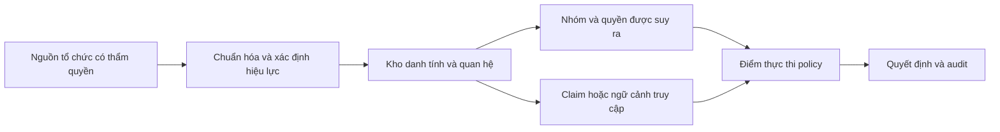

# Department attribute — thuộc tính phòng ban trong IAM

Một ứng dụng cho phép nhân viên xem tài liệu nội bộ của phòng mình bằng điều kiện `user.department == document.department`. Điều kiện ngắn gọn này che giấu nhiều câu hỏi: phòng ban do ai xác nhận, hai giá trị có cùng hệ định danh không, người kiêm nhiệm thuộc phòng nào, và quyền cũ mất lúc nào khi nhân viên chuyển bộ phận?

**Department attribute** là thuộc tính mô tả phòng ban mà một danh tính có quan hệ tổ chức với nó. Trong hệ thống đơn giản, thuộc tính có thể là một chuỗi như `Finance`. Trong IAM, khi thuộc tính tham gia quyết định cấp quyền, cần quản lý cả ý nghĩa, nguồn dữ liệu, phạm vi tổ chức và thời gian hiệu lực của quan hệ đó.

Bài học xem phòng ban như một đầu vào của quản lý danh tính và quyền truy cập. Từ đầu vào này, hệ thống có thể xây dựng chính sách ABAC, phân công quyền nền theo tổ chức và điều chỉnh quyền trong vòng đời nhân sự. Thuộc tính phòng ban không tự tạo ra quyền nghiệp vụ hoặc đặc quyền quản trị.

## 1. Mục tiêu và phạm vi

Sau bài học, bạn có thể:

- Phân biệt phòng ban với chức danh, vai trò truy cập, nhóm, người quản lý và trung tâm chi phí.
- Thiết kế định danh phòng ban ổn định, có phạm vi tenant hoặc tổ chức rõ ràng.
- Xác định nguồn có thẩm quyền và ai được phép thay đổi thuộc tính dùng cho phân quyền.
- Giải thích cách trao đổi thông tin phòng ban qua SCIM và claim tùy chỉnh.
- Kết hợp phòng ban với quyền hành động, trạng thái danh tính và thuộc tính tài nguyên.
- Phân tích chuyển phòng ban, kiêm nhiệm, tái cơ cấu và dữ liệu chưa đồng bộ.

Các ví dụ giả định người đọc đã biết sự khác nhau giữa xác thực và phân quyền. `tenant-a`, `dep-finance`, `user-an` và những mốc thời gian trong bài là dữ liệu minh họa, không đại diện cho tài khoản hoặc tổ chức thực.

## 2. Department mô tả điều gì?

### 2.1. Một quan hệ tổ chức, không chỉ một nhãn trên hồ sơ

Giả sử hồ sơ của An hiển thị:

```text
Nhân viên: An
Phòng ban chính: Tài chính
Chức danh: Chuyên viên phân tích
Người quản lý: Bình
Trung tâm chi phí: CC-120
```

Department trả lời An được xếp vào đơn vị phòng ban nào theo mô hình của tổ chức. Nó không trực tiếp trả lời An được duyệt chi, xem lương hay quản trị tài khoản hay không.

Một người thuộc phòng Tài chính có thể chỉ được đọc tài liệu hướng dẫn chung; người khác được xử lý hóa đơn; một số ít được phê duyệt khoản chi trong giới hạn. Những quyền đó cần chính sách hoặc entitlement tương ứng.

Nếu hệ thống có nhiều loại quan hệ, phải đặt tên rõ: phòng ban nhân sự chính thức, phòng ban của vị trí kiêm nhiệm, đơn vị chủ quản dự án hay đơn vị bảo trợ tài khoản nhà thầu. Không gộp tất cả vào một chuỗi `department` rồi để mỗi ứng dụng tự diễn giải khác nhau.

### 2.2. Phân biệt các khái niệm dễ bị dùng thay thế

| Khái niệm | Ý nghĩa chính | Vì sao không đồng nghĩa với department |
| --- | --- | --- |
| Department | Đơn vị phòng ban theo cấu trúc tổ chức | Là dữ liệu quan hệ tổ chức |
| Job title | Chức danh hoặc tên công việc | Cùng chức danh có thể ở nhiều phòng |
| Access role | Gói quyền theo chức năng | Một phòng thường có nhiều mức quyền |
| Group | Tập hợp thành viên | Có thể phục vụ dự án, thông báo hoặc cấp quyền |
| Manager | Quan hệ quản lý giữa các danh tính | Quản lý không nhất thiết trùng ranh giới phòng |
| Cost center | Đơn vị hạch toán chi phí | Có thể gom hoặc chia khác cơ cấu nhân sự |
| Division | Cấp đơn vị theo mô hình doanh nghiệp | Không có một quan hệ cấp bậc giống nhau cho mọi tổ chức |
| Tenant | Miền tổ chức hoặc khách hàng của ứng dụng | Nhiều tenant có thể cùng tên phòng ban |

Ví dụ, nhóm `invoice-approvers` có thể có thành viên từ Tài chính và Vận hành. Department giúp xác định một phần phạm vi, còn nhóm hoặc entitlement phê duyệt xác định khả năng thực hiện hành động.

### 2.3. Mục đích sử dụng quyết định mức tin cậy cần có

Một trường phòng ban dùng để tìm đồng nghiệp có yêu cầu khác với trường dùng để mở kho tài liệu nhạy cảm. Trước khi đưa thuộc tính vào policy, cần biết:

1. Thuộc tính chỉ phục vụ hiển thị hay còn quyết định quyền?
2. Quyết định nào sẽ thay đổi khi giá trị này thay đổi?
3. Sai hoặc chậm cập nhật có thể mở quyền cho ai?
4. Hệ thống có biết giá trị đang dùng còn hiệu lực không?

Việc một trường đã tồn tại trong directory không tự chứng minh nó đủ đáng tin cậy cho mọi quyết định bảo mật.

## 3. Định danh phòng ban và tên hiển thị

### 3.1. Tránh dùng tên làm khóa chính sách

Những chuỗi sau có thể nói về cùng một phòng, nhưng cũng có thể là các đơn vị khác nhau:

```text
Finance
FINANCE
Tài chính
Finance Operations
Finance - North
```

Chỉ chuyển chữ thường và loại khoảng trắng không giải quyết được sự khác nhau về ý nghĩa. Hai công ty đều có `Finance`; một công ty cũng có thể có hai phòng tên Tài chính ở hai pháp nhân hoặc hai đơn vị thành viên.

Một mô hình phòng ban nội bộ có thể là:

```json
{
  "tenantId": "tenant-a",
  "departmentId": "dep-1042",
  "departmentCode": "FIN",
  "displayName": "Tài chính",
  "parentDepartmentId": "dep-corporate",
  "status": "active"
}
```

Đây là schema ứng dụng minh họa. `departmentId` là định danh ổn định trong tenant; `displayName` phục vụ con người; `departmentCode` có thể theo quy tắc nghiệp vụ. Không giả định code là bất biến hoặc duy nhất toàn cầu nếu nguồn tổ chức không cam kết điều đó.

Policy nên so sánh định danh chuẩn trong phạm vi tương ứng. Đổi tên Tài chính thành Tài chính doanh nghiệp không nên tự động làm mất hoặc mở rộng quyền khi thực thể phòng ban vẫn là thực thể cũ.

### 3.2. Phạm vi tenant phải đi cùng định danh

Một khóa so sánh an toàn về mặt mô hình có thể là cặp:

```text
(tenantId, departmentId)
```

Đừng chỉ so sánh `departmentId` nếu hệ thống cho phép cùng mã xuất hiện trong nhiều tenant. Cũng không nên bỏ kiểm tra tenant vì hiện tại mọi ID đang là UUID; tính khó trùng của ID không thay thế ý nghĩa ranh giới tổ chức trong policy.

Khi tiếp nhận danh tính liên kết, nguồn phát hành thuộc tổ chức nào và phép ánh xạ vào tenant nào phải được xác định trước. Claim `department=Finance` từ một nhà cung cấp danh tính đối tác không tự tương đương với `dep-1042` của doanh nghiệp mình.

### 3.3. Ánh xạ dữ liệu bên ngoài

Nếu nguồn chỉ gửi tên, cần một quy tắc ánh xạ có chủ sở hữu, chẳng hạn:

| Nguồn và tổ chức | Giá trị nguồn | Định danh chuẩn |
| --- | --- | --- |
| HR-A, công ty A | `Finance` | `tenant-a/dep-1042` |
| HR-A, công ty A | `Tài chính` | `tenant-a/dep-1042` |
| HR-B, công ty B | `Finance` | `tenant-b/dep-7780` |

Giá trị chưa biết hoặc ánh xạ đến nhiều phòng phải được đánh dấu chưa giải quyết. Không tự đoán theo chuỗi gần giống khi kết quả có thể cấp quyền.

Danh sách alias phục vụ tương thích cần được quản lý khi phòng đổi tên hoặc tái cơ cấu. Một alias cũ không nên được tái sử dụng cho phòng mới nếu điều đó làm các bản ghi cũ bị hiểu sang thực thể khác.

## 4. Mô hình một người thuộc nhiều phòng ban

### 4.1. Primary department không biểu diễn mọi phạm vi công việc

Một người có thể có phòng ban chính để báo cáo nhân sự và có vị trí kiêm nhiệm trong đơn vị khác. Chọn giá trị đầu tiên trong danh sách hoặc ghép thành chuỗi `Finance, Risk` sẽ khiến policy khó xác định quan hệ nào được dùng cho hành động nào.

Một mô hình quan hệ có thời gian hiệu lực rõ hơn:

```json
{
  "subjectId": "user-an",
  "tenantId": "tenant-a",
  "primaryDepartmentId": "dep-1042",
  "assignments": [
    {
      "assignmentId": "assignment-901",
      "departmentId": "dep-1042",
      "kind": "primary-employment",
      "validFrom": "2026-01-05T02:00:00Z",
      "validUntil": null,
      "source": "hr-a"
    },
    {
      "assignmentId": "assignment-902",
      "departmentId": "dep-2088",
      "kind": "approved-secondment",
      "validFrom": "2026-11-01T02:00:00Z",
      "validUntil": "2026-12-01T02:00:00Z",
      "source": "approved-assignment-workflow"
    }
  ]
}
```

`null` ở `validUntil` trong schema minh họa có nghĩa chưa ấn định thời điểm kết thúc, không có nghĩa bỏ qua khả năng thu hồi. Những trường này là lựa chọn của mô hình nội bộ, không phải các trường department chuẩn của SCIM.

### 4.2. Quan hệ tổ chức nào được dùng để cấp quyền?

Không phải mọi assignment đều được phép mở cùng một loại dữ liệu. Một đợt hỗ trợ dự án có thể chỉ cấp quyền đọc tài liệu dự án, không cấp quyền đọc dữ liệu nhân sự của phòng tiếp nhận.

Tầng tạo ngữ cảnh phân quyền cần chọn các quan hệ được policy cụ thể chấp nhận. Ví dụ, tập `authorizedDepartmentIds` có thể được xây dựng từ vị trí chính và các vị trí kiêm nhiệm đã phê duyệt cho loại tài liệu tương ứng.

Tên tập này chỉ có ý nghĩa khi hợp đồng tạo dữ liệu được quản lý. Không đổi tên một danh sách tự khai thành `authorizedDepartmentIds` rồi xem nó là đáng tin cậy.

### 4.3. Cấu trúc cha con không mặc nhiên truyền quyền

Nếu phòng Risk nằm trong khối Corporate, thành viên của Corporate chưa chắc được đọc mọi tài liệu của Risk. Chiều ngược lại cũng không tự động đúng.

Chính sách có thể cho phép quyền theo cây tổ chức, nhưng phải nêu rõ chiều kế thừa, loại tài nguyên, hành động và các nhánh ngoại lệ. Khi cây tổ chức thay đổi, những quyền suy ra từ cây cũng phải được tính lại.

Đường dẫn như `Corporate/Finance/Payroll` thuận tiện để hiển thị, nhưng dùng nó làm ID sẽ khiến việc di chuyển một nhánh thay đổi định danh hàng loạt. Nên quản lý quan hệ cha con tách khỏi định danh của từng đơn vị.

## 5. Nguồn có thẩm quyền và quyền sửa thuộc tính

### 5.1. Phân quyền cho người ghi dữ liệu phòng ban

Nguồn có thẩm quyền có thể là hệ thống nhân sự, danh mục tổ chức đã phê duyệt hoặc quy trình quản lý đối tác. Lựa chọn tùy loại danh tính và mô hình doanh nghiệp, không phải mọi tài khoản đều đi qua cùng một nguồn HR.

Cần xác định riêng:

- Ai định nghĩa và tạo thực thể phòng ban.
- Ai xác nhận quan hệ của người dùng với phòng ban.
- Ai được sửa phép ánh xạ giữa nguồn ngoài và ID nội bộ.
- Ai được phê duyệt ngoại lệ truy cập vượt ranh giới phòng.

Nếu người dùng tự sửa `department` trên màn hình hồ sơ và trường đó quyết định quyền, việc sửa hồ sơ có thể trở thành đường tự cấp quyền. Trường tự khai để hiển thị nên được phân biệt với thuộc tính đã xác minh dùng cho policy.

### 5.2. Không dùng last-writer-wins một cách mù quáng

Một ứng dụng downstream sửa tên phòng rồi đồng bộ ngược lên directory có thể ghi đè thông tin HR. Hai connector cùng ghi còn có thể tạo vòng lặp, mỗi bên liên tục sửa dữ liệu của bên kia.

Nên có hợp đồng theo từng field: nguồn nào làm chủ, nguồn nào chỉ đọc, trường nào là override có thời hạn và cách giải quyết xung đột. Tài khoản provisioning chỉ được sửa thuộc tính và đối tượng nằm trong phạm vi được cấp.

Một bản ghi provenance hữu ích có thể lưu `sourceSystem`, ID bản ghi nguồn, phiên bản nguồn, thời điểm hiệu lực và thời điểm xác nhận dữ liệu. Việc kết nối được bảo vệ không tự chứng minh dữ liệu nguồn đã phản ánh thay đổi nhân sự mới nhất.

### 5.3. Phân biệt các thời điểm

| Mốc thời gian | Câu hỏi nó trả lời |
| --- | --- |
| `effectiveAt` | Thay đổi có hiệu lực nghiệp vụ từ lúc nào? |
| `receivedAt` | Hệ thống nhận thông điệp từ lúc nào? |
| `sourceConfirmedAt` | Dữ liệu đã được nguồn có thẩm quyền xác nhận gần nhất lúc nào? |
| `snapshotCreatedAt` | Bản ngữ cảnh hoặc bản sao hiện tại được tạo lúc nào? |
| `validUntil` | Ngữ cảnh hoặc quan hệ này được chấp nhận đến lúc nào? |

Đọc lại một bản directory cũ vào thời điểm mới không làm dữ liệu HR trong đó trở nên mới. Không được đặt lại `sourceConfirmedAt` chỉ vì cache vừa được làm mới từ một bản sao chưa đồng bộ.

## 6. Department trong SCIM và OpenID Connect

### 6.1. Trường department của SCIM Enterprise User

SCIM định nghĩa `department` trong enterprise extension của User với schema URI:

```text
urn:ietf:params:scim:schemas:extension:enterprise:2.0:User
```

Một resource minh họa:

```json
{
  "schemas": [
    "urn:ietf:params:scim:schemas:core:2.0:User",
    "urn:ietf:params:scim:schemas:extension:enterprise:2.0:User"
  ],
  "id": "scim-user-901",
  "userName": "an@example.com",
  "active": true,
  "urn:ietf:params:scim:schemas:extension:enterprise:2.0:User": {
    "employeeNumber": "E-901",
    "organization": "Example A",
    "division": "Corporate Services",
    "department": "Finance",
    "costCenter": "CC-120"
  }
}
```

Trong schema chuẩn này, `department` là một chuỗi đơn trị, không bắt buộc, mô tả tên phòng ban và không có ràng buộc duy nhất. Nó không tự biểu diễn nhiều assignment hoặc ID phòng ban ổn định. [Nguồn: RFC 7643, Enterprise User và enterprise schema](https://www.rfc-editor.org/rfc/rfc7643.html#section-4.3).

Khi cần nhiều quan hệ hoặc mã phòng ban, hai phía phải thống nhất extension hoặc mô hình trao đổi khác. Không tự thay giá trị chuỗi chuẩn thành mảng đối tượng rồi kỳ vọng mọi connector hiểu được.

Schema mô tả field có thể ghi không có nghĩa mọi người dùng đều được quyền sửa nó. Service provider vẫn phải kiểm soát caller nào được thay đổi thuộc tính và việc thay đổi có được đưa vào luồng phân quyền hay không.

### 6.2. Ví dụ cập nhật bằng SCIM PATCH

```http
PATCH /scim/v2/Users/scim-user-901 HTTP/1.1
Host: iam.example.com
Authorization: Bearer <provisioning-access-token>
Content-Type: application/scim+json
If-Match: W/"user-version-73"

{
  "schemas": ["urn:ietf:params:scim:api:messages:2.0:PatchOp"],
  "Operations": [
    {
      "op": "replace",
      "path": "urn:ietf:params:scim:schemas:extension:enterprise:2.0:User:department",
      "value": "Risk"
    }
  ]
}
```

Request này minh họa thay tên phòng được trao đổi; nó không tự chứng minh quyền đã được thu hồi ở mọi ứng dụng. Header `If-Match` chỉ có ý nghĩa khi server hỗ trợ versioning/ETag và giá trị đến từ resource đã đọc. Khi precondition không còn đúng, connector phải xử lý xung đột thay vì ghi đè bằng dữ liệu cũ. [Nguồn: RFC 7644, PATCH và Versioning Resources](https://www.rfc-editor.org/rfc/rfc7644.html#section-3.5.2).

ETag là phiên bản để kiểm soát cập nhật resource, không phải timestamp đảm bảo nguồn HR đã được đồng bộ. Cập nhật field department cũng không đồng nghĩa các group suy ra, cache hay phiên đang hoạt động đã thay đổi theo.

### 6.3. Department không phải Standard Claim của OIDC Core

Danh sách Standard Claims của OpenID Connect Core không định nghĩa claim `department`. Hai hệ thống muốn trao đổi thông tin này phải thống nhất claim mở rộng, ý nghĩa và quy tắc tin cậy; đặc tả khuyến nghị tên claim chống xung đột khi dùng claim bổ sung. [Nguồn: OpenID Connect Core, Standard Claims và Additional Claims](https://openid.net/specs/openid-connect-core-1_0.html#AdditionalClaims).

Ví dụ một phần claim tùy chỉnh theo hợp đồng nội bộ:

```json
{
  "https://iam.example.com/claims/tenant_id": "tenant-a",
  "https://iam.example.com/claims/department_ids": ["dep-1042"],
  "https://iam.example.com/claims/identity_version": 74
}
```

Đây không phải token hoàn chỉnh hoặc claim chuẩn dùng chung cho mọi nhà cung cấp. ID token phục vụ client xác minh thông tin đăng nhập; không lấy nó làm access token cho một API chỉ vì bên trong có claim phòng ban. API cần xác minh loại token, nguồn phát hành, đối tượng nhận, thời hạn và quyền theo hợp đồng của nó.

Chữ ký hợp lệ chứng minh claim đến từ bên phát hành và chưa bị sửa theo cơ chế xác minh tương ứng; nó không chứng minh nhân viên chưa chuyển phòng kể từ lúc token được cấp. Dữ liệu đã ký vẫn có thể cũ.

## 7. Dùng department trong chính sách phân quyền

### 7.1. Kết hợp thuộc tính chủ thể và tài nguyên

Trong ABAC, quyền được đánh giá từ thuộc tính chủ thể, tài nguyên, thao tác và điều kiện môi trường theo policy. Department thường là một thuộc tính chủ thể và cũng có thể là thuộc tính sở hữu của tài nguyên. [Nguồn: NIST SP 800-162](https://csrc.nist.gov/pubs/sp/800/162/upd2/final).

Ví dụ chính sách đọc tài liệu nội bộ phòng ban:

```text
permit(subject, "document:read", document, context) =
    subject đã được xác thực và đang hoạt động
    AND subject.tenantId == document.tenantId
    AND có quyền "department-document:read" trong tenant đang xét
    AND dữ liệu quan hệ phòng ban đủ tin cậy và còn hiệu lực
    AND document.departmentId thuộc subject.authorizedDepartmentIds
    AND document.classification == "department-internal"
```

Policy giới hạn một loại tài liệu cụ thể. Tài liệu lương hoặc hồ sơ điều tra có phân loại khác không được đọc chỉ vì cùng phòng. Quyền ghi, duyệt, chia sẻ hoặc xuất hàng loạt cần các quyết định riêng.

### 7.2. Department phía tài nguyên cũng phải đáng tin cậy

Nếu người tạo tài liệu được tự đổi `document.departmentId`, họ có thể đưa tài liệu vào một phạm vi mà người nhận không được phép thấy, hoặc làm người khác mất quyền. Việc chuyển tài nguyên giữa các phòng là thao tác thay đổi phạm vi truy cập, cần quyền riêng và audit phù hợp.

Không nhất thiết gắn tài liệu với phòng hiện tại của tác giả bằng một phép join động. Khi tác giả chuyển từ Tài chính sang Risk, tài liệu tài chính cũ không nên tự chuyển sang Risk nếu nghiệp vụ không yêu cầu điều đó.

Nên xác định rõ tài nguyên được sở hữu bởi phòng nào, ở thời điểm nào và ai có quyền chuyển quyền quản lý. Thuộc tính phòng ban của chủ thể và thuộc tính phòng ban của tài nguyên có vòng đời khác nhau.

### 7.3. Ngoại lệ phải có phạm vi riêng

Nhân viên kiểm toán có thể được đọc tài liệu của nhiều phòng trong một đợt kiểm tra. Quan hệ hỗ trợ này không nhất thiết phải được mô hình hóa bằng cách sửa phòng ban nhân sự của họ.

Có thể dùng một quyền hoặc quan hệ được phê duyệt riêng, gồm danh sách tài nguyên/phòng, hành động và thời hạn. Policy khi đó kết hợp phạm vi thường lệ và ngoại lệ, trong khi vẫn giữ tenant và các điều kiện bảo mật bắt buộc.

Quản lý của một phòng cũng không mặc nhiên có đặc quyền mọi hành động. Quyền phê duyệt cần xét loại giao dịch, giới hạn giá trị và quy tắc tách biệt nhiệm vụ, chẳng hạn không tự phê duyệt đề nghị do mình tạo.

## 8. Ví dụ Java: đánh giá quyền đọc tài liệu phòng ban

Ví dụ sau nhận snapshot do tầng IAM đáng tin cậy tạo. `departmentIds` chỉ chứa các quan hệ hiện hành được policy tài liệu này chấp nhận. `permissions` đã được tính cho đúng `tenantId`. Không bind những record này trực tiếp từ payload do client gửi.

`sourceConfirmedAt` phản ánh thời điểm dữ liệu được xác nhận theo hợp đồng nguồn, còn `validUntil` giới hạn thời gian dùng snapshot. Nếu đã biết một lần chuyển phòng trong tương lai, thời hạn snapshot cần kết thúc không muộn hơn thời điểm thay đổi liên quan đó.

```java
import java.time.Duration;
import java.time.Instant;
import java.util.Objects;
import java.util.Set;

public final class DepartmentDocumentPolicy {
    public enum Effect { PERMIT, DENY, INDETERMINATE }

    public record Decision(Effect effect, String reason) {}

    public record IdentitySnapshot(
            String subjectId,
            String tenantId,
            boolean active,
            Set<String> permissions,
            Set<String> departmentIds,
            Instant sourceConfirmedAt,
            Instant validUntil) {
        public IdentitySnapshot {
            Objects.requireNonNull(subjectId);
            Objects.requireNonNull(tenantId);
            permissions = Set.copyOf(permissions);
            departmentIds = Set.copyOf(departmentIds);
            Objects.requireNonNull(sourceConfirmedAt);
            Objects.requireNonNull(validUntil);
        }
    }

    public record Document(
            String tenantId,
            String departmentId,
            String classification) {
        public Document {
            Objects.requireNonNull(tenantId);
            Objects.requireNonNull(departmentId);
            Objects.requireNonNull(classification);
        }
    }

    public static Decision mayRead(
            IdentitySnapshot subject,
            Document document,
            Instant now,
            Duration maxAttributeAge) {
        if (subject == null || document == null || now == null
                || maxAttributeAge == null
                || maxAttributeAge.isNegative()
                || maxAttributeAge.isZero()) {
            return new Decision(Effect.INDETERMINATE, "INVALID_CONTEXT");
        }

        if (!subject.active()) {
            return new Decision(Effect.DENY, "SUBJECT_INACTIVE");
        }

        if (now.isBefore(subject.sourceConfirmedAt())
                || !now.isBefore(subject.validUntil())
                || !now.isBefore(
                    subject.sourceConfirmedAt().plus(maxAttributeAge))) {
            return new Decision(Effect.INDETERMINATE, "ATTRIBUTES_NOT_CURRENT");
        }

        if (!subject.tenantId().equals(document.tenantId())) {
            return new Decision(Effect.DENY, "TENANT_MISMATCH");
        }

        if (!subject.permissions().contains("department-document:read")) {
            return new Decision(Effect.DENY, "MISSING_ACTION_PERMISSION");
        }

        if (!"department-internal".equals(document.classification())) {
            return new Decision(Effect.DENY, "CLASSIFICATION_OUT_OF_SCOPE");
        }

        if (!subject.departmentIds().contains(document.departmentId())) {
            return new Decision(Effect.DENY, "DEPARTMENT_MISMATCH");
        }

        return new Decision(Effect.PERMIT, "DEPARTMENT_READ_ALLOWED");
    }
}
```

Đây là minh họa cho một policy, không phải toàn bộ hệ thống xác thực, kiểm chứng nguồn hoặc truy xuất tài liệu. Record và constructor không tự tạo sự tin cậy; tầng gọi phải kiểm tra định dạng ID, hợp đồng nguồn, trạng thái quan hệ và nguồn token trước khi tạo snapshot.

Điểm thực thi chỉ trả dữ liệu khi `effect == PERMIT`. `DENY` nghĩa điều kiện không cho phép; `INDETERMINATE` nghĩa không có đủ dữ liệu đáng tin cậy để quyết định cho phép. Cả hai đều không mở quyền, nhưng phân biệt lý do giúp xử lý sự cố đồng bộ hoặc ngữ cảnh bị lỗi.

`maxAttributeAge` là cấu hình theo yêu cầu của ứng dụng và hành động, không có một giá trị mặc định phù hợp mọi hệ thống. Đặt thời hạn ngắn hơn chỉ có ý nghĩa khi dữ liệu được xác nhận thực sự từ nguồn phù hợp; không dùng thời điểm vừa đọc cache làm bằng chứng nguồn đã mới.

Ví dụ chỉ đánh giá đọc tài liệu. Không dùng nguyên kết quả này để cho phép sửa, tải toàn kho, quản lý thành viên hoặc thực hiện đặc quyền quản trị.

## 9. Department trong vòng đời joiner, mover, leaver

### 9.1. Joiner — người mới

Ở thời điểm tạo tài khoản, thông tin phòng ban có thể chưa đầy đủ. Hệ thống cần phân biệt dữ liệu đang chờ xác nhận với một tập quan hệ đã được xác nhận là rỗng.

Không chọn phòng mặc định có quyền rộng chỉ để việc provisioning không bị lỗi. Có thể cho người dùng truy cập chức năng chung đã được cấp độc lập, trong khi quyền phụ thuộc phòng ban chờ nguồn có thẩm quyền xác nhận.

Khi quan hệ được kích hoạt, chỉ cấp các quyền nền đã được phê duyệt cho quan hệ ấy. Quyền quản trị, phê duyệt giá trị cao hoặc truy cập hồ sơ nhạy cảm có thể cần quy trình bổ sung.

### 9.2. Mover — chuyển phòng ban

Giả sử An chuyển từ `dep-1042` sang `dep-2088` tại thời điểm T. Một quy trình cần xử lý cả cấp quyền mới và thu hồi quyền cũ:

| Thời điểm | Trạng thái cần quản lý |
| --- | --- |
| Trước T | Quan hệ cũ còn hiệu lực; quan hệ mới có thể đang chờ |
| T có hiệu lực | Quan hệ cũ kết thúc, quan hệ mới bắt đầu theo quyết định đã duyệt |
| Sau T | Policy, nhóm suy ra, cache và ứng dụng nhận thay đổi |
| Sau khoảng lan truyền cho phép | Quyền cũ không còn được chấp nhận ở những điểm thực thi liên quan |

Không tự cấp cả hai phạm vi để tránh gián đoạn nếu chưa có quy tắc chồng lấn được phê duyệt. Nếu cần giai đoạn bàn giao, biểu diễn nó bằng quan hệ hoặc quyền bổ sung có ngày kết thúc.

Một yêu cầu thu hồi quyền phải xét đường truy cập thực tế: nhóm được tạo tự động, quyền được gán trực tiếp, quyền trong SaaS, vai trò cloud, phiên, cache quyền và công việc chạy nền. Đổi chuỗi department trong directory chưa đủ để hoàn tất mover.

### 9.3. Leaver — nghỉ việc hoặc kết thúc hợp tác

Xóa department khỏi hồ sơ không thay thế việc vô hiệu hóa danh tính và thu hồi khả năng sử dụng hệ thống. Policy cần kiểm tra trạng thái danh tính độc lập với quan hệ phòng ban.

Quan hệ phòng ban cũ có thể được giữ trong lịch sử để phục vụ giải thích dữ liệu hoặc audit. Lịch sử đó không được trộn vào tập quan hệ hiện hành khi tính quyền.

### 9.4. Tái cơ cấu phòng ban

Đổi tên, sáp nhập, chia tách và giải thể có tác động khác nhau. Đổi tên cùng thực thể thường giữ ID; sáp nhập hoặc chia tách cần quyết định về thực thể tiếp nhận, tài nguyên và quyền tương ứng.

Không mặc định mọi thành viên của hai phòng sáp nhập được đọc toàn bộ dữ liệu cũ của nhau. Việc chuyển người và chuyển tài nguyên là hai quá trình có thể cần các quyết định riêng.

Khi phòng bị giải thể, cần đóng khả năng cấp mới, giải quyết các assignment còn hiệu lực và đánh giá các policy còn tham chiếu ID cũ. Không tái sử dụng ID phòng đã đóng cho một đơn vị mới để tránh hiểu nhầm lịch sử và quyền tồn dư.

## 10. Đồng bộ, token cũ và thời gian thu hồi quyền

### 10.1. Một chuỗi thay đổi có nhiều điểm trễ



An có thể đã chuyển phòng trong HR nhưng directory chưa nhận; directory đã nhận nhưng token cũ còn được API chấp nhận; token mới đã đúng nhưng quyền gán trực tiếp ở ứng dụng khác chưa được thu hồi.

Vì vậy thời hạn token không phải toàn bộ thời gian thu hồi. Một token vừa được cấp từ directory cũ vẫn có thể mang department cũ. Nếu muốn cam kết thời gian thu hồi, phải quản lý độ trễ phát hiện ở nguồn, độ trễ lan truyền và thời gian các điểm thực thi còn chấp nhận trạng thái cũ.

### 10.2. Lựa chọn cơ chế theo loại hành động

| Cơ chế | Hỗ trợ điều gì? | Giới hạn phải biết |
| --- | --- | --- |
| Token có thời hạn ngắn | Giới hạn thời gian chấp nhận một snapshot token | Không sửa dữ liệu nguồn đang cũ |
| Đọc thuộc tính hiện hành khi quyết định | Có thể phản ánh thay đổi gần điểm thực thi | Phụ thuộc khả năng sẵn sàng và độ mới của nguồn |
| Version danh tính/quyền | Phát hiện snapshot cũ khi đối chiếu phiên bản hiện hành | Version trong token đơn độc không tự kiểm tra được |
| Event làm mất hiệu lực cache | Giảm thời gian dùng quyết định hoặc dữ liệu cũ | Cần xử lý mất sự kiện, trùng lặp và sai thứ tự |
| Đối soát định kỳ | Phát hiện chênh lệch giữa nguồn và đích | Không tự đáp ứng thu hồi tức thời |

Một ứng dụng có thể kết hợp các cơ chế. Hành động đọc tài liệu chung và hành động quản trị có thể cần mức độ mới khác nhau, nhưng cách xử lý khi dữ liệu không đủ tin cậy phải được xác định trước.

Nếu nguồn thuộc tính không truy cập được, không tự coi chủ thể thuộc mọi phòng. Với chức năng phụ thuộc department, có thể từ chối hoặc sử dụng một snapshot còn trong giới hạn đã được phê duyệt; lựa chọn đó phải là một phần của policy và yêu cầu vận hành.

### 10.3. Idempotency, thứ tự sự kiện và hiệu lực tương lai

Connector cần nhận diện một thay đổi đã xử lý để không cấp hoặc thu hồi lặp ngoài ý muốn. Một sự kiện cũ đến muộn không được ghi đè trạng thái mới chỉ vì nó được nhận sau.

Phiên bản cần có phạm vi rõ, chẳng hạn theo bản ghi nguồn hoặc theo luồng thay đổi của subject. Không so sánh hai số version từ hai hệ thống độc lập rồi kết luận số lớn hơn luôn mới hơn.

Sự kiện có thời điểm hiệu lực tương lai cần được lưu và áp dụng đúng thời điểm. “Đã nhận thay đổi” khác với “đã bắt đầu cấp quyền”. Cũng cần đối soát để phát hiện trường hợp lịch thay đổi bị hủy hoặc điều chỉnh.

Đối soát phải kiểm tra giá trị thực tế ở đích và những quyền suy ra liên quan. Một lần gửi SCIM thành công về mặt HTTP không chứng minh mọi cơ chế phân quyền downstream đã hoàn tất.

## 11. Group và role suy ra từ department

### 11.1. Theo dõi lý do cấp quyền

Một quy tắc có thể nói thành viên của `dep-1042` được vào nhóm tài liệu nội bộ Tài chính. Khi quan hệ phòng ban kết thúc, IAM cần biết membership nào do quy tắc đó tạo ra để thu hồi đúng.

Một bản ghi lý do cấp quyền có thể gồm:

```text
subject: user-an
entitlement: finance-internal-documents
grantSource: department-rule
ruleId: dept-docs-v3
assignmentId: assignment-901
validUntil: thời điểm kết thúc hiệu lực được xác định
```

Nếu cùng entitlement còn được cấp từ một nhiệm vụ đặc biệt đã phê duyệt, việc thu hồi phải xét mô hình kết hợp các lý do cấp. Không xóa bừa mọi quyền trùng tên, nhưng cũng không giữ mãi quyền cũ chỉ vì hệ thống không còn biết nó đến từ đâu.

### 11.2. Tránh coi cùng phòng là vai trò đặc quyền

Quy tắc `department == IT => system-admin` mở quyền quá rộng nếu không có quy trình bổ sung. Cùng làm việc trong bộ phận kỹ thuật không chứng minh cần đặc quyền quản trị cho mọi hệ thống.

Department phù hợp để cung cấp ngữ cảnh, giới hạn phạm vi hoặc làm một điều kiện đủ nhỏ trong quy trình cấp quyền. Những đặc quyền mạnh cần chủ sở hữu, lý do nghiệp vụ, thời hạn và cơ chế phê duyệt phù hợp với rủi ro của hành động.

## 12. Danh tính bên ngoài và workload

### 12.1. Nhà thầu và đối tác

Một nhà thầu không có phòng ban trong HR nhân viên có thể có đơn vị bảo trợ hoặc assignment hợp tác được quản lý riêng. Không gán họ vào phòng nội bộ chỉ để khớp một rule cấp quyền nếu quan hệ thực tế khác.

Nếu đối tác gửi department qua liên kết danh tính, cần kiểm soát nguồn nào được phép xác nhận loại quan hệ nào. Tên phòng ở tổ chức đối tác không tự làm phát sinh quyền trong tenant nội bộ.

### 12.2. Workload không có phòng ban nhân sự theo cùng nghĩa

Một service account có thể có đơn vị sở hữu chịu trách nhiệm vận hành. Thuộc tính `owningDepartmentId` giúp quản trị vòng đời, liên hệ và audit, nhưng không nên tự kế thừa mọi quyền của nhân viên trong phòng ấy.

Quyền của workload cần xuất phát từ công việc dịch vụ được phép làm, tài nguyên và tenant/phạm vi tương ứng. Khi chủ sở hữu dịch vụ chuyển phòng, hệ thống phải xác định lại trách nhiệm quản trị; không tự mở rộng quyền chạy của dịch vụ theo mọi assignment của người quản lý mới.

## 13. Audit, quyền riêng tư và ma trận thực hành

### 13.1. Giải thích được quyết định

Một quyết định truy cập có thể lưu subject, tenant, hành động, tài nguyên, ID phòng liên quan, nguồn/phiên bản thuộc tính, phiên bản policy, kết quả và thời điểm đánh giá. Những dữ liệu này giúp trả lời tại sao An được đọc tài liệu ở thời điểm cụ thể.

Không cần ghi toàn bộ hồ sơ nhân sự hoặc token vào log để giải thích một phép so sánh phòng ban. Tên phòng và quan hệ tổ chức có thể là thông tin cần giới hạn phân phối; chỉ đưa claim cần thiết cho ứng dụng nhận và kiểm soát quyền xem log.

Lịch sử cần cho điều tra hoặc báo cáo không có nghĩa ứng dụng thông thường được quyền đọc mọi assignment trong quá khứ. Phạm vi lưu trữ và truy cập lịch sử phải theo mục đích sử dụng đã xác định.

### 13.2. Ma trận tình huống

Giả sử tài liệu D1 thuộc `tenant-a/dep-1042`, có phân loại `department-internal`. Các tình huống dưới là kỳ vọng để người học tự kiểm chứng với policy minh họa, không phải báo cáo rằng hệ thống thực đã được kiểm thử.

| Tình huống | Kết quả mong đợi | Ý nghĩa |
| --- | --- | --- |
| An cùng tenant, quan hệ đúng phòng, có quyền đọc, snapshot hợp lệ | Cho phép | Đủ các điều kiện áp dụng |
| An đúng phòng nhưng thiếu quyền hành động | Từ chối | Department không thay entitlement |
| An cùng tenant nhưng chỉ thuộc phòng khác | Từ chối | Kiểm tra phạm vi phòng |
| Một người ở tenant B có cùng tên phòng Finance | Từ chối | Tên trùng không vượt tenant |
| Tài liệu D1 đổi phân loại sang loại hạn chế khác | Policy này từ chối | Quyền cùng phòng không bao phủ mọi dữ liệu |
| Department tự khai từ form hồ sơ | Không dùng để cấp quyền | Kiểm tra nguồn có thẩm quyền |
| Quan hệ kiêm nhiệm chưa tới ngày bắt đầu | Chưa cấp phạm vi mới | Hiệu lực nghiệp vụ khác thời điểm nhận |
| Quan hệ kiêm nhiệm đã hết hạn | Không còn trong tập phòng được phép | Thu hồi theo thời gian |
| Phòng đổi tên nhưng giữ cùng ID và quan hệ | Phạm vi không đổi chỉ vì nhãn mới | Tách tên và định danh |
| Snapshot quá giới hạn độ mới | Không cho phép từ snapshot đó | Tránh dùng thuộc tính cũ |
| Token còn hạn sau khi nhân viên chuyển phòng | Đánh giá theo cơ chế thu hồi đã thiết kế | Thời hạn token chưa đủ chứng minh quan hệ hiện hành |
| Tài khoản bị vô hiệu hóa nhưng còn department | Từ chối | Trạng thái danh tính kiểm tra riêng |
| Bản ghi nguồn thiếu department do lỗi đồng bộ | Không tự cấp phòng mặc định | Thiếu dữ liệu không mở rộng quyền |
| Sự kiện chuyển phòng cũ đến sau sự kiện mới | Không phục hồi quyền cũ | Quản lý version và thứ tự |
| Tác giả chuyển phòng | Không tự chuyển phòng sở hữu tài liệu | Phân biệt subject và resource |

Thực hành thêm bằng cách đổi một điều kiện mỗi lần: tenant, quyền hành động, tập phòng, thời hạn, trạng thái subject hoặc phân loại tài liệu. Dự đoán kết quả trước khi gọi bộ đánh giá để nhận ra điều kiện nào thật sự quyết định quyền.

## 14. Tình huống phân tích: đã đổi phòng nhưng vẫn còn quyền

An chuyển từ Tài chính sang Risk. HR cập nhật đúng, directory hiển thị đúng và một token mới đã có phòng Risk. Tuy nhiên, An vẫn tải được thư mục dùng chung của Tài chính.

Nhóm vận hành phát hiện quy tắc provisioning chỉ thêm thành viên vào nhóm `finance-internal-documents` khi department là Finance, nhưng không có nhánh thu hồi khi department thay đổi. Ứng dụng lưu trữ chỉ kiểm tra nhóm, không đọc department trực tiếp.

Lỗi nằm ở vòng đời quyền suy ra. Sửa claim hoặc rút ngắn thời hạn token không làm membership cũ biến mất. Quy trình cần theo dõi lý do cấp nhóm, kết thúc lý do gắn với assignment cũ, tính lại membership hiệu lực và xác minh kết quả ở ứng dụng đích.

Nếu An cần quyền bàn giao trong ba ngày, quy trình có thể cấp một ngoại lệ được duyệt có thời hạn. Ngoại lệ ấy cần được phân biệt với quyền nền từ phòng ban; sau thời hạn, nó cũng phải được thu hồi.

Tình huống cho thấy một thuộc tính có thể đúng ở nguồn nhưng quyền thực tế vẫn sai ở điểm thực thi. Quản lý department trong IAM bao gồm cả quản lý các hệ quả cấp quyền của nó.

## 15. Những điểm cần ghi nhớ

Department là dữ liệu về quan hệ tổ chức của danh tính. Khi dùng để phân quyền, cần định danh ổn định, phạm vi tenant rõ, nguồn có thẩm quyền và thời gian hiệu lực được quản lý.

Tên hiển thị, phòng ban chính và tập phòng được phép dùng cho một policy là những khái niệm khác nhau. Cùng phòng không tự cấp quyền hành động, quyền quản trị hoặc quyền đọc mọi loại tài nguyên.

Thay đổi phòng ban phải đi đến những quyền suy ra, nhóm, claim, cache và ứng dụng thực thi. Lưu lịch sử để giải thích quá khứ, đồng thời giữ rõ ranh giới giữa quan hệ lịch sử và quan hệ đang được chấp nhận để cấp quyền.
