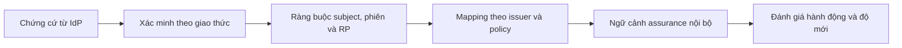
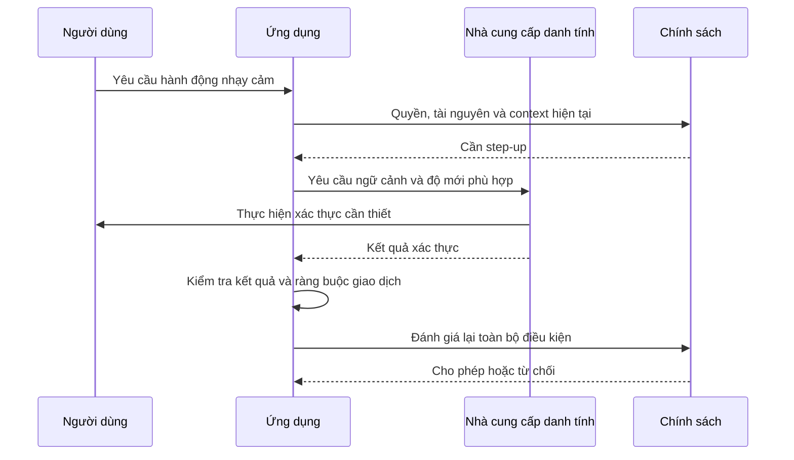

# Assurance attribute

## 1. Thuộc tính assurance trả lời câu hỏi nào?

Một hệ thống IAM có thể biết người dùng đang được nhận diện bằng tài khoản nào, nhưng vẫn cần hỏi: **bằng chứng hiện có mạnh đến đâu để cho phép thao tác này?**

Hai request đều mang cùng `subject_id` chưa chắc có cùng mức bảo đảm:

```text
Request A:
  tài khoản S1
  đăng nhập bằng mật khẩu từ hai giờ trước
  yêu cầu xem danh sách khóa học của mình

Request B:
  tài khoản S1
  vừa hoàn thành một bước xác thực mạnh hơn
  yêu cầu thay phương thức khôi phục tài khoản
```

Chủ thể vẫn là S1. Điều thay đổi là bằng chứng xác thực, thời điểm bằng chứng được tạo và yêu cầu của hành động.

**Assurance attribute** trong bài này là tên gọi cho dữ liệu mô tả mức bảo đảm của một quy trình hoặc bằng chứng danh tính. Nó có thể phản ánh kết quả xác minh danh tính, ngữ cảnh xác thực hay mức bảo vệ của giao dịch federation, tùy framework được sử dụng.

Không có một field `assurance` duy nhất mang cùng ý nghĩa trong mọi sản phẩm IAM. Muốn dùng thuộc tính này để ra quyết định, hệ thống cần biết ít nhất: nó thuộc chiều nào, framework nào, do ai khẳng định, áp dụng cho chủ thể và phiên nào, còn hiệu lực không và chính sách nào chấp nhận nó.

Mục tiêu của bài là thiết kế và sử dụng những thuộc tính ấy mà không nhầm chúng với vai trò, hồ sơ tự khai hoặc một cờ “đã bật MFA”.

## 2. Phân biệt danh tính, quyền và mức bảo đảm

| Nhóm thông tin | Câu hỏi | Ví dụ |
| --- | --- | --- |
| Identifier | Đang nói đến tài khoản nào? | `subject_id = S1` |
| Profile | Tài khoản được mô tả như thế nào? | Tên hiển thị, ngôn ngữ |
| Authorization | Tài khoản được làm gì trong phạm vi nào? | Giảng viên được sửa điểm lớp A |
| Assurance | Bằng chứng hoặc quy trình đáp ứng yêu cầu tin cậy nào? | Ngữ cảnh xác thực được chấp nhận cho thao tác nhạy cảm |
| Freshness | Sự kiện liên quan xảy ra cách đây bao lâu? | Xác thực cách đây 120 giây |
| Risk signal | Hiện có dấu hiệu đáng ngờ nào? | Thiết bị mới, hành vi bất thường |

Một giảng viên có quyền sửa điểm nhưng phiên hiện tại chưa đáp ứng yêu cầu xác thực của thao tác xuất toàn bộ bảng điểm. Ngược lại, một học viên vừa xác thực rất mạnh vẫn không được xuất bảng điểm của cả lớp.

Có thể biểu diễn quyết định như sau:

```text
Cho phép hành động =
  đúng chủ thể và phiên hợp lệ
  AND tài khoản còn hoạt động
  AND đúng tenant và tài nguyên
  AND có quyền thực hiện hành động
  AND assurance đáp ứng chính sách
  AND bằng chứng đủ mới
  AND các điều kiện rủi ro khác được thỏa mãn
```

Đây là mô hình ứng dụng minh họa. Không phải mọi hành động đều cần mọi chiều assurance; điều kiện cần được chọn theo yêu cầu của hành động.

Không cộng các đại lượng khác loại thành một điểm tin cậy chung nếu chưa có mô hình rõ ràng:

```text
IAL2 + role ADMIN + riskScore 10 = assurance 12
```

Phép tính trên không có ý nghĩa tự nhiên. Vai trò là quyền, risk score phụ thuộc mô hình rủi ro, còn assurance level thuộc một framework cụ thể.

## 3. Ba chiều cần tách: IAL, AAL và FAL

NIST SP 800-63-4 phân biệt ba chiều bảo đảm. Không nên gộp chúng thành một số “level” không có namespace. [NIST — Digital Identity Guidelines](https://pages.nist.gov/800-63-4/sp800-63.html).

| Chiều | Đối tượng được đánh giá | Câu hỏi chính |
| --- | --- | --- |
| IAL — Identity Assurance Level | Quy trình identity proofing | Người đăng ký có gắn với danh tính được khai báo ở mức bảo đảm nào? |
| AAL — Authentication Assurance Level | Quy trình xác thực và việc chứng minh kiểm soát authenticator | Lần xác thực đáp ứng yêu cầu nào? |
| FAL — Federation Assurance Level | Quy trình federation truyền thông tin giữa IdP và RP | Giao dịch liên kết danh tính được bảo vệ ra sao? |

IAL không phải mức độ chắc chắn của một mật khẩu. AAL không xác nhận mọi dữ liệu hồ sơ là đúng ngoài đời. FAL không phải vai trò đặc biệt của người dùng.

### 3.1. IAL gắn với quy trình xác minh danh tính

Ví dụ, nền tảng cấp chứng chỉ có thể cần một quy trình đối chiếu danh tính trước khi phát hành chứng chỉ mang tên người học. Kết quả proofing cần gắn với tài khoản và nguồn xác minh có thẩm quyền.

Xác minh email chỉ chứng minh một điều trong phạm vi quy trình email được thực hiện; nó không tự chứng minh tên pháp lý, ngày sinh hoặc quyền đại diện tổ chức.

Cần ghi phiên bản framework. Trong SP 800-63A-4, IAL1 đã bao gồm các yêu cầu identity proofing; không dùng mô tả IAL1 từ phiên bản cũ như thể chúng không thay đổi. [NIST SP 800-63A-4 — Identity Proofing Requirements](https://pages.nist.gov/800-63-4/sp800-63a/ial/).

Một dịch vụ không cần danh tính ngoài đời có thể chọn hoạt động mà không thực hiện identity proofing theo framework đó. Không vì vậy mà tự gắn một IAL bất kỳ vào mọi tài khoản chưa được đánh giá.

### 3.2. AAL nói về yêu cầu xác thực

Ở mức khái quát, AAL1 cho phép xác thực một hoặc nhiều yếu tố; AAL2 đòi hỏi hai yếu tố khác loại và các yêu cầu liên quan; AAL3 yêu cầu cơ chế mật mã chống phishing với khóa riêng không xuất được cùng các điều kiện khác. Đây chỉ là mô tả định hướng, không đủ để tự chứng nhận một implementation. [NIST SP 800-63B-4 — Authentication Assurance Levels](https://pages.nist.gov/800-63-4/sp800-63b/aal/).

Trong thiết kế ứng dụng, không suy ra một lần xác thực đạt AAL2 chỉ vì có hai màn hình nhập liệu. Mật khẩu cộng một câu hỏi bí mật vẫn có thể chỉ là hai bằng chứng cùng loại tri thức.

Cũng không tự suy ra mọi passkey đạt AAL3. Cách bảo vệ khóa, khả năng đồng bộ hoặc xuất khóa, quy trình xác thực và các yêu cầu của profile đều cần được xem xét.

### 3.3. FAL không thể suy ra từ một field user

Một cột `user.fal = 3` không tự làm giao dịch SSO có thêm bảo vệ. Federation assurance liên quan đến cách assertion được phát hành, truyền, ràng buộc và xử lý trong một kiến trúc cụ thể.

Ứng dụng cần kết quả đánh giá hoặc cấu hình tin cậy cho luồng federation. Không lấy việc token có chữ ký hoặc kết nối có HTTPS làm bằng chứng duy nhất rằng mọi yêu cầu của một FAL đã được đáp ứng.

## 4. Assurance có phạm vi và thời điểm

Một tài khoản có thể sở hữu authenticator mạnh nhưng người dùng chưa sử dụng nó trong phiên hiện tại. Phải tách ba khái niệm:

```text
Khả năng:
  tài khoản có đăng ký authenticator nào?

Sự kiện:
  trong lần xác thực này đã sử dụng quy trình nào?

Yêu cầu:
  hành động sắp thực hiện cần đáp ứng điều kiện nào?
```

Cờ `mfa_enrolled = true` mô tả khả năng hoặc cấu hình của tài khoản. Nó không tự mô tả sự kiện xác thực của request.

Ví dụ:

```text
S1 có một passkey và một mật khẩu.

Phiên laptop:
  vừa xác thực bằng quy trình được chấp nhận cho tác vụ nhạy cảm.

Phiên điện thoại:
  đăng nhập trước đó bằng quy trình cơ bản.

Sai:
  nâng assurance của cả hai phiên vì S1 đã từng xác thực mạnh.
```

Kết quả assurance của một sự kiện cần được gắn đúng phiên hoặc giao dịch. Không dùng “mức cao nhất từng đạt” của tài khoản để quyết định mọi request về sau.

Thời điểm cũng phải đúng nghĩa: thời gian xác minh danh tính, thời gian xác thực, thời gian phát hành token và thời gian ứng dụng tiếp nhận bằng chứng là những mốc khác nhau.

## 5. OIDC: hiểu đúng acr, amr và auth_time

Ba claim thường gặp khi xử lý ngữ cảnh xác thực:

| Claim | Vai trò |
| --- | --- |
| `acr` | Tham chiếu lớp ngữ cảnh xác thực mà IdP khẳng định đã đáp ứng |
| `amr` | Danh sách phương thức đã được dùng |
| `auth_time` | Thời điểm xác thực người dùng |

Đây là các thành phần của OIDC, không phải ba tên khác nhau của một mức assurance. [OpenID Connect Core, §2](https://openid.net/specs/openid-connect-core-1_0.html#IDToken).

Ví dụ phần thông tin về ngữ cảnh:

```json
{
  "iss": "https://login.example.org",
  "sub": "user-7391",
  "acr": "urn:example:auth:mfa-policy:v2",
  "amr": ["pwd", "otp"]
}
```

Chuỗi `acr` trong ví dụ do hệ thống giả định định nghĩa. Nó không phải tên chuẩn của NIST AAL2 và không mang ý nghĩa toàn cầu chỉ vì trông giống một URI.

RFC 8176 phân biệt rõ lớp quy tắc mà `acr` tham chiếu với các phương thức cụ thể mà `amr` mô tả. [RFC 8176, §3](https://www.rfc-editor.org/rfc/rfc8176.html#section-3).

Trong ứng dụng, hệ quả thiết kế là không viết:

```text
amr có hai phần tử -> assurance level 2
acr chứa ký tự "3" -> đạt mọi yêu cầu level 3
acr = "high" ở mọi IdP -> cùng một chính sách
```

Hai phương thức được khai báo không đủ mô tả toàn bộ cách authenticator được bảo vệ, ràng buộc với tài khoản hoặc quy trình khôi phục. Muốn chấp nhận một lớp ngữ cảnh, RP cần hợp đồng với nguồn phát hành và mapping được kiểm soát.

Các claim về ngữ cảnh có thể không xuất hiện trong một phản hồi. Nếu một hành động yêu cầu bằng chứng cụ thể mà dữ liệu còn thiếu, không tự điền một mức cao dựa trên tên nhà cung cấp hoặc việc người dùng đã vào được giao diện.

## 6. Từ claim bên ngoài đến thuộc tính nội bộ

### 6.1. Xác minh nguồn trước khi dùng giá trị

Một JSON chứa `acr = high` do client gửi không phải bằng chứng. Các bước kiểm tra giao thức phải hoàn tất trước khi dữ liệu trở thành ngữ cảnh đáng tin cậy.

Một luồng thiết kế:



Tầng xác minh xử lý các yêu cầu như chữ ký, thuật toán được phép, issuer, đối tượng nhận, thời hạn và ràng buộc của luồng xác thực. Chi tiết phụ thuộc loại token và giao thức triển khai.

Một token hợp lệ về mật mã chứng minh nguồn khẳng định giá trị ấy. Nó không tự chứng minh nguồn đáp ứng mọi yêu cầu nghiệp vụ mà RP đang cần.

### 6.2. Mapping phải có namespace và chính sách

Một mapping nội bộ có thể được quản lý theo:

```text
issuer + tenant/phạm vi tin cậy + acr + phiên bản mapping
    -> profile được ứng dụng chấp nhận
```

Ví dụ:

```text
https://login.example.org
tenant-a
urn:example:auth:mfa-policy:v2
mapping-2026-11

    -> APP_MFA_PROFILE
```

`APP_MFA_PROFILE` là một profile nội bộ của ví dụ. Không mặc định nó tương đương AAL2. Muốn tuyên bố tương đương cần đánh giá yêu cầu tương ứng và quản lý bằng chứng cho kết luận đó.

Không dùng regex đoán mức:

```java
// Không có hợp đồng về nghĩa của phần số trong acr.
int assurance = Integer.parseInt(acr.substring(acr.length() - 1));
```

Không so sánh các URI bằng thứ tự từ điển. Nếu các profile có quan hệ chấp nhận lẫn nhau, hãy biểu diễn quan hệ đó rõ ràng trong chính sách.

### 6.3. Không ghép bằng chứng từ những sự kiện không liên quan

Một lần đăng nhập cũ có `acr` mạnh và một lần đăng nhập mới có timestamp mới không tự tạo thành “xác thực mạnh vừa xảy ra”.

```text
Sai:
  lấy acr mạnh nhất trong lịch sử
  + lấy auth_time mới nhất của mọi phiên
  = phiên hiện tại có xác thực mạnh mới
```

Các field phải cùng mô tả một sự kiện hoặc một chuỗi xác thực được framework và triển khai ràng buộc rõ ràng. Tương tự, không hợp nhất `amr` của hai tài khoản hoặc hai thiết bị để tạo một danh sách phương thức tưởng như đã dùng cùng nhau.

## 7. Mô hình dữ liệu: lưu kết luận cùng ngữ cảnh

Một cột `assurance = true` làm mất thông tin quan trọng. Khi thiết kế storage hoặc cache, có thể tách hai loại dữ liệu.

### 7.1. Kết quả proofing có vòng đời riêng

```json
{
  "subjectId": "S1",
  "dimension": "IDENTITY_PROOFING",
  "framework": "org.example:proofing-policy:v2",
  "result": "REVIEWED_IDENTITY",
  "source": "https://proofing.example.org",
  "evidenceRef": "proofing-event-8401",
  "assessedAt": "2026-11-01T02:00:00Z",
  "status": "ACTIVE"
}
```

Đây là record ứng dụng minh họa. `REVIEWED_IDENTITY` không phải IAL của NIST. Chính sách của ví dụ cần định nghĩa các yêu cầu để tạo kết quả ấy và khi nào phải đánh giá lại.

Nên tham chiếu bằng chứng thay vì sao chép giấy tờ, ảnh hoặc dữ liệu sinh trắc học vào mọi hồ sơ ứng dụng. Ai được đọc bằng chứng và lưu bao lâu là những quyết định riêng.

### 7.2. Ngữ cảnh xác thực gắn với phiên

```json
{
  "subjectId": "S1",
  "sessionId": "session-21",
  "tenantId": "tenant-a",
  "dimension": "AUTHENTICATION",
  "issuer": "https://login.example.org",
  "externalAcr": "urn:example:auth:mfa-policy:v2",
  "acceptedProfile": "APP_MFA_PROFILE",
  "mappingVersion": "mapping-2026-11",
  "authenticationEventRef": "auth-event-209",
  "authenticatedAt": "2026-11-26T03:58:00Z",
  "validUntil": "2026-11-26T04:15:00Z",
  "revoked": false
}
```

Các timestamp và tên field trên thuộc mô hình nội bộ, không phải claim OIDC chuẩn. `validUntil` là hạn hiệu lực của ngữ cảnh theo thiết kế; nó không thay yêu cầu “xác thực trong năm phút gần nhất” của một hành động.

Có thể lưu thêm nguồn nhận dữ liệu, phiên bản chính sách và trạng thái thu hồi. Tránh ghi toàn bộ token hoặc dữ liệu authenticator vào record chỉ vì muốn thuận tiện truy vết.

## 8. Freshness: bằng chứng còn hiệu lực chưa chắc đủ mới

Giả sử token còn hạn đến 12:00 nhưng thao tác đổi phương thức khôi phục đòi hỏi xác thực phù hợp trong năm phút gần nhất. Request lúc 11:55 với sự kiện xác thực từ 09:00 không thỏa điều kiện ấy.

```text
Hiệu lực:
  now < validUntil

Độ mới:
  now - authenticatedAt <= maxAuthenticationAge
```

Hai điều kiện cần được xét riêng.

OIDC phân biệt `auth_time` với `iat`; khi refresh ID token, `iat` mới không làm sự kiện xác thực cũ trở thành mới. `max_age` được dùng để yêu cầu giới hạn tuổi xác thực và kéo theo yêu cầu trả `auth_time`. [OpenID Connect Core, §3.1.2.1 và §12.2](https://openid.net/specs/openid-connect-core-1_0.html#RefreshTokenResponse).

Đối với thiết kế của bài, RP còn phải kiểm tra kết quả đáp ứng tuổi bằng chứng mà hành động yêu cầu. Không thay `authenticatedAt` bằng thời điểm server vừa nhận token.

Cần xác định cách xử lý lệch đồng hồ và thời gian tương lai. Ví dụ Java bên dưới chọn từ chối thời gian xác thực nằm trong tương lai; một hệ thống thực tế có thể có tolerance được định nghĩa và giới hạn rõ ràng.

Mốc năm phút trong bài là chính sách minh họa cho một hành động, không phải timeout bắt buộc chung của NIST hoặc OIDC. Các hành động khác có thể dùng yêu cầu khác, được chọn theo rủi ro và hợp đồng của hệ thống.

## 9. Chính sách assurance theo hành động

Một nền tảng học tập có thể chọn những yêu cầu khác nhau:

| Hành động | Quyền nghiệp vụ | Yêu cầu ngữ cảnh minh họa |
| --- | --- | --- |
| Xem nội dung công khai | Có thể không cần tài khoản | Không cần assurance của một phiên người dùng |
| Xem bài làm của mình | Chủ sở hữu trong tenant phù hợp | Phiên hợp lệ theo chính sách ứng dụng |
| Đổi phương thức khôi phục | Quyền tự quản lý tài khoản | Profile xác thực được chấp nhận và đủ mới |
| Xuất toàn bộ bảng điểm | Quyền xuất dữ liệu của lớp | Profile mạnh hơn nếu chính sách yêu cầu |
| Giao quyền quản trị tenant | Quyền quản lý đặc quyền | Ngữ cảnh phù hợp, xác thực mới và điều kiện phê duyệt nếu có |

Bảng là ví dụ phân tích nghiệp vụ, không phải ánh xạ bắt buộc sang các mức NIST.

Không cấu hình một ngưỡng toàn hệ thống rồi áp dụng như nhau cho đọc nội dung công khai và thay đổi đặc quyền. Đồng thời, đừng chỉ kiểm tra assurance ở màn hình đầu tiên nếu request thực hiện hành động có thể được gửi trực tiếp.

Ba loại kết quả hữu ích khi đánh giá:

```text
ALLOW:
  có quyền và đủ bằng chứng cho hành động.

STEP_UP_REQUIRED:
  có thể tiếp tục sau một quy trình xác thực phù hợp hơn hoặc mới hơn.

DENY:
  không có quyền, sai phạm vi, bằng chứng không hợp lệ
  hoặc nguồn/context không được tin cậy.
```

Không yêu cầu người không có quyền “xác thực mạnh thêm” như thể làm vậy sẽ nhận được quyền. Việc thiếu authorization và thiếu assurance cần được xử lý đúng nguyên nhân.

## 10. Java: quyết định từ profile được tin cậy và độ mới

Ví dụ dưới đây dùng Java 17 trở lên và thư viện chuẩn. Các profile `BASELINE`, `MFA_PROFILE`, `RESISTANT_PROFILE` là tên nội bộ của ví dụ, không phải các mức NIST.

`AuthContext` được giả định do adapter xác thực tạo sau khi kiểm tra chứng cứ. `RequestState` được lấy từ security context và kết quả phân quyền của server cho hành động hiện tại. Không nhận các object này trực tiếp từ request body.

```java
import java.time.Duration;
import java.time.Instant;
import java.util.Map;
import java.util.Set;

public class AssuranceDecisionDemo {

    enum Profile {
        BASELINE, MFA_PROFILE, RESISTANT_PROFILE
    }

    enum Decision {
        ALLOW, STEP_UP_REQUIRED, DENY
    }

    record TrustKey(String issuer, String tenantId, String acr) {
    }

    record AuthContext(
            String subjectId,
            String sessionId,
            String tenantId,
            String issuer,
            String acr,
            Instant authenticatedAt,
            Instant validUntil,
            boolean revoked) {
    }

    record RequestState(
            String subjectId,
            String sessionId,
            String tenantId,
            boolean accountActive,
            boolean authorizedForAction) {
    }

    record Requirement(
            Set<Profile> acceptedProfiles,
            Duration maxAuthenticationAge) {
    }

    static Decision evaluate(
            AuthContext auth,
            RequestState request,
            Requirement requirement,
            Instant now,
            Map<TrustKey, Profile> trustedProfiles) {

        if (request == null
                || !request.accountActive()
                || !request.authorizedForAction()) {
            return Decision.DENY;
        }

        if (auth == null
                || request.subjectId() == null
                || request.sessionId() == null
                || request.tenantId() == null) {
            return Decision.DENY;
        }

        boolean sameContext =
                request.subjectId().equals(auth.subjectId())
                && request.sessionId().equals(auth.sessionId())
                && request.tenantId().equals(auth.tenantId());

        if (!sameContext
                || auth.revoked()
                || auth.validUntil() == null
                || !now.isBefore(auth.validUntil())) {
            return Decision.DENY;
        }

        TrustKey key = new TrustKey(
                auth.issuer(), auth.tenantId(), auth.acr());
        Profile profile = trustedProfiles.get(key);

        if (profile == null) {
            return Decision.DENY;
        }

        if (auth.authenticatedAt() == null) {
            return Decision.STEP_UP_REQUIRED;
        }

        if (auth.authenticatedAt().isAfter(now)) {
            return Decision.DENY;
        }

        if (!requirement.acceptedProfiles().contains(profile)) {
            return Decision.STEP_UP_REQUIRED;
        }

        Duration age = Duration.between(auth.authenticatedAt(), now);
        if (age.compareTo(requirement.maxAuthenticationAge()) > 0) {
            return Decision.STEP_UP_REQUIRED;
        }

        return Decision.ALLOW;
    }

    static AuthContext sample(
            String issuer, String acr, Instant authTime, Instant now) {
        return new AuthContext(
                "S1", "session-21", "tenant-a",
                issuer, acr, authTime,
                now.plusSeconds(900), false);
    }

    public static void main(String[] args) {
        String issuer = "https://login.example.org";
        String baselineAcr = "urn:example:auth:baseline:v1";
        String mfaAcr = "urn:example:auth:mfa-policy:v2";
        String resistantAcr = "urn:example:auth:resistant-policy:v1";

        Map<TrustKey, Profile> mapping = Map.of(
                new TrustKey(issuer, "tenant-a", baselineAcr),
                Profile.BASELINE,
                new TrustKey(issuer, "tenant-a", mfaAcr),
                Profile.MFA_PROFILE,
                new TrustKey(issuer, "tenant-a", resistantAcr),
                Profile.RESISTANT_PROFILE
        );

        Requirement sensitiveAction = new Requirement(
                Set.of(Profile.MFA_PROFILE, Profile.RESISTANT_PROFILE),
                Duration.ofMinutes(5));

        Instant now = Instant.parse("2026-11-26T04:00:00Z");
        RequestState allowedRequest = new RequestState(
                "S1", "session-21", "tenant-a", true, true);

        AuthContext recentMfa = sample(
                issuer, mfaAcr, now.minusSeconds(120), now);
        AuthContext oldMfa = sample(
                issuer, mfaAcr, now.minusSeconds(600), now);
        AuthContext recentBaseline = sample(
                issuer, baselineAcr, now.minusSeconds(30), now);
        AuthContext unknownIssuer = sample(
                "https://untrusted.example.org",
                mfaAcr, now.minusSeconds(30), now);
        AuthContext missingTime = sample(
                issuer, mfaAcr, null, now);

        System.out.println("Recent MFA: " + evaluate(
                recentMfa, allowedRequest, sensitiveAction, now, mapping));
        System.out.println("Old MFA: " + evaluate(
                oldMfa, allowedRequest, sensitiveAction, now, mapping));
        System.out.println("Baseline only: " + evaluate(
                recentBaseline, allowedRequest, sensitiveAction, now, mapping));
        System.out.println("Unknown issuer: " + evaluate(
                unknownIssuer, allowedRequest, sensitiveAction, now, mapping));

        RequestState otherSession = new RequestState(
                "S1", "session-other", "tenant-a", true, true);
        System.out.println("Different session: " + evaluate(
                recentMfa, otherSession, sensitiveAction, now, mapping));

        RequestState unauthorized = new RequestState(
                "S1", "session-21", "tenant-a", true, false);
        System.out.println("No business permission: " + evaluate(
                recentMfa, unauthorized, sensitiveAction, now, mapping));

        System.out.println("Missing authentication time: " + evaluate(
                missingTime, allowedRequest, sensitiveAction, now, mapping));
    }
}
```

Kết quả dự kiến:

```text
Recent MFA: ALLOW
Old MFA: STEP_UP_REQUIRED
Baseline only: STEP_UP_REQUIRED
Unknown issuer: DENY
Different session: DENY
No business permission: DENY
Missing authentication time: STEP_UP_REQUIRED
```

Các quyết định quan trọng của ví dụ:

- Mapping dùng cả issuer, tenant và giá trị `acr`; một chuỗi giống nhau từ nguồn khác không được nhận diện như cùng profile.
- Bộ profile được chấp nhận là một tập rõ ràng, không dùng `enum.ordinal()` để giả định mọi profile có thứ bậc chung.
- Cùng subject nhưng khác session không được lấy bằng chứng của nhau.
- Token hoặc context còn hạn không vượt qua được yêu cầu về tuổi xác thực.
- Thiếu quyền nghiệp vụ dẫn đến từ chối dù đã có profile mạnh.
- Thiếu thời gian xác thực của một context đã được nhận diện dẫn đến yêu cầu bổ sung bằng chứng, không tự lấy thời điểm hiện tại.

Chương trình chỉ minh họa một nhánh chính sách xác thực. Nó chưa triển khai kiểm tra chữ ký, token replay, proofing, FAL, thu hồi phân tán hay policy engine hoàn chỉnh. Các field đầu vào cần được tạo tại ranh giới tin cậy đã nêu; tên class không tự bảo đảm điều đó.

`Requirement` và mapping trong ví dụ là cấu hình cố định do server quản lý. Nếu cấu hình được nạp từ bên ngoài, cần validation về tập profile, thời lượng không âm, nguồn tin cậy và phiên bản trước khi đưa vào sử dụng.

## 11. Step-up authentication đúng phạm vi

Step-up là yêu cầu đáp ứng ngữ cảnh phù hợp hơn cho hành động, chẳng hạn dùng profile mạnh hơn hoặc xác thực mới hơn. Nó không nhất thiết đồng nghĩa “thêm một OTP” trong mọi tình huống.

Một luồng ứng dụng có thể là:



Ứng dụng không thực hiện thay đổi nhạy cảm trước rồi mới hỏi thêm xác thực.

Kết quả trở về phải liên quan đúng yêu cầu step-up ban đầu và đúng tài khoản. Nếu người dùng chọn một tài khoản khác tại IdP, không lấy kết quả đó để nâng assurance cho tài khoản đang mở trước đó.

Các ràng buộc cần thiết có thể gồm phiên cha, tài khoản, tenant, yêu cầu đang chờ, thời hạn và các tham số chống giả mạo luồng theo giao thức. Một số hành động còn cần ràng buộc nội dung giao dịch; đăng nhập mạnh không tự xác nhận mọi giá trị mà client gửi sau đó.

Trong OAuth, RFC 9470 định nghĩa challenge `insufficient_user_authentication` và các tham số như `acr_values`, `max_age` để truyền yêu cầu xác thực của resource server. [RFC 9470, §3–5](https://www.rfc-editor.org/rfc/rfc9470.html#section-3).

Ví dụ challenge cho một hệ thống hỗ trợ giao thức ấy:

```http
HTTP/1.1 401 Unauthorized
WWW-Authenticate: Bearer error="insufficient_user_authentication", acr_values="urn:example:auth:mfa-policy:v2", max_age="300"
```

Giá trị `acr` và 300 giây là lựa chọn minh họa. Client cần nhận biết giao thức và đưa người dùng qua quy trình phù hợp; không thể chỉ sửa token hoặc retry request cũ để đáp ứng yêu cầu.

Việc gửi yêu cầu ngữ cảnh không thay việc kiểm tra kết quả nhận về. Nếu nguồn không hỗ trợ hoặc không trả một kết quả được chấp nhận, ứng dụng không tự coi việc redirect thành công là đủ.

Sau step-up, đánh giá lại quyền và trạng thái tài nguyên. Người dùng có thể đã bị gỡ quyền trong thời gian xác thực; kết quả mới không làm sống lại quyền đã bị thu hồi.

## 12. Ai được ghi assurance attribute?

Tên hiển thị có thể do người dùng tự sửa, nhưng thuộc tính dùng làm bằng chứng tin cậy cần có đường ghi riêng.

Ví dụ một request cập nhật hồ sơ không được phép chứa:

```json
{
  "displayName": "Minh An",
  "assuranceLevel": 3,
  "identityProofed": true,
  "lastStrongAuthenticationAt": "2026-11-26T04:00:00Z"
}
```

Client tự gửi các giá trị trên không tạo ra bằng chứng. Nếu API deserialize toàn bộ object rồi ghi vào entity, một thao tác sửa hồ sơ có thể trở thành nâng mức tin cậy trái phép.

Quyền ghi nên đi theo trách nhiệm:

| Thành phần | Dữ liệu có thể tạo hoặc cập nhật theo hợp đồng |
| --- | --- |
| Dịch vụ profile | Thuộc tính tự quản lý trong phạm vi được phép |
| Dịch vụ proofing | Kết quả proofing, nguồn và tham chiếu bằng chứng |
| Adapter xác thực | Context được xác minh và gắn với sự kiện, phiên |
| Quản trị trust mapping | Quan hệ giữa nguồn, profile ngoài và chính sách nội bộ |
| Policy engine | Kết quả đánh giá yêu cầu của hành động |
| Audit service | Bản ghi sự kiện và quyết định theo quyền được cấp |

Đây là phân chia logic; hệ thống nhỏ có thể triển khai nhiều trách nhiệm trong một dịch vụ, nhưng vẫn cần bảo vệ đường ghi.

Một tenant admin được quản lý người dùng không mặc nhiên có quyền khai rằng mọi người dùng đạt một mức proofing hoặc authentication assurance. Nếu có quy trình override hoặc ngoại lệ, phải ghi rõ đó là ngoại lệ chính sách, có phạm vi và thời hạn; không sửa lịch sử thành “người dùng đã xác thực mạnh” khi việc đó chưa xảy ra.

Tương tự, một field từ directory chỉ được dùng theo ngữ nghĩa đã thỏa thuận. Không lấy cột “VIP” hoặc “verified employee” rồi đổi tên thành `AAL3`.

## 13. Vòng đời: thu hồi, khôi phục và thay đổi chính sách

Assurance không phải một huy hiệu được cấp một lần rồi tồn tại vĩnh viễn.

### 13.1. Thu hồi bằng chứng hoặc phương thức xác thực

Khi phát hiện bằng chứng proofing sai, cần có cách vô hiệu hóa hoặc thay thế kết luận liên quan. Lịch sử vẫn phải cho biết kết quả cũ từng tồn tại và khi nào không còn được chấp nhận.

Khi một authenticator bị mất hoặc bị thu hồi, cần xác định tác động đến các context và phiên liên quan theo chính sách. Xóa một bản ghi thiết bị nhưng để cache quyết định nhạy cảm tiếp tục có hiệu lực vô hạn không giải quyết được vòng đời.

Không nhất thiết mọi sự kiện đều hủy mọi phiên; yêu cầu phụ thuộc mô hình đe dọa và chính sách. Điều cần thiết là hệ thống có quy tắc rõ ràng và thực thi được.

### 13.2. Khôi phục tài khoản không tự giữ mức cũ

Một tài khoản từng dùng phương thức mạnh nhưng vừa được khôi phục qua một quy trình khác không được tự động có context mạnh mới chỉ vì hồ sơ vẫn ghi “đã bật MFA”.

Luồng recovery cần xác định mức tin cậy được thiết lập, thao tác nào được phép ngay, khi nào cần xác thực lại hoặc tái ràng buộc authenticator. Không lấy assurance trước khi recovery để bỏ qua kiểm tra cho thay đổi sau recovery.

Một mốc thời gian mới từ luồng khôi phục cũng không tự tương đương thời điểm hoàn thành profile xác thực mà hành động yêu cầu.

### 13.3. Thay đổi profile hoặc mapping

Nếu IdP thay đổi cách thực thi một lớp `acr`, RP cần xem lại mapping. Cùng một chuỗi tên không bảo đảm rằng implementation hoặc các thỏa thuận chưa thay đổi.

Khi cập nhật mapping, cần quản lý phiên bản và quyết định context được tạo dưới phiên bản cũ còn được chấp nhận không. Một lựa chọn là buộc đánh giá lại hoặc xác thực lại cho những hành động bị ảnh hưởng.

Không nâng hàng loạt context cũ lên một profile mới chỉ vì tên profile được đổi. Việc thay đổi chính sách và việc có thêm bằng chứng là hai sự kiện khác nhau.

### 13.4. Khóa tài khoản vẫn có hiệu lực riêng

Assurance mạnh không vượt qua trạng thái `DISABLED` hoặc một quyết định từ chối của chính sách. Một admin bị khóa tài khoản không được tiếp tục quản trị nhờ còn một assertion mạnh chưa hết hạn.

Subject identifier có thể giữ nguyên để truy vết; điều kiện truy cập phải phản ánh trạng thái hiện tại.

## 14. Cache và đồng bộ trong hệ thống phân tán

Nếu mọi service chỉ cache:

```text
subject S1 -> assurance HIGH
```

hệ thống sẽ làm mất phạm vi phiên, nguồn, tuổi bằng chứng và phiên bản chính sách.

Một context cache có thể cần những thông tin sau:

```text
subject_id
session_id hoặc authentication_event_id
issuer và phạm vi tenant/RP
profile được chấp nhận
authenticated_at
valid_until
mapping_version
trạng thái thu hồi hoặc phiên bản context
```

Đây không phải danh sách field bắt buộc cho mọi cache. Cần chọn theo dữ liệu đang cache: bằng chứng xác thực, kết quả mapping hay quyết định cho một tài nguyên cụ thể.

Cache quyết định `ALLOW` còn cần xét action, resource, quyền hiện hành và policy version. Không dùng một kết quả cho hành động đọc để cho phép thay đổi đặc quyền.

TTL cần gắn với các giới hạn liên quan. Nếu quyết định đòi xác thực trong năm phút, không cache `ALLOW` một giờ mà bỏ qua thời điểm bằng chứng sẽ quá cũ. Khi cùng context được dùng cho nhiều hành động có ngưỡng khác nhau, đánh giá freshness theo từng hành động.

Thu hồi cần cơ chế truyền đến nơi ra quyết định: kiểm tra trạng thái hiện hành, sự kiện invalidation hoặc cơ chế đã thiết kế khác. TTL ngắn có thể giới hạn độ trễ nhưng không tự bảo đảm thu hồi tức thì.

Nếu nguồn trạng thái không truy cập được, hành vi phải được xác định theo chính sách của hành động. Với hành động yêu cầu bằng chứng chắc chắn còn hiệu lực, không lấy lỗi kết nối làm lý do tự mặc định bằng chứng vẫn đủ mạnh.

Việc hạ hoặc thu hồi context ở một service phải được các đường thực hiện tác vụ nhạy cảm tôn trọng; chỉ cập nhật badge trên UI là chưa đủ.

## 15. Kiểm toán: vì sao quyết định được đưa ra?

Một bản ghi chỉ có `assurance = 2` thường không đủ giải thích vì sao hệ thống cho phép hoặc yêu cầu xác thực lại.

Ví dụ sự kiện quyết định nội bộ:

```json
{
  "eventType": "ASSURANCE_POLICY_EVALUATED",
  "subjectId": "S1",
  "tenantId": "tenant-a",
  "action": "CHANGE_RECOVERY_METHOD",
  "authenticationEventRef": "auth-event-209",
  "profile": "APP_MFA_PROFILE",
  "mappingVersion": "mapping-2026-11",
  "policyId": "recovery-change-v3",
  "authenticatedAt": "2026-11-26T03:50:00Z",
  "evaluatedAt": "2026-11-26T04:00:00Z",
  "maxAuthenticationAgeSeconds": 300,
  "decision": "STEP_UP_REQUIRED",
  "reasonCode": "AUTHENTICATION_TOO_OLD"
}
```

Sự kiện minh họa cho thấy context có profile phù hợp nhưng sự kiện xác thực đã cách 600 giây, vượt ngưỡng 300 giây.

Tham chiếu sự kiện và policy version giúp phân biệt lỗi nguồn, sai mapping, thiếu quyền và bằng chứng quá cũ. Trong vận hành, correlation ID hoặc tham chiếu nội bộ phù hợp còn giúp nối các bước mà không phải đưa bearer token vào log.

Không ghi mật khẩu, OTP, token dùng được, private key hoặc toàn bộ hồ sơ proofing để giải thích một quyết định. Thông tin phương thức xác thực cũng cần quyền đọc thích hợp; không nhất thiết mọi người xem lịch sử hoạt động được biết người dùng đã sử dụng loại authenticator nào.

Nếu một nhân viên phê duyệt ngoại lệ, cần ghi actor thực sự, điều kiện ngoại lệ và thời hạn. Không biến một lần phê duyệt thủ công thành bằng chứng giả về một sự kiện xác thực.

## 16. Assurance cho workload và tín hiệu rủi ro

Các khái niệm về chủ thể và nguồn tin cậy còn áp dụng cho workload, nhưng không nên sao chép máy móc các profile dành cho con người.

Một workload có thể có bằng chứng về môi trường chạy, nguồn cấp credential hoặc trạng thái thiết bị. Muốn sử dụng chúng, cần một framework và cơ chế xác minh riêng với phạm vi rõ ràng. Một chứng thư mTLS hoặc một nhãn “managed” không tự có nghĩa workload đạt một IAL hay AAL của quy trình người dùng.

Cũng không coi hai secret cấu hình trong cùng môi trường là hai yếu tố độc lập chỉ vì chúng có hai tên khác nhau.

Đối với người dùng, tín hiệu như thiết bị quen thuộc hoặc địa chỉ mạng có thể tác động đến yêu cầu hành động. Tuy nhiên, một điểm rủi ro thấp không tự tạo bằng chứng mà profile xác thực yêu cầu.

```text
Có thể:
  thiết bị lạ -> yêu cầu context phù hợp hơn hoặc từ chối theo chính sách.

Không tự suy ra:
  thiết bị quen thuộc -> coi như đã dùng authenticator còn thiếu.
```

Nếu sản phẩm có cơ chế xác thực thích ứng, cần mô tả chính xác cách tín hiệu được sử dụng và cách kiểm soát thay đổi. Không ghi một số “confidence” không có nguồn gốc rồi so sánh trực tiếp với một mức assurance có định nghĩa khác.

## 17. Các lỗi thường gặp

| Lỗi | Điều bị nhầm | Cách thiết kế phù hợp hơn |
| --- | --- | --- |
| Dùng `mfa_enrolled` để cho phép tác vụ nhạy cảm | Cấu hình tài khoản với sự kiện của phiên | Đánh giá context hiện tại |
| Lấy assurance mạnh nhất từng có | Lịch sử với bằng chứng cho request hiện tại | Gắn kết quả với phiên và sự kiện |
| Dùng `amr.length >= 2` như AAL2 | Số phương thức với yêu cầu của framework | Mapping có thẩm quyền và kiểm chứng profile |
| Dùng `iat` làm thời gian xác thực | Phát hành token với thực hiện xác thực | Dùng mốc đúng ngữ nghĩa |
| Tin mọi `acr = high` | Chuỗi tên với profile có namespace | Mapping theo nguồn và phạm vi |
| Token có chữ ký thì chấp nhận mọi mức | Nguồn khẳng định với mức nguồn được phép khẳng định | Kiểm tra trust contract |
| Gắn một số chung cho IAL, AAL, FAL | Ba chiều khác nhau | Giữ dimension và framework rõ ràng |
| Cho người dùng sửa field assurance | Thuộc tính tự khai với bằng chứng | Tách đường ghi có thẩm quyền |
| Xác thực mạnh là đủ quyền | Assurance với authorization | Kiểm tra cả quyền và bằng chứng |
| Step-up ở phiên A rồi nâng phiên B | Cùng tài khoản với cùng ngữ cảnh | Ràng buộc phiên và giao dịch |
| Nguồn lỗi thì mặc định mức cao | Thiếu bằng chứng với bằng chứng hợp lệ | Xử lý thiếu dữ liệu theo chính sách |
| Profile đổi tên là nâng context cũ | Thay cấu hình với có thêm bằng chứng | Quản lý version và đánh giá lại |

## 18. Tình huống tự luyện

### Tình huống A: bật MFA nhưng đăng nhập cơ bản

Tài khoản có đăng ký MFA, nhưng phiên hiện tại chỉ đi qua quy trình cơ bản. Người dùng muốn đổi địa chỉ dùng để khôi phục.

**Kết quả mong muốn:** kiểm tra context của phiên, không chỉ cờ đăng ký. Nếu hành động yêu cầu profile khác hoặc xác thực mới hơn, thực hiện step-up và đánh giá lại trước khi thay đổi.

### Tình huống B: token vừa refresh

Token mới được cấp cách đây một phút, còn sự kiện xác thực của context diễn ra từ hai giờ trước. Hành động đòi hỏi bằng chứng trong năm phút.

**Kết quả mong muốn:** context chưa đủ mới. Refresh không tự đáp ứng yêu cầu xác thực lại; dùng mốc thực sự của sự kiện xác thực.

### Tình huống C: hai IdP có cùng chuỗi acr

IdP A và IdP B đều phát hành `acr = high`, nhưng chỉ A có trust mapping được phê duyệt cho tenant.

**Kết quả mong muốn:** không áp dụng mapping của A cho B. Thiếu nguồn hoặc profile được chấp nhận là vấn đề tin cậy, không phải thiếu một phép so sánh số.

### Tình huống D: học viên xác thực rất mạnh

Học viên hoàn thành profile mạnh nhất của ứng dụng rồi gọi API xuất bảng điểm của toàn lớp.

**Kết quả mong muốn:** từ chối do không có quyền nghiệp vụ. Assurance mạnh không biến học viên thành giảng viên hay quản trị viên.

### Tình huống E: hai phiên của cùng chủ thể

Laptop và điện thoại cùng thuộc S1. Người dùng vừa step-up trên laptop, sau đó thực hiện thao tác nhạy cảm trên điện thoại.

**Kết quả mong muốn:** đánh giá context của điện thoại. Không dùng kết quả của laptop nếu hệ thống chưa có một cơ chế chuyển hoặc ràng buộc bằng chứng được định nghĩa rõ ràng.

### Tình huống F: mất claim thời gian

Một issuer có mapping hợp lệ trả profile được chấp nhận nhưng không có thời điểm cần thiết cho điều kiện freshness.

**Kết quả mong muốn:** không mặc định thời gian hiện tại. Chuyển sang quy trình lấy bằng chứng có đủ ngữ cảnh hoặc từ chối hành động theo chính sách; tránh lặp step-up vô hạn khi nguồn không hỗ trợ.

### Tình huống G: bằng chứng proofing bị thu hồi

Kết quả proofing từng được chấp nhận nay bị nguồn có thẩm quyền thu hồi. Một service vẫn giữ bản cache cũ.

**Kết quả mong muốn:** cơ chế invalidation hoặc kiểm tra phiên bản phải làm quyết định hiện tại phản ánh việc thu hồi trong giới hạn đã cam kết. Lịch sử cũ được giữ để giải thích, không dùng nó như bằng chứng còn hiệu lực.

### Tình huống H: quản trị viên tự nâng thuộc tính

Tenant admin cập nhật hồ sơ người dùng và gửi thêm `assuranceLevel = 3`.

**Kết quả mong muốn:** API không ghi field ngoài quyền của thao tác. Nếu có quy trình phê duyệt đặc biệt, nó phải tạo loại bằng chứng hoặc ngoại lệ riêng có nguồn và phạm vi, không giả lập một sự kiện xác thực chưa xảy ra.

## 19. Áp dụng vào thiết kế IAM

Khi thêm một assurance attribute, hãy trả lời được: thuộc tính nói về quy trình nào, thuộc framework và phiên bản nào, ai khẳng định, ai có quyền ghi, bằng chứng gắn với chủ thể và context nào, điều gì làm nó quá cũ hoặc bị thu hồi.

Khi dùng thuộc tính trong policy, hãy xác định hành động yêu cầu gì, nguồn nào được tin cậy, cách mapping được quản lý, bằng chứng thiếu được xử lý thế nào và authorization có được kiểm tra độc lập hay không.

Một mã chủ thể ổn định cho biết đang nói đến tài khoản nào. Assurance bổ sung điều kiện về bằng chứng và quy trình đang được chấp nhận. Quyết định truy cập chỉ đáng tin cậy khi hai phần ấy được ràng buộc đúng phạm vi, đúng thời điểm và đúng chính sách.
