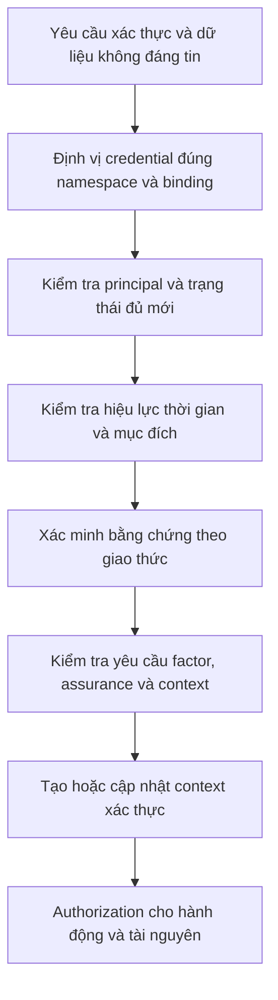
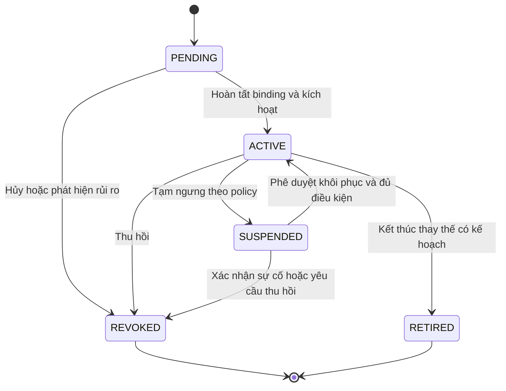

# Credential status

## 1. Trạng thái credential trả lời câu hỏi nào?

Credential status là thông tin mô tả tình trạng quản lý và khả năng được chấp nhận của một credential tại thời điểm xét. Nó giúp hệ thống trả lời: bằng chứng xác thực này đã được kích hoạt chưa, có đang bị tạm ngưng hoặc thu hồi không, còn trong thời gian hiệu lực không và dữ kiện trạng thái có đủ mới để sử dụng không?

Trong một hệ thống IAM, người dùng có thể có mật khẩu, hai passkey và một thiết bị sinh OTP; workload có thể có API key hoặc chứng thư dùng để xác thực. Mỗi phương tiện có vòng đời riêng. Không nên nén tất cả thành một trường `credentialActive` trên tài khoản.

Ví dụ, Lan làm mất một khóa bảo mật. Hệ thống cần vô hiệu hóa binding của khóa bị mất mà không mặc nhiên coi mọi phương tiện xác thực khác của Lan đều bị mất. Nếu có dấu hiệu tài khoản bị chiếm, phạm vi xử lý có thể rộng hơn: chặn tài khoản, thu hồi phiên hoặc token và kiểm tra những authenticator mới được thêm. Phạm vi đó phải được quyết định rõ ràng.

Trong bài học, từ credential được dùng theo nghĩa vận hành rộng, chỉ đối tượng hoặc binding được quản lý để hỗ trợ xác thực. Với giao thức cụ thể, cần giữ thuật ngữ chính xác: authenticator, khóa, chứng thư, access token và refresh token không phải những đối tượng đồng nhất. Phần so sánh token bên dưới nhằm chỉ ra quan hệ trạng thái, không coi mọi token OAuth là một authenticator của người dùng.

Sau bài học, người học cần có khả năng:

- Phân biệt credential status với account status, session status và quyền trên tài nguyên.
- Tách trạng thái vòng đời khỏi hiệu lực thời gian và chất lượng dữ kiện trạng thái.
- Thiết kế bản ghi trạng thái có định danh, nguồn, phiên bản và lý do thay đổi.
- Giải thích thu hồi, tạm ngưng, hết hạn và thay thế credential.
- Hiểu giới hạn của kiểm tra trạng thái qua cache, token introspection hoặc dữ liệu thu hồi chứng thư.
- Đọc ví dụ Java đánh giá khả năng sử dụng theo trạng thái mà không nhầm nó với toàn bộ quá trình xác thực.

Các schema, tên trạng thái, thời hạn và tình huống ứng dụng trong bài là thiết kế minh họa, trừ những đoạn có dẫn nguồn giao thức cụ thể.

## 2. Phân biệt những trạng thái thường bị gộp chung

| Đối tượng | Ví dụ trạng thái | Ý nghĩa chính | Không tự chứng minh |
| --- | --- | --- | --- |
| Tài khoản hoặc principal | Đang hoạt động, bị đình chỉ | Danh tính có được tham gia hệ thống theo chính sách không? | Mọi credential của danh tính đều an toàn |
| Credential hoặc authenticator binding | Chờ kích hoạt, hoạt động, thu hồi | Phương tiện này còn được chấp nhận trong phạm vi quản lý không? | Bên gọi đang kiểm soát bí mật tương ứng |
| Phiên đăng nhập | Còn hiệu lực, đã kết thúc | Context đăng nhập hiện có còn được sử dụng không? | Credential gốc chưa từng bị thay đổi |
| Access token | Còn hiệu lực theo cơ chế kiểm tra áp dụng | Token còn được resource server chấp nhận theo contract không? | Người dùng được làm mọi hành động trên mọi tài nguyên |
| Refresh token hoặc grant | Có thể tiếp tục cấp token, bị thu hồi | Luồng cấp token tiếp theo còn được phép không? | Access token đã phát hành đều lập tức bị vô hiệu hóa ở mọi nơi |
| Authorization assignment | Role hoặc permission còn hiệu lực | Chủ thể có quyền gì trong phạm vi nào? | Phương tiện xác thực dùng để đăng nhập còn hợp lệ |

Một tài khoản có trạng thái `ACTIVE` nhưng API key đã bị thu hồi thì không được xác thực bằng API key đó. Ngược lại, credential vẫn tồn tại và chưa bị thu hồi nhưng tài khoản bị đình chỉ cũng không nên vượt qua chính sách chặn principal.

Thay mật khẩu có thể làm mật khẩu cũ không còn dùng được cho lần đăng nhập mới. Phiên đã tạo trước đó có chấm dứt hay không là một chính sách và cơ chế khác. Phải kiểm tra thiết kế thực tế, không suy ra từ việc một trường trạng thái đã đổi.

## 3. Mô hình nhiều chiều rõ hơn một boolean `active`

### 3.1. Trạng thái vòng đời được quản lý

Một mô hình nội bộ có thể dùng:

| Trạng thái | Nghĩa trong ví dụ | Khả năng sử dụng để xác thực mới |
| --- | --- | --- |
| `PENDING` | Đã tạo bản ghi nhưng chưa hoàn tất binding hoặc kích hoạt | Chưa được dùng |
| `ACTIVE` | Được bật trong registry | Cần kiểm tra thêm thời hạn, principal và giao thức |
| `SUSPENDED` | Tạm dừng trong khi xử lý một điều kiện hoặc sự cố | Không được dùng khi đang tạm ngưng |
| `REVOKED` | Đã thu hồi theo chính sách của hệ thống | Không được dùng |
| `RETIRED` | Đã cho ngừng sử dụng có chủ đích, chẳng hạn sau thay thế | Không được dùng |

Đây không phải bộ trạng thái chung cho mọi sản phẩm. Một nền tảng có thể gọi là `DISABLED`, `INVALIDATED` hoặc có mô hình binding khác. Adapter phải ánh xạ theo ngữ nghĩa đã thống nhất, không chỉ theo tên gần giống.

`COMPROMISED` có thể là trạng thái trong một sản phẩm, hoặc là lý do thu hồi trong sản phẩm khác. Ví dụ của bài chọn lưu `lifecycle = REVOKED` và `reason = COMPROMISE_CONFIRMED` khi đã xác nhận lộ bí mật. Không cần vừa đặt `ACTIVE` vừa gắn nhãn compromise rồi hy vọng mọi dịch vụ sẽ hiểu đúng sự mâu thuẫn đó.

### 3.2. Hiệu lực theo thời gian

Một credential được bật có thể chưa đến thời điểm bắt đầu sử dụng hoặc đã hết hạn. Vì vậy cần tách:

```text
Trạng thái quản lý: ACTIVE.
Thời gian hiệu lực: từ validFrom đến validUntil theo contract.
Kết quả tại thời điểm hiện tại: có thể là NOT_YET_VALID hoặc EXPIRED.
```

Không nhất thiết chạy một job đúng từng giây để đổi mọi bản ghi sang `EXPIRED`. Verifier có thể tính trực tiếp từ thời gian hiệu lực. Nếu chỉ tin nhãn `ACTIVE` trong database mà bỏ qua thời hạn, credential có thể được dùng sau khi đã hết hạn dù job cập nhật chưa chạy.

Quy tắc biên thời gian phải theo loại credential và giao thức. Mô hình Java của bài dùng khoảng nội bộ `[validFrom, validUntil)`, nhưng không áp đặt quy tắc này lên mọi profile chứng thư hoặc token.

### 3.3. Độ mới và mức xác định của dữ kiện

Một response trạng thái cần được hiểu cùng thời điểm mà nguồn có thẩm quyền đã xác nhận dữ kiện. Giá trị `ACTIVE` lấy từ cache cũ không có sức bảo đảm như dữ kiện vừa được kiểm tra theo contract.

Có thể phân biệt kết quả:

- **Usable by status:** các điều kiện trạng thái được kiểm tra đã đạt.
- **Not usable:** có điều kiện rõ ràng làm credential không được sử dụng.
- **Indeterminate:** không có đủ dữ kiện tin cậy hoặc đủ mới để kết luận.

`Indeterminate` không được tự biến thành `ACTIVE`. Nó cũng không nhất thiết có nghĩa credential đã bị thu hồi tại nguồn. Giữ sự phân biệt này giúp vừa chặn thao tác cần chứng cứ trạng thái, vừa điều tra đúng nguyên nhân hạ tầng.

## 4. Định danh và metadata của credential

### 4.1. Mỗi credential phải có định danh riêng

Một người có nhiều passkey thì mỗi binding cần được quản lý riêng. Một workload đang rotation có thể tạm thời có hai API key, mỗi key có ID và trạng thái khác nhau. Thu hồi theo username hoặc tên hiển thị dễ ảnh hưởng sai đối tượng.

Một bản ghi metadata giả định:

```json
{
  "credentialId": "cred-example-042",
  "subject": {
    "issuer": "https://identity.example.test",
    "subjectId": "workload-billing-export"
  },
  "kind": "API_KEY",
  "purpose": "billing-export-api",
  "lifecycle": "ACTIVE",
  "validFrom": "2026-11-26T02:00:00Z",
  "validUntil": "2026-11-26T10:00:00Z",
  "statusVersion": 7,
  "statusAuthority": "workload-credential-registry",
  "observedAt": "2026-11-26T03:00:00Z",
  "rotationFamilyId": "rotation-example-09"
}
```

Đây là metadata nội bộ, không chứa API key thật và không phải schema chuẩn của một nhà cung cấp. Thời gian dùng UTC. Định danh nguồn trong JSON không tự chứng minh nguồn đáng tin; kênh tiếp nhận và quyền cập nhật phải được xác thực riêng.

Với credential bên ngoài, định danh có thể cần namespace của issuer hoặc hệ thống quản lý. Cùng một `credentialId` dạng chuỗi ở hai hệ thống không nhất thiết chỉ cùng một credential. Tương tự, `kid` trong header token giúp chọn khóa theo contract nhưng không phải một kết luận credential còn được phép sử dụng.

### 4.2. Metadata phục vụ những mục đích khác nhau

| Dữ kiện | Mục đích | Lưu ý |
| --- | --- | --- |
| Subject hoặc workload sở hữu | Ràng buộc credential với đúng danh tính | Xác minh namespace và loại principal |
| Kind, purpose, audience hoặc scope quản lý | Dùng credential đúng mục đích | Không suy ra quyền truy cập tài nguyên chỉ từ purpose |
| Lifecycle và reason code | Quản lý vòng đời, điều tra | Tránh trạng thái và lý do mâu thuẫn |
| Validity interval | Kiểm tra hiệu lực thời gian | Đánh giá cả khi registry chưa đổi nhãn hết hạn |
| Status version | Phát hiện cập nhật và tránh ghi đè dữ kiện mới | Phải có cơ chế so sánh và đồng bộ thực sự |
| Observed time | Đánh giá độ mới | Không đặt lại giờ hiện tại cho dữ liệu nguồn đã cũ |
| Last used time | Theo dõi vận hành | Có thể là telemetry cập nhật chậm, không phải bằng chứng chưa thu hồi |
| Revoked time và actor | Kiểm toán thu hồi | Phân biệt lúc nguồn ghi nhận với lúc mọi verifier đã áp dụng |

Không trả material xác thực trong API liệt kê trạng thái: mật khẩu, private key, secret OTP, recovery code hoặc access token không phải dữ liệu cần hiển thị cùng credential status. Định danh credential và lịch sử sử dụng cũng cần giới hạn truy cập, dù bản thân ID không nhất thiết là bí mật xác thực.

## 5. Từ trạng thái đến quyết định xác thực

Một credential có trạng thái được chấp nhận vẫn cần bằng chứng đúng giao thức. Ai đó biết ID của passkey không đồng nghĩa họ tạo được assertion hợp lệ; một API key được bật không có nghĩa bất kỳ chuỗi nào gắn ID đó đều xác thực thành công.



Thứ tự chi tiết có thể thay đổi để đáp ứng đặc tính giao thức, hiệu năng và chống lộ thông tin. Sơ đồ thể hiện các điều kiện cần phân biệt, không yêu cầu mọi verifier phải thực hiện chính xác cùng một chuỗi lời gọi.

Có thể diễn đạt quan hệ trong ví dụ:

```text
xác thực được chấp nhận
    = trạng thái credential đạt yêu cầu
      AND principal được phép xác thực
      AND bằng chứng hợp lệ
      AND điều kiện của giao thức và chính sách xác thực đạt yêu cầu

thao tác nghiệp vụ được chấp nhận
    = context xác thực phù hợp
      AND policy cho action, resource và phạm vi cho phép
```

Status không thay thế xác minh bí mật, chữ ký, challenge, khả năng chống replay hoặc yêu cầu MFA. Authorization cũng không nên bỏ qua trạng thái principal chỉ vì một session hoặc token đã từng được phát hành hợp lệ.

## 6. Thay đổi trạng thái phải có quyền và quy tắc chuyển

### 6.1. Luồng vòng đời minh họa



Trong mô hình này, `REVOKED` và `RETIRED` là trạng thái cuối của một bản ghi credential. Nếu cần cấp lại khả năng xác thực, hệ thống tạo credential hoặc binding mới theo quy trình phù hợp, không đặt lại cùng bí mật đã bị lộ thành `ACTIVE`.

Đây là lựa chọn nội bộ của ví dụ. Một số giao thức có cơ chế hold hoặc khôi phục với ngữ nghĩa riêng; adapter phải tôn trọng giao thức đó. Không suy từ sơ đồ này rằng mọi từ “revoked” trong mọi hệ thống đều có cùng cách chuyển trạng thái.

### 6.2. Tạm ngưng không phải cách né thu hồi

Tạm ngưng phù hợp khi policy cho phép dừng sử dụng trong lúc xác minh. Khôi phục cần bằng chứng và thẩm quyền phù hợp, không chỉ một request của bên đang nắm credential bị nghi ngờ.

NIST SP 800-63B-4 phân biệt tạm ngưng, hết hạn và invalidation của authenticator; invalidation gắn với việc gỡ binding với tài khoản. Tài liệu yêu cầu xử lý invalidation khi authenticator bị compromise và mô tả điều kiện cho cơ chế tạm ngưng nếu được hỗ trợ. [Nguồn: NIST SP 800-63B-4, vòng đời authenticator](https://pages.nist.gov/800-63-4/sp800-63b.html).

Trong ví dụ, nếu đã xác nhận private key bị sao chép, tìm lại thiết bị gốc không làm bản sao của kẻ khác biến mất. Quy trình xử lý cần thay credential liên quan thay vì chỉ bỏ nhãn tạm ngưng.

### 6.3. Quyền cập nhật status là quyền nhạy cảm

Các hành động như kích hoạt, khôi phục và thu hồi cần có phân quyền. Người dùng có thể được quản lý authenticator của mình qua luồng đã xác thực; quản trị viên tenant có thể chỉ được xử lý credential của thành viên trong tenant; workload không mặc nhiên được tự bật lại credential đã bị thu hồi.

API tự sửa hồ sơ không được cho bind tùy ý các field như `lifecycle`, `revokedAt` hoặc `statusAuthority`. Cần tách DTO và luồng điều khiển trạng thái khỏi dữ liệu tự khai.

Ngay cả yêu cầu thu hồi cũng cần kiểm tra thẩm quyền để tránh một người vô hiệu hóa credential của người khác. Luồng báo mất có thể ưu tiên giảm nguy cơ bị sử dụng trái phép, nhưng chính sách xác minh và phục hồi phải được xác định có chủ đích.

## 7. Hết hạn, rotation và yêu cầu đổi credential

### 7.1. Hết hạn là một điều kiện riêng

Một chứng thư có thời hạn, một API key có ngày hết hiệu lực và một mã khôi phục dùng một lần có những cơ chế kết thúc khác nhau. Không ép chúng vào cùng một job “đổi mật khẩu mỗi tháng”.

Với mật khẩu, NIST SP 800-63B-4 nêu rằng không yêu cầu thay định kỳ tùy ý và phải buộc thay khi có bằng chứng compromise. Vì vậy credential status không có nghĩa mọi loại credential đều cần cùng một chu kỳ hết hạn. [Nguồn: NIST SP 800-63B-4, yêu cầu đối với password](https://pages.nist.gov/800-63-4/sp800-63b.html).

Nếu có trường `mustChangePassword`, cần định nghĩa nó là nghĩa vụ của luồng nào. Ví dụ, mật khẩu tạm có thể chỉ được dùng để vào một luồng thiết lập credential mới, không cho truy cập nghiệp vụ bình thường trước khi hoàn tất. Không nên gán nghĩa vụ đó thành quyền truy cập đầy đủ.

### 7.2. Rotation theo kế hoạch có thể có thời gian chồng lấn

Một workload cần thay API key mà không làm gián đoạn dịch vụ. Thiết kế có thể cho hai credential tồn tại trong thời gian chuyển tiếp:

```text
Bước 1: Tạo key mới K2 ở trạng thái PENDING.
Bước 2: Hoàn tất cấp phát và kích hoạt K2.
Bước 3: Chuyển workload sang dùng K2, quan sát kết quả.
Bước 4: Kết thúc cửa sổ chuyển tiếp và ngừng chấp nhận K1.
Bước 5: Xác nhận K1 không còn được chấp nhận trên các đường gọi cần bảo vệ.
```

K1 và K2 phải có ID và trạng thái độc lập. Dùng một ID rồi thay bí mật bên dưới có thể làm lịch sử sử dụng và thu hồi khó giải thích.

Chồng lấn có thời hạn là lựa chọn để chuyển đổi có kế hoạch. Nếu K1 đã bị lộ, tiếp tục chấp nhận K1 chỉ để thuận tiện vận hành làm kéo dài cửa sổ bị khai thác. Trường hợp sự cố cần policy xử lý riêng.

### 7.3. Không nhầm thay chứng thư với thay khóa

Một chứng thư mới có thể liên quan đến khóa cũ hoặc khóa mới tùy quy trình. Khi private key bị lộ, chỉ phát hành chứng thư mới dùng cùng key không loại bỏ việc kẻ khác đang giữ key. Hệ thống quản lý cần theo dõi đúng đối tượng bị ảnh hưởng: khóa, chứng thư, binding và credential phụ thuộc.

## 8. Các cơ chế kiểm tra trạng thái có ngữ nghĩa khác nhau

### 8.1. Registry credential nội bộ

API key hoặc binding authenticator có thể được quản lý trong registry. Verifier tìm bản ghi đúng định danh, xác minh bằng chứng và kiểm tra trạng thái theo contract. Registry là nguồn có thẩm quyền nếu quyền ghi và kênh đọc của nó được bảo vệ.

Một bảng chỉ có cột `enabled` nhưng cho mọi service tự chỉnh không tạo thành nguồn đáng tin. Cần biết ai sở hữu chuyển trạng thái, version thay đổi ra sao và cache lấy dữ kiện từ đâu.

### 8.2. OAuth token introspection

RFC 7662 định nghĩa trường `active` trong phản hồi introspection. Ngữ nghĩa phụ thuộc authorization server và thường bao gồm việc token do server phát hành, chưa hết hạn, chưa bị thu hồi và phù hợp với resource đang hỏi. `active: false` có thể được trả trong nhiều tình huống, không cung cấp đầy đủ nguyên nhân nội bộ. [Nguồn: RFC 7662, mục 2 và 2.2](https://www.rfc-editor.org/rfc/rfc7662.html#section-2.2).

Ví dụ phản hồi không hoạt động:

```json
{
  "active": false
}
```

Không suy từ phản hồi này rằng một passkey cụ thể đã bị thu hồi hoặc toàn bộ tài khoản bị khóa. Đây là kết quả kiểm tra token theo endpoint và context được hỏi.

Resource server vẫn cần kiểm tra scope, audience và policy tài nguyên theo contract. Gọi introspection thất bại vì timeout khác với nhận được phản hồi hợp lệ `active: false`. Tầng vận hành cần phân biệt hai tình huống dù cả hai đều không đủ để cho phép thao tác cần token đang hoạt động.

### 8.3. OAuth token revocation

RFC 7009 mô tả endpoint thu hồi token. Phạm vi ảnh hưởng tới token liên quan phụ thuộc chính sách và khả năng của authorization server. HTTP 200 có thể được trả cả khi token đã bị thu hồi thành công lẫn khi token gửi lên không hợp lệ; không được coi nó là chứng cứ token đó từng tồn tại. Chuẩn cũng lưu ý khả năng trễ lan truyền trạng thái. [Nguồn: RFC 7009, mục 2.1 và 2.2](https://www.rfc-editor.org/rfc/rfc7009.html#section-2.2).

Trong thiết kế ứng dụng, cần xác định rõ thu hồi refresh token có làm access token đã phát hành mất hiệu lực ở các resource server hay không, và bằng cách nào. Không tự đồng nhất “không cấp thêm token mới” với “mọi token cũ đều đã bị chặn”.

### 8.4. Chứng thư và thông tin thu hồi

Đối với X.509, hiệu lực chứng thư còn liên quan đến xây dựng và kiểm tra certification path, thời gian, cách sử dụng khóa và các điều kiện profile. RFC 5280 mô tả CRL và các reason code, trong đó có ngữ nghĩa riêng cho certificate hold. Vì vậy một nhãn `ACTIVE` trong inventory không thay thế việc xác minh chứng thư theo profile áp dụng. [Nguồn: RFC 5280](https://www.rfc-editor.org/rfc/rfc5280.html).

Khi sử dụng CRL hoặc dịch vụ trạng thái chứng thư, cần xác minh nguồn phản hồi, độ mới và policy khi không lấy được thông tin. Không phải mọi cơ chế đều cung cấp cùng bảo đảm. Dữ kiện thu hồi không đủ mới phải được nhận diện thay vì tự gắn nhãn “chưa bị thu hồi”.

## 9. Độ mới, cache và phạm vi thu hồi

### 9.1. Trạng thái ở nguồn và trạng thái tại verifier

Giả sử credential K1 bị thu hồi tại registry lúc 09:00:00. Một API node vẫn giữ kết quả `ACTIVE` được xác nhận lúc 08:59:55. Nếu node được phép dùng cache đó trong 30 giây, nó có thể chưa biết cập nhật ngay tại 09:00:01.

Phải tách ba mốc:

```text
T0: Yêu cầu thu hồi được tiếp nhận và xác minh.
T1: Nguồn có thẩm quyền đã ghi trạng thái mới.
T2: Các điểm thực thi trong phạm vi yêu cầu đã áp dụng trạng thái mới.
```

Một cam kết “thu hồi trong 30 giây” phải nói rõ đo từ mốc nào đến mốc nào. Cũng cần tính độ trễ replica, chu kỳ đồng bộ, truyền sự kiện, cache và khả năng verifier mất kết nối.

Cache phản hồi introspection có thể làm dữ kiện kém cập nhật hơn; RFC 7662 yêu cầu cân nhắc đánh đổi hiệu năng và độ mới. [Nguồn: RFC 7662, mục 2.2 và 4](https://www.rfc-editor.org/rfc/rfc7662.html#section-4).

### 9.2. Khóa cache phải phản ánh đúng đối tượng

Một khóa cache trạng thái có thể cần:

```text
registry hoặc issuer namespace
    + credential ID
    + purpose/resource context nếu kết quả phụ thuộc context
```

Cache chỉ theo user ID làm lẫn nhiều credential của cùng người. Cache token introspection chỉ theo subject cũng có thể lấy kết quả của token này dùng cho token khác.

Version giúp ngăn một sự kiện `ACTIVE` cũ ghi đè lên `REVOKED` mới nếu consumer so sánh và xử lý đúng. Trường `statusVersion` tự nó không làm sự kiện được xác thực, cũng không giúp gì khi consumer bỏ qua version.

Đọc lại bản cache cũ rồi thay `observedAt` bằng thời gian hiện tại là làm mất thông tin độ mới. Mốc thời gian cần phản ánh lần kiểm tra phù hợp tại nguồn, không chỉ lần cache được đọc.

### 9.3. Thu hồi credential không tự kết thúc mọi quyền đã phát sinh

Một credential có thể đã tạo ra session, token hoặc grant cho tác vụ. Khi xử lý sự cố, cần xác định tác động mong muốn:

| Phạm vi xử lý | Ví dụ | Cơ chế cần xem xét |
| --- | --- | --- |
| Một credential | Lan báo mất khóa bảo mật X | Vô hiệu hóa binding của X |
| Nhiều credential liên quan | Một workload làm lộ cả nhóm secret | Thu hồi các credential xác định thuộc phạm vi sự cố |
| Principal | Nghi tài khoản bị chiếm hoàn toàn | Policy chặn principal và các phương tiện truy cập phù hợp |
| Phiên | Buộc đăng xuất các phiên đã bị ảnh hưởng | Session store hoặc cơ chế kiểm tra trạng thái phiên |
| Token và grant | Ngăn tiếp tục gọi API hoặc lấy token mới | Revocation, introspection hoặc cơ chế tại resource server |
| Job đang chạy | Ngăn xuất dữ liệu sau khi mất quyền truy cập | Kiểm tra lại tại các mốc thực thi đã định nghĩa |

Không phải sự cố nào cũng yêu cầu cùng phạm vi, nhưng phải có người hoặc policy quyết định phạm vi đó. Đổi một field trong registry rồi tuyên bố “đã đăng xuất toàn bộ thiết bị” là một kết luận thiếu bằng chứng nếu phiên được quản lý riêng.

## 10. Ví dụ Java: đánh giá khả năng sử dụng theo trạng thái

### 10.1. Phạm vi của đoạn mã

Ví dụ Java 17 trở lên đánh giá một snapshot trạng thái nội bộ. Kết quả `USABLE_BY_STATUS` chỉ nghĩa là các điều kiện trạng thái trong ví dụ đã đạt, không có nghĩa xác thực thành công.

Giả định:

- Snapshot đến từ registry hoặc adapter đã được xác minh, không bind trực tiếp từ request.
- Credential có UUID riêng, gắn với subject gồm issuer và subject ID.
- Credential chỉ được dùng cho purpose đã ghi.
- Principal phải được phép xác thực.
- Snapshot phải mới theo giới hạn 15 giây của ví dụ.
- Hiệu lực nội bộ là `[validFrom, validUntil)`; `null` ở `validUntil` nghĩa là không đặt ngày hết hạn trong schema này.

### 10.2. Dữ liệu và kết quả

```java
import java.time.Duration;
import java.time.Instant;
import java.util.Objects;
import java.util.UUID;

enum CredentialLifecycle {
    PENDING,
    ACTIVE,
    SUSPENDED,
    REVOKED,
    RETIRED
}

enum StatusDecision {
    USABLE_BY_STATUS,
    CONTEXT_MISMATCH,
    SUBJECT_DISABLED,
    INDETERMINATE,
    PENDING,
    SUSPENDED,
    REVOKED,
    RETIRED,
    NOT_YET_VALID,
    EXPIRED
}

record SubjectKey(String issuer, String subjectId) {
    SubjectKey {
        Objects.requireNonNull(issuer);
        Objects.requireNonNull(subjectId);
        if (issuer.isBlank() || subjectId.isBlank()) {
            throw new IllegalArgumentException("Missing subject identity");
        }
    }
}

record CredentialSnapshot(
        UUID credentialId,
        SubjectKey subject,
        String purpose,
        CredentialLifecycle lifecycle,
        Instant validFrom,
        Instant validUntil,
        Instant observedAt,
        long statusVersion) {
    CredentialSnapshot {
        Objects.requireNonNull(credentialId);
        Objects.requireNonNull(subject);
        Objects.requireNonNull(purpose);
        Objects.requireNonNull(lifecycle);
        Objects.requireNonNull(validFrom);
        Objects.requireNonNull(observedAt);
        if (purpose.isBlank() || statusVersion < 0) {
            throw new IllegalArgumentException("Invalid status metadata");
        }
        if (validUntil != null && !validUntil.isAfter(validFrom)) {
            throw new IllegalArgumentException("Invalid validity interval");
        }
    }
}
```

Kiểu dữ liệu không chứa secret. Constructor kiểm tra hình dạng dữ liệu, không xác thực nguồn. Một object được tạo thành công trong Java vẫn có thể chứa dữ liệu giả nếu tầng tiếp nhận không bảo vệ nguồn và quyền ghi.

### 10.3. Evaluator không biến trạng thái thiếu hoặc cũ thành cho phép

```java
final class CredentialStatusEvaluator {
    private static final Duration MAX_STATUS_AGE = Duration.ofSeconds(15);

    StatusDecision evaluate(
            UUID expectedCredentialId,
            SubjectKey expectedSubject,
            String requiredPurpose,
            boolean subjectEnabled,
            CredentialSnapshot snapshot,
            Instant now) {
        Objects.requireNonNull(expectedCredentialId);
        Objects.requireNonNull(expectedSubject);
        Objects.requireNonNull(requiredPurpose);
        Objects.requireNonNull(now);

        if (snapshot == null) {
            return StatusDecision.INDETERMINATE;
        }
        if (!expectedCredentialId.equals(snapshot.credentialId())
                || !expectedSubject.equals(snapshot.subject())
                || !requiredPurpose.equals(snapshot.purpose())) {
            return StatusDecision.CONTEXT_MISMATCH;
        }
        if (!subjectEnabled) {
            return StatusDecision.SUBJECT_DISABLED;
        }

        Instant observedAt = snapshot.observedAt();
        if (observedAt.isAfter(now)
                || !now.isBefore(observedAt.plus(MAX_STATUS_AGE))) {
            return StatusDecision.INDETERMINATE;
        }

        if (snapshot.lifecycle() != CredentialLifecycle.ACTIVE) {
            return switch (snapshot.lifecycle()) {
                case PENDING -> StatusDecision.PENDING;
                case SUSPENDED -> StatusDecision.SUSPENDED;
                case REVOKED -> StatusDecision.REVOKED;
                case RETIRED -> StatusDecision.RETIRED;
                case ACTIVE -> throw new IllegalStateException("Unexpected branch");
            };
        }

        if (now.isBefore(snapshot.validFrom())) {
            return StatusDecision.NOT_YET_VALID;
        }
        if (snapshot.validUntil() != null
                && !now.isBefore(snapshot.validUntil())) {
            return StatusDecision.EXPIRED;
        }
        return StatusDecision.USABLE_BY_STATUS;
    }
}
```

Tất cả kết quả ngoài `USABLE_BY_STATUS` đều không đủ để tiếp tục một luồng bắt buộc credential đang được chấp nhận. `INDETERMINATE` được giữ riêng để phân biệt việc không lấy được chứng cứ trạng thái với các trường hợp biết chắc credential bị thu hồi hoặc hết hạn.

`subjectEnabled` phải được nạp từ nguồn trạng thái principal được quản lý và đáp ứng yêu cầu về độ mới. Nó không phải boolean người dùng tự gửi. `requiredPurpose` phải được suy ra từ endpoint hoặc luồng đang thực thi theo cấu hình server, không để bên gọi tùy ý chọn purpose dễ được chấp nhận hơn.

Đoạn mã chưa dùng `statusVersion` để kiểm tra một phiên bản tối thiểu đã biết. Nếu kiến trúc có stream sự kiện thu hồi hoặc security epoch, tầng tích hợp cần so sánh phiên bản theo thiết kế. Chỉ để trường đó trong record không cung cấp bảo đảm chống replay snapshot cũ.

Ví dụ chọn không chấp nhận thời điểm quan sát nằm trong tương lai. Hệ thống phân tán thực tế cần quản lý đồng hồ và độ lệch theo contract rõ ràng; không tăng vô hạn độ lệch cho phép để che một lỗi đồng bộ thời gian.

### 10.4. Kết hợp với verifier theo giao thức

Caller của evaluator vẫn cần thực hiện logic tương ứng:

```text
statusDecision = evaluateStatus(...)

nếu statusDecision khác USABLE_BY_STATUS:
    không chấp nhận xác thực bằng credential này

xác minh bằng chứng theo loại credential
kiểm tra challenge, replay protection và binding theo giao thức
kiểm tra yêu cầu factor và chính sách xác thực
chỉ sau đó mới tạo kết quả xác thực thành công
```

Không viết nhánh `return authenticatedUser` ngay sau khi thấy `ACTIVE`. Khi tích hợp với framework hoặc thư viện xác thực, phải bảo đảm trạng thái được kiểm tra tại đường thực thi thật, kể cả các đường đăng nhập thay thế hoặc lời gọi nội bộ.

## 11. Cập nhật cạnh tranh và sự kiện trạng thái

### 11.1. Không để snapshot cũ bật lại credential đã thu hồi

Một tình huống race condition:

```text
T0: Tác vụ rotation đọc K1 ở version 7, trạng thái ACTIVE.
T1: Nhóm vận hành thu hồi K1, ghi version 8.
T2: Tác vụ rotation ghi lại object version 7 cùng trạng thái ACTIVE.
```

Nếu ghi đè toàn object không kiểm tra version, thao tác tại T2 có thể làm mất thu hồi. Một cập nhật có điều kiện cho mô hình nội bộ:

```sql
UPDATE credential_registry
SET lifecycle = 'REVOKED',
    status_version = status_version + 1,
    revoked_at = :revoked_at,
    revocation_reason = :reason
WHERE credential_id = :credential_id
  AND status_version = :expected_version
  AND lifecycle IN ('PENDING', 'ACTIVE', 'SUSPENDED');
```

Đây là SQL minh họa dùng tham số bind, không phải một migration hoàn chỉnh. Nếu không cập nhật hàng nào, caller phải phân biệt credential không tồn tại, version đã đổi hoặc trạng thái đã kết thúc bằng cách đọc lại có quyền. Không tự bỏ điều kiện version rồi thử ghi lần nữa.

Các đường kích hoạt hoặc khôi phục cũng phải tuân thủ kiểm tra chuyển trạng thái. Chỉ bảo vệ câu lệnh thu hồi mà một API khác vẫn cho `UPDATE lifecycle='ACTIVE'` tùy ý thì trạng thái cuối chưa được bảo đảm.

### 11.2. Ghi nguồn và phát sự kiện cần có tính nhất quán phù hợp

Nếu cập nhật registry thành công nhưng phát sự kiện vô hiệu hóa cache thất bại, verifier có thể tiếp tục dùng snapshot cũ. Một thiết kế có thể ghi sự kiện outbox cùng transaction với cập nhật trạng thái rồi chuyển tiếp bằng worker, kết hợp cơ chế kiểm tra định kỳ hoặc giới hạn cache theo yêu cầu.

Outbox giúp tránh mất sự kiện giữa hai thao tác ghi, nhưng không tự bảo đảm mọi consumer đã nhận ngay. Cần theo dõi lag, retry, idempotency và sự kiện đến sai thứ tự. Consumer không nên cho version thấp hơn ghi đè version cao hơn đã áp dụng.

### 11.3. Kiểm tra rồi sử dụng vẫn có khoảng cách thời gian

Credential có thể bị thu hồi sau khi verifier đọc trạng thái nhưng trước khi nó hoàn tất xác thực hoặc thực hiện hành động. Kiến trúc phải định nghĩa bảo đảm mong muốn: snapshot tại thời điểm kiểm tra, độ trễ thu hồi tối đa hay cơ chế đồng bộ mạnh hơn cho thao tác nhạy cảm.

Một transaction cục bộ không tự tạo tính nguyên tử giữa registry, session store và nhiều resource server. Không hứa “thu hồi tức thời ở mọi nơi” chỉ vì cập nhật registry là atomic.

## 12. Hành vi khi dữ kiện thiếu hoặc dịch vụ trạng thái lỗi

| Tình huống | Cách hiểu | Hành vi trong thiết kế yêu cầu trạng thái đủ mới |
| --- | --- | --- |
| Registry xác nhận `REVOKED` | Biết credential không còn được chấp nhận | Chặn xác thực mới bằng credential đó |
| Chưa tìm được credential | Không có binding phù hợp để kiểm tra | Không tạo credential hợp lệ mặc định |
| Registry timeout | Không xác nhận được trạng thái | Không tự gán `ACTIVE`; xử lý lỗi dịch vụ phù hợp |
| Snapshot quá cũ | Chưa đạt yêu cầu độ mới | Làm mới hoặc từ chối dùng snapshot cho luồng này |
| Trạng thái lạ | Adapter chưa hiểu contract | Báo lỗi hoặc cách ly, không ánh xạ sang trạng thái có quyền |
| Principal bị đình chỉ | Danh tính đang bị chặn theo policy | Không bỏ qua bằng một credential khác còn bật |
| Bằng chứng sai nhưng status hợp lệ | Chưa chứng minh được quyền kiểm soát credential | Xác thực thất bại |

Nếu hệ thống có chế độ hoạt động khi nguồn trạng thái gián đoạn, nó phải được thiết kế trước với phạm vi hành động, thời hạn dữ kiện và điều kiện kết thúc rõ ràng. Ví dụ, một số luồng có thể dùng snapshot còn trong giới hạn đã phê duyệt; điều đó khác với cho phép dùng dữ kiện cũ vô thời hạn.

Thông báo công khai cần tránh làm lộ danh sách credential, trạng thái tài khoản hoặc lý do điều tra cho người chưa có quyền. Sau khi người dùng đã xác thực qua một kênh phù hợp, giao diện quản lý credential có thể cung cấp thông tin đủ để họ xử lý hết hạn hoặc báo mất. Nội dung chi tiết phải theo context, không nhất thiết giống nhau ở mọi endpoint.

## 13. Audit và khả năng giải thích trạng thái

Một sự kiện thu hồi minh họa:

```json
{
  "event": "credential_status_changed",
  "credentialId": "cred-example-042",
  "subjectId": "workload-billing-export",
  "previousLifecycle": "ACTIVE",
  "newLifecycle": "REVOKED",
  "reasonCode": "COMPROMISE_CONFIRMED",
  "actorId": "security-operator-example-3",
  "statusVersion": 8,
  "sourceRecordedAt": "2026-11-26T03:05:00Z",
  "correlationId": "incident-example-27"
}
```

Các ID là dữ liệu giả. Audit cần giới hạn quyền đọc và tránh chứa secret. Bản ghi nên cho biết ai thay đổi, thay đổi đối tượng nào, theo thẩm quyền nào, lý do gì và phiên bản mới là bao nhiêu.

Để chứng minh thu hồi đã được thực thi, cần thêm bằng chứng phía verifier: version đã áp dụng, thời điểm ngừng chấp nhận hoặc kết quả kiểm tra trên các đường truy cập cần bảo vệ. Một event “đã yêu cầu thu hồi” không đồng nghĩa mọi hệ thống downstream đã thực hiện.

Các tín hiệu vận hành hữu ích có thể gồm:

- Credential sắp hết hạn nhưng chưa có phương tiện thay thế.
- Verifier tiếp tục nhận credential đã thu hồi theo nguồn.
- Consumer xử lý trạng thái bị chậm hoặc lặp lỗi.
- Tỷ lệ không xác định được trạng thái tăng bất thường.
- Có nỗ lực kích hoạt lại credential ở trạng thái cuối.
- Một credential lâu không dùng bỗng xuất hiện ở context khác thường.

Những tín hiệu này hỗ trợ điều tra; không nên suy từ một lần `lastUsedAt` chưa cập nhật rằng credential chưa được sử dụng, vì telemetry có thể trễ hoặc mất.

## 14. Kiểm chứng cách sử dụng credential status

| Ca kiểm chứng | Kết quả cần quan sát |
| --- | --- |
| Credential hoạt động, đủ mới, đúng purpose, bằng chứng hợp lệ | Chỉ thành công nếu các điều kiện xác thực còn lại cũng đạt |
| Credential hoạt động nhưng bằng chứng sai | Không xác thực thành công |
| Credential `PENDING` | Không dùng được cho đăng nhập nghiệp vụ trước kích hoạt |
| Credential chưa đến `validFrom` | Không dùng được trước thời điểm cho phép |
| Thời điểm xét bằng `validUntil` trong mô hình Java | Kết quả `EXPIRED` |
| Một trong hai passkey của Lan bị thu hồi | Passkey đó bị chặn; credential khác xử lý theo policy riêng |
| Principal bị đình chỉ nhưng API key còn `ACTIVE` | Không vượt qua policy chặn principal |
| Snapshot hết độ mới | Không được dùng như dữ kiện vừa xác nhận |
| Registry lỗi | Không có nhánh mặc định biến lỗi thành cho phép |
| Sự kiện `ACTIVE` version cũ đến sau `REVOKED` version mới | Không bật lại credential |
| Request tự sửa hồ sơ chứa `lifecycle: ACTIVE` | Không thay trạng thái credential được quản lý |
| Thu hồi credential tạo ra một phiên trước đó | Trạng thái phiên tuân theo chính sách xử lý liên quan đã định nghĩa |
| Kết thúc rotation có chồng lấn | Key cũ thực sự không còn được chấp nhận trong phạm vi yêu cầu |

Không chỉ kiểm tra label hiển thị. Cần thử một yêu cầu thật bằng credential giả lập phù hợp trong môi trường kiểm thử và quan sát verifier, kết quả tạo phiên hoặc token và tác dụng phụ liên quan.

Với thu hồi phân tán, đo từ mốc nguồn ghi nhận đến điểm thực thi cuối trong phạm vi đã xác định. Kiểm tra cả khi cache đang có dữ liệu, khi replica chậm và khi consumer vừa khởi động lại. Những trường hợp này có thể làm khác kết quả của một request chỉ đọc thẳng database chính.

Với biên thời gian, dùng đồng hồ kiểm soát được trong phép kiểm chứng: trước thời điểm bắt đầu, đúng thời điểm bắt đầu, trước hết hạn và tại hết hạn. Không phụ thuộc vào việc test chạy đủ nhanh giữa hai lệnh lấy giờ.

## 15. Bài tập vận dụng

### Tình huống 1: Một khóa bị mất, một tài khoản vẫn hoạt động

Lan có hai khóa bảo mật và báo mất khóa X. Quản trị viên đặt `accountStatus=ACTIVE` rồi cho rằng mọi phương tiện của Lan vẫn dùng được. Mô hình đang thiếu gì?

**Gợi ý:** cần định danh và trạng thái từng binding. Account status không biểu diễn việc một credential cụ thể bị mất hoặc bị thu hồi. Đồng thời xác định sự cố có cần xử lý phiên và các phương tiện khác không.

### Tình huống 2: Job hết hạn chạy chậm

Một API key đã qua `validUntil` nhưng registry vẫn ghi `ACTIVE` vì job chạy mỗi giờ. API chỉ kiểm tra enum. Điều kiện nào bị bỏ sót?

**Gợi ý:** hiệu lực thời gian phải được đánh giá tại verifier theo contract. Nhãn quản lý không thay thế khoảng thời gian, và không nên phụ thuộc hoàn toàn vào job đổi nhãn.

### Tình huống 3: Đã thay mật khẩu nên cho rằng đã đăng xuất mọi nơi

Hệ thống thay verifier mật khẩu thành công nhưng session store độc lập vẫn có các phiên cũ. Có đủ căn cứ báo “mọi thiết bị đã đăng xuất” không?

**Gợi ý:** cần bằng chứng về trạng thái phiên và token liên quan. Việc credential cũ không còn dùng được để đăng nhập mới là bảo đảm khác với việc context truy cập đã phát hành bị chặn.

### Tình huống 4: Cache cũ được đóng dấu giờ mới

Một service đọc bản cache `ACTIVE` từ hai phút trước, đặt `observedAt=now` rồi chuyển cho evaluator có giới hạn 15 giây. Vì sao phép kiểm tra độ mới không còn ý nghĩa?

**Gợi ý:** evaluator đang tin một mốc không phản ánh lần xác nhận tại nguồn. Cần bảo toàn lineage và thời gian của dữ kiện, không chỉ thời gian vận chuyển hoặc đọc cache.

### Tình huống 5: Rotation ghi đè thu hồi

Một tác vụ tự động lưu snapshot K1 cũ sau khi đội vận hành đã thu hồi K1. Hãy nêu các lớp cần bảo vệ để K1 không hoạt động trở lại.

**Gợi ý:** quy tắc chuyển trạng thái, optimistic concurrency tại nguồn, version tại consumer và quyền của tác vụ rotation đều cần phù hợp. Không chỉ sửa một bảng hiển thị.

### Tình huống 6: Trạng thái hợp lệ nhưng authentication thất bại

Passkey vẫn được bật, nhưng assertion gửi tới không khớp challenge của phiên đăng nhập hiện tại. Có nên cho qua vì status là `ACTIVE` không?

**Gợi ý:** status chỉ là một điều kiện. Verifier còn phải kiểm tra bằng chứng và các ràng buộc của giao thức; một thuộc tính quản lý không thay thế được việc chứng minh quyền kiểm soát credential.

## 16. Các câu hỏi cần trả lời khi thiết kế credential status

1. Đối tượng đang quản lý là một secret, khóa, chứng thư, binding hay token nào?
2. Định danh và namespace nào giúp thu hồi đúng đối tượng?
3. Trạng thái nào được lưu, điều kiện thời gian nào được tính và kết quả nào chỉ là trạng thái quan sát tại verifier?
4. Ai có thẩm quyền kích hoạt, tạm ngưng, khôi phục và thu hồi?
5. Dữ kiện được phép cũ bao lâu cho từng loại luồng xác thực hoặc hành động?
6. Khi nguồn hoặc kênh đồng bộ lỗi, hệ thống có tiếp tục chấp nhận credential không, theo contract nào?
7. Thu hồi một credential ảnh hưởng thế nào tới principal, phiên, token và tác vụ đã phát sinh?
8. Bằng chứng nào xác nhận các điểm thực thi đã áp dụng trạng thái mới?

Credential status hữu ích khi nó gắn với đúng đối tượng, có nguồn thẩm quyền và giữ được ý nghĩa đến verifier. Một nhãn `ACTIVE` đứng riêng không chứng minh credential an toàn, bên gọi kiểm soát credential hay hành động nghiệp vụ được phép. Thiết kế IAM cần giữ rõ từng điều kiện đó để xử lý đúng cả truy cập bình thường lẫn sự cố và thu hồi quyền.
