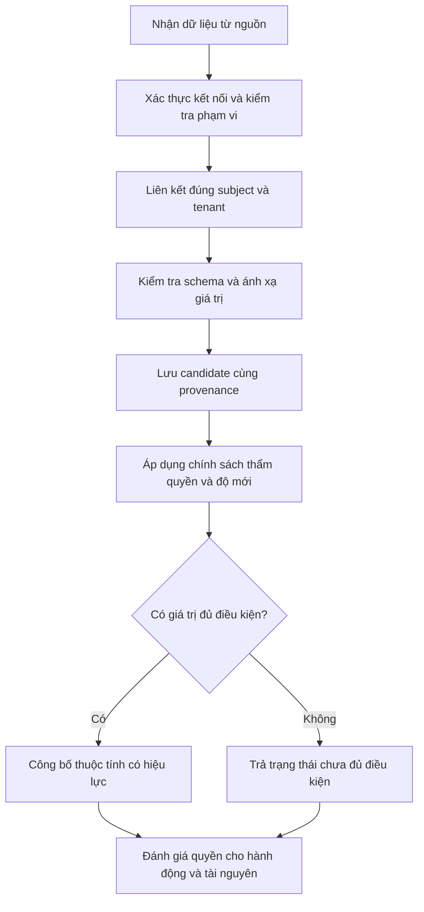

# Attribute source — Nguồn thuộc tính danh tính

## 1. Vì sao biết giá trị thuộc tính vẫn chưa đủ?

Một ứng dụng cấp quyền xem báo cáo tài chính cho người thuộc phòng tài chính. Trong hồ sơ của Minh có thuộc tính:

```json
{
  "department": "FINANCE"
}
```

Trước khi dùng giá trị này để cấp quyền, ứng dụng cần biết nó đến từ đâu. Có ít nhất ba khả năng:

- Minh tự nhập phòng ban trong màn hình sửa hồ sơ.
- Directory sao chép phòng ban từ hệ thống nhân sự.
- Một nhân viên hỗ trợ sửa thủ công trong tình huống xử lý lỗi.

Cùng một chuỗi `FINANCE` có thể mang mức tin cậy và mục đích sử dụng khác nhau. Nếu ứng dụng cho người dùng tự sửa field rồi dùng chính field đó để cấp quyền, quyền sửa hồ sơ đã trở thành đường tự cấp đặc quyền.

**Attribute source** là nguồn cung cấp một giá trị thuộc tính. Trong IAM, việc quản lý nguồn bao gồm xác định hệ thống tạo hoặc khẳng định dữ liệu, đường dữ liệu đi qua, chủ thể mà dữ liệu mô tả, phạm vi nguồn được tin cậy và điều kiện để giá trị được dùng.

Bài học giúp người học thiết kế luồng thuộc tính từ các hệ thống nhân sự, directory, IdP, provisioning và ứng dụng đến quyết định truy cập. Trọng tâm là giữ được nguồn gốc, giải quyết xung đột và thu hồi tác động của thuộc tính khi dữ liệu hoặc quan hệ tin cậy thay đổi.

## 2. Phân biệt nguồn, kênh truyền và thẩm quyền

Các khái niệm sau liên quan nhưng không đồng nghĩa:

| Khái niệm | Câu hỏi | Ví dụ |
| --- | --- | --- |
| Nguồn khởi tạo | Dữ liệu ban đầu được tạo hoặc xác nhận ở đâu? | Hệ thống nhân sự xác nhận phòng ban |
| Nguồn trực tiếp | Ứng dụng nhận dữ liệu từ hệ thống nào? | Directory gửi bản sao phòng ban |
| Kênh truyền | Dữ liệu được đưa tới bằng cách nào? | SCIM, OIDC, API hoặc sự kiện |
| Nguồn có thẩm quyền | Nguồn nào được phép quyết định giá trị cho mục đích đang xét? | Nhân sự quyết định tình trạng làm việc |
| Nguồn gốc dữ liệu | Có thể lần theo dữ liệu và các bước biến đổi như thế nào? | Nhân sự → connector → directory → IAM |
| Chủ sở hữu nghiệp vụ | Ai chịu trách nhiệm về ý nghĩa và chất lượng? | Bộ phận nhân sự |
| Người quản trị nguồn | Ai có thể sửa dữ liệu hoặc cấu hình kết nối? | Nhóm quản trị được giao phạm vi |

SCIM và OIDC là cơ chế trao đổi, không phải nhãn bảo đảm mọi giá trị được trao đổi đều đúng và có thẩm quyền.

Tương tự, TLS bảo vệ kênh theo cấu hình triển khai; chữ ký giúp xác minh nguồn phát và tính toàn vẹn của thông điệp. Chúng không tự chứng minh một phòng ban là đúng hoặc bên phát được phép cấp quyền quản trị trong ứng dụng đích.

Có thể biểu diễn ba bước riêng:

```text
Thông điệp có xác thực nguồn
    -> nguồn được phép khẳng định thuộc tính này trong phạm vi này
    -> giá trị đủ điều kiện cho quyết định cụ thể
```

Bỏ qua bước ở giữa dễ dẫn đến việc tin mọi claim từ một IdP đã kết nối, kể cả những claim có nguồn là dữ liệu người dùng tự khai.

## 3. Những nhóm nguồn thường gặp

Không có một bảng xếp hạng chung nói rằng một loại hệ thống luôn đáng tin hơn mọi loại khác. Thẩm quyền phụ thuộc thuộc tính, tenant, nhóm chủ thể và mục đích sử dụng.

Một thiết kế giả định trong doanh nghiệp:

| Nguồn | Thuộc tính phù hợp trong thiết kế này | Giới hạn cần ghi rõ |
| --- | --- | --- |
| Hệ thống nhân sự | Mã nhân sự, đơn vị công tác, ngày nghỉ việc | Không tự xác định mọi quyền ứng dụng |
| Directory doanh nghiệp | Nhóm directory, địa chỉ công việc, trạng thái directory | Có thể chứa dữ liệu được đồng bộ từ nguồn khác |
| IdP | Subject tại issuer, kết quả xác thực, claim được thỏa thuận | Đăng nhập hợp lệ không tự trao mọi entitlement |
| Hệ thống quản trị quyền | Membership, role, quyền đã được phê duyệt | Cần phân biệt quyền có hiệu lực và yêu cầu đang chờ |
| Người dùng tự phục vụ | Tên hiển thị, ngôn ngữ, thông tin liên hệ đề nghị | Không tự đặt độ tin cậy hoặc quyền truy cập |
| Hệ thống quản lý thiết bị | Trạng thái tuân thủ của thiết bị | Không suy ra tư thế thiết bị từ claim tự khai |
| Nền tảng workload | Danh tính workload, service account hoặc môi trường đã xác minh | Nhãn do workload tự sửa chưa chắc có thẩm quyền |
| Quản trị viên được ủy quyền | Ngoại lệ có phạm vi và thời hạn | Cần bằng chứng, kiểm toán và điều kiện hết hạn |

Bảng này là ví dụ chính sách, không phải quy định bắt buộc cho mọi tổ chức. Một công ty có thể dùng directory làm nguồn quyết định phòng ban nếu quy trình quản trị của họ bảo đảm điều đó.

Khi dùng ABAC, các thuộc tính của subject, tài nguyên, hành động và môi trường tham gia đánh giá chính sách. Chất lượng đầu vào vì vậy tác động trực tiếp đến quyết định truy cập. Đây là phạm vi được mô tả trong [NIST SP 800-162](https://csrc.nist.gov/pubs/sp/800/162/upd2/final).

### 3.1. Quyền sửa nguồn là một loại quyền bảo mật

Nếu nhóm directory `finance-approvers` làm phát sinh quyền phê duyệt thanh toán, người có thể thêm thành viên vào nhóm đó đang có khả năng cấp quyền gián tiếp.

Tương tự, ai có thể sửa ánh xạ claim, đổi nguồn ưu tiên hoặc cho phép tenant tự khai phòng ban cũng có thể thay đổi kết quả phân quyền.

Đánh giá đặc quyền cần bao gồm cả quyền sửa dữ liệu và cấu hình đầu vào, không chỉ quyền gọi API nghiệp vụ cuối cùng.

## 4. Lưu nguồn gốc ở mức thuộc tính

Một hồ sơ tổng hợp có thể chứa các field đến từ nhiều nguồn. Gắn một nhãn `source=SSO` cho toàn bộ hồ sơ thường không đủ để giải thích từng giá trị.

Một bản ghi candidate minh họa:

```json
{
  "subjectId": "usr-1042",
  "tenantId": "tenant-a",
  "attribute": "department",
  "value": "FINANCE",
  "sourceId": "hr-tenant-a",
  "sourceRecordId": "employee-781",
  "sourceRevision": 42,
  "receivedAt": "2026-11-26T02:00:05Z",
  "sourceConfirmedAt": "2026-11-26T02:00:00Z",
  "effectiveFrom": "2026-11-25T17:00:00Z",
  "validUntil": "2026-11-26T02:15:00Z",
  "state": "PRESENT",
  "mappingVersion": "hr-map-3"
}
```

Đây là schema ứng dụng tự định nghĩa. Các field chỉ có ý nghĩa khi hệ thống thực sự kiểm tra và thực thi hợp đồng tương ứng.

| Metadata | Ý nghĩa cần giữ |
| --- | --- |
| `sourceId` | Danh tính nguồn được server xác định từ kết nối đáng tin |
| `sourceRecordId` | Khóa bản ghi trong không gian của nguồn đó |
| `sourceRevision` | Phiên bản dùng theo quy tắc thứ tự của nguồn |
| `receivedAt` | Thời điểm ứng dụng nhận thông điệp |
| `sourceConfirmedAt` | Thời điểm nguồn xác nhận thông tin hiện hành, nếu có bằng chứng phù hợp |
| `effectiveFrom` | Thời điểm thay đổi bắt đầu có hiệu lực nghiệp vụ |
| `validUntil` | Giới hạn sử dụng theo hợp đồng hoặc chính sách |
| `mappingVersion` | Phiên bản quy tắc biến đổi dữ liệu |
| `state` | Có giá trị, đã rút lại, không biết hoặc trạng thái cần xử lý khác |

Không lấy `receivedAt` làm bằng chứng dữ liệu vừa được nguồn xác nhận. Một sự kiện cũ có thể được gửi lại hôm nay.

Cũng không dùng thời điểm phát token làm thời điểm xác minh từng thuộc tính nếu issuer không đưa ra khẳng định đó. Việc phát hành bản sao mới không bảo đảm dữ liệu gốc vừa được kiểm tra lại.

### 4.1. Metadata do ai đặt?

Nếu client gửi:

```json
{
  "department": "FINANCE",
  "sourceId": "hr-tenant-a",
  "trusted": true
}
```

backend không được lấy hai field cuối làm bằng chứng nguồn nhân sự.

Server cần xác thực kết nối, kiểm tra phạm vi connector và tự gán provenance từ cấu hình đã quản lý. Các field nguồn do phía ngoài cung cấp chỉ được sử dụng theo một hợp đồng được xác minh, không phải lời khai tự đủ.

Quản lý đặc tính và nguồn gốc thuộc tính là một phần của thiết kế hệ thống kiểm soát truy cập; tài liệu chuyên biệt để đọc thêm là [NIST SP 800-205](https://csrc.nist.gov/pubs/sp/800/205/final).

## 5. Thiết lập hợp đồng cho từng nguồn

Một hợp đồng thuộc tính nên trả lời được:

1. Nguồn được khẳng định thuộc tính nào?
2. Dữ liệu áp dụng cho tenant và quần thể subject nào?
3. Ai có thể sửa giá trị ở phía nguồn?
4. Thuộc tính được kiểm tra, đồng bộ và thu hồi bằng cách nào?
5. Giá trị được dùng cho hiển thị hay được dùng để cấp quyền?
6. Khi nguồn ngừng hoạt động hoặc bị loại bỏ, hệ thống xử lý ra sao?

Ví dụ chính sách cho `department`:

```yaml
attribute: department
purpose: authorization
tenantId: tenant-a
authoritativeSource: hr-tenant-a
allowedValues:
  - FINANCE
  - ENGINEERING
  - OPERATIONS
maximumConfirmationAge: PT15M
onMissing: UNAVAILABLE
onStale: UNAVAILABLE
onWithdrawal: WITHDRAWN
selfServiceOverride: false
```

YAML này chỉ mô tả ý định của ứng dụng minh họa; nó không thuộc một chuẩn giao thức. Các giá trị 15 phút hoặc cách xử lý cụ thể phải được tổ chức chọn theo rủi ro và khả năng vận hành.

Với `displayName`, chính sách có thể chấp nhận người dùng tự sửa. Với `employmentStatus`, nguồn nhân sự có thể có thẩm quyền. Với `applicationRole`, một hệ thống phê duyệt quyền có thể là nguồn quyết định.

Đừng suy ra từ việc nguồn được tin cho tên hiển thị rằng nó cũng được tin để cấp vai trò quản trị.

### 5.1. Thẩm quyền có phạm vi

Nguồn của tenant A không được sửa hồ sơ tenant B. Một connector chỉ quản lý nhà thầu không tự trở thành nguồn quyết định dữ liệu nhân viên chính thức.

Phạm vi nguồn cần được kiểm tra cùng ánh xạ subject:

```text
(sourceConnection, sourceRecordId, tenant)
    -> internalSubjectId
```

Khóa bản ghi nguồn có thể chỉ duy nhất trong một hệ thống. Ghép hai bản ghi từ hai nguồn chỉ vì cùng một mã số hoặc email có thể làm thuộc tính và quyền bị gắn sai người.

Nguồn cũng có thể chỉ có thẩm quyền cho một tập giá trị hoặc một hành động cụ thể. Ví dụ quản trị viên tenant được quản lý role trong tenant nhưng không được khẳng định role quản trị nền tảng toàn cục.

## 6. Từ dữ liệu đầu vào đến thuộc tính có hiệu lực

Không nên đưa trực tiếp mọi field nhận được vào tập thuộc tính mà bộ phân quyền sử dụng.



### 6.1. Xác thực và phạm vi

Connector cần được gắn với đúng tenant, nguồn và tập thuộc tính được phép ghi. Một token provisioning hợp lệ nhưng cấp quá rộng vẫn có thể cho phép cập nhật nhầm hàng loạt tài khoản.

Khi nguồn dùng cơ chế ký, ứng dụng phải xác minh thông điệp theo giao thức và cấu hình tin cậy. Không lấy khóa xác minh tùy ý do một request bên ngoài chỉ tới rồi coi đó là nguồn đã được duyệt.

### 6.2. Ánh xạ subject

Ánh xạ cần dùng khóa có phạm vi phù hợp và quan hệ đã được xác lập. Email, tên hiển thị hoặc số thứ tự trùng nhau không tự đủ để nối hai danh tính.

Nếu không ánh xạ chắc chắn được, nên giữ bản ghi ở trạng thái cần đối soát thay vì gán vào tài khoản “gần giống nhất”.

### 6.3. Kiểm tra schema và biến đổi

Một nguồn có thể dùng `Finance`, nguồn khác dùng `FIN`. Ứng dụng cần ánh xạ thành giá trị nội bộ theo bảng quy tắc được quản lý.

Biến đổi phải giữ được ý nghĩa. Không chuyển một giá trị lạ thành `ADMIN` chỉ vì parser cần một giá trị mặc định. Với thuộc tính dùng cấp quyền, giá trị không hợp lệ cần có trạng thái hoặc lỗi rõ ràng.

Mã ánh xạ và phiên bản schema cũng thuộc chuỗi nguồn gốc: kết quả sai có thể do connector biến đổi sai dù dữ liệu nguồn hoàn toàn đúng.

### 6.4. Candidate và effective value

Có thể lưu nhiều candidate để điều tra hoặc đối soát, nhưng chỉ công bố một giá trị hoặc một tập giá trị có hiệu lực theo chính sách cụ thể.

Ví dụ:

```text
Candidates của department:
    HR: FINANCE
    Self-service: ENGINEERING

Giá trị có hiệu lực cho phân quyền:
    FINANCE
    được chọn theo authority-policy-7
```

Một màn hình hồ sơ có thể hiển thị giá trị tự khai ở một khu vực riêng. Điều đó không đòi hỏi bộ phân quyền phải dùng cùng một bản dữ liệu.

## 7. Xung đột giữa các nguồn

### 7.1. Không dùng “đến sau thì thắng” cho mọi thuộc tính

Directory gửi `department=ENGINEERING` lúc 09:00. Một lần đồng bộ nhân sự gửi `department=FINANCE` lúc 09:01. Chưa thể kết luận chỉ từ thời điểm nhận rằng giá trị thứ hai là đúng.

Cần biết nguồn nào có thẩm quyền, mỗi bản dữ liệu đại diện cho thời điểm nào và thông điệp có thể bị chậm hoặc gửi lại không.

Ví dụ chính sách cụ thể:

| Tình huống | Cách xử lý của ứng dụng minh họa |
| --- | --- |
| HR có giá trị hợp lệ, self-service khác HR | Dùng HR cho phân quyền |
| Hai thông điệp từ cùng HR có revision khác nhau | Chọn revision hiện hành theo hợp đồng của HR |
| Cùng revision nhưng payload khác nhau | Ghi nhận xung đột, không tự chọn ngẫu nhiên |
| HR rút lại thuộc tính | Giữ ý nghĩa rút lại, không tự quay về self-service |
| HR không phản hồi, chỉ có bản cũ | Áp dụng giới hạn độ mới đã cấu hình |
| Hai nguồn được phép nhưng chưa có quy tắc ưu tiên | Cần chính sách giải quyết rõ ràng |

Các cách xử lý trên là lựa chọn trong thiết kế này. Một hệ thống khác có thể kết hợp các nguồn bằng quy tắc khác, nhưng quy tắc phải được xác định trước khi dữ liệu được dùng để cấp quyền.

### 7.2. Phiên bản chỉ so sánh trong đúng không gian

Revision 120 của hệ thống nhân sự không có nghĩa mới hơn revision 70 của directory. Hai nguồn có thể dùng bộ đếm hoàn toàn khác nhau.

Ngay trong một nguồn, trường có tên `version` cũng không nhất thiết là số tăng dần. Nó có thể là mã opaque chỉ dùng kiểm tra bằng nhau. Chỉ so sánh lớn hơn hoặc nhỏ hơn khi hợp đồng nguồn cho phép.

Nếu dùng thời gian, phải xét đồng bộ đồng hồ và ngữ nghĩa timestamp. `lastModified` có thể mô tả thay đổi tài nguyên tổng thể, không phải thời điểm từng thuộc tính được xác minh lại.

### 7.3. Thuộc tính nhiều giá trị

Với tập nhóm, không nên luôn lấy hợp của mọi nguồn:

```text
Directory A: [report-readers]
Nguồn B: [platform-admins]
Hợp tự động: [report-readers, platform-admins]
```

Phép hợp đã mở thêm quyền nếu cả hai nhóm được ánh xạ sang entitlement. Nguồn B có được phép khẳng định nhóm đặc quyền đó không phải là một câu hỏi cần kiểm tra trước.

Có thể chọn một nguồn có thẩm quyền, hợp theo namespace được ủy quyền hoặc giao của các điều kiện tùy nghiệp vụ. Không có phép kết hợp duy nhất đúng cho mọi tập thuộc tính.

### 7.4. Thiếu field không đồng nghĩa xóa

Một bản PATCH không chứa `department` có thể chỉ không sửa field đó. Một snapshot đầy đủ thiếu `department` có thể có ý nghĩa khác. `null`, chuỗi rỗng, danh sách rỗng và thông điệp xóa phải được diễn giải theo hợp đồng giao thức và ứng dụng.

Khi bỏ một giá trị, cần giữ đủ trạng thái để thông điệp cũ không làm nó xuất hiện lại. Một dấu rút lại hoặc bản ghi phiên bản hiện hành có thể phục vụ mục đích này.

## 8. Độ mới, thời điểm hiệu lực và sự cố nguồn

### 8.1. Dữ liệu cũ vẫn có thể còn trong token hoặc cache

Nhân viên đã chuyển phòng lúc 10:00 nhưng access token được phát trước đó vẫn mang phòng ban cũ. Xác minh chữ ký không tự làm claim cập nhật theo nguồn nhân sự.

Nếu thuộc tính ảnh hưởng quyền nhạy cảm, hệ thống cần xác định cam kết độ mới và cơ chế thực thi: token ngắn hạn, tra cứu trực tiếp, cache có thời hạn, sự kiện vô hiệu hóa hoặc kết hợp.

Hạn sử dụng token và độ mới của dữ liệu nguồn là hai giới hạn khác nhau. Một token mới có thể chứa bản sao dữ liệu nguồn cũ.

### 8.2. Thời điểm hiệu lực có thể ở tương lai

HR thông báo hôm nay rằng nhân viên chuyển đơn vị từ đầu tháng sau. Hệ thống phải phân biệt việc đã nhận thông tin với việc thay đổi đã có hiệu lực.

Các quy tắc cần xác định cách xử lý khoảng hiệu lực và thay đổi được lên lịch. Dùng ngay mọi giá trị mới nhất có thể cấp quyền của vị trí tương lai quá sớm.

### 8.3. Không có dữ liệu và nguồn bị lỗi

Cần tách ít nhất:

```text
UNAVAILABLE: chưa có candidate đủ điều kiện
STALE: có candidate nhưng quá cũ
WITHDRAWN: nguồn có thẩm quyền đã rút giá trị
CONFLICT: có dữ liệu mâu thuẫn chưa giải quyết
AVAILABLE: có giá trị đủ điều kiện theo chính sách
```

Đây là các trạng thái minh họa cho resolver, không phải mã bắt buộc của một chuẩn.

Một nguồn lỗi không có nghĩa thuộc tính trở thành `false`, và cũng không có nghĩa được dùng nguồn yếu hơn để giữ mọi quyền đang có. Bộ phân quyền cần biết điều kiện đầu vào chưa được đáp ứng.

Với chức năng nhạy cảm, thiếu thuộc tính bắt buộc có thể làm yêu cầu dừng trước tác dụng phụ. Với chức năng ít rủi ro, ứng dụng có thể cho phép dùng bản cache trong khoảng đã được phê duyệt. Cần diễn đạt các ngoại lệ đó theo hành động và phạm vi, tránh một cờ fallback mở rộng toàn hệ thống.

## 9. Ví dụ Java: chọn nguồn đúng trước khi dùng giá trị

Ví dụ dùng Java 17 trở lên. Chính sách minh họa cho biết chỉ HR của tenant đang xét được quyết định `department` phục vụ phân quyền.

Hợp đồng của nguồn giả định `revision` là số thứ tự tăng của từng khẳng định, bao gồm rút lại; phát lại cùng revision phải giữ nguyên nội dung. Không áp dụng giả định này cho ETag hoặc version opaque của nguồn khác.

```java
import java.time.Duration;
import java.time.Instant;
import java.util.List;
import java.util.Objects;

public final class AttributeSourceExample {

    enum State {
        AVAILABLE, UNAVAILABLE, WITHDRAWN, STALE, CONFLICT, INVALID
    }

    record SubjectKey(String tenantId, String subjectId) {
        SubjectKey {
            Objects.requireNonNull(tenantId);
            Objects.requireNonNull(subjectId);
        }
    }

    record Candidate(
            SubjectKey subject,
            String sourceId,
            long revision,
            String value,
            boolean withdrawn,
            Instant sourceConfirmedAt,
            Instant validUntil) {

        Candidate {
            Objects.requireNonNull(subject);
            Objects.requireNonNull(sourceId);
            Objects.requireNonNull(sourceConfirmedAt);
            Objects.requireNonNull(validUntil);
            if (revision < 0 || (!withdrawn && value == null)) {
                throw new IllegalArgumentException("INVALID_CANDIDATE");
            }
        }
    }

    record Policy(String sourceId, Duration maximumAge) {
        Policy {
            Objects.requireNonNull(sourceId);
            Objects.requireNonNull(maximumAge);
            if (maximumAge.isNegative() || maximumAge.isZero()) {
                throw new IllegalArgumentException("INVALID_MAXIMUM_AGE");
            }
        }
    }

    record Resolution(State state, String value, long revision) {
    }

    static Resolution resolve(
            SubjectKey subject,
            Policy policy,
            List<Candidate> candidates,
            Instant now) {

        Candidate latest = null;
        boolean conflict = false;

        for (Candidate candidate : candidates) {
            if (!subject.equals(candidate.subject())
                    || !policy.sourceId().equals(candidate.sourceId())) {
                continue;
            }

            if (latest == null
                    || candidate.revision() > latest.revision()) {
                latest = candidate;
                conflict = false;
            } else if (candidate.revision() == latest.revision()
                    && !candidate.equals(latest)) {
                conflict = true;
            }
        }

        if (latest == null) {
            return new Resolution(State.UNAVAILABLE, null, -1);
        }
        if (conflict) {
            return new Resolution(State.CONFLICT, null, latest.revision());
        }
        if (latest.sourceConfirmedAt().isAfter(now)
                || !latest.validUntil().isAfter(latest.sourceConfirmedAt())) {
            return new Resolution(State.INVALID, null, latest.revision());
        }
        if (latest.withdrawn()) {
            return new Resolution(State.WITHDRAWN, null, latest.revision());
        }

        Duration age = Duration.between(latest.sourceConfirmedAt(), now);
        if (!now.isBefore(latest.validUntil())
                || age.compareTo(policy.maximumAge()) >= 0) {
            return new Resolution(State.STALE, null, latest.revision());
        }

        return new Resolution(
                State.AVAILABLE, latest.value(), latest.revision());
    }

    public static void main(String[] args) {
        var now = Instant.parse("2026-11-26T02:00:00Z");
        var subject = new SubjectKey("tenant-a", "usr-1042");
        var policy = new Policy("hr-tenant-a", Duration.ofMinutes(15));

        var hr = new Candidate(
                subject, "hr-tenant-a", 9, "FINANCE", false,
                now.minusSeconds(60), now.plusSeconds(600));

        var selfDeclared = new Candidate(
                subject, "self-service", 900, "ENGINEERING", false,
                now.minusSeconds(5), now.plusSeconds(600));

        var selected = resolve(
                subject, policy, List.of(hr, selfDeclared), now);
        System.out.println(selected.state() + ":" + selected.value());

        System.out.println(resolve(
                subject, policy, List.of(selfDeclared), now).state());

        var withdrawal = new Candidate(
                subject, "hr-tenant-a", 10, null, true,
                now.minusSeconds(10), now.plusSeconds(600));

        System.out.println(resolve(
                subject, policy,
                List.of(hr, selfDeclared, withdrawal), now).state());
    }
}
```

Kết quả dự kiến:

```text
AVAILABLE:FINANCE
UNAVAILABLE
WITHDRAWN
```

Revision 900 của self-service không thắng revision 9 của HR vì bước đầu tiên là kiểm tra nguồn được phép và subject, không phải tìm số lớn nhất toàn cục.

Nếu HR rút lại thuộc tính, resolver không tự dùng lại giá trị HR cũ hoặc giá trị tự khai. Trong ví dụ, dấu rút lại được giữ để tránh khôi phục quyền bằng dữ liệu cũ; việc phục hồi cần một khẳng định hợp lệ có revision mới hơn hoặc thay đổi chính sách được quản lý.

### 9.1. Ranh giới tin cậy của ví dụ

`sourceId` trong Java không tự có giá trị bảo mật. Danh sách candidate phải do pipeline phía server tạo từ kết nối và ánh xạ đã được xác minh. Không deserialize request tự phục vụ thành candidate rồi gọi resolver như thể nguồn đã được chứng minh.

Ví dụ chưa thực hiện kiểm tra tập giá trị phòng ban, bảo mật connector, lưu trữ đồng thời hoặc thời điểm hiệu lực tương lai. Các bước đó cần được xử lý trước hoặc bổ sung theo hợp đồng ứng dụng.

`AVAILABLE` cũng chỉ nghĩa thuộc tính đủ điều kiện theo resolver này. Nó không có nghĩa người dùng được phép truy cập mọi báo cáo. Quyền cuối cùng vẫn phụ thuộc hành động, tài nguyên, tenant và các điều kiện khác.

## 10. Nguồn thuộc tính trong SSO và liên kết danh tính

### 10.1. Issuer xác thực không đồng nghĩa thẩm quyền cho mọi claim

Một IdP có thể được tin để xác thực người dùng của tenant, nhưng không được phép khẳng định vai trò quản trị toàn nền tảng.

Ví dụ hợp đồng tích hợp:

```text
Nguồn: idp-tenant-a
Phạm vi subject: thành viên được kết nối của tenant-a

Được chấp nhận:
    externalSubject
    displayName
    department theo ánh xạ đã duyệt

Không tự động chấp nhận:
    platformAdministrator
    quyền trong tenant-b
    mức phê duyệt thanh toán toàn hệ thống
```

Để ra quyết định, ứng dụng cần xác minh phản hồi, xác định đúng issuer và quan hệ với subject nội bộ, rồi áp dụng hợp đồng thuộc tính.

Trong federation, quan hệ tin cậy cần có điều khoản về các bên, nhóm tài khoản và mục đích sử dụng thông tin được trao đổi. NIST SP 800-63C-4 mô tả vai trò của các thỏa thuận này; việc kết nối kỹ thuật là một phần của quan hệ đó. Xem [NIST SP 800-63C-4](https://pages.nist.gov/800-63-4/sp800-63c.html).

Không nên biến mọi claim tên `role` của mọi issuer thành authority nội bộ cùng tên. Namespace và ánh xạ phải gắn với issuer, tenant và phạm vi được ủy quyền.

### 10.2. Nguồn phát hành và nguồn khẳng định có thể khác nhau

OIDC phân biệt Normal Claims do OP trực tiếp khẳng định, Aggregated Claims do một Claims Provider khác khẳng định nhưng OP trả về, và Distributed Claims được OP trả bằng tham chiếu. Hỗ trợ hai loại sau là tùy chọn. Xem [OpenID Connect Core, mục 5.6](https://openid.net/specs/openid-connect-core-1_0.html#ClaimTypes).

Điểm cần vận dụng là không làm mất quan hệ nguồn khi tập thuộc tính đi qua một bên trung gian. Nếu ứng dụng hỗ trợ các dạng đó, cần xác minh và áp dụng chính sách tương ứng; không coi mọi phần dữ liệu lồng trong phản hồi đều có cùng thẩm quyền.

Một endpoint được tham chiếu cũng không tự trở thành nơi backend được phép gọi tùy ý. Cấu hình tích hợp cần giới hạn nguồn và cách truy xuất phù hợp.

### 10.3. Tránh gắn thuộc tính vào sai tài khoản

Một directory có `employeeId=781`, một directory khác cũng có mã `781`. Hai bản ghi không tự thuộc cùng một người.

Tương tự, tài khoản liên kết không nên tự đổi subject đích chỉ vì email hoặc tên hiển thị thay đổi. Nguồn có thể cập nhật thuộc tính của subject đã liên kết, nhưng việc chuyển liên kết sang tài khoản khác là một thao tác riêng cần bằng chứng.

## 11. Nguồn trong provisioning và đồng bộ

### 11.1. Mỗi kết nối cần giữ phạm vi riêng

Một dịch vụ IAM có thể nhận SCIM từ nhiều tenant. Xác thực được request chưa đủ; request phải thuộc đúng kết nối và chỉ quản lý các đối tượng trong phạm vi đã cấp.

Ví dụ khóa đối chiếu:

```text
provisioningConnectionId
+ externalRecordId
+ tenantId
    -> internalSubjectId
```

Trong SCIM, `externalId` do provisioning client cấp và phải được hiểu trong phạm vi provisioning domain tương ứng. Nó không phải khóa toàn cục tự đủ cho mọi connector. Xem [RFC 7643, mục 3.1](https://www.rfc-editor.org/rfc/rfc7643.html#section-3.1).

Ứng dụng cần giữ ánh xạ kết nối thay vì chỉ tìm toàn hệ thống theo một `externalId` do client gửi.

### 11.2. Đồng bộ toàn phần và cập nhật từng phần

Một connector có thể gửi snapshot đầy đủ, một connector khác chỉ gửi field thay đổi. Cách xử lý thiếu field phải phù hợp từng loại dữ liệu.

Ví dụ, chỉ khi hợp đồng snapshot đầy đủ cho biết đó là toàn bộ nhóm do nguồn này quản lý, việc vắng nhóm mới có thể được diễn giải là thu hồi nhóm trong phạm vi đó. Không lấy snapshot của nguồn A để xóa những nhóm do nguồn B hoặc quy trình phê duyệt cục bộ quản lý.

Tương tự, lỗi đọc một trang dữ liệu không nên biến thành “toàn bộ các chủ thể còn lại đã bị xóa”. Cần xác minh phiên đồng bộ hoàn tất trước khi áp dụng bước đối soát xóa theo thiết kế.

### 11.3. Sự kiện đến chậm và phát lại

Một hệ thống nhận:

```text
revision 41: department = ENGINEERING
revision 42: department = FINANCE
revision 41: gửi lại do retry
```

Nếu lần retry ghi đè vô điều kiện, dữ liệu quay lại giá trị cũ. Cần giữ phiên bản hiện hành, xử lý lặp và cập nhật nguyên tử theo thứ tự được nguồn cam kết.

Với nguồn không có thứ tự đủ tin cậy, có thể cần truy vấn trạng thái hiện hành hoặc quy trình đối soát thay vì tự suy thứ tự từ thời điểm nhận.

Thông điệp rút lại hoặc xóa cũng cần chống phát lại. Nếu xóa mất toàn bộ bằng chứng phiên bản ngay lập tức, một thông điệp cũ có thể tạo lại giá trị đã bị thu hồi.

## 12. Thuộc tính dẫn xuất cần giữ chuỗi nguồn gốc

Một thuộc tính không nhất thiết được nhập nguyên vẹn từ một nguồn. Nó có thể được tính từ các dữ liệu khác.

Trong ứng dụng minh họa:

```text
eligibleForApproval =
    department == FINANCE
    AND employmentStatus == ACTIVE
    AND requiredTraining == CURRENT
```

Kết quả phụ thuộc ít nhất ba đầu vào, chính sách nguồn cho từng đầu vào và phiên bản công thức.

Có thể lưu thông tin dẫn xuất:

```json
{
  "attribute": "eligibleForApproval",
  "value": true,
  "ruleVersion": "approval-eligibility-8",
  "inputReferences": [
    "department:hr-tenant-a:42",
    "employmentStatus:hr-tenant-a:109",
    "requiredTraining:training-tenant-a:17"
  ],
  "evaluatedAt": "2026-11-26T02:05:00Z"
}
```

Nếu HR đổi trạng thái làm việc, việc giữ nguyên kết quả `true` chỉ vì nó được tính gần đây sẽ sai. Cần tính lại hoặc vô hiệu hóa các giá trị phụ thuộc theo thiết kế.

Trong công thức AND ở trên, thời gian được phép tái sử dụng kết quả không nên kéo dài vượt giới hạn hợp lệ của bất kỳ đầu vào bắt buộc nào. `evaluatedAt` mới không làm các đầu vào cũ trở nên mới.

### 12.1. Đừng biến dữ liệu đầu vào thành quyền vô thời hạn

Một quy tắc có thể cấp role khi `department=FINANCE`. Nếu sau đó phòng ban thay đổi, entitlement phát sinh từ quy tắc cần được xem xét hoặc thu hồi theo lifecycle đã thiết kế.

Cần phân biệt grant phát sinh từ quy tắc với grant thủ công hoặc ngoại lệ được phê duyệt riêng. Không thu hồi bừa mọi quyền có cùng tên nếu chúng có căn cứ cấp khác nhau; cũng không giữ grant tự động vô thời hạn vì không lưu nguồn cấp.

Một grant có thể cần ghi:

```text
grantId
subjectId
permission hoặc role
grantBasis = ATTRIBUTE_RULE
ruleVersion
inputReferences
effectiveFrom
validUntil khi có
```

Như vậy, khi nguồn hoặc quy tắc thay đổi, hệ thống có thể tìm đúng các quyền bị ảnh hưởng.

## 13. Quản lý vòng đời nguồn và ngoại lệ

### 13.1. Tiếp nhận một nguồn mới

Kết nối mới cần có mapping subject, phạm vi thuộc tính, thẩm quyền và quyền sửa cấu hình được xác định trước.

Có thể chạy đối chiếu giữa giá trị hiện hành và giá trị đề xuất để phát hiện xung đột trước khi nguồn mới ảnh hưởng quyết định truy cập. Giai đoạn quan sát chỉ tạo bằng chứng đánh giá, chưa tự bảo đảm chính sách mới đã được thực thi.

Khi chuyển nguồn HR cũ sang HR mới, cần kiểm tra mã chủ thể, bảng ánh xạ và những giá trị bị thiếu. Không suy ra rằng cùng tên field là cùng ngữ nghĩa.

### 13.2. Ngoại lệ thủ công

Có lúc dữ liệu nguồn sai nhưng cần xử lý một công việc khẩn cấp. Ngoại lệ nên là một đối tượng riêng có người phê duyệt, lý do, phạm vi và thời hạn.

```text
Ngoại lệ:
    subjectId = usr-1042
    mục đích = tiếp tục đọc báo cáo trong ca xử lý
    phạm vi = một tập báo cáo của tenant-a
    người phê duyệt = người có thẩm quyền
    thời hạn = giới hạn được duyệt
```

Không nên âm thầm sửa phòng ban thành `FINANCE` và ghi nguồn là HR nếu thực tế HR không xác nhận điều đó.

Giữ ngoại lệ riêng giúp việc hết hạn, kiểm toán và đồng bộ không phụ thuộc vào việc “nhớ sửa lại dữ liệu” sau sự cố.

### 13.3. Nguồn bị thu hồi tin cậy hoặc nghi bị xâm nhập

Khi nguồn không còn được tin cậy, chỉ chặn những bản cập nhật mới có thể chưa đủ. Các giá trị đã nhập, cache, claim đang tồn tại, thuộc tính dẫn xuất và entitlement phát sinh từ nguồn vẫn có thể còn hiệu lực.

Cần xác định tập bị ảnh hưởng dựa trên provenance, áp dụng chính sách dừng sử dụng hoặc tái xác minh, và kiểm tra hiệu lực thực tế tại các điểm phân quyền.

Không mặc định rằng mọi dữ liệu lịch sử phải bị xóa ngay. Dữ liệu phục vụ điều tra và dữ liệu còn được phép dùng để cấp quyền có mục đích và vòng đời khác nhau.

### 13.4. Khi bỏ một connector

Xóa cấu hình kết nối không tự thu hồi các tài khoản, quyền hoặc phiên do nguồn đó tạo ra. Quy trình ngừng nguồn cần xử lý những đối tượng liên quan theo hợp đồng lifecycle.

Ngược lại, xóa toàn bộ dữ liệu subject chỉ vì ngừng một connector có thể làm mất hồ sơ và quyền hợp lệ do nguồn khác quản lý. Cần dựa vào quyền sở hữu dữ liệu và căn cứ cấp của từng đối tượng.

## 14. Kiểm toán và bảo vệ dữ liệu nguồn

Một quyết định truy cập cần giải thích được đã dùng thuộc tính nào và vì sao chấp nhận nguồn đó.

Ví dụ bản ghi giải thích rút gọn:

```json
{
  "subjectId": "usr-1042",
  "tenantId": "tenant-a",
  "action": "report.approve",
  "attributeReferences": [
    {
      "name": "department",
      "sourceId": "hr-tenant-a",
      "sourceRevision": 42,
      "resolution": "AVAILABLE"
    }
  ],
  "sourcePolicyVersion": "authority-policy-7",
  "authorizationPolicyVersion": "report-policy-12",
  "decision": "DENY",
  "reasonCode": "MISSING_ADDITIONAL_PERMISSION"
}
```

Thuộc tính đã được resolve thành công không bảo đảm toàn bộ chính sách sẽ cho phép. Ví dụ trên vẫn từ chối vì thiếu một điều kiện khác.

Để điều tra sai lệch, nên theo dõi các sự kiện như từ chối nguồn ngoài phạm vi, ánh xạ subject thất bại, xung đột cùng revision, dữ liệu quá cũ và ngoại lệ hết hạn.

Không cần sao chép toàn bộ hồ sơ nhân sự vào mọi access log. Chỉ lưu dữ liệu cần thiết, kiểm soát quyền xem và giữ đủ tham chiếu để tái dựng trong kho có quyền phù hợp.

### 14.1. Các chỉ số vận hành có ích

| Chỉ số | Điều cần quan sát |
| --- | --- |
| Độ trễ nhận dữ liệu | Khoảng cách giữa sự kiện nguồn và thời điểm hệ thống nhận |
| Tuổi dữ liệu được dùng | Thuộc tính có gần chạm hoặc vượt giới hạn độ mới không |
| Lỗi liên kết subject | Có bản ghi bị gắn sai hoặc chưa ánh xạ được không |
| Tỷ lệ xung đột | Mapping hoặc hợp đồng thứ tự có vấn đề không |
| Phạm vi bị từ chối | Connector có đang ghi sang tenant hoặc field không được cấp không |
| Tiến độ thu hồi | Thay đổi nguồn đã có hiệu lực tại ứng dụng và cache chưa |
| Ngoại lệ đang hoạt động | Có quyền tạm nào đã quá hạn hoặc mất căn cứ không |

Không chỉ đo rằng connector “đang chạy”. Một connector chạy đều vẫn có thể sao chép cùng bản dữ liệu cũ hoặc áp dụng sai ánh xạ.

## 15. Kiểm thử nguồn bằng các tình huống đối chứng

| Tình huống | Kết quả mong đợi theo thiết kế |
| --- | --- |
| Người dùng tự khai phòng ban có đặc quyền | Không ghi đè nguồn HR cho phân quyền |
| Connector hợp lệ ghi sang tenant khác | Bị chặn theo phạm vi nguồn |
| Payload tự gửi nhãn nguồn HR | Không được coi là bằng chứng nguồn |
| Cùng mã bản ghi từ hai connector | Không tự gắn chung một subject |
| Nguồn đúng nhưng thuộc tính ngoài danh mục được phép | Không nhập thành thuộc tính có hiệu lực |
| Candidate mới nhận nhưng thông tin gốc đã quá cũ | Không làm mới độ tin cậy chỉ bằng receivedAt |
| Sự kiện cũ được phát lại sau sự kiện mới | Không ghi lùi trạng thái |
| Cùng revision nhưng nội dung khác | Phát hiện xung đột |
| Nguồn rút lại thuộc tính | Không tự phục hồi từ giá trị cũ |
| PATCH không chứa một field | Không tự diễn giải thành xóa nếu hợp đồng không quy định |
| Nguồn gián đoạn vượt giới hạn cache | Áp dụng trạng thái và chính sách khi thiếu dữ liệu |
| Thuộc tính có thời điểm hiệu lực tương lai | Không cấp quyền tương lai trước hạn |
| Thuộc tính đầu vào đổi | Tính lại hoặc vô hiệu hóa thuộc tính dẫn xuất liên quan |
| Quy tắc nguồn thay đổi | Giá trị và grant liên quan được đánh giá theo phiên bản mới |
| Nguồn mất tin cậy | Những bản sao còn dùng để cấp quyền được xử lý theo kế hoạch |
| Ngoại lệ hết hạn | Quyền phát sinh từ ngoại lệ không tiếp tục ngoài giới hạn |

Unit test của resolver giúp kiểm tra thứ tự và lựa chọn nguồn. Kiểm thử tích hợp cần xác minh connector thật được gắn đúng phạm vi, metadata do server tạo và cập nhật được thực thi nguyên tử.

Với thu hồi quyền, nên kiểm tra cả nơi lưu thuộc tính, quyết định tại ứng dụng và những phiên hoặc token còn hiệu lực. Thấy giá trị mới trong directory chưa chứng minh người dùng đã mất quyền ở hệ thống đích.

Một phép thử tốt nên có đối chứng: cùng giá trị nhưng khác nguồn; cùng nguồn nhưng khác tenant; cùng subject nhưng revision cũ; cùng dữ liệu nhưng nguồn đã hết hạn tin cậy. Những cặp này chứng minh hệ thống xét provenance thay vì chỉ xét chuỗi giá trị.

## 16. Cách vận dụng khi thiết kế IAM

Với mỗi thuộc tính dùng để cấp quyền, hãy xác định nguồn nào có thẩm quyền, trong phạm vi nào và bằng chứng được cập nhật ra sao. Giữ các điều kiện đó trong cấu hình và nghiệp vụ có thể kiểm chứng.

Dữ liệu cần được gắn đúng subject, kiểm tra ý nghĩa, lưu provenance và giải quyết xung đột trước khi trở thành đầu vào phân quyền. Các bản sao trong cache, token hoặc quyền dẫn xuất cũng phải tuân theo vòng đời đã chọn.

Thiết kế nguồn thuộc tính tốt giúp một quyết định truy cập có thể giải thích và thu hồi: hệ thống biết không chỉ “giá trị là gì”, mà còn ai khẳng định nó, khi nào nó có hiệu lực và vì sao nó được phép ảnh hưởng đến quyền của chủ thể.
