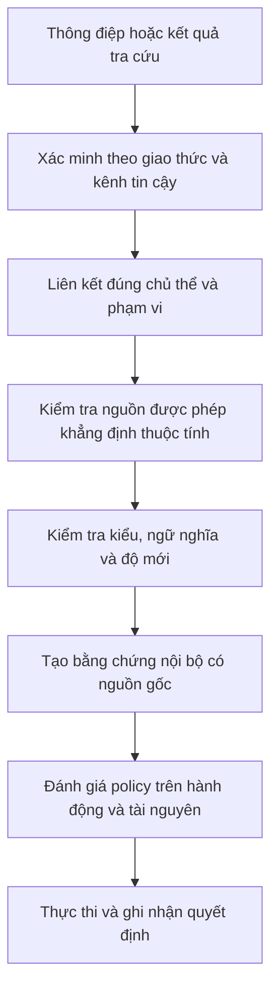

# Attribute authority — Nguồn có thẩm quyền xác nhận thuộc tính

## 1. Vì sao biết giá trị thuộc tính vẫn chưa đủ?

Một ứng dụng nhận được dữ liệu:

```json
{
  "department": "Finance",
  "employmentStatus": "ACTIVE",
  "approvalLimit": 500000000
}
```

Các giá trị có vẻ đủ để xét quyền phê duyệt một khoản chi. Nhưng trước khi sử dụng, ứng dụng cần trả lời: ai khẳng định những giá trị này, người đó có quyền xác nhận chúng cho danh tính đang xét hay không, và dữ liệu phản ánh thời điểm nào?

Nếu department do người dùng tự nhập, nó có thể phù hợp để hiển thị một hồ sơ chưa xác minh nhưng không đủ để tự cấp quyền tài chính. Nếu approvalLimit do dịch vụ quản lý hạn mức công bố theo một tích hợp đã được phê duyệt, nó có thể trở thành bằng chứng cho một điều kiện phân quyền.

**Attribute authority** là vai trò của bên phát hành hoặc cung cấp khẳng định về thuộc tính. Để bên nhận sử dụng khẳng định đó trong IAM, bên nhận phải thiết lập nguồn này có thẩm quyền đối với thuộc tính, chủ thể và phạm vi cụ thể nào. Danh xưng authority không tự tạo ra sự tin cậy toàn cục.

Trong bài học này, khái niệm được dùng để phân tích nguồn dữ liệu danh tính và quan hệ tin cậy giữa các hệ thống. Ở ngữ cảnh SAML, Attribute Authority còn là thuật ngữ giao thức cụ thể: một thực thể tạo các assertion về thuộc tính. [OASIS — SAML 2.0 Glossary](https://docs.oasis-open.org/security/saml/v2.0/saml-glossary-2.0-os.pdf)

Câu hỏi quan trọng không chỉ là “thuộc tính có giá trị gì?” mà còn là “giá trị này được chấp nhận trên cơ sở thẩm quyền và bằng chứng nào?”.

## 2. Các vai trò cần phân biệt

Một hệ thống có thể vừa quản lý dữ liệu, vừa phát hành token và vừa quyết định quyền. Đó là lựa chọn triển khai; về mặt trách nhiệm, cần tách các vai trò để tránh hiểu nhầm.

| Vai trò | Trách nhiệm | Ví dụ |
| --- | --- | --- |
| Nguồn dữ liệu chuẩn trong một phạm vi | Quản lý giá trị được tổ chức công nhận là chuẩn | Hệ thống nhân sự quản lý trạng thái làm việc |
| Attribute authority | Khẳng định thuộc tính trong phạm vi được bên nhận chấp nhận | Dịch vụ cung cấp trạng thái nhân sự cho ứng dụng |
| Bên xác thực danh tính | Xác nhận hành vi xác thực hoặc quyền kiểm soát thông tin xác thực | IdP xác nhận người dùng đã đăng nhập |
| Bên phát hành thông điệp | Phát hành token hoặc assertion chứa dữ liệu | Broker tổng hợp dữ liệu rồi ký token |
| Bộ đồng bộ hoặc mapper | Sao chép, chuyển đổi hoặc ánh xạ dữ liệu | Connector nhân sự sang directory |
| Bộ cung cấp dữ liệu cho policy | Cung cấp thuộc tính cần cho quyết định | Dịch vụ tra cứu nhóm và hạn mức |
| Bộ quyết định quyền | Đánh giá policy | Dịch vụ quyết định được phê duyệt khoản chi hay không |
| Điểm thực thi quyền | Thực hiện cho phép hoặc từ chối | API kiểm tra quyết định trước khi ghi giao dịch |

Trong XACML, PIP là điểm cung cấp giá trị thuộc tính, PDP đánh giá policy và PEP thực thi quyết định. Những vai trò này giúp phân biệt việc cung cấp dữ kiện với việc quyết định quyền. [OASIS — XACML 3.0](https://docs.oasis-open.org/xacml/3.0/xacml-3.0-core-spec-os-en.html)

Một PIP có thể truy vấn hoặc tổng hợp từ nhiều authority. Việc dữ liệu đi qua PIP không tự làm mọi nguồn trở nên có thẩm quyền. Tương tự, một bên ký token có thể phát hành lại dữ liệu từ hệ thống khác; cần biết bên đó chịu trách nhiệm xác minh hoặc chuyển tiếp dữ liệu đến mức nào.

### 2.1. Xác thực thành công không xác nhận mọi thuộc tính

Người dùng đăng nhập thành công chứng minh điều gì phụ thuộc cơ chế xác thực và hợp đồng liên kết. Kết quả đó không tự chứng minh người dùng thuộc phòng tài chính, được quản lý máy chủ sản xuất hoặc có hạn mức phê duyệt cao.

Trong SAML, Authentication Authority và Attribute Authority là hai vai trò khác nhau về loại assertion được tạo. Một triển khai có thể đảm nhận cả hai, nhưng không nên suy ra thẩm quyền thuộc tính chỉ từ việc nó cung cấp đăng nhập. [OASIS — SAML 2.0 Glossary](https://docs.oasis-open.org/security/saml/v2.0/saml-glossary-2.0-os.pdf)

### 2.2. Cung cấp dữ kiện không đồng nghĩa cấp quyền cuối cùng

Dịch vụ nhân sự nói “Lan đang làm việc” chưa có nghĩa Lan được xem toàn bộ hồ sơ lương. Dịch vụ hạn mức nói “Lan có hạn mức X” cũng chưa quyết định Lan được phê duyệt khoản chi do chính mình tạo.

Ứng dụng vẫn cần kết hợp dữ kiện với hành động, tài nguyên, phạm vi tenant và các ràng buộc nghiệp vụ.

## 3. Thẩm quyền gắn với thuộc tính và phạm vi

Một nguồn có thể có thẩm quyền với thuộc tính này nhưng không có thẩm quyền với thuộc tính khác.

Ví dụ một tổ chức tự thiết kế bảng phân công:

| Thuộc tính | Nguồn được chấp nhận | Phạm vi | Nguồn không tự thay thế được |
| --- | --- | --- | --- |
| Trạng thái làm việc | Hệ thống nhân sự | Nhân sự do tổ chức quản lý | Hồ sơ do người dùng tự sửa |
| Membership nhóm ứng dụng | Dịch vụ quản lý quyền | Nhóm đã được ánh xạ vào ứng dụng | Danh sách nhóm do client gửi |
| Hạn mức phê duyệt | Hệ thống quản lý ủy quyền tài chính | Loại nghiệp vụ và tenant đã định | Tên chức danh trong email |
| Trạng thái thiết bị | Hệ thống quản lý thiết bị | Thiết bị đã đăng ký | Cờ deviceCompliant từ trình duyệt |
| Chủ sở hữu tài liệu | Dịch vụ quản lý tài liệu | Đúng tài liệu được truy vấn | ownerId trong request sửa tài liệu |
| Ngôn ngữ hiển thị | Người dùng | Tùy chọn của chính người đó | Không cần dùng để cấp đặc quyền |

Bảng này là ví dụ về thiết kế trách nhiệm, không phải quy tắc bắt buộc rằng mọi doanh nghiệp phải dùng hệ thống nhân sự cho cùng một tập thuộc tính.

Một quan hệ tin cậy có thể được diễn đạt:

```text
Ứng dụng chấp nhận:
  nguồn = hr-core
  thuộc tính = employmentStatus
  đối tượng = nhân sự đã liên kết với hồ sơ nội bộ
  phạm vi = tổ chức A
  ngữ nghĩa = trạng thái làm việc theo danh mục đã thống nhất
  điều kiện = bằng chứng hợp lệ và đủ mới cho thao tác
```

Cần tránh quan hệ quá rộng như “tin mọi thuộc tính từ nguồn X”. Một nguồn nội bộ bị cấp phạm vi quá rộng có thể khẳng định quyền mà nó không có trách nhiệm nghiệp vụ quản lý.

### 3.1. Thẩm quyền là quan hệ với bên nhận

Một đối tác có thể là nguồn chuẩn cho nhân viên của chính họ. Ứng dụng của doanh nghiệp vẫn phải quyết định những thuộc tính nào của đối tác được công nhận và được dùng cho quyền nào.

Đối tác xác nhận “người này là quản trị viên hệ thống của đối tác” không tự tạo quyền quản trị nền tảng của doanh nghiệp. Hai khái niệm administrator ở hai miền có thể có ý nghĩa và phạm vi hoàn toàn khác.

### 3.2. Cùng tên thuộc tính chưa chắc cùng ý nghĩa

Hai nguồn cùng trả `status: ACTIVE` có thể đang nói về:

- Tài khoản chưa bị khóa.
- Hợp đồng nhân sự còn hiệu lực.
- Thành viên dự án đang tham gia.
- Thiết bị vừa hoàn thành kiểm tra.
- Quyền tạm thời đã được kích hoạt.

Gộp tất cả vào `active = true` có thể làm policy đánh giá sai. Cần tên thuộc tính hoặc namespace đủ rõ, kiểu dữ liệu và bảng giá trị được thống nhất.

## 4. Chất lượng thuộc tính và hợp đồng dữ liệu

Một tích hợp cần mô tả nhiều hơn URL của API và tên field. NIST SP 800-205 tập trung vào những yếu tố cần xem xét khi triển khai thuộc tính cho hệ thống kiểm soát truy cập, trong đó việc chuẩn hóa và quản lý thuộc tính là trách nhiệm cần được xác định. [NIST SP 800-205](https://csrc.nist.gov/pubs/sp/800/205/final)

Với một thuộc tính dùng để xét quyền, hợp đồng nên trả lời:

| Nội dung | Câu hỏi |
| --- | --- |
| Định nghĩa | Thuộc tính phản ánh chính xác sự kiện hoặc trạng thái gì? |
| Chủ thể | Nó thuộc người dùng, tài khoản, thiết bị hay workload nào? |
| Kiểu dữ liệu | Chuỗi, số, thời điểm hay tập nhiều giá trị? |
| Đơn vị | Hạn mức dùng tiền tệ gì, số đo dùng đơn vị nào? |
| Tập giá trị | ACTIVE và SUSPENDED được hiểu thế nào? |
| Nguồn | Ai quản lý, ai được sửa và ai phát hành khẳng định? |
| Phạm vi | Có hiệu lực ở tổ chức, tenant hoặc loại tài nguyên nào? |
| Thời gian | Khi nào quan sát, khi nào bắt đầu và hết hiệu lực? |
| Khi thiếu | Thiếu dữ liệu khác với giá trị phủ định ra sao? |
| Mâu thuẫn | Nguồn nào được dùng và khi nào phải báo xung đột? |
| Biến đổi | Có ánh xạ hoặc tính toán từ dữ liệu khác không? |
| Vòng đời | Sửa sai, thu hồi và thay nguồn được xử lý thế nào? |

Ví dụ, `approvalLimit = 500000000` chưa đủ nếu không biết đó là VND hay một đơn vị tiền tệ khác, áp dụng cho loại giao dịch nào và có hạn chế theo tenant không.

### 4.1. Tự khai có thể hợp lệ trong đúng mục đích

Không phải mọi thuộc tính do người dùng khai đều vô ích. Người dùng có thể là nguồn phù hợp cho ngôn ngữ hiển thị hoặc tên gọi muốn dùng trên giao diện, nếu ứng dụng cho phép.

Điều cần tránh là chuyển một thuộc tính tự khai sang mục đích yêu cầu bằng chứng mạnh hơn mà không có bước xác minh. Một tên công ty trong hồ sơ cá nhân không tự chứng minh quan hệ lao động để cấp quyền dữ liệu doanh nghiệp.

### 4.2. Metadata quản trị không tự tạo kiểm soát

Ghi `authoritative: true` vào JSON hoặc mô tả connector không làm dữ liệu trở thành chuẩn. Cần kiểm soát thực tế đối với nguồn, quyền sửa, cách xác minh thông điệp và phạm vi mà bên nhận chấp nhận.

Tương tự, khai báo một field là read-only ở API chỉ mô tả một loại quyền ghi trên giao diện đó. Nó chưa chứng minh giá trị không thể bị thay từ nguồn khác hoặc luôn chính xác về nghiệp vụ.

## 5. Gắn thuộc tính với đúng chủ thể

Một authority đáng tin vẫn có thể cung cấp dữ liệu bị ứng dụng gắn nhầm người. Vì vậy, thẩm quyền nguồn phải đi cùng việc liên kết chủ thể chính xác.

Giả sử có hai hệ thống:

```text
IdP:
  issuer = login-company-a
  subject = user-145

Nhân sự:
  employeeId = employee-820
```

Ứng dụng cần một quan hệ liên kết được quản lý giữa hai khóa. Không tự kết luận chúng là cùng người chỉ vì cùng tên hiển thị hoặc cùng một địa chỉ email mà người dùng có thể thay.

Những tình huống dễ gây nhầm:

- Hai tổ chức có tài khoản cùng phần định danh cục bộ.
- Email được đổi hoặc cấp lại.
- Một người có tài khoản nhân viên và tài khoản khách mời.
- Một tài khoản dịch vụ được đặt tên giống nhân viên.
- Dữ liệu đồng bộ dùng nhầm khóa ngoại.

Ví dụ, một response đúng từ hệ thống nhân sự về employee-820 không chứng minh employee-820 là người đang gọi API. Mối liên kết này phải được xác minh theo mô hình tích hợp.

### 5.1. Phân biệt chủ thể và bên đang gọi

Một dịch vụ có thể gọi API thuộc tính thay mặt người dùng. Bên gọi trực tiếp là dịch vụ; chủ thể mà dữ liệu nói đến là người dùng.

API cần kiểm tra dịch vụ đó được tra cứu ai và thuộc tính nào. Nếu chỉ yêu cầu bên gọi có đăng nhập rồi cho phép lấy mọi thuộc tính của mọi người, việc thu thập dữ liệu có thể vượt phạm vi cần thiết.

### 5.2. Phân biệt thuộc tính người và thuộc tính phiên

“Người này là nhân viên” và “phiên này đã đáp ứng một phương thức xác thực yêu cầu” không phải cùng loại dữ kiện. Một thuộc tính về phiên không nên được sao chép thành thuộc tính vĩnh viễn của người dùng.

Tương tự, trạng thái thiết bị cần gắn với đúng thiết bị hoặc phiên truy cập. Dùng kết quả kiểm tra một máy để công nhận mọi phiên của người đó có thể làm mất điều kiện bảo vệ mà policy định yêu cầu.

## 6. Bằng chứng và nguồn gốc của thuộc tính

Một cấu trúc nội bộ có thể giữ giá trị cùng thông tin về nguồn:

```json
{
  "subjectKey": {
    "issuer": "https://login.example.test",
    "subjectId": "user-145"
  },
  "attributeKey": "urn:example:workforce:employment-status",
  "value": "ACTIVE",
  "sourceAuthority": "hr-core",
  "scope": "organization-a",
  "observedAt": "2026-11-26T02:00:00Z",
  "validFrom": "2026-11-01T00:00:00Z",
  "evidenceRef": "hr-observation-582",
  "state": "AVAILABLE"
}
```

Đây là mô hình minh họa của ứng dụng, không phải schema chuẩn của SAML, OIDC hoặc SCIM. Các field chỉ có giá trị bảo mật khi được tạo và kiểm soát bởi những thành phần đáng tin trong kiến trúc.

Cần phân biệt:

- `sourceAuthority`: nguồn mà hệ thống đã xác nhận có trách nhiệm về thuộc tính.
- Bên phát hành token hoặc response: thành phần tạo thông điệp mà ứng dụng trực tiếp nhận.
- `observedAt`: thời điểm quan sát theo hợp đồng, không nhất thiết là thời điểm thuộc tính bắt đầu đúng.
- `validFrom`: thời điểm giá trị bắt đầu được áp dụng, nếu nguồn cung cấp ý nghĩa này.
- `evidenceRef`: tham chiếu phục vụ điều tra, không phải một bằng chứng mật mã tự có hiệu lực.
- `state`: kết quả có dữ liệu, thiếu, không thể xác minh hoặc đang mâu thuẫn theo mô hình đã định.

Một chuỗi ghi `sourceAuthority = hr-core` do client gửi không chứng minh dữ liệu đến từ nhân sự. Ngay cả khi nó nằm trong thông điệp có chữ ký, bên nhận vẫn cần biết bên ký được phép khẳng định nguồn gốc đó theo quan hệ tin cậy nào.

Thông tin nguồn gốc giúp theo dấu dữ liệu qua các bước sao chép và chuyển đổi. Nó không thay thế kiểm soát nguồn và trách nhiệm xác minh.

## 7. Một chuỗi xác minh trước khi dùng thuộc tính

Không nên đưa mọi dữ liệu nhận được trực tiếp vào hàm xét quyền. Một luồng xử lý có thể tách thành các bước:



Thứ tự triển khai chi tiết có thể khác, nhưng các trách nhiệm phải được giải quyết. Ví dụ:

1. Xác minh thông điệp theo đúng cơ chế của tích hợp, không chỉ giải mã payload.
2. Xác nhận dữ liệu nói về đúng danh tính hoặc tài nguyên đang xét.
3. Kiểm tra nguồn được công nhận cho đúng thuộc tính và scope.
4. Phân tích giá trị theo schema đã định.
5. Kiểm tra giá trị có đáp ứng yêu cầu thời gian của thao tác không.
6. Chỉ sau đó mới sử dụng nó như dữ kiện của policy.

### 7.1. Bảo vệ kênh và thẩm quyền dữ liệu là hai điều khác nhau

Một kết nối TLS tới một dịch vụ đã xác thực giúp bảo vệ và nhận diện kênh theo cấu hình. Nó không tự chứng minh dịch vụ đó có quyền cấp mọi thuộc tính.

Tương tự, chữ ký hợp lệ của token chứng minh tính xác thực và toàn vẹn theo cơ chế xác minh được dùng. Nó không tự bảo đảm giá trị đúng về nghiệp vụ, còn mới hoặc được bên nhận chấp nhận cho quyền đang xét.

Ví dụ, nhà cung cấp đăng nhập đối tác ký `platformAdmin = true`. Ứng dụng có thể xác minh đúng chữ ký của đối tác nhưng vẫn phải từ chối dùng claim này để cấp quản trị toàn nền tảng nếu không có ánh xạ được chấp thuận.

### 7.2. Trust không bắt đầu từ dữ liệu tự khai

Ứng dụng cần cấu hình hoặc cơ chế thiết lập tin cậy đã được quản lý để biết nguồn nào được chấp nhận. Không để thông điệp tự chọn một issuer bất kỳ, tự cung cấp khóa rồi coi việc xác minh bằng khóa đó là đủ.

Một issuer hoặc nguồn mới cần được tiếp nhận theo quy trình phù hợp với hệ thống. Khả năng truy cập được endpoint công khai không đồng nghĩa ứng dụng đã công nhận authority của endpoint.

## 8. Attribute authority trong SAML

SAML có các statement mô tả những loại thông tin khác nhau. `AttributeStatement` biểu diễn các thuộc tính về chủ thể của assertion; giao thức cũng có `AttributeQuery` để truy vấn thuộc tính. [OASIS — SAML 2.0 Core](https://docs.oasis-open.org/security/saml/v2.0/saml-core-2.0-os.pdf)

Trong một triển khai, IdP có thể gửi thuộc tính cùng kết quả đăng nhập. Một triển khai khác có thể có dịch vụ authority riêng để phục vụ truy vấn. Không bắt buộc mọi ứng dụng phải có một máy chủ AA độc lập chỉ vì muốn quản lý nguồn thuộc tính rõ ràng.

Khi nhận thuộc tính SAML, ứng dụng cần quan tâm cả việc xác minh assertion theo profile áp dụng lẫn ý nghĩa của các thuộc tính được tin cậy:

| Nhóm kiểm tra | Ví dụ điều cần xác nhận |
| --- | --- |
| Thông điệp | Bên phát hành và cơ chế bảo vệ có phù hợp với trust đã thiết lập? |
| Bên nhận | Assertion có được dùng cho đúng ứng dụng và luồng không? |
| Chủ thể | Thuộc tính có gắn đúng danh tính đang đăng nhập hoặc được truy vấn? |
| Thời gian và điều kiện | Các điều kiện chấp nhận của assertion có được đáp ứng? |
| Thuộc tính | Tên, định dạng tên, kiểu giá trị và scope có đúng hợp đồng? |
| Thẩm quyền | Nguồn này có được cấp quyền khẳng định thuộc tính đó cho bên nhận? |

Những mục trên là khung phân tích; kiểm tra chi tiết phải theo profile SAML thực sự triển khai. Không thay một bộ thư viện xác minh giao thức bằng việc tự đọc vài field XML và tìm thấy tên thuộc tính mong muốn.

Một assertion có thể mang thông tin do nhiều hệ thống phía sau đóng góp. Nếu ứng dụng chỉ tin issuer cuối, cần xác định trách nhiệm mà issuer cuối nhận: nó kiểm chứng nguồn gốc, chỉ sao chép hay thực hiện ánh xạ được phê duyệt. Trách nhiệm này phải thuộc hợp đồng tích hợp.

## 9. Claims Provider và nguồn thuộc tính trong OIDC

OIDC có claim do OpenID Provider trực tiếp khẳng định. Nó cũng mô tả aggregated claims và distributed claims từ Claims Provider khác; hai dạng sau là khả năng tùy chọn. Dữ liệu có thể được chuyển kèm hoặc tham chiếu để lấy từ nguồn khác. [OpenID Connect Core — Claim Types](https://openid.net/specs/openid-connect-core-1_0.html#ClaimTypes)

Điều đó cho thấy bên phát hành thông tin đăng nhập và nguồn của mọi thuộc tính không nhất thiết luôn trùng nhau.

Khi thiết kế tích hợp, cần giải quyết:

- Claims Provider nào được chấp nhận cho thuộc tính cần dùng.
- Quan hệ liên kết giữa định danh tại các nguồn.
- Cơ chế xác minh và lấy dữ liệu được profile yêu cầu.
- Những gì ứng dụng thực hiện khi một claim được yêu cầu nhưng không được trả về.

Không giả định định danh cục bộ ở hai Claims Provider có thể so trực tiếp. Ứng dụng cần liên kết chủ thể theo hợp đồng; không ghép tùy ý bằng email.

### 9.1. Scope yêu cầu dữ liệu không tự tạo quyền nghiệp vụ

Việc một ứng dụng được nhận một claim không đồng nghĩa claim đó tự cấp quyền tài nguyên. Một sự đồng ý chia sẻ thông tin hồ sơ cũng không trao cho nguồn hồ sơ quyền quản lý đặc quyền của ứng dụng.

Ví dụ, client có thể được lấy thông tin tên và phòng ban để hiển thị. Muốn dùng phòng ban để xét truy cập tài liệu mật, bên nhận cần đánh giá thêm nguồn, độ tin cậy và policy tương ứng.

### 9.2. Đúng loại token và đúng mục đích

Dữ liệu nhận qua luồng đăng nhập không nên được dùng tùy ý thay thông tin ủy quyền của API. Phải tuân theo vai trò của ID token, access token và các endpoint trong tích hợp.

Cũng không nên giả định mọi token đều chứa đầy đủ nguồn gốc của từng thuộc tính. Nếu token chỉ có giá trị đã chuẩn hóa mà thiếu provenance, bên nhận cần dựa vào trách nhiệm đã thỏa thuận với bên phát hành hoặc dùng đường tra cứu khác khi thao tác yêu cầu bằng chứng chi tiết hơn.

## 10. SCIM, đồng bộ và bản sao dữ liệu

SCIM định nghĩa schema để trao đổi các tài nguyên như User và Group. Việc dữ liệu đi qua SCIM không tự chứng minh hệ thống gửi là nguồn chuẩn của mọi field. Cần quản lý quyền ghi và trách nhiệm của từng bên theo hợp đồng tích hợp. [IETF — RFC 7643](https://www.rfc-editor.org/rfc/rfc7643.html)

Giả sử dữ liệu đi theo chuỗi:

```text
Hệ thống nhân sự
  -> directory
  -> connector cấp phát
  -> hồ sơ cục bộ của ứng dụng
```

Ứng dụng nhận dữ liệu từ connector nhưng nguồn chuẩn về trạng thái làm việc vẫn có thể là hệ thống nhân sự. Directory và connector có trách nhiệm truyền tải, ánh xạ và cập nhật theo thiết kế.

Các câu hỏi cần làm rõ:

1. Field nào được nguồn ngoài sở hữu?
2. Quản trị viên ứng dụng có được sửa field đó tại bản sao không?
3. Nếu sửa, lần đồng bộ sau ghi đè, báo xung đột hay giữ giá trị nào?
4. Việc thiếu field trong một phản hồi có ý nghĩa gì theo loại thao tác?
5. Khi nguồn chuẩn gỡ hoặc sửa dữ liệu, bản sao nào cần được cập nhật?
6. Dấu vết phiên bản và thời điểm ở từng bước được lưu thế nào?

Một giá trị ở cơ sở dữ liệu cục bộ không tự trở thành nguồn chuẩn chỉ vì policy đọc nó trực tiếp. Nếu đó là bản sao có độ trễ, đặc điểm này phải được tính vào quyết định.

### 10.1. Tránh nhiều nơi cùng ghi nhưng không có quy tắc

Nếu nhân sự và người dùng đều sửa department mà không xác định quyền sở hữu, giá trị có thể thay đổi theo lần ghi cuối. Nếu department dùng để tự động cấp nhóm, xung đột dữ liệu trở thành xung đột quyền.

Có thể tách thuộc tính phục vụ hiển thị do người dùng chọn khỏi thuộc tính nhân sự dùng cho quyền. Cách tách cụ thể phụ thuộc sản phẩm, nhưng cần giữ rõ mục đích và thẩm quyền của từng field.

## 11. Thuộc tính suy ra cần giữ trách nhiệm của bước tính toán

Một thuộc tính có thể không được lưu nguyên bản tại một authority mà được tính từ nhiều dữ kiện.

Ví dụ ứng dụng tạo:

```text
invoiceApprovalEligible =
    employmentStatus là ACTIVE từ nguồn nhân sự
    AND có quyền phê duyệt được hệ thống ủy quyền xác nhận
    AND hạn mức đáp ứng loại giao dịch đang xét
```

Nguồn tạo thuộc tính suy ra chịu trách nhiệm về logic, dữ liệu đầu vào và phạm vi kết quả. Nó không nên được mô tả như thể toàn bộ kết luận do một nguồn đầu vào duy nhất khẳng định.

Một bản ghi nguồn gốc có thể lưu:

```json
{
  "attributeKey": "urn:example:finance:approval-eligibility",
  "value": true,
  "producedBy": "approval-eligibility-service",
  "ruleVersion": "eligibility-rule-7",
  "scope": "tenant-a/invoice-approval",
  "inputEvidenceRefs": [
    "employment-observation-582",
    "delegation-observation-910",
    "limit-observation-235"
  ]
}
```

Đây là cấu trúc minh họa, không phải chuẩn liên kết danh tính. Nó giúp phân biệt ai xác nhận dữ kiện và ai chịu trách nhiệm cho phép biến đổi.

Những lỗi dễ xuất hiện:

- Chuyển giá trị tự khai thành claim quyền mà làm mất nhãn nguồn.
- Gộp nhiều loại trạng thái thành một boolean.
- Bỏ đơn vị tiền tệ khi chuyển hạn mức.
- Mở rộng nhóm nhưng không giữ thông tin cách suy ra.
- Đổi tên thuộc tính khiến bên nhận tưởng nó có phạm vi lớn hơn.
- Dùng lại kết quả suy ra sau khi một đầu vào quan trọng đã hết hiệu lực.

Không nhất thiết phải gửi mọi provenance cho mọi client. Hệ thống cần giữ đủ dấu vết ở nơi có trách nhiệm để điều tra và thực hiện quản trị quyền.

### 11.1. Tính nhất quán giữa các đầu vào

Dữ liệu từ nhiều nguồn có thể phản ánh những thời điểm khác nhau. Policy phải xác định khi nào sự lệch này chấp nhận được và khi nào cần đọc lại hoặc kiểm tra bổ sung.

Không đòi mọi timestamp phải giống hệt nhau một cách máy móc. Điều cần bảo vệ là các bất biến nghiệp vụ, chẳng hạn người đã hết nhiệm vụ không tiếp tục dùng một quyền ủy quyền còn nằm trong cache.

## 12. Xử lý nguồn mâu thuẫn

Giả sử:

```text
Nguồn nhân sự: employmentStatus = TERMINATED
Hồ sơ ứng dụng: employmentStatus = ACTIVE
```

Nếu nhân sự đã được chỉ định là nguồn chuẩn và hồ sơ ứng dụng chỉ là bản sao, không nên hợp hai giá trị rồi chọn ACTIVE cho thuận tiện.

Một cơ chế xử lý có thể phân biệt:

| Tình huống | Hướng xử lý theo thiết kế |
| --- | --- |
| Nguồn chuẩn và bản sao khác nhau | Kiểm tra độ trễ, cập nhật hoặc dừng dùng bản sao nếu quá hạn |
| Hai nguồn quản lý các loại chủ thể khác nhau | Chọn nguồn theo miền chủ thể đã được xác định |
| Hai nguồn có phạm vi khác nhau | Giữ scope, không gộp thành quyền toàn cục |
| Nguồn chuẩn không truy cập được | Xử lý thiếu bằng chứng theo yêu cầu của thao tác |
| Hai nguồn cùng được cấu hình có thẩm quyền nhưng bất đồng | Báo xung đột hoặc dùng quy tắc đã được phê duyệt |
| Một nguồn tự khai mâu thuẫn với nguồn đã xác minh | Không nâng nguồn tự khai lên mức thay thế cho thuộc tính được bảo vệ |

### 12.1. Vì sao timestamp mới hơn chưa chắc thắng?

Nguồn ít có thẩm quyền có thể trả dữ liệu mới hơn. Một timestamp mới từ hồ sơ người dùng không thể tự ghi đè hạn mức tài chính do nguồn quản lý ủy quyền xác nhận.

Ngay trong cùng một nguồn, cần biết timestamp biểu diễn lúc nào: thời điểm quan sát, lúc phát hành thông điệp hay thời điểm có hiệu lực. Nếu có số phiên bản, chỉ so sánh theo quy tắc mà nguồn bảo đảm; không so các bộ đếm của hai hệ thống như thể chúng cùng thang đo.

### 12.2. Không lấy nguồn dự phòng yếu hơn để mở quyền

Nguồn dự phòng có thể phù hợp nếu đã được phê duyệt cho cùng ngữ nghĩa và mức bảo đảm. Nhưng khi nguồn nhân sự lỗi, thay bằng department do người dùng khai không phải một giải pháp tương đương.

Khi một thao tác bắt buộc bằng chứng mà hiện không có, cần xử lý trạng thái đó rõ ràng thay vì tự thay nguồn để tiếp tục cho phép.

## 13. Độ mới, thời gian hiệu lực và thu hồi

Cần phân biệt ít nhất ba thời điểm:

- Khi sự kiện hoặc trạng thái bắt đầu có hiệu lực.
- Khi một thành phần quan sát được giá trị.
- Khi token hoặc response chứa giá trị được phát hành.

Ví dụ giả định:

| Thời điểm | Sự kiện |
| --- | --- |
| 09:00 | Bản sao directory quan sát nhân viên đang hoạt động |
| 09:05 | Nguồn nhân sự ghi nhận kết thúc nhiệm vụ có hiệu lực |
| 09:08 | IdP phát hành token dựa trên bản sao chưa cập nhật |
| 09:10 | Ứng dụng nhận token mới và xét quyền |
| 09:12 | Directory nhận thay đổi từ nguồn nhân sự |

Token phát hành lúc 09:08 không làm quan sát từ 09:00 trở nên mới hơn. Nếu thao tác yêu cầu trạng thái nhân sự gần thời điểm thực thi, ứng dụng phải biết nguồn và cơ chế nào đáp ứng yêu cầu đó.

### 13.1. Độ mới phụ thuộc thao tác

Một tên hiển thị được cache lâu có thể chỉ làm giao diện chậm cập nhật. Trạng thái đặc quyền hoặc hạn mức phê duyệt bị cũ có thể làm thao tác được cho phép sau khi quyền đã bị gỡ.

Hệ thống có thể đặt yêu cầu độ mới khác nhau theo loại thuộc tính và hành động. Không nhất thiết tra cứu nguồn trực tiếp cho mọi lần hiển thị trang, nhưng cần thiết kế đường xét quyền cho thao tác nhạy cảm.

### 13.2. Hết hạn token và thu hồi thuộc tính không trùng nhau

Token còn thời hạn có thể chứa thuộc tính đã thay đổi. Ngược lại, token hết thời hạn phải được xử lý theo giao thức dù dữ liệu nghiệp vụ bên trong vẫn tình cờ đúng.

Muốn thu hồi có hiệu quả cần xét các bản sao, token, phiên, cache và quyết định đã được lưu. Mục tiêu thu hồi phải nêu rõ đường truy cập nào cần dừng trong khoảng thời gian nào và cách xác minh kết quả.

Đọc lại một mục cache không được tự thay `observedAt` bằng thời điểm đọc rồi kéo dài độ mới. Chỉ một quan sát mới theo cơ chế tin cậy mới có thể tạo bằng chứng mới theo hợp đồng tương ứng.

## 14. Khi nguồn không trả lời hoặc dữ liệu không dùng được

Không phải mọi phản hồi đều có thể rút gọn thành true hoặc false. Có thể cần các trạng thái nội bộ:

| Trạng thái | Ý nghĩa |
| --- | --- |
| AVAILABLE | Có giá trị đáp ứng hợp đồng bằng chứng |
| ABSENT | Đã xác minh việc không có giá trị trong phạm vi truy vấn |
| UNAVAILABLE | Không lấy được dữ liệu cần thiết |
| INVALID | Dữ liệu hoặc thông điệp không đáp ứng kiểm tra |
| STALE | Bằng chứng quá cũ cho quyết định đang xét |
| CONFLICT | Có mâu thuẫn chưa được xử lý theo policy |

Đây là danh mục minh họa của ứng dụng, không phải bộ mã chung cho mọi giao thức.

Nếu employmentStatus không lấy được, không đổi lỗi thành ACTIVE để duy trì thao tác phê duyệt. Nếu cần xác minh người dùng không nằm trong danh sách hạn chế, việc nguồn timeout cũng chưa chứng minh điều kiện phủ định.

Ứng dụng có thể từ chối thao tác cần bằng chứng hoặc yêu cầu thử lại, đồng thời giữ những chức năng có policy độc lập vẫn hoạt động. Không nhất thiết một lỗi thuộc tính làm dừng mọi phần của hệ thống.

### 14.1. Kiểm soát sự phụ thuộc vào authority

Nguồn thuộc tính có thể trở thành một điểm phụ thuộc quan trọng. Thiết kế cần cân bằng yêu cầu cập nhật với khả năng hoạt động:

- Chọn thuộc tính thực sự cần cho mỗi loại quyết định.
- Dùng cache trong phạm vi độ mới được chấp nhận.
- Giới hạn và theo dõi truy vấn để tránh làm nguồn quá tải.
- Có quy tắc rõ khi nguồn lỗi hoặc không đủ dữ liệu.
- Kiểm tra sự kiện cập nhật và đối soát để phát hiện sai lệch.

Không biến cơ chế dự phòng thành đường bỏ qua kiểm soát. Nếu một chế độ xử lý khẩn cấp được tổ chức cho phép, nó cần quyền, phạm vi, thời hạn và ghi nhận riêng thay vì âm thầm coi dữ liệu thiếu là đạt yêu cầu.

## 15. Ví dụ tổng thể: phê duyệt chi phí cho nhiều tenant

Một ứng dụng nhận yêu cầu từ người dùng Lan để phê duyệt khoản chi của tenant A. Các nguồn được tổ chức phân công:

| Dữ kiện | Nguồn được chấp nhận trong ví dụ |
| --- | --- |
| Danh tính đã đăng nhập | IdP đã được liên kết |
| Trạng thái làm việc | HR authority của tổ chức tương ứng |
| Quyền tham gia quy trình phê duyệt | Dịch vụ quản lý ủy quyền |
| Hạn mức | Authority tài chính theo tenant và loại giao dịch |
| Tenant, số tiền và người tạo khoản chi | Kho nghiệp vụ của ứng dụng |
| Điều kiện của phiên | Thành phần quản lý phiên theo tích hợp đã định |

Luồng xét quyền:

```text
1. Xác minh yêu cầu và danh tính người gọi.
2. Đọc khoản chi từ kho nghiệp vụ trong ngữ cảnh truy cập phù hợp.
3. Xác định policy và nguồn thuộc tính được phép cho tenant của khoản chi.
4. Liên kết danh tính với khóa chủ thể tại các nguồn.
5. Lấy và kiểm tra bằng chứng cho từng thuộc tính bắt buộc.
6. Đánh giá trạng thái làm việc, quyền ủy quyền, hạn mức và điều kiện phiên.
7. Kiểm tra người phê duyệt không vi phạm ràng buộc nghiệp vụ.
8. Thực hiện cập nhật với cơ chế kiểm soát đồng thời phù hợp.
9. Ghi nhận quyết định và nguồn bằng chứng cần cho điều tra.
```

Nguồn tài chính của tenant B không được dùng để xác nhận hạn mức cho khoản chi tenant A chỉ vì cả hai trả cùng một tên field.

Nếu Lan là nhân viên đang hoạt động nhưng không có quyền ủy quyền phê duyệt, ứng dụng từ chối theo policy. Nếu Lan có quyền và hạn mức nhưng là người tạo khoản chi, ràng buộc tách biệt trách nhiệm có thể tiếp tục ngăn thao tác.

### 15.1. Ví dụ kiểm tra bằng chứng trong Java

Đoạn code sau minh họa riêng việc kiểm tra một bằng chứng đã được adapter tin cậy xác minh. Các record không tự xác thực dữ liệu; không tạo chúng trực tiếp từ request của người dùng rồi gọi là bằng chứng hợp lệ.

```java
import java.time.Duration;
import java.time.Instant;

public final class AttributeAuthorityExample {

    record SubjectKey(String issuer, String subjectId) {}

    record SourceKey(String publisherId, String authorityId) {}

    record ValidatedAttribute(
            SubjectKey subject,
            String attributeKey,
            String scope,
            SourceKey source,
            String value,
            Instant observedAt,
            Instant acceptUntil) {}

    record TrustRule(
            String attributeKey,
            String scope,
            SourceKey acceptedSource,
            Duration maxAge) {}

    static boolean canUseEvidence(
            ValidatedAttribute attribute,
            TrustRule rule,
            SubjectKey expectedSubject,
            String targetScope,
            Instant now) {

        if (!expectedSubject.equals(attribute.subject())) {
            return false;
        }

        if (!rule.attributeKey().equals(attribute.attributeKey())
                || !rule.scope().equals(attribute.scope())
                || !rule.scope().equals(targetScope)) {
            return false;
        }

        if (!rule.acceptedSource().equals(attribute.source())) {
            return false;
        }

        if (rule.maxAge().isNegative() || rule.maxAge().isZero()) {
            return false;
        }

        if (!now.isBefore(attribute.acceptUntil())) {
            return false;
        }

        Duration age = Duration.between(attribute.observedAt(), now);
        return !age.isNegative() && age.compareTo(rule.maxAge()) < 0;
    }
}
```

Mẫu giả định dữ liệu bắt buộc đã được kiểm tra khác null. Adapter phía trước đã thực hiện việc xác minh giao thức, schema, liên kết chủ thể và điều kiện có hiệu lực theo tích hợp. `TrustRule` do cấu hình server quản lý.

`publisherId` là bên phát hành trực tiếp; `authorityId` biểu diễn nguồn thuộc tính mà tích hợp đã xác nhận. Một chuỗi được ghi vào `authorityId` không tự chứng minh quan hệ này. Với đường qua broker, adapter phải biết broker được phép xác nhận hoặc chuyển tiếp nguồn nào.

`acceptUntil` là giới hạn chấp nhận bằng chứng trong mô hình nội bộ, được xác định từ hợp đồng và policy. Nó không đòi mọi nguồn bên ngoài đều có cùng tên field hoặc luôn cung cấp một thời điểm hết hạn.

Hàm trả true mới chỉ cho biết bằng chứng phù hợp với rule trong mẫu. Policy còn phải kiểm tra `value`, chẳng hạn employmentStatus là ACTIVE, và các điều kiện về tài nguyên. Một bằng chứng hợp lệ có giá trị TERMINATED không được chuyển thành quyền cho phép chỉ vì đã vượt qua kiểm tra nguồn.

Trong triển khai thực tế, nên giữ lý do thất bại riêng để phân biệt sai chủ thể, sai scope, nguồn không được chấp nhận và bằng chứng cũ. Cũng cần bảo vệ dữ liệu giữa lúc xét và lúc thực thi theo yêu cầu nghiệp vụ.

## 16. Quản trị authority và quyền thay đổi quan hệ tin cậy

### 16.1. Tiếp nhận một nguồn mới

Trước khi dùng nguồn mới cho phân quyền, cần làm rõ:

- Thuộc tính nào được nguồn quản lý.
- Nguồn có thẩm quyền với chủ thể và scope nào.
- Quy trình xác minh, cập nhật và sửa sai.
- Cách bảo vệ giao tiếp và nhận diện bên phát hành.
- Ngữ nghĩa, schema và yêu cầu thời gian.
- Quy tắc giải quyết thiếu dữ liệu và mâu thuẫn.
- Quyền tra cứu và giới hạn tiết lộ thông tin.
- Khả năng thu hồi trust hoặc thay nguồn.

Trong liên kết danh tính, các quan hệ và thỏa thuận tin cậy là phần quan trọng của việc bên nhận sử dụng assertion từ hệ thống khác. Không nên coi cấu hình kỹ thuật để nhận token là toàn bộ thỏa thuận đó. [NIST SP 800-63C — Federation and Assertions](https://pages.nist.gov/800-63-4/sp800-63c.html)

### 16.2. Ai sửa được cấu hình authority?

Một người được đổi nguồn chuẩn cho approvalLimit có thể gián tiếp thay đổi quyền phê duyệt của nhiều người. Người sửa mapping nhóm hoặc quy tắc chuyển đổi cũng có thể tạo ảnh hưởng tương tự.

Cần quản lý quyền:

| Loại thay đổi | Ảnh hưởng có thể có |
| --- | --- |
| Thêm issuer hoặc endpoint tin cậy | Chấp nhận dữ liệu từ một bên mới |
| Mở rộng thuộc tính được nguồn khẳng định | Tăng phạm vi authority |
| Mở rộng tenant hoặc nhóm chủ thể | Cho dữ liệu tác động sang miền khác |
| Đổi mapping hoặc quy tắc suy ra | Thay ý nghĩa dữ liệu trong policy |
| Nới thời gian dùng cache | Kéo dài việc dùng trạng thái cũ |
| Đổi cách xử lý khi nguồn lỗi | Có thể tạo đường cho phép ngoài ý định |

Đây là những quyền quản trị kiểm soát truy cập, không chỉ là cấu hình tích hợp thông thường. Cần có lịch sử thay đổi và cơ chế xem xét phù hợp với mức ảnh hưởng.

### 16.3. Luân chuyển khóa không đồng nghĩa đổi thẩm quyền

Khóa và chứng thư có vòng đời kỹ thuật. Việc cập nhật khóa theo quy trình tin cậy không nên tự làm nguồn được cấp thêm thuộc tính hoặc tenant.

Ngược lại, thu hồi thẩm quyền nghiệp vụ của một nguồn có thể cần cập nhật trust policy dù khóa của nó vẫn còn hợp lệ về kỹ thuật.

### 16.4. Sửa sai và ngừng sử dụng một nguồn

Khi phát hiện dữ liệu sai, không chỉ sửa tại nguồn rồi mặc định mọi hệ thống đã hết ảnh hưởng. Cần xác định bản sao, kết quả suy ra, cache và quyền đã được cấp dựa trên dữ liệu đó.

Khi thay authority, nên quản lý phạm vi chuyển đổi rõ ràng, kiểm tra ánh xạ chủ thể và so sánh quyết định trên các trường hợp quan trọng. Có hai nguồn hoạt động đồng thời không nên làm ứng dụng tự hợp giá trị hoặc lấy quyền rộng hơn.

## 17. Quan sát và điều tra quyết định

Một bản ghi quyết định cần giúp trả lời:

```text
Ai yêu cầu hành động gì trên tài nguyên nào?
Thuộc tính nào đã tham gia quyết định?
Nguồn nào được công nhận cho các thuộc tính đó?
Dữ liệu được quan sát khi nào và qua bước biến đổi nào?
Policy hoặc mapping phiên bản nào được sử dụng?
Kết quả và lý do là gì?
```

Có thể lưu tham chiếu bằng chứng thay vì chép nguyên hồ sơ, token hoặc thông tin nhạy cảm vào mọi log. Quyền xem log và dữ liệu nguồn cũng cần được kiểm soát.

### 17.1. Phân biệt lỗi dữ liệu và lỗi policy

| Quan sát | Hướng kiểm tra |
| --- | --- |
| Giá trị đúng tại nguồn nhưng sai trong ứng dụng | Đồng bộ, mapping, cache và thời điểm quan sát |
| Nguồn trả đúng người nhưng ứng dụng xét nhầm | Liên kết chủ thể và khóa truy vấn |
| Token được chấp nhận nhưng quyền quá rộng | Phạm vi trust, mapping và policy tài nguyên |
| Nguồn ngoài cấp được quyền nội bộ | Quyền khẳng định thuộc tính và giới hạn tenant |
| Dữ liệu bị từ chối dù có chữ ký hợp lệ | Scope, authority, schema, độ mới và mục đích token |
| Thu hồi tại nguồn nhưng quyền vẫn còn | Bản sao, phiên, token, quyền cục bộ hoặc kết quả suy ra |

Không xử lý mọi trường hợp từ chối bằng cách bỏ kiểm tra issuer hoặc dùng bất kỳ nguồn nào trả được dữ liệu. Điều tra cần xác định điều kiện nào đang thiếu và nó có đúng với mục tiêu policy không.

### 17.2. Tối thiểu hóa thông tin được phát hành

Một authority không cần gửi mọi thuộc tính mà nó có cho mọi ứng dụng. Hệ thống nên cung cấp phần dữ liệu cần thiết cho mục đích đã được chấp thuận.

Nếu một quyết định chỉ cần biết một quyền ủy quyền có hiệu lực hay không, không nhất thiết phải phát hành toàn bộ hồ sơ nhân sự. Tuy nhiên, kết quả rút gọn vẫn cần định nghĩa rõ người tạo, scope, cách suy ra và vòng đời để bên nhận dùng đúng.

## 18. Ma trận kiểm tra

Bảng sau là các trường hợp cần kiểm chứng khi triển khai, không phải báo cáo đã chạy thử một hệ thống cụ thể:

| Trường hợp | Kết quả cần kiểm chứng |
| --- | --- |
| Đúng nguồn, đúng thuộc tính, đúng chủ thể và scope | Dữ liệu được xét theo policy nghiệp vụ |
| Nguồn đăng nhập hợp lệ nhưng không có thẩm quyền về hạn mức | Không dùng claim để cấp hạn mức |
| Chữ ký hợp lệ từ issuer chưa được chấp nhận | Không tự thiết lập trust |
| Cùng subjectId nhưng khác miền định danh | Không gắn dữ liệu nhầm người |
| Authority của tenant B khẳng định dữ liệu cho tenant A | Không vượt phạm vi đã được cấp |
| Client gửi field sourceAuthority mong muốn | Không xem đó là bằng chứng nguồn |
| Thuộc tính tự khai trùng tên thuộc tính được bảo vệ | Không tự nâng mức tin cậy |
| Token mới phát hành nhưng quan sát đầu vào cũ | Độ mới được xét theo hợp đồng, không chỉ thời điểm token |
| Dữ liệu có đơn vị hoặc kiểu khác hợp đồng | Không dùng trực tiếp để so hạn mức |
| Nguồn chuẩn mâu thuẫn với bản sao | Xử lý theo ownership và quy tắc mâu thuẫn |
| Nguồn bắt buộc timeout | Không biến lỗi thành bằng chứng cho phép |
| Thuộc tính suy ra còn cache sau khi đầu vào bị gỡ | Không tiếp tục dùng vượt policy thu hồi |
| Khóa được luân chuyển theo quy trình | Vẫn giữ nguyên phạm vi authority được quản lý |
| Trust bị thu hồi nhưng token kỹ thuật còn hạn | Cơ chế thu hồi trust có hiệu lực theo mục tiêu đã định |

Cần kiểm tra cả lý do quyết định. Một yêu cầu bị từ chối vì tài nguyên không tồn tại chưa chứng minh kiểm soát authority đang hoạt động. Một yêu cầu được cho phép nhờ quyền quản trị độc lập chưa chứng minh dữ liệu authority đang được dùng đúng.

## 19. Bài tập phân tích

### Tình huống 1: IdP đối tác phát hành platformAdmin

Ứng dụng đã liên kết đăng nhập với đối tác. Một token hợp lệ mang `platformAdmin = true`, và API lập tức cấp quản trị nền tảng.

**Phân tích:** Ứng dụng đã nhầm trust xác thực với thẩm quyền cấp đặc quyền nội bộ. Cần xác định nguồn được phép khẳng định thuộc tính nào và ánh xạ nó vào đúng scope. Chữ ký hợp lệ không thay quyết định này.

### Tình huống 2: Người dùng tự sửa department

Directory nhận department từ nhân sự, nhưng ứng dụng cho người dùng sửa cùng field trong hồ sơ cục bộ. Một policy cấp quyền kho dữ liệu tài chính khi department là Finance.

**Phân tích:** Hai đường ghi đang có mức tin cậy khác nhau nhưng bị gộp thành một thuộc tính quyền. Cần xác định ownership, kiểm soát quyền sửa và tách mục đích nếu cần. Việc dữ liệu nằm trong DB nội bộ không làm nó thành thuộc tính nhân sự đã xác minh.

### Tình huống 3: Token mới chứa hạn mức cũ

Authority tài chính giảm hạn mức lúc 11:00. Broker phát hành token lúc 11:05 từ cache có dữ liệu 10:30. Ứng dụng dùng thời điểm token để coi hạn mức là mới.

**Phân tích:** Thời điểm phát hành thông điệp bị nhầm với thời điểm quan sát thuộc tính. Cần định nghĩa độ mới của bằng chứng, quản lý cache và cơ chế cập nhật cho thao tác yêu cầu hạn mức.

### Tình huống 4: Lấy nguồn bất kỳ khi nguồn chuẩn lỗi

Dịch vụ nhân sự không truy cập được. Ứng dụng chuyển sang lấy trạng thái nhân viên từ một hồ sơ công khai và tiếp tục cho phép phê duyệt.

**Phân tích:** Nguồn dự phòng chưa được chứng minh có cùng thẩm quyền và ngữ nghĩa. Nếu không có bằng chứng bắt buộc, cần xử lý trạng thái thiếu theo policy, thay vì thay nguồn để mở quyền.

### Tình huống 5: Authority đúng nhưng liên kết nhầm người

API nhân sự trả đúng trạng thái của employee-820. Ứng dụng nối dữ liệu vào tài khoản người dùng khác có tên hiển thị giống nhau.

**Phân tích:** Nguồn đáng tin chưa đủ khi binding chủ thể sai. Cần một ánh xạ danh tính được quản lý và kiểm tra, không dựa vào tên hiển thị.

## 20. Những điều người học cần làm được

Người học cần phân biệt bên xác thực danh tính, bên phát hành thông điệp, nguồn có thẩm quyền về thuộc tính và bên quyết định quyền. Với mỗi thuộc tính được dùng trong IAM, cần chỉ rõ định nghĩa, chủ thể, nguồn, scope và yêu cầu thời gian.

Khi đánh giá một tích hợp, hãy theo dấu dữ liệu từ nguồn quản lý qua đồng bộ, broker, token và cache tới policy. Mỗi bước biến đổi hoặc sao chép phải có trách nhiệm rõ ràng để dữ liệu không bị nâng mức tin cậy hay mở rộng phạm vi ngoài ý định.

Attribute authority giúp hệ thống trả lời ai được quyền khẳng định điều gì về ai. Quyền truy cập chỉ hình thành khi ứng dụng kiểm chứng dữ kiện đó và áp dụng policy phù hợp lên đúng hành động, đúng tài nguyên.
