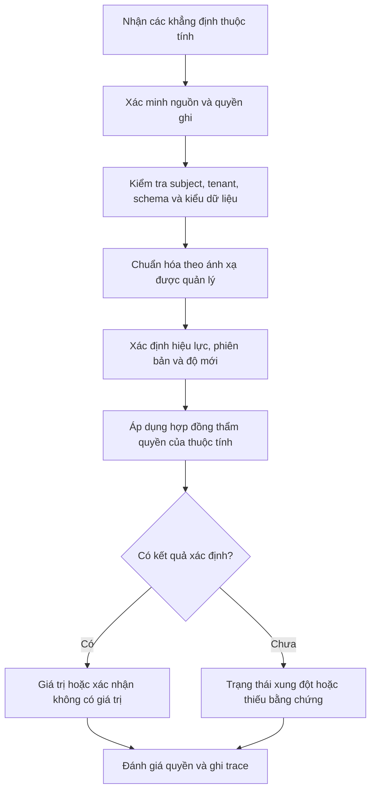

# Attribute conflict — xử lý xung đột thuộc tính danh tính

HR ghi An thuộc phòng Risk, directory vẫn ghi Finance, còn một token chưa hết hạn cũng chứa Finance. Ứng dụng nên dùng giá trị nào để quyết định An được đọc tài liệu của phòng nào?

Nếu lấy giá trị được nhận cuối cùng, một bản đồng bộ cũ đến muộn có thể khôi phục quyền đã thu hồi. Nếu hợp nhất mọi giá trị, An có thể được quyền của cả hai phòng. Nếu tùy tiện chọn một hệ thống cho mọi thuộc tính, dữ liệu do người dùng tự sửa có thể ghi đè dữ liệu dùng để kiểm soát truy cập.

**Attribute conflict** là tình huống có những khẳng định không tương thích về một thuộc tính trong cùng phạm vi ý nghĩa, danh tính và thời gian đang được xét. Xử lý xung đột trong IAM là xác định dữ liệu nào được chấp nhận cho từng mục đích, lưu được căn cứ của lựa chọn và điều chỉnh những quyền đã được suy ra từ dữ liệu đó.

Bài học tập trung vào thuộc tính danh tính và tác động của chúng đến xác thực, phân quyền, liên kết danh tính, provisioning và vòng đời quyền. Các schema, ID và quy tắc ưu tiên trong ví dụ là thiết kế minh họa của một tổ chức, không phải thứ tự nguồn được tiêu chuẩn quy định sẵn.

## 1. Mục tiêu học tập

Sau bài học, bạn có thể:

- Xác định khi nào hai giá trị thực sự xung đột và khi nào chỉ khác cách biểu diễn hoặc thời điểm hiệu lực.
- Phân biệt nguồn có thẩm quyền, bản sao, dữ liệu tự khai và một khẳng định đã được ký.
- Xây dựng hợp đồng giải quyết theo thuộc tính, tenant, loại danh tính và mục đích sử dụng.
- Tránh các lỗi last-writer-wins, hợp nhất quyền ngoài ý muốn và coi thiếu dữ liệu là giá trị mặc định.
- Diễn đạt kết quả chưa giải quyết được thay vì âm thầm chọn một giá trị.
- Theo dõi tác động đến token, nhóm, cache, quyền ứng dụng và audit sau khi xung đột được xử lý.

Kiến thức đầu vào gồm phân biệt xác thực với phân quyền và hiểu vai trò của thuộc tính như department, employment status, manager hoặc tenant trong IAM.

## 2. Trước khi gọi là xung đột, phải xác định điều đang so sánh

### 2.1. Cùng tên field chưa chắc cùng ý nghĩa

Một hệ thống có `status=active` để nói hợp đồng lao động còn hiệu lực; hệ thống khác dùng `active` để nói tài khoản được phép đăng nhập. Nhân viên vẫn đang làm việc nhưng bị khóa truy cập để xử lý sự cố là trạng thái nghiệp vụ hoàn toàn có thể xảy ra.

Nếu ép hai field vào cùng thuộc tính `active`, IAM có thể chọn HR làm nguồn ưu tiên rồi mở lại tài khoản đã bị khóa. Cách mô hình hóa rõ hơn là:

```text
employmentStatus = ACTIVE        -- do nguồn nhân sự xác nhận
accessSuspended = true          -- do quy trình bảo mật xác nhận

Được xét cấp quyền thông thường khi:
    employmentStatus == ACTIVE
    AND accessSuspended == false
    AND các điều kiện khác của hành động được đáp ứng
```

Hai dữ kiện trên cùng đúng; chúng không cần ghi đè nhau. Quy tắc kết hợp thuộc tính khác với quy tắc giải quyết hai giá trị cho cùng một thuộc tính.

### 2.2. Khóa so sánh cần đủ phạm vi

Một đơn vị so sánh có thể được mô tả bằng:

```text
(subject, tenant, attribute, semantic-context, effective-time)
```

Ví dụ, phòng ban chính của An trong tenant A không phải cùng dữ kiện với phòng ban của An trong tenant B. Người kiêm nhiệm có hai assignment được phê duyệt cũng không mặc nhiên là hồ sơ lỗi.

Trước khi so sánh, cần trả lời:

1. Hai bản ghi có chắc thuộc cùng một danh tính nội bộ không?
2. Thuộc tính có cùng ý nghĩa và schema không?
3. Giá trị thuộc tenant hoặc tổ chức nào?
4. Hai khẳng định có áp dụng cho cùng khoảng thời gian không?
5. Thuộc tính là đơn trị, đa trị hay một tập quan hệ có điều kiện?

### 2.3. Những tình huống nhìn giống nhau nhưng cần cách xử lý khác nhau

| Tình huống | Bản chất | Cách tiếp cận |
| --- | --- | --- |
| `Finance` và `dep-1042` đã có ánh xạ được quản lý | Khác biểu diễn | Chuẩn hóa về định danh cùng ý nghĩa |
| HR ghi Risk, directory giữ Finance từ trước lần chuyển phòng | Bản sao chậm | Xác định nguồn và phiên bản hiệu lực |
| Hai bản ghi HR hiện hành cùng thẩm quyền ghi hai phòng chính khác nhau | Xung đột nội dung | Cần quy tắc hoặc xác minh từ chủ sở hữu dữ liệu |
| Người làm ở hai tenant, mỗi nơi có một phòng khác nhau | Khác phạm vi | Tách theo tenant |
| Phòng chính và vị trí kiêm nhiệm được phê duyệt | Nhiều quan hệ hợp lệ | Giữ loại quan hệ và hiệu lực riêng |
| Sự kiện đổi phòng có hiệu lực vào tuần sau | Khác thời gian | Lưu lịch thay đổi, chưa mở quyền sớm |
| Hai tài khoản trùng email nhưng có định danh nguồn khác nhau | Có thể sai liên kết danh tính | Xác minh correlation trước khi hợp nhất |

Một bộ giải quyết tốt bắt đầu bằng việc giảm các “xung đột giả” mà không xóa những khác biệt có ý nghĩa bảo mật.

## 3. Dữ liệu phải đi cùng nguồn gốc và thời gian

### 3.1. Giá trị trần không đủ để ra quyết định

Hai chuỗi `departmentId=dep-risk` và `departmentId=dep-finance` không cho biết giá trị nào nên được dùng. Một evidence, tức bản ghi khẳng định thuộc tính cùng căn cứ nguồn, có thể gồm:

```json
{
  "subjectId": "user-an",
  "tenantId": "tenant-a",
  "attribute": "primaryDepartmentId",
  "presence": "VALUE",
  "canonicalValue": "dep-risk",
  "sourceSystem": "hr-a",
  "sourceRecordId": "employee-901",
  "sourceVersion": "hr-record-184",
  "effectiveFrom": "2026-11-26T02:00:00Z",
  "effectiveUntil": null,
  "receivedAt": "2026-11-26T02:01:00Z",
  "sourceConfirmedAt": "2026-11-26T02:00:30Z"
}
```

Đây là mô hình nội bộ minh họa, không phải payload SCIM chuẩn. Hệ thống tiếp nhận còn phải xác minh nguồn có quyền khẳng định thuộc tính ấy cho đúng đối tượng và phạm vi. Trường `sourceSystem` do client tùy ý gửi không tự tạo ra sự tin cậy.

### 3.2. Các mốc thời gian trả lời các câu hỏi khác nhau

`effectiveFrom` cho biết thời điểm có hiệu lực nghiệp vụ. `receivedAt` cho biết khi nào thông điệp đến. `sourceConfirmedAt` cho biết thời điểm dữ liệu được xác nhận theo hợp đồng nguồn. Thời điểm tạo token hoặc làm mới cache là những mốc khác.

Một thông điệp đến sau có thể chứa dữ liệu cũ. Một token được ký sau có thể được tạo từ directory chưa đồng bộ. Đọc lại bản sao cũ lúc 10 giờ không biến dữ liệu nhân sự của 8 giờ thành dữ liệu được nguồn xác nhận ở 10 giờ.

Chênh lệch đồng hồ còn khiến timestamp từ hai hệ thống không phù hợp để xếp hạng trực tiếp. Nếu cần so thứ tự, dùng cơ chế phiên bản trong phạm vi mà nguồn bảo đảm và quản lý thời gian hiệu lực riêng.

### 3.3. Phiên bản không phải một con số toàn cục

Không thể kết luận `directoryVersion=920` mới hơn `hrVersion=184`: hai số được tạo theo hai cơ chế khác nhau. Ngay trong cùng nguồn, version có thể áp dụng cho toàn resource thay vì riêng field đang xét.

Nếu nguồn cung cấp ETag hoặc chuỗi version không có hợp đồng thứ tự, hãy coi nó là giá trị opaque để đối chiếu theo giao thức. Không sắp xếp từ điển các ETag để đoán bản ghi nào mới hơn.

## 4. Nguồn có thẩm quyền được xác định theo thuộc tính

### 4.1. Không có một hệ thống luôn đúng cho mọi field

Một ma trận do tổ chức xây dựng có thể là:

| Thuộc tính chuẩn | Nguồn được chấp nhận trong ví dụ | Ràng buộc bổ sung |
| --- | --- | --- |
| `employmentStatus` của nhân viên | HR được phê duyệt cho pháp nhân tương ứng | Kiểm tra thời điểm hiệu lực |
| `primaryDepartmentId` | HR và bảng ánh xạ tổ chức đã duyệt | Không lấy từ form hồ sơ tự sửa |
| `accessSuspended` | Quy trình bảo mật hoặc quản trị truy cập | Chỉ nguồn được ủy quyền mới đặt hoặc gỡ hold |
| `preferredDisplayName` | Hồ sơ người dùng theo quy tắc sản phẩm | Chỉ phục vụ hiển thị trong ví dụ |
| `contractorSponsorId` | Quy trình quản lý nhà thầu | Có thời hạn của hợp tác |
| `workloadOwnerId` | Danh mục dịch vụ hoặc nền tảng workload | Xác minh trách nhiệm sở hữu dịch vụ |

Đây là lựa chọn của ví dụ. Tổ chức khác có thể có nguồn khác, nhưng vẫn cần xác định thẩm quyền theo thuộc tính và loại danh tính.

Directory thường đóng vai trò phân phối bản sao. IdP có thể phát hành claim từ directory. Ứng dụng có thể lưu cache của claim. Ba bản cùng nói Finance không có nghĩa có ba bằng chứng độc lập chống lại một bản HR nói Risk.

### 4.2. Xác thực nguồn và thẩm quyền của nguồn là hai việc

Kết nối TLS, credential connector hoặc chữ ký có thể giúp xác định dữ liệu đến từ bên nào. Sau đó IAM vẫn phải kiểm tra bên ấy được phép xác nhận điều gì.

IdP của đối tác có thể có quyền khẳng định danh tính và một số quan hệ trong tổ chức đối tác, nhưng không tự có quyền gán vai trò quản trị cho tenant nội bộ. Một ứng dụng SaaS nhận provisioning cũng không mặc nhiên trở thành nguồn chủ cho `employmentStatus`.

### 4.3. Quyền cấu hình resolver cũng là quyền nhạy cảm

Nếu một người có thể đổi nguồn ưu tiên của department từ HR sang hồ sơ tự khai, họ có thể thay đổi người được cấp quyền mà không trực tiếp sửa role nào. Bảng ánh xạ, rule ưu tiên, rule fallback và override cần có chủ sở hữu, kiểm soát thay đổi và lịch sử tương ứng.

Không đưa các lựa chọn này vào tham số request để client tự chọn nguồn được tin cậy. Cấu hình phải được nạp từ chính sách server đã được quản lý.

## 5. Những chiến lược giải quyết và giới hạn của chúng

### 5.1. Ưu tiên theo nguồn có thẩm quyền

Với `primaryDepartmentId`, hợp đồng có thể yêu cầu dùng HR hiện hành đã được xác minh. Directory khác HR được ghi nhận là bản sao lệch, rồi được đồng bộ lại.

Nếu HR không đủ mới hoặc không truy cập được, không tự chuyển sang dữ liệu tự khai chỉ để có một giá trị. Fallback chỉ hợp lệ nếu đã được định nghĩa cho thuộc tính, mục đích và điều kiện đó; một bản sao có provenance và giới hạn độ trễ được chấp nhận có thể có vai trò khác với giá trị nhập tay không có bằng chứng.

### 5.2. Theo phiên bản trong cùng một dòng dữ liệu

Nếu nguồn cam kết revision tăng trong một luồng cụ thể, một sự kiện cũ đến muộn có thể được nhận diện và không được ghi đè trạng thái mới. Quy tắc này cần xử lý riêng lịch tương lai, hủy lịch và thay đổi hiệu lực hồi tố.

Không chỉ chọn revision lớn nhất rồi áp dụng ngay nếu thay đổi đó chưa đến thời điểm có hiệu lực. Cũng không loại mọi thông điệp cũ theo timestamp nhận khi chúng chứa thông tin cần thiết để sửa lịch sử.

### 5.3. Hợp nhất tập giá trị phải theo ngữ nghĩa

Với quyền hoặc nhóm, phép hợp có thể mở rộng truy cập. Nếu nguồn A ghi có quyền `invoice:approve` còn nguồn B nói quyền đó đã kết thúc, lấy hợp hai tập sẽ giữ lại đặc quyền cũ.

Một số tập giá trị có thể hợp nhất khi mỗi nguồn được ủy quyền cấp những phần riêng, các giá trị còn hiệu lực và quy tắc thu hồi theo từng lý do cấp đã rõ. Không suy từ việc một field là mảng rằng mọi phần tử ở mọi nguồn đều được giữ.

Phép giao cũng không phải giải pháp mặc định cho mọi thuộc tính. Nó có thể loại bỏ dữ liệu đúng hoặc không có ý nghĩa với field đơn trị. Cần xác định đang giải quyết dữ kiện, tập quyền dương, trạng thái cấm hay những quan hệ độc lập.

### 5.4. Last-writer-wins chỉ hợp lệ khi hợp đồng cho phép

Một sản phẩm có thể dùng giá trị ghi sau cho một tùy chọn giao diện ít tác động, nếu quy tắc người ghi và thứ tự đã rõ. Với thuộc tính phân quyền, “đến sau” không đủ chứng minh đúng nguồn, đúng thời gian hoặc quyền ghi.

Một connector ghi lại toàn resource từ bản cache cũ có thể là writer cuối cùng nhưng mang dữ liệu lỗi thời. Vì vậy cần phân biệt writer cuối ở nơi nhận với thay đổi mới nhất có thẩm quyền ở nguồn.

### 5.5. Override có thời hạn và có phạm vi

Một ngoại lệ được duyệt có thể cho phép An tiếp tục đọc một tập tài liệu bàn giao trong ba ngày. Không nhất thiết sửa department chuẩn thành cả phòng cũ và phòng mới để đạt mục tiêu này.

Nên biểu diễn ngoại lệ bằng quyền hoặc quan hệ riêng có phạm vi tài nguyên, hành động, thời hạn, người duyệt và lý do. Nếu có override dữ liệu thật sự, cần xác định override thuộc field nào, ai được tạo, khi hết hạn phục hồi theo nguồn nào và cách xử lý nguồn thay đổi trong thời gian override.

### 5.6. Chưa giải quyết được là một kết quả hợp lệ

Khi hai nguồn ngang thẩm quyền cùng khẳng định hai giá trị không tương thích và hợp đồng không chọn được, resolver nên trả trạng thái xung đột. Không chọn phần tử đầu danh sách vì thứ tự trả về thuận tiện.

Kết quả có thể là:

```text
RESOLVED: đã xác định giá trị được chấp nhận
ABSENT: nguồn có thẩm quyền xác nhận không có giá trị theo ngữ nghĩa đã định
CONFLICT: còn những khẳng định không tương thích chưa thể chọn
STALE: bằng chứng vượt giới hạn được phép sử dụng
INVALID: bằng chứng không phù hợp schema, phạm vi hoặc hợp đồng
UNAVAILABLE: chưa lấy được bằng chứng cần thiết
```

Đây là các trạng thái thiết kế minh họa. Ý nghĩa và hành vi khi nhận từng trạng thái phải được quy định ở điểm thực thi quyền.

## 6. Một quy trình giải quyết có thể giải thích được

### 6.1. Chuỗi xử lý



### 6.2. Thuật toán ở mức thiết kế

```text
resolve(attribute, subject, tenant, purpose, evaluationTime):
    contract = loadApprovedContract(attribute, tenant, subject.type, purpose)
    evidence = loadEvidenceForExactScope(subject, tenant, attribute)

    reject evidence from unauthenticated or unauthorized writers
    reject malformed data and unresolved subject correlations
    normalize only with the contract's schema and mapping rules
    distinguish missing, explicit removal, empty value and unavailable source
    evaluate current state using source ordering and effective-time rules

    if required authoritative evidence is missing or unusable:
        return unresolved state with reason and evidence references

    apply the contract's source selection or typed combination rule
    if incompatible claims remain:
        return CONFLICT

    persist resolution trace with contract version and validity boundary
    return RESOLVED(value) or ABSENT
```

Thuật toán không bắt buộc một dịch vụ hoặc sản phẩm cụ thể. Điểm quan trọng là các bước quyết định được kiểm soát, có đầu vào đủ ngữ cảnh và không biến một trường thiếu thành một giá trị cấp quyền mặc định.

### 6.3. Kết quả cần mang theo căn cứ

```json
{
  "resolutionId": "resolution-901-74",
  "subjectId": "user-an",
  "tenantId": "tenant-a",
  "attribute": "primaryDepartmentId",
  "state": "RESOLVED",
  "value": "dep-risk",
  "selectedEvidence": ["evidence-hr-184"],
  "rejectedEvidence": [
    {
      "id": "evidence-directory-902",
      "reason": "NON_AUTHORITATIVE_REPLICA_DIVERGENCE"
    }
  ],
  "contractVersion": "department-authority-v3",
  "reconcileRequired": true
}
```

Một kết quả đã giải quyết được vẫn có thể cần sửa bản sao lệch. Ngược lại, số lần đồng bộ thành công không chứng minh resolver đã có giá trị hợp lệ cho một hành động nhạy cảm.

## 7. Thiếu, xóa, rỗng và không truy cập được không đồng nghĩa

Một thông điệp chỉ cập nhật `displayName` mà không có department chưa chắc muốn xóa department. Cần biết nó là snapshot đầy đủ, projection chỉ trả một số field hay bản cập nhật từng phần theo giao thức.

| Dạng đầu vào | Câu hỏi cần trả lời trước khi xử lý |
| --- | --- |
| Field không xuất hiện | Không thay đổi, không được trả về hay thật sự không có? |
| `null` | Nguồn dùng để xóa, biểu diễn chưa biết hay không chấp nhận giá trị này? |
| Chuỗi rỗng | Giá trị hiển thị rỗng hay cách mã hóa thao tác xóa? |
| Tập rỗng | Đã xác nhận không có quan hệ, hay connector chưa tải được? |
| Thao tác remove rõ ràng | Caller có thẩm quyền kết thúc giá trị hoặc quan hệ này không? |
| Timeout khi đọc nguồn | Chưa biết trạng thái hiện hành, không phải xác nhận giá trị đã bị xóa |

Không thể có một quy tắc `null` dùng chung mà bỏ qua schema và giao thức. Resolver cần giữ riêng trạng thái bằng chứng và nội dung giá trị.

Nếu nguồn có thẩm quyền đã xác nhận xóa một quan hệ, không dùng bản cache cũ để lấp chỗ trống rồi khôi phục quyền. Nếu chỉ mất kết nối, cũng không được tự tuyên bố nguồn xác nhận xóa dữ liệu.

Lưu ý ranh giới giữa dữ kiện và hành vi an toàn: hệ thống có thể tạm từ chối hành động phụ thuộc thuộc tính khi thiếu dữ liệu, nhưng không vì thế phải ghi sai rằng nhân viên đã nghỉ việc hoặc phòng ban đã bị xóa.

## 8. Liên kết danh tính và đồng bộ là hai điểm dễ tạo xung đột

### 8.1. Phải liên kết đúng người trước khi hợp nhất thuộc tính

Hai bản ghi cùng email có thể là cùng một người, nhưng email cũng có thể đổi, được tái sử dụng hoặc do hai miền quản lý khác nhau. Nếu correlation sai, resolver sẽ cố giải quyết thuộc tính của hai danh tính khác nhau như thể chúng thuộc một người.

Trong OIDC, cặp `iss` và `sub` được dùng để định danh người dùng ổn định trong ngữ cảnh bên phát hành. Khi dùng UserInfo cùng luồng đăng nhập, `sub` của UserInfo phải khớp chính xác với `sub` trong ID token trước khi dùng dữ liệu phản hồi. [Nguồn: OpenID Connect Core, Claim Stability và UserInfo](https://openid.net/specs/openid-connect-core-1_0.html#ClaimStability).

Điều đó không tạo một định danh chung tự động giữa mọi issuer hoặc client. Nếu muốn liên kết hai tài khoản nguồn vào một subject nội bộ, cần một quy trình correlation được quản lý. Không hợp nhất chỉ vì họ tên, tên đăng nhập hoặc email nhìn giống nhau.

SCIM phân biệt `id` ổn định do service provider cấp với `externalId` do provisioning client cấp trong phạm vi provisioning domain. Không coi cùng chuỗi `externalId` từ hai domain là cùng một người. [Nguồn: RFC 7643, Common Attributes](https://www.rfc-editor.org/rfc/rfc7643.html#section-3.1).

### 8.2. Kiểm soát cập nhật đồng thời bằng giao thức

Giả sử connector đọc resource phiên bản `W/"r-73"`, sau đó một tác nhân khác cập nhật resource. Connector không nên ghi lại toàn bộ bản đọc cũ để sửa mỗi department.

Một request minh họa cho phần cập nhật đã được resolver xác định:

```http
PATCH /scim/v2/Users/scim-user-901 HTTP/1.1
Host: directory.example.com
Authorization: Bearer <authorized-provisioning-token>
Content-Type: application/scim+json
If-Match: W/"r-73"

{
  "schemas": ["urn:ietf:params:scim:api:messages:2.0:PatchOp"],
  "Operations": [
    {
      "op": "replace",
      "path": "urn:ietf:params:scim:schemas:extension:enterprise:2.0:User:department",
      "value": "Risk"
    }
  ]
}
```

Ví dụ giả định server hỗ trợ PATCH và conditional update bằng version/ETag; giá trị `If-Match` được lấy từ resource đã đọc. Nếu server báo precondition không còn đúng, connector cần đọc trạng thái mới, đánh giá lại khác biệt và chỉ gửi thay đổi vẫn được cho phép. Không bỏ header rồi thử ghi đè bằng bản cũ.

SCIM hỗ trợ versioning bằng HTTP ETag và quy định một PATCH request là atomic trên resource được cập nhật. Tính atomic đó không biến nhiều ứng dụng downstream thành một transaction chung. [Nguồn: RFC 7644, PATCH và Versioning Resources](https://www.rfc-editor.org/rfc/rfc7644.html#section-3.14).

### 8.3. Hai tầng xung đột khác nhau

Conditional update xử lý tình huống resource đã đổi kể từ lần đọc. Resolver xử lý ý nghĩa thuộc tính, nguồn có thẩm quyền và giá trị mong muốn. Cập nhật không bị race vẫn có thể ghi một giá trị sai nếu resolver chọn nguồn không đúng.

Chiều ngược lại, quyết định đúng vẫn có thể bị connector làm hỏng nếu ghi đè field ngoài phạm vi, bỏ qua xung đột phiên bản hoặc lặp lại payload cũ vô hạn. Hai tầng cần kết hợp nhưng không thay thế nhau.

## 9. Ví dụ Java: resolver cho một thuộc tính đơn trị

### 9.1. Hợp đồng của ví dụ

Ví dụ chỉ giải quyết `primaryDepartmentId`. Nguồn có thẩm quyền được server chọn từ cấu hình cho tenant và loại danh tính. Danh sách đầu vào là các **snapshot hiện hành** đã qua xác minh provenance và kiểm tra correlation, không phải danh sách mọi sự kiện lịch sử.

Tầng nạp dữ liệu phải xử lý thứ tự sự kiện, lịch tương lai và hủy lịch trước khi tạo snapshot hiện hành. Resolver không đoán thứ tự từ ETag hoặc tự chọn bản nhận sau. Trong hợp đồng này, nhiều snapshot khác nhau cùng được đưa vào như trạng thái hiện hành của nguồn chính là đầu vào chưa xác định được.

Nguồn chính thiếu, quá cũ hoặc mâu thuẫn sẽ trả `UNRESOLVED`. Ví dụ không cấu hình fallback sang directory; một bản sao có giá trị khác được theo dõi để đối soát, không được tự thay nguồn chính.

### 9.2. Mã minh họa

```java
import java.time.Duration;
import java.time.Instant;
import java.util.List;
import java.util.Objects;

public final class DepartmentAttributeResolver {
    public enum Presence { VALUE, CLEARED }
    public enum State { RESOLVED, ABSENT, UNRESOLVED }

    // Evidence đã qua xác minh nguồn; không bind trực tiếp từ request client.
    public record VerifiedEvidence(
            String subjectId,
            String tenantId,
            String attribute,
            String sourceId,
            String sourceVersion,
            Presence presence,
            String canonicalValue,
            Instant effectiveFrom,
            Instant sourceConfirmedAt,
            Instant usableUntil) {}

    public record Resolution(
            State state,
            String value,
            String evidenceVersion,
            String reason) {}

    private static Resolution unresolved(String reason) {
        return new Resolution(State.UNRESOLVED, null, null, reason);
    }

    public static Resolution resolve(
            List<VerifiedEvidence> currentEvidence,
            String expectedSubjectId,
            String expectedTenantId,
            String authoritativeSourceId,
            Instant now,
            Duration maxAttributeAge) {
        if (expectedSubjectId == null || expectedSubjectId.isBlank()
                || expectedTenantId == null || expectedTenantId.isBlank()
                || authoritativeSourceId == null || authoritativeSourceId.isBlank()
                || now == null || maxAttributeAge == null
                || maxAttributeAge.isNegative() || maxAttributeAge.isZero()) {
            return unresolved("INVALID_RESOLUTION_CONTEXT");
        }
        if (currentEvidence == null) {
            return unresolved("EVIDENCE_UNAVAILABLE");
        }
        if (currentEvidence.stream().anyMatch(Objects::isNull)) {
            return unresolved("MALFORMED_EVIDENCE");
        }

        List<VerifiedEvidence> candidates = currentEvidence.stream()
            .filter(e -> expectedSubjectId.equals(e.subjectId()))
            .filter(e -> expectedTenantId.equals(e.tenantId()))
            .filter(e -> "primaryDepartmentId".equals(e.attribute()))
            .filter(e -> authoritativeSourceId.equals(e.sourceId()))
            .distinct()
            .toList();

        if (candidates.isEmpty()) {
            return unresolved("AUTHORITATIVE_EVIDENCE_MISSING");
        }
        if (candidates.size() != 1) {
            return unresolved("AMBIGUOUS_CURRENT_EVIDENCE");
        }

        VerifiedEvidence chosen = candidates.get(0);
        if (chosen.sourceVersion() == null || chosen.sourceVersion().isBlank()
                || chosen.presence() == null || chosen.effectiveFrom() == null
                || chosen.sourceConfirmedAt() == null || chosen.usableUntil() == null) {
            return unresolved("INCOMPLETE_AUTHORITATIVE_EVIDENCE");
        }
        if (now.isBefore(chosen.effectiveFrom())
                || now.isBefore(chosen.sourceConfirmedAt())
                || !now.isBefore(chosen.usableUntil())
                || Duration.between(chosen.sourceConfirmedAt(), now)
                    .compareTo(maxAttributeAge) >= 0) {
            return unresolved("AUTHORITATIVE_EVIDENCE_NOT_USABLE");
        }

        if (chosen.presence() == Presence.CLEARED) {
            if (chosen.canonicalValue() != null) {
                return unresolved("REMOVAL_WITH_UNEXPECTED_VALUE");
            }
            return new Resolution(State.ABSENT, null,
                chosen.sourceVersion(), "AUTHORITATIVE_REMOVAL");
        }
        if (chosen.canonicalValue() == null || chosen.canonicalValue().isBlank()) {
            return unresolved("MISSING_CANONICAL_VALUE");
        }
        return new Resolution(State.RESOLVED, chosen.canonicalValue(),
            chosen.sourceVersion(), "AUTHORITATIVE_VALUE_SELECTED");
    }
}
```

Mã yêu cầu Java hỗ trợ record và `Stream.toList()`. Các cấu trúc là ví dụ ứng dụng, không triển khai đầy đủ SCIM hoặc một hệ thống xác minh nguồn.

`distinct()` chỉ loại các bản evidence bằng nhau theo record; nó không hợp nhất hai nguồn hoặc suy luận hai version khác nhau là cùng trạng thái. Nếu có hai snapshot khác nhau cùng nguồn chính, tầng dữ liệu phải làm rõ đâu là trạng thái hiện hành hoặc chuyển sang xử lý xung đột.

`sourceVersion` được giữ để truy vết, không dùng để so sánh thứ tự. `usableUntil` phải phản ánh những ranh giới hiệu lực đã biết, bao gồm thay đổi được lên lịch khi liên quan. Giới hạn độ mới là cấu hình theo mục đích sử dụng, không có một TTL mặc định áp dụng cho mọi hành động.

### 9.3. Cách dùng kết quả tại điểm phân quyền

Một luồng đọc tài liệu phòng ban chỉ được dùng `value` khi state là `RESOLVED` và các điều kiện khác cũng hợp lệ. `ABSENT` không được biến thành quyền toàn phòng, còn `UNRESOLVED` không được thay bằng giá trị cũ chỉ vì đã từng đăng nhập thành công.

```text
+ RESOLVED(dep-risk): có thể tiếp tục so phạm vi tài liệu theo policy
+ ABSENT: không có quan hệ phòng ban để cấp quyền theo nhánh này
+ UNRESOLVED: chưa có căn cứ dùng thuộc tính này để cho phép
```

Dấu `+` ở đây là ký hiệu trình bày các trường hợp, không phải phép hợp quyền. Quyền theo ngoại lệ hoặc quan hệ khác, nếu có, phải được đánh giá theo policy của chính nó.

Trong hệ thống thực, cần lưu thêm resolution ID, hợp đồng đã dùng, các evidence được chọn hoặc bị loại và lý do. Mã chỉ trả kết quả thu gọn để làm rõ cách tránh fallback ngoài hợp đồng.

## 10. Tác động của xung đột đến quyết định truy cập

### 10.1. Thuộc tính không phải quyết định quyền hoàn chỉnh

ABAC đánh giá thuộc tính của chủ thể, tài nguyên, thao tác và điều kiện môi trường theo policy. Giải quyết được department chỉ tạo ra một đầu vào; nó chưa chứng minh người dùng có quyền hành động trên tài nguyên. [Nguồn: NIST SP 800-162](https://csrc.nist.gov/pubs/sp/800/162/upd2/final).

Ví dụ:

```text
Cho phép đọc tài liệu phòng ban khi:
    danh tính và phiên được xác minh
    AND tài khoản đang được phép hoạt động
    AND không có security hold áp dụng cho hành động này
    AND tenant của chủ thể và tài nguyên khớp
    AND có quyền hành động tương ứng
    AND kết quả department đã được chấp nhận cho mục đích này
    AND department khớp phạm vi tài nguyên
    AND các điều kiện phân loại dữ liệu được đáp ứng
```

Một token còn hạn hoặc department đã giải quyết đúng không bỏ qua các điều kiện còn lại.

### 10.2. Chặn đúng hành động phụ thuộc bằng chứng

Một xung đột `preferredDisplayName` có thể chỉ khiến ứng dụng tạm hiển thị định danh thay tên. Một xung đột tenant, trạng thái được phép hoạt động hoặc phạm vi quyền có thể khiến hành động liên quan không được phép tiếp tục.

Cần khai báo thuộc tính nào là đầu vào bắt buộc của quyết định nào. Không bỏ qua xung đột quan trọng để giữ luồng hoạt động, nhưng cũng không suy rằng mọi xung đột hồ sơ đều phải khóa toàn bộ tài khoản.

Nếu một nguồn không được phép tự đặt trạng thái cấm, không cho nó khóa mọi tài khoản chỉ bằng cách gửi `suspended=true`. Chính các khẳng định thu hồi hoặc cấm cũng phải đến từ nguồn có thẩm quyền và đúng phạm vi.

### 10.3. Giữ nguyên snapshot trong một quyết định

Nếu ứng dụng đọc department trước lần chuyển phòng, quyền hành động sau lần chuyển phòng và trạng thái tài khoản ở một bản cache khác, nó có thể tạo một tổ hợp chưa từng là trạng thái hợp lệ của danh tính.

Có thể dùng snapshot thuộc tính đã giải quyết cùng một revision nội bộ, hoặc cơ chế kiểm tra nhất quán phù hợp với yêu cầu của thao tác. Một thay đổi ảnh hưởng phạm vi truy cập cần làm mất hiệu lực những quyết định hoặc cache liên quan theo thiết kế.

Với thao tác ghi nhạy cảm, còn phải xử lý việc dữ liệu hoặc quyền thay đổi giữa lúc đánh giá và lúc ghi. Resolver không tự thay thế transaction, kiểm tra phiên bản tài nguyên hoặc các ràng buộc nghiệp vụ.

## 11. Sửa xung đột phải bao gồm các quyền suy ra

### 11.1. Giá trị chuẩn đúng chưa đủ

Sau khi xác định department của An là Risk, các nơi sau có thể vẫn giữ hệ quả của Finance:

- Nhóm hoặc role được cấp tự động từ department cũ.
- Quyền gán trực tiếp bởi một provisioning rule cũ.
- Token hoặc session context đã được tạo trước đó.
- Cache quyết định phân quyền và cache nội dung đã được lọc theo quyền cũ.
- Ứng dụng SaaS, tác vụ export hoặc dịch vụ liên quan chưa nhận thay đổi.

Phải quản lý các hệ quả này theo hợp đồng của từng đích. Một phản hồi cập nhật hồ sơ thành công không chứng minh quyền cũ đã kết thúc.

### 11.2. Theo dõi lý do cấp quyền

Giả sử nhóm tài liệu Finance được cấp cho An vì assignment nhân sự `assignment-901`. Khi assignment kết thúc, hệ thống phải nhận ra lý do cấp này đã hết hiệu lực.

Nếu An còn một quyền bàn giao được duyệt độc lập, quyền ấy được đánh giá theo phạm vi và thời hạn riêng. Thiếu provenance có thể khiến hệ thống giữ tất cả quyền để tránh xóa nhầm, hoặc xóa cả quyền vẫn hợp lệ.

Lý do cấp cần cho biết rule, nguồn, assignment hoặc phê duyệt liên quan, thời gian hiệu lực và quyền đích. Khi dữ liệu nguồn hoặc rule thay đổi, có thể tính lại những quyền bị tác động thay vì sửa tay không để lại căn cứ.

### 11.3. Chặn việc phục hồi trạng thái cũ

Một bản đồng bộ Finance cũ đến sau khi đã chuyển sang Risk không được mở lại quyền Finance. Cần phối hợp quản lý version nguồn, trạng thái hiện hành, lịch hiệu lực, tính idempotent và đối soát.

Nếu một connector gửi lại sự kiện đã xử lý, kết quả không được tạo thêm một lý do cấp mới không có thời hạn. Nếu sửa lại rule nguồn ưu tiên, cần đánh giá tác động đến cả quyền đang có và quyền đang chờ cấp.

Rollback cấu hình không đồng nghĩa phục hồi toàn bộ dữ liệu hoặc quyền về một thời điểm cũ. Có thể đã có các thay đổi nhân sự hợp lệ xảy ra trong lúc cấu hình lỗi; việc phục hồi phải bảo toàn những thay đổi đó.

## 12. Vận hành, xử lý thủ công và audit

### 12.1. Hồ sơ xung đột cần có chủ sở hữu

Một case cần giải quyết có thể ghi loại thuộc tính, subject/tenant, nguồn liên quan, mức tác động đến quyền, thời điểm phát hiện, trạng thái và đơn vị chịu trách nhiệm. Không gửi toàn bộ hồ sơ hoặc token cho mọi người tham gia xử lý.

Nhóm IAM có thể sửa mapping, nhưng quyết định phòng ban nhân sự thực sự thuộc đơn vị nào thường cần chủ sở hữu dữ liệu tổ chức. Nhóm bảo mật quản lý security hold; người dùng không tự gỡ hold bằng cách cập nhật hồ sơ.

### 12.2. Xử lý thủ công không được tạo một nguồn vô thời hạn

Một quyết định thủ công cần nêu giá trị hoặc kết quả được chấp nhận, bằng chứng đã đối chiếu, người phê duyệt và tác động đến quyền. Nếu chỉ là biện pháp tạm thời, phải có điều kiện hoặc thời điểm kết thúc.

Ưu tiên sửa nguyên nhân ở nơi có thẩm quyền hoặc rule ánh xạ, rồi đối soát các đích. Chỉ sửa một field downstream có thể bị lần đồng bộ kế tiếp ghi đè hoặc tiếp tục tạo xung đột lặp lại.

### 12.3. Nội dung audit hữu ích

Một trace nên cho phép trả lời:

1. Quyết định nào đã dùng thuộc tính này?
2. Resolver đã nhận những evidence nào và chúng thuộc phạm vi nào?
3. Giá trị nào được chọn, loại hoặc để ở trạng thái chưa giải quyết?
4. Hợp đồng phiên bản nào quyết định kết quả?
5. Việc cấp hoặc thu hồi quyền nào đã diễn ra sau đó?
6. Đích nào đã được xác minh cập nhật, đích nào còn chờ?

Chỉ lưu dữ liệu cần thiết và bảo vệ quyền đọc audit. Mã tham chiếu evidence có thể đủ cho phần log thông thường, còn giá trị chi tiết được giữ trong kho có quyền truy cập phù hợp.

### 12.4. Chỉ số cần nhìn theo tác động

Các chỉ số có thể gồm số xung đột chưa giải quyết, thời gian tồn tại, nguồn gây lặp, mức lệch bản sao, độ trễ thu hồi quyền và số lần fallback được dùng theo hợp đồng.

Không chỉ đo tỷ lệ payload provisioning thành công. Hệ thống có thể gửi thành công mọi request nhưng vẫn giữ quyền sai do rule resolver hoặc rule thu hồi chưa đúng.

## 13. Ma trận tự thực hành

Ma trận sau mô tả kỳ vọng theo hợp đồng minh họa: HR-A làm nguồn chính cho phòng ban của nhân viên trong tenant A; directory là bản sao; security hold do quy trình bảo mật quản lý riêng.

| Tình huống | Kết quả mong đợi | Điều cần nhận diện |
| --- | --- | --- |
| HR-A và directory khác nhau; HR-A hợp lệ, đủ mới | Dùng giá trị HR-A, ghi nhận lệch và đối soát | Giải quyết được không có nghĩa hết chênh lệch |
| HR-A quá cũ, directory có thời điểm nhận mới hơn | Chưa tự chọn directory | Received time không tạo thẩm quyền |
| Hai snapshot hiện hành của HR-A mâu thuẫn | Chưa chọn giá trị, tạo case xử lý | Không lấy phần tử đầu |
| Bản tin HR cũ đến sau trạng thái HR mới | Không khôi phục quyền cũ | Version cần đúng phạm vi nguồn |
| Hai tên khác nhau đã được ánh xạ tới cùng phòng | Cùng giá trị chuẩn | Khác biểu diễn không nhất thiết xung đột |
| Tên gần giống nhưng chưa có ánh xạ | Không tự gộp | Chuẩn hóa không được tự sáng tác ý nghĩa |
| Cùng subject trong hai tenant có hai department | Giữ theo phạm vi tenant | Không hợp nhất xuyên tenant |
| HR xác nhận active, security hold đang hiệu lực | Hành động thuộc hold không được mở | Hai thuộc tính độc lập cùng đúng |
| Người dùng sửa hồ sơ thành Admin hoặc Finance | Không ghi đè thuộc tính dùng cho quyền | Kiểm tra quyền khẳng định của writer |
| Nguồn chính xác nhận xóa quan hệ | Không lấp lại bằng bản sao cũ | Removal phải có ngữ nghĩa rõ |
| Nguồn timeout | Đánh dấu chưa có bằng chứng hiện hành | Unavailable không phải xác nhận xóa |
| Event đổi phòng chưa tới ngày hiệu lực | Chưa mở quyền của phòng mới | Tách received time và effective time |
| ETag không khớp khi PATCH | Đọc lại và đánh giá thay đổi | Không bỏ kiểm soát đồng thời |
| UserInfo có sub khác ID token | Không dùng dữ liệu UserInfo đó | Kiểm tra liên kết đúng danh tính |
| Resolver đã chọn Risk nhưng nhóm Finance còn membership cũ | Chưa hoàn tất thu hồi quyền | Giá trị chuẩn và quyền thực tế là hai điểm kiểm tra |

Đây là tình huống để người học dự đoán và đối chiếu khi xây dựng hệ thống thử nghiệm, không phải báo cáo rằng mã hay hạ tầng đã được thực thi trong môi trường cụ thể.

Thử thêm hai tình huống: xung đột ở field chỉ dùng hiển thị và xung đột ở field bắt buộc cho quyền ghi. Giải thích tại sao tác động đến hành vi ứng dụng có thể khác nhau dù cả hai đều là sai lệch dữ liệu.

## 14. Phân tích tình huống: nhiều bản sao đồng thuận nhưng đều cũ

### 14.1. Diễn biến

Trong một tình huống minh họa, HR xác nhận An chuyển từ Finance sang Risk lúc 09:00. Kho danh tính nhận thay đổi lúc 09:01. Một connector đọc từ directory cũ gửi Finance lúc 09:02. IdP cấp token lúc 09:03 từ chính directory ấy và claim vẫn là Finance.

Một bộ resolver dùng số đông sẽ thấy directory, ứng dụng và token cùng mang Finance nên chọn Finance. Một bộ dùng thời điểm nhận sẽ chọn bản gửi 09:02 hoặc token 09:03. Cả hai cách đều không xét đường đi của dữ liệu.

### 14.2. Xác định bằng chứng

Ba giá trị Finance không độc lập; chúng cùng bắt nguồn từ bản directory chậm. Token được tạo lúc 09:03 không chứng minh nguồn đã xác nhận department của An ở 09:03.

Hợp đồng nguồn chính cho department chọn evidence HR đã có hiệu lực và còn trong giới hạn sử dụng. Directory được đánh dấu cần đối soát. Nếu không đủ bằng chứng xác minh HR hoặc thời gian hiệu lực, trạng thái phải phản ánh điều chưa biết thay vì dựa vào số đông bản sao.

### 14.3. Tác động đến truy cập

Giá trị chuẩn là Risk nhưng việc xử lý chưa kết thúc: cần thu hồi các lý do cấp quyền Finance đã hết hiệu lực, cập nhật bản sao, làm mất hiệu lực cache liên quan và xử lý token/session theo cơ chế được thiết kế.

Nếu quyền bàn giao vẫn hợp lệ, giữ nó bằng một lý do cấp riêng có thời hạn. Nếu còn security hold, việc đổi phòng không được tự gỡ hold.

Trace của sự việc cần thể hiện nguồn đã chọn, bản sao bị loại, rule áp dụng và bằng chứng các đích thực thi đã thay đổi. Như vậy có thể giải thích cả quyết định dữ liệu lẫn kết quả truy cập thực tế.

## 15. Những điểm cần ghi nhớ

Xung đột thuộc tính cần được xét trong đúng danh tính, tenant, ý nghĩa và khoảng thời gian. Nhiều giá trị khác nhau có thể là quan hệ hợp lệ, bản sao chậm, sai ánh xạ hoặc một xung đột thật chưa giải quyết được.

Nguồn có thẩm quyền phải được xác định theo từng thuộc tính và mục đích. Thứ tự nhận, số lượng bản sao hoặc chữ ký hợp lệ không tự quyết định giá trị nào đúng cho một policy hiện hành.

Resolver cần trả kết quả cùng căn cứ, giữ rõ khác biệt giữa đã giải quyết, xác nhận không có giá trị và chưa đủ bằng chứng. Quy trình hoàn tất khi các quyền và điểm thực thi liên quan đã phản ánh kết quả đúng, với lịch sử đủ để giải thích và xử lý những lần đồng bộ sau.
