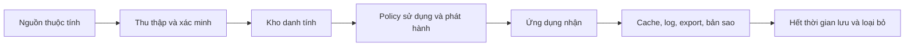

# Attribute privacy

## 1. Quyền riêng tư của thuộc tính danh tính là gì?

Attribute privacy là việc kiểm soát dữ liệu thuộc tính danh tính trong suốt quá trình thu thập, sử dụng, chia sẻ, lưu giữ và loại bỏ. Mục tiêu là để một bên chỉ nhận và xử lý những thông tin phù hợp với nhiệm vụ đã xác định, trong phạm vi và thời gian cần thiết.

Ví dụ, một cổng học tập của doanh nghiệp cần nhận diện người đăng nhập, biết người đó còn là nhân viên và có được tham gia khóa học hay không. Nó không mặc nhiên cần lương, địa chỉ nhà, ngày sinh đầy đủ hoặc toàn bộ lịch sử nhóm đặc quyền trong directory.

Giả sử hệ thống IAM phát hành nguyên hồ sơ nhân sự cho mọi ứng dụng để tiện tích hợp. Token có chữ ký hợp lệ, đường truyền được mã hóa và ứng dụng nhận đúng token. Dữ liệu vẫn có thể bị chia sẻ quá mức: ứng dụng học tập đang nhận những thông tin không phục vụ nhiệm vụ của nó. Vấn đề này không được giải quyết chỉ bằng việc tăng độ mạnh của chữ ký hoặc TLS.

Trong IAM, thuộc tính vừa là thông tin về chủ thể vừa có thể là đầu vào của authorization. Quyền riêng tư cần đi cùng tính chính xác, nguồn có thẩm quyền và độ mới của dữ kiện. Không thay một thuộc tính đáng tin bằng một boolean do client tự khai chỉ để giảm số trường được gửi.

Sau bài học, người học cần có khả năng:

- Nhận diện dữ liệu định danh trực tiếp, dữ liệu có thể liên kết và thông tin suy ra từ thuộc tính.
- Thiết kế việc phát hành thuộc tính theo bên nhận, mục đích và phạm vi tenant.
- Dùng dữ kiện dẫn xuất hoặc kết quả quyết định khi không cần toàn bộ giá trị gốc.
- Hiểu lợi ích và giới hạn của định danh pairwise, che dữ liệu và mã hóa.
- Kiểm soát các bản sao trong token, cache, log, export và hệ thống downstream.
- Đọc ví dụ Java tạo response theo danh sách cho phép và chỉ đọc những thuộc tính cần phát hành.

Các schema, ứng dụng, tên trường và chính sách trong ví dụ là thiết kế giả định phục vụ học tập. Chúng không phải một profile giao thức áp dụng chung cho mọi hệ thống.

## 2. Privacy không chỉ là giấu mật khẩu

Mật khẩu, private key hoặc secret OTP cần được bảo vệ như material xác thực. Tuy nhiên, nhiều thuộc tính không phải secret vẫn có tác động tới quyền riêng tư.

| Nhóm dữ liệu | Ví dụ | Điều có thể bị tiết lộ |
| --- | --- | --- |
| Định danh trực tiếp | Email cá nhân, số điện thoại, mã nhân sự | Liên hệ thuộc tính với một người cụ thể |
| Định danh ổn định | Subject ID, user ID toàn doanh nghiệp | Nối hành vi qua nhiều ứng dụng hoặc thời gian |
| Thuộc tính nhân sự | Bộ phận, chức danh, quản lý trực tiếp | Vị trí và quan hệ trong tổ chức |
| Membership và role | Nhóm điều tra, nhóm quản trị đặc quyền | Nhiệm vụ hoặc quyền hạn không nên công khai rộng |
| Dữ kiện xác thực | Loại authenticator, thời điểm đăng nhập, mức bảo đảm | Thói quen truy cập hoặc thông tin về phương tiện bảo mật |
| Dữ liệu ngữ cảnh | Vị trí, thiết bị, mạng truy cập | Hoạt động và khả năng theo dõi chủ thể |
| Thuộc tính dẫn xuất | Đủ điều kiện tham gia, đạt yêu cầu độ tuổi | Một kết luận về chủ thể dù không lộ toàn bộ đầu vào |

Đây là phân nhóm kỹ thuật để phân tích luồng dữ liệu, không phải bảng phân loại pháp lý. Mức nhạy cảm phụ thuộc context: một tên nhóm có vẻ bình thường có thể tiết lộ dự án kín hoặc một tình trạng đặc biệt của người dùng.

Các trường riêng lẻ cũng có thể ít nhận diện nhưng trở nên nhận diện khi kết hợp. Bộ phận nhỏ, địa điểm làm việc và chức danh hiếm có thể đủ để đoán một người, ngay cả khi response bỏ tên và email.

Vì vậy, câu hỏi cần đặt ra không chỉ là “trường này có phải secret không?” mà còn là “bên nhận có cần biết, có thể kết hợp nó với dữ liệu nào và có được tiếp tục dùng cho mục đích khác không?”.

## 3. Theo dõi thuộc tính trên toàn bộ vòng đời



Mỗi bước có một câu hỏi khác nhau:

| Bước | Câu hỏi thiết kế | Ví dụ kiểm soát |
| --- | --- | --- |
| Thu thập | Có cần lấy thuộc tính này cho nhiệm vụ đang thực hiện không? | Không yêu cầu ngày sinh nếu chỉ cần trạng thái đủ điều kiện |
| Xác minh | Nguồn nào được khẳng định giá trị? | Trạng thái nhân viên đến từ nguồn được quản lý |
| Lưu trữ | Có cần lưu bản sao hay có thể truy vấn khi cần? | Tách hồ sơ nghiệp vụ khỏi dữ kiện đăng nhập tối thiểu |
| Sử dụng | Luồng nào được phép đọc? | Policy riêng cho đăng nhập và gửi thông báo |
| Phát hành | Bên nhận nào được thấy trường nào? | Danh sách cho phép theo recipient và purpose |
| Sao chép | Dữ liệu đi tới những hệ thống phụ nào? | Hạn chế token payload, cache và log |
| Loại bỏ | Khi nào dữ liệu hoặc bản sao hết mục đích sử dụng? | Quy tắc hết hạn, xóa và xử lý dữ liệu phục hồi |

Xóa một trường khỏi giao diện không có tác dụng nếu API vẫn gửi nó trong JSON. Bỏ một claim khỏi token mới cũng không xóa bản sao trong token cũ, log đã ghi hoặc tệp đã xuất.

Thiết kế cần biết nơi tạo ra bản sao và người quản lý bản sao đó. Một danh sách thuộc tính trong database trung tâm chưa mô tả toàn bộ phạm vi dữ liệu đã được chia sẻ.

## 4. Tối thiểu hóa thuộc tính theo chức năng

### 4.1. Thu thập ít và phát hành ít là hai việc khác nhau

Kho nhân sự có thể cần địa chỉ để thực hiện công việc của nó. Điều đó không có nghĩa mọi relying party của IdP đều cần nhận địa chỉ. Tương tự, một ứng dụng có thể không nên lưu một thuộc tính dù nó được phép sử dụng nhất thời để quyết định.

NIST SP 800-63C-4 nhấn mạnh trao đổi dữ liệu tối thiểu cần thiết giữa IdP và relying party, đồng thời nêu khả năng dùng thuộc tính dẫn xuất thay cho giá trị đầy đủ khi phù hợp. Đây là cơ sở kỹ thuật cho việc xác định nhu cầu của từng bên nhận thay vì phát hành toàn bộ hồ sơ. [Nguồn: NIST SP 800-63C-4, Data Minimization](https://pages.nist.gov/800-63-4/sp800-63c.html).

Trong ví dụ cổng học tập:

```text
Chức năng: xác định người dùng có được tham gia một khóa học nội bộ.

Dữ kiện có thể cần:
    định danh cho ứng dụng học tập;
    trạng thái nhân viên còn hiệu lực;
    kết quả đủ điều kiện tham gia khóa học.

Dữ kiện không mặc nhiên cần:
    lương;
    địa chỉ nhà;
    ngày sinh đầy đủ;
    toàn bộ nhóm đặc quyền;
    lịch sử hồ sơ nhân sự.
```

### 4.2. Thuộc tính dẫn xuất cần giữ nguồn và ý nghĩa

Thay vì gửi toàn bộ hợp đồng lao động, hệ thống có thể gửi kết quả `employeeActive`. Thay vì gửi các điều kiện nhân sự chi tiết, một nguồn có thẩm quyền có thể cung cấp `trainingEligible` cho một chương trình cụ thể.

Cần định nghĩa rõ:

- Ai có thẩm quyền tạo kết quả dẫn xuất?
- Kết quả áp dụng cho khóa học, tenant hoặc mục đích nào?
- Nó được xác nhận lúc nào và được phép cũ bao lâu?
- Khi thiếu dữ kiện gốc, kết quả là không xác định hay một giá trị cụ thể?
- Bên nhận có thực sự cần giá trị, hay chỉ cần quyết định cho phép một hành động?

`trainingEligible=true` do browser tự gửi không thay thế được dữ kiện từ hệ thống quản lý. Một boolean có nguồn tin cậy, một boolean tự khai và một giá trị mặc định đều có cùng kiểu dữ liệu nhưng sức bảo đảm khác nhau.

Giá trị dẫn xuất cũng không mặc nhiên vô danh hoặc không nhạy cảm. Việc biết ai đủ điều kiện cho một chương trình có thể cho phép suy luận về người đó. Nếu một API cho phép hỏi hàng loạt điều kiện rất chi tiết, bên nhận còn có thể khôi phục thông tin gần với đầu vào gốc qua nhiều truy vấn.

### 4.3. Không đưa dữ liệu gốc tới mọi nơi chỉ để ra quyết định

Một phương án là để policy engine hoặc dịch vụ dữ kiện được quản lý xử lý thuộc tính nhạy cảm, rồi trả kết luận với phạm vi và thời hạn phù hợp. Ứng dụng nghiệp vụ chỉ nhận phần cần để thực thi.

Phương án này giảm số nơi nắm dữ liệu gốc nhưng tập trung trách nhiệm tại thành phần ra quyết định. Thành phần đó vẫn cần quyền truy cập tối thiểu, audit, kiểm soát truy vấn và bảo vệ dữ liệu. Chuyển dữ liệu sang một dịch vụ khác không tự loại bỏ rủi ro.

## 5. Policy phát hành thuộc tính

### 5.1. Xét bên nhận, mục đích và phạm vi

Một quyết định phát hành có thể dựa trên:

```text
subject và tenant đã được xác định
    + danh tính bên nhận
    + chức năng hoặc mục đích được đăng ký
    + danh sách thuộc tính được yêu cầu
    + chính sách nguồn và điều kiện runtime phù hợp
    -> tập thuộc tính được phép phát hành
```

Trong ví dụ, bảng chính sách có thể là:

| Bên nhận | Mục đích | Thuộc tính cần thiết | Thuộc tính tùy chọn |
| --- | --- | --- | --- |
| `learning-portal` | Đăng nhập cổng học tập | Định danh theo bên nhận, `employeeActive`, `trainingEligible` | `displayName` |
| `learning-portal` | Đăng ký nhận thông báo khóa học | Định danh theo bên nhận, `workEmail` | `displayName` |
| `expense-service` | Đánh giá quyền dùng chức năng chi phí | Định danh theo bên nhận, kết quả điều kiện liên quan | Theo contract riêng |
| `support-console` | Hỗ trợ một hồ sơ được phân công | Mã tham chiếu hồ sơ và trường phục vụ ca hỗ trợ | Theo policy ca hỗ trợ |

Các hàng là thiết kế giả định. Việc ứng dụng cần email cho gửi thông báo không có nghĩa email phải được thêm vào mọi token đăng nhập của ứng dụng đó.

### 5.2. Bên nhận không được tự quyết định thẩm quyền của mình

Nếu client gửi `purpose=SUPPORT_INVESTIGATION`, server không được coi chuỗi đó là bằng chứng đã có quyền điều tra. Purpose phải được ràng buộc với loại client, endpoint, workflow và phạm vi đã được xác thực.

Tương tự, danh sách `requestedAttributes` chỉ thể hiện yêu cầu. Nó phải được đối chiếu với policy phía server. Một API nhận danh sách field bất kỳ rồi trả mọi trường có trong entity tạo ra đường truy cập rộng ngoài ý định.

Tenant và subject cũng phải được xác nhận. Một request từ ứng dụng của tenant A không được chuyển sang đọc hồ sơ B chỉ vì thay một ID. Quyền đọc thuộc tính cần bao gồm cả quyền trên đối tượng và trên từng trường.

### 5.3. Phân biệt thông báo, lựa chọn runtime và authorization

Một màn hình giải thích bên nhận sẽ nhận những thuộc tính nào giúp người dùng hiểu giao dịch. Với thuộc tính tùy chọn, hệ thống có thể cho chọn hoặc từ chối trong phạm vi chức năng cho phép.

Lựa chọn đó không thay thế authorization: người dùng không thể cấp cho một ứng dụng bất kỳ quyền đọc mọi thuộc tính mà chính họ không có thẩm quyền chia sẻ theo policy. Ngược lại, nhãn “đã đồng ý” cũng không nên được dùng như cờ bỏ qua giới hạn recipient, tenant hoặc mục đích.

Trong ví dụ, `displayName` có thể được bỏ qua khi người dùng không chọn chia sẻ, còn workflow cần email phải xử lý việc chưa đủ điều kiện nhận email theo contract. Không âm thầm lấy email từ một trường khác để vượt lựa chọn đã áp dụng.

## 6. Định danh, liên kết và pairwise subject

### 6.1. Một ID dùng ở mọi nơi tạo khả năng nối dữ liệu

Nếu mọi ứng dụng nhận cùng mã nhân sự hoặc email, các bên có thể nối sự kiện của cùng một người dù mỗi hệ thống chỉ giữ một phần dữ liệu. Đổi tên trường thành `anonymousId` không làm mất khả năng liên kết nếu giá trị vẫn ổn định toàn cục.

Ngay cả ID ngẫu nhiên cũng có thể phục vụ theo dõi khi được dùng lâu dài trên nhiều dịch vụ. Cần đánh giá phạm vi ổn định của ID, bên nào có thể nhận ra nó và nơi nào giữ bảng ánh xạ.

### 6.2. Pairwise identifier giảm một số đường tương quan

OpenID Connect phân biệt public và pairwise subject identifier. Với pairwise, OP tính `sub` theo sector identifier; các client cùng sector có thể nhận giá trị nhất quán theo cấu hình. Vì vậy không nên diễn giải cơ chế này là mọi client chắc chắn có một ID khác nhau trong mọi cấu hình. [Nguồn: OpenID Connect Core, mục 8 và 8.1](https://openid.net/specs/openid-connect-core-1_0.html#SubjectIDTypes).

Trong một thiết kế giả định:

```text
Danh tính nội bộ Lan
    -> định danh riêng cho learning
    -> định danh riêng cho expense
```

Ứng dụng vẫn nhận diện được người dùng trở lại trong phạm vi của mình. Việc nối dữ liệu giữa các phạm vi phải đi qua cơ chế được quản lý thay vì dùng một ID chung mặc định.

Pairwise không loại bỏ mọi khả năng tương quan. Nếu hai ứng dụng vẫn nhận cùng email, số điện thoại, một tổ hợp thuộc tính hiếm hoặc cùng mã phân tích hành vi, chúng có thể liên kết người dùng qua những dữ kiện đó.

### 6.3. Không tự coi hash email là ẩn danh

Email và số điện thoại có thể nằm trong tập giá trị mà bên khác đoán được. Hash không khóa của các giá trị đó có thể bị so sánh hoặc thử đoán. Hash dùng chung còn giữ khả năng nối dữ liệu giữa các hệ thống.

Khi cần định danh theo bên nhận, ưu tiên cơ chế của hệ thống danh tính hoặc dịch vụ pseudonym được thiết kế và quản lý phù hợp. Cần bảo vệ khóa hoặc bảng ánh xạ, xác định phạm vi tenant và có kế hoạch khi thay đổi cấu hình.

Không tự liên kết hai tài khoản chỉ vì email trùng, cũng không kỳ vọng `sub` pairwise giống nhau giữa hai bên nhận. Trong OIDC, context issuer và subject cần được giữ để nhận diện đúng danh tính trong phạm vi giao thức. [Nguồn: OpenID Connect Core, mục 5.7](https://openid.net/specs/openid-connect-core-1_0.html#ClaimStability).

## 7. Privacy khi phát hành claim và response API

### 7.1. Chữ ký không che nội dung JWT

JWT có chữ ký nhưng không được mã hóa có thể để bên nắm token đọc được claims. RFC 9068 nêu các cân nhắc về quyền riêng tư của JWT access token và những lựa chọn như bỏ thuộc tính không cần thiết, mã hóa thích hợp hoặc dùng opaque token. Resource server cuối cùng vẫn nhận được những dữ kiện cần để xử lý, nên quyền nhận dữ liệu của nó phải được đánh giá riêng. [Nguồn: RFC 9068, mục 6](https://www.rfc-editor.org/rfc/rfc9068.html#section-6).

Không đưa lương, địa chỉ hoặc toàn bộ groups vào access token chỉ vì payload dễ mở rộng. Mỗi token được lưu trong browser, proxy hoặc hệ thống quan sát có thể làm tăng số bản sao dữ liệu đó.

Trong thiết kế ví dụ, frontend lấy thông tin hiển thị từ endpoint được phép thay vì dựa vào việc tự giải mã access token làm hợp đồng giao diện. Token truy cập được dùng cho đúng mục đích của nó; dữ liệu hồ sơ có contract riêng.

### 7.2. Scope rộng không đồng nghĩa mọi claim đều cần thiết

Một integration đăng nhập có thể yêu cầu scope theo thói quen rồi nhận nhiều thông tin hồ sơ hơn nhu cầu thực tế. Cần kiểm tra cấu hình phát hành claims và khả năng provider hỗ trợ, không chỉ nhìn tên scope trong request.

Danh sách claims được yêu cầu cũng không đủ để quyết định phát hành. IdP hoặc dịch vụ thuộc tính còn phải kiểm tra bên nhận, context và policy. Tên trường “bắt buộc” trong một request của client không tự tạo ra quyền đọc giá trị.

### 7.3. API response phải có schema được giới hạn

Một endpoint `GET /me` không nên serialize nguyên entity của kho danh tính. Entity có thể chứa các trường nội bộ như cờ điều tra, nguồn xác minh, recovery metadata hoặc danh sách role chưa được phép công khai.

Response nên dùng DTO hoặc bộ dựng dữ liệu theo danh sách cho phép. Khi entity nguồn thêm một trường mới, trường đó không tự xuất hiện ở API. Với GraphQL, export hoặc batch endpoint, kiểm soát theo trường cũng cần nằm trên đường thực thi thực tế.

Che trường ở giao diện chỉ làm thay đổi hiển thị. Nếu browser đã nhận giá trị gốc trong response hoặc state, việc hiển thị dấu sao không thu hồi được dữ liệu đã chuyển tới client.

## 8. Ví dụ Java: policy trước, đọc thuộc tính sau

### 8.1. Contract của ví dụ

Ví dụ Java 17 trở lên minh họa một dịch vụ phát hành thuộc tính cho `learning-portal` với hai purpose đã đăng ký. Nó không triển khai giao thức OIDC, không tự tạo token và không phải một framework consent hoàn chỉnh.

Tầng tích hợp phải xác thực subject, tenant, bên nhận, workflow và quyền yêu cầu trước khi tạo context. Các record Java chỉ mô tả dữ liệu nội bộ, không phải bằng chứng rằng request đã được xác thực.

Thiết kế chọn:

- Đăng nhập cần `employeeActive`, `trainingEligible`; tên hiển thị là tùy chọn.
- Đăng ký thông báo cần `workEmail`; tên hiển thị là tùy chọn.
- Thuộc tính ngoài danh sách cho phép làm request bị từ chối.
- Thuộc tính tùy chọn chỉ được phát hành khi có trong lựa chọn runtime đã được hệ thống xác nhận.
- Dữ liệu bắt buộc bị thiếu không tự biến thành `false` hoặc chuỗi rỗng.
- Dịch vụ chỉ đọc những thuộc tính nằm trong release plan.

### 8.2. Context và danh sách cho phép

```java
import java.util.EnumSet;
import java.util.LinkedHashMap;
import java.util.Map;
import java.util.Objects;
import java.util.Optional;
import java.util.Set;
import java.util.UUID;

enum AttributeKey {
    DISPLAY_NAME,
    EMPLOYEE_ACTIVE,
    TRAINING_ELIGIBLE,
    WORK_EMAIL
}

enum ReleasePurpose {
    LEARNING_SIGN_IN,
    COURSE_NOTIFICATION
}

record IdentityScope(UUID subjectId, UUID tenantId) {
    IdentityScope {
        Objects.requireNonNull(subjectId);
        Objects.requireNonNull(tenantId);
    }
}

record ReleaseContext(
        IdentityScope identity,
        String recipientId,
        ReleasePurpose purpose,
        Set<AttributeKey> requested,
        Set<AttributeKey> approvedOptional) {
    ReleaseContext {
        Objects.requireNonNull(identity);
        Objects.requireNonNull(recipientId);
        Objects.requireNonNull(purpose);
        requested = Set.copyOf(requested);
        approvedOptional = Set.copyOf(approvedOptional);
    }
}

record PolicyKey(String recipientId, ReleasePurpose purpose) {
}

record ReleaseRule(Set<AttributeKey> required, Set<AttributeKey> optional) {
    ReleaseRule {
        required = Set.copyOf(required);
        optional = Set.copyOf(optional);
    }
}

final class AttributeReleasePolicy {
    private static final Map<PolicyKey, ReleaseRule> RULES = Map.of(
            new PolicyKey("learning-portal", ReleasePurpose.LEARNING_SIGN_IN),
            new ReleaseRule(
                    Set.of(AttributeKey.EMPLOYEE_ACTIVE,
                           AttributeKey.TRAINING_ELIGIBLE),
                    Set.of(AttributeKey.DISPLAY_NAME)),
            new PolicyKey("learning-portal", ReleasePurpose.COURSE_NOTIFICATION),
            new ReleaseRule(
                    Set.of(AttributeKey.WORK_EMAIL),
                    Set.of(AttributeKey.DISPLAY_NAME)));

    Set<AttributeKey> plan(ReleaseContext context) {
        ReleaseRule rule = RULES.get(
                new PolicyKey(context.recipientId(), context.purpose()));
        if (rule == null) {
            throw new SecurityException("Attribute release is not allowed");
        }

        EnumSet<AttributeKey> permitted = EnumSet.noneOf(AttributeKey.class);
        permitted.addAll(rule.required());
        permitted.addAll(rule.optional());
        if (!permitted.containsAll(context.requested())
                || !context.requested().containsAll(rule.required())) {
            throw new SecurityException("Attribute request violates policy");
        }

        EnumSet<AttributeKey> selectedOptional = EnumSet.noneOf(AttributeKey.class);
        selectedOptional.addAll(context.requested());
        selectedOptional.retainAll(rule.optional());
        selectedOptional.retainAll(context.approvedOptional());

        EnumSet<AttributeKey> result = EnumSet.noneOf(AttributeKey.class);
        result.addAll(rule.required());
        result.addAll(selectedOptional);
        return Set.copyOf(result);
    }
}
```

`approvedOptional` là dữ kiện từ một quyết định runtime được quản lý. Cho client gửi tùy ý tập này rồi coi là quyết định đã được xác nhận sẽ làm mất giả định của ví dụ. Dù tập đó chứa `WORK_EMAIL`, nó vẫn không mở rộng rule đăng nhập vốn chỉ cho hai trường bắt buộc và tên hiển thị tùy chọn.

Không đăng ký purpose tùy ý chỉ vì một client đề nghị. Việc thay đổi bảng policy là một thay đổi phạm vi chia sẻ dữ liệu, cần chủ sở hữu và khả năng đánh giá tác động.

### 8.3. Chỉ lấy dữ liệu cần phát hành

```java
interface AttributeSource {
    Optional<String> displayName(IdentityScope identity);
    Optional<Boolean> employeeActive(IdentityScope identity);
    Optional<Boolean> trainingEligible(IdentityScope identity);
    Optional<String> workEmail(IdentityScope identity);
}

interface SubjectReferenceProvider {
    String forRecipient(IdentityScope identity, String recipientId);
}

final class AttributeUnavailableException extends RuntimeException {
}

record ReleasedAttributes(
        String recipientId,
        ReleasePurpose purpose,
        Map<String, Object> values) {
    ReleasedAttributes {
        values = Map.copyOf(values);
    }
}

final class AttributeReleaseService {
    private final AttributeReleasePolicy policy;
    private final AttributeSource source;
    private final SubjectReferenceProvider subjects;

    AttributeReleaseService(
            AttributeReleasePolicy policy,
            AttributeSource source,
            SubjectReferenceProvider subjects) {
        this.policy = Objects.requireNonNull(policy);
        this.source = Objects.requireNonNull(source);
        this.subjects = Objects.requireNonNull(subjects);
    }

    ReleasedAttributes release(ReleaseContext context) {
        Objects.requireNonNull(context);
        Set<AttributeKey> plan = policy.plan(context);
        IdentityScope identity = context.identity();

        String subjectReference = subjects.forRecipient(
                identity, context.recipientId());
        if (subjectReference == null || subjectReference.isBlank()) {
            throw new AttributeUnavailableException();
        }

        Map<String, Object> values = new LinkedHashMap<>();
        values.put("recipientSubject", subjectReference);
        for (AttributeKey key : plan) {
            switch (key) {
                case DISPLAY_NAME -> source.displayName(identity)
                        .ifPresent(value -> values.put("displayName", value));
                case EMPLOYEE_ACTIVE -> values.put("employeeActive",
                        source.employeeActive(identity)
                                .orElseThrow(AttributeUnavailableException::new));
                case TRAINING_ELIGIBLE -> values.put("trainingEligible",
                        source.trainingEligible(identity)
                                .orElseThrow(AttributeUnavailableException::new));
                case WORK_EMAIL -> values.put("workEmail",
                        source.workEmail(identity)
                                .orElseThrow(AttributeUnavailableException::new));
            }
        }

        return new ReleasedAttributes(
                context.recipientId(), context.purpose(), values);
    }
}
```

`recipientSubject` là trường riêng của ví dụ, không phải cách tự triển khai claim `sub` của OIDC. Provider phải quản lý định danh theo scope và bên nhận; không trả thẳng subject ID nội bộ nếu điều đó trái với thiết kế liên kết dữ liệu.

Trong luồng đăng nhập, `workEmail` không nằm trong plan nên phương thức đọc email không được gọi. Điều này rõ hơn việc lấy toàn bộ hồ sơ rồi bỏ vài field trước khi serialize. Triển khai `AttributeSource` vẫn phải giữ giới hạn đó ở tầng truy vấn hoặc adapter, tránh âm thầm nạp toàn hồ sơ trong mỗi getter.

Giá trị `false` của một thuộc tính boolean vẫn được giữ như một giá trị thật. Dữ kiện không tồn tại khác với `false`; ví dụ báo lỗi khi thiếu trường bắt buộc. Nguồn dữ liệu cũng phải đáp ứng contract về độ mới và nguồn có thẩm quyền, điều mà `Optional` hoặc kiểu `Boolean` không tự bảo đảm.

`ReleasedAttributes.recipientId` là metadata để tầng tích hợp gửi đúng nơi. Chỉ có trường đó trong object không tự tạo audience binding bằng mật mã hoặc ngăn một API chuyển response cho sai bên nhận. Việc ký, mã hóa, kiểm tra audience và bảo vệ kênh phải theo giao thức thực tế.

### 8.4. Ranh giới mà ví dụ chưa triển khai

Ví dụ chưa xử lý giao thức liên kết danh tính, kiểm tra quyền trên subject, trạng thái đồng ý theo workflow, nguồn thuộc tính phân tán, TTL hoặc audit. Những trách nhiệm đó cần được tích hợp rõ; không được coi việc gọi một method public trong Java là bằng chứng đã vượt qua chúng.

Policy chỉ được đánh giá một lần để tạo plan cho lần release này. Nếu workflow dài hoặc quyền chia sẻ thay đổi trong khi chạy, hệ thống cần quy tắc kiểm tra lại và tính nhất quán phù hợp. Một plan cũ không nên trở thành giấy phép phát hành dữ liệu vô thời hạn.

## 9. Cache, độ mới và những bản sao không nhìn thấy

### 9.1. Cache không được trộn context chia sẻ

Cache response chỉ theo `subjectId` có thể làm dữ liệu được phép cho support-console xuất hiện trong response dành cho learning-portal. Một khóa phù hợp có thể cần:

```text
subject namespace + subject ID + tenant
    + recipient + purpose
    + tập thuộc tính phát hành
    + phiên bản policy và quyết định runtime liên quan
```

Không có công thức khóa cache duy nhất cho mọi hệ thống. Điều cần giữ là tất cả dữ kiện có thể làm thay đổi quyền phát hành phải được phản ánh hoặc được kiểm tra lại. Thêm tên `policyVersion` nhưng không cập nhật khi policy thay đổi không giúp chống dùng kết quả cũ.

### 9.2. TTL có nhiều ý nghĩa khác nhau

Hết hạn cache nghĩa là không tiếp tục tái sử dụng bản cache theo quy tắc đó. Hết hạn token nghĩa là token không còn được chấp nhận theo giao thức. Cả hai không tự xóa dữ liệu mà bên nhận đã sao chép vào database hoặc export.

Ví dụ, một response hồ sơ có cache 5 phút vẫn có thể được lưu trong log một năm nếu cấu hình log giữ nguyên body. Thời hạn của nguồn hoặc token không phải một cơ chế tự lan truyền việc xóa tới mọi bản sao.

### 9.3. Thay đổi và thu hồi quyền chia sẻ

Khi người dùng đổi lựa chọn cho thuộc tính tùy chọn hoặc policy giảm trường được phép, cần xác định:

- Những lần release tiếp theo bắt đầu áp dụng từ khi nào?
- Cache và session context nào cần vô hiệu hóa?
- Bản sao downstream được giữ cho nhiệm vụ nào và bao lâu?
- Các token đã phát hành có cần xử lý theo cơ chế liên quan không?
- Job đang xếp hàng có phải đánh giá lại trước khi gửi dữ liệu không?

Việc ngừng phát hành trong tương lai và việc loại bỏ dữ liệu đã chia sẻ là hai nhiệm vụ khác nhau. Hệ thống cần theo dõi cả hai theo contract của từng luồng, không tuyên bố một thay đổi cấu hình đã tự thu hồi mọi bản sao.

## 10. Log, telemetry và công cụ hỗ trợ

### 10.1. Quan sát hệ thống mà không ghi toàn bộ hồ sơ

OWASP khuyến nghị tránh ghi trực tiếp access token, mật khẩu, secret và dữ liệu cá nhân nhạy cảm vào log; dữ liệu quan sát cũng cần được giới hạn và xử lý phù hợp. Điều này quan trọng với IAM vì log đăng nhập hoặc trace có thể vô tình trở thành một kho thuộc tính thứ hai. [Nguồn: OWASP Logging Cheat Sheet — Data to exclude](https://cheatsheetseries.owasp.org/cheatsheets/Logging_Cheat_Sheet.html#data-to-exclude).

Một sự kiện release giả định có thể chỉ ghi:

```json
{
  "event": "identity_attributes_released",
  "requestId": "request-example-017",
  "subjectAuditRef": "audit-ref-example-42",
  "recipientId": "learning-portal",
  "purpose": "LEARNING_SIGN_IN",
  "policyVersion": "attribute-policy-example-v3",
  "releasedAttributeCount": 2,
  "decision": "PERMIT"
}
```

Các giá trị là dữ liệu giả. Số lượng hai trường trong ví dụ chỉ đếm các thuộc tính nghiệp vụ được policy chọn, không gồm mã tham chiếu chủ thể. Cách đếm và schema audit phải nhất quán trong triển khai.

`subjectAuditRef` vẫn có thể liên kết hoạt động nên không mặc nhiên là dữ liệu vô danh. Nó cần phạm vi sử dụng, quyền đọc và thời gian lưu phù hợp. Nếu audit cần ghi tên thuộc tính, phải xem chính tên đó có tiết lộ điều nhạy cảm không.

### 10.2. Những đường rò rỉ thường bị bỏ qua

| Vị trí | Dữ liệu có thể bị ghi ngoài ý định | Cách kiểm soát trong ví dụ |
| --- | --- | --- |
| Access log | Query string chứa email hoặc token | Tránh đặt dữ liệu đó trong URL, lọc trường ghi |
| Debug log | `toString()` của toàn hồ sơ hoặc context | Ghi sự kiện có schema giới hạn |
| Distributed tracing | Request/response body, baggage chứa ID toàn cục | Chỉ truyền metadata cần cho quan sát |
| Error tracker | Payload gây lỗi hoặc snapshot bộ nhớ | Cấu hình redaction và giới hạn thu thập |
| Support export | Bảng user đầy đủ gửi cho người hỗ trợ | Export theo ca, phạm vi và trường cần thiết |
| Analytics | Email hoặc subject dùng chung để nối hành vi | Định danh và dữ liệu theo mục đích đã thiết kế |

Redaction sau khi log đã được chuyển tới nhiều hệ thống không làm biến mất bản gốc ở mọi nơi. Nên giảm nội dung nhạy cảm trước khi phát sự kiện, đồng thời giữ lớp kiểm soát bổ sung ở pipeline thu thập.

Log có cấu trúc giúp kiểm soát trường nhưng không tự bảo vệ privacy. Nếu schema cho phép một trường `details` chứa toàn JSON nguồn thì dữ liệu vẫn bị đưa ra ngoài danh sách giới hạn.

## 11. Lưu giữ, loại bỏ và dữ liệu phục hồi

### 11.1. Xác định thời gian lưu theo nhiệm vụ

Một thuộc tính dùng một lần để quyết định đăng ký khóa học không nhất thiết cần được lưu nguyên giá trị trong toàn bộ thời gian tồn tại tài khoản. Có thể giữ bằng chứng quyết định, nguồn và thời điểm ở mức cần thiết thay vì toàn bộ hồ sơ đầu vào, tùy yêu cầu của nghiệp vụ.

Ngược lại, không xóa tùy tiện mọi dấu vết khiến hệ thống không thể giải thích một thay đổi quyền hoặc xử lý một sự cố. Cần phân biệt dữ liệu vận hành, hồ sơ nghiệp vụ, audit và các bản sao tạm để đặt quy tắc lưu phù hợp.

| Loại bản sao | Câu hỏi cần trả lời |
| --- | --- |
| Hồ sơ ở ứng dụng | Những trường nào còn cần cho chức năng hiện tại? |
| Cache | Khi nào bản cache hết hiệu lực và được dọn thực tế? |
| Token | Khi nào ngừng được chấp nhận và nơi nào có thể đã lưu token? |
| Export | Ai quản lý tệp, quyền truy cập và thời điểm xóa? |
| Audit | Dữ kiện tối thiểu nào cần để giải thích sự kiện? |
| Backup | Khi phục hồi, làm sao tránh phục vụ lại dữ liệu đã được loại bỏ? |

### 11.2. Xóa ở nguồn không đồng nghĩa xóa hết downstream

Nếu directory bỏ một thuộc tính, một ứng dụng có thể vẫn giữ bản sao đã lấy trước đó. Cần có cơ chế cập nhật hoặc loại bỏ tại đích nếu luồng yêu cầu, cùng cách nhận diện đúng bản sao theo nguồn gốc.

Với backup, dữ liệu cũ có thể xuất hiện lại khi phục hồi. Một thiết kế có thể dùng nhật ký thay đổi hoặc danh sách loại bỏ được bảo vệ để áp dụng lại trước khi dữ liệu được phục vụ. Chính danh sách đó cũng chứa thông tin cần bảo vệ và có vòng đời riêng.

Không nên mô tả “đã xóa hoàn toàn” khi chỉ mới xóa hàng chính nhưng chưa xử lý cache, tệp xuất hoặc quá trình phục hồi. Báo cáo vận hành cần phản ánh phạm vi thực tế đã hoàn tất.

### 11.3. Đổi mã định danh và thay khóa không tự xóa thông tin

Đổi pseudonym có thể giảm một số đường liên kết trong tương lai nhưng không xóa các bảng ánh xạ hoặc dữ liệu đã nối trước đó. Thay khóa mã hóa cũng cần một thiết kế quản lý dữ liệu và khóa rõ ràng; không tự có nghĩa mọi bản sao plaintext đã biến mất.

## 12. Những lỗi thiết kế thường gặp

| Cách làm | Hệ quả | Cách thiết kế phù hợp hơn |
| --- | --- | --- |
| Gửi toàn bộ profile cho mọi ứng dụng | Bên nhận nắm dữ liệu ngoài nhiệm vụ | Release policy theo recipient và purpose |
| Chỉ ẩn trường ở giao diện | Client vẫn nhận giá trị gốc | Giới hạn response phía server |
| Tin rằng JWT có chữ ký là payload bí mật | Claims có thể bị đọc tại nơi giữ token | Giảm claims và chọn cơ chế bảo vệ phù hợp |
| Cho client tự đặt purpose đặc quyền | Purpose trở thành đường vượt quyền | Ràng buộc purpose với workflow đã xác thực |
| Hash email dùng chung rồi gọi là anonymous | Vẫn nối dữ liệu hoặc thử đoán được | Định danh có phạm vi và quản lý tương quan |
| Pairwise ID nhưng vẫn gửi email toàn cục | Hai bên tiếp tục nối cùng người qua email | Đánh giá toàn bộ tập thuộc tính và metadata |
| Nạp full entity rồi dựa vào blacklist | Trường mới có thể bị lộ khi schema mở rộng | Danh sách cho phép và đọc dữ liệu theo plan |
| Mất dữ kiện được đổi thành `false` | Tạo kết luận sai về chủ thể | Phân biệt thiếu dữ kiện với giá trị thật |
| Cache theo subject nhưng bỏ recipient | Dùng response rộng cho bên nhận hẹp hơn | Cache giữ đầy đủ context phát hành |
| Thuộc tính dẫn xuất bị coi là không nhạy cảm | Kết luận vẫn tiết lộ thông tin hoặc bị hỏi để suy ngược | Giới hạn mục đích, truy vấn và đối tượng nhận |
| Xóa ở nguồn rồi coi mọi nơi đã xóa | Bản sao downstream tiếp tục tồn tại | Theo dõi lineage và xử lý vòng đời tại đích |

Không có một kỹ thuật đơn lẻ giải quyết toàn bộ bảng này. Mã hóa bảo vệ dữ liệu trong những ranh giới nhất định; allowlist giới hạn phát hành; định danh pairwise giảm một số khả năng tương quan; quản lý vòng đời xử lý các bản sao sau đó. Cần đặt đúng trách nhiệm của từng cơ chế.

## 13. Kiểm chứng attribute privacy

### 13.1. Kiểm tra dữ liệu thực sự rời khỏi hệ thống

| Ca kiểm chứng | Kết quả cần quan sát |
| --- | --- |
| Đăng nhập learning-portal | Không đọc hoặc phát hành work email nếu policy không yêu cầu |
| Thêm một trường nhạy cảm mới vào entity nguồn | Response cũ không tự xuất hiện trường đó |
| Client yêu cầu trường ngoài allowlist | Không lấy hoặc trả giá trị bị cấm |
| Client tự đổi purpose thành luồng hỗ trợ | Không tạo quyền mới ngoài workflow được phép |
| Người dùng không chọn displayName tùy chọn | Response bỏ trường tùy chọn theo contract |
| `employeeActive=false` từ nguồn đáng tin | Giữ đúng giá trị false, không đánh đồng với thiếu field |
| Không lấy được trường bắt buộc | Không tạo giá trị giả hoặc fallback sang hồ sơ khác |
| Cùng subject nhưng khác recipient | Cache và định danh không làm lộ context của bên nhận khác |
| Request tenant A nhắm subject B | Kiểm soát đối tượng chặn đọc dữ liệu ngoài phạm vi |
| Token hoặc response gây lỗi | Error tracker và log không giữ nguyên payload nhạy cảm |
| Policy giảm tập field cho phép | Cache và job tuân theo quy tắc cập nhật đã định nghĩa |
| Phục hồi backup | Không tự phục vụ lại dữ liệu đã được loại bỏ theo quy trình |

Đối với ví dụ Java, có thể dùng source giả lập ghi nhận những method đã được gọi. Trong luồng đăng nhập, không chỉ kiểm tra JSON không có email mà còn kiểm tra `workEmail()` không được gọi. Điều này kiểm chứng tối thiểu hóa tại thời điểm lấy dữ liệu, không chỉ lúc serialize.

### 13.2. Theo dõi bản sao trong hệ thống quan sát

Dùng dữ liệu thử có giá trị nhận diện rõ để kiểm tra response, log, trace, export và cache ở môi trường kiểm thử. Sau đó xác nhận giá trị không xuất hiện tại nơi policy không cho phép. Không dùng hồ sơ thật chỉ để kiểm tra khả năng lọc dữ liệu.

Một kiểm chứng thành công cần nêu phạm vi đã quan sát. Việc không thấy email trong log ứng dụng chưa chứng minh proxy, tracing agent hoặc công cụ support cũng không thu thập email.

## 14. Bài tập vận dụng

### Tình huống 1: Cổng học tập nhận toàn bộ hồ sơ

IdP gửi lương, địa chỉ nhà, toàn bộ groups và email cá nhân trong mỗi lần đăng nhập. Nhóm phát triển nói đã dùng TLS và chữ ký nên không có vấn đề privacy. Cần sửa cách phân tích nào?

**Gợi ý:** kiểm tra nhu cầu của bên nhận và tập dữ liệu tối thiểu. Kênh an toàn và tính toàn vẹn không chứng minh việc chia sẻ mọi trường là phù hợp với chức năng.

### Tình huống 2: Pairwise ID nhưng analytics vẫn ghép được người

Hai ứng dụng nhận subject khác nhau nhưng cùng gửi email vào hệ thống analytics chung. Có thể kết luận pairwise đã bảo đảm không liên kết được hai hoạt động không?

**Gợi ý:** đánh giá mọi định danh và thuộc tính có thể dùng làm khóa nối. Thay một ID không loại bỏ các đường tương quan khác.

### Tình huống 3: Backend bỏ email khỏi response nhưng vẫn đọc toàn profile

API response đúng allowlist, nhưng client thư viện nguồn tải cả hồ sơ vào bộ nhớ và interceptor ghi toàn body ở debug. Cần kiểm soát thêm ở đâu?

**Gợi ý:** tối thiểu hóa cả việc đọc dữ liệu, kiểm soát interceptor và nội dung log. Giới hạn cuối response chưa bao phủ các thành phần trước đó.

### Tình huống 4: Một boolean dẫn xuất có thể bị hỏi quá chi tiết

Dịch vụ cho phép ứng dụng hỏi liên tục nhiều ngưỡng và nhiều điều kiện về một người. Mỗi câu trả lời chỉ là true hoặc false. Vì sao vẫn có nguy cơ lộ thông tin?

**Gợi ý:** tổ hợp các kết quả có thể làm hẹp dần giá trị đầu vào hoặc tiết lộ đặc điểm nhạy cảm. Cần giới hạn loại câu hỏi, mục đích và đối tượng nhận, không chỉ số byte của từng response.

### Tình huống 5: Người dùng ngừng chia sẻ tên hiển thị

Policy mới bỏ displayName tùy chọn, nhưng một cache theo subject vẫn phục vụ response cũ trong nhiều giờ. Thay đổi đã hoàn tất ở những đâu và còn thiếu gì?

**Gợi ý:** tách policy nguồn, quyết định release, cache và dữ liệu đã nhận. Xác định mốc áp dụng và cơ chế vô hiệu hóa theo contract, không coi một lần lưu cấu hình là mọi bản sao đã cập nhật.

## 15. Các câu hỏi cần trả lời trước khi phát hành một thuộc tính

1. Chức năng nào cần thuộc tính và có thể dùng dữ kiện ít chi tiết hơn không?
2. Nguồn nào có thẩm quyền và dữ kiện cần mới tới mức nào?
3. Bên nhận, purpose, tenant và subject đã được xác nhận ở đâu?
4. Thuộc tính là bắt buộc hay tùy chọn trong workflow này?
5. Response có được dựng theo danh sách cho phép và tránh nạp dữ liệu thừa không?
6. Định danh hoặc tổ hợp thuộc tính nào cho phép nối hành vi ngoài phạm vi mong muốn?
7. Token, cache, log, trace, export và backup sẽ tạo những bản sao nào?
8. Khi purpose kết thúc hoặc policy thay đổi, từng bản sao được xử lý ra sao?

Attribute privacy đòi hỏi giữ được mục đích, đối tượng nhận và phạm vi của dữ liệu từ nguồn tới mọi nơi sử dụng. Một hệ thống IAM được thiết kế rõ sẽ phát hành đủ dữ kiện đáng tin để xác thực và phân quyền, đồng thời hạn chế việc một ứng dụng nhận cả hồ sơ danh tính chỉ vì dữ liệu đó sẵn có.
