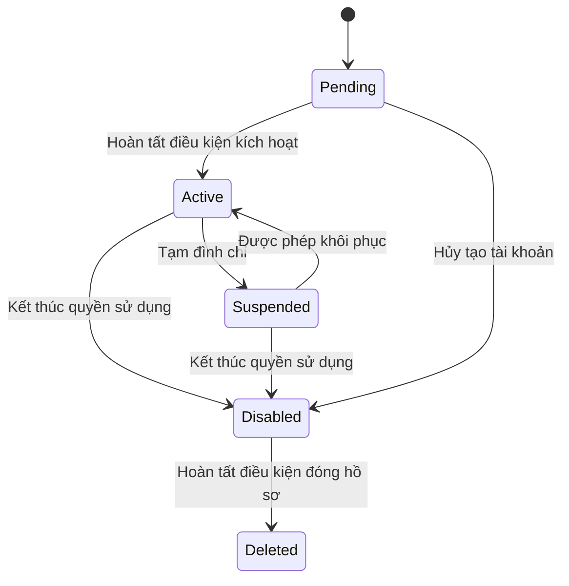

# Identity store — Kho lưu trữ danh tính

## 1. Identity store dùng để làm gì?

Một nền tảng học tập có học viên, giảng viên, nhân viên hỗ trợ và các dịch vụ chạy tự động. Hệ thống cần biết mỗi chủ thể có khóa định danh nào, đang ở trạng thái gì, thuộc tổ chức nào và liên kết với phương thức đăng nhập nào.

**Identity store** là kho dữ liệu lưu và quản lý những bản ghi biểu diễn danh tính số cùng các thông tin liên quan. Nó có thể là một cơ sở dữ liệu của ứng dụng, một directory, kho tích hợp trong dịch vụ IAM hoặc nhiều kho được tổ chức dưới một mô hình logic thống nhất.

Một bản ghi ví dụ:

```json
{
  "subjectId": "usr-1042",
  "principalType": "HUMAN",
  "displayName": "Linh",
  "status": "ACTIVE",
  "version": 7
}
```

Bản ghi cho biết ứng dụng đang quản lý subject nào và trạng thái đã lưu. Nó không chứng minh người gửi request hiện tại là Linh, cũng không tự cho biết Linh được phép đọc tài nguyên nào.

Trong IAM, identity store hỗ trợ nhiều quy trình:

- Tạo và cập nhật hồ sơ danh tính.
- Liên kết danh tính ngoài với tài khoản nội bộ.
- Lưu membership và dữ liệu phục vụ phân quyền.
- Theo dõi trạng thái hoạt động, đình chỉ hoặc kết thúc.
- Tham chiếu authenticator đã gắn với tài khoản.
- Cung cấp dữ liệu cho xác thực, cấp quyền và kiểm toán theo phạm vi.

Không phải mọi chức năng trên đều nằm trong cùng một database. Điều cần rõ là mỗi loại dữ liệu được ai quản lý và có ý nghĩa thế nào đối với truy cập.

## 2. Tách kho dữ liệu khỏi các quyết định bảo mật

Các thành phần có thể được đóng gói trong cùng một sản phẩm nhưng vẫn có trách nhiệm khác nhau:

| Thành phần | Vai trò | Điều không tự suy ra |
| --- | --- | --- |
| Identity store | Lưu bản ghi danh tính và quan hệ | Có bản ghi không có nghĩa đã xác thực |
| Dịch vụ xác thực | Kiểm tra bằng chứng của người hoặc workload | Xác thực thành công không trao mọi quyền |
| Identity provider | Cung cấp kết quả xác thực và claim theo giao thức | Mọi claim không tự có thẩm quyền cho mọi mục đích |
| Bộ phân quyền | Đánh giá hành động trên tài nguyên theo chính sách | Một role lưu trong hồ sơ không bỏ qua điều kiện khác |
| Session store | Quản lý trạng thái phiên khi kiến trúc cần | Khóa tài khoản không tự xóa mọi phiên |
| Secret store hoặc vault | Bảo vệ và quản lý bí mật | Không phải hồ sơ danh tính hay danh mục người dùng |
| Hệ thống kiểm toán | Ghi nhận thay đổi và quyết định quan trọng | Log không thay cho trạng thái đang có hiệu lực |

Ví dụ luồng đăng nhập:

```text
Nhận yêu cầu
    -> xác minh bằng chứng xác thực
    -> xác định subject nội bộ
    -> kiểm tra trạng thái và điều kiện tài khoản
    -> thiết lập phiên theo chính sách
```

Sau đó, mỗi thao tác nghiệp vụ vẫn phải được phân quyền theo thiết kế. Việc API tìm thấy `subjectId` trong database không phải là cơ chế đăng nhập.

Một ứng dụng dùng SSO vẫn có thể cần identity store cục bộ để quản lý membership, tham chiếu dữ liệu nghiệp vụ và quyền riêng của mình. Nó không nhất thiết phải lưu mật khẩu của người dùng.

## 3. Những loại dữ liệu thường xuất hiện

### 3.1. Subject và loại chủ thể

Subject là thực thể được hệ thống nhận diện khi ra quyết định. Nó có thể là người dùng, service account hoặc workload.

```text
subjectId
principalType
status
createdAt
updatedAt
version
```

Loại chủ thể giúp áp dụng lifecycle và phương thức xác thực phù hợp. Một workload không nên phải giả làm nhân viên có ngày sinh hoặc dùng chung tài khoản của một người vận hành.

Thông tin người chịu trách nhiệm cho workload là quan hệ quản trị riêng. Khi người phụ trách nghỉ việc, cần chuyển trách nhiệm hoặc ngừng workload theo quy trình, thay vì mặc định workload chính là danh tính của người đó.

### 3.2. Hồ sơ và thuộc tính

Hồ sơ có thể chứa tên hiển thị, địa chỉ liên hệ, ngôn ngữ hoặc phòng ban. Nguồn dữ liệu có thể là người dùng, directory hoặc hệ thống nhân sự.

Không phải thuộc tính nào cũng được tự sửa. Field dùng để cấp đặc quyền cần có nguồn có thẩm quyền và kiểm soát cập nhật tương ứng.

Một thiết kế nên phân biệt:

```text
Giá trị được lưu
Nguồn khẳng định
Bằng chứng hoặc trạng thái xác minh
Thời điểm có hiệu lực
Giới hạn sử dụng
```

Giữ thông tin nguồn giúp tránh việc một lần đồng bộ ghi đè dữ liệu tin cậy bằng giá trị tự khai.

### 3.3. Membership trong tenant

Một người có thể thuộc nhiều tổ chức trong cùng sản phẩm:

```text
usr-1042
    tenant-a: giảng viên
    tenant-b: học viên
```

Đình chỉ membership của tenant A không nhất thiết phải khóa toàn bộ subject ở tenant B. Ngược lại, vô hiệu hóa subject toàn cục có thể cần chặn mọi membership theo chính sách của sản phẩm.

Do đó, trạng thái subject và trạng thái membership nên được mô hình hóa rõ, thay vì dùng một cờ `enabled` để đại diện cho mọi phạm vi.

### 3.4. Liên kết danh tính ngoài

Ứng dụng cần biết một chủ thể được xác thực tại IdP ngoài ánh xạ vào subject nội bộ nào.

```text
issuer + externalSubject -> internalSubjectId
```

Trong OIDC, cặp `iss` và `sub` được dùng cùng nhau làm định danh ổn định tại issuer; email không có bảo đảm tương đương về tính duy nhất và độ ổn định. Xem [OpenID Connect Core, mục 5.7](https://openid.net/specs/openid-connect-core-1_0.html#ClaimStability).

Quan hệ liên kết phải được tạo bằng quy trình phù hợp. Tìm thấy cùng email không tự đủ để hợp nhất hai tài khoản hoặc chuyển quyền giữa chúng.

### 3.5. Authenticator và credential

Kho danh tính có thể lưu thông tin tham chiếu tới authenticator:

```text
credentialId
subjectId
authenticatorType
status
createdAt
revokedAt
credentialReference
```

Dữ liệu xác minh thực tế phụ thuộc loại authenticator. Không nên có một cột mật khẩu thuần văn bản dùng chung cho mọi tài khoản.

Nếu verifier lưu mật khẩu, chúng cần được bảo vệ bằng cơ chế băm mật khẩu có salt phù hợp để chống dò ngoại tuyến; mã hóa có thể đảo ngược không thay cho việc đó. Xem [NIST SP 800-63B-4](https://pages.nist.gov/800-63-4/sp800-63b.html).

Với xác thực bằng khóa công khai, server có thể lưu dữ liệu khóa công khai và metadata cần thiết; khóa riêng của authenticator không được giả định là một field hồ sơ server phải thu thập.

Một số bí mật của hệ thống cần được truy xuất để gọi dịch vụ khác. Chúng có yêu cầu bảo vệ khác với password verifier và thường cần cơ chế quản lý bí mật chuyên biệt. Không đưa tất cả vào API đọc hồ sơ.

### 3.6. Nhóm, role và entitlement

Có thể lưu nhóm, role hoặc grant cạnh hồ sơ danh tính, nhưng cần phân biệt chúng với thuộc tính tự khai.

Ví dụ, `department=FINANCE` là thuộc tính; `report.approve` là permission; một grant gắn permission với subject có căn cứ cấp và vòng đời riêng.

Mô hình hóa riêng giúp truy vết quyền đến từ role, quy tắc thuộc tính hay phê duyệt thủ công. Khi nhân sự đổi nhiệm vụ, hệ thống có thể xem lại đúng quyền phát sinh từ căn cứ đã thay đổi.

## 4. Identity store và directory có quan hệ như thế nào?

Directory là một cách tổ chức và cung cấp thông tin danh tính. LDAP mô tả mô hình directory với entry, attribute và schema; đó là một dạng kho mà ứng dụng có thể sử dụng. Xem [RFC 4512](https://www.rfc-editor.org/rfc/rfc4512.html).

Identity store là khái niệm rộng hơn: một bảng người dùng trong database cũng có thể đảm nhận vai trò này nếu nó được thiết kế và quản lý như dữ liệu danh tính.

| Cách tổ chức | Điểm cần cân nhắc |
| --- | --- |
| Database ứng dụng | Dễ gắn với dữ liệu nghiệp vụ và transaction, cần tự quản trị schema và API |
| Directory | Phù hợp hệ sinh thái tra cứu và nhóm theo mô hình directory, cần hiểu schema và quyền quản trị |
| Kho trong dịch vụ IAM/IdP | Có thể tích hợp lifecycle và phương thức xác thực, cần hiểu khả năng mở rộng và xuất dữ liệu |
| Nhiều kho kết hợp | Giữ được nhu cầu của từng miền, cần ánh xạ và đồng bộ rõ ràng |

Không cần chọn một nơi chứa toàn bộ mọi dữ liệu. Một kiến trúc có thể dùng:

```text
HR: dữ liệu nhân sự có thẩm quyền
Directory: nhóm và thông tin công việc
IdP: xác thực và liên kết danh tính
Ứng dụng: subject nội bộ, membership và quyền nghiệp vụ
Vault: bí mật hệ thống
```

Điều quan trọng là chỉ rõ kho nào quyết định dữ liệu nào. Nếu mọi nơi đều có thể sửa cùng một field mà không có quy tắc ưu tiên, hệ thống dễ có nhiều phiên bản mâu thuẫn.

## 5. Thiết kế khóa định danh và phạm vi

### 5.1. Khóa ổn định, không phụ thuộc thông tin hiển thị

Không nên dùng tên hiển thị hoặc email làm khóa tham chiếu lâu dài cho bài nộp, phê duyệt hoặc audit.

Khi email của Linh đổi, các dữ liệu đó vẫn phải gắn với đúng subject. Khi một địa chỉ được cấp lại cho người khác, người mới không nên nhận dữ liệu lịch sử chỉ vì trùng chuỗi email.

Khóa nội bộ cần có chính sách không tái sử dụng theo lifecycle của sản phẩm. Định dạng UUID không tự thực thi chính sách đó; ứng dụng vẫn phải quản lý tạo, liên kết và xóa đúng.

### 5.2. Namespace của danh tính ngoài

Mã `123` của directory A không tự giống mã `123` của directory B. Tương tự, `sub` ở hai issuer không tự thuộc cùng chủ thể.

Khi có nhiều connector, khóa đối chiếu có thể cần thêm `connectionId` hoặc tenant theo mô hình phạm vi. Phải xác định namespace trước khi tạo unique constraint.

Trong SCIM, `id` do service provider cấp là định danh ổn định không được cấp lại, còn `externalId` do provisioning client cấp và được hiểu trong provisioning domain tương ứng. Xem [RFC 7643, mục 3.1](https://www.rfc-editor.org/rfc/rfc7643.html#section-3.1).

### 5.3. Unique constraint phải đúng với chính sách

Nếu username chỉ duy nhất trong tenant, khóa duy nhất phải có tenant. Nếu sản phẩm chọn một subject toàn cục cho mọi tenant, cần giữ tính nhất quán của mô hình đó ở các API liên kết.

Không chỉ kiểm tra “chưa tồn tại” rồi mới ghi. Hai request đồng thời có thể cùng thấy chưa có bản ghi. Kho dữ liệu cần ràng buộc duy nhất hoặc cơ chế tương đương, và ứng dụng cần xử lý xung đột có kiểm soát.

## 6. Ví dụ lược đồ dữ liệu tối thiểu

Ví dụ PostgreSQL dưới đây chọn mô hình một subject nội bộ toàn cục, có membership riêng trong từng tenant. Một cặp issuer–subject ngoài ánh xạ tới một subject nội bộ trong sản phẩm.

```sql
CREATE TABLE identity_subject (
    subject_id UUID PRIMARY KEY,
    principal_type VARCHAR(16) NOT NULL
        CHECK (principal_type IN ('HUMAN', 'WORKLOAD')),
    display_name TEXT NOT NULL,
    status VARCHAR(16) NOT NULL
        CHECK (status IN (
            'PENDING', 'ACTIVE', 'SUSPENDED', 'DISABLED', 'DELETED'
        )),
    version BIGINT NOT NULL DEFAULT 0
        CHECK (version >= 0),
    created_at TIMESTAMPTZ NOT NULL DEFAULT CURRENT_TIMESTAMP,
    updated_at TIMESTAMPTZ NOT NULL DEFAULT CURRENT_TIMESTAMP
);

CREATE TABLE tenant (
    tenant_id UUID PRIMARY KEY,
    name TEXT NOT NULL
);

CREATE TABLE tenant_membership (
    tenant_id UUID NOT NULL REFERENCES tenant (tenant_id),
    subject_id UUID NOT NULL REFERENCES identity_subject (subject_id),
    status VARCHAR(16) NOT NULL
        CHECK (status IN ('PENDING', 'ACTIVE', 'SUSPENDED', 'REMOVED')),
    version BIGINT NOT NULL DEFAULT 0
        CHECK (version >= 0),
    PRIMARY KEY (tenant_id, subject_id)
);

CREATE TABLE external_identity (
    issuer TEXT NOT NULL,
    external_subject TEXT NOT NULL,
    subject_id UUID NOT NULL REFERENCES identity_subject (subject_id),
    PRIMARY KEY (issuer, external_subject)
);
```

Các trạng thái là lựa chọn của ví dụ, không phải tên trạng thái bắt buộc của OIDC, SCIM hoặc mọi hệ thống IAM. Trạng thái `DELETED` ở đây biểu thị bản ghi đã đóng theo mô hình giữ dấu, chưa phải thao tác xóa vật lý.

Primary key và foreign key giúp giữ ràng buộc định danh và tham chiếu trong kho dữ liệu. Chúng không tự thực hiện phân quyền cho người gọi. Cơ chế các constraint được mô tả trong [PostgreSQL — Constraints](https://www.postgresql.org/docs/current/ddl-constraints.html).

Lược đồ chưa có thông tin liên hệ, credential, role, nguồn dữ liệu hoặc audit. Việc tách các nhóm dữ liệu đó giúp tránh coi một bảng ví dụ là toàn bộ hệ thống IAM.

### 6.1. Những điều lược đồ không tự bảo đảm

- Người tạo membership có quyền thêm subject vào tenant hay không.
- Liên kết issuer–subject đã được chứng minh đúng hay chưa.
- Một chủ thể đang bị đình chỉ có được cập nhật lại thành active hay không.
- Connector chỉ được quản lý dữ liệu trong phạm vi đã cấp.
- Role quản trị không được thêm qua API sửa hồ sơ.
- Session và cache đã được cập nhật sau thay đổi lifecycle hay chưa.

Những bất biến đó cần nghiệp vụ và kiểm tra ở các ranh giới phù hợp.

`updated_at` cũng không tự thay đổi sau mọi UPDATE chỉ vì có giá trị mặc định. Ứng dụng hoặc cơ chế database được triển khai phải thực sự cập nhật nó.

### 6.2. Nếu danh tính được tách riêng theo tenant

Một sản phẩm khác có thể chọn subject chỉ tồn tại trong phạm vi tenant. Khi đó, khóa chính, khóa liên kết ngoài và foreign key phải phản ánh mô hình đó.

Không nên giữ schema toàn cục nhưng cho từng tenant tự tạo liên kết cùng issuer–subject sang các tài khoản khác nhau mà không có chính sách. Đây là thay đổi mô hình định danh, không chỉ là thêm một điều kiện tìm kiếm.

## 7. Tra cứu danh tính đúng phạm vi

Một truy vấn minh họa để lấy trạng thái subject và membership:

```sql
SELECT
    s.subject_id,
    s.principal_type,
    s.status AS subject_status,
    s.version AS subject_version,
    m.status AS membership_status,
    m.version AS membership_version
FROM external_identity e
JOIN identity_subject s
    ON s.subject_id = e.subject_id
JOIN tenant_membership m
    ON m.subject_id = s.subject_id
WHERE e.issuer = :issuer
  AND e.external_subject = :externalSubject
  AND m.tenant_id = :tenantId;
```

Các ký hiệu `:issuer`, `:externalSubject` và `:tenantId` đại diện tham số bind của lớp truy cập dữ liệu; chúng không phải cú pháp để chép nguyên xi vào mọi SQL client.

Issuer và external subject phải đến từ phản hồi xác thực đã được kiểm tra theo giao thức. Tenant có thể là lựa chọn của người dùng, nhưng backend phải kiểm tra membership và phạm vi tương ứng.

Không ghép các giá trị bên ngoài trực tiếp vào câu lệnh SQL hoặc bộ lọc directory. Dùng cơ chế tham số hóa hoặc escaping đúng với giao thức đang sử dụng.

Kết quả truy vấn chỉ là snapshot. Ứng dụng cần kiểm tra trạng thái và các điều kiện nghiệp vụ trước khi sử dụng. Với thao tác nhạy cảm có cập nhật đồng thời, cần thiết kế ranh giới nhất quán phù hợp.

### 7.1. Không nhầm “không thấy” và “không đọc được”

Có ít nhất ba kết quả khác nhau:

```text
FOUND: tìm thấy dữ liệu trong phạm vi
NOT_FOUND: kho đã trả lời nhưng không có bản ghi phù hợp
UNAVAILABLE: chưa xác định được vì lỗi truy cập kho
```

Nếu database timeout, không nên coi đó là “người dùng mới” rồi tự tạo tài khoản khác. Nếu membership bị mất do lỗi đồng bộ, không tự thêm role mặc định để bỏ qua lỗi.

API có thể chọn trả thông báo chung nhằm hạn chế lộ thông tin tài khoản, nhưng phía server vẫn cần phân biệt nguyên nhân để xử lý và kiểm toán đúng.

### 7.2. Hạn chế dữ liệu trả về

Dịch vụ cần kiểm tra membership thường chỉ cần ID, trạng thái và một số thuộc tính. Nó không cần nhận password hash, secret MFA hoặc toàn bộ hồ sơ nhân sự.

Tách đối tượng đọc công khai khỏi entity lưu trữ giúp tránh vô tình serialize dữ liệu nhạy cảm ra JSON. Quyền đọc kho dữ liệu cũng cần được giới hạn theo chức năng, không mặc định cho mọi service toàn quyền đọc mọi bảng.

## 8. Vòng đời dữ liệu danh tính

Một mô hình trạng thái minh họa:



Tên trạng thái và đường chuyển cụ thể tùy sản phẩm. Không phải mọi hệ thống đều cho phép phục hồi từ cùng một trạng thái.

### 8.1. Tạo

Một yêu cầu tạo cần được kiểm tra nguồn, phạm vi và điều kiện trùng lặp. Hồ sơ được tạo không nhất thiết hoạt động ngay.

Một tài khoản đang chờ xác minh hoặc chờ phê duyệt cần được phân biệt với tài khoản đã đủ điều kiện truy cập.

### 8.2. Thay đổi

Khi người dùng đổi tên hoặc đơn vị, ứng dụng cập nhật đúng thuộc tính và version. Nếu thay đổi ảnh hưởng quyền, cần kích hoạt tính lại hoặc xem xét quyền liên quan.

Một màn hình sửa hồ sơ không nên được phép cập nhật `status`, liên kết IdP hoặc role chỉ vì các field đó nằm trong cùng entity.

### 8.3. Đình chỉ và vô hiệu hóa

Cần phân biệt đình chỉ toàn subject, đình chỉ một membership và khóa một authenticator.

Ví dụ, một passkey bị mất có thể cần thu hồi authenticator đó. Điều này không nhất thiết yêu cầu xóa subject hoặc tất cả dữ liệu nghiệp vụ của người dùng.

Ngược lại, nghỉ việc có thể đòi hỏi vô hiệu hóa subject, thu hồi quyền và xử lý phiên ở nhiều ứng dụng. Chỉ đổi một field trong identity store không chứng minh các điểm sử dụng đã thực thi thay đổi.

### 8.4. Xóa và giữ dấu

Xóa vật lý, ẩn danh hóa hồ sơ và đặt trạng thái đã đóng có mục đích khác nhau. Cần chọn theo yêu cầu dữ liệu, kiểm toán và vận hành thực tế.

Không đặt cascade xóa toàn bộ dữ liệu nghiệp vụ chỉ vì xóa một hồ sơ mà chưa xác định hệ quả. Các phê duyệt, tài liệu hoặc lịch sử hoạt động có thể cần giữ tham chiếu ổn định.

Nếu giữ bản ghi đã xóa, mọi đường tra cứu có thể dẫn tới truy cập phải tôn trọng trạng thái đó. Soft delete không tự có hiệu lực nếu API cũ vẫn coi bản ghi tồn tại là được sử dụng.

## 9. Cập nhật đồng thời và đồng bộ thay đổi

### 9.1. Tránh ghi đè quyết định mới bằng bản cũ

Hai nhân viên quản trị cùng đọc version 7. Người thứ nhất vô hiệu hóa tài khoản thành version 8. Người thứ hai gửi biểu mẫu cũ chỉ để sửa tên.

Nếu backend ghi đè toàn bộ entity từ biểu mẫu cũ, tài khoản có thể bị đặt lại thành active ngoài ý muốn.

Cập nhật có điều kiện giúp phát hiện xung đột:

```sql
UPDATE identity_subject
SET display_name = :displayName,
    version = version + 1,
    updated_at = CURRENT_TIMESTAMP
WHERE subject_id = :subjectId
  AND version = :expectedVersion;
```

Lớp nghiệp vụ cần kiểm tra số hàng thực sự cập nhật. Không có hàng nào được cập nhật có thể là xung đột hoặc đối tượng không còn phù hợp; không nên tự bỏ điều kiện version rồi thử ghi lại.

Câu lệnh trên chỉ sửa tên, không sửa trạng thái. Giới hạn field cập nhật cũng giúp giảm nguy cơ thao tác hồ sơ làm thay đổi lifecycle.

### 9.2. Đồng bộ database và sự kiện

Giả sử database đã vô hiệu hóa tài khoản nhưng tiến trình bị dừng trước khi gửi sự kiện thu hồi cache. Các hệ thống khác có thể tiếp tục dùng trạng thái cũ.

Một cách tổ chức là transactional outbox:

```text
Bắt đầu transaction
    kiểm tra quyền và phiên bản cần thiết
    cập nhật trạng thái subject
    ghi sự kiện lifecycle vào outbox cùng database
Commit

Tiến trình phát sự kiện:
    đọc outbox đã commit
    gửi sự kiện
    ghi nhận kết quả và retry có kiểm soát
```

Outbox giúp tránh mất sự kiện do khoảng hở giữa commit và gửi. Nó không làm mọi hệ thống cập nhật đồng thời, cũng không tự bảo đảm consumer chỉ nhận đúng một lần.

Consumer cần xử lý lặp và thứ tự theo hợp đồng, ví dụ dựa vào ID sự kiện và version subject. Không để một sự kiện kích hoạt cũ ghi đè trạng thái vô hiệu hóa mới.

### 9.3. Reconciliation

Ngoài luồng cập nhật liên tục, có thể cần đối soát định kỳ trạng thái mong đợi với trạng thái thực tế tại các hệ thống đích.

Đối soát giúp tìm membership mồ côi, grant không còn căn cứ hoặc tài khoản ứng dụng chưa được khóa. Nó không thay thế kiểm soát truy cập tại thời điểm xử lý yêu cầu.

## 10. Cache, bản sao và hiệu lực thu hồi

### 10.1. Dữ liệu đã đổi chưa chắc quyết định đã đổi

Một tình huống giả định:

```text
10:00 — Subject bị vô hiệu hóa trong identity store
10:01 — Replica đọc vẫn trả trạng thái active
10:03 — Cache ứng dụng vẫn còn bản trước đó
10:15 — Token cũ vẫn chưa hết hạn
```

Nếu ứng dụng chỉ xác minh token rồi tin mọi claim bên trong, thay đổi ở kho có thể chưa tác động đến truy cập theo thời điểm mong muốn.

Cần xác định yêu cầu hiệu lực thu hồi cho từng loại chức năng. Cơ chế có thể bao gồm kiểm tra trạng thái hiện hành, cache có thời hạn, sự kiện vô hiệu hóa, phiên bản bảo mật hoặc token có thời hạn phù hợp.

Một field `securityVersion` chỉ có ích khi các điểm sử dụng thật sự kiểm tra nó. Tăng số trong database mà không có nơi đối chiếu không thu hồi được phiên.

### 10.2. Chọn cách đọc theo rủi ro

Dữ liệu hiển thị tên người dùng có thể chấp nhận độ trễ khác với dữ liệu quyết định tài khoản còn được chuyển tiền hay không.

Không cần buộc mọi truy vấn dùng cùng một mức nhất quán. Nhưng những đường truy cập quan trọng cần biết đang đọc từ đâu và dữ liệu có thể cũ bao lâu.

Khi kho không khả dụng, không nên cho phép mọi thao tác để “duy trì hoạt động”. Có thể dùng một chính sách cache được giới hạn cho các chức năng cụ thể, còn thao tác cần trạng thái mới phải dừng trước tác dụng phụ nếu không xác định được.

### 10.3. Khóa cache phải giữ phạm vi

Cache membership chỉ theo `subjectId` có thể trả quyền tenant A khi người dùng đang thao tác tenant B.

Khóa và dữ liệu cache cần phản ánh các đầu vào liên quan:

```text
tenantId
subjectId
loại dữ liệu hoặc truy vấn
version hoặc giới hạn độ mới khi có
```

Cũng cần xử lý cache kết quả “không có bản ghi”. Nếu thời hạn quá dài và không vô hiệu hóa khi tạo membership, người dùng có thể vẫn bị từ chối sau khi đã được cấp quyền hợp lệ.

## 11. Bảo vệ identity store

### 11.1. Kho danh tính là mục tiêu có giá trị cao

Kẻ có quyền sửa liên kết IdP, trạng thái, phương thức khôi phục hoặc role có thể kiểm soát tài khoản mà không cần biết mật khẩu.

Vì vậy, bảo vệ kho bao gồm cả dữ liệu, API quản trị, tài khoản kết nối, công cụ vận hành và bản sao lưu.

Một ví dụ phân quyền nội bộ:

| Thành phần | Dữ liệu cần thiết | Giới hạn |
| --- | --- | --- |
| API hồ sơ | Tên hiển thị và thông tin được phép sửa | Không tự sửa role hoặc trạng thái xác minh |
| Dịch vụ xác thực | Tham chiếu authenticator và trạng thái cần kiểm tra | Không trả credential verifier ra API hồ sơ |
| Connector provisioning | Subject và field thuộc phạm vi nguồn | Không quản lý tenant ngoài phạm vi |
| Dịch vụ phân quyền | Membership, grant và thuộc tính được chấp nhận | Không mặc định cần mọi bí mật |
| Công cụ hỗ trợ | Những thao tác đã được giao và có kiểm toán | Không mặc định được liên kết lại mọi tài khoản |
| Tác vụ sao lưu | Dữ liệu cần phục hồi | Bản sao cũng phải được bảo vệ và giới hạn truy cập |

Quyền quản trị database hoặc sửa migration có thể vượt các kiểm tra ở ứng dụng. Cần quản lý các quyền đó như đặc quyền, không chỉ kiểm soát tài khoản người dùng cuối.

### 11.2. Tách dữ liệu nhạy cảm và dữ liệu cần công bố

Password verifier không phải dữ liệu được trả cho người dùng chỉ vì nó nằm trong bản ghi của chính họ. Secret, token khôi phục và thông tin xác thực hệ thống cũng cần ranh giới riêng.

Bảo vệ dữ liệu khi truyền và lưu trữ là cần thiết, nhưng không thay cho quyền truy cập theo chức năng. Nếu một service có thể đọc mọi dữ liệu sau giải mã, mã hóa lưu trữ không giới hạn việc service đó sử dụng chúng.

Các API liệt kê, tìm kiếm và xuất danh tính cũng phải được phân quyền. Cho phép một người dùng biết tài khoản của mình không có nghĩa được tải toàn bộ danh sách email hoặc thông tin nhân sự.

### 11.3. Không để binding tự động tạo đường tăng quyền

Một request sửa hồ sơ có thể chứa field ngoài dự kiến:

```json
{
  "displayName": "Linh",
  "status": "ACTIVE",
  "platformAdmin": true,
  "externalSubject": "another-account"
}
```

Nếu backend bind toàn bộ JSON vào entity rồi lưu, người gọi có thể sửa dữ liệu bảo mật qua một endpoint tưởng chỉ sửa tên.

Nên có DTO riêng, allowlist field và thao tác nghiệp vụ riêng cho trạng thái, liên kết hoặc quyền. Server tự xác định subject đang được sửa và kiểm tra phạm vi, thay vì tin mọi ID do client cung cấp.

### 11.4. Theo dõi thay đổi có ý nghĩa

Sự kiện audit nên mô tả actor, đối tượng, loại thao tác, kết quả và mã tương quan. Với thay đổi nhạy cảm, cần đủ bằng chứng để biết ai sửa liên kết hoặc trạng thái và căn cứ nào cho phép.

Không ghi nguyên mật khẩu, token, secret hoặc toàn bộ request chứa dữ liệu nhạy cảm vào log.

Nếu lưu giá trị cũ và mới để điều tra, cần kho và quyền đọc phù hợp. Audit cần phục vụ truy vết mà không trở thành một bản sao hồ sơ mở cho mọi người.

## 12. Nguồn dữ liệu, provisioning và SSO

### 12.1. Identity store không tự là nguồn có thẩm quyền cho mọi field

Ứng dụng có thể lưu bản sao phòng ban từ HR nhưng quản lý role nghiệp vụ cục bộ. Việc cả hai nằm trong cùng database không làm chúng có cùng nguồn quyết định.

Nên xác định:

```text
Thuộc tính nào được quản lý ở đâu?
Ai được sửa?
Bản sao có thể cũ bao lâu?
Khi nguồn rút lại dữ liệu, hệ thống đích xử lý ra sao?
```

Nếu dùng dữ liệu nguồn để cấp role tự động, cần giữ căn cứ cấp để thu hồi hoặc tính lại khi thuộc tính đổi.

### 12.2. Provisioning và đăng nhập theo nhu cầu

Có thể tạo tài khoản trước qua provisioning, hoặc tạo hồ sơ ứng dụng khi người dùng đăng nhập lần đầu bằng SSO theo chính sách JIT.

Hai cách này không tự tương đương. Một hồ sơ được tạo JIT vẫn cần membership và quyền theo quy trình; không nên mặc định cho mọi người từ một IdP cùng role quản trị.

Provisioning cũng cần idempotency để retry không tạo nhiều subject. Khóa idempotency và khóa đối chiếu cần gắn với đúng kết nối hoặc phạm vi, không dùng một email làm quy tắc gộp tùy ý.

### 12.3. Không đồng bộ credential không cần thiết

Nếu IdP chịu trách nhiệm xác thực, ứng dụng có thể chỉ giữ liên kết danh tính ngoài và các dữ liệu cục bộ cần dùng.

Không thu thập mật khẩu của IdP chỉ để “đủ hồ sơ”. Không tạo một mật khẩu mặc định hoặc một đường đăng nhập cục bộ yếu hơn mà người dùng không biết, vì nó có thể trở thành đường bỏ qua bảo vệ ở SSO.

Quy trình thêm phương thức đăng nhập mới cho tài khoản hiện có cũng cần kiểm soát riêng; đó là thay đổi khả năng kiểm soát tài khoản.

## 13. Sao lưu, phục hồi và di chuyển kho

### 13.1. Khôi phục không chỉ là đọc lại được dữ liệu

Một bản backup từ hôm qua có thể chứa tài khoản khi đó còn active. Nếu phục hồi mà bỏ qua các sự kiện vô hiệu hóa sau thời điểm backup, người đã bị thu hồi có thể lấy lại quyền.

Kế hoạch phục hồi cần xem xét trạng thái lifecycle, grant, liên kết ngoài và những phiên hoặc token còn tồn tại trong các hệ thống khác.

Cần biết dữ liệu nào được phục hồi, dữ liệu nào phải đối soát với nguồn hiện hành và thời điểm hệ thống được phép phục vụ trở lại.

### 13.2. Giữ định danh khi chuyển hệ thống

Di chuyển identity store không nên làm mọi subject nhận một khóa mới rồi mất liên kết với dữ liệu nghiệp vụ.

Nếu bắt buộc đổi khóa, cần bảng ánh xạ và kiểm tra đầy đủ tham chiếu. Cũng phải giữ đúng quan hệ issuer–subject và namespace của nguồn provisioning.

Thay IdP không có nghĩa có thể liên kết mọi tài khoản mới với tài khoản cũ chỉ bằng email. Việc nối hai miền danh tính cần quy trình và bằng chứng tương ứng.

### 13.3. Di chuyển dữ liệu xác thực

Không phải credential nào cũng có thể sao chép sang hệ thống mới. Khả năng chuyển phụ thuộc loại authenticator, dữ liệu verifier, giao thức và cách ràng buộc với ứng dụng.

Cần có kế hoạch duy trì hoặc đăng ký lại phương thức xác thực phù hợp. Không “giải quyết” việc không chuyển được verifier bằng cách đặt mật khẩu mặc định cho tất cả tài khoản.

Bản staging, file xuất và backup phát sinh trong migration cũng là dữ liệu danh tính cần bảo vệ và có lifecycle riêng.

## 14. Tình huống xuyên suốt: một người ở hai tenant

Linh có subject toàn cục `usr-1042` và hai membership:

```text
tenant-a: ACTIVE, giảng viên
tenant-b: ACTIVE, học viên
```

Linh đăng nhập bằng IdP đã liên kết. Ứng dụng xác định đúng subject rồi yêu cầu chọn tenant.

### Bước 1: Truy cập tenant A

Backend lấy membership của đúng cặp `tenant-a` và `usr-1042`. Quyền giảng viên được tính trong phạm vi tenant A và vẫn chịu kiểm tra tài nguyên.

Không được lấy role giảng viên của tenant A để thực hiện thao tác giảng viên ở tenant B.

### Bước 2: Tenant A đình chỉ Linh

Membership tenant A chuyển sang suspended. Subject toàn cục và membership tenant B vẫn giữ trạng thái theo chính sách của ví dụ.

Các cache và điểm kiểm tra truy cập tenant A cần nhận được thay đổi trong giới hạn hiệu lực đã thiết kế. Linh vẫn có thể được học ở tenant B.

### Bước 3: Subject bị vô hiệu hóa vì sự cố bảo mật

Đây là thay đổi toàn subject. Theo chính sách của ví dụ, mọi truy cập dựa trên subject đó phải bị chặn, đồng thời xử lý phiên và authenticator liên quan.

Chỉ lọc membership active là chưa đủ nếu truy vấn hoặc bộ phân quyền quên xét trạng thái subject.

### Bước 4: Đổi email liên hệ

Sau khi sự cố được xử lý theo quy trình riêng, email có thể thay đổi mà `subjectId` vẫn giữ nguyên. Bài nộp, lịch sử giảng dạy và audit không bị chuyển sang một subject khác.

Tình huống cho thấy mô hình dữ liệu quyết định việc ứng dụng có thể diễn đạt đúng phạm vi thay đổi hay không.

## 15. Kiểm thử và tiêu chí đánh giá

| Tình huống | Kết quả cần kiểm tra |
| --- | --- |
| Hai request tạo cùng định danh ngoài | Không tạo liên kết mâu thuẫn hoặc hai subject ngoài ý định |
| Người dùng đổi email hoặc tên hiển thị | Khóa subject và tham chiếu nghiệp vụ giữ đúng |
| Cùng subject ở hai tenant | Membership và quyền không bị trộn |
| Membership bị đình chỉ | Đúng phạm vi bị chặn |
| Subject toàn cục bị vô hiệu hóa | Không bỏ sót đường chỉ kiểm tra membership |
| API sửa hồ sơ nhận field role hoặc trạng thái | Field bảo vệ không bị sửa trái quyền |
| Database timeout khi tra cứu | Không tự coi là người mới để tạo tài khoản khác |
| Update từ version cũ | Phát hiện xung đột, không ghi đè thay đổi mới |
| Sự kiện lifecycle bị gửi lại | Consumer xử lý lặp theo thiết kế |
| Sự kiện kích hoạt cũ đến sau vô hiệu hóa | Không làm sống lại quyền |
| Cache hoặc replica còn bản cũ | Hành vi nằm trong cam kết độ mới và thu hồi |
| Soft delete một subject | Không còn đường truy cập coi bản ghi đó là active |
| Xóa liên kết IdP | Không tạo đường chiếm hoặc hợp nhất tài khoản ngoài ý muốn |
| Phục hồi backup cũ | Không khôi phục quyền đã bị thu hồi mà chưa đối soát |
| Service chỉ cần đọc membership | Không nhận credential hoặc dữ liệu nhạy cảm ngoài nhu cầu |

Kiểm thử schema giúp kiểm tra constraint; kiểm thử nghiệp vụ giúp kiểm tra ai được sửa gì; kiểm thử tích hợp giúp kiểm tra đường dữ liệu và hiệu lực ở ứng dụng thật. Không một loại kiểm tra đơn lẻ chứng minh toàn bộ kho danh tính đã an toàn.

Trong vận hành, có thể theo dõi độ trễ đồng bộ, số lỗi ánh xạ, tài khoản hoặc grant mồ côi, xung đột version và thời gian thu hồi có hiệu lực. Một database khỏe chưa chắc có dữ liệu đúng hoặc quyền đã được thu hồi đúng.

## 16. Những điều cần vận dụng

Identity store cung cấp nền tảng dữ liệu để IAM nhận diện và quản lý chủ thể, nhưng các quyết định xác thực, phân quyền và vòng đời phải được thực thi bằng cơ chế tương ứng.

Một thiết kế rõ ràng giữ khóa ổn định, tách subject khỏi membership, quản lý liên kết ngoài theo đúng namespace và giới hạn dữ liệu nhạy cảm. Nó cũng mô tả được dữ liệu đến từ đâu, thay đổi lan truyền thế nào và cách kiểm chứng hiệu lực thu hồi.

Khi đọc một mô hình kho danh tính, hãy lần theo một chủ thể từ lúc được tạo đến lúc ngừng hoạt động. Nếu hệ thống vẫn giữ đúng tham chiếu, đúng phạm vi quyền và đủ bằng chứng ở mỗi bước, kho đó mới đang phục vụ đầy đủ vai trò của nó trong IAM.
