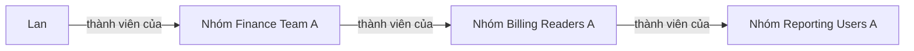

# Group directory

## 1. Group directory giải quyết vấn đề gì trong IAM?

Group directory là phần dịch vụ hoặc kho danh tính quản lý các nhóm và quan hệ thành viên của nhóm. Thay vì duy trì riêng danh sách người được truy cập ở từng ứng dụng, tổ chức có thể quản lý những tập người hoặc principal có cùng mục đích, rồi cho ứng dụng sử dụng membership đó theo chính sách đã định nghĩa.

Ví dụ, Lan thuộc đội tài chính của doanh nghiệp A. Directory ghi nhận Lan là thành viên nhóm đọc hóa đơn. Ứng dụng billing nhận dữ kiện nhóm từ nguồn được tin cậy và ánh xạ nhóm đó sang quyền đọc trong tenant A. Khi Lan đổi nhiệm vụ, membership cần được cập nhật và thay đổi đó phải đi tới các điểm thực thi quyền.

Group directory không nhất thiết là một sản phẩm tách biệt. Nó có thể là một phần của directory doanh nghiệp, identity provider, dịch vụ quản lý danh tính trên cloud hoặc kho nội bộ. Điều cần hiểu là dữ liệu nhóm được quản lý ở đâu, ai có quyền thay đổi và ứng dụng diễn giải dữ liệu đó thế nào.

Sau bài học, người học cần có khả năng:

- Phân biệt group, user, role và organizational unit.
- Chọn định danh nhóm ổn định thay cho tên hiển thị.
- Phân biệt membership trực tiếp, bắc cầu và membership suy ra theo điều kiện.
- Đọc được cách biểu diễn nhóm cơ bản trong LDAP và SCIM.
- Thiết kế mapping nhóm sang quyền có giới hạn nguồn, tenant và ứng dụng.
- Nhận ra lỗi phân quyền do dữ liệu không đầy đủ, đồng bộ chậm hoặc nhóm lồng nhau.
- Hiểu ví dụ Java giải membership từ snapshot được quản lý mà không mặc nhiên coi nhóm là quyền trên mọi tài nguyên.

Các tên nhóm, schema nội bộ, thời hạn và chính sách ứng dụng dưới đây là ví dụ giả định. Những đoạn mô tả giao thức hoặc nền tảng cụ thể có dẫn nguồn riêng.

## 2. Group không phải user, role hay đơn vị tổ chức

| Khái niệm | Vai trò chính | Ví dụ | Không được suy ra tự động |
| --- | --- | --- | --- |
| User hoặc principal | Đại diện chủ thể sử dụng hệ thống | Lan, workload xuất báo cáo | Có quyền chỉ vì tài khoản tồn tại |
| Group | Tập principal hoặc nhóm khác theo mô hình được hỗ trợ | `Billing Readers A` | Mọi thành viên được làm mọi việc trong billing |
| Role | Tập trách nhiệm hoặc quyền trong mô hình authorization | `BILLING_READER` | Role cùng tên có nghĩa giống nhau ở mọi ứng dụng |
| Permission | Hành động được mô tả trong policy | `invoice.read` | Có quyền trên mọi hóa đơn bất kể tenant |
| Organizational unit | Cách tổ chức hoặc quản trị đối tượng theo mô hình directory | OU Finance | Mọi người trong OU đều là thành viên một group cụ thể |
| Distribution list | Tập địa chỉ hoặc đối tượng phục vụ gửi thư | Danh sách nhận thông báo tài chính | Danh sách đó được dùng để cấp quyền ứng dụng |

Một group có thể được dùng làm đầu vào cấp role, nhưng cần một mapping có chủ sở hữu. Nếu chỉ tạo group tên `Admin`, ứng dụng không nên tự coi đó là quyền quản trị nền tảng.

Trong Active Directory, Microsoft phân biệt security group dùng cho việc cấp quyền và distribution group phục vụ danh sách thư; distribution group không phải security-enabled group để đưa vào DACL. Đây là đặc điểm của AD, không phải quy tắc đặt tên cho mọi hệ thống group trên thị trường. [Nguồn: Microsoft Learn — Active Directory security groups](https://learn.microsoft.com/en-us/windows-server/identity/ad-ds/manage/understand-security-groups).

Một group dùng để nhận thư vẫn có thể được một ứng dụng tùy chỉnh ánh xạ thành quyền nếu tổ chức cố ý thiết kế như vậy. Khi đó việc bảo vệ quyền sửa danh sách nhận thư trở thành một phần của bảo vệ quyền ứng dụng. Không nên để sự liên hệ này xuất hiện ngầm ngoài quy trình quản trị.

## 3. Định danh nhóm và metadata cần giữ

### 3.1. Tên hiển thị không phải khóa bảo mật

Hai tenant có thể cùng có group tên `Finance`. Một group cũng có thể đổi tên mà vẫn là cùng một đối tượng. Nếu mapping quyền theo tên, việc đổi tên có thể làm mất quyền, hoặc tạo lại một group trùng tên có thể vô tình nhận quyền của group cũ.

Một khóa nhóm nội bộ có thể là:

```text
GroupKey = directoryId + groupId
```

`directoryId` chỉ nguồn danh tính được quản lý; `groupId` là định danh ổn định trong nguồn đó. Nếu source có phạm vi định danh nhỏ hơn toàn directory, khóa nội bộ phải bổ sung namespace cần thiết. Không dùng email, nhãn hiển thị hoặc chuỗi DN như thể chúng luôn bất biến.

SCIM quy định `id` là định danh do service provider cấp, ổn định và không tái gán. Khi tích hợp nhiều provider, ứng dụng vẫn cần giữ namespace của từng provider để tránh trộn nguồn. [Nguồn: RFC 7643, mục 3.1](https://www.rfc-editor.org/rfc/rfc7643.html#section-3.1).

### 3.2. Nhóm và membership là hai loại bản ghi khác nhau

Một group có thể có metadata:

```json
{
  "directoryId": "corp-directory-a",
  "groupId": "group-billing-readers-01",
  "tenantId": "tenant-a",
  "displayName": "Billing Readers",
  "purpose": "Đọc hóa đơn trong tenant A",
  "membershipMode": "ASSIGNED",
  "ownerTeam": "finance-access-owners",
  "version": 18
}
```

Đây là schema nội bộ của ví dụ, không phải một resource SCIM hoàn chỉnh. Các trường như owner hoặc purpose hỗ trợ quản trị; quyền thay đổi membership vẫn cần được thực thi bằng policy, không chỉ bằng một dòng mô tả.

Quan hệ thành viên cần thông tin riêng:

```json
{
  "groupId": "group-billing-readers-01",
  "memberType": "USER",
  "memberId": "user-lan",
  "source": "approved-membership-request",
  "validFrom": "2026-11-26T02:00:00Z",
  "validUntil": null,
  "version": 7
}
```

Không phải mọi directory đều hỗ trợ thời hạn trên từng membership. Nếu ví dụ dùng membership có thời hạn mà nguồn không có khả năng đó, tầng quản lý cần cơ chế tương ứng, thay vì lưu `validUntil` ở đâu đó nhưng không áp dụng khi giải quyền.

### 3.3. Định danh thành viên cũng cần namespace

Group có thể chứa user, workload, thiết bị hoặc group khác tùy sản phẩm và schema. Bản ghi phải phân biệt loại thành viên và định danh tương ứng. Không dùng cùng chuỗi `42` cho user và group mà không biết namespace.

Khi người dùng đăng nhập qua IdP, ứng dụng cần liên kết danh tính đăng nhập với đúng đối tượng directory. Ghép bằng tên hiển thị hoặc email có thể thay đổi không đủ để chứng minh đó là cùng principal. Việc liên kết phải dựa trên contract định danh và quy trình được quản lý.

## 4. Membership trực tiếp, bắc cầu và động

### 4.1. Membership trực tiếp

Lan xuất hiện ngay trong danh sách thành viên của nhóm A. Khi đó Lan có membership trực tiếp đối với A.

```text
Lan --là thành viên trực tiếp của--> Nhóm A
```

Một truy vấn direct membership trả A nhưng không nhất thiết trả tất cả nhóm cha của A. Tên endpoint hoặc tên field có chữ `groups` chưa đủ để biết nó trả direct hay transitive membership.

### 4.2. Membership bắc cầu qua nhóm lồng nhau

Giả sử A là thành viên B, B là thành viên C:



Nếu policy của integration cho phép mở rộng membership bắc cầu, Lan có thể được xem là thành viên hiệu lực của B và C. Nếu application chỉ chấp nhận direct membership, kết quả dùng để mapping quyền sẽ khác.

Trong AD, các group scope như Global, Universal và Domain Local có quy tắc riêng về thành viên và phạm vi cấp quyền. Không được mang một thuật toán lồng nhóm tùy ý sang AD rồi mặc định tương đương với ngữ nghĩa quyền của hệ điều hành. [Nguồn: Microsoft Learn — Group scope](https://learn.microsoft.com/en-us/windows-server/identity/ad-ds/manage/understand-security-groups#group-scope).

Đối với một ứng dụng tự giải membership, cần định nghĩa rõ:

- Nhóm lồng nhau có được phép tạo quyền gián tiếp không?
- Có cho đi qua nguồn hoặc tenant khác không?
- Có giới hạn độ sâu và kích thước đồ thị không?
- Chu trình được từ chối hay được xử lý bằng tập đã thăm?
- Khi thiếu một phần dữ liệu nhóm, có được dùng kết quả đang có không?

### 4.3. Group động

Group động được tính từ một điều kiện, chẳng hạn nhân viên đang hoạt động và thuộc bộ phận tài chính. Membership là kết quả đánh giá quy tắc, không chỉ là danh sách do quản trị viên thêm thủ công.

Quy tắc động trở thành một đường cấp quyền nếu group được mapping sang role. Do đó, ai sửa được điều kiện group hoặc thuộc tính đầu vào có thể ảnh hưởng quyền của nhiều người.

Ví dụ, nếu người dùng tự sửa được `department=FINANCE` và rule chỉ dựa vào thuộc tính này, họ có thể tự vào group cấp quyền. Nguồn của thuộc tính và quyền thay đổi rule cần được quản lý cùng mức quan trọng với membership thủ công.

Kết quả group động cũng có thể trễ do lịch tính toán và đồng bộ. Không hứa quyền biến mất ngay sau khi nhân sự đổi bộ phận nếu hệ thống chỉ đánh giá lại theo chu kỳ.

## 5. Biểu diễn nhóm trong LDAP và SCIM

### 5.1. LDAP group entry

RFC 4519 định nghĩa `groupOfNames` với các thuộc tính bắt buộc gồm `cn` và `member`; giá trị `member` sử dụng DN. Ví dụ LDIF dưới đây minh họa mô hình đó. [Nguồn: RFC 4519, mục 2.17 và 3.5](https://www.rfc-editor.org/rfc/rfc4519.html#section-3.5).

```ldif
dn: cn=billing-readers,ou=groups,dc=example,dc=test
objectClass: top
objectClass: groupOfNames
cn: billing-readers
member: uid=lan,ou=people,dc=example,dc=test
```

DN thể hiện vị trí và tên của entry trong cây directory. Khi rename hoặc di chuyển entry, DN có thể đổi; integration cần cơ chế định danh và cập nhật tham chiếu phù hợp với nguồn.

Vì schema trên yêu cầu `member`, không thể mặc định mọi server đều cho tạo một `groupOfNames` rỗng theo đúng schema đó. Cách biểu diễn nhóm rỗng phải theo schema và khả năng thực tế, không tự thêm một người dùng giả để làm đầy trường bắt buộc.

Một số hệ thống cung cấp `memberOf` ở phía user dưới dạng backlink hoặc giá trị được tính. Không nên giả định tên field đó luôn tồn tại hoặc luôn trả membership bắc cầu trên mọi LDAP server. Adapter cần kiểm chứng schema và ngữ nghĩa của nguồn đang dùng.

### 5.2. SCIM Group resource

SCIM định nghĩa Group với `displayName` và `members`; thành viên có thể tham chiếu User hoặc Group khi được hỗ trợ. Chuẩn không định nghĩa một authorization model chung cho membership: ý nghĩa quyền thuộc về service provider và policy ứng dụng. [Nguồn: RFC 7643, mục 4.2](https://www.rfc-editor.org/rfc/rfc7643.html#section-4.2).

```json
{
  "schemas": ["urn:ietf:params:scim:schemas:core:2.0:Group"],
  "id": "group-billing-readers-01",
  "displayName": "Billing Readers",
  "members": [
    {
      "value": "user-lan",
      "type": "User"
    }
  ]
}
```

Các ID trong ví dụ là dữ liệu giả do provider giả định cấp. Không suy ra tenant hoặc role chỉ từ chuỗi ID và nhãn hiển thị. Những dữ kiện đó cần mapping và context được quản lý.

### 5.3. Giao thức truy cập không quyết định nơi có thẩm quyền

LDAP và SCIM là các cách đọc hoặc quản lý dữ liệu; việc thấy một group qua API không tự cho biết API đó là nguồn gốc hay bản sao.

Ví dụ, group có thể bắt nguồn từ directory doanh nghiệp, được đồng bộ sang IdP rồi provisioning sang ứng dụng. Nếu ứng dụng tự sửa membership tại bản sao trong khi nguồn vẫn giữ dữ kiện cũ, lần đồng bộ tiếp theo có thể ghi lại trạng thái trước đó.

Với mỗi group hoặc loại membership, cần xác định nguồn có quyền quyết định. Chọn một nơi làm nguồn có thẩm quyền không nhất thiết có nghĩa mọi trường đều do cùng nơi quản lý; nhưng phân chia theo trường phải rõ, tránh hai chiều ghi đè nhau.

## 6. Từ membership tới quyền ứng dụng

### 6.1. Dùng mapping tường minh

Trong ví dụ billing, ứng dụng dùng bảng mapping:

| Directory | Group ID | Tenant đích | Role ứng dụng | Cách dùng membership |
| --- | --- | --- | --- | --- |
| `corp-directory-a` | `group-billing-readers-01` | A | `BILLING_READER` | Direct hoặc transitive theo contract |
| `corp-directory-a` | `group-billing-approvers-02` | A | `BILLING_APPROVER` | Direct theo contract của nhóm đặc quyền |
| `partner-directory-b` | `group-billing-readers-01` | B | `BILLING_READER` | Mapping riêng của nguồn B |

Cùng một chuỗi group ID ở hai nguồn không được nhập làm một. Một group hợp lệ của A cũng không tự tạo quyền trong B.

Mapping không nên dùng `displayName.contains("admin")`, tiền tố email hoặc suy đoán tên group. Một nhóm tự tạo tên `Platform Admins` phải không thể nhận quyền nền tảng nếu chưa có mapping được phê duyệt.

### 6.2. Membership chưa đủ để quyết định tài nguyên

Giả sử Lan được mapping sang `BILLING_READER` trong tenant A. Khi Lan yêu cầu đọc hóa đơn, policy vẫn có thể cần:

```text
principal đang hoạt động
AND context xác thực phù hợp
AND membership được xác nhận từ đúng nguồn và đủ mới
AND mapping cho ứng dụng billing và tenant A còn hiệu lực
AND hóa đơn thuộc tenant A
AND điều kiện đối tượng hoặc trường dữ liệu được thỏa mãn
```

Biết ID của một hóa đơn không có nghĩa được đọc hóa đơn đó chỉ vì thuộc một group có quyền đọc ở mức chức năng. Group directory cung cấp một phần dữ kiện; điểm thực thi authorization vẫn cần giới hạn phạm vi.

### 6.3. Group owner không mặc nhiên là người có quyền cấp mọi đặc quyền

Nếu group được dùng để cấp quyền duyệt hóa đơn, quyền thêm thành viên vào group cũng ảnh hưởng quyền duyệt. Cần xác định chủ nhóm có được thêm chính mình không, có cần phê duyệt không và có được thêm nhóm con không.

Thêm một nhóm con vào nhóm đặc quyền có thể cấp quyền cho hàng trăm người qua một thao tác. Luồng phê duyệt nên đánh giá phạm vi thành viên bị ảnh hưởng, không chỉ số lượng cạnh membership được ghi.

## 7. Quản lý thêm, xóa và thay thế membership

### 7.1. Phân biệt thay đổi một thành viên và thay toàn bộ tập

Một client muốn thêm Lan nhưng dùng thao tác thay thế toàn bộ danh sách bằng `[Lan]` có thể xóa mọi thành viên còn lại. Ngược lại, một client chỉ thêm mà không xử lý remove sẽ giữ quyền của người đã rời nhóm.

SCIM PATCH có các thao tác `add`, `remove`, `replace`; RFC 7644 cũng mô tả dùng `If-Match` khi provider hỗ trợ versioning để tránh cập nhật trên phiên bản đã thay đổi. Cần dùng đúng ngữ nghĩa thao tác và khả năng của provider. [Nguồn: RFC 7644, mục 3.5.2 và 3.14](https://www.rfc-editor.org/rfc/rfc7644.html#section-3.5.2).

Một payload thêm thành viên minh họa:

```json
{
  "schemas": ["urn:ietf:params:scim:api:messages:2.0:PatchOp"],
  "Operations": [
    {
      "op": "add",
      "path": "members",
      "value": [{"value": "user-lan"}]
    }
  ]
}
```

Payload chỉ diễn tả thay đổi dữ liệu. Nó không chứng minh người gọi có quyền cấp membership; endpoint phải kiểm tra danh tính và thẩm quyền của bên ghi.

### 7.2. Idempotency và cập nhật cạnh tranh

Một yêu cầu đồng bộ có thể được gửi lại do timeout. Hệ thống cần xác định kết quả khi thành viên đã có hoặc đã bị gỡ, theo giao thức và contract tương ứng. Không tự tạo nhiều bản ghi cấp quyền độc lập chỉ vì cùng thông điệp được nhận hai lần.

Với thao tác đọc toàn bộ rồi thay thế, có thể xảy ra lost update:

```text
T0: Client X và Y cùng đọc danh sách {Lan} ở version 10.
T1: X thêm Minh, ghi {Lan, Minh}.
T2: Y thêm An từ snapshot cũ, ghi {Lan, An}.
Kết quả: Minh bị xóa ngoài ý định nếu không phát hiện xung đột.
```

Giải pháp có thể là cập nhật có điều kiện theo version, thao tác delta phù hợp hoặc cơ chế giao dịch do nguồn hỗ trợ. Khi có conflict, cần đọc lại và tính lại ý định, không bỏ kiểm tra version rồi ghi đè.

### 7.3. Thay đổi group definition cũng có thể đổi quyền

Không chỉ thêm hoặc xóa user mới làm thay đổi truy cập. Các thay đổi sau cũng cần được quản lý:

- Thêm nhóm con vào nhóm đã được mapping sang role.
- Sửa điều kiện membership động.
- Thay owner hoặc quyền quản trị nhóm đặc quyền.
- Thêm mapping group sang role mới.
- Thay permission của role đã được mapping.
- Xóa group rồi tạo group cùng tên nhưng ID khác.

Quy trình rà soát chỉ đọc danh sách user trực tiếp có thể bỏ sót tác động của những thay đổi này.

## 8. Đồng bộ, tính đầy đủ và độ mới của dữ liệu

### 8.1. Một danh sách trả về chưa chắc là toàn bộ membership

API có thể phân trang, bỏ trường do quyền đọc, giới hạn số kết quả hoặc trả lỗi giữa các trang. Một response không chứa Lan chưa đủ chứng minh Lan không thuộc group nếu client chưa hoàn tất truy vấn theo contract.

Trong thiết kế nội bộ có thể giữ:

```text
subject + tenant + directory
direct memberships
graph hoặc kết quả transitive nếu được dùng
observedAt
sourceVersion/checkpoint nếu có
complete
```

`complete` phải do adapter xác lập dựa trên các kiểm tra thực tế: đã đọc hết phần cần thiết, không có lỗi hoặc giới hạn chưa xử lý và dữ liệu thuộc đúng phạm vi. Đây không phải field client tùy ý gửi để được tin.

Đọc đủ các trang cũng chưa chắc tạo một snapshot cùng thời điểm nếu dữ liệu thay đổi trong khi phân trang. Nếu nghiệp vụ yêu cầu snapshot nhất quán, cần cơ chế hoặc contract của nguồn đáp ứng yêu cầu đó; không chỉ đếm số trang.

### 8.2. Không dùng một tập chưa đủ như sự thật hoàn chỉnh

Tập thiếu có thể gây hai loại lỗi:

- **Cấp thiếu:** bỏ mất group cho phép, khiến người đúng quyền bị từ chối.
- **Cấp thừa:** bỏ mất group hoặc dữ kiện dùng để hạn chế quyền, khiến người dùng được cho phép sai.

Vì vậy không thể lập luận rằng dữ liệu thiếu luôn an toàn vì chỉ làm giảm quyền. Khi policy có group loại trừ hoặc ràng buộc xung đột, thiếu dữ liệu có thể thay đổi kết luận theo hướng ngược lại.

Ví dụ của bài chọn không tạo tập membership hiệu lực nếu snapshot không đủ hoặc quá cũ. Một kiến trúc khác có thể cho phép kết luận từ chứng cứ dương trong một policy chỉ có allow, nhưng phải chứng minh điều kiện đó và quản lý độ mới; không biến một kết quả tạm thành tập đầy đủ cho mọi policy.

### 8.3. Gỡ membership ở nguồn chưa đồng nghĩa thu hồi ở mọi ứng dụng

```text
09:00: Directory gỡ Lan khỏi nhóm duyệt.
09:01: IdP chưa đồng bộ xong.
09:02: Ứng dụng vẫn giữ cache membership cũ.
09:03: Một access token chứa group tại thời điểm phát hành vẫn còn hạn.
```

Muốn cam kết thời gian thu hồi, cần xem cả độ trễ nguồn, provisioning, replica, cache và token. Chỉ giảm TTL ở một lớp không đủ nếu lớp khác vẫn dùng group cũ độc lập.

Session hoặc job dài cũng có thể giữ context cũ. Với thao tác nhạy cảm, cần định nghĩa mốc kiểm tra lại, thay vì chỉ lấy nhóm khi đăng nhập rồi dùng vô thời hạn.

### 8.4. Reconciliation cần biết phạm vi nguồn có thẩm quyền

Đồng bộ tăng dần cần xử lý xóa và các sự kiện bị bỏ lỡ; một lượt đối soát đầy đủ giúp phát hiện lệch. Tuy nhiên, không được xóa toàn bộ membership ở đích chỉ vì một lần đọc nguồn bị timeout hoặc trả thiếu.

Nếu nhiều nguồn cùng cấp quyền, phải giữ provenance. Gỡ membership do nguồn X quản lý không được xóa quyền hợp lệ do nguồn Y cấp. Ngược lại, xóa một bản sao không giải quyết được quyền nếu nguồn có thẩm quyền vẫn tiếp tục tạo lại nó.

## 9. Ví dụ Java: giải nhóm trực tiếp và nhóm bắc cầu

### 9.1. Contract của snapshot

Ví dụ Java 17 trở lên nhận một snapshot nội bộ đã được adapter xác minh. Nó không gọi LDAP hoặc SCIM trực tiếp và không phải thuật toán tính quyền gốc của AD.

Quy ước:

- Mỗi khóa group có `directoryId` và `groupId`.
- Snapshot thuộc đúng một subject và một tenant.
- `directGroups` là các nhóm mà subject trực tiếp là thành viên.
- Với mỗi group G, `parents` là các nhóm chứa G: đi từ nhóm thành viên lên nhóm chứa.
- Map phải có node cho mọi group được đi tới, kể cả node không có parent.
- Ví dụ không cho mở rộng sang directory hoặc tenant khác.
- Chế độ mở rộng nested group do cấu hình server quyết định.
- Giới hạn tuổi snapshot, số node, số cạnh và độ sâu là lựa chọn minh họa.

### 9.2. Các kiểu dữ liệu

```java
import java.time.Duration;
import java.time.Instant;
import java.util.ArrayDeque;
import java.util.HashSet;
import java.util.Map;
import java.util.Objects;
import java.util.Set;
import java.util.UUID;

record GroupKey(String directoryId, String groupId) {
    GroupKey {
        Objects.requireNonNull(directoryId);
        Objects.requireNonNull(groupId);
        if (directoryId.isBlank() || groupId.isBlank()) {
            throw new IllegalArgumentException("Missing group identity");
        }
    }
}

record DirectorySubject(String directoryId, String subjectId) {
    DirectorySubject {
        Objects.requireNonNull(directoryId);
        Objects.requireNonNull(subjectId);
        if (directoryId.isBlank() || subjectId.isBlank()) {
            throw new IllegalArgumentException("Missing subject identity");
        }
    }
}

record GroupNode(UUID tenantId, Set<GroupKey> parents) {
    GroupNode {
        Objects.requireNonNull(tenantId);
        parents = Set.copyOf(parents);
    }
}

record MembershipSnapshot(
        DirectorySubject subject,
        UUID tenantId,
        Set<GroupKey> directGroups,
        Map<GroupKey, GroupNode> groups,
        Instant observedAt,
        boolean complete,
        long version) {
    MembershipSnapshot {
        Objects.requireNonNull(subject);
        Objects.requireNonNull(tenantId);
        Objects.requireNonNull(observedAt);
        directGroups = Set.copyOf(directGroups);
        groups = Map.copyOf(groups);
    }
}
```

Các collection được sao chép thành dạng không cho sửa qua những tham chiếu này; `GroupNode` cũng sao chép tập parent. Điều đó giúp tránh việc đồ thị bị thay đổi ngoài ý muốn trong lúc giải. Nó không xác thực nguồn dữ liệu và không bảo đảm snapshot là mới chỉ vì object đã được tạo thành công.

### 9.3. Duyệt có giới hạn và không trả tập kết quả dở dang

```java
final class GroupMembershipResolver {
    private static final Duration MAX_AGE = Duration.ofSeconds(30);
    private static final int MAX_GROUPS = 1_000;
    private static final int MAX_EDGES = 10_000;
    private static final int MAX_DEPTH = 8;

    private record Visit(GroupKey key, int depth) {
    }

    Set<GroupKey> resolve(
            DirectorySubject expectedSubject,
            UUID expectedTenant,
            MembershipSnapshot snapshot,
            Instant now,
            boolean expandNested) {
        Objects.requireNonNull(expectedSubject);
        Objects.requireNonNull(expectedTenant);
        Objects.requireNonNull(snapshot);
        Objects.requireNonNull(now);

        if (!expectedSubject.equals(snapshot.subject())
                || !expectedTenant.equals(snapshot.tenantId())) {
            throw new IllegalArgumentException("Membership context mismatch");
        }
        if (!snapshot.complete()
                || snapshot.observedAt().isAfter(now)
                || !now.isBefore(snapshot.observedAt().plus(MAX_AGE))) {
            throw new IllegalStateException("Membership snapshot is not usable");
        }
        if (snapshot.directGroups().size() > MAX_GROUPS) {
            throw new IllegalStateException("Too many direct groups");
        }

        ArrayDeque<Visit> queue = new ArrayDeque<>();
        for (GroupKey key : snapshot.directGroups()) {
            queue.addLast(new Visit(key, 0));
        }

        Set<GroupKey> resolved = new HashSet<>();
        int scannedEdges = 0;
        while (!queue.isEmpty()) {
            Visit visit = queue.removeFirst();
            GroupKey key = visit.key();
            if (resolved.contains(key)) {
                continue;
            }
            if (visit.depth() > MAX_DEPTH || resolved.size() >= MAX_GROUPS) {
                throw new IllegalStateException("Group traversal limit exceeded");
            }
            if (!expectedSubject.directoryId().equals(key.directoryId())) {
                throw new IllegalArgumentException("Cross-directory group");
            }

            GroupNode node = snapshot.groups().get(key);
            if (node == null) {
                throw new IllegalStateException("Incomplete group graph");
            }
            if (!expectedTenant.equals(node.tenantId())) {
                throw new IllegalArgumentException("Cross-tenant group");
            }

            resolved.add(key);
            if (expandNested) {
                for (GroupKey parent : node.parents()) {
                    scannedEdges++;
                    if (scannedEdges > MAX_EDGES) {
                        throw new IllegalStateException("Too many group edges");
                    }
                    queue.addLast(new Visit(parent, visit.depth() + 1));
                }
            }
        }
        return Set.copyOf(resolved);
    }
}
```

Tập đã thăm ngăn lặp vô hạn khi có chu trình như A chứa B và B chứa A. Trong ví dụ, chu trình không tự tạo group mới ngoài các node hợp lệ; hệ thống thực tế có thể chọn từ chối việc tạo chu trình ngay tại nguồn nếu policy quản trị yêu cầu.

Đây là duyệt theo chiều rộng: độ sâu của lần xử lý đầu tiên là khoảng cách ngắn nhất từ một direct group trong snapshot. Giới hạn độ sâu được hiểu theo quy ước đó. Khi vượt giới hạn hoặc thiếu node, phương thức báo lỗi thay vì trả một tập chưa đầy đủ như thể đã giải xong.

Các giới hạn này không thay thế giới hạn ở adapter. Adapter vẫn cần giới hạn phân trang, kích thước response và tài nguyên khi nạp snapshot; không nên chờ đọc một đồ thị khổng lồ vào bộ nhớ rồi mới kiểm tra.

`version` được giữ để theo dõi nguồn và tích hợp cơ chế cập nhật, nhưng đoạn mã chưa dùng nó để so sánh với một version tối thiểu đã biết. Nếu có stream sự kiện thu hồi, tầng tích hợp phải áp dụng quy tắc phiên bản và độ mới tương ứng; chỉ thêm field version không đủ chống dùng dữ liệu cũ.

### 9.4. Dùng kết quả để mapping, không trả quyền vô điều kiện

Sau khi giải nhóm, ứng dụng đối chiếu từng `GroupKey` với mapping của đúng tenant và application. Nhóm không có mapping thì không tạo role ứng dụng.

Với group đặc quyền chỉ chấp nhận direct membership, ứng dụng phải dùng dữ kiện direct tương ứng hoặc một resolver được cấu hình cho chính sách đó. Không lấy tập transitive tổng hợp rồi đánh mất việc role yêu cầu direct membership.

Ví dụ chưa trả provenance từng đường đi. Khi cần giải thích một quyền gián tiếp, hệ thống nên giữ được đường như `Lan -> Finance Team A -> Billing Readers A` cùng version nguồn và mapping. Một tập group cuối cùng có thể đủ cho phép so sánh đơn giản, nhưng không tự đáp ứng mọi yêu cầu kiểm toán.

## 10. Bảo vệ group directory và các đường quản trị

### 10.1. Quyền ghi membership là một đường cấp quyền

Một ứng dụng có tài khoản service chỉ để đọc group không cần quyền thêm thành viên hoặc đổi rule động. Tài khoản provisioning có quyền ghi cần phạm vi riêng, giới hạn tenant và nhóm được quản lý theo nhiệm vụ.

Các thao tác nhạy cảm có thể cần kiểm tra:

- Người gọi được quản lý group này không?
- Có được thêm loại thành viên đó không, kể cả nhóm con?
- Thành viên và group có cùng phạm vi được phép không?
- Thay đổi có tạo xung đột trách nhiệm hoặc đường tự nâng quyền không?
- Có yêu cầu phê duyệt hoặc thời hạn cho nhóm đặc quyền không?

Không cho endpoint tự sửa hồ sơ user nhận một mảng `groups` rồi ghi thẳng vào directory. Dữ liệu membership dùng cho quyền phải đi qua luồng có thẩm quyền.

### 10.2. Bảo vệ truy vấn và kênh kết nối

Kênh kết nối cần xác thực server và bảo vệ dữ liệu phù hợp với giao thức. Không tắt kiểm tra chứng thư chỉ để làm một kết nối thử hoạt động rồi dùng cấu hình đó trong triển khai thực tế.

Với LDAP hoặc các API filter, không nối dữ liệu người dùng tùy ý vào biểu thức tìm kiếm. Cần API xây dựng truy vấn hoặc escaping đúng loại cú pháp đang dùng; escaping DN và escaping LDAP filter là hai bài toán khác nhau.

Không tự truy cập mọi URL referral hoặc URL nguồn được trả về nếu chưa có policy tin cậy. Adapter phải giới hạn nguồn và phạm vi kết nối, tránh biến việc tra membership thành đường đọc dữ liệu ngoài dự kiến.

### 10.3. Group data cũng cần quyền riêng tư

Tên group hoặc membership có thể tiết lộ vị trí công việc, quyền đặc biệt, dự án nội bộ hoặc mối quan hệ trong tổ chức. Không phát hành toàn bộ group directory cho mọi ứng dụng chỉ để ứng dụng chọn một nhóm.

Một ứng dụng chỉ cần biết người dùng có thuộc nhóm cần thiết không có thể nhận tập group được giới hạn hoặc một kết quả đã được kiểm chứng theo contract. Dù chỉ là boolean, kết quả vẫn phải có nguồn, context và độ mới; không cho client tự khai `isApprover=true`.

Audit không nên ghi toàn bộ danh sách nhóm của mọi user vào log debug thường trực. Cần đủ dữ kiện giải thích thay đổi quyền nhưng giới hạn người xem, nội dung và thời gian lưu theo mục đích vận hành.

## 11. Các lỗi triển khai thường gặp

| Cách làm | Lỗi có thể xuất hiện | Cách thiết kế phù hợp hơn |
| --- | --- | --- |
| Mapping theo tên `Admin` | Nhóm trùng tên hoặc đổi tên làm sai quyền | Mapping ID có namespace và scope |
| Chỉ đọc trang kết quả đầu tiên | Kết luận thiếu membership hoặc bỏ sót ràng buộc | Theo contract phân trang và kiểm tra tính đầy đủ |
| Mọi group đều được xem là security group | Danh sách thư hoặc nhóm tự tạo trở thành đường cấp quyền | Chỉ mapping nhóm được phê duyệt |
| Tự mở rộng nested group ở mọi nơi | Cấp quyền gián tiếp ngoài ý định | Chính sách direct/transitive theo loại quyền |
| Không giữ tập đã thăm | Chu trình gây lặp hoặc cạn tài nguyên | Duyệt có kiểm soát và giới hạn |
| Chỉ xử lý add | Người đã rời nhóm vẫn có quyền | Đồng bộ remove, deprovision và reconciliation |
| Lỗi directory trả tập rỗng như dữ kiện đầy đủ | Quyết định sai hoặc che sự cố hạ tầng | Phân biệt không có nhóm với không lấy được dữ kiện |
| Cache theo user ID toàn cục | Trộn nguồn hoặc tenant | Khóa cache giữ đủ context |
| Người tự sửa được thuộc tính của group động | Tự tạo membership có quyền | Kiểm soát nguồn và quyền sửa thuộc tính đầu vào |
| Gỡ user trực tiếp nhưng còn đường qua nhóm con | Người dùng vẫn nhận quyền bắc cầu | Phân tích tất cả đường membership hợp lệ |

Một lỗi đáng chú ý là coi việc group biến mất khỏi response bị giới hạn quyền đọc như một sự kiện xóa. Thiếu khả năng quan sát khác với nguồn xác nhận đối tượng đã bị xóa. Đối soát cần có bằng chứng đủ trước khi thực hiện thay đổi có tác động lớn.

## 12. Audit và giải thích quyền từ nhóm

Một bản ghi thay đổi membership giả định:

```json
{
  "event": "group_membership_removed",
  "directoryId": "corp-directory-a",
  "groupId": "group-billing-approvers-02",
  "memberType": "USER",
  "memberId": "user-lan",
  "tenantId": "tenant-a",
  "actorId": "access-admin-example-04",
  "reasonCode": "RESPONSIBILITY_CHANGED",
  "sourceVersion": 19,
  "correlationId": "access-request-example-87"
}
```

Các ID là dữ liệu giả. Sự kiện nguồn cho biết membership đã thay đổi tại directory; để chứng minh quyền đã bị chặn ở ứng dụng còn cần dấu vết đồng bộ và điểm thực thi.

Một lời giải thích quyền gián tiếp có thể gồm:

```text
Subject: Lan trong directory A.
Membership trực tiếp: Finance Team A.
Membership gián tiếp: Billing Readers A qua cạnh nhóm đã được phép.
Mapping: Billing Readers A -> BILLING_READER tại billing/tenant A.
Version nguồn và thời điểm quan sát: dùng để đánh giá độ mới.
Policy tài nguyên: hóa đơn thuộc tenant A và các điều kiện khác đạt.
```

Khi thu hồi, cần kiểm tra còn đường khác không. Lan có thể vừa là thành viên trực tiếp của Billing Readers A, vừa thuộc nhóm con dẫn tới nhóm đó. Xóa một cạnh không bảo đảm membership hiệu lực biến mất nếu còn đường khác hợp lệ.

Quyền quản trị group và thay đổi mapping cũng phải có audit. Nếu chỉ log thao tác user mà không log việc một nhóm lớn được gắn vào nhóm đặc quyền, hệ thống có thể bỏ sót một thay đổi quyền diện rộng.

## 13. Kiểm chứng group directory trong luồng IAM

| Ca kiểm chứng | Kết quả cần quan sát |
| --- | --- |
| Hai directory có group cùng tên hoặc cùng chuỗi ID | Không trộn nguồn khi mapping |
| Group đổi display name | Mapping ID tiếp tục đúng theo policy |
| Group cũ bị xóa, nhóm mới cùng tên được tạo | Nhóm mới không tự nhận mapping của ID cũ |
| Lan thuộc A, A thuộc B | Kết quả tùy contract direct/transitive đã chọn |
| Nhóm đặc quyền chỉ chấp nhận direct membership | Đường gián tiếp không tự cấp quyền đó |
| Graph có chu trình | Không lặp vô hạn và không trả kết quả chưa đầy đủ như hoàn tất |
| Group graph vượt giới hạn | Báo lỗi rõ, không âm thầm cắt rồi dùng tập thiếu |
| Một trang hoặc node không tải được | Snapshot không được đánh dấu đủ |
| Group hoặc parent khác tenant | Không vượt ranh giới tenant của ví dụ |
| Lan bị gỡ trực tiếp nhưng còn đường gián tiếp | Giải thích được vì sao quyền còn hoặc mất |
| Sự kiện version cũ đến sau version mới | Không khôi phục membership cũ ngoài ý định |
| Nguồn mất kết nối trong lúc reconciliation | Không xóa quyền hàng loạt từ một tập đọc thiếu |
| Hai client cập nhật membership đồng thời | Không làm mất thay đổi hợp lệ mà không phát hiện |
| Mapping role thay đổi | Đánh giá được tập subject bị ảnh hưởng |

Kiểm chứng cả dữ liệu directory lẫn hành vi API ứng dụng. User hiển thị đúng group trên trang quản trị chưa chứng minh service sử dụng đúng tenant, độ mới hoặc policy tài nguyên.

Với yêu cầu thu hồi có thời hạn, thử khi cache đã được nạp, IdP đang giữ context cũ và job đang xếp hàng. Đo mốc quan sát tại nguồn tới các điểm thực thi thuộc phạm vi cam kết, thay vì chỉ đo tốc độ ghi membership vào database chính.

## 14. Bài tập vận dụng

### Tình huống 1: Đổi tên nhóm làm mất quyền

Nhóm `Finance Readers` được đổi tên thành `Billing Readers`. Ứng dụng dừng cho toàn bộ thành viên đọc hóa đơn dù group ID và membership không đổi. Cần kiểm tra thiết kế nào?

**Gợi ý:** xem mapping có dùng nhãn hiển thị làm khóa hay không. Tên phục vụ con người khác với định danh ổn định của đối tượng.

### Tình huống 2: Gỡ người dùng nhưng quyền vẫn còn

Lan bị gỡ trực tiếp khỏi Billing Approvers nhưng vẫn thuộc Finance Team; Finance Team lại là thành viên Billing Approvers. Có thể kết luận đồng bộ bị lỗi không?

**Gợi ý:** cần phân tích membership bắc cầu và policy của nhóm đặc quyền. Quyền có thể còn qua một đường hợp lệ khác, không nhất thiết do dữ liệu chưa cập nhật.

### Tình huống 3: Danh sách nguồn chỉ còn mười người

Đồng bộ trước đây thấy hàng nghìn thành viên; lần này API trả mười người rồi timeout ở trang tiếp theo. Worker định thay toàn bộ nhóm đích bằng mười người đó. Điều kiện nào cần ngăn thao tác này?

**Gợi ý:** tính đầy đủ, phạm vi snapshot và quyền có thẩm quyền của nguồn phải được xác nhận trước khi dùng tập dữ liệu làm phép thay thế toàn bộ. Một response thành công ở trang đầu không đủ.

### Tình huống 4: Nhóm động dựa vào trường tự khai

Group duyệt hóa đơn dùng điều kiện `department=FINANCE`, trong khi user được tự sửa department ở trang hồ sơ. Tại sao quyền sửa một thuộc tính lại trở thành đường leo thang quyền?

**Gợi ý:** rule group liên kết thuộc tính đó với membership, rồi mapping liên kết membership với role. Cần xem chuỗi cấp quyền từ đầu vào tới điểm thực thi, không chỉ quyền gọi API thêm thành viên.

### Tình huống 5: Nhóm hợp lệ ở A được dùng cho B

Ứng dụng chỉ kiểm tra group ID `group-billing-readers-01` mà bỏ directory và tenant. Một khách hàng khác cũng có ID cùng chuỗi. Khóa mapping đang thiếu gì?

**Gợi ý:** namespace nguồn, phạm vi tenant/application và liên kết principal tương ứng. Không có bảo đảm rằng một chuỗi ID có ý nghĩa toàn cục giữa các provider độc lập.

### Tình huống 6: Thêm một nhóm con vào nhóm đặc quyền

Một yêu cầu quản trị chỉ thay một cạnh trong directory nhưng làm ba trăm người có quyền xuất dữ liệu. Nên đánh giá tác động ở cấp nào?

**Gợi ý:** xem tập principal hiệu lực và mapping liên quan, không chỉ số dòng thay đổi. Cần tính cả những đường lồng nhóm được policy cho phép và những ràng buộc xung đột nhiệm vụ.

## 15. Các câu hỏi cần trả lời trước khi dùng group làm đầu vào quyền

1. Group có ID ổn định và namespace nguồn rõ ràng không?
2. Ai quản lý định nghĩa nhóm, rule động và membership?
3. Nhóm phục vụ cộng tác, gửi thư hay đã được phê duyệt để cấp quyền?
4. Ứng dụng sử dụng direct membership hay transitive membership?
5. Dữ kiện có đầy đủ và đủ mới cho hành động đang xét không?
6. Mapping nhóm sang role được giới hạn theo application và tenant thế nào?
7. Khi gỡ thành viên, những cache, token, phiên và job nào vẫn giữ context cũ?
8. Có thể giải thích một quyền gián tiếp bằng đường membership và version policy không?

Group directory làm đơn giản việc quản lý tập danh tính khi định danh, quan hệ thành viên và nguồn có thẩm quyền được giữ rõ ràng. Giá trị của nó trong IAM nằm ở việc chuyển dữ kiện nhóm thành quyền có phạm vi, có thể kiểm chứng và thu hồi; bản thân một tên nhóm hoặc một mảng membership chưa phải quyết định authorization hoàn chỉnh.
