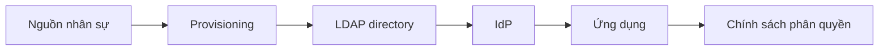

# LDAP directory

## 1. LDAP directory nằm ở đâu trong hệ thống IAM?

Một doanh nghiệp có nhiều ứng dụng cùng cần biết nhân viên nào đang hoạt động, email công việc là gì và người đó thuộc những nhóm nào. Nếu từng ứng dụng tự duy trì một danh sách riêng, thông tin sẽ dễ khác nhau: người đã nghỉ việc vẫn còn nhóm ở một nơi, người chuyển phòng ban vẫn được nhận diện bằng dữ liệu cũ ở nơi khác.

**LDAP — Lightweight Directory Access Protocol** là giao thức truy cập dịch vụ thư mục. Khi nói “LDAP directory”, ta thường nói đến một dịch vụ thư mục cung cấp giao diện LDAP để tìm, đọc và quản lý các entry có cấu trúc.

Cần phân biệt giao thức với sản phẩm: LDAP không phải tên của một cơ sở dữ liệu duy nhất, cũng không tự quy định toàn bộ chính sách IAM của tổ chức. Server thư mục, schema, cơ chế phân quyền và các khả năng mở rộng phụ thuộc hệ thống triển khai.

Trong IAM, thư mục có thể giữ hồ sơ người dùng, nhóm, đơn vị tổ chức và một số dữ liệu phục vụ xác thực. Ứng dụng hoặc IdP sử dụng dữ liệu ấy theo hợp đồng tích hợp. Một truy vấn thành công không tự chứng minh người dùng có quyền với mọi tài nguyên ứng dụng.

Bài này tập trung vào cách đọc mô hình thư mục, thực hiện tìm kiếm, hiểu Bind và TLS, quản lý định danh, bảo vệ truy vấn và tích hợp Java. Mọi DN, hostname, tài khoản và dữ liệu minh họa đều là giả định.

## 2. Thư mục, identity store và IdP có vai trò khác nhau

| Thành phần | Vai trò chính trong kiến trúc minh họa |
| --- | --- |
| Directory | Tổ chức entry và thuộc tính; cung cấp cách truy cập, tìm kiếm và cập nhật |
| Identity store | Nơi lưu danh tính hoặc dữ liệu liên quan; có thể dùng directory hoặc mô hình khác |
| Identity provider — IdP | Thực hiện luồng xác thực và phát hành kết quả cho ứng dụng theo giao thức được hỗ trợ |
| Provisioning service | Tạo, cập nhật, đình chỉ hoặc xóa tài khoản theo nguồn và chính sách |
| Authorization service | Đánh giá chủ thể được thực hiện hành động nào trên tài nguyên nào |
| Ứng dụng nghiệp vụ | Thực thi quyền đối với dữ liệu và hành động của mình |

Một kiến trúc có thể là:



Sơ đồ minh họa sự phân chia trách nhiệm, không khẳng định mọi IdP phải dùng LDAP hoặc mọi ứng dụng phải truy vấn directory trực tiếp.

LDAP không phải giao thức đăng nhập trình duyệt tương đương OIDC. Việc một directory cho phép kiểm tra credential không tự tạo ra các luồng chuyển hướng, phiên federation, consent hoặc step-up của ứng dụng.

Thư mục cũng không bắt buộc là nguồn gốc có thẩm quyền cho mọi thuộc tính. Phòng ban có thể đến từ HR, tên thường gọi có thể do người dùng quản lý, còn quyền dự án do chủ tài nguyên phê duyệt.

## 3. Mô hình dữ liệu: entry, attribute và objectClass

Thông tin thư mục được biểu diễn bằng các entry. Mỗi entry có tên phân biệt và tập thuộc tính; schema mô tả các loại dữ liệu và ràng buộc. [RFC 4512 — Directory Information Models](https://www.rfc-editor.org/rfc/rfc4512.html).

Một entry người dùng minh họa dưới dạng LDIF:

```ldif
dn: uid=an,ou=people,dc=example,dc=org
objectClass: top
objectClass: person
objectClass: organizationalPerson
objectClass: inetOrgPerson
uid: an
cn: Nguyen Minh An
sn: Nguyen
displayName: Minh An
mail: an@example.org
```

Đây là dữ liệu minh họa cho một schema có hỗ trợ các object class trên; không phải lệnh đã chạy. Các giá trị tên dùng ASCII để đơn giản hóa ví dụ LDIF, không phải yêu cầu tên người phải viết không dấu.

Các thành phần cần nhận biết:

- `dn` là Distinguished Name của entry; trong LDIF nó thể hiện vị trí và tên của entry.
- `objectClass` cho biết entry thuộc các lớp nào theo schema.
- `uid`, `cn`, `sn`, `displayName`, `mail` là các thuộc tính trong schema minh họa.
- Một thuộc tính có thể có nhiều giá trị nếu schema cho phép; không coi mọi entry như một hàng chỉ có một chuỗi cho mỗi cột.

Ví dụ hai địa chỉ email có thể xuất hiện thành hai giá trị của một thuộc tính, tùy schema. Việc thư viện trả “giá trị đầu tiên” không có nghĩa nó là email chính theo nghiệp vụ.

`objectClass` cũng không phải role ứng dụng. Một entry có lớp `inetOrgPerson` không có nghĩa đó là giảng viên, quản trị viên hay tài khoản đang được phép đăng nhập.

## 4. DIT, DN và RDN

### 4.1. Đọc cây thư mục

Một Directory Information Tree — DIT — minh họa:

```text
dc=example,dc=org
├── ou=people
│   ├── uid=an
│   └── uid=binh
├── ou=groups
│   ├── cn=java-learners
│   └── cn=grade-reviewers
└── ou=services
    └── cn=learning-reader
```

DN đầy đủ của entry An:

```text
uid=an,ou=people,dc=example,dc=org
```

RDN của entry ấy, xét tại cha `ou=people`, là:

```text
uid=an
```

Các giá trị `dc=example,dc=org` thường được dùng để xây một naming context theo tên miền của tổ chức, nhưng DN không tự là địa chỉ mạng của LDAP server. Không biến nó thành URL kết nối bằng cách nối chuỗi tùy ý.

`ou=people` là một entry hoặc nhánh theo thiết kế. Tên OU không tự tạo ranh giới authorization. Nếu server không có ACL phù hợp, việc chia hai tenant thành hai OU chưa chứng minh dữ liệu của chúng được cách ly.

### 4.2. DN có cú pháp riêng

DN có thể chứa ký tự cần escape, RDN nhiều thành phần hoặc giá trị có dấu phẩy. Không tách DN bằng một phép `split(",")` rồi cho rằng đã phân tích đúng cấu trúc.

RFC 4514 quy định cách biểu diễn DN dưới dạng chuỗi và không định nghĩa một chuỗi canonical duy nhất cho mọi DN. [RFC 4514 — String Representation of Distinguished Names](https://www.rfc-editor.org/rfc/rfc4514.html).

Ví dụ giá trị common name chứa dấu phẩy cần được biểu diễn phù hợp:

```text
cn=Nguyen\, An,ou=people,dc=example,dc=org
```

Khi xây RDN bằng Java, dùng API xử lý tên thay vì tự nối:

```java
import javax.naming.ldap.Rdn;

Rdn rdn = new Rdn("cn", "Nguyen, An");
System.out.println(rdn);
```

API giúp biểu diễn thành phần tên; nó không quyết định người gọi có quyền ghi entry ở vị trí đó hay không.

### 4.3. DN không phải khóa bất biến của tài khoản

Đổi RDN hoặc chuyển entry sang nhánh khác có thể làm DN thay đổi trong khi chủ thể vẫn là người cũ.

Một connector nên có mapping từ định danh ổn định của nguồn sang tài khoản nội bộ. Nếu directory hỗ trợ `entryUUID` theo RFC 4530, có thể dùng nó theo hợp đồng của nguồn thay vì lấy DN làm khóa vĩnh viễn. [RFC 4530 — entryUUID Operational Attribute](https://www.rfc-editor.org/rfc/rfc4530.html).

Trong thiết kế ứng dụng:

```text
directory_source_id + stable_entry_id
    -> subject_id nội bộ

current_dn
    -> vị trí hiện tại dùng cho thao tác LDAP phù hợp
```

Không mặc định mọi server có `entryUUID`; cần xác định thuộc tính ổn định thực tế và hành vi khi xóa rồi tạo lại entry. Email và tên hiển thị không phải phương án thay thế an toàn khi mapping bị thiếu.

## 5. Các thao tác LDAP cần biết

LDAP định nghĩa những thao tác như Bind, Search, Add, Modify, Delete, Modify DN và Compare. [RFC 4511 — LDAP: The Protocol](https://www.rfc-editor.org/rfc/rfc4511.html).

| Thao tác | Ý nghĩa khái quát |
| --- | --- |
| Bind | Thiết lập trạng thái xác thực của kết nối theo cơ chế sử dụng |
| Search | Tìm entry trong phạm vi và điều kiện được chỉ định |
| Add | Thêm entry |
| Modify | Thay đổi thuộc tính của entry |
| Delete | Xóa entry |
| Modify DN | Đổi tên hoặc chuyển entry theo khả năng và điều kiện của server |
| Compare | Kiểm tra một giá trị thuộc tính theo quy tắc so khớp |
| Unbind | Kết thúc LDAP session theo giao thức |

Trong một luồng đăng nhập, có thể cần Search để tìm entry rồi Bind bằng credential của người dùng. Hai thao tác giải quyết hai câu hỏi khác nhau: tìm thấy entry nào và người dùng có chứng minh được quyền kiểm soát credential hay không.

Không dùng Compare trên một thuộc tính password như một cách tự chế thay cho quy trình xác thực. Cũng không đọc hash mật khẩu từ directory về ứng dụng để tự so sánh nếu kiến trúc không yêu cầu và không có cơ chế phù hợp.

Quyền thực hiện một thao tác do server đánh giá theo trạng thái kết nối và chính sách của nó. Bind thành công không đồng nghĩa được phép tìm mọi entry hoặc sửa mọi thuộc tính.

## 6. Search: base DN, scope, filter và thuộc tính trả về

Một truy vấn cần được định nghĩa bằng nhiều thành phần, không chỉ một chuỗi username.

```text
Base DN:
  ou=people,dc=example,dc=org

Scope:
  subtree

Filter:
  (&(objectClass=inetOrgPerson)(uid=an))

Attributes:
  entryUUID, displayName

Limits:
  giới hạn số kết quả và thời gian phù hợp
```

### 6.1. Chọn đúng scope

| Scope | Phạm vi tìm |
| --- | --- |
| Base object | Chính entry tại base DN |
| Single level | Các entry con trực tiếp của base |
| Subtree | Base và các entry bên dưới theo phạm vi truy vấn |

Nếu chỉ cần đọc một entry đã biết, không nhất thiết tìm toàn bộ cây. Nếu cần tìm người dùng dưới một OU có nhiều nhánh con, single level có thể không thấy người ở nhánh sâu hơn.

Base DN, filter cấu trúc và tên thuộc tính nên đến từ cấu hình đã được kiểm soát. Không cho người dùng cuối tùy chọn base sang một tenant khác hoặc yêu cầu trả thuộc tính bảo mật.

### 6.2. Hiểu cú pháp filter

Các filter minh họa:

```text
(uid=an)
(&(objectClass=inetOrgPerson)(uid=an))
(|(uid=an)(uid=binh))
(mail=*)
```

Filter cuối hỏi thuộc tính có giá trị hiện diện; nó không kiểm tra email đã được xác minh. Dấu `*` có ý nghĩa trong filter, không phải lúc nào cũng là ký tự dữ liệu.

Quy tắc so khớp thuộc tính phụ thuộc schema và matching rule. Đừng mặc định mọi giá trị đều so sánh giống nhau, hoặc tự lowercase toàn bộ dữ liệu trước khi tìm kiếm.

### 6.3. Không tìm thấy chưa chắc là không tồn tại

Kết quả có thể bị ảnh hưởng bởi base, scope, ACL, alias/referral, giới hạn truy vấn và trạng thái replica. Một tài khoản service thiếu quyền đọc có thể không thấy entry tồn tại.

Với tra cứu phục vụ đăng nhập, không được lấy “kết quả đầu tiên” nếu có nhiều entry trùng điều kiện. Cần xác định duy nhất đúng chủ thể trong phạm vi đã chọn; nếu dữ liệu mơ hồ hoặc truy vấn không hoàn tất, dừng theo chính sách của luồng.

Truy vấn liệt kê toàn bộ người dùng để đồng bộ có yêu cầu khác truy vấn tra cứu một người. Pagination và giới hạn server cần được xử lý theo khả năng đã xác minh; một trang rỗng hoặc lỗi giữa chừng không chứng minh toàn directory đã hết dữ liệu.

## 7. LDAP injection: escape đúng ngữ cảnh

Một lỗi thường gặp là nối trực tiếp input vào filter:

```java
String filter = "(&(objectClass=inetOrgPerson)(uid=" + login + "))";
```

Nếu input chứa ký tự có ý nghĩa trong ngôn ngữ filter, điều kiện truy vấn có thể bị thay đổi. Validation giới hạn độ dài là hữu ích nhưng không thay thế xử lý giá trị đúng ngữ cảnh.

Cần phân biệt ba ngữ cảnh:

| Ngữ cảnh | Cách xử lý |
| --- | --- |
| Giá trị trong search filter | Dùng API filter parameter hoặc encoder cho filter |
| Giá trị trong RDN/DN | Dùng API tên như Rdn, LdapName hoặc encoder đúng ngữ cảnh |
| Thành phần LDAP URL | Dùng cơ chế xây URL phù hợp; không lấy quy tắc filter để thay thế |

RFC 4515 mô tả cách escape trong biểu diễn filter. Escape filter và escape DN không phải một thuật toán dùng thay nhau. [RFC 4515 — String Representation of Search Filters](https://www.rfc-editor.org/rfc/rfc4515.html).

Với JNDI, có thể giữ filter cấu trúc cố định và truyền giá trị qua `filterArgs`:

```java
directory.search(
        PEOPLE_BASE,
        "(&(objectClass=inetOrgPerson)(uid={0}))",
        new Object[] { login },
        controls);
```

API `DirContext.search` hỗ trợ thay đối số chuỗi với xử lý ký tự đặc biệt của filter. [Java — DirContext.search](https://docs.oracle.com/en/java/javase/25/docs/api/java.naming/javax/naming/directory/DirContext.html).

Điều này bảo vệ phần **giá trị** được đặt vào mẫu. Không biến tên thuộc tính, toán tử, base DN hoặc toàn bộ mẫu filter thành input tùy ý của client rồi coi tham số hóa đã giải quyết mọi quyền truy vấn.

## 8. Bind, TLS và bẫy password rỗng

### 8.1. Bind mô tả trạng thái của kết nối

Một kết nối có thể Bind bằng service account để đọc các thuộc tính được cho phép. Điều đó chỉ xác thực service account.

Nếu ứng dụng sau đó tìm thấy entry `uid=an`, chưa có bước nào trong chuỗi đó chứng minh người đang nhập tên An biết credential của An. Nhầm kết quả Search với xác thực là lỗi mô hình nghiêm trọng.

Simple Bind có các trường hợp anonymous, unauthenticated và name/password; password rỗng có ngữ nghĩa cần đặc biệt chú ý. [RFC 4513, §5.1](https://www.rfc-editor.org/rfc/rfc4513.html#section-5.1).

Ứng dụng dùng name/password để đăng nhập phải từ chối password độ dài bằng không trước khi thực hiện Bind. Không đánh giá “Bind trả success” như bằng chứng đăng nhập nếu request thực tế không thiết lập đúng danh tính theo cơ chế mong muốn.

### 8.2. Simple không có nghĩa đã được mã hóa

Simple Bind không tự bảo vệ mật khẩu trên đường truyền. Một lựa chọn tích hợp có thể sử dụng TLS ngay từ đầu qua LDAPS; lựa chọn khác có thể nâng kết nối bằng StartTLS trước khi gửi credential.

Cổng thường gặp là 389 cho LDAP và 636 cho LDAPS, nhưng cổng thực tế phụ thuộc cấu hình. Số cổng không phải bằng chứng kết nối đã an toàn.

Các điều kiện triển khai cần giải quyết gồm xác minh danh tính server, trust anchor, hostname, chính sách TLS và thứ tự thiết lập kênh trước khi gửi secret. Không tắt kiểm tra chứng thư hoặc tự động chuyển sang kết nối không bảo vệ khi TLS lỗi.

Với StartTLS, không gửi credential rồi mới nâng cấp. Nếu nâng cấp thất bại, luồng phải kết thúc theo chính sách; không tiếp tục Simple Bind như thể TLS đã hoạt động.

### 8.3. SASL và MFA cần được hiểu theo cơ chế cụ thể

LDAP có thể dùng các cơ chế SASL được server và client hỗ trợ. Không phải mọi cơ chế đều cung cấp cùng thuộc tính bảo vệ hoặc mức assurance.

Một Simple Bind bằng mật khẩu qua TLS không tự chứng minh đã thực hiện MFA. Nếu ứng dụng cần step-up, khả năng chống phishing hoặc ngữ cảnh xác thực theo một profile, phải chọn kiến trúc và giao thức đáp ứng yêu cầu đó thay vì suy ra từ việc directory đã chấp nhận Bind.

## 9. Ví dụ Java: tra cứu duy nhất một entry

Ví dụ sau dùng Java 17 trở lên và JNDI trong module `java.naming`. Nó thực hiện **tra cứu danh tính bằng service account**, chưa xác thực mật khẩu của người dùng và chưa tạo phiên ứng dụng.

Các giả định cấu hình:

- Server hỗ trợ LDAP qua TLS ngay từ đầu tại endpoint LDAPS đã cấu hình.
- Runtime có trust configuration và xác minh hostname phù hợp; không có custom socket bỏ qua kiểm tra.
- Service account chỉ có quyền đọc các entry và thuộc tính cần thiết.
- Schema của nguồn hỗ trợ `inetOrgPerson`, `uid` và operational attribute `entryUUID`.
- Quy trình quản trị đảm bảo username có ý nghĩa duy nhất trong phạm vi tra cứu; code vẫn kiểm tra kết quả mơ hồ mà nó nhìn thấy.

```java
import java.util.Hashtable;
import javax.naming.Context;
import javax.naming.NamingEnumeration;
import javax.naming.NamingException;
import javax.naming.directory.Attribute;
import javax.naming.directory.Attributes;
import javax.naming.directory.DirContext;
import javax.naming.directory.InitialDirContext;
import javax.naming.directory.SearchControls;
import javax.naming.directory.SearchResult;

public final class LdapIdentityLookup {

    private static final String DIRECTORY_SOURCE = "corp-directory-prod";
    private static final String LDAP_URL =
            "ldaps://ldap.example.org:636";
    private static final String PEOPLE_BASE =
            "ou=people,dc=example,dc=org";
    private static final String READER_DN =
            "cn=learning-reader,ou=services,dc=example,dc=org";

    public record DirectoryIdentity(
            String sourceId,
            String stableEntryId,
            String currentDn) {
    }

    public static DirectoryIdentity lookup(
            String login,
            String servicePassword) throws NamingException {

        if (login == null || login.isBlank() || login.length() > 128) {
            throw new IllegalArgumentException("Invalid login identifier");
        }

        if (servicePassword == null || servicePassword.isEmpty()) {
            throw new IllegalArgumentException("Missing service credential");
        }

        Hashtable<String, Object> environment = new Hashtable<>();
        environment.put(
                Context.INITIAL_CONTEXT_FACTORY,
                "com.sun.jndi.ldap.LdapCtxFactory");
        environment.put(Context.PROVIDER_URL, LDAP_URL);
        environment.put(Context.SECURITY_AUTHENTICATION, "simple");
        environment.put(Context.SECURITY_PRINCIPAL, READER_DN);
        environment.put(Context.SECURITY_CREDENTIALS, servicePassword);
        environment.put(Context.REFERRAL, "throw");
        environment.put("com.sun.jndi.ldap.connect.timeout", "3000");
        environment.put("com.sun.jndi.ldap.read.timeout", "4000");
        environment.put("com.sun.jndi.ldap.connect.pool", "false");

        DirContext directory = new InitialDirContext(environment);
        try {
            return findUnique(directory, login);
        } finally {
            directory.close();
        }
    }

    private static DirectoryIdentity findUnique(
            DirContext directory,
            String login) throws NamingException {

        SearchControls controls = new SearchControls();
        controls.setSearchScope(SearchControls.SUBTREE_SCOPE);
        controls.setCountLimit(2);
        controls.setTimeLimit(2000);
        controls.setReturningObjFlag(false);
        controls.setReturningAttributes(new String[] { "entryUUID" });

        NamingEnumeration<SearchResult> results = directory.search(
                PEOPLE_BASE,
                "(&(objectClass=inetOrgPerson)(uid={0}))",
                new Object[] { login },
                controls);

        try {
            if (!results.hasMore()) {
                throw new NamingException("Identity not found in search scope");
            }

            SearchResult candidate = results.next();

            if (results.hasMore()) {
                throw new NamingException("Ambiguous identity");
            }

            String stableId = requireSingleString(
                    candidate.getAttributes(), "entryUUID");
            String dn = candidate.getNameInNamespace();

            if (dn == null || dn.isBlank()) {
                throw new NamingException("Missing entry DN");
            }

            return new DirectoryIdentity(DIRECTORY_SOURCE, stableId, dn);
        } finally {
            results.close();
        }
    }

    private static String requireSingleString(
            Attributes attributes,
            String attributeName) throws NamingException {

        Attribute attribute = attributes.get(attributeName);
        if (attribute == null || attribute.size() != 1) {
            throw new NamingException("Missing or ambiguous stable identifier");
        }

        Object value = attribute.get();
        if (!(value instanceof String text) || text.isBlank()) {
            throw new NamingException("Unsupported stable identifier value");
        }

        return text;
    }
}
```

`servicePassword` phải do cơ chế cung cấp secret của môi trường triển khai truyền vào, không phải mật khẩu người đang nhập username. Không hardcode hoặc in giá trị ấy ra log. Ví dụ dùng kiểu `String` của API tích hợp và không khẳng định có thể xóa sạch mọi bản sao secret trong bộ nhớ.

Kết quả thành công có dạng:

```text
sourceId      = corp-directory-prod
stableEntryId = UUID do directory cấp cho entry
currentDn     = DN đầy đủ mà provider trả về
```

Không có output cố định nếu chưa có server, schema, ACL và dữ liệu thật tương ứng. Đoạn code là ví dụ tích hợp, không phải bằng chứng đã kết nối thành công với một directory đang chạy.

Các thuộc tính `com.sun.jndi.ldap.connect.timeout` và `read.timeout` thuộc LDAP provider mặc định trong JDK; không mặc định một provider khác có cùng hợp đồng. [Java SE 17 — Module java.naming](https://docs.oracle.com/en/java/javase/17/docs/api/java.naming/module-summary.html).

Giới hạn của ví dụ:

1. Count limit bằng 2 nhằm phát hiện trường hợp mơ hồ, không chọn ngẫu nhiên một người. Nếu server trả lỗi giới hạn hoặc lỗi giữa chừng, exception phải làm tra cứu thất bại; không lấy entry đã nhận một phần để tiếp tục đăng nhập.
2. Timeout kết nối, timeout đọc và time limit tìm kiếm không tự tạo thành một deadline tổng thể cho toàn request. Hệ thống thực tế cần ngân sách thời gian và giới hạn đồng thời ở tầng gọi.
3. Chế độ referral `throw` yêu cầu xử lý rõ ràng thay vì tự động đi theo nguồn được server giới thiệu. Nó không phải cơ chế cấu hình toàn bộ topology của một hệ thống phân tán.
4. Tắt trả object cho truy vấn thuộc tính giúp giữ mục tiêu đọc dữ liệu. Không gọi `getObject()` hoặc tái dựng đối tượng từ dữ liệu directory tùy ý cho một chức năng chỉ cần thuộc tính danh tính.
5. Thiếu `entryUUID` có thể do schema hoặc ACL, không nhất thiết do user không tồn tại. Connector phải có cấu hình đúng; không fallback sang email để âm thầm tạo mapping mới.

## 10. Từ tra cứu đến xác thực người dùng

Nếu một hệ thống có yêu cầu xác thực trực tiếp qua LDAP, luồng khái quát có thể là:

```text
1. Nhận login identifier và credential.
2. Từ chối credential thiếu hoặc có độ dài bằng không.
3. Tra cứu đúng entry trong phạm vi và schema đã cấu hình.
4. Dùng một kết nối riêng để thực hiện cơ chế xác thực của user.
5. Kiểm tra kết quả và các điều kiện tài khoản theo hợp đồng của nguồn.
6. Ánh xạ stable entry identifier về subject nội bộ.
7. Đánh giá tenant, quyền và yêu cầu assurance của ứng dụng.
8. Tạo phiên ứng dụng theo chính sách phiên.
```

Không trim mật khẩu hoặc tự chuyển nó thành chữ thường. Việc thay đổi secret trước khi gửi có thể làm sai ngữ nghĩa credential.

Kết nối của reader và kết nối xác thực user phải có ranh giới rõ ràng. Trạng thái Bind gắn với kết nối; không chia sẻ một context có thể rebind qua nhiều request rồi giả định nó luôn mang cùng danh tính.

Connection pooling cần được thiết kế theo cơ chế xác thực và trạng thái sử dụng. Oracle lưu ý không dùng pooling cho context dự định thay đổi các thuộc tính bảo mật hoặc thực hiện StartTLS vì provider không theo dõi các thay đổi ấy theo cách cần thiết. [Oracle — LDAP Connection Pooling](https://docs.oracle.com/javase/tutorial/jndi/ldap/pool.html).

Nếu ứng dụng dùng IdP làm đầu mối xác thực, bước kiểm tra credential có thể nằm ở IdP thay vì ứng dụng web. Khi đó, ứng dụng xử lý kết quả giao thức của IdP và không tự coi một truy vấn LDAP là bằng chứng cho phiên trình duyệt.

LDAP Bind cũng không tự tạo session cookie của ứng dụng, không tự thêm role và không làm mới ngữ cảnh mọi thiết bị của cùng user.

## 11. Group membership và ánh xạ quyền

Một group minh họa, giả sử các user được tham chiếu đã tồn tại:

```ldif
dn: cn=java-learners,ou=groups,dc=example,dc=org
objectClass: top
objectClass: groupOfNames
cn: java-learners
member: uid=an,ou=people,dc=example,dc=org
member: uid=binh,ou=people,dc=example,dc=org
```

`groupOfNames` và `member` là những thành phần schema được mô tả trong RFC 4519. Không mặc định mọi directory tổ chức nhóm theo schema này. [RFC 4519 — Schema for User Applications](https://www.rfc-editor.org/rfc/rfc4519.html).

Những câu hỏi connector phải trả lời:

- Membership nằm trên group, trên user, được suy ra động hay do một cơ chế mở rộng tạo?
- Server có trả membership gián tiếp qua nhóm lồng nhau không?
- Nếu có vòng lặp nhóm, tầng xử lý phát hiện và giới hạn độ sâu ra sao?
- DN của thành viên đổi thì tham chiếu được cập nhật bằng cơ chế nào?
- Quyền đọc có cho connector nhìn thấy đầy đủ nhóm liên quan không?
- Trạng thái cache có còn đúng khi membership vừa bị thu hồi không?

Không mặc định `memberOf` có trên mọi LDAP server hoặc tự cập nhật giống nhau. Cũng không mặc định đặt một group vào `member` của group khác sẽ khiến mọi ứng dụng hiểu cùng một nghĩa về quyền gián tiếp.

Một mapping ứng dụng có thể là:

```text
Nguồn directory A
+ nhóm ổn định G42
+ phạm vi tenant T1
    -> vai trò LEARNER trong T1
```

Không nên viết quy tắc “group có tên Admin ở bất kỳ directory nào thì có quyền quản trị toàn nền tảng”. Tên group có thể đổi, trùng ở nhánh khác hoặc thuộc nguồn không được tin cậy cho loại quyền đó.

Nếu một group cấp quyền quan trọng, ai được sửa membership của group ấy cũng đang nắm một đường cấp quyền gián tiếp. Quyền ghi group cần được kiểm soát tương xứng.

Một user có thể thuộc group hợp lệ nhưng tài khoản đã bị đình chỉ. Quyết định cuối cùng vẫn phải xét trạng thái tài khoản, tenant và hành động, không chỉ sự hiện diện của một chuỗi group.

## 12. ACL, service account và ranh giới tenant

LDAP server có cơ chế điều khiển truy cập, nhưng cú pháp ACL và mô hình quản trị phụ thuộc triển khai. Không copy một cấu hình ACL từ sản phẩm này sang sản phẩm khác rồi coi ý nghĩa được giữ nguyên.

Đối với một connector chỉ tra cứu danh tính, hợp đồng quyền có thể là:

```text
Được:
  tìm user trong nhánh phục vụ ứng dụng;
  đọc stable identifier và các thuộc tính cần dùng;
  đọc group được phép làm đầu vào cho mapping.

Không được:
  đọc dữ liệu credential không cần thiết;
  sửa user hoặc group;
  cấp đặc quyền cho chính service account;
  truy vấn các tenant ngoài phạm vi tích hợp.
```

Đây là thiết kế quyền cần được cấu hình và kiểm chứng tại server, không phải hiệu lực tự có vì biến Java được đặt tên `reader`.

Nếu một connector vừa provisioning vừa xác thực, nên xác định rõ credential và đường gọi nào có quyền ghi. Không đưa quyền directory admin vào mọi instance ứng dụng chỉ để tiện Search.

Client hạn chế thuộc tính trả về giúp giảm dữ liệu được truyền nhưng không thay ACL. Một đối tượng có quyền server quá rộng vẫn có thể gửi truy vấn khác nếu credential bị dùng ngoài đoạn code dự kiến.

Đối với nhiều tenant, cả server và ứng dụng cần thống nhất nguồn, base, mapping và phạm vi quản trị. Không lấy tenant từ body request rồi nối trực tiếp vào DN để chọn nhánh; phải kiểm tra tenant người gọi được phép thao tác và ánh xạ cấu hình tương ứng.

## 13. Schema và khả năng server phải được xác minh

Một schema được dùng trong ví dụ không trở thành schema chung cho mọi sản phẩm. Những thuộc tính như username, trạng thái đình chỉ, group membership, định danh ổn định và cách đổi password cần được xác định cho nguồn thực tế.

Một bản hợp đồng connector có thể ghi:

| Thành phần | Ví dụ cấu hình cần xác định |
| --- | --- |
| Endpoint và trust | Máy chủ được phép kết nối, TLS, chứng thư được tin |
| Naming context | Base DN phục vụ đúng phạm vi |
| User schema | Object class và thuộc tính tìm username |
| Stable identity | Thuộc tính ổn định, kiểu giá trị, phạm vi duy nhất |
| Trạng thái | Cách nguồn biểu diễn tài khoản hoạt động hoặc bị hạn chế |
| Group schema | Nơi lưu membership và cách xử lý nhóm gián tiếp |
| Control và extension | Khả năng cần cho paging hoặc đồng bộ |
| Quyền connector | Nhánh và thuộc tính được đọc hoặc ghi |
| Giới hạn | Số kết quả, thời gian, tần suất và cách xử lý lỗi |

Root DSE và thông tin schema của server có thể giúp khám phá naming context, cơ chế hoặc control được hỗ trợ, tùy quyền và triển khai. Khám phá khả năng không thay việc phê duyệt cấu hình: ứng dụng không tự chọn mọi nhánh nhìn thấy rồi quét toàn bộ.

Không giả định một cột `active` là thuộc tính LDAP chuẩn biểu diễn mọi trường hợp đình chỉ. Một directory có thể có nhiều điều kiện: khóa tạm do xác thực sai, hết hạn credential, đình chỉ theo nghiệp vụ hoặc giới hạn đăng nhập. Connector phải hiểu điều kiện nào cần kiểm tra và nguồn nào chịu trách nhiệm.

Một lỗi `undefinedAttributeType` hoặc vi phạm object class thường cần sửa schema hay mapping cấu hình. Không khắc phục bằng cách bỏ qua field quan trọng, tự đổi thuộc tính trạng thái hoặc chuyển sang tin email để tiếp tục login.

## 14. Cập nhật directory và vòng đời danh tính

### 14.1. Một thao tác Modify không phải toàn bộ quy trình cập nhật

Cập nhật một entry có thể là một phần của chuyển phòng ban, thay nhóm hoặc đình chỉ tài khoản. Sau khi dữ liệu directory đổi, còn có các hệ thống đích và phiên ứng dụng cần phản ánh trạng thái mới.

Ví dụ chuyển một học viên sang lớp khác:

```text
Nguồn có thẩm quyền:
  xác nhận học viên chuyển từ lớp A sang lớp B.

Provisioning:
  cập nhật quan hệ hoặc group tương ứng.

Ứng dụng:
  đánh giá lại quyền đọc bài, nộp bài và dữ liệu lớp.

Phiên và cache:
  không tiếp tục dùng quyền cũ vượt thời gian chính sách cho phép.

Đối soát:
  xác nhận trạng thái thực tế tại các điểm liên quan.
```

Không coi việc sửa `department` hoặc đổi OU là tự động thu hồi mọi quyền trong mọi ứng dụng. Chỉ những mapping và cơ chế thực thi đã thiết kế mới có tác dụng.

Một request Modify trên một entry không tự tạo giao dịch nguyên tử chung cho nhiều entry hoặc nhiều server. Nếu triển khai cần một extension hoặc cơ chế phối hợp, phải xác minh hỗ trợ và điều kiện sử dụng; không suy ra từ tên “directory”.

### 14.2. Đổi DN cần giữ mapping đúng chủ thể

Khi một user được đổi tên hoặc di chuyển nhánh, connector cần cập nhật vị trí hiện tại nhưng giữ liên kết với subject nội bộ nếu stable identifier vẫn đại diện cùng entry.

Các tham chiếu group bằng DN có thể cần được cập nhật theo cơ chế của sản phẩm. Không mặc định server tự sửa mọi tham chiếu lẫn dữ liệu cache của ứng dụng.

Nếu xóa entry rồi tạo một entry mới có cùng `uid`, cần xem đây có phải chủ thể mới không theo hợp đồng của nguồn. Không tự gán lại subject cũ chỉ vì username giống nhau.

### 14.3. Tách dữ liệu nguồn khỏi quyền suy ra

Một group có thể cấp quyền nền, nhưng không nhất thiết cấp toàn bộ quyền nghiệp vụ. Nếu quyền được cấp từ nhiều căn cứ, cần biết căn cứ nào hết hiệu lực khi membership đổi.

Ngược lại, người được phép sửa một thuộc tính dùng trong ABAC có thể đang kiểm soát một đầu vào phân quyền. Không cho self-service thay đổi field có thể tự nâng quyền chỉ vì nó được hiển thị trong phần “hồ sơ”.

## 15. Replication, cache và kết quả chưa hoàn chỉnh

Directory có thể có replica để phục vụ tính sẵn sàng hoặc phân tải. Mức nhất quán, topology và thời gian lan truyền phụ thuộc triển khai.

Ví dụ một user vừa bị gỡ khỏi group ở nguồn ghi, nhưng một replica còn trả membership cũ. Một API nhạy cảm dùng dữ liệu cũ có thể cho phép hành động không còn phù hợp.

Thiết kế cần xác định độ trễ chấp nhận được và cách xử lý giảm quyền:

- Điểm thực thi dùng dữ liệu hiện hành hoặc một cơ chế thu hồi có hiệu lực trong giới hạn yêu cầu.
- Cache có thời hạn, phạm vi key và cách invalidation phù hợp.
- Token đã phát không tự thay nội dung khi directory đổi.
- Đình chỉ ở directory không tự chứng minh session ứng dụng và refresh grant đều đã bị thu hồi.
- Lỗi liên lạc với nguồn phải được xử lý theo chính sách của hành động.

Không có một lựa chọn duy nhất cho mọi ứng dụng. Điều cần rõ là sau bao lâu thay đổi phải có hiệu lực, hệ thống nào chịu trách nhiệm và làm sao biết mục tiêu ấy đã đạt.

Đối với đồng bộ toàn bộ directory, phải phân biệt:

```text
Scan hoàn chỉnh và không thấy entry
    khác với
Scan bị ngắt, thiếu trang hoặc thiếu quyền đọc entry.
```

Không xóa hàng loạt tài khoản hoặc thu hồi mọi membership chỉ vì một lần Search trả thiếu dữ liệu do lỗi. Một snapshot chỉ có giá trị cho đối soát khi các điều kiện hoàn tất của scan đã được thỏa mãn.

Tương tự, không giữ quyền cũ vô thời hạn chỉ vì connector liên tục lỗi. Cần có trạng thái vận hành, cảnh báo và xử lý phần quyền còn hiệu lực theo rủi ro.

Nếu cần lưu cursor hoặc điểm tiến triển, phải hiểu phạm vi và vòng đời của nó. Không mặc định cookie paging là mã thay đổi lâu dài hoặc timestamp từ các server khác nhau có thể so sánh như một phiên bản chung.

## 16. Lỗi vận hành và kiểm toán

### 16.1. Phân loại lỗi trước khi retry

| Tình huống | Hướng xử lý trong thiết kế |
| --- | --- |
| Chứng thư hoặc hostname không hợp lệ | Kiểm tra trust và endpoint; không bỏ TLS để tiếp tục |
| Kết nối hoặc đọc timeout | Xử lý lỗi nguồn, ngân sách thời gian và retry có giới hạn |
| Credential service account sai | Kiểm tra rotation và cấu hình; không chuyển sang anonymous |
| Không có kết quả | Kiểm tra login, phạm vi và quyền nhìn thấy theo yêu cầu của luồng |
| Nhiều kết quả | Dừng nhận diện và xử lý dữ liệu mơ hồ |
| Lỗi giới hạn truy vấn | Không dùng tập kết quả một phần như một scan hoàn chỉnh |
| Referral | Áp dụng chính sách nguồn được phép; không tự gửi credential ra ngoài |
| Thiếu quyền đọc hoặc ghi | Sửa hợp đồng ACL; không tăng lên directory admin theo mặc định |
| Sai schema | Kiểm tra object class, thuộc tính và mapping |
| Replica hoặc cache cũ | Đối soát và thực thi yêu cầu hiệu lực của thay đổi |

Bên ngoài có thể cần thông báo phù hợp để tránh tiết lộ tài khoản và cấu trúc nội bộ. Bên trong vẫn phải phân biệt lỗi credential người dùng với lỗi directory không sẵn sàng; nếu gộp hết thành “sai mật khẩu”, vận hành sẽ khó tìm nguyên nhân.

Retry một request xác thực còn có thể tác động đến chính sách chống dò hoặc khóa tài khoản của nguồn. Không retry vô hạn chỉ vì coi mọi lỗi Bind là lỗi mạng tạm thời.

Với thao tác ghi, sau lỗi mất kết nối cần xác định kết quả có thể đã được áp dụng chưa. Không tự gửi lại mọi lệnh Add hoặc Modify mà không xét idempotency và trạng thái hiện tại.

### 16.2. Ghi gì vào audit?

Thông tin hữu ích có thể gồm:

```text
directory_source_id
loại thao tác
subject hoặc stable entry reference khi đã xác định
phạm vi tenant/base đã được cấu hình
kết quả và nhóm lỗi
thời gian xử lý
correlation_id
phiên bản cấu hình connector
```

DN, username và nội dung filter có thể chứa dữ liệu cá nhân. Cần giới hạn người đọc, che dữ liệu khi phù hợp và không đưa credential vào thông báo lỗi.

Không log toàn bộ environment của JNDI: nó có thể chứa `SECURITY_CREDENTIALS`. Không log password người dùng, secret reader hoặc toàn bộ thuộc tính trả về chỉ để ghi nhận một lần tra cứu.

Một log “Search thành công” không phải log “user đã xác thực”. Nếu tạo phiên ứng dụng, sự kiện đó cần có căn cứ xác thực và thông tin subject đúng; không đổi tên sự kiện để che đi bước còn thiếu.

## 17. Tình huống tự luyện

### Tình huống A: tìm thấy user nhưng chưa kiểm tra credential

Service account Search được entry của An. Ứng dụng tạo phiên cho An ngay sau khi truy vấn có kết quả.

**Kết quả mong muốn:** từ chối thiết kế ấy. Reader chỉ chứng minh service có quyền tìm thấy entry; cần cơ chế xác thực người dùng và các điều kiện liên quan trước khi tạo phiên.

### Tình huống B: password rỗng

Form gửi username có giá trị và password độ dài bằng không. Một Bind không báo lỗi trong cấu hình server hiện tại.

**Kết quả mong muốn:** ứng dụng không coi đây là đăng nhập hợp lệ. Luồng name/password phải từ chối secret rỗng và kiểm soát đúng cơ chế xác thực; success của một thao tác có ngữ nghĩa khác không thay bằng chứng.

### Tình huống C: input có dấu sao hoặc ngoặc

Người dùng nhập chuỗi chứa ký tự có ý nghĩa trong filter.

**Kết quả mong muốn:** mẫu filter giữ nguyên cấu trúc và input chỉ là giá trị. Không nối chuỗi hoặc dùng encoder DN để thay thế encoder filter.

### Tình huống D: hai entry cùng uid

Trong phạm vi connector nhìn thấy, có hai entry thỏa điều kiện `uid`.

**Kết quả mong muốn:** không chọn entry đầu tiên. Xử lý mơ hồ ở nguồn hoặc cấu hình phạm vi đúng; không để thứ tự kết quả quyết định ai được đăng nhập.

### Tình huống E: chuyển OU

Entry được chuyển từ nhánh cũ sang nhánh mới, stable identifier không đổi.

**Kết quả mong muốn:** connector cập nhật DN hiện tại và bảo toàn mapping về subject nếu hợp đồng nguồn xác nhận đó là cùng entry. Kiểm tra lại group reference, base tìm kiếm và ACL có liên quan.

### Tình huống F: thu hồi group chưa lan đến replica

Nguồn ghi đã gỡ quyền, một replica còn trả membership cũ.

**Kết quả mong muốn:** áp dụng cơ chế đảm bảo hiệu lực theo chính sách của hành động. Không kết luận quyền đã được thu hồi ở toàn ứng dụng chỉ vì một lệnh Modify thành công.

### Tình huống G: server giới thiệu một referral

Một Search trả tham chiếu tới máy chủ khác.

**Kết quả mong muốn:** xử lý theo danh sách nguồn, trust và chính sách credential được cho phép. Không tự chuyển secret của reader hoặc người dùng sang một endpoint chưa được phê duyệt.

### Tình huống H: scan đồng bộ dừng giữa chừng

Connector nhận một số trang rồi timeout; nhiều user không xuất hiện trong dữ liệu đã nhận.

**Kết quả mong muốn:** đánh dấu scan chưa hoàn chỉnh. Không dùng sự thiếu mặt trong snapshot lỗi làm bằng chứng hàng loạt user đã bị xóa hoặc rời group.

## 18. Áp dụng vào hệ thống IAM

Một tích hợp LDAP rõ ràng cần biết nguồn nào đang phục vụ dữ liệu, schema nào được dùng, phạm vi tìm kiếm ở đâu, credential nào có quyền đọc hoặc ghi và thuộc tính nào thực sự ổn định để liên kết chủ thể.

Khi dùng dữ liệu directory cho truy cập, cần tách tra cứu, xác thực và phân quyền. Khi thay đổi dữ liệu, cần theo dõi ảnh hưởng đến group, mapping, replica, cache và phiên ứng dụng. Khi gặp lỗi, cần phân biệt thiếu bằng chứng với một kết quả phủ định đã được xác nhận.

LDAP cung cấp giao thức để làm việc với thư mục. Tính an toàn của tích hợp IAM đến từ cách hệ thống ràng buộc giao thức ấy với định danh, quyền ghi, nguồn có thẩm quyền và các điểm thực thi thực tế.
