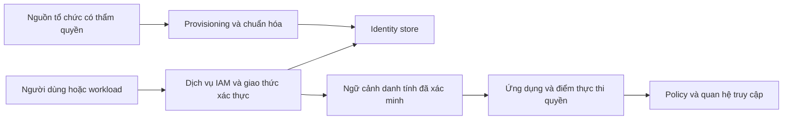

# Database identity store — lưu trữ danh tính trong cơ sở dữ liệu

Một ứng dụng Java có bảng `users` chưa chắc đã có một identity store được thiết kế đầy đủ. Nếu bảng ấy dùng email làm khóa, đặt mật khẩu cạnh hồ sơ công khai, lưu quyền trong một cột tùy ý và chỉ kiểm tra `active` khi đăng nhập, thay đổi nhỏ trong vòng đời người dùng có thể tạo ra lỗi truy cập khó phát hiện.

**Database identity store** là kho lưu thông tin danh tính được xây dựng trên một hệ quản trị cơ sở dữ liệu. Kho này lưu những bản ghi mà dịch vụ IAM sử dụng để nhận diện chủ thể, liên kết tài khoản, quản lý credential, trạng thái, thuộc tính và các quan hệ truy cập phù hợp với phạm vi của hệ thống.

Bài học tập trung vào việc dùng database làm nơi lưu danh tính của ứng dụng hoặc dịch vụ IAM. Nó không đồng nghĩa cấp một tài khoản đăng nhập PostgreSQL, MySQL hay SQL Server cho mỗi người dùng cuối. Tài khoản database của backend là một loại danh tính khác, có credential và quyền riêng.

## 1. Mục tiêu học tập

Sau bài học, bạn có thể:

- Phân biệt identity store với directory, Identity Provider và bộ máy phân quyền.
- Tách subject ổn định khỏi tên đăng nhập, hồ sơ, credential và liên kết danh tính bên ngoài.
- Đọc một schema quan hệ có ràng buộc tenant và những điều kiện toàn vẹn cần thiết.
- Mô tả luồng truy vấn danh tính mà không làm lộ credential hoặc bỏ qua kiểm tra trạng thái.
- Xử lý cập nhật đồng thời, phát sự kiện vòng đời và dữ liệu đọc từ replica hoặc cache.
- Giải thích vì sao sao lưu, phục hồi và di chuyển dữ liệu danh tính phải bảo toàn trạng thái truy cập.

Ví dụ SQL sử dụng PostgreSQL. Các bảng và trạng thái là lựa chọn thiết kế minh họa, không phải schema tiêu chuẩn bắt buộc của IAM. Đoạn Java minh họa cách truy vấn, không triển khai trọn vẹn một hệ thống đăng nhập.

## 2. Identity store nằm ở đâu trong kiến trúc IAM?

### 2.1. Nơi lưu dữ liệu và nơi thực hiện giao thức

| Thành phần | Trách nhiệm chính | Điều không tự có chỉ vì thành phần tồn tại |
| --- | --- | --- |
| Identity store | Lưu và truy xuất bản ghi danh tính | Giao thức SSO, MFA hoặc policy đầy đủ |
| Directory | Tổ chức, tra cứu và cung cấp thông tin danh tính theo mô hình của nó | Nguồn có thẩm quyền cho mọi thuộc tính |
| Identity Provider | Xác thực và phát hành thông tin danh tính theo giao thức | Toàn bộ quyền trên tài nguyên của ứng dụng |
| Provisioning service | Tạo, cập nhật, vô hiệu hóa tài khoản ở hệ thống đích | Thu hồi mọi phiên đã tồn tại |
| Authorization service | Đánh giá hành động được phép trên tài nguyên | Tự xác minh nguồn gốc của mọi thuộc tính nhận vào |

Một IdP có thể dùng database làm nơi lưu dữ liệu nội bộ; một ứng dụng cũng có thể lưu hồ sơ cục bộ nhưng để IdP bên ngoài quản lý xác thực. Do đó database không phải lựa chọn thay thế trực tiếp cho giao thức OIDC hay SAML: chúng giải quyết các phần khác nhau.



### 2.2. Database có thể là nguồn chính hoặc bản sao

Kho tài khoản của một sản phẩm tự đăng ký có thể làm chủ tên đăng nhập và credential cục bộ. Trong môi trường doanh nghiệp, department có thể đến từ HR, tài khoản xác thực đến từ IdP, còn trạng thái quyền trên ứng dụng được quản lý ở nơi khác.

Cần xác định quyền ghi theo từng thuộc tính. Nếu HR làm chủ quan hệ nhân sự, việc ứng dụng có cột `department` không tự cho phép người dùng sửa nó rồi nhận quyền của phòng mới.

Với bản sao, cần lưu căn cứ nguồn, phiên bản hoặc thời gian hiệu lực phù hợp. Một hàng mới được cập nhật ở database nhận chưa chắc chứa trạng thái mới nhất từ nguồn có thẩm quyền.

## 3. Subject ổn định và các loại dữ liệu liên quan

### 3.1. Đừng dùng tên đăng nhập làm danh tính gốc

Email, số điện thoại và username có thể thay đổi hoặc được tái sử dụng theo quy định của hệ thống. Nếu lịch sử, quyền và tài nguyên đều tham chiếu trực tiếp email, việc đổi địa chỉ có thể làm mất liên kết hoặc gắn dữ liệu cũ sang người khác.

Một subject nội bộ nên có định danh ổn định, không được tái cấp cho một chủ thể khác. NIST SP 800-63A-4 mô tả tài khoản subscriber có định danh duy nhất và hồ sơ các authenticator được gắn với tài khoản. Những yêu cầu của NIST áp dụng theo phạm vi hệ thống tương ứng; ví dụ schema của bài này không tự tuyên bố đáp ứng toàn bộ đặc tả. [Nguồn: NIST — Subscriber Accounts](https://pages.nist.gov/800-63-4/sp800-63a/accounts/).

### 3.2. Các nhóm dữ liệu cần phân biệt

| Nhóm | Ví dụ | Đặc điểm vòng đời |
| --- | --- | --- |
| Subject | ID nội bộ, loại chủ thể, trạng thái | Ổn định qua thay đổi tên hoặc credential |
| Login identifier | Username hoặc alias được phép đăng nhập | Có quy tắc duy nhất và thay đổi riêng |
| Profile | Tên hiển thị, ngôn ngữ | Không tự quyết định quyền mạnh |
| Credential/authenticator | Password hash, bản ghi khóa xác thực | Có đăng ký, thay thế, thu hồi và bảo vệ riêng |
| Federated link | Issuer và subject bên ngoài | Gắn danh tính liên kết vào subject nội bộ |
| Authorization relationship | Role, group, entitlement, assignment | Cần phạm vi và lý do cấp |
| Session và token state | Phiên, hạn dùng, thông tin thu hồi | Thường thay đổi nhanh hơn hồ sơ |
| Audit/provisioning state | Sự kiện, lần đồng bộ, trạng thái giao việc | Phục vụ giải thích và đối soát |

Tách các nhóm không có nghĩa phải dùng một database cho mỗi nhóm. Mục tiêu là có ranh giới mô hình và quyền truy cập phù hợp, tránh mọi API đọc hồ sơ đều nhận cả dữ liệu credential.

### 3.3. Mô hình tenant phải được chọn rõ

Có hai cách thường gặp về mặt thiết kế:

- Subject thuộc một tenant, mọi quan hệ đi cùng cặp `(tenant_id, subject_id)`.
- Subject ở phạm vi chung, còn tư cách thành viên tenant nằm trong bảng quan hệ riêng.

Bài này chọn mô hình thứ nhất để làm rõ ràng buộc. Không trộn hai mô hình bằng cách có bảng kiểm tra tenant, có bảng lại chỉ tham chiếu subject theo một giả định ngầm.

## 4. Schema quan hệ minh họa

### 4.1. Bản ghi subject

Các UUID do thành phần tạo danh tính phát sinh và kiểm soát. Một bản ghi được tạo mặc định ở trạng thái `pending`; thời điểm tạo không tự mở quyền sử dụng.

```sql
CREATE SCHEMA iam;

CREATE TABLE iam.subjects (
    tenant_id uuid NOT NULL,
    subject_id uuid NOT NULL,
    subject_kind text NOT NULL
        CHECK (subject_kind IN ('human', 'workload')),
    account_state text NOT NULL DEFAULT 'pending'
        CHECK (account_state IN
            ('pending', 'active', 'suspended', 'deactivated')),
    display_name text NOT NULL,
    row_version bigint NOT NULL DEFAULT 0 CHECK (row_version >= 0),
    access_version bigint NOT NULL DEFAULT 0 CHECK (access_version >= 0),
    created_at timestamptz NOT NULL DEFAULT now(),
    updated_at timestamptz NOT NULL DEFAULT now(),
    PRIMARY KEY (tenant_id, subject_id)
);
```

`row_version` hỗ trợ phát hiện cập nhật dựa trên bản đọc cũ. `access_version` là phiên bản trạng thái liên quan truy cập trong thiết kế này. Cần định nghĩa thao tác nào tăng mỗi phiên bản; chỉ có cột version mà các luồng ghi không duy trì nhất quán thì không bảo vệ được gì.

Schema chưa chứa danh mục tenant và toàn bộ quy tắc kích hoạt. Dịch vụ vẫn phải xác minh tenant hợp lệ, chủ thể được tạo đúng phạm vi và ai có quyền chuyển trạng thái.

### 4.2. Tên đăng nhập cục bộ và credential mật khẩu

```sql
CREATE TABLE iam.local_login_names (
    tenant_id uuid NOT NULL,
    subject_id uuid NOT NULL,
    normalized_login_name text NOT NULL,
    PRIMARY KEY (tenant_id, normalized_login_name),
    UNIQUE (tenant_id, subject_id),
    FOREIGN KEY (tenant_id, subject_id)
        REFERENCES iam.subjects (tenant_id, subject_id)
        ON DELETE RESTRICT
);

CREATE TABLE iam.password_credentials (
    tenant_id uuid NOT NULL,
    subject_id uuid NOT NULL,
    encoded_password_hash text NOT NULL,
    credential_version bigint NOT NULL DEFAULT 1
        CHECK (credential_version > 0),
    changed_at timestamptz NOT NULL DEFAULT now(),
    PRIMARY KEY (tenant_id, subject_id),
    FOREIGN KEY (tenant_id, subject_id)
        REFERENCES iam.subjects (tenant_id, subject_id)
        ON DELETE RESTRICT
);
```

Ví dụ giới hạn một tên đăng nhập cục bộ cho mỗi subject. Nếu sản phẩm cho phép nhiều alias, cần thay đổi mô hình có chủ đích và quản lý tính duy nhất, xác minh và thu hồi từng alias.

`normalized_login_name` phải được tạo theo quy tắc rõ ràng của loại identifier. Không tự áp một phép chuyển chữ thường cho mọi email, subject bên ngoài hoặc chuỗi định danh. Kiểu so sánh và collation của database cũng phải phù hợp hợp đồng định danh.

Subject không nhất thiết có password credential: tài khoản chỉ dùng federation hoặc một phương thức xác thực khác có thể không có hàng trong bảng này. Không tạo mật khẩu mặc định cho mọi subject chỉ để thỏa một quan hệ dữ liệu.

### 4.3. Liên kết OIDC bên ngoài

```sql
CREATE TABLE iam.federated_links (
    tenant_id uuid NOT NULL,
    issuer text NOT NULL,
    external_subject text NOT NULL,
    subject_id uuid NOT NULL,
    linked_at timestamptz NOT NULL DEFAULT now(),
    PRIMARY KEY (tenant_id, issuer, external_subject),
    FOREIGN KEY (tenant_id, subject_id)
        REFERENCES iam.subjects (tenant_id, subject_id)
        ON DELETE RESTRICT
);
```

Trong OIDC, cặp `iss` và `sub` là định danh ổn định mà RP có thể dựa vào theo đặc tả; email hoặc `preferred_username` không thay thế cặp đó. Bài thêm tenant vào khóa để biểu diễn phạm vi liên kết nội bộ đã chọn. [Nguồn: OpenID Connect Core — Claim Stability and Uniqueness](https://openid.net/specs/openid-connect-core-1_0.html#ClaimStability).

Không chuyển issuer hoặc external subject thành chữ thường trước khi so sánh nếu hợp đồng không cho phép. Không tự liên kết một tài khoản mới vào tài khoản cũ chỉ vì email trùng nhau. Luồng liên kết cần xác minh đúng chủ thể và quyền liên kết.

### 4.4. Constraint bảo vệ tính toàn vẹn nào?

Khóa chính và unique constraint ngăn hai hàng cùng chiếm một định danh đăng nhập trong cùng tenant. Khóa ngoại gồm tenant và subject ngăn quan hệ credential tham chiếu một subject không tồn tại trong tenant đó. `CHECK` giới hạn miền giá trị trạng thái trong schema.

PostgreSQL thực thi các loại ràng buộc này tại database, kể cả khi giá trị đến từ một luồng ghi khác của ứng dụng. Chúng bảo vệ tính toàn vẹn dữ liệu, không tự quyết định caller có quyền quản trị subject ấy hay không. [Nguồn: PostgreSQL — Constraints](https://www.postgresql.org/docs/17/ddl-constraints.html).

`ON DELETE RESTRICT` trong ví dụ khiến việc xóa subject có dữ liệu tham chiếu phải được xử lý rõ. Nó không định nghĩa toàn bộ chính sách lưu giữ hoặc xóa dữ liệu của sản phẩm.

## 5. Database tham gia luồng xác thực như thế nào?

### 5.1. Luồng đăng nhập bằng credential cục bộ

Một luồng có thể thực hiện:

1. Xác định tenant theo routing và hợp đồng đăng nhập của hệ thống.
2. Chuẩn hóa login identifier theo quy tắc đã định.
3. Tra cứu subject và credential bằng phạm vi tenant chính xác.
4. Dùng thư viện xác minh password hash hoặc giao thức authenticator tương ứng.
5. Kiểm tra trạng thái tài khoản, điều kiện rủi ro và các bước xác thực bổ sung.
6. Tạo phiên hoặc token với ngữ cảnh phù hợp, đồng thời quản lý thay đổi trạng thái cạnh tranh với bước này.
7. Thực hiện phân quyền cho hành động và tài nguyên khi ứng dụng xử lý yêu cầu.

Một truy vấn tìm thấy hàng chỉ hoàn thành bước tra cứu. Nó chưa chứng minh mật khẩu đúng, MFA đã hoàn tất hoặc người dùng có quyền trên mọi dữ liệu.

### 5.2. Không so sánh mật khẩu trong câu SQL

Mẫu sai về thiết kế là ghép input thành câu lệnh và tìm `password = input`. Mật khẩu không được lưu plaintext để làm phép so sánh này.

Dịch vụ xác thực có thể tải encoded hash bằng truy vấn tham số hóa rồi gọi hàm verify của thư viện phù hợp. Encoded hash chỉ đi qua thành phần cần xác minh; không trả nó về browser, API hồ sơ hoặc log truy vấn.

Tránh giữ transaction khóa hàng kéo dài chỉ để chạy một phép password hashing tốn tài nguyên. Nếu xác minh ngoài transaction, phải xử lý trường hợp trạng thái hoặc credential đổi trước khi cấp phiên. Có thể dùng phiên bản, kiểm tra lại trạng thái hoặc cơ chế khóa phù hợp, nhưng cần xác định ranh giới bảo đảm của toàn luồng.

### 5.3. Đường lỗi không được mở quyền

Khi database lỗi hoặc không lấy được dữ liệu bắt buộc, không bỏ qua bước xác minh hay chuyển sang một tài khoản mặc định. Trường hợp không tồn tại và credential sai cần hợp đồng phản hồi tránh tiết lộ không cần thiết về tài khoản.

Rate limit, kiểm soát thử đăng nhập và xử lý tín hiệu bất thường là trách nhiệm của luồng xác thực. Một unique index hoặc bảng đếm không tự giải quyết toàn bộ các vấn đề này.

## 6. Bảo vệ password hash và các loại credential khác

### 6.1. Password hash khác với mã hóa có thể giải ngược

Mật khẩu cần được bảo vệ bằng thuật toán băm mật khẩu thích hợp và salt riêng theo cơ chế thư viện. OWASP khuyến nghị các thuật toán thiết kế cho mục đích này như Argon2id; SHA-256 đơn lẻ không phù hợp để lưu mật khẩu. [Nguồn: OWASP — Password Storage](https://cheatsheetseries.owasp.org/cheatsheets/Password_Storage_Cheat_Sheet.html).

Encoded hash thường chứa thông tin cần thiết để xác minh theo định dạng của thư viện, như thuật toán, tham số và salt. Trường `encoded_password_hash` không có nghĩa có thể đưa bất kỳ chuỗi hash tự chế nào vào rồi xem là an toàn.

Tham số cần theo chính sách được cập nhật và được đo trên môi trường vận hành. Tăng chi phí quá cao còn ảnh hưởng tài nguyên của dịch vụ xác thực; giảm tùy tiện để tăng thông lượng cũng làm yếu khả năng chống dò mật khẩu.

Nếu dùng pepper, đó là bí mật riêng cần được quản lý ngoài cơ sở dữ liệu chứa hash, chẳng hạn bằng secret manager hoặc HSM theo thiết kế. Sao chép pepper vào cùng bảng backup với hash làm mất ý nghĩa phân tách đó.

### 6.2. Không phải mọi authenticator đều được lưu giống mật khẩu

| Dữ liệu | Cách nghĩ về bảo vệ |
| --- | --- |
| Password verifier | Băm mật khẩu phù hợp, giới hạn quyền đọc |
| Khóa công khai của authenticator | Quản lý liên kết, metadata và trạng thái thu hồi |
| Bí mật dùng chung cần cho giao thức xác minh | Có thể cần mã hóa và khóa giải mã được quản lý riêng |
| Token ngẫu nhiên dùng một lần | Thiết kế lưu verifier, mục đích, hạn dùng và trạng thái đã sử dụng |
| Credential kết nối database của backend | Quản lý như secret của workload, không đưa vào hồ sơ người dùng |

Không lấy cách bảo vệ password để áp máy móc cho mọi loại dữ liệu. Nếu giao thức cần sử dụng lại một bí mật, chỉ lưu hash một chiều có thể không đủ để thực hiện giao thức. Ngược lại, việc có thể mã hóa không có nghĩa nên giữ mật khẩu có thể giải ngược.

### 6.3. Credential cũng có vòng đời riêng

Đổi mật khẩu cần thay verifier, tăng phiên bản tương ứng và áp dụng quy tắc xử lý phiên hoặc token đã cấp. Thu hồi authenticator cần đánh dấu đúng authenticator, không chỉ xóa một nhãn trên hồ sơ.

Khôi phục tài khoản là luồng đặc quyền có điều kiện riêng. Không cho một API cập nhật profile tự ghi `encoded_password_hash`, reset MFA hoặc thêm federated link chỉ vì caller được phép đổi tên hiển thị.

## 7. Lưu thuộc tính và quyền mà không tạo một cột “toàn năng”

### 7.1. Profile không phải policy

Một cột JSON chứa `department`, `isAdmin`, `roles` và `preferences` tiện cho việc lưu nhanh nhưng có thể khiến cùng một quyền ghi profile sửa luôn dữ liệu phân quyền.

Có thể dùng JSON cho thuộc tính mở rộng, nhưng các field tham gia quyết định quyền cần hợp đồng schema, nguồn có thẩm quyền, giới hạn người ghi và lịch sử phù hợp. Mức linh hoạt của kiểu dữ liệu không thay thế các yêu cầu đó.

### 7.2. Quan hệ quyền cần có phạm vi và lý do cấp

Group membership hoặc role assignment thường cần subject, tenant, role/group, phạm vi tài nguyên, thời gian hiệu lực và nguồn cấp. Nếu quyền được suy ra từ department, cần biết rule hoặc assignment nào đã tạo quyền để thu hồi khi quan hệ kết thúc.

Không gộp mọi role thành một chuỗi rồi dùng tìm kiếm chuỗi con để cấp quyền. Một role của tenant A cũng không được tự áp dụng trong tenant B.

`account_state = active` chỉ là một điều kiện vòng đời. Nó không thay quyền hành động, phạm vi tenant, trạng thái credential hoặc policy trên từng tài nguyên.

### 7.3. Tách dữ liệu hiện hành khỏi lịch sử

Lịch sử phòng ban, role hoặc trạng thái có ích để giải thích quyết định trong quá khứ. Nó không được trộn vào tập quan hệ hiện hành chỉ để tiện truy vấn.

Khi truy vấn quyền theo thời gian, cần quy định rõ thời điểm đánh giá, thời điểm hiệu lực và cách xử lý nguồn chưa đồng bộ. Chỉ thêm `updated_at` không tự tạo được một mô hình lịch sử hoặc bảo đảm thu hồi quyền đúng lúc.

## 8. Truy vấn từ Java: lấy đúng dữ liệu và đúng phạm vi

### 8.1. API hồ sơ không cần đọc credential

Một truy vấn hồ sơ nên liệt kê rõ các cột cần dùng. Tránh `SELECT *` từ một view hoặc phép join có password hash, token verifier hay bí mật dùng chung.

Ví dụ dưới nhận một connection do tầng gọi quản lý. `verifiedTenantId` đến từ ngữ cảnh server đã xác minh; việc caller có quyền xem `targetSubjectId` phải được service kiểm tra trước khi gọi repository.

```java
import java.sql.Connection;
import java.sql.SQLException;
import java.util.Objects;
import java.util.Optional;
import java.util.UUID;

public final class SubjectRepository {
    public enum AccountState {
        PENDING, ACTIVE, SUSPENDED, DEACTIVATED
    }

    public record SubjectView(
            UUID subjectId,
            String displayName,
            AccountState state,
            long rowVersion,
            long accessVersion) {}

    private static AccountState mapState(String value) throws SQLException {
        return switch (value) {
            case "pending" -> AccountState.PENDING;
            case "active" -> AccountState.ACTIVE;
            case "suspended" -> AccountState.SUSPENDED;
            case "deactivated" -> AccountState.DEACTIVATED;
            default -> throw new SQLException("Unsupported account state");
        };
    }

    public static Optional<SubjectView> findSubject(
            Connection connection,
            UUID verifiedTenantId,
            UUID targetSubjectId) throws SQLException {
        Objects.requireNonNull(connection);
        Objects.requireNonNull(verifiedTenantId);
        Objects.requireNonNull(targetSubjectId);

        String sql = """
            SELECT subject_id, display_name, account_state,
                   row_version, access_version
            FROM iam.subjects
            WHERE tenant_id = ? AND subject_id = ?
            """;

        try (var statement = connection.prepareStatement(sql)) {
            statement.setObject(1, verifiedTenantId);
            statement.setObject(2, targetSubjectId);
            try (var result = statement.executeQuery()) {
                if (!result.next()) {
                    return Optional.empty();
                }
                return Optional.of(new SubjectView(
                    result.getObject("subject_id", UUID.class),
                    result.getString("display_name"),
                    mapState(result.getString("account_state")),
                    result.getLong("row_version"),
                    result.getLong("access_version")));
            }
        }
    }
}
```

Mã dùng record, text block và switch expression của Java hiện đại. Nó chỉ là repository đọc hồ sơ; không phải bộ xác thực hoặc một policy cho phép mọi caller đọc mọi subject trong tenant.

`PreparedStatement` truyền giá trị input như dữ liệu tham số thay vì ghép thành mã SQL. Cách này giúp ngăn SQL injection ở phần giá trị được bind, nhưng không chứng minh quyền truy cập của caller. [Nguồn: Oracle — Using Prepared Statements](https://docs.oracle.com/javase/tutorial/jdbc/basics/prepared.html).

### 8.2. Những ranh giới vẫn còn phải thực thi

Không lấy tenant bất kỳ trong body rồi đổi tên biến thành `verifiedTenantId`. Nếu có truy vấn xuyên tenant cho quản trị, cần hành động và phạm vi quản trị rõ, thay vì bỏ điều kiện tenant trong một hàm dùng chung.

Tên bảng, tên cột hoặc hướng sắp xếp động thường không được bind như giá trị thông thường. Chỉ cho phép lựa chọn thuộc một tập được server định nghĩa; không ghép nguyên biểu thức client vào câu SQL.

Quyền database của tài khoản runtime, policy ở service và cơ chế như RLS nếu được triển khai có thể cùng thu hẹp đường truy cập. Mỗi lớp phải có hợp đồng rõ; một truy vấn có điều kiện tenant không thay thế mọi ràng buộc quyền trên subject đích.

## 9. Cập nhật đồng thời và phiên bản dữ liệu

### 9.1. Tránh ghi đè từ bản đọc cũ

Giả sử hai quản trị viên cùng đọc subject ở `row_version=12`. Người thứ nhất cập nhật thành công; người thứ hai không nên ghi lại toàn bộ bản cũ làm mất thay đổi vừa có.

Một phép cập nhật optimistic locking có thể là:

```sql
UPDATE iam.subjects
SET display_name = :display_name,
    row_version = row_version + 1,
    updated_at = now()
WHERE tenant_id = :tenant_id
  AND subject_id = :subject_id
  AND row_version = :expected_row_version;
```

Ký hiệu `:name` trong các ví dụ cập nhật là tham số ở tầng ứng dụng, không phải cú pháp chạy nguyên trạng trong PostgreSQL console. Khi dùng JDBC thuần, thay chúng bằng placeholder `?` và bind đúng kiểu.

Nếu không có hàng được cập nhật, có thể subject không tồn tại, không đúng tenant hoặc phiên bản đã thay đổi. Tầng service cần phân loại theo hợp đồng của API; không báo thành công một cách mặc định và cũng không tự bỏ điều kiện version để retry.

### 9.2. Đổi trạng thái là một thao tác được bảo vệ

Chuyển `active` sang `suspended` khác với đổi tên hiển thị. Nó có thể ảnh hưởng quyền sử dụng, phiên, token và ứng dụng downstream. Dịch vụ cần kiểm tra ai được chuyển trạng thái, trạng thái nguồn nào hợp lệ và có được tái kích hoạt theo quy trình hay không.

`CHECK` chỉ bảo đảm tên trạng thái thuộc tập cho phép; nó không bảo đảm mọi chuyển trạng thái đều hợp lệ. Nếu mọi role ghi database đều có thể tùy ý đặt `account_state='active'`, ràng buộc này không ngăn được kích hoạt trái phép.

### 9.3. Transaction không tự giải quyết mọi race

Một transaction nhóm các thay đổi theo bảo đảm của database và mức isolation được chọn. Nó không khiến một lần đọc luôn khóa mọi dữ liệu hoặc buộc ứng dụng bên ngoài chờ transaction đó. PostgreSQL mô tả hành vi snapshot và cạnh tranh khác nhau theo mức isolation. [Nguồn: PostgreSQL — Transaction Isolation](https://www.postgresql.org/docs/17/transaction-iso.html).

Cần chọn cơ chế phù hợp cho từng invariant: unique constraint cho tên đăng nhập, conditional update cho phiên bản, khóa hoặc cách phối hợp khác cho thao tác cạnh tranh. Nếu dùng một mức isolation có thể yêu cầu retry, retry phải xử lý lại đơn vị công việc phù hợp và tránh tạo tác dụng phụ ngoài database nhiều lần.

Không giữ một transaction mở trong lúc chờ người dùng nhập MFA hoặc phản hồi email. Những luồng kéo dài cần trạng thái trung gian, thời hạn và chuyển trạng thái có kiểm tra ở mỗi bước.

## 10. Đổi trạng thái cùng sự kiện đồng bộ

### 10.1. Vấn đề ghi database rồi gửi message

Nếu service cập nhật subject thành suspended rồi lỗi trước khi gửi sự kiện, ứng dụng downstream có thể không biết cần thu hồi quyền. Nếu gửi message trước rồi transaction rollback, downstream có thể xử lý một thay đổi chưa từng được commit.

Một thiết kế thường dùng là lưu thay đổi và một outbox record trong cùng transaction database. Worker sau đó chuyển outbox sang kênh sự kiện. Đây là cách tổ chức của ví dụ; nó không làm việc gửi message và mọi đích nhận trở thành một transaction toàn hệ thống.

### 10.2. Bảng outbox tối thiểu

```sql
CREATE TABLE iam.outbox_events (
    event_id uuid PRIMARY KEY,
    tenant_id uuid NOT NULL,
    subject_id uuid NOT NULL,
    event_type text NOT NULL,
    subject_access_version bigint NOT NULL
        CHECK (subject_access_version > 0),
    payload jsonb NOT NULL,
    created_at timestamptz NOT NULL DEFAULT now(),
    published_at timestamptz,
    UNIQUE (tenant_id, subject_id, subject_access_version, event_type),
    FOREIGN KEY (tenant_id, subject_id)
        REFERENCES iam.subjects (tenant_id, subject_id)
        ON DELETE RESTRICT
);
```

Payload không nên chứa password hash, token nguyên bản hoặc toàn bộ hồ sơ không cần cho consumer. Outbox là dữ liệu chuyển giao sự kiện; bảng có `published_at` này chưa phải toàn bộ thiết kế audit chống sửa hoặc chính sách lưu giữ.

### 10.3. Ví dụ suspend và tạo sự kiện cùng một câu lệnh

```sql
WITH changed AS (
    UPDATE iam.subjects
    SET account_state = 'suspended',
        row_version = row_version + 1,
        access_version = access_version + 1,
        updated_at = now()
    WHERE tenant_id = :tenant_id
      AND subject_id = :subject_id
      AND account_state = 'active'
      AND row_version = :expected_row_version
    RETURNING tenant_id, subject_id, account_state, access_version
)
INSERT INTO iam.outbox_events (
    event_id, tenant_id, subject_id, event_type,
    subject_access_version, payload
)
SELECT :event_id, tenant_id, subject_id, 'identity.suspended',
       access_version,
       jsonb_build_object('accountState', account_state)
FROM changed
RETURNING event_id;
```

Nếu phép UPDATE không chọn được hàng, không có outbox event tương ứng được tạo. Nếu INSERT vi phạm ràng buộc, câu lệnh thất bại thay vì để lại một thay đổi trạng thái thành công tách rời event. Nếu luồng còn cần ghi dữ liệu khác, cần đặt những thao tác thuộc cùng đơn vị nhất quán trong transaction tương ứng.

Một request lặp cần được xử lý bằng hợp đồng idempotency hoặc kiểm tra trạng thái/phần kết quả đã ghi. Unique constraint của outbox không tự định nghĩa kết quả API phải trả cho mọi tình huống retry.

### 10.4. Consumer phải xử lý giao lại và thứ tự

Publisher có thể gửi lại sau lỗi không biết message trước đã đến hay chưa. Consumer cần nhận diện event đã xử lý và tránh áp tác dụng phụ lặp ngoài ý muốn.

Phiên bản có thể giúp nhận diện trạng thái cũ, nhưng chỉ khi hợp đồng sự kiện rõ. Nếu message là snapshot trạng thái, consumer có thể so phiên bản hiện hành theo quy tắc đã chọn. Nếu message là delta, bỏ qua một event cũ mà chưa áp có thể làm mất một thay đổi cần thiết; không dùng cùng một quy tắc cho cả hai mà không phân tích.

Cần theo dõi đích nào đã phản ánh trạng thái mới và đối soát khi message bị chậm hoặc bỏ lỡ. `published_at` có giá trị chỉ chứng minh bước publish đã được ghi nhận theo cơ chế của worker, không chứng minh mọi quyền ở mọi ứng dụng đã bị thu hồi.

## 11. Phiên, token, cache và read replica

### 11.1. Đổi trạng thái ở database chưa tự thu hồi token

Một access token tự chứa có thể tiếp tục được ứng dụng chấp nhận nếu ứng dụng chỉ kiểm tra chữ ký và thời hạn mà không biết tài khoản đã bị suspend. Chỉ tăng `access_version` trong database chưa tạo hiệu lực nếu không có điểm thực thi đọc hoặc đối chiếu phiên bản đó.

Thiết kế có thể dùng kiểm tra phiên tập trung, introspection khi phù hợp giao thức, đối chiếu trạng thái/phiên bản hoặc giới hạn thời gian chấp nhận token theo policy. Từng cách có chi phí và phạm vi hiệu lực riêng.

Nếu một thay đổi quyền ảnh hưởng access context, luồng ghi phải duy trì phiên bản hoặc phát tín hiệu liên quan một cách nhất quán. Không giả định mọi cập nhật role ở bảng khác tự làm `access_version` tăng.

### 11.2. Cache cần giữ cả phạm vi và độ mới

Cache profile, cache quyền và cache verifier có rủi ro khác nhau. Một API chỉ cần tên hiển thị không có cùng yêu cầu độ mới với một thao tác quyết định tài khoản còn được phép hoạt động hay không.

Cache key cần phản ánh tenant và subject; cache theo username đơn độc có thể trộn dữ liệu của hai tenant. Thêm version vào key chỉ hữu ích khi hệ thống có cách biết version hiện hành và không tiếp tục chọn mãi key cũ.

Sự kiện làm mất hiệu lực cache giúp giảm độ trễ nhưng còn cần đối soát hoặc giới hạn thời gian sử dụng khi sự kiện không đến. Không biến lỗi cache thành lý do bỏ qua trạng thái danh tính bắt buộc.

### 11.3. Read replica có thể chưa có thay đổi vừa commit

Nếu khóa tài khoản trên primary nhưng bước kiểm tra tiếp theo đọc replica chưa đồng bộ, hệ thống có thể vẫn thấy active. Vấn đề tương tự xảy ra khi đổi mật khẩu, xóa federated link hoặc thu hồi quan hệ quyền.

Những đường đọc cần tính nhất quán mạnh hơn có thể phải dùng nguồn đọc phù hợp, cơ chế read-your-writes hoặc kiểm tra phiên bản theo kiến trúc đã chọn. Không đưa mọi truy vấn xác thực sang replica chỉ vì chúng đều là SELECT.

Cần định nghĩa khoảng trễ chấp nhận được cho từng loại quyết định và đo nó tại điểm thực thi quyền. Số liệu replication lag riêng lẻ không thay thế bằng chứng rằng tài khoản bị thu hồi không còn được dùng ở các đường quan trọng.

## 12. Quyền truy cập database và bảo vệ vận hành

### 12.1. Tài khoản runtime phải có phạm vi công việc rõ

Một cách phân tách trách nhiệm có thể là:

| Thành phần | Phạm vi dữ liệu cần thiết trong ví dụ |
| --- | --- |
| API hồ sơ | Các cột hồ sơ và trạng thái được cho phép |
| Dịch vụ xác thực | Identifier, verifier và thông tin xác thực bắt buộc |
| Dịch vụ quản trị vòng đời | Các chuyển trạng thái và quan hệ được ủy quyền |
| Outbox publisher | Đọc sự kiện và cập nhật metadata publish được cho phép |
| Công cụ migration | Thay đổi schema theo quy trình triển khai |
| Công cụ báo cáo | Projection được phê duyệt, không mặc định đọc credential |

Đây là ranh giới thiết kế; có thể thực thi bằng các role, view, API trung gian hoặc cơ chế khác phù hợp. Đặt bảng trong các schema khác nhau mà vẫn cấp cùng quyền rộng cho mọi thành phần chưa tạo ra phân tách hữu hiệu.

OWASP khuyến nghị giới hạn quyền database theo nhu cầu, bảo vệ credential kết nối và kênh truyền. Runtime không nên dùng tài khoản quản trị hoặc tài khoản migration chỉ để tiện triển khai. [Nguồn: OWASP — Database Security](https://cheatsheetseries.owasp.org/cheatsheets/Database_Security_Cheat_Sheet.html).

### 12.2. Mã hóa dữ liệu và quản lý khóa

Mã hóa kết nối bảo vệ đường truyền theo cấu hình đã xác minh. Mã hóa ổ đĩa hoặc database bảo vệ một số tình huống truy cập lưu trữ. Các cơ chế ấy không tự ngăn một tài khoản ứng dụng đã có quyền SELECT đọc dữ liệu.

Với bí mật được mã hóa ở tầng ứng dụng, cần quản lý khóa, phân quyền giải mã, version khóa và khả năng phục hồi phù hợp. Không để khóa giải mã ngay cạnh ciphertext trong cùng nơi mọi reader đều có quyền truy cập rồi kỳ vọng có thêm một ranh giới độc lập.

Không ghi password, encoded hash, raw token hoặc secret kết nối vào log lỗi SQL, trace request hoặc công cụ phân tích. Việc che dữ liệu ở API response chưa đủ nếu telemetry vẫn thu thập nguyên request hay bind parameter.

### 12.3. Migration schema là thay đổi của hệ thống danh tính

Đổi độ dài identifier, collation, unique constraint hoặc cách ánh xạ trạng thái có thể làm hai danh tính bị coi là một, hoặc làm một tài khoản không còn được tìm thấy. Cần đánh giá dữ liệu hiện hữu và tính tương thích giữa các phiên bản ứng dụng trong quá trình triển khai.

Khi bổ sung field có ý nghĩa cấp quyền, không đặt default active hoặc admin chỉ để migration đi qua. Giá trị khởi tạo phải phù hợp với dữ liệu và chính sách nguồn, đồng thời không tạo ra quyền ngoài ý định.

Nếu thay đổi định dạng hash, cần chiến lược xác minh dữ liệu cũ và nâng cấp an toàn. Không thể đổi thuật toán bằng cách đặt lại nhãn thuật toán trên chuỗi hash cũ.

## 13. Sao lưu, phục hồi và kết thúc vòng đời

### 13.1. Sao lưu phải bảo vệ dữ liệu nhạy cảm tương đương

Một backup chứa verifier, thông tin cá nhân, liên kết tài khoản và trạng thái quyền vẫn là dữ liệu danh tính nhạy cảm. Quyền đọc, mã hóa, vận chuyển và truy cập thử phục hồi phải được quản lý tương ứng.

Khả năng phục hồi còn phụ thuộc những thành phần ngoài bảng: khóa giải mã, cấu hình issuer, rule ánh xạ, secret riêng và dữ liệu phiên/quyền ở hệ thống khác. Có file dump chưa chứng minh hệ thống có thể khôi phục đúng hành vi IAM.

### 13.2. Phục hồi có thể làm sống lại trạng thái đã thu hồi

Giả sử backup được chụp trước khi An nghỉ việc. Khôi phục nó có thể làm account state quay lại active, federated link đã xóa xuất hiện lại hoặc verifier mật khẩu cũ được đưa trở lại.

Trước khi mở lưu lượng sau phục hồi, quy trình cần xác minh và áp lại những thay đổi vòng đời hoặc thu hồi liên quan theo thiết kế phục hồi. Việc đối soát có thể cần nguồn tổ chức, nhật ký sự kiện được bảo toàn ở nơi khác hoặc một mốc trạng thái đáng tin cậy.

Không phát lại outbox cũ một cách mù quáng nếu điều đó có thể kích hoạt lại tài khoản downstream. Publisher và consumer phải biết trạng thái phục hồi, hợp đồng replay và cách kiểm tra phiên bản hoặc trạng thái hiện hành.

### 13.3. Vô hiệu hóa và xóa là hai việc khác nhau

Vô hiệu hóa cần chặn những hành động hoặc khả năng sử dụng theo chính sách. Xóa dữ liệu là quyết định về vòng đời lưu trữ với những quan hệ tham chiếu, nhu cầu audit và thời hạn đã được xác định cho hệ thống.

Một cờ soft delete không tự thu hồi phiên. Ngược lại, xóa hàng subject ngay lập tức không tự bảo đảm mọi token, bản sao hoặc dữ liệu ngoài database đã được xử lý.

Subject ID không nên được tái cấp cho người khác sau khi tài khoản kết thúc. Nếu tổ chức cho tái sử dụng username theo quy trình, cần bảo đảm lịch sử và liên kết danh tính cũ không bị gắn sang subject mới.

## 14. Tình huống hoàn chỉnh và ma trận thực hành

### 14.1. An đổi tên đăng nhập rồi bị suspend

An thuộc tenant A, có subject ID ổn định. Khi đổi username, dịch vụ cập nhật login identifier theo unique constraint và quy tắc xác minh cần thiết. Tài nguyên và lịch sử vẫn tham chiếu subject, nên việc đổi tên không chuyển quyền sang người khác.

Sau đó một quản trị viên có thẩm quyền suspend tài khoản. Dịch vụ cập nhật trạng thái, tăng các phiên bản được quy định và lưu outbox trong cùng đơn vị nhất quán. Luồng session/token và các ứng dụng liên quan nhận hoặc kiểm tra thay đổi theo thiết kế.

Nếu replica còn trả active, các đường quyết định đòi hỏi trạng thái hiện hành không được dựa vào bản đọc cũ đó. Nếu một sự kiện active cũ được gửi lại, consumer phải xử lý theo hợp đồng phiên bản/trạng thái thay vì mở lại tài khoản do thứ tự nhận.

Tình huống đi qua ba ranh giới: tính toàn vẹn của kho dữ liệu, quyền thực hiện thay đổi và hiệu lực tại nơi chấp nhận truy cập. Thiết kế identity store phải biết mình bảo đảm điều gì ở từng ranh giới.

### 14.2. Ma trận tự kiểm chứng

| Tình huống | Kỳ vọng | Điều được xem xét |
| --- | --- | --- |
| Hai request đồng thời tạo cùng username trong một tenant | Không tồn tại hai chủ thể cùng chiếm identifier đó | Unique constraint và xử lý lỗi |
| Hai tenant cùng dùng username An theo chính sách sản phẩm | Không tra cứu nhầm tenant | Khóa tra cứu có tenant |
| Credential tham chiếu subject của tenant khác | Không tạo quan hệ chéo tenant | Khóa ngoại tổng hợp |
| API hồ sơ đọc subject | Không trả verifier hoặc bí mật xác thực | Projection và quyền dữ liệu |
| Đổi email hoặc username | Subject ID và lịch sử vẫn đúng | Tách identifier khỏi subject |
| Hai cập nhật từ cùng row version cũ | Phát hiện bản ghi đã thay đổi | Conditional update |
| Suspend thành công nhưng publisher tạm lỗi | Outbox còn công việc cần gửi | Không mất sự kiện do lỗi giữa hai bước |
| Consumer nhận lại cùng event | Không tạo tác dụng phụ lặp ngoài hợp đồng | Idempotency |
| Token cũ sau suspend | Bị xử lý theo cơ chế thu hồi đã thiết kế | DB state không tự thay quyết định token |
| Replica chưa có trạng thái thu hồi | Không mở quyền qua đường đọc không phù hợp | Nhất quán tại điểm quyết định |
| Hai issuer có cùng external subject | Không tự gộp liên kết | Khóa issuer-subject và correlation |
| Khôi phục backup trước lần suspend | Không mở lưu lượng trước khi xử lý trạng thái thu hồi cần thiết | Khả năng phục hồi IAM |
| Tài khoản workload được tạo | Không tự có mật khẩu và quyền của người sở hữu | Phân biệt loại chủ thể và quyền |
| Giá trị account state không nằm trong schema | Bị constraint hoặc mapper từ chối | Không mặc định chuyển thành active |

Các kết quả trên là kỳ vọng để người học kiểm chứng trong môi trường thực hành; bài không khẳng định SQL hoặc Java đã được chạy trên một hạ tầng cụ thể.

### 14.3. Khi nào mô hình database cần mở rộng?

Khi xuất hiện nhiều loại authenticator, nhiều nguồn tổ chức, quyền theo thời gian hoặc liên kết nhiều IdP, hãy mở rộng những quan hệ và hợp đồng tương ứng. Đừng giải quyết mọi yêu cầu bằng cách thêm các cờ vào một hàng users duy nhất.

Nếu dùng một nền tảng IAM hoặc IdP đã quản lý credential, ứng dụng có thể chỉ cần lưu subject nội bộ, liên kết bên ngoài và dữ liệu nghiệp vụ cần thiết. Không sao chép password verifier về ứng dụng chỉ để hồ sơ cục bộ trông đầy đủ hơn.

## 15. Những điểm cần ghi nhớ

Database identity store là nền tảng lưu trữ cho những quyết định IAM; nó cần subject ổn định, mô hình identifier và credential rõ, ràng buộc tenant và quyền đọc/ghi theo trách nhiệm.

Constraint bảo vệ tính toàn vẹn, truy vấn tham số hóa bảo vệ cách truyền input, còn service và điểm thực thi quyền quyết định ai được làm gì. Một bảng đúng cấu trúc không tự hoàn thành xác thực, MFA, SSO hoặc thu hồi quyền.

Thay đổi vòng đời phải được duy trì nhất quán trong kho dữ liệu và truyền đến phiên, token, cache cùng hệ thống đích. Khả năng phục hồi cũng phải được đánh giá bằng trạng thái truy cập thực tế, không chỉ bằng việc phục hồi đủ số hàng.
