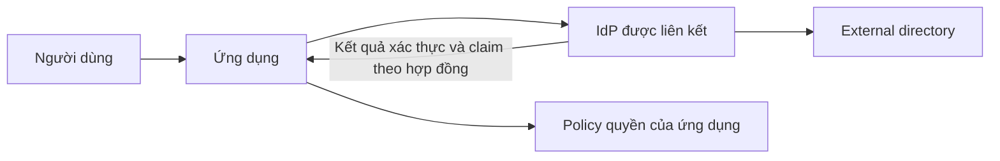

# External directory — Tích hợp directory bên ngoài với hệ thống IAM

## 1. External directory là gì?

Một doanh nghiệp đã quản lý nhân viên trong directory tập trung. Khi triển khai ứng dụng quản lý dự án, doanh nghiệp muốn nhân viên sử dụng danh tính hiện có thay vì tạo một tài khoản và mật khẩu độc lập cho từng ứng dụng.

Đối với ứng dụng quản lý dự án, directory tập trung đó là một **external directory**: nguồn danh tính nằm ngoài kho tài khoản do ứng dụng trực tiếp quản lý. Directory có thể thuộc cùng doanh nghiệp, một đơn vị khác hoặc một nhà cung cấp dịch vụ.

“External” mô tả ranh giới quản lý và tích hợp, không bắt buộc có nghĩa directory nằm trên Internet. Một dịch vụ LDAP trong mạng nội bộ vẫn là directory bên ngoài đối với ứng dụng chỉ kết nối để tra cứu hoặc xác thực.

External directory có thể cung cấp:

- Định danh của người dùng hoặc các loại đối tượng được hỗ trợ.
- Thuộc tính hồ sơ, trạng thái tài khoản và quan hệ tổ chức.
- Nhóm và quan hệ thành viên.
- Cơ chế kiểm tra thông tin xác thực, nếu dịch vụ hỗ trợ và tích hợp lựa chọn sử dụng.
- Dữ liệu hoặc sự kiện để tạo, cập nhật và vô hiệu hóa tài khoản ở hệ thống khác.

Tích hợp directory không tự giải quyết toàn bộ IAM. Ứng dụng vẫn cần biết ai được tham gia, dữ liệu nguồn nào được tin cậy, quyền được ánh xạ ra sao và khi quan hệ kết thúc thì các đường truy cập nào phải bị thu hồi.

Ví dụ, ứng dụng có thể tìm thấy Minh trong directory của đối tác nhưng chưa được phép cho Minh vào mọi dự án của doanh nghiệp. Việc tồn tại tại nguồn khác với quyền truy cập một tài nguyên cụ thể.

## 2. Phân biệt directory, identity store và identity provider

| Khái niệm | Vai trò chính | Điều không nên suy ra |
| --- | --- | --- |
| Directory | Tổ chức các đối tượng và thuộc tính để tra cứu, quản lý theo mô hình của dịch vụ | Mọi directory đều phát hành token OIDC |
| Identity store | Lưu dữ liệu danh tính hoặc tài khoản phục vụ hệ thống | Mọi dữ liệu lưu tại đó đều là nguồn chuẩn |
| Identity provider, IdP | Cung cấp kết quả xác thực và thông tin danh tính cho bên nhận qua tích hợp phù hợp | IdP tự quyết định mọi quyền nghiệp vụ ở ứng dụng |
| Connector | Kết nối, đọc, ghi hoặc chuyển đổi dữ liệu giữa các hệ thống | Connector tự có quyền tin cậy mọi thuộc tính |
| Provisioning service | Tạo, thay đổi và ngừng cấp tài khoản hoặc quyền ở đích | Provisioning thành công đồng nghĩa đăng nhập thành công |
| Authorization service | Đánh giá quyền trên hành động và tài nguyên | Tìm được user trong directory là đủ để cho phép |

Một sản phẩm có thể thực hiện nhiều vai trò. Tuy nhiên, khi thiết kế nên tách trách nhiệm để biết thành phần nào quản lý mật khẩu, thành phần nào quản lý nhóm và thành phần nào quyết định quyền.

LDAP là giao thức truy cập directory, có các thao tác như bind, search và thay đổi dữ liệu. Nó không tự quy định toàn bộ policy quyền của ứng dụng dùng directory. [IETF — RFC 4511](https://www.rfc-editor.org/rfc/rfc4511.html)

Một ứng dụng có thể không gọi LDAP trực tiếp. IdP có thể sử dụng directory ở phía sau, rồi ứng dụng nhận kết quả đăng nhập qua giao thức liên kết. Khi đó, ứng dụng tích hợp với IdP trên đường đăng nhập, còn dữ liệu vẫn có thể bắt nguồn từ directory.

## 3. Các mô hình tích hợp thường gặp

### 3.1. Tra cứu directory trực tiếp

Ứng dụng hoặc dịch vụ IAM truy vấn directory khi cần tìm người dùng, lấy thuộc tính hoặc phân giải membership.

```text
Ứng dụng
  -> connector có quyền đọc giới hạn
  -> external directory
  -> kết quả tra cứu
  -> policy của ứng dụng
```

Mô hình này có thể giữ dữ liệu gần nguồn tại thời điểm truy vấn, nhưng đưa directory vào đường phụ thuộc của yêu cầu. Cần quản lý timeout, giới hạn truy vấn và kết quả không đầy đủ.

Tra cứu được hồ sơ không có nghĩa người dùng đã chứng minh quyền kiểm soát tài khoản. Search và authentication là hai việc khác nhau.

### 3.2. Dùng directory để kiểm tra thông tin xác thực

Một tích hợp có thể nhận thông tin đăng nhập của người dùng rồi kiểm tra với directory bằng cơ chế được hỗ trợ. Với LDAP, cần phân biệt bind của tài khoản kỹ thuật để tra cứu và việc xác thực danh tính người dùng.

Điều quan trọng là ứng dụng đang tham gia xử lý thông tin xác thực. Nó phải bảo vệ đường truyền, tránh ghi bí mật vào log và hiểu chính xác kết quả mà giao thức trả về.

Nếu doanh nghiệp yêu cầu MFA hoặc điều kiện phiên tập trung, một lần kiểm tra tên và mật khẩu với directory không tự chứng minh các điều kiện bổ sung đã hoàn tất.

### 3.3. Xác thực liên kết qua IdP

Ứng dụng chuyển việc đăng nhập tới IdP được tin cậy. IdP có thể dùng directory để xác thực và lấy dữ liệu, rồi phát hành kết quả cho ứng dụng.



Trong federation, bên nhận sử dụng assertion từ IdP theo quan hệ tin cậy đã thiết lập. NIST SP 800-63C mô tả vai trò của IdP và relying party trong mô hình này. [NIST — Federation and Assertions](https://pages.nist.gov/800-63-4/sp800-63c.html)

Directory và IdP không nhất thiết là cùng một dịch vụ. Bên nhận cũng không được mặc định mọi thuộc tính trong thông điệp đều có quyền cấp mọi vai trò nội bộ.

### 3.4. Đồng bộ hoặc cấp phát vào kho cục bộ

Một connector lấy dữ liệu nguồn rồi tạo hoặc cập nhật tài khoản tại ứng dụng. Ứng dụng có thể dùng bản sao cục bộ cho tra cứu và một phần xét quyền.

```text
External directory
  -> đồng bộ hoặc provisioning
  -> tài khoản và thuộc tính tại ứng dụng
  -> quyết định truy cập
```

Mô hình này giảm việc phải tra cứu nguồn cho mọi yêu cầu nhưng tạo ra độ trễ và trách nhiệm quản lý bản sao. Phải xác định điều gì xảy ra khi nguồn đổi nhóm, khóa tài khoản hoặc xóa đối tượng.

SCIM là giao thức HTTP phục vụ quản lý danh tính giữa các miền; nó có thể được sử dụng trong đường provisioning khi các bên hỗ trợ. SCIM không thay thế giao thức đăng nhập chỉ vì cùng xử lý tài nguyên User. [IETF — RFC 7644](https://www.rfc-editor.org/rfc/rfc7644.html)

### 3.5. Cấp phát khi đăng nhập lần đầu

Ứng dụng có thể tạo tài khoản cục bộ sau lần đăng nhập liên kết đầu tiên. Mô hình này thường gọi là just-in-time provisioning.

Nó giúp tạo tài khoản đúng lúc, nhưng cần điều kiện rõ về nguồn, tenant, chủ thể đủ tư cách và quyền ban đầu. Đăng nhập hợp lệ từ đối tác không tự cho phép tạo tài khoản quản trị.

Cấp phát lần đầu cũng chưa tạo ra một quy trình thu hồi hoàn chỉnh. Người không đăng nhập nữa vẫn có thể còn tài khoản, phiên hoặc quyền tại ứng dụng; cần đường xử lý vòng đời riêng.

## 4. Xác định nhu cầu trước khi chọn cách tích hợp

Một câu hỏi như “ứng dụng có hỗ trợ external directory không?” chưa đủ cụ thể. Cần xác định muốn lấy dữ liệu hay chuyển trách nhiệm xác thực, có cần ghi ngược hay không và yêu cầu thu hồi là gì.

| Nhu cầu | Thành phần cần làm rõ |
| --- | --- |
| Dùng danh tính hiện có để đăng nhập | Cơ chế authentication hoặc federation |
| Có hồ sơ trước lần đăng nhập đầu | Provisioning theo nguồn hoặc theo yêu cầu |
| Dùng nhóm nguồn để cấp quyền | Schema nhóm, semantics membership và ánh xạ quyền |
| Thu hồi sau khi nguồn vô hiệu hóa user | Sự kiện, đồng bộ, phiên, token và thời hạn xử lý |
| Sửa thông tin ở ứng dụng | Ownership từng field và quy tắc ghi ngược |
| Hỗ trợ nhiều tổ chức | Khóa nguồn, scope tenant và trust riêng |
| Tiếp tục phục vụ khi nguồn lỗi | Policy cache, thiếu bằng chứng và đường vận hành khẩn cấp |
| Ghi nhận được nguồn quyền | Lịch sử thay đổi, mapping và bằng chứng xét quyền |

Các mô hình có thể kết hợp. Chẳng hạn, ứng dụng dùng federation cho đăng nhập, provisioning cho vòng đời tài khoản và một dịch vụ nhóm để xác minh thao tác nhạy cảm.

Sự kết hợp chỉ có ích khi các đường không mâu thuẫn. Nếu tài khoản đã bị vô hiệu hóa bởi provisioning mà luồng đăng nhập lần đầu tự kích hoạt lại vô điều kiện, mục tiêu thu hồi bị phá vỡ.

## 5. Quyền sở hữu dữ liệu giữa nguồn và ứng dụng

External directory không nhất thiết là nguồn chuẩn của mọi dữ liệu. Cần chia trách nhiệm theo thuộc tính và phạm vi.

Một ví dụ:

| Dữ liệu | Bên quản lý trong ví dụ | Hành vi ứng dụng |
| --- | --- | --- |
| Định danh đối tượng tại directory | Directory | Lưu khóa liên kết, không tự đổi |
| Trạng thái quan hệ nhân sự | Nguồn tổ chức được chấp thuận | Tiếp nhận theo hợp đồng và độ mới |
| Membership nhóm nguồn | Directory hoặc hệ thống quản trị nhóm | Chỉ sử dụng tập và ngữ nghĩa được duyệt |
| Sở thích giao diện | Người dùng tại ứng dụng | Cho sửa theo policy cục bộ |
| Vai trò nghiệp vụ ứng dụng | Kho policy hoặc cơ chế ánh xạ được quản lý | Không nhận tùy ý từ client |
| Cờ khóa khẩn cấp tại ứng dụng | Thành phần quản trị có thẩm quyền của ứng dụng | Có thể hạn chế truy cập theo policy |
| Mật khẩu nguồn | Hệ thống chịu trách nhiệm xác thực | Không mặc định sao chép về ứng dụng |

Một khóa cục bộ có thể là kiểm soát hạn chế độc lập. Việc directory báo tài khoản hoạt động không bắt buộc ứng dụng bỏ qua quyết định đình chỉ do chính ứng dụng đặt vì sự cố.

Ngược lại, không cho phép biểu mẫu hồ sơ ghi đè trạng thái nguồn bằng một giá trị tự khai. Cần tránh hai nơi cùng ghi một field nhưng không có quy tắc giải quyết xung đột.

### 5.1. Ghi ngược là một quyền riêng

Một connector chỉ cần đọc tên và nhóm không nên được cấp khả năng sửa toàn bộ directory. Nếu ứng dụng có yêu cầu thay đổi một thuộc tính tại nguồn, cần xác định field, đối tượng và quy trình được phép.

Ghi ngược mật khẩu, trạng thái tài khoản hoặc membership là những tác động khác với đọc hồ sơ. Chúng cần cơ chế và thẩm quyền phù hợp, không nên xuất hiện như hệ quả mặc định của việc bật tích hợp.

### 5.2. Đồng bộ dữ liệu không đồng nghĩa đồng bộ mật khẩu

Ứng dụng có hồ sơ cục bộ không có nghĩa phải có một bản sao mật khẩu hoặc hash mật khẩu. Có thể giữ trách nhiệm xác thực tại nguồn hoặc IdP.

Nếu một giải pháp có chức năng riêng liên quan mật khẩu, cần đánh giá theo thiết kế cụ thể. Không tự bật đồng bộ bí mật để xử lý lỗi tích hợp dữ liệu.

## 6. Khóa liên kết danh tính phải bền vững và có phạm vi

Một ứng dụng cần phân biệt tài khoản Lan ở directory A với tài khoản có cùng username ở directory B.

Một khóa nội bộ có thể gồm:

```json
{
  "sourceId": "partner-directory-a",
  "sourceScope": "organization-a",
  "externalObjectId": "object-145",
  "localPrincipalId": "principal-820"
}
```

Đây là mô hình minh họa của ứng dụng, không phải schema bắt buộc của LDAP, OIDC hoặc SCIM. `sourceId` phải trỏ tới tích hợp do server quản lý; client không được tự thay nguồn rồi dùng cùng externalObjectId để chiếm một liên kết khác.

### 6.1. Username, email và tên hiển thị

Các giá trị này có thể đổi hoặc được tái sử dụng. Chúng hữu ích để tìm kiếm và hiển thị, nhưng không nên là căn cứ duy nhất để tự ghép hai hồ sơ có quyền.

Ví dụ, Minh rời đối tác và địa chỉ email của Minh được cấp cho người khác. Ứng dụng không nên tự chuyển tài khoản cùng dữ liệu của Minh cho người mới chỉ vì email trùng.

### 6.2. DN không luôn là khóa ổn định

Trong LDAP, distinguished name biểu diễn tên của entry trong cấu trúc directory. Khi entry đổi tên hoặc được chuyển, DN có thể thay đổi.

RFC 4530 định nghĩa thuộc tính vận hành entryUUID để phân biệt đối tượng và hỗ trợ định vị lại sau khi đổi tên; tài liệu cũng nêu DN không phải định danh ổn định. Việc một directory cụ thể hỗ trợ thuộc tính nào cần được kiểm tra. [IETF — RFC 4530](https://www.rfc-editor.org/rfc/rfc4530.html)

Không áp dụng entryUUID như field có sẵn trong mọi loại directory. Nguồn khác có thể dùng khóa khác; connector cần hợp đồng định danh của đúng nguồn.

### 6.3. Liên kết tài khoản không chỉ là tìm thấy một giá trị trùng

Một lần liên kết có thể gắn danh tính ngoài với tài khoản đã có quyền. Vì vậy, cần kiểm chứng người thực hiện có quyền với tài khoản hiện có và danh tính ngoài được liên kết, theo quy trình được thiết kế.

Không gộp tài khoản chỉ dựa vào tên hoặc email, đặc biệt khi một tài khoản đang có quyền cao hơn. Một tài khoản nguồn bị xóa rồi tạo mới cùng tên cũng không mặc nhiên kế thừa liên kết cũ.

## 7. Ranh giới tin cậy của connector

Một connector thường có đường mạng và thông tin xác thực để tiếp cận nhiều hồ sơ. Nó cần được quản lý như một thành phần có quyền, không chỉ là thư viện đọc dữ liệu.

Những giới hạn cần xác định:

| Giới hạn | Mục đích |
| --- | --- |
| Endpoint được phê duyệt | Không để request chọn một máy chủ tùy ý |
| Phạm vi tìm kiếm | Chỉ đọc những đối tượng cần cho tích hợp |
| Thuộc tính được trả về | Hạn chế dữ liệu và bí mật không cần thiết |
| Quyền tài khoản kỹ thuật | Chỉ có thao tác phù hợp với nhiệm vụ |
| Tenant hoặc miền nguồn | Ngăn dữ liệu nguồn này tác động sang phạm vi khác |
| Thời gian và số lượng truy vấn | Tránh yêu cầu treo hoặc gây quá tải nguồn |
| Cách theo referral và chuyển hướng | Không mở rộng trust ngoài các đích được duyệt |
| Quyền sửa cấu hình connector | Kiểm soát người có thể thay nguồn và mapping |

Nếu client gửi một URL directory trong request và server tự kết nối bằng bí mật của mình, request có thể điều khiển đường mạng hoặc làm bí mật đi tới một đích ngoài ý định. Nguồn tích hợp phải là cấu hình được quản lý tại server.

### 7.1. Bảo vệ đường truyền

Khi dùng cơ chế mật khẩu, cần bảo vệ bí mật trên đường truyền và xác minh đúng máy chủ đích. Với cấu hình StartTLS, nếu bước nâng cấp bảo vệ kênh thất bại thì không tự tiếp tục gửi thông tin xác thực theo một đường yếu hơn.

Không tắt xác minh chứng thư chỉ để làm mất lỗi kết nối. Cần xử lý trust store, danh tính endpoint và cấu hình kênh theo hạ tầng thực tế.

RFC 4513 mô tả các cơ chế bảo vệ và xác thực LDAP, đồng thời phân biệt các trạng thái xác thực của phiên. Khi triển khai cần áp dụng cấu hình bảo mật hiện hành được môi trường chấp thuận, không sao chép máy móc mọi tham số lịch sử trong tài liệu giao thức. [IETF — RFC 4513](https://www.rfc-editor.org/rfc/rfc4513.html)

### 7.2. Tài khoản kỹ thuật không đại diện cho người dùng cuối

Connector có thể dùng tài khoản kỹ thuật để tìm DN hoặc đọc thuộc tính của người dùng. Việc tài khoản kỹ thuật đăng nhập thành công không chứng minh người dùng đang nhập tên đã được xác thực.

Hai kết quả cần phân biệt:

```text
Connector đọc được hồ sơ Minh
  = dịch vụ tra cứu được phép và tìm được dữ liệu.

Minh được xác thực
  = cơ chế đăng nhập đã xác minh bằng chứng phù hợp của Minh.
```

Không dùng khả năng đọc một entry để cấp phiên đăng nhập cho người có thể đoán username của entry đó.

## 8. Tra cứu LDAP: đúng phạm vi và đúng kết quả

Một truy vấn cần chỉ rõ base, phạm vi tìm kiếm, filter và thuộc tính cần trả về.

Ví dụ ý định:

```text
Nguồn: directory đã được cấu hình
Base: cây người dùng của tổ chức A
Loại đối tượng: loại user mà schema tích hợp quy định
Điều kiện: uid bằng giá trị người dùng nhập
Thuộc tính cần đọc: định danh nguồn và thông tin hiển thị tối thiểu
Kỳ vọng: đúng một đối tượng phù hợp
```

Không mặc định username duy nhất trên toàn directory nếu chỉ có bảo đảm trong một nhánh. Cũng không mở rộng sang mọi nhánh khi không tìm thấy kết quả mà chưa xác định quyền và nguy cơ trùng định danh.

### 8.1. Tránh ghép input trực tiếp vào filter

LDAP filter có cú pháp riêng; những ký tự đặc biệt phải được xử lý theo đúng ngữ cảnh. RFC 4515 mô tả biểu diễn chuỗi của filter. [IETF — RFC 4515](https://www.rfc-editor.org/rfc/rfc4515.html)

Trong Java JNDI, dạng search nhận biểu thức cùng mảng đối số cho phép truyền giá trị chuỗi như literal; LDAP provider thực hiện việc escape cần thiết cho các đối số đó. Cấu trúc filter và tên thuộc tính vẫn phải do ứng dụng kiểm soát. [Oracle — Context Search Methods](https://docs.oracle.com/javase/jndi/tutorial/ldap/search/search.html)

### 8.2. Ví dụ Java chỉ phục vụ tra cứu

Đoạn code sau minh họa một truy vấn theo schema mẫu có `inetOrgPerson`, `uid` và `entryUUID`. Nó không phải cấu hình dùng chung cho mọi directory.

```java
import javax.naming.NamingEnumeration;
import javax.naming.NamingException;
import javax.naming.directory.DirContext;
import javax.naming.directory.SearchControls;
import javax.naming.directory.SearchResult;

public final class ExternalDirectoryLookup {

    static SearchResult findExactlyOne(
            DirContext directory,
            String trustedBase,
            String username) throws NamingException {

        if (username == null || username.isBlank()) {
            throw new IllegalArgumentException("Username is required");
        }

        SearchControls controls = new SearchControls();
        controls.setSearchScope(SearchControls.SUBTREE_SCOPE);
        controls.setReturningAttributes(
                new String[]{"entryUUID", "uid", "cn"});
        controls.setReturningObjFlag(false);
        controls.setCountLimit(2);
        controls.setTimeLimit(2000);

        NamingEnumeration<SearchResult> results = directory.search(
                trustedBase,
                "(&(objectClass=inetOrgPerson)(uid={0}))",
                new Object[]{username},
                controls);

        try {
            if (!results.hasMore()) {
                return null;
            }

            SearchResult first = results.next();
            if (results.hasMore()) {
                throw new NamingException("Ambiguous directory identity");
            }

            return first;
        } finally {
            results.close();
        }
    }
}
```

Các giả định của ví dụ:

- `directory` đã được tạo qua cấu hình endpoint, kênh bảo vệ và quyền tra cứu được phê duyệt.
- `trustedBase` đến từ cấu hình server, không lấy tùy ý từ client.
- Tài khoản tra cứu được phép đọc các thuộc tính được yêu cầu.
- Các tùy chọn timeout kết nối, timeout đọc và referral được quản lý ở tầng connector.
- Bên gọi sẽ kiểm tra định danh nguồn bắt buộc trước khi tạo liên kết nội bộ.

`SearchControls` cho phép giới hạn scope, thuộc tính, số entry và thời gian tìm kiếm. Thời gian 2.000 ms trong mẫu chỉ là giá trị minh họa, không phải cam kết tổng thời gian của mọi hoạt động mạng. [Oracle — SearchControls](https://docs.oracle.com/en/java/javase/17/docs/api/java.naming/javax/naming/directory/SearchControls.html)

Nếu enumeration phát sinh lỗi vì giới hạn, timeout hoặc kết quả chưa hoàn chỉnh, ngoại lệ được chuyển lên. Bên gọi không được đổi mọi ngoại lệ thành “không có user” hoặc lấy entry đầu tiên làm kết quả duy nhất đã xác minh.

Giá trị null trong mẫu chỉ biểu diễn truy vấn hoàn tất mà không có kết quả phù hợp trong phạm vi đã cấu hình. Nó chưa chứng minh danh tính không tồn tại ở mọi nguồn.

### 8.3. Tra cứu không phải kiểm tra mật khẩu

Mẫu chỉ search dữ liệu, không xác thực mật khẩu và không cấp phiên. Không thực hiện xác thực bằng cách tìm một thuộc tính mật khẩu theo input hoặc cố đọc bí mật về ứng dụng.

Nếu tích hợp dùng name/password bind, cần chặn mật khẩu có độ dài bằng không ở luồng đó. LDAP có cơ chế bind không xác thực với DN không rỗng và mật khẩu rỗng; phản hồi thành công trong cơ chế này không đồng nghĩa DN đã được xác thực. [IETF — RFC 4513, mục 5.1.2](https://www.rfc-editor.org/rfc/rfc4513.html#section-5.1.2)

Không tự trim hoặc biến đổi mật khẩu để xử lý trường hợp này; điều cần phân biệt là dữ liệu rỗng và thông tin xác thực nguyên vẹn theo cơ chế được hỗ trợ.

Khi quản lý connection pool, tránh thay danh tính bind của một context dùng chung rồi để yêu cầu khác vô tình sử dụng trạng thái đó. Việc tra cứu bằng tài khoản kỹ thuật và kiểm tra thông tin xác thực người dùng cần được tách hoặc quản lý trạng thái đúng theo connector.

## 9. Nhóm nguồn và quyền ứng dụng

Directory thường có nhóm, nhưng nhóm nguồn chưa tự quyết định quyền ở ứng dụng.

Một ánh xạ có thể là:

| Khóa nhóm nguồn | Tenant đích | Vai trò cục bộ | Phạm vi |
| --- | --- | --- | --- |
| source-a / group-readers | tenant-a | project-reader | Dự án của tenant-a theo policy |
| source-a / group-maintainers | tenant-a | project-maintainer | Các thao tác được quy định |
| source-b / group-readers | tenant-b | project-reader | Dự án của tenant-b theo policy |

Không nhận mọi nhóm tên Administrators từ mọi nguồn rồi cấp quản trị toàn nền tảng. Người quản lý nhóm ở đối tác có thể được quyền quyết định membership của họ nhưng chưa được trao quyền quản trị hệ thống của bên nhận.

### 9.1. Ngữ nghĩa membership phải được thống nhất

Cần biết dữ liệu nhận được là:

- Membership trực tiếp hay đã tính nhóm lồng nhau.
- Tất cả nhóm hay chỉ nhóm được chọn cho ứng dụng.
- Kết quả đầy đủ hay một phần.
- Dữ liệu hiện tại hay một bản sao theo chu kỳ.
- Khóa nhóm ổn định hay tên hiển thị.

Một thuộc tính có cùng tên ở hai directory không bảo đảm cùng cách tính. Không giả định mọi schema LDAP đều có một field nhóm và semantics giống nhau.

Nếu cần kiểm tra nhóm cụ thể, có thể sử dụng một cơ chế phân giải được nguồn hỗ trợ. Nếu phải duyệt hoặc liệt kê nhiều kết quả, cần nhận biết kết quả đã hoàn tất phạm vi cần thiết hay chưa.

### 9.2. Quản trị membership có thể gián tiếp cấp quyền

Nếu nhóm được ánh xạ sang quyền triển khai sản xuất, người có thể thêm mình vào nhóm đó có thể tác động đến đặc quyền. Vì vậy, quyền sửa membership hoặc thuộc tính dùng cho nhóm động cần được quản lý cùng với mapping tại ứng dụng.

Một policy tài nguyên vẫn có thể yêu cầu thêm điều kiện như đúng tenant, đúng dự án, phiên đủ mạnh hoặc không tự phê duyệt hành động của chính mình. Có nhóm không nên trở thành đường bỏ qua các ràng buộc này.

## 10. Đồng bộ dữ liệu là một quy trình có trạng thái

Đồng bộ cần theo dõi ít nhất ba thông tin:

1. Trạng thái quan sát được ở nguồn.
2. Trạng thái mong muốn theo policy của ứng dụng.
3. Trạng thái thực tế đã được xác nhận tại hệ thống đích.

Ví dụ:

```json
{
  "sourceId": "partner-directory-a",
  "externalObjectId": "object-145",
  "sourceStatus": "DISABLED",
  "desiredLocalStatus": "SUSPENDED",
  "actualLocalStatus": "ACTIVE",
  "reconciliationState": "RETRY_REQUIRED"
}
```

Đây là dữ liệu minh họa. Nó cho thấy việc đọc được trạng thái nguồn chưa đồng nghĩa tác động tại đích đã thành công.

### 10.1. Lặp lại yêu cầu và phản hồi bị mất

Một connector có thể tạo tài khoản thành công nhưng hết thời gian chờ trước khi nhận phản hồi. Nếu lần thử lại luôn tạo tài khoản mới, sẽ sinh tài khoản trùng.

Cần có khóa tương quan ổn định, xử lý lặp và đối soát theo khả năng hệ thống. Không khẳng định một thao tác thất bại tại đích chỉ vì phản hồi mạng không tới.

### 10.2. Sự kiện đến sai thứ tự

Giả sử sự kiện kích hoạt cũ đến sau sự kiện vô hiệu hóa mới. Nếu áp dụng theo thứ tự nhận, connector có thể làm sống lại tài khoản đã bị ngừng.

Cần dùng cơ chế phiên bản, mốc thay đổi hoặc kiểm tra lại trạng thái hiện hành mà nguồn hỗ trợ. Không so sánh bộ đếm của hai nguồn khác nhau như thể chúng có cùng ý nghĩa.

### 10.3. Phân trang không phải một snapshot bất biến

Khi API trả nhiều trang, đọc một trang chưa đủ để kết luận đã nhìn thấy mọi đối tượng. Với SCIM, RFC 7644 mô tả phân trang không có trạng thái và cảnh báo kết quả có thể thay đổi giữa các yêu cầu. [IETF — RFC 7644, mục 3.4.2.4](https://www.rfc-editor.org/rfc/rfc7644.html#section-3.4.2.4)

Một lượt liệt kê không đầy đủ, quyền đọc bị thay hoặc filter cấu hình sai có thể làm nhiều user biến mất khỏi kết quả. Không mặc định những người đó đã bị xóa tại nguồn.

Nếu thiết kế sử dụng phép so sánh toàn bộ danh sách để phát hiện người bị xóa, cần có điều kiện xác nhận tính đầy đủ, phạm vi và mức tin cậy của lần đọc trước khi áp dụng tác động diện rộng.

### 10.4. Xóa, vô hiệu hóa và ra khỏi phạm vi đồng bộ

Ba sự kiện này có thể mang ý nghĩa khác nhau:

- Đối tượng bị xóa tại nguồn.
- Đối tượng còn tồn tại nhưng bị vô hiệu hóa.
- Đối tượng không còn khớp filter hoặc nhánh được đồng bộ.

Ứng dụng phải quy định hành vi cho từng trường hợp. Không tự xóa dữ liệu nghiệp vụ chỉ vì một tài khoản không xuất hiện trong một lần truy vấn.

## 11. Vòng đời quyền và thu hồi

Một tích hợp hoàn chỉnh cần xử lý tham gia, thay đổi nhiệm vụ và kết thúc quan hệ.

### 11.1. Khi tham gia

Kiểm tra nguồn, chủ thể, điều kiện tham gia tenant và quyền ban đầu. Tạo tài khoản có thể là bước chuẩn bị; điều kiện kích hoạt và cấp quyền có thể là bước riêng.

Không để một domain email được chấp nhận trở thành bằng chứng đủ cho mọi quyền nếu nguồn và quan hệ tổ chức chưa được xác minh.

### 11.2. Khi chuyển nhiệm vụ

Thêm nhóm mới chưa đủ. Cần đánh giá các nhóm, vai trò và quyền cũ còn cần không, đồng thời xét những quyền cục bộ không do directory quản lý.

Một người chuyển từ nhóm phát triển sang hỗ trợ có thể vẫn giữ quyền triển khai nếu hệ thống chỉ bổ sung membership mà không thu hồi đường quyền cũ.

### 11.3. Khi kết thúc quan hệ

Vô hiệu hóa tại external directory cần được chuyển thành tác động cụ thể tại ứng dụng:

```text
Nguồn xác nhận hết tư cách
  -> nhận và kiểm tra thay đổi
  -> cập nhật trạng thái tài khoản hoặc policy
  -> thu hồi quyền và xử lý phiên theo thiết kế
  -> đối soát các hệ thống đích
  -> ghi nhận kết quả thực tế
```

Gỡ tài khoản ở nguồn không tự chứng minh mọi access token hoặc phiên ứng dụng đã hết hiệu lực. Một ứng dụng chỉ kiểm tra directory lúc đăng nhập có thể tiếp tục nhận yêu cầu trên phiên được tạo trước đó.

Cần đặt mục tiêu thu hồi theo đường truy cập và thời gian: kết nối mới, phiên đang có, token, quyền tạm và các thông tin xác thực độc lập phải được xử lý ra sao.

### 11.4. Tài khoản và danh tính có thể có nhiều quan hệ

Một người có thể rời tenant A nhưng vẫn có quan hệ hợp lệ với tenant B. Thu hồi cần đúng phạm vi, không xóa hoặc vô hiệu hóa toàn bộ danh tính một cách máy móc nếu thiết kế quản lý nhiều quan hệ.

Ngược lại, không giữ quyền tenant A chỉ vì người đó còn là user hợp lệ ở một directory khác.

## 12. Khi external directory không khả dụng

Lỗi nguồn không phải là một kết quả xác thực hay một kết luận về membership.

| Kết quả | Ý nghĩa trong phạm vi tích hợp |
| --- | --- |
| Tìm thấy đúng một đối tượng hợp lệ | Có dữ liệu phù hợp để tiếp tục kiểm tra |
| Không tìm thấy sau truy vấn hoàn chỉnh | Không có đối tượng phù hợp trong phạm vi truy vấn |
| Nhiều đối tượng phù hợp | Chưa xác định được danh tính duy nhất |
| Timeout hoặc lỗi kết nối | Không có đủ kết quả từ nguồn |
| Thiếu quyền đọc | Connector chưa được phép hoặc không đọc được dữ liệu cần thiết |
| Schema hoặc dữ liệu không hợp lệ | Kết quả không đáp ứng hợp đồng |
| Kết quả bị giới hạn | Chưa biết đầy đủ tập cần xét |
| Xác thực bị từ chối | Cơ chế xác thực không chấp nhận bằng chứng được cung cấp |

Thông báo cho người dùng có thể được thiết kế để tránh tiết lộ tài khoản tồn tại hay không. Nhưng bên trong hệ thống cần giữ lý do đúng để không biến lỗi hạ tầng thành kết luận nghiệp vụ sai.

### 12.1. Cache phải có mục đích và thời hạn

Một bản hồ sơ cũ có thể đủ để hiển thị tên trên giao diện, nhưng không đủ để xác nhận một quyền đặc biệt còn hiệu lực.

Khi dùng cache, cần ghi được nguồn, khóa đối tượng, thời điểm quan sát và ngữ nghĩa kết quả. Đọc cache không tự làm bằng chứng trở nên mới.

Cần quản lý cả kết quả dương và âm:

- Cache membership cũ có thể giữ quyền đã bị gỡ.
- Cache “không tồn tại” quá lâu có thể ngăn người mới được cấp tham gia.
- Cache dữ liệu theo username mà thiếu sourceId có thể gắn nhầm hai nguồn.
- Cache lỗi như một tập nhóm rỗng có thể làm policy phủ định đánh giá sai.

Yêu cầu độ mới nên gắn với loại quyết định. Không nhất thiết truy vấn directory cho mọi hình ảnh đại diện, nhưng thao tác nhạy cảm cần một đường kiểm chứng đáp ứng policy.

### 12.2. Không tự đổi sang mật khẩu cục bộ khi nguồn lỗi

Nếu tài khoản được thiết kế chỉ xác thực tại directory, ứng dụng không nên tự cho phép dùng một mật khẩu cục bộ bị bỏ quên khi directory mất kết nối.

Một đường dự phòng có thể được thiết kế có chủ đích, nhưng đó là chính sách xác thực riêng cần được quản lý, kiểm tra và ghi nhận. Nó không được xuất hiện âm thầm như cách bỏ qua xác thực nguồn.

Tài khoản vận hành khẩn cấp, nếu tổ chức có yêu cầu, cần danh tính riêng, quyền giới hạn, bảo vệ phù hợp và khả năng theo dõi. Không gán chế độ khẩn cấp cho mọi người dùng có hồ sơ cache.

### 12.3. Giới hạn ảnh hưởng của sự cố nguồn

Connector cần timeout và cách thử lại hợp lý để một nguồn chậm không giữ hết tài nguyên ứng dụng. Một cơ chế tạm ngừng gọi nguồn đang lỗi có thể giúp ổn định hệ thống, nhưng trạng thái đó vẫn phải được policy xử lý như thiếu dữ liệu.

Không tạo vòng lặp thử lại không giới hạn cho mỗi lần đăng nhập. Cần quan sát tỷ lệ lỗi, giới hạn đồng thời và trạng thái phục hồi để tránh làm directory quá tải hơn.

Nếu các ứng dụng cùng phụ thuộc một nguồn, cần biết phạm vi ảnh hưởng thực tế. Việc một replica còn phản hồi không chứng minh nó đã có dữ liệu thu hồi mới nhất.

## 13. Nhiều nguồn và nhiều tenant

Một nền tảng có thể hỗ trợ directory nội bộ, directory của đối tác A và directory của đối tác B. Mỗi tích hợp cần ranh giới rõ về chủ thể, thuộc tính và quyền được tạo.

Một cấu hình ý định có thể là:

```text
source-a
  -> đối tượng đủ điều kiện của tổ chức A
  -> tài khoản thuộc tenant-a
  -> ánh xạ nhóm đã được duyệt cho tenant-a

source-b
  -> đối tượng đủ điều kiện của tổ chức B
  -> tài khoản thuộc tenant-b
  -> ánh xạ nhóm đã được duyệt cho tenant-b
```

Đây không phải cú pháp cấu hình của sản phẩm. Nó diễn đạt quan hệ cần giữ trong policy.

### 13.1. Lựa chọn nguồn đăng nhập không phải quyền vào tenant

Giao diện có thể cho người dùng chọn doanh nghiệp hoặc nhập email để định tuyến tới nguồn đăng nhập. Thông tin định tuyến chưa là bằng chứng người đó được tham gia tenant tương ứng.

Sau xác thực, server vẫn cần kiểm tra nguồn đã được chấp thuận và chủ thể đủ điều kiện theo policy của tenant.

### 13.2. Directory của đối tác có phạm vi thẩm quyền riêng

Một đối tác có thể được quản lý danh sách nhân viên của họ. Điều đó không có nghĩa họ được tự khẳng định quyền quản trị nền tảng của bên nhận.

Nếu bên nhận ánh xạ một nhóm đối tác sang vai trò cục bộ, cần hiểu người có quyền sửa nhóm đối tác đang có khả năng gián tiếp cấp vai trò đó. Phạm vi mapping phải phù hợp với mức ủy quyền thực sự chấp nhận.

### 13.3. Thay đổi nguồn cần quy trình di chuyển liên kết

Nếu doanh nghiệp chuyển directory hoặc tổ chức lại miền quản lý, định danh ngoài có thể thay đổi. Không tự ghép tất cả tài khoản theo email để “giữ nguyên quyền”.

Cần một kế hoạch ánh xạ có căn cứ, kiểm tra tài khoản đặc quyền, xử lý trùng lặp và giữ dấu vết. Trong thời gian chuyển đổi, hai nguồn cùng hoạt động không nên khiến một người tự nhận hợp mọi quyền từ cả hai mà không có policy.

## 14. Tình huống xuyên suốt: cổng dự án của doanh nghiệp

Doanh nghiệp triển khai cổng dự án cho nhân viên nội bộ và hai đối tác. Mỗi tổ chức có nguồn danh tính riêng.

Thiết kế của ví dụ:

- Đăng nhập qua các IdP đã được liên kết.
- Mỗi nguồn có khóa và phạm vi tenant được quản lý.
- Provisioning chuẩn bị tài khoản và cập nhật trạng thái tại cổng.
- Nhóm nguồn chỉ ánh xạ sang một số vai trò cơ bản.
- Quyền tới từng dự án do policy của cổng kiểm tra.
- Quyền quản trị nền tảng được cấp qua quy trình riêng.

### 14.1. Minh tham gia dự án

Đối tác A đưa Minh vào tập đối tượng được phép tham gia cổng. Connector tạo tài khoản cục bộ gắn với định danh ổn định của Minh tại source-a.

Khi Minh đăng nhập, cổng xác minh thông điệp theo tích hợp và tìm liên kết đó. Minh có thể vào tenant-a, nhưng chỉ thấy dự án mà vai trò và quan hệ tài nguyên cho phép.

Nếu IdP trả nhóm Project-Administrators, cổng chỉ áp dụng mapping đã được duyệt cho tenant-a. Tên nhóm không tự tạo quyền quản trị toàn nền tảng.

### 14.2. Minh đổi username

Username của Minh tại nguồn thay đổi. Connector vẫn nhận diện đúng đối tượng qua khóa ổn định theo hợp đồng và cập nhật thuộc tính hiển thị.

Không tạo một principal mới chỉ vì username khác. Nếu đây thật sự là đối tượng mới được tạo lại, ứng dụng cũng không tự coi nó là Minh cũ chỉ vì tên hiển thị giống nhau.

### 14.3. Minh chuyển dự án

Minh ra khỏi nhóm dự án X và vào nhóm dự án Y. Hệ thống cập nhật phần quyền do nhóm nguồn quản lý; đồng thời kiểm tra các quyền cấp trực tiếp tại cổng.

Nếu quyền X được cấp độc lập và chưa có lý do thu hồi, cần quyết định theo policy thay vì giả định mọi quyền đều đến từ directory. Nếu quyền đó chỉ phục vụ nhiệm vụ cũ, quá trình chuyển nhiệm vụ phải xử lý nó.

### 14.4. Nguồn của đối tác A tạm lỗi

Một lần đồng bộ chỉ đọc được phần đầu danh sách. Hệ thống ghi lần chạy chưa đầy đủ và không áp dụng phép xóa hàng loạt dựa trên các đối tượng chưa nhìn thấy.

Với một thao tác quản trị yêu cầu kiểm tra quyền mới từ nguồn, cổng xử lý việc thiếu bằng chứng theo policy. Những trang đã được phép hiển thị bằng dữ liệu cache có thể tiếp tục theo quy tắc riêng.

### 14.5. Minh kết thúc hợp tác

Directory của đối tác A vô hiệu hóa Minh. Cổng tiếp nhận thay đổi, cập nhật trạng thái, thu hồi quyền theo phạm vi và xử lý phiên theo mục tiêu đặt ra.

Ví dụ về chuỗi thời gian cần đo, không phải cam kết mặc định của sản phẩm:

```text
Nguồn xác nhận vô hiệu hóa
  -> connector quan sát thay đổi
  -> đích xác nhận đình chỉ
  -> các đường truy cập bị từ chối theo policy
```

Thời điểm connector báo đã nhận sự kiện khác với thời điểm mọi hệ thống đích xác nhận hoàn tất. Nhật ký và báo cáo cần thể hiện đúng các mốc này.

## 15. Quan sát, đối soát và điều tra

Một tích hợp cần ghi đủ để theo dấu danh tính và quyết định mà không làm lộ bí mật.

Thông tin hữu ích có thể gồm:

- Mã nguồn và khóa đối tượng trong phạm vi được phép.
- Mã tài khoản cục bộ được liên kết.
- Loại thao tác: lookup, xác thực, tạo, cập nhật, đình chỉ hoặc gỡ quyền.
- Thời điểm quan sát nguồn và xác nhận đích.
- Phiên bản mapping hoặc policy liên quan.
- Mã tương quan, kết quả và lý do lỗi.
- Trạng thái đầy đủ của lần đồng bộ.

Không ghi mật khẩu, bind credential, access token hoặc refresh token nguyên vẹn vào log. Cũng không chép toàn bộ hồ sơ directory vào mỗi sự kiện khi chỉ cần một tham chiếu để điều tra.

### 15.1. Các chỉ số vận hành có ý nghĩa

| Chỉ số hoặc tín hiệu | Điều nó giúp phát hiện |
| --- | --- |
| Độ trễ từ nguồn tới trạng thái xác nhận tại đích | Thay đổi quyền bị lan truyền chậm |
| Số tài khoản đích chưa đạt trạng thái mong muốn | Provisioning còn lỗi hoặc cần đối soát |
| Số kết quả tra cứu mơ hồ | Scope hoặc tính duy nhất không đúng |
| Lỗi xác thực của tài khoản connector | Bí mật hoặc quyền connector có vấn đề |
| Tăng đột biến số đối tượng biến mất | Lỗi filter, quyền đọc, phân trang hoặc thay đổi lớn tại nguồn |
| Số thay đổi mapping và phạm vi nguồn | Khả năng mở rộng quyền ngoài dự kiến |
| Tỷ lệ timeout và giới hạn nguồn | Quá tải hoặc phụ thuộc không ổn định |

Không dùng “connector đang chạy” như bằng chứng rằng mọi tài khoản đã đồng bộ. Một tiến trình khỏe có thể vẫn có hàng đợi lỗi hoặc đọc sai phạm vi.

### 15.2. Chẩn đoán theo lớp

| Triệu chứng | Điểm cần kiểm tra |
| --- | --- |
| Không kết nối được directory | Đường mạng, endpoint, DNS, kênh bảo vệ và trạng thái dịch vụ |
| Kết nối được nhưng không search được | Quyền bind, base, filter, schema và thuộc tính |
| Tìm được user nhưng đăng nhập thất bại | Cơ chế xác thực người dùng và trạng thái theo tích hợp |
| Đăng nhập được nhưng thiếu quyền | Membership, mapping, tenant và policy tài nguyên |
| User đã khóa ở nguồn nhưng còn truy cập | Độ trễ đồng bộ, token, phiên và quyền cục bộ |
| User mới không xuất hiện | Điều kiện tham gia, filter, phân trang và trạng thái provisioning |
| Xuất hiện tài khoản trùng | Khóa liên kết, thao tác thử lại và logic cấp phát lần đầu |
| Lỗi sau khi đổi tên hoặc chuyển nhánh | Dùng DN hoặc username như khóa cố định |

Không xử lý mọi lỗi bằng cách tăng quyền cho connector hoặc cấp vai trò quản trị cho người dùng. Cần xác định lớp nào đang thiếu điều kiện và sửa đúng phạm vi.

## 16. Quản trị connector và vòng đời tích hợp

Quyền sửa cấu hình external directory có thể ảnh hưởng tới nhiều tài khoản. Cần quản lý người được phép:

- Thêm hoặc thay endpoint nguồn.
- Đổi nguồn được chấp nhận cho một tenant.
- Thay base, filter hoặc tập đối tượng được cấp phát.
- Sửa ánh xạ thuộc tính, nhóm và vai trò.
- Thay cách xử lý khi user biến mất hoặc nguồn lỗi.
- Cấp hoặc luân chuyển thông tin xác thực connector.
- Bật ghi ngược hoặc mở rộng quyền tại directory.

Một tài khoản đọc directory phục vụ một ứng dụng không nên dùng chung không kiểm soát cho nhiều tích hợp. Khi một tích hợp ngừng hoạt động, cần thu hồi bí mật và quyền mà nó không còn cần.

### 16.1. Thử thay đổi phạm vi trước khi áp dụng diện rộng

Một sửa filter nhỏ có thể làm hàng nghìn đối tượng ra khỏi tập đồng bộ. Cần xem trước tác động và kiểm tra những thay đổi lớn trước khi áp dụng chính sách thu hồi tương ứng.

Cách xác nhận nên dựa trên quy trình của tổ chức và mức ảnh hưởng, không phải chỉ nhìn cú pháp filter có hợp lệ hay không.

### 16.2. Giới hạn sao chép dữ liệu

Chỉ nhập các thuộc tính cần cho mục đích được chấp thuận. Directory có thể chứa thông tin cá nhân, cấu trúc tổ chức và nhóm nhạy cảm không cần thiết cho ứng dụng.

Quyền đọc, quyền lưu bản sao và quyền phát hành tiếp cho hệ thống khác là những trách nhiệm cần xác định. Một connector đọc được field không có nghĩa mọi client của ứng dụng đều được xem field đó.

### 16.3. Ngừng liên kết nguồn

Khi kết thúc tích hợp, cần xử lý các liên kết, tài khoản, quyền và phiên thuộc nguồn đó theo policy. Không chỉ xóa cấu hình endpoint rồi để tài khoản cục bộ tiếp tục hoạt động ngoài sự quản lý.

Nếu còn lý do hợp lệ để giữ một tài khoản, cần chuyển quyền sở hữu hoặc cơ chế xác thực qua quy trình rõ ràng. Không tự biến mọi tài khoản liên kết thành tài khoản mật khẩu cục bộ.

## 17. Ma trận kiểm tra tích hợp

Bảng sau là thiết kế kiểm tra cho một triển khai, không phải kết quả đã chạy trên directory thực tế:

| Trường hợp | Kết quả cần kiểm chứng |
| --- | --- |
| User hợp lệ từ đúng nguồn và tenant | Được xử lý theo policy tham gia và quyền tài nguyên |
| Cùng username ở hai nguồn | Không gắn nhầm tài khoản |
| Email đổi hoặc được cấp lại | Không tự chuyển quyền của người cũ |
| Entry đổi DN nhưng giữ cùng định danh nguồn | Liên kết không bị mất hoặc tạo trùng sai |
| Đối tượng mới cùng tên đối tượng đã xóa | Không tự kế thừa quyền cũ |
| Tra cứu trả nhiều kết quả | Không chọn tùy ý entry đầu |
| Filter nhận giá trị có ký tự đặc biệt | Input được xử lý như dữ liệu theo API và hợp đồng |
| Mật khẩu rỗng ở luồng name/password bind | Không tạo phiên đã xác thực |
| Kênh bảo vệ không thiết lập được | Không tự gửi bí mật theo đường yếu hơn |
| Nguồn timeout hoặc thiếu quyền đọc | Không coi là kết quả xác thực thành công |
| Lần đồng bộ chưa đầy đủ | Không suy ra mọi đối tượng chưa thấy đã bị xóa |
| Sự kiện kích hoạt cũ đến sau vô hiệu hóa mới | Không làm sống lại tài khoản sai |
| Thử lại sau phản hồi bị mất | Không tạo tài khoản trùng hoặc quyền lặp ngoài ý định |
| Gỡ nhóm tại nguồn | Quyền do mapping đó sinh ra thay đổi theo mục tiêu thu hồi |
| Nguồn vô hiệu hóa user | Các đường đăng nhập, phiên và token được xử lý theo thiết kế |
| Nhóm đối tác tên Administrators | Chỉ nhận quyền trong mapping được duyệt |
| Nguồn bị ngừng liên kết | Không để lại đường truy cập vô chủ |

Cần kiểm tra cả bằng chứng và lý do. Ví dụ, một yêu cầu bị từ chối do API đang tắt chưa chứng minh mapping nhóm đúng; một lần đăng nhập thành công bằng tài khoản cục bộ chưa chứng minh đường xác thực external directory đang hoạt động.

## 18. Bài tập phân tích

### Tình huống 1: Tìm thấy user nên cấp phiên

Ứng dụng dùng tài khoản kỹ thuật để search username. Nếu có entry, nó cấp phiên cho người nhập username đó mà không kiểm tra thêm.

**Phân tích:** Search chỉ chứng minh connector đọc được dữ liệu. Người dùng chưa chứng minh quyền kiểm soát danh tính. Cần cơ chế xác thực phù hợp và tiếp tục kiểm tra điều kiện tham gia, không dùng kết quả lookup thay kết quả đăng nhập.

### Tình huống 2: Một lần đọc thiếu làm đình chỉ hàng loạt

Directory có nhiều trang user. Connector gặp lỗi sau trang đầu nhưng vẫn so sánh với danh sách cục bộ và đình chỉ mọi user chưa thấy.

**Phân tích:** Lần đọc chưa đầy đủ bị coi là trạng thái nguồn hoàn chỉnh. Cần ghi nhận lỗi, giữ phạm vi và điều kiện áp dụng chính sách đối soát; không suy ra việc xóa hoặc hết tư cách từ kết quả thiếu.

### Tình huống 3: Đổi email tạo tài khoản mới

Ứng dụng dùng email làm khóa duy nhất để đối chiếu external directory. Nhân viên đổi email và nhận một tài khoản cục bộ khác.

**Phân tích:** Thuộc tính có thể thay đổi đã được dùng như định danh ổn định. Cần khóa nguồn phù hợp và quá trình sửa liên kết có kiểm chứng, đồng thời kiểm tra các quyền và dữ liệu ở tài khoản trùng.

### Tình huống 4: Đã gỡ user tại nguồn nhưng API còn nhận token

Ứng dụng chỉ kiểm tra external directory khi đăng nhập. Một access token được phát hành trước đó vẫn được API chấp nhận trong thời hạn của nó.

**Phân tích:** Thay đổi nguồn chưa tự tác động tới mọi đường truy cập. Cần xem lại mục tiêu thu hồi, quản lý token và phiên, cùng cơ chế kiểm tra trạng thái tại API hoặc policy theo thiết kế.

### Tình huống 5: Đối tác cấp nhóm quản trị cùng tên

Đối tác thêm một user vào nhóm Administrators. Ứng dụng nhận tên nhóm và cấp quyền quản trị toàn nền tảng.

**Phân tích:** Ứng dụng đã trao quá nhiều thẩm quyền cho nhóm ngoài và bỏ mất scope. Cần mapping theo nguồn, định danh nhóm và tenant; quyền quản trị nền tảng phải có căn cứ cấp riêng.

## 19. Những điều người học cần làm được

Người học cần phân biệt external directory với IdP và kho cục bộ, xác định đường tra cứu, xác thực, provisioning và phân quyền trong một kiến trúc cụ thể.

Với mỗi tích hợp, cần chỉ rõ khóa liên kết, ownership từng loại dữ liệu, phạm vi connector, semantics nhóm và hành vi khi nguồn lỗi. Khi có thay đổi vòng đời, cần theo dõi tác động thực tế tại đích, bao gồm các phiên và thông tin xác thực còn tồn tại.

Một external directory giúp tái sử dụng danh tính và quản lý tập trung, nhưng sự nhất quán về quyền chỉ có được khi ranh giới tin cậy, đồng bộ và thu hồi được thiết kế rõ ràng và kiểm chứng trên các đường truy cập thực tế.
