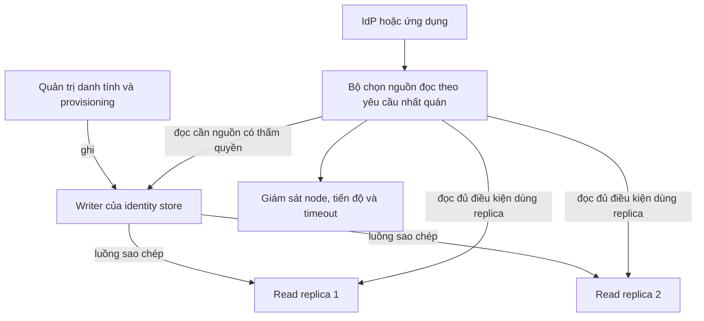

# Read replica

## 1. Read replica có vai trò gì trong identity store?

Read replica là một bản sao dữ liệu được duy trì từ một nguồn ghi hoặc luồng cập nhật để phục vụ truy vấn đọc. Trong IAM, replica có thể giúp chia tải tra cứu hồ sơ, nhóm, thuộc tính và các dữ kiện danh tính, đồng thời đưa điểm đọc đến gần ứng dụng hơn.

Ví dụ, một doanh nghiệp có identity store trung tâm và nhiều ứng dụng cùng tra cứu thông tin người dùng. Nếu mọi truy vấn đều dồn vào một node, tải đọc có thể ảnh hưởng đến việc ghi thay đổi tài khoản hoặc membership. Một số truy vấn có thể chuyển sang replica, nhưng hệ thống phải biết truy vấn đó được phép dùng dữ liệu chậm tới mức nào.

Giả sử quản trị viên đã đình chỉ Lan ở nguồn ghi. Replica chưa áp dụng thay đổi nên vẫn trả `accountEnabled=true`. Nếu dịch vụ xác thực dùng kết quả đó như trạng thái hiện tại, Lan có thể tiếp tục vượt qua điều kiện mà quản trị viên vừa muốn chặn. Một tối ưu đọc đã trở thành vấn đề thu hồi truy cập.

Vì vậy, câu hỏi quan trọng là: **lần đọc này cần bảo đảm nhất quán nào và node được chọn có đáp ứng được không?** Chỉ phân loại câu SQL là `SELECT` chưa trả lời được câu hỏi đó.

Sau bài học, người học cần có khả năng:

- Phân biệt replica với cache, backup và các loại điểm dự phòng.
- Giải thích replication lag và rủi ro của dữ liệu danh tính cũ.
- Chọn cách đọc cho hồ sơ hiển thị, kiểm tra bảo mật và luồng vừa ghi xong.
- Hiểu giới hạn của synchronous replication, sticky routing và mốc tiến độ sao chép.
- Đọc ví dụ Java chọn nguồn đọc theo contract nhất quán.
- Thiết kế giám sát và kiểm chứng thu hồi quyền qua các điểm đọc.

Các topology, ngưỡng thời gian và mã nguồn trong bài là ví dụ giả định. Những đặc tính của PostgreSQL hoặc OpenLDAP được nêu với nguồn riêng; không áp đặt chúng lên mọi hệ quản trị.

## 2. Những khái niệm cần phân biệt

| Khái niệm | Mục đích chính | Điều không được mặc định |
| --- | --- | --- |
| Nguồn có thẩm quyền | Quyết định dữ kiện nào là chính thức trong một phạm vi | Luôn là cùng một máy chủ cho mọi thuộc tính |
| Primary hoặc writer trong mô hình một nguồn ghi | Nhận ghi theo topology đã chọn | Mọi read trên primary luôn mới nếu vẫn dùng cache hoặc snapshot cũ |
| Read replica | Phục vụ đọc từ dữ liệu được sao chép | Dữ liệu đã phản ánh mọi ghi mới nhất |
| Standby đủ điều kiện failover | Có thể tiếp nhận vai trò phục vụ sau sự cố theo quy trình | Mọi replica đều được phép hoặc đủ điều kiện promotion |
| Cache | Tái sử dụng kết quả hoặc đối tượng đã đọc | Có cùng cơ chế nhất quán với replication của database |
| Backup | Phục hồi về trạng thái được lưu | Là điểm đọc trực tiếp hoặc không cần kiểm tra độ mới |
| Read model riêng | Tối ưu dữ liệu cho một loại truy vấn | Giữ nguyên mọi trường và transaction boundary của nguồn |

Một replica có thể đồng thời là standby, nhưng hai vai trò có điều kiện vận hành khác nhau. Một node dành cho báo cáo chậm hoặc có lọc dữ liệu có thể không phù hợp để thay writer của identity store.

Mô hình một primary trong bài là một trường hợp phổ biến để phân tích. Directory cũng có thể dùng nhiều provider nhận ghi. Với topology đó, cần hiểu thêm quy tắc xung đột, phạm vi thẩm quyền và tiến độ đồng bộ giữa các nguồn; không thể gọi tùy ý một node là “bản thật” cho mọi thay đổi.

## 3. Một topology đọc/ghi điển hình



Writer nhận các thay đổi như đình chỉ tài khoản, gỡ membership hoặc cập nhật thuộc tính. Replica nhận và áp dụng những thay đổi đó qua cơ chế của sản phẩm.

Luồng sao chép thường có những mốc khác nhau:

```text
ghi được commit tại nguồn
    -> dữ liệu thay đổi được gửi
    -> replica nhận
    -> replica lưu bền vững theo cấu hình
    -> replica áp dụng
    -> snapshot truy vấn mới nhìn thấy thay đổi
```

Không gộp “đã nhận” với “đã nhìn thấy trong query”. Nếu replica đã nhận log nhưng chưa áp dụng, truy vấn vẫn có thể trả trạng thái cũ. Một transaction đang giữ snapshot cũ cũng có thể chưa thấy ghi mới dù node đã áp dụng thêm dữ liệu.

PostgreSQL mô tả hot standby là khả năng chạy truy vấn read-only trong khi ở chế độ standby hoặc recovery. Dữ liệu từ primary đến và được replay sau một khoảng trễ; thay đổi đã replay xuất hiện với các snapshot mới phù hợp. Vì vậy cùng truy vấn trên primary và standby có thể trả kết quả khác nhau. [Nguồn: PostgreSQL — Hot Standby](https://www.postgresql.org/docs/current/hot-standby.html).

## 4. Lợi ích của replica và giới hạn thực tế

### 4.1. Chia tải đọc

Các truy vấn hồ sơ, tìm kiếm người dùng hoặc báo cáo có thể chiếm nhiều CPU, I/O và connection. Chuyển những truy vấn phù hợp sang replica giúp giảm cạnh tranh với luồng ghi.

Tuy nhiên, thêm replica không làm mọi tài nguyên tăng tuyến tính. Nguồn vẫn phải phục vụ sao chép, replica vẫn phải áp dụng ghi và các thành phần như network, pool kết nối hoặc directory adapter có thể trở thành điểm nghẽn.

Một truy vấn lớn trên replica cũng có thể cạnh tranh tài nguyên với việc áp dụng thay đổi. Trong một số cơ chế standby, truy vấn còn có thể bị hủy khi xung đột với recovery. PostgreSQL mô tả rõ các xung đột có thể dẫn tới hủy query hoặc ngắt session trên hot standby. [Nguồn: PostgreSQL — Handling Query Conflicts](https://www.postgresql.org/docs/current/hot-standby.html#HOT-STANDBY-CONFLICT).

### 4.2. Đưa điểm đọc tới gần ứng dụng

Replica gần vùng triển khai có thể giảm thời gian mạng cho một lần tra cứu. Đổi lại, đường truyền sao chép giữa các vùng có thể làm tăng độ trễ cập nhật và tạo thêm trạng thái lỗi cần xử lý.

Phản hồi nhanh không đồng nghĩa kết luận mới. Một replica trả trong 5 ms nhưng chậm một phút có thể không phù hợp cho quyết định đình chỉ tài khoản, dù tốt hơn về độ trễ HTTP.

### 4.3. Tăng lựa chọn vận hành

Replica có thể hỗ trợ bảo trì hoặc một kế hoạch chuyển vai trò đã được thiết kế. Nhưng backup, failover và phục vụ read không tự thay thế nhau. Cần biết node nào được promotion, dữ liệu nào có nguy cơ chưa được sao chép và ứng dụng cập nhật routing bằng cách nào.

Trong PostgreSQL, log shipping bất đồng bộ có cửa sổ mất những transaction chưa được chuyển tới standby khi primary bị mất nghiêm trọng. Điểm này ảnh hưởng trực tiếp tới việc lựa chọn standby sau sự cố. [Nguồn: PostgreSQL — Log-Shipping Standby Servers](https://www.postgresql.org/docs/current/warm-standby.html).

## 5. Replication lag có ý nghĩa bảo mật thế nào?

### 5.1. Ví dụ thu hồi tài khoản

```text
09:00:00.000  Writer commit việc đình chỉ Lan.
09:00:00.100  Replica vẫn trả trạng thái trước thay đổi.
09:00:00.200  Một request dùng replica để kiểm tra Lan có hoạt động không.
09:00:02.000  Replica áp dụng thay đổi đình chỉ.
```

Nếu policy chấp nhận dữ liệu cũ ở mốc thứ ba, request có thể được cho qua trước khi thay đổi đến replica. Giá trị hai giây chỉ minh họa, không phải mức trễ cố định của một công nghệ.

### 5.2. Cấp quyền và thu hồi quyền có tác động khác nhau

| Thay đổi tại nguồn | Dữ liệu cũ có thể gây ra | Hệ quả trong IAM |
| --- | --- | --- |
| Thêm group cho phép | Replica chưa thấy group mới | Từ chối nhầm người vừa được cấp quyền |
| Gỡ group cho phép | Replica vẫn thấy membership cũ | Tiếp tục cho phép ngoài thời gian mong muốn |
| Thêm group hạn chế | Replica chưa thấy điều kiện hạn chế | Bỏ sót một ràng buộc hoặc explicit deny |
| Đình chỉ tài khoản | Replica vẫn trả hoạt động | Vượt điều kiện chặn principal |
| Thay credential | Replica còn dữ kiện cũ | Có thể chấp nhận phương tiện cũ hoặc từ chối phương tiện mới tùy thiết kế |
| Thu hồi phiên hoặc token trong store | Replica chưa thấy thu hồi | Context truy cập cũ tiếp tục được chấp nhận |

Không nên nói dữ liệu cũ chỉ gây cấp thiếu nên luôn an toàn. Với thu hồi hoặc thuộc tính hạn chế, kết quả có thể là cấp thừa.

### 5.3. Một luồng có tên “read” vẫn có thể cần ghi nguyên tử

Kiểm tra một mã dùng một lần, refresh token rotation, phát hiện reuse hoặc cập nhật bộ đếm thường cần thay đổi trạng thái có điều kiện. Đọc một replica rồi ghi writer ở bước sau có thể tạo race condition hoặc sử dụng trạng thái đã cũ.

Một annotation `readOnly=true` hoặc endpoint HTTP GET không tự chứng minh luồng nghiệp vụ đủ điều kiện đọc replica. Phải nhìn vào bảo đảm cần giữ, kể cả việc kiểm tra và cập nhật có cần nằm trong một transaction hay không.

## 6. Chọn bảo đảm nhất quán theo lần đọc

### 6.1. Những contract thường gặp

| Contract | Ý nghĩa mong muốn | Ví dụ dùng trong bài |
| --- | --- | --- |
| Eventual read | Chấp nhận bản sao có thể chậm và sẽ hội tụ theo điều kiện của hệ thống | Hiển thị một nhãn hồ sơ không dùng để cấp quyền |
| Bounded staleness | Có bảo đảm dữ kiện không cũ hơn giới hạn đã định nghĩa | Một tra cứu được policy cho phép trễ có giới hạn |
| Read-your-writes | Lần đọc sau thấy ít nhất thay đổi vừa ghi trong luồng liên quan | Màn hình kiểm tra sau cập nhật membership |
| Monotonic reads | Luồng không quay lại một trạng thái cũ hơn mốc đã thấy | Chuyển giữa nhiều replica mà vẫn giữ tiến độ tối thiểu |
| Authoritative read | Dùng đường đọc của nguồn có thẩm quyền với contract thích hợp | Kiểm tra nhạy cảm về principal theo thiết kế |

Đây là các mục tiêu cần được hiện thực hóa; đặt tên enum không tự cung cấp bảo đảm. Cũng không có một mức chung phù hợp cho mọi dữ kiện IAM.

### 6.2. Không đánh đồng thời gian đọc với tuổi dữ liệu

Ứng dụng nhận một response lúc 09:05 không có nghĩa bản sao đã theo kịp nguồn tới 09:05. Gắn `observedAt=now` vào hàng lấy từ replica chỉ ghi thời điểm đọc, không chứng minh lần đồng bộ gần nhất.

Một giới hạn “dữ liệu chậm không quá 5 giây” cần chứng cứ về tiến độ so với nguồn hoặc một cơ chế mà hệ thống thực sự bảo đảm. Heartbeat ứng dụng còn sống, thời gian query hoặc TTL cache không tự cung cấp chứng cứ đó.

Khi nguồn không phát sinh ghi, thời gian từ transaction replay cuối cùng có thể tăng dù replica đã theo kịp. Ngược lại, replica đang xử lý đều đặn một backlog lớn vẫn có thể phản hồi heartbeat tốt. Cần đọc đúng ý nghĩa chỉ số.

### 6.3. Phân loại workload IAM

| Lần đọc | Cách lựa chọn trong thiết kế giả định | Lý do |
| --- | --- | --- |
| Danh sách user cho màn hình thông tin | Có thể dùng replica theo contract hiển thị | Sai khác ngắn không được dùng làm quyết định quyền |
| Hiển thị tên mới ngay sau cập nhật | Writer hoặc replica đã qua mốc ghi | Cần read-your-writes |
| Kiểm tra tài khoản bị đình chỉ cho luồng nhạy cảm | Đường có bảo đảm đáp ứng yêu cầu thu hồi | Kết quả cũ có thể cấp thừa |
| Đọc membership để cấp quyền quản trị | Nguồn đủ mới và dữ liệu đầy đủ theo policy | Không chỉ cần group tồn tại ở một replica |
| Báo cáo phân tích đã được cho phép trễ | Replica hoặc read model riêng | Cần giới hạn tải và bảo vệ dữ liệu báo cáo |
| Xác nhận kết quả thu hồi vừa thực hiện | Đọc qua mốc commit đã xác nhận và kiểm tra các điểm thực thi | Thành công ở nguồn chưa chứng minh mọi nơi đã áp dụng |

Ngay cả khi đọc writer, ứng dụng còn có thể dùng role từ token cũ hoặc cache policy cũ. Phải kiểm tra toàn bộ chuỗi tạo quyết định, không chỉ datasource của một truy vấn.

## 7. Read-your-writes và mốc tiến độ sao chép

### 7.1. Gắn lần đọc với thay đổi đã commit

Một luồng cập nhật có thể trả về mốc tiến độ sau khi ghi thành công:

```text
Writer commit thay đổi membership ở mốc K.
Lần đọc sau yêu cầu dữ liệu nhìn thấy ít nhất tới K.

Nếu replica đáp ứng:
    đọc từ replica theo contract đã chứng minh.
Nếu chưa đáp ứng trong thời gian chờ cho phép:
    dùng đường có thẩm quyền hoặc báo chưa thể đáp ứng.
```

Mốc K phải đến từ nguồn được quản lý và có ngữ nghĩa liên quan tới commit. Một timestamp do browser đặt hoặc một counter không đi cùng transaction không đủ làm bằng chứng.

Mốc tiến độ có thể là vị trí log, revision hoặc token nhất quán do sản phẩm cung cấp. Không so sánh trực tiếp hai con số từ hai nguồn, hai shard hoặc hai lịch sử phục hồi khác nhau nếu contract không cho phép.

### 7.2. Mốc thấp nhất không đồng nghĩa đã thấy mọi thay đổi sau đó

Nếu replica đã qua mốc K của việc cấp quyền lúc 09:00, điều đó chưa chứng minh nó đã thấy việc thu hồi lúc 09:01. Read-your-writes là bảo đảm tương đối với một thay đổi đã biết, không phải khẳng định replica luôn ở trạng thái mới nhất toàn hệ thống.

Khi dùng lower bound để bảo vệ luồng nhạy cảm, cần biết lower bound đó được cập nhật từ đâu và có bao phủ sự kiện cần phản ánh không. Giữ mãi mốc cũ trong session không tạo ra khả năng thu hồi tức thời.

### 7.3. Sticky routing có phạm vi tác dụng hữu hạn

Sau khi ghi, hệ thống có thể giữ một luồng đọc trên writer trong một giai đoạn hoặc cho tới khi replica đủ điều kiện. Điều đó giúp đọc lại thay đổi của chính luồng đó.

Tuy nhiên, quản trị viên có thể thu hồi quyền của Lan trong một luồng khác. Sticky routing của browser Lan không tự biết sự kiện này. Chỉ ngủ một khoảng cố định rồi quay lại replica cũng không bảo đảm dữ liệu đã tới khi mạng hoặc replay chậm bất thường.

### 7.4. Phải kiểm tra đúng node và đúng snapshot

Một lỗi triển khai:

```text
Kiểm tra replica R1 đã qua K.
Trả connection vào pool.
Thực hiện truy vấn danh tính trên replica R2 chưa qua K.
```

Kết quả không còn bảo đảm đã kiểm tra. Adapter cần ràng buộc việc kiểm tra và đọc với cùng điểm phục vụ, cùng lịch sử dữ liệu và quy tắc snapshot phù hợp.

Tương tự, transaction giữ snapshot trước K có thể không thấy thay đổi dù một chỉ số cấp node đã đi qua K. Việc chờ replay phải gắn với cách tạo snapshot đọc theo đặc tính của hệ quản trị.

## 8. Synchronous replication không tự làm mọi replica nhất quán mạnh

Từ synchronous có thể chỉ các mức chờ khác nhau: chờ nhận, chờ ghi hoặc chờ áp dụng. Phải đọc đúng contract của sản phẩm và cấu hình.

Trong PostgreSQL, khi có synchronous standby được cấu hình, `synchronous_commit=on` chờ WAL được flush tại các standby đồng bộ tương ứng; `remote_apply` chờ commit được áp dụng để có thể nhìn thấy trong truy vấn trên các standby đó. Đây là khác biệt giữa độ bền dữ liệu và khả năng nhìn thấy khi đọc. [Nguồn: PostgreSQL — synchronous_commit](https://www.postgresql.org/docs/current/runtime-config-wal.html#GUC-SYNCHRONOUS-COMMIT).

Không suy ra từ ví dụ đó rằng:

- Mọi replica trong pool đều là synchronous standby đã xác nhận transaction.
- Snapshot cũ đang mở sẽ tự được cập nhật.
- Tất cả cache, token hoặc directory downstream cũng đã phản ánh thay đổi.
- Một cấu hình có chữ synchronous luôn đáp ứng mọi yêu cầu thu hồi của ứng dụng.

Chờ replica đồng bộ cũng ảnh hưởng latency ghi và hành vi khi các node liên quan không sẵn sàng. Cần lựa chọn theo bảo đảm cần giữ và khả năng vận hành, không chỉ bật một tham số rồi kết luận kiến trúc đã nhất quán hoàn toàn.

## 9. Read replica trong directory và identity projection

### 9.1. Replica có thể chỉ chứa một phần dữ liệu

Không phải bản sao nào cũng chứa toàn bộ cây hoặc mọi thuộc tính. OpenLDAP syncrepl hỗ trợ consumer giữ bản sao một phần DIT; phạm vi có thể bị giới hạn bởi base, scope, filter, danh sách thuộc tính và quyền của tài khoản replication. Tài liệu cũng phân biệt provider và consumer thay vì giả định topology cố định một writer cho mọi trường hợp. [Nguồn: OpenLDAP 2.6 — Replication](https://www.openldap.org/doc/admin26/replication.html).

Nếu replica chỉ có tên và email, không được dùng việc không thấy group membership để kết luận người dùng không thuộc nhóm nào. Nếu policy có nhóm hạn chế, sự thiếu dữ liệu còn có thể dẫn tới cấp quyền sai.

Hợp đồng replica cần nêu:

- Đối tượng và thuộc tính nào được sao chép?
- Có bao gồm xóa, đổi tên và thay đổi membership không?
- Thuộc tính tính toán có được phản ánh theo cách nào?
- Dữ liệu nào chỉ có trên provider hoặc hệ thống khác?
- Quyền đọc của service account có làm kết quả bị lược bớt không?

### 9.2. Projection có thể thay đổi ranh giới nhất quán

Một hệ thống xây read model từ sự kiện có thể cập nhật account trước, membership sau. Một lần đọc kết hợp hai bảng ở đích có thể nhận hai mốc nguồn khác nhau nếu pipeline không cung cấp snapshot nhất quán.

Ví dụ:

```text
account status đã phản ánh thay đổi mới;
group memberships vẫn ở bản cũ;
policy mapping lấy từ một cache khác.
```

Không có một `user.updatedAt` duy nhất tự chứng minh cả ba phần đã đồng bộ. Cần tracking tiến độ đúng phạm vi và contract của phép kết hợp dữ kiện.

### 9.3. Đọc nguồn có thẩm quyền phải hiểu theo từng dữ kiện

Identity store của ứng dụng có thể là bản sao từ directory; directory lại nhận trạng thái nhân sự từ HR. Đọc primary database của ứng dụng chỉ tránh lag giữa primary đó với replica của nó, không xóa độ trễ từ HR đến ứng dụng.

Khi đặt yêu cầu thu hồi, phải xác định nguồn bắt đầu sự kiện và các lớp trung gian. Một quyết định quan trọng không nên được mô tả “strong” chỉ vì câu SQL chạy trên writer của một bản sao downstream.

## 10. Ví dụ Java: định tuyến lần đọc theo yêu cầu nhất quán

### 10.1. Mô hình minh họa

Ví dụ Java 17 trở lên dùng một identity store giả định có một journal được đánh số thứ tự trong cùng nguồn và cùng thế hệ lịch sử. Số `sequence` trong mã không phải cách biểu diễn PostgreSQL LSN; với sản phẩm thật phải dùng kiểu và phép so sánh do adapter hỗ trợ.

Ba chế độ:

- `AUTHORITATIVE`: dùng đường đọc có thẩm quyền theo contract.
- `EVENTUAL`: cho phép đọc replica có thể chậm, dành cho luồng đã cho phép điều đó.
- `AT_LEAST_POSITION`: kết quả phải bao phủ ít nhất một mốc được quản lý.

Chế độ được chọn từ policy phía server. Không cho client tự chuyển một kiểm tra bảo mật sang `EVENTUAL` bằng query parameter.

### 10.2. Kiểu dữ liệu và contract adapter

```java
import java.time.Duration;
import java.util.Objects;
import java.util.Optional;
import java.util.Set;
import java.util.UUID;

enum ReadMode {
    AUTHORITATIVE,
    EVENTUAL,
    AT_LEAST_POSITION
}

record IdentityKey(String directoryId, UUID tenantId, String subjectId) {
    IdentityKey {
        Objects.requireNonNull(directoryId);
        Objects.requireNonNull(tenantId);
        Objects.requireNonNull(subjectId);
        if (directoryId.isBlank() || subjectId.isBlank()) {
            throw new IllegalArgumentException("Missing identity key");
        }
    }
}

record ReplicationPosition(String sourceId, String generation, long sequence) {
    ReplicationPosition {
        Objects.requireNonNull(sourceId);
        Objects.requireNonNull(generation);
        if (sourceId.isBlank() || generation.isBlank() || sequence < 0) {
            throw new IllegalArgumentException("Invalid replication position");
        }
    }
}

record ReadRequirement(ReadMode mode, Optional<ReplicationPosition> minimum) {
    ReadRequirement {
        Objects.requireNonNull(mode);
        Objects.requireNonNull(minimum);
        if ((mode == ReadMode.AT_LEAST_POSITION) != minimum.isPresent()) {
            throw new IllegalArgumentException("Invalid read requirement");
        }
    }
}

record IdentityView(IdentityKey key, boolean accountEnabled, Set<String> groupIds) {
    IdentityView {
        Objects.requireNonNull(key);
        groupIds = Set.copyOf(groupIds);
    }
}

record IdentityRead(
        IdentityView view,
        ReplicationPosition visibleThrough,
        boolean complete) {
    IdentityRead {
        Objects.requireNonNull(view);
        Objects.requireNonNull(visibleThrough);
    }
}

interface IdentityReadPort {
    // Phải trả dữ liệu theo contract của nguồn có thẩm quyền hiện tại.
    IdentityRead readAuthoritative(IdentityKey key);

    // Optional.empty khi không có replica đáp ứng trong budget.
    // Adapter phải gắn visibleThrough với chính dữ liệu/snapshot trả về.
    Optional<IdentityRead> readReplica(
            IdentityKey key,
            Optional<ReplicationPosition> minimum,
            Duration waitBudget);
}
```

`visibleThrough` là cam kết của adapter rằng dữ liệu trả về bao phủ journal tới mốc đó trong phạm vi của snapshot. Nó không phải giá trị tùy ý lấy từ một health endpoint rồi đính kèm vào một query chạy ở nơi khác.

`complete` nói snapshot có các dữ kiện thuộc contract của `IdentityView`, không phải toàn bộ dữ liệu danh tính của doanh nghiệp. Adapter phải phân biệt dữ liệu thật sự rỗng với dữ liệu bị lược vì thiếu quyền hoặc lỗi nạp.

Ví dụ chỉ minh họa đối tượng đã tồn tại. Kết quả không tìm thấy trong hệ thống thật cũng cần ngữ nghĩa nhất quán: replica chưa nhận một user mới không đủ chứng minh user không tồn tại tại nguồn.

### 10.3. Không hạ yêu cầu nhất quán khi replica chưa theo kịp

```java
final class ConsistentReadUnavailableException extends RuntimeException {
}

final class IdentityReadRouter {
    private static final Duration REPLICA_WAIT_BUDGET = Duration.ofMillis(50);
    private final IdentityReadPort port;

    IdentityReadRouter(IdentityReadPort port) {
        this.port = Objects.requireNonNull(port);
    }

    IdentityView read(IdentityKey key, ReadRequirement requirement) {
        Objects.requireNonNull(key);
        Objects.requireNonNull(requirement);

        if (requirement.mode() != ReadMode.AUTHORITATIVE) {
            Optional<IdentityRead> replica = port.readReplica(
                    key, requirement.minimum(), REPLICA_WAIT_BUDGET);
            if (replica.isPresent()
                    && satisfies(key, requirement, replica.get())) {
                return replica.get().view();
            }
        }

        IdentityRead authoritative = port.readAuthoritative(key);
        if (!satisfies(key, requirement, authoritative)) {
            throw new ConsistentReadUnavailableException();
        }
        return authoritative.view();
    }

    private boolean satisfies(
            IdentityKey key,
            ReadRequirement requirement,
            IdentityRead result) {
        if (!result.complete() || !key.equals(result.view().key())) {
            return false;
        }

        ReplicationPosition actual = result.visibleThrough();
        if (!key.directoryId().equals(actual.sourceId())) {
            return false;
        }

        return requirement.minimum().map(required ->
                required.sourceId().equals(actual.sourceId())
                && required.generation().equals(actual.generation())
                && actual.sequence() >= required.sequence()
        ).orElse(true);
    }
}
```

Giới hạn 50 ms chỉ là lựa chọn minh họa của thời gian chờ replica, không phải thời gian thu hồi được bảo đảm. Adapter có thể trả ngay khi không có replica đủ điều kiện. Timeout tổng của request và kiểm soát tải phải được thiết kế riêng.

Nếu đọc nguồn có thẩm quyền lỗi hoặc không đáp ứng mốc, ví dụ không tự trả dữ liệu cũ để làm luồng thành công. Tầng API cần xử lý trạng thái chưa thể đáp ứng phù hợp, không biến nó thành một kết luận người dùng chắc chắn không tồn tại hoặc có quyền.

Các exception từ adapter trong ví dụ được để lan ra tầng xử lý lỗi; không có nhánh catch-all đổi lỗi thành đọc eventual. Muốn fallback cho một loại lỗi hạ tầng cụ thể phải giữ nguyên yêu cầu nhất quán và phân biệt nó với lỗi sai nguồn, sai context hoặc thiếu dữ kiện.

### 10.4. Những điều kiểu dữ liệu không tự bảo đảm

`generation` giúp ví dụ từ chối so sánh hai lịch sử khác nhau. Sau failover, adapter cần biết mốc cũ còn có ý nghĩa không và cách ánh xạ hoặc xác nhận lại theo cơ chế thật. Không sửa chuỗi generation cho khớp chỉ để phép so sánh thành công.

Chế độ `AT_LEAST_POSITION` chỉ chứng minh lower bound đã yêu cầu. Một kết quả ở mốc cao hơn vẫn có thể chưa phản ánh một thu hồi xảy ra sau đó. Với hành động cần trạng thái có thẩm quyền hiện tại theo contract, phải chọn đường phù hợp từ đầu.

`IdentityView` cũng chưa phải quyết định authorization. Bên dùng vẫn cần kiểm tra principal, loại hành động, tenant, tài nguyên, trạng thái credential hoặc session và policy liên quan. Việc đọc nhất quán một dữ kiện không làm mọi dữ kiện khác trong quyết định trở nên nhất quán.

## 11. Giám sát replica: đo đúng ý nghĩa

### 11.1. Node còn sống khác với node đủ mới

Replica có thể trả lời TCP, nhận query và vẫn chậm rất xa nguồn. Health check cho routing cần phân biệt ít nhất:

- Kết nối và truy vấn có hoạt động không?
- Node có đúng vai trò và đúng nguồn dữ liệu không?
- Có đang bootstrap, recovery hoặc cần resync không?
- Đã nhận tới đâu, đã áp dụng tới đâu?
- Có đáp ứng mốc hoặc giới hạn cần cho loại lần đọc này không?
- Chỉ số quan sát có còn đủ mới không?

Không dùng một endpoint `/health=UP` duy nhất làm bằng chứng mọi lần đọc bảo mật được dùng replica.

### 11.2. Ví dụ quan sát PostgreSQL

Một câu truy vấn quan sát read-only có thể là:

```sql
SELECT
    pg_is_in_recovery() AS in_recovery,
    pg_last_wal_receive_lsn() AS received_lsn,
    pg_last_wal_replay_lsn() AS replayed_lsn,
    pg_last_xact_replay_timestamp() AS last_replayed_transaction_time;
```

Các hàm trên phân biệt vị trí WAL đã nhận, đã replay và timestamp transaction replay cuối. Một số kết quả có thể là `NULL` tùy vai trò và trạng thái node; không chuyển `NULL` thành lag bằng không. Timestamp replay cuối không phải thời gian query vừa hoàn thành. [Nguồn: PostgreSQL — Recovery Information Functions](https://www.postgresql.org/docs/current/functions-admin.html#FUNCTIONS-RECOVERY-CONTROL).

Nếu primary đang rảnh và không phát sinh transaction mới, thời gian từ transaction replay cuối tăng không nhất thiết là replica đang tụt lại. Cần kết hợp tiến độ nguồn và trạng thái đồng bộ; không chỉ lấy `now - lastReplayTime` rồi gọi đó là mọi loại replication lag.

Truy vấn trên cũng không tạo bảo đảm read-your-writes cho một truy vấn danh tính chạy sau đó ở connection khác. Bằng chứng tiến độ phục vụ monitoring và bằng chứng cho snapshot đọc cần được sử dụng đúng phạm vi.

### 11.3. Chỉ số gắn với yêu cầu IAM

| Nhóm chỉ số | Điều cần quan sát |
| --- | --- |
| Replication | Khoảng cách nhận/áp dụng, nguồn và lịch sử đang theo |
| Read routing | Bao nhiêu lần chọn replica, writer hoặc không đáp ứng được |
| Freshness | Bao nhiêu lần đọc chưa đạt mốc hoặc vượt giới hạn policy |
| Thu hồi | Thời gian từ sự kiện nguồn đến các điểm thực thi thuộc phạm vi |
| Tải | Query latency, replay throughput, connection và tài nguyên |
| Lỗi | Query bị hủy do recovery, timeout, replica mất kết nối |
| Failover | Mất hoặc đổi mốc, pool chưa cập nhật, node cũ còn được gọi |

Log nên ghi request ID, loại yêu cầu nhất quán, node được chọn và mốc cần so sánh ở mức phù hợp. Không ghi password hash, token hoặc toàn bộ hồ sơ chỉ để tìm hiểu lag.

## 12. Fallback, failover và áp lực tải

### 12.1. Fallback sang writer phải có khả năng chịu tải

Khi nhiều replica không đáp ứng, mọi request dồn về writer có thể làm writer quá tải, ảnh hưởng cả việc thu hồi tài khoản. Cần tính capacity, giới hạn concurrency, timeout và khả năng từ chối có kiểm soát.

Không khắc phục quá tải bằng việc tự hạ yêu cầu nhất quán của một kiểm tra bảo mật. Nếu không có đường đáp ứng contract, hệ thống cần báo chưa thể thực hiện hoặc áp dụng chế độ được thiết kế trước cho đúng loại hành động.

Replica dành cho báo cáo có thể có policy routing khác replica phục vụ IAM latency thấp. Một truy vấn báo cáo dài không nên tùy ý chiếm toàn bộ tài nguyên mà hệ thống cần để áp dụng thu hồi.

### 12.2. Failover có thể làm một thay đổi bảo mật đã xác nhận không còn trong dữ liệu

Trong một cấu hình bất đồng bộ, writer có thể đã xác nhận thu hồi nhưng standby chưa nhận hoặc áp dụng thay đổi đó trước sự cố. Nếu standby được promotion mà thiếu thay đổi, trạng thái sau failover có thể quay về trước thu hồi.

Đối với IAM, tác động không chỉ là mất một cập nhật hồ sơ. Nó có thể làm credential, session hoặc membership bị thu hồi xuất hiện như còn hợp lệ. Kế hoạch HA cần đánh giá loại dữ liệu này khi xác định RPO và điều kiện khôi phục phục vụ.

Nếu có journal bảo mật bền vững hoặc nguồn trạng thái độc lập để đối soát, hệ thống cần quy trình dùng nó trước khi cho phép những hành động liên quan. Không tự giả định một revision lớn hơn ở node mới chứng minh đã giữ mọi thu hồi của lịch sử cũ.

### 12.3. Chuyển vai trò không chỉ là đổi một hostname

Ứng dụng có thể giữ connection tới node cũ, DNS có thể chưa cập nhật và metadata của read pool có thể còn sai. Cần cơ chế nhận diện vai trò, tái thiết lập pool và fencing writer cũ theo kiến trúc của hệ thống.

Không để hai phía cùng nhận ghi ngoài topology dự kiến rồi gọi đó là tăng sẵn sàng. Vấn đề split-brain có thể tạo lịch sử danh tính xung đột mà một phép kiểm tra sequence đơn giản không giải quyết được.

### 12.4. Replica là thêm một bản sao dữ liệu cần bảo vệ

Replica có thể chứa credential verifier, thông tin cá nhân và group đặc quyền giống nguồn. Read-only không có nghĩa người đọc được phép xem mọi bảng hoặc file dữ liệu.

Phân quyền tài khoản ứng dụng, quyền replication, mã hóa, bảo vệ backup và quyền quản trị node cần được quản lý theo nhiệm vụ. Không dùng tài khoản replication đặc quyền rộng làm tài khoản tra hồ sơ của ứng dụng.

Với partial replica, cần biết giới hạn dữ liệu được sao chép và bảo đảm policy không đòi những trường đã bị loại. Với replica đầy đủ, giảm quyền query của service vẫn không làm dữ liệu trên đĩa tự biến mất khỏi phạm vi quản trị hạ tầng.

## 13. Các lỗi triển khai thường gặp

| Cách làm | Lỗi có thể xảy ra | Hướng thiết kế phù hợp hơn |
| --- | --- | --- |
| Mọi SELECT đi replica | Kiểm tra đình chỉ hoặc thu hồi dùng dữ liệu cũ | Chọn nguồn theo yêu cầu nghiệp vụ |
| Node UP được xem là đủ mới | Replica còn sống nhưng đã tụt xa | Kiểm tra tiến độ và điều kiện eligibility |
| Đợi một khoảng cố định sau write | Hết thời gian đợi nhưng replica vẫn chưa theo kịp | Dùng mốc hoặc đọc đường có thẩm quyền |
| Kiểm tra R1, đọc R2 | Bảo đảm tiến độ không gắn với kết quả | Ràng buộc node và snapshot |
| Tin rằng synchronous nghĩa là mọi node đã replay | Đọc replica không nằm trong tập xác nhận | Hiểu mức ack và routing cụ thể |
| Gắn giờ đọc làm giờ đồng bộ | Tuổi dữ liệu bị báo sai | Theo dõi tiến độ nguồn và lineage |
| Coi không tìm thấy ở replica là không tồn tại | User vừa tạo bị xử lý sai hoặc tạo trùng | Xử lý absence theo contract nhất quán |
| Primary read nhưng dùng token group cũ | Quyết định vẫn bỏ sót thu hồi | Kiểm tra toàn bộ chuỗi dữ kiện |
| So revision giữa hai lịch sử sau failover | Kết luận sai rằng đã thấy một thay đổi | Mốc có namespace và lịch sử so sánh hợp lệ |
| Timeout chuyển sang stale allow | Sự cố hạ tầng tạo quyền truy cập mới | Giữ nguyên điều kiện bảo mật khi fallback |

Một lớp routing tốt không thể sửa mọi lỗi trong bảng nếu adapter báo sai tính đầy đủ hoặc ứng dụng không nêu yêu cầu nhất quán. Contract cần được giữ xuyên suốt từ luồng nghiệp vụ tới query và kết quả.

## 14. Kiểm chứng read replica trong IAM

| Ca kiểm chứng | Kết quả cần quan sát |
| --- | --- |
| Hiển thị hồ sơ qua replica hơi trễ | Chỉ ảnh hưởng chức năng đã cho phép trễ |
| Đình chỉ tài khoản rồi tạo request mới | Luồng bảo mật đáp ứng contract thu hồi đã đặt |
| Gỡ group cho phép | Không tiếp tục cấp quyền quá cửa sổ đã cam kết |
| Thêm group hạn chế | Không bỏ sót ràng buộc do chỉ xem group cho phép |
| Read-your-writes với replica chưa qua mốc | Chờ có giới hạn, chuyển nguồn phù hợp hoặc báo không đáp ứng |
| Hai replica có tiến độ khác nhau | Không mất lower bound khi load balancing |
| Transaction giữ snapshot cũ | Không gắn mốc mới cho dữ liệu snapshot cũ |
| Replica thiếu thuộc tính hoặc membership | Không coi tập thiếu là dữ liệu đầy đủ |
| Writer không sẵn sàng và replica quá cũ | Không xuất hiện nhánh tự cho phép bằng dữ liệu cũ |
| Fallback hàng loạt | Writer giữ được mức phục vụ theo thiết kế hoặc từ chối có kiểm soát |
| Failover khi có ghi thu hồi chưa được sao chép | Phát hiện rủi ro mất thay đổi và áp dụng quy trình phục hồi |
| Cache vẫn giữ context sau khi replica đã theo kịp | Không nhầm replica mới với toàn quyết định đã mới |

Các thử nghiệm tạo lag hoặc sự cố phải được thực hiện trong môi trường kiểm thử có dữ liệu giả và phạm vi kiểm soát. Kết quả cần quan sát cả nguồn đọc lẫn hành vi API, việc tạo phiên hoặc token và tác dụng phụ.

Đối với cam kết thu hồi, đo mốc sự kiện đã xác định tại nguồn tới từng điểm thực thi thuộc phạm vi. Không chỉ đo thời gian cập nhật database hoặc lúc dashboard đổi nhãn.

Không cần mọi bài kiểm chứng đều chạy một cụm phân tán. Unit test có thể kiểm tra routing và xử lý mốc; integration test cần kiểm tra adapter, transaction và cơ chế replication thật để xác nhận những bảo đảm mà unit test không thể chứng minh.

## 15. Bài tập vận dụng

### Tình huống 1: Trang quản trị đúng, đăng nhập vẫn được

Quản trị viên thấy Lan đã bị đình chỉ trên màn hình đọc writer, nhưng request đăng nhập dùng replica còn trả hoạt động. Cần kiểm tra những lớp nào?

**Gợi ý:** xem datasource, lag, cache trạng thái, context token và yêu cầu thu hồi của luồng đăng nhập. Màn hình đúng tại một nơi không chứng minh mọi verifier đã cập nhật.

### Tình huống 2: Read-only annotation gây sai quyền

Một phương thức kiểm tra refresh token được đánh dấu read-only nên router tự chuyển sang replica. Sau đó phương thức gọi writer để đánh dấu token đã dùng. Vì sao việc phân loại dựa trên annotation có thể sai?

**Gợi ý:** luồng cần bảo đảm kiểm tra và thay đổi trạng thái phù hợp, không chỉ thực hiện một truy vấn đọc. Replica cũ có thể bỏ sót trạng thái đã dùng hoặc thu hồi.

### Tình huống 3: Chỉ số timestamp báo lag lớn khi hệ thống rảnh

Dashboard lấy thời gian hiện tại trừ thời gian transaction replay cuối, rồi báo replica chậm mười phút. Primary không có ghi trong mười phút đó. Có đủ căn cứ kết luận replica tụt lại không?

**Gợi ý:** xem tiến độ nguồn, tiến độ đã áp dụng và ý nghĩa timestamp. Khoảng thời gian từ giao dịch cuối không tự bằng khoảng dữ liệu đang thiếu.

### Tình huống 4: Đã qua mốc cấp quyền, chưa thấy mốc thu hồi

Client giữ mốc K từ lần được cấp role hôm qua. Hôm nay role bị thu hồi, nhưng replica chỉ mới vượt K. Điều kiện `replicaPosition >= K` có bảo đảm quyền hiện tại không?

**Gợi ý:** lower bound cũ chỉ chứng minh đã thấy ít nhất mốc cũ. Cần yêu cầu hoặc cơ chế đáp ứng sự kiện thu hồi mới, không coi read-your-writes là luôn mới nhất.

### Tình huống 5: Failover làm credential bị thu hồi hoạt động lại

Một thu hồi đã được writer xác nhận nhưng không tới standby trước sự cố. Sau promotion, credential lại xuất hiện như còn bật. Vấn đề này liên quan những bảo đảm nào?

**Gợi ý:** độ bền ghi, replication mode, RPO, điều kiện promotion và quy trình đối soát dữ liệu bảo mật. Chỉ sửa read routing sau failover không khôi phục transaction đã mất.

### Tình huống 6: Replica có tên và email nhưng không có nhóm

Một partial directory replica trả hồ sơ user mà thiếu thuộc tính group. Ứng dụng kết luận người đó không thuộc nhóm hạn chế nào. Sai lầm nằm ở đâu?

**Gợi ý:** thiếu trường ngoài phạm vi replication khác với nguồn xác nhận tập membership rỗng. Cần contract dữ liệu và tính đầy đủ trước khi dùng cho policy.

## 16. Các câu hỏi cần trả lời trước khi dùng replica cho một lần đọc

1. Dữ kiện này dùng để hiển thị hay để quyết định xác thực, thu hồi hoặc authorization?
2. Nguồn có thẩm quyền thực sự là đâu và còn những lớp đồng bộ nào trước identity store này?
3. Lần đọc được phép chậm tới mức nào và bằng chứng nào chứng minh điều đó?
4. Có cần thấy một ghi cụ thể hoặc giữ tiến độ tối thiểu giữa nhiều lần đọc không?
5. Kiểm tra tiến độ có gắn với cùng node, lịch sử và snapshot trả kết quả không?
6. Replica có đủ đối tượng, thuộc tính và membership cho policy không?
7. Khi không đáp ứng, fallback giữ bảo đảm thế nào và writer có chịu được tải không?
8. Sau failover, các thay đổi bảo mật đã xác nhận có còn được giữ và kiểm chứng không?

Read replica hữu ích khi việc chia tải đọc đi cùng một contract nhất quán rõ ràng. Trong IAM, dữ liệu cũ không chỉ làm giao diện cập nhật chậm; nó có thể kéo dài quyền đã bị thu hồi. Lựa chọn nguồn đọc cần xuất phát từ bảo đảm của hành động và được kiểm chứng tại đúng điểm thực thi.
