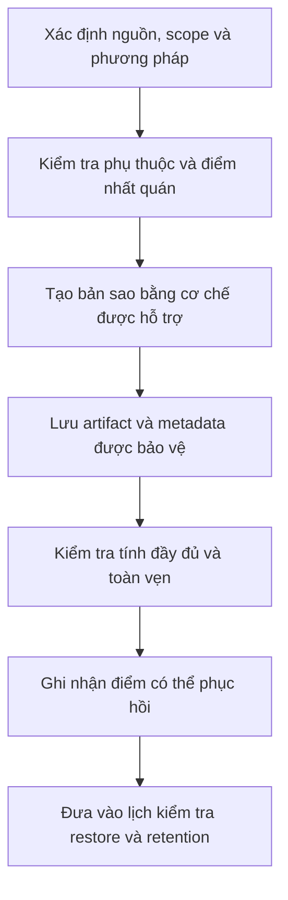

# Identity store backup — Sao lưu kho danh tính và quyền truy cập

## 1. Sao lưu identity store phải khôi phục được điều gì?

Một kho danh tính chứa nhiều hơn tên đăng nhập. Nó có thể lưu định danh, trạng thái tài khoản, nhóm, quan hệ thành viên, liên kết với nguồn ngoài và dữ liệu phục vụ xác thực. Trong một kiến trúc khác, những dữ liệu này lại nằm ở nhiều dịch vụ riêng.

**Identity store backup** là việc tạo và quản lý bản sao có khả năng hỗ trợ khôi phục dữ liệu của kho danh tính theo một phạm vi, thời điểm và mục tiêu đã xác định.

Mục tiêu không chỉ là làm dịch vụ khởi động lại. Sau khôi phục, hệ thống cần nhận diện đúng chủ thể và tiếp tục thực thi quyền phù hợp. Một bản phục hồi có đủ số lượng user nhưng làm người đã nghỉ việc hoạt động trở lại vẫn chưa đáp ứng mục tiêu an toàn của IAM.

Ví dụ, doanh nghiệp sao lưu directory vào lúc 08:00. Đến 09:00, tài khoản của một nhân viên bị vô hiệu hóa và thông tin xác thực bị lộ được thu hồi. Nếu sự cố lúc 10:00 buộc khôi phục bản 08:00, dữ liệu được phục hồi có thể mang trạng thái trước khi thu hồi. Quy trình phải xử lý khoảng thay đổi này trước khi mở lại các đường truy cập liên quan.

Có ba câu hỏi cần trả lời riêng:

1. Bản sao có còn nguyên vẹn và đọc được không?
2. Nó có khôi phục được cấu trúc và quan hệ dữ liệu cần thiết không?
3. Trạng thái sau khôi phục có được phép dùng để xác thực và phân quyền ở thời điểm hiện tại không?

Trong bài này, các quy trình và cấu trúc dữ liệu là ví dụ thiết kế. Chúng không phải lệnh sao lưu hoặc khôi phục để chạy trực tiếp trên một hệ thống sản xuất.

## 2. Backup khác replication, snapshot và export

| Cơ chế | Mục đích điển hình | Giới hạn cần hiểu |
| --- | --- | --- |
| Backup | Có bản sao phục vụ khôi phục theo thời điểm và phạm vi | Cần bảo vệ, kiểm tra và quy trình restore |
| Replication | Duy trì bản sao hoạt động để tăng khả dụng hoặc phân phối tải | Có thể lan truyền thay đổi sai và thao tác xóa |
| Snapshot | Ghi lại trạng thái ở một lớp lưu trữ hoặc nền tảng | Chỉ phù hợp khi bảo đảm tính nhất quán và khả năng restore của sản phẩm |
| Export dữ liệu | Xuất các đối tượng hoặc field được công cụ hỗ trợ | Có thể thiếu cấu hình, bí mật, metadata hoặc quyền |
| Archive | Giữ dữ liệu phục vụ lịch sử hoặc mục đích lưu trữ | Không mặc nhiên đáp ứng yêu cầu vận hành sau khôi phục |
| Disaster recovery | Phục hồi dịch vụ và các phụ thuộc sau sự cố | Bao gồm backup nhưng rộng hơn thao tác chép lại dữ liệu |

### 2.1. Replica không thay thế toàn bộ backup

Nếu một quản trị viên xóa nhầm nhóm đặc quyền, cơ chế replication có thể chuyển thao tác xóa tới các bản sao. Replica vẫn khỏe nhưng không còn giữ trạng thái trước lỗi.

Tương tự, một thay đổi độc hại có thể được đồng bộ hợp lệ về mặt giao thức. Muốn trở lại một thời điểm trước thay đổi, cần cơ chế lưu lịch sử hoặc bản sao phù hợp, không chỉ thêm replica.

### 2.2. Snapshot phải được hỗ trợ cho cách khôi phục dự kiến

Một snapshot ổ đĩa không tự hiểu tất cả giao dịch của directory, kho khóa và ứng dụng. Nó có thể nhất quán ở lớp tệp nhưng chưa nhất quán ở mức nghiệp vụ.

Với hệ thống có replication, việc đưa một ảnh cũ trở lại cụm còn chịu quy tắc của sản phẩm. Không coi mọi thao tác quay lui máy ảo là một cách khôi phục directory được hỗ trợ.

### 2.3. Export user không phải backup toàn bộ hệ thống IAM

Một tệp chỉ có username, email và nhóm có thể hữu ích cho đối chiếu. Nhưng nó chưa chắc chứa:

- Định danh gốc mà ứng dụng khác đang tham chiếu.
- Trạng thái khóa và thông tin xác thực.
- Cấu hình schema, policy và connector.
- Cách bảo vệ dữ liệu mã hóa.
- Các metadata cần để khôi phục đúng theo sản phẩm.

Cần đánh giá khả năng khôi phục của đúng công cụ, thay vì đặt tên một tệp export là backup rồi mặc định phạm vi đã đầy đủ.

## 3. Xác định phạm vi sao lưu

Phạm vi phụ thuộc kiến trúc. Trước khi chọn công cụ, cần lập danh mục dữ liệu, nơi sở hữu và cách khôi phục.

| Nhóm thành phần | Ví dụ | Điều cần xác định |
| --- | --- | --- |
| Đối tượng danh tính | User, service account, nhóm | Giữ định danh và phạm vi nguồn nào? |
| Trạng thái vòng đời | Chờ kích hoạt, hoạt động, đình chỉ | Khôi phục thế nào để không mở lại tài khoản đã bị khóa? |
| Quan hệ | Membership, liên kết tài khoản, quan hệ tenant | Có khôi phục cùng đối tượng được tham chiếu không? |
| Dữ liệu xác thực ở server | Password hash, dữ liệu đăng ký yếu tố | Có nằm trong store này, có được công cụ đưa vào bản sao không? |
| Policy và cấu hình | Schema, ACL, mapping nhóm, connector | Nằm cùng DB hay ở kho cấu hình riêng? |
| Bí mật và khóa | Khóa bảo vệ dữ liệu, bí mật connector | Khôi phục theo cơ chế quản lý khóa nào? |
| Phụ thuộc nền tảng | Runtime, chứng thư, mạng, DNS | Có sẵn để dịch vụ phục hồi hoạt động không? |
| Dấu vết an ninh | Sự kiện thu hồi, lịch sử thay đổi | Có nguồn đủ tin cậy để đối soát sau rollback không? |

Không phải mọi thành phần đều được sao lưu bằng một tác vụ. Một số cần cơ chế riêng của HSM, KMS hoặc dịch vụ quản lý. Điều quan trọng là kế hoạch phục hồi chỉ ra được đường khôi phục cho các phụ thuộc thực sự cần.

### 3.1. Dữ liệu chuẩn và bản sao có thể tái tạo

Một identity store cục bộ có thể chỉ là bản sao của directory bên ngoài. Trong trường hợp đó, có thể tái tạo một phần hồ sơ từ nguồn, nhưng cần biết phần nào không có tại nguồn:

- Quyền cấp trực tiếp trong ứng dụng.
- Liên kết tới dữ liệu nghiệp vụ.
- Quyết định đình chỉ cục bộ.
- Sở hữu tài nguyên và thông tin cấu hình.
- Những quan hệ được tạo sau khi đồng bộ.

“Tái đồng bộ user” không tự tái tạo đúng mọi ID và quan hệ mà ứng dụng đang dùng.

### 3.2. Định danh cần được giữ theo hợp đồng

Nếu khôi phục tạo user mới với ID khác rồi gắn dữ liệu cũ bằng email, ứng dụng có thể nhầm chủ thể hoặc mất quyền. Cần giữ hoặc di chuyển định danh theo quy trình được kiểm chứng.

Đặc biệt, user mới có tên giống user đã xóa không được tự kế thừa quyền của người cũ chỉ vì phép đối chiếu chuỗi trùng nhau.

### 3.3. Không cần giữ mọi trạng thái chạy tạm thời như dữ liệu lâu dài

Phiên, cache và token có cách quản lý riêng. Khôi phục nguyên trạng mọi phiên cũ có thể không phù hợp sau sự cố.

Kế hoạch cần xác định dữ liệu nào phải bảo toàn và trạng thái nào nên được tái tạo hoặc yêu cầu đăng nhập lại theo policy. Không quyết định chỉ dựa trên việc một bảng có tồn tại trong database.

## 4. RPO và RTO trong bối cảnh IAM

Hai mục tiêu thường dùng là:

- **Recovery Point Objective, RPO:** khoảng mất dữ liệu theo thời gian mà tổ chức đặt mục tiêu chấp nhận khi phục hồi.
- **Recovery Time Objective, RTO:** khoảng thời gian mục tiêu để khôi phục khả năng hoạt động đã xác định sau gián đoạn.

Việc đặt mục tiêu cần gắn với tác động nghiệp vụ, thứ tự phụ thuộc và kế hoạch diễn tập. NIST SP 800-34 hướng dẫn xây dựng kế hoạch dự phòng hệ thống dựa trên phân tích tác động và yêu cầu phục hồi. [NIST SP 800-34 Rev. 1](https://csrc.nist.gov/pubs/sp/800/34/r1/upd1/final)

### 4.1. Tần suất chạy không tự chứng minh RPO đạt yêu cầu

Giả sử lịch backup là mỗi 15 phút nhưng lần thành công gần nhất đã cách sự cố hai giờ vì kho lưu trữ lỗi. Lịch cấu hình 15 phút không làm bản phục hồi thực tế mới hơn.

Cần theo dõi **thời điểm dữ liệu có thể khôi phục**, không chỉ thời điểm tác vụ bắt đầu hoặc trạng thái scheduler.

Nếu dùng chuỗi bản sao hoặc nhật ký thay đổi, điểm phục hồi thực tế còn phụ thuộc việc chuỗi đó đủ và dùng được.

### 4.2. Thời gian restore DB chưa phải toàn bộ RTO

Một DB được restore trong 20 phút nhưng phải chờ thêm quyền giải mã, cấu hình IdP và kiểm tra thu hồi mới có thể phục vụ an toàn. Không nên chỉ báo 20 phút như thời gian khôi phục toàn dịch vụ IAM.

Có thể tách các mốc:

```text
Phát hiện và quyết định phục hồi
  -> chuẩn bị môi trường và quyền phục hồi
  -> lấy và giải mã bản sao
  -> restore dữ liệu, cấu hình và phụ thuộc
  -> đối soát trạng thái quyền
  -> kiểm tra các đường truy cập
  -> mở lại dịch vụ theo phạm vi
```

Mốc kết thúc phải được quy định. “Directory nhận kết nối” và “người dùng hợp lệ dùng được ứng dụng với quyền đúng” có thể là hai mức phục hồi khác nhau.

### 4.3. Mất thay đổi cấp quyền và mất thay đổi thu hồi có tác động khác nhau

Mất một quyền vừa cấp có thể làm người dùng tạm không làm việc được. Mất một sự kiện thu hồi có thể làm quyền đã bị gỡ hoạt động trở lại.

Do đó, RPO của dữ liệu nền không tự giải quyết mọi yêu cầu an ninh. Có thể cần nguồn thay đổi hoặc kiểm soát bổ sung để giữ hiệu lực những quyết định đình chỉ và thu hồi quan trọng sau điểm backup.

Không thể tái tạo chính xác các thay đổi đã mất nếu không có nguồn bằng chứng đáng tin khác. Kế hoạch phải thừa nhận giới hạn này và quy định cách hạn chế truy cập trong khi xác minh.

## 5. Chọn loại bản sao theo hệ thống thực tế

### 5.1. Logical backup

Bản sao logic xuất các đối tượng hoặc cấu trúc dữ liệu theo định dạng mà công cụ hỗ trợ. Nó có thể thuận tiện cho kiểm tra và di chuyển, nhưng cần xác định những thành phần nào không được bao gồm.

Một logical export có thể bỏ qua dữ liệu mà tài khoản xuất không được đọc. Nó cũng có thể không chứa cấu hình máy chủ hoặc vật liệu khóa cần cho dữ liệu mã hóa.

### 5.2. Physical backup

Bản sao vật lý lưu dữ liệu ở mức tệp hoặc cấu trúc lưu trữ. Khả năng khôi phục thường phụ thuộc engine, phiên bản, định dạng và phương pháp chụp nhất quán.

Không sao chép ngẫu nhiên các tệp của một database đang ghi rồi mặc định đó là bản sao hợp lệ. Cần phương pháp được hệ thống hỗ trợ và những nhật ký hoặc metadata đi kèm nếu được yêu cầu.

### 5.3. Full, incremental và differential

Một full backup là nền tảng cho phạm vi dữ liệu mà nó bao phủ. Các cơ chế incremental hoặc differential lưu phần thay đổi theo cách sản phẩm định nghĩa.

Lợi ích về thời gian và dung lượng đi kèm trách nhiệm bảo toàn chuỗi phục hồi. Nếu một mắt xích cần thiết bị mất, các tệp mới hơn chưa chắc đủ để restore.

Không gọi mọi bản sao “chỉ có thay đổi” bằng cùng một tên rồi giả định quy trình khôi phục giống nhau.

### 5.4. Point-in-time recovery

Một hệ thống có thể hỗ trợ phục hồi tới điểm thời gian dựa trên bản nền và nhật ký. Khả năng này cần đúng chuỗi dữ liệu và quy trình của engine.

Tài liệu PostgreSQL phân biệt SQL dump, sao lưu mức hệ thống tệp và continuous archiving; đây là các phương pháp có giả định khác nhau. Chúng là ví dụ của một engine, không phải quy trình dùng chung cho mọi identity store. [PostgreSQL 18 — Backup and Restore](https://www.postgresql.org/docs/18/backup.html)

Điểm thời gian cần chọn không nhất thiết là điểm mới nhất. Nếu sự cố bắt đầu từ một thay đổi độc hại, bản mới có thể đã chứa thay đổi đó. Nhưng phục hồi bản cũ hơn lại cần xử lý các thay đổi hợp lệ và thu hồi xảy ra sau nó.

## 6. Tính nhất quán phải xét cả quan hệ nghiệp vụ

Một kho có thể đang thay đổi khi backup chạy. Cần biết phương pháp sao lưu bảo đảm điều gì: tính nhất quán của engine, của từng entry hay của một quy trình gồm nhiều thao tác.

Ví dụ, provisioning thực hiện:

```text
Tạo user
  -> thêm membership
  -> tạo liên kết tenant
  -> ghi trạng thái đã hoàn tất
```

Nếu bản sao ghi nhận giữa các bước mà không có cơ chế nhất quán phù hợp, restore có thể tạo user thiếu quan hệ hoặc một trạng thái hoàn tất không khớp dữ liệu.

OpenLDAP lưu ý rằng một bản xuất khi server hoạt động có thể nhất quán với directory nhưng chưa nhất quán với một ứng dụng đang thực hiện nhiều thao tác LDAP. Phương pháp backup cần được chọn theo backend và mô hình cập nhật thực tế. [OpenLDAP 2.6 — Maintenance](https://www.openldap.org/doc/admin26/maintenance.html)

### 6.1. Nhiều store không tạo một giao dịch chỉ nhờ cùng lịch

Một hệ thống có thể lưu user ở directory, vai trò ở DB ứng dụng và cấu hình connector ở kho riêng. Ba job chạy cùng giờ không tự tạo một snapshot chung.

Cần xác định cách phối hợp hoặc đối soát:

- Những đối tượng nào tham chiếu lẫn nhau.
- Phiên bản dữ liệu hoặc cấu hình nào tương thích.
- Trạng thái đang xử lý có được tiếp tục hay phải kiểm tra lại.
- Khi nào phải giữ hệ thống chưa phục vụ để hoàn tất đối soát.

Không nhất thiết mọi thành phần có timestamp giống hệt nhau. Điều cần bảo vệ là các quan hệ và bất biến mà quyết định truy cập dựa vào.

### 6.2. Số lượng user không đủ chứng minh nhất quán

Hai bản dữ liệu có cùng số lượng user vẫn có thể khác membership, khóa liên kết hoặc trạng thái đình chỉ.

Kiểm tra cần có đối tượng và quan hệ đại diện, nhất là những trường hợp nhạy cảm: tài khoản đặc quyền, tài khoản đã bị khóa, nguồn ngoài và nhiều tenant.

## 7. Bí mật, khóa và yếu tố xác thực

Bản sao identity store có thể chứa dữ liệu cho phép tấn công tài khoản hoặc tái tạo quyền. Cần bảo vệ nó theo mức nhạy cảm của dữ liệu thực tế.

| Dữ liệu hoặc thành phần | Điều cần lưu ý khi phục hồi |
| --- | --- |
| Password hash và metadata thuật toán | Có thể là mục tiêu tấn công ngoại tuyến; phải giữ đúng định dạng và cấu hình cần thiết |
| Bí mật TOTP hoặc dữ liệu khôi phục | Nếu có tại server, cần cơ chế bảo vệ và đánh giá hiệu lực sau sự cố |
| Bản ghi đăng ký khóa công khai | Cần giữ liên kết tới đúng user và credential theo hệ thống |
| Khóa riêng trong authenticator của người dùng | Backup server không tự tái tạo vật liệu này |
| Khóa mã hóa dữ liệu | Cần có quyền và cơ chế khôi phục khóa tương ứng |
| Khóa ký hoặc bí mật connector | Có thể nằm ngoài store; phải có kế hoạch quản lý riêng |
| Khóa không xuất được trong HSM | Dùng cơ chế phục hồi được nền tảng hỗ trợ hoặc kế hoạch thay thế phù hợp |

Không cố xuất khóa riêng từ phần cứng bằng một phương pháp tùy tiện để làm “backup đầy đủ”. Một số hệ thống được thiết kế để vật liệu khóa không xuất ra; phương án phục hồi phải tôn trọng đặc tính đó.

### 7.1. Dữ liệu mã hóa cần đúng phiên bản khóa

Có tệp backup nhưng mất khóa giải mã có thể làm bản sao không sử dụng được. Việc luân chuyển khóa cũng cần tính đến những bản sao còn được giữ.

Kế hoạch phải xác định tham chiếu khóa, quyền giải mã và thời gian cần giữ các phiên bản khóa cũ theo chính sách. Không tự xóa khóa cũ chỉ vì hệ thống đang chạy đã dùng khóa mới.

### 7.2. Không tạo vòng phụ thuộc không thể khởi động

Một ví dụ về vòng phụ thuộc:

```text
Muốn restore IAM phải lấy backup.
Muốn lấy backup phải đăng nhập IAM đang hỏng.
Muốn giải mã backup cũng cần quyền chỉ có qua IAM đó.
```

Cần một đường phục hồi được quản lý để người có thẩm quyền truy cập kho và khóa khi dịch vụ chính không hoạt động. Đường này phải được bảo vệ, kiểm tra và ghi nhận; không trở thành cách bỏ qua IAM cho sử dụng thường ngày.

### 7.3. Khôi phục được không có nghĩa phải tin lại bí mật cũ

Nếu sự cố là hỏng thiết bị, việc giữ thông tin xác thực theo cơ chế được hỗ trợ có thể phù hợp. Nếu sự cố liên quan lộ bí mật hoặc chiếm quyền, cần đánh giá vật liệu nào phải thu hồi, thay hoặc đăng ký lại.

Không sao lưu plaintext password làm phương án khôi phục người dùng. Cũng không dùng một mật khẩu mặc định chung cho mọi tài khoản sau restore.

Với dữ liệu đăng ký yếu tố, phải phân biệt khôi phục bản ghi tại server với khôi phục quyền kiểm soát yếu tố của người dùng. Mất dữ liệu ở một phía có thể đòi quy trình khôi phục hoặc đăng ký lại phù hợp.

## 8. Bảo vệ kho backup

Một bản sao chỉ hữu ích nếu còn sẵn và không bị thay đổi trái phép khi cần dùng. Kho backup cũng cần kiểm soát truy cập và giám sát riêng.

Những quyền cần phân biệt gồm tạo bản sao, đọc nội dung, giải mã, khôi phục, thay retention và xóa. Không mặc định một tài khoản vận hành job được phép phá hủy mọi bản sao lịch sử.

Các hướng dẫn của NCSC nhấn mạnh khả năng cách ly, chống hành động phá hủy, giữ phiên bản có thể phục hồi và bảo vệ khóa mã hóa. [NCSC — Ransomware-resistant backups](https://www.ncsc.gov.uk/collection/ransomware-resistant-backups/principles-for-ransomware-resistant-on-premises-backups)

### 8.1. Phân tách miền ảnh hưởng

Một sự cố ở hệ thống đang chạy không nên mặc nhiên phá được toàn bộ bản sao và quyền phục hồi.

Tùy thiết kế, có thể có bản sao tách mạng, kho độc lập hoặc cơ chế bất biến. Cần kiểm chứng quyền thực tế và điều kiện của dịch vụ, không chỉ đặt tên một bucket là immutable.

Bản sao ngoài máy chủ giúp xử lý hỏng máy, nhưng nếu cùng một tài khoản có thể xóa cả nguồn lẫn mọi bản sao, mục tiêu chống phá hủy vẫn chưa được giải quyết đầy đủ.

### 8.2. Mã hóa và tính bất biến giải quyết các vấn đề khác nhau

Mã hóa giảm khả năng đọc dữ liệu khi không có quyền giải mã. Nó không tự ngăn xóa tệp, hủy khóa hoặc ghi đè dữ liệu.

Tính bất biến có thể hạn chế thay đổi trong một phạm vi và thời hạn, nhưng không chứng minh dữ liệu gốc đúng hoặc có thể restore. Cần giữ cả khả năng truy cập khóa và kiểm tra phục hồi.

### 8.3. Retention phải gắn với phạm vi sự cố

Nếu chỉ giữ một bản mới nhất và bản đó đã chứa lỗi, có thể không còn điểm phục hồi phù hợp. Nhưng giữ mọi bản vô thời hạn lại làm tăng dữ liệu nhạy cảm cần quản lý.

Cần xác định lịch giữ, dung lượng, quyền xóa và điều kiện kết thúc. Một bản mới chưa được xác minh không nên khiến bản còn dùng được duy nhất bị loại bỏ ngoài policy.

Không nêu một con số bản sao hoặc thời hạn như bảo đảm chung cho mọi hệ thống. Mục tiêu, khả năng phục hồi và mức ảnh hưởng phải quyết định thiết kế.

## 9. Catalog và bằng chứng về bản sao

Một tệp lớn trong kho lưu trữ chưa đủ để người vận hành biết nên dùng nó ở đâu và bằng cách nào.

Catalog hoặc manifest có thể ghi:

```yaml
backupId: identity-store-example-001
source:
  service: directory-a
  scope: organization-a
captureStartedAt: "2026-11-26T01:00:00Z"
captureFinishedAt: "2026-11-26T01:04:00Z"
recoveryPoint: "2026-11-26T01:00:00Z"
method: documented-engine-backup
formatVersion: example-format-v1
schemaVersion: example-schema-v3
artifacts:
  - name: directory-data
    digest: "<digest-duoc-tao-tu-artifact-thuc>"
  - name: server-configuration
    digest: "<digest-duoc-tao-tu-artifact-thuc>"
keyReference: approved-key-version-7
captureStatus: COMPLETE
integrityCheck: PASS
restoreTest: NOT_RUN
```

Đây là cấu trúc minh họa; các digest là chỗ giữ giá trị, không phải checksum thật. Phần mềm thực tế phải tạo và xác minh metadata từ các artifact thật.

Thời điểm phục hồi dữ liệu không nhất thiết là lúc job kết thúc. Với nhiều thành phần, cần biết phương pháp nào tạo ra điểm nhất quán và phần nào phải đối soát riêng.

### 9.1. Checksum không chứng minh toàn bộ độ tin cậy

Checksum hữu ích để phát hiện nội dung không khớp giá trị mong đợi. Nếu một bên tấn công thay được cả dữ liệu và checksum trong cùng vùng không được bảo vệ, phép so sánh vẫn có thể khớp.

Cần bảo vệ nguồn metadata, quyền sửa và cơ chế xác thực phù hợp với hệ thống. Một kiểm tra toàn vẹn thành công cũng chưa chứng minh bản sao được tạo trước sự cố hoặc không chứa policy độc hại.

### 9.2. Backup thành công và restore test là hai trạng thái riêng

Manifest trong ví dụ cho thấy capture và kiểm tra toàn vẹn đã xong nhưng restore chưa chạy. Không được đổi NOT_RUN thành PASS chỉ vì job tạo tệp trả exit code thành công.

Một kết quả diễn tập cần ghi bản sao đã dùng, môi trường, kiểm tra đã thực hiện và giới hạn chưa kiểm chứng.

## 10. Quy trình tạo backup có thể kiểm soát

Một luồng tổng quát:



Những kiểm tra cần có theo thiết kế:

- Đúng nguồn và scope, không đọc nhầm tenant hoặc môi trường.
- Đủ artifact bắt buộc, chuỗi phụ thuộc và thông tin phiên bản.
- Tác vụ có quyền vừa đủ và không lộ bí mật vào log.
- Lỗi giữa chừng được ghi nhận như bản sao chưa hoàn tất.
- Việc tải lên kho lưu trữ đã được xác nhận.
- Cảnh báo hoạt động khi không còn bản sao đủ mới hoặc dung lượng sắp hết.

Nếu backup chỉ có một phần dữ liệu, phải ghi rõ phạm vi đó. Không đặt trạng thái toàn hệ thống thành thành công khi một thành phần bắt buộc bị bỏ sót.

Việc kiểm tra tác vụ không nên tự làm thay đổi trạng thái user hoặc membership đang chạy. Những thao tác phối hợp cần thiết để bảo đảm nhất quán phải thuộc phương pháp đã được thiết kế cho hệ thống.

## 11. Khôi phục trong môi trường cách ly

Kiểm tra restore nên bắt đầu từ môi trường được cô lập khỏi các đường có thể tác động tới sản xuất.

Một bản directory cũ có thể chứa connector, lịch provisioning hoặc cấu hình gửi thông báo thật. Nếu môi trường thử tự kết nối ngược tới hệ thống đích, nó có thể ghi đè trạng thái mới hoặc tạo tác động ngoài ý định.

### 11.1. Chuẩn bị trước khi restore

Xác định:

1. Phạm vi sự cố và mục tiêu cần khôi phục.
2. Điểm phục hồi được chọn và lý do nó phù hợp.
3. Người có thẩm quyền vận hành và quyền truy cập kho, khóa.
4. Runtime, phiên bản và tài nguyên tương thích.
5. Những đường mạng, replication và connector cần giữ chưa hoạt động.
6. Các nguồn đối soát trạng thái quyền hiện hành.

Nếu nghi ngờ xâm nhập, việc chọn bản sao phải phối hợp với điều tra sự cố. Một bản có checksum đúng có thể vẫn chứa thay đổi của bên tấn công.

### 11.2. Phục hồi theo thứ tự phụ thuộc

Một thứ tự minh họa:

```text
Môi trường và phần mềm phù hợp
  -> cơ chế truy cập khóa
  -> dữ liệu và cấu hình store
  -> kiểm tra định danh, schema, quan hệ
  -> đối soát thu hồi và policy hiện hành
  -> kiểm tra xác thực, phân quyền và tích hợp
  -> kết nối lại các thành phần theo kế hoạch
```

Thứ tự cụ thể phụ thuộc sản phẩm. Không khôi phục một tệp riêng lẻ rồi coi mọi thành phần liên quan đều đã đồng bộ.

### 11.3. Kiểm tra trước khi mở phục vụ

Cần có bằng chứng cho ít nhất những điều kiện thuộc phạm vi đã định:

- Dịch vụ đọc được dữ liệu bằng quyền phù hợp.
- Các khóa định danh và quan hệ quan trọng được giữ đúng.
- Tài khoản đại diện có trạng thái và quyền mong đợi.
- Cơ chế xác thực bắt buộc hoạt động theo policy.
- Tài khoản đã bị đình chỉ hoặc quyền đã thu hồi không hoạt động trở lại.
- Đường connector và replication có thể kết nối lại theo cách được hỗ trợ.
- Nhật ký và giám sát hoạt động.

Không thử bằng cách mở toàn bộ môi trường cho người dùng rồi chờ xem có lỗi hay không. Có thể mở theo giai đoạn và phạm vi sau khi đáp ứng các điều kiện đã xác định.

### 11.4. Kiểm soát dữ liệu thử nghiệm

Bản sao sản xuất trong môi trường diễn tập vẫn chứa dữ liệu nhạy cảm. Cần quyền truy cập, lưu trữ và thời hạn dọn phù hợp.

Nếu dùng dữ liệu đã biến đổi, cần hiểu những kiểm tra nào còn có ý nghĩa. Một bản đã loại toàn bộ dữ liệu xác thực có thể phục vụ kiểm tra cấu trúc nhưng không chứng minh khả năng khôi phục đường đăng nhập thật.

## 12. Ngăn rollback làm sống lại quyền cũ

Khôi phục dữ liệu về một thời điểm trước đây có thể đảo ngược các thay đổi về quyền. Đây là một trong những khác biệt quan trọng giữa phục hồi identity store và chỉ phục hồi dữ liệu hiển thị.

Các trạng thái có thể bị quay lui gồm:

| Thay đổi sau điểm backup | Rủi ro nếu chỉ restore bản cũ |
| --- | --- |
| Tài khoản đã bị đình chỉ | Tài khoản có thể trở lại trạng thái hoạt động |
| Người dùng đã rời nhóm đặc quyền | Membership cũ xuất hiện trở lại |
| Mật khẩu hoặc bí mật đã bị thay vì lộ | Thông tin cũ có thể được công nhận lại nếu store và cơ chế có liên quan |
| Phương thức xác thực đã bị thu hồi | Bản ghi cũ có thể được phục hồi |
| Mapping nhóm đã được thu hẹp | Policy cũ lại cấp quyền rộng hơn |
| Liên kết tài khoản đã bị hủy | Quan hệ cũ có thể được nối lại |
| Mã khôi phục dùng một lần đã được sử dụng | Trạng thái cũ có thể khiến mã bị xem như chưa dùng |

Mức ảnh hưởng cụ thể phụ thuộc dữ liệu nào thật sự được restore và cơ chế của hệ thống. Không nên giả định mọi loại bí mật hoặc phiên đều nằm trong cùng một store.

### 12.1. Đối soát với nguồn hiện hành

Có thể cần kết hợp bản sao với:

- Nguồn tổ chức còn được tin cậy.
- Trạng thái đình chỉ hoặc thu hồi được giữ ngoài miền sự cố.
- Quyết định quản trị đã được xác nhận.
- Lịch sử thay đổi có đủ tính toàn vẹn và ý nghĩa để hỗ trợ tái dựng.
- Những kiểm tra bổ sung cho nhóm tài khoản nhạy cảm.

Không phải mọi audit log đều là nhật ký có thể phát lại an toàn. Một sự kiện ghi “đã gửi yêu cầu gỡ quyền” chưa chứng minh quyền từng được gỡ thành công; cách đối soát cần hiểu ngữ nghĩa và kết quả thực tế.

Nếu không có bằng chứng đủ mới cho các quyết định quan trọng, có thể cần giữ phạm vi truy cập tương ứng chưa được mở và xác minh lại. Không khẳng định hệ thống đã trở về trạng thái quyền hiện hành chỉ dựa vào bản sao lịch sử.

### 12.2. Không bật đồng bộ hai chiều một cách tùy tiện

Một store vừa phục hồi có thể chứa trạng thái cũ nhưng vẫn mang quyền ghi sang nguồn khác. Nếu connector chạy ngay, nó có thể đẩy trạng thái cũ ra ngoài.

Cần xác định chiều dữ liệu, ownership và điểm khởi động lại. Với replication, phải theo quy trình sản phẩm để tránh đưa trạng thái không phù hợp vào cụm.

### 12.3. Phiên, token và khóa cần được đánh giá theo sự cố

Kế hoạch phải trả lời phiên nào được tiếp tục, token nào phải ngừng công nhận và khóa nào còn đáng tin.

Không tự coi restore database là một cơ chế thu hồi token toàn cục. Ngược lại, cũng không tái sử dụng khóa đã bị nghi lộ chỉ để giữ mọi token cũ hoạt động.

Nếu cần luân chuyển hoặc đăng ký lại, phải thực hiện qua cơ chế được hệ thống hỗ trợ và theo phạm vi sự cố. Việc khôi phục khả dụng không nên vô tình khôi phục cả đường truy cập đã bị coi là không an toàn.

## 13. Phương pháp phải theo đúng sản phẩm

Các nguyên tắc chung không thay thế hướng dẫn kỹ thuật của nền tảng đang vận hành.

| Loại hệ thống | Cần kiểm tra |
| --- | --- |
| Directory tự quản | Backend, cấu hình, schema, ACL, metadata và cách tái tham gia replication |
| Store dựa trên database | Cơ chế backup của engine và dữ liệu ứng dụng nằm ngoài DB |
| Domain service như AD DS | Quy trình system state và kế hoạch phục hồi domain hoặc forest thích hợp |
| Identity service được quản lý | Phạm vi nhà cung cấp hỗ trợ, khả năng khách hàng export/restore và phần phải tự bảo vệ |
| Store là bản sao từ nguồn ngoài | Phần có thể tái tạo và phần cục bộ không có ở nguồn |

Microsoft cung cấp quy trình backup System State cho domain controller và hướng dẫn phục hồi forest riêng. Điều này minh họa vì sao không thể dùng một tệp danh sách user như vật thay thế cho mọi yêu cầu phục hồi AD DS. [Microsoft — Back up System State](https://learn.microsoft.com/en-us/windows-server/identity/ad-ds/manage/forest-recovery-guide/ad-forest-recovery-backing-up-system-state), [Active Directory Forest Recovery Guide](https://learn.microsoft.com/en-us/windows-server/identity/ad-ds/manage/forest-recovery-guide/ad-forest-recovery-guide)

Với một dịch vụ được quản lý, cần đọc hợp đồng và khả năng khôi phục thực sự của dịch vụ. “Nhà cung cấp có dự phòng” chưa trả lời khách hàng có phục hồi được một nhóm bị xóa nhầm, về thời điểm nào và trong bao lâu.

Không suy ra mọi bản backup tương thích với mọi phiên bản mới hơn. Nâng cấp, đổi engine hoặc đổi schema có thể thay đổi quy trình restore; cần kiểm tra lại sau những thay đổi liên quan.

## 14. Ví dụ kế hoạch phục hồi cho cổng dự án

Cổng dự án có directory nội bộ, DB ánh xạ vai trò, kho cấu hình connector và dịch vụ quản lý khóa.

Thiết kế phục hồi của ví dụ xác định:

- Directory là nguồn cho user nội bộ và membership được quản lý tại đó.
- DB ứng dụng giữ liên kết principal, quyền cấp trực tiếp và quan hệ dự án.
- Cấu hình connector và mapping có phiên bản.
- Dữ liệu mã hóa có tham chiếu tới phiên bản khóa cần thiết.
- Các quyết định đình chỉ khẩn cấp có nguồn đối soát được bảo vệ ngoài bản store phải phục hồi.
- Restore được thử trong môi trường không tự ghi ra các hệ thống sản xuất.

### 14.1. Sự cố giả định

```text
08:00: tạo điểm backup đã được xác nhận.
08:20: Lan bị đình chỉ truy cập vì một sự cố.
08:30: nhóm triển khai được thu hẹp quyền.
09:00: store hỏng, cần dùng điểm 08:00.
```

Nếu chỉ khôi phục directory và mở cổng, Lan có thể hoạt động lại và mapping cũ có thể cấp quyền triển khai rộng hơn.

Kế hoạch cần đối soát quyết định đình chỉ, mapping được chấp thuận hiện tại và những quan hệ quan trọng ở DB ứng dụng trước khi mở các thao tác liên quan.

### 14.2. Các mốc kiểm chứng

Một bản ghi diễn tập có thể thể hiện:

| Mốc | Bằng chứng trong ví dụ |
| --- | --- |
| Lấy được artifact | Đúng backupId, scope và manifest |
| Giải mã được | Đúng quyền và phiên bản khóa |
| Store khởi động | Dữ liệu và schema đọc được |
| Quan hệ được kiểm tra | Principal, nhóm và dự án đại diện khớp |
| Thu hồi được bảo toàn | Lan vẫn bị từ chối theo quyết định hiện hành |
| Policy được kiểm tra | Nhóm triển khai không nhận lại quyền đã gỡ |
| Đường tích hợp được kiểm tra | Không có ghi ngược từ trạng thái cũ ngoài kế hoạch |
| Sẵn sàng phục vụ | Các kiểm tra bắt buộc đã đạt và được ghi nhận |

Các mốc là tiêu chí thiết kế, không phải kết quả diễn tập thật của một hệ thống đã triển khai.

### 14.3. Đo thời gian theo mục tiêu đầy đủ

Giả sử trong một lần diễn tập, restore dữ liệu mất 25 phút nhưng giải quyết quyền truy cập khóa và đối soát cần thêm 35 phút. Báo cáo không nên kết luận toàn dịch vụ đã phục hồi trong 25 phút.

Cần phân tích bước chiếm thời gian, phụ thuộc còn thiếu và khả năng đáp ứng RTO mà tổ chức đã đặt. Tối ưu chỉ tốc độ chép dữ liệu có thể không giải quyết điểm nghẽn thật.

## 15. Kiểm thử restore bằng cả trường hợp cho phép và từ chối

Một lần đăng nhập thành công chứng minh một đường có thể hoạt động. Nó chưa chứng minh quyền đã thu hồi hoặc ranh giới tenant vẫn được bảo vệ.

| Phép kiểm tra | Điều cần chứng minh |
| --- | --- |
| User hợp lệ đăng nhập theo cơ chế bắt buộc | Đường xác thực có thể dùng sau phục hồi |
| User đã đình chỉ thử truy cập | Trạng thái thu hồi không bị đảo ngược |
| User ra khỏi nhóm đặc quyền | Membership hoặc policy cũ không cấp lại quyền |
| User cùng tên ở hai tenant | Khóa và scope không bị trộn |
| User đổi tên nhưng giữ định danh | Liên kết tới tài nguyên được bảo toàn |
| Quyền được cấp trực tiếp | Dữ liệu quyền ngoài directory không bị bỏ sót |
| Credential đã thu hồi | Cơ chế tương ứng không công nhận lại ngoài policy |
| Chuỗi backup thiếu một phần bắt buộc | Hệ thống phát hiện không đủ điều kiện restore |
| Có dữ liệu nhưng thiếu khóa | Quy trình nhận diện phụ thuộc và xử lý đúng |
| Runtime hoặc schema không tương thích | Không mở phục vụ với dữ liệu chưa xác minh |
| Bản sao có checksum sai | Không được chấp nhận theo kiểm tra toàn vẹn |
| Môi trường thử có connector thật | Đường tác động ra sản xuất bị ngăn theo kế hoạch |
| Replication kết nối lại | Thực hiện đúng quy trình hỗ trợ và không ghi đè sai |
| Người vận hành chỉ có quyền tạo backup | Không tự có quyền đọc bí mật hoặc xóa mọi lịch sử |

Kiểm tra nên dùng tài khoản và dữ liệu thử được quản lý. Không thu thập mật khẩu thật của người dùng để chứng minh restore.

Một kết quả bị từ chối do lỗi mạng không chứng minh policy đình chỉ đúng. Cần biết lớp nào tạo ra kết quả và giữ bằng chứng thích hợp.

### 15.1. Phân tầng mức kiểm tra

Có thể phân biệt:

1. Kiểm tra artifact tồn tại và đầy đủ theo manifest.
2. Kiểm tra toàn vẹn và khả năng giải mã.
3. Restore kỹ thuật vào môi trường phù hợp.
4. Kiểm tra đối tượng, quan hệ và schema.
5. Kiểm tra xác thực, phân quyền và thu hồi.
6. Kiểm tra phụ thuộc, tích hợp và thời gian phục hồi.

Không gộp tất cả thành một nhãn PASS khi mới thực hiện tầng đầu. Nếu môi trường diễn tập chỉ kiểm chứng được một phần, báo cáo cần nêu rõ phần đó.

## 16. Vận hành và quản trị vòng đời backup

### 16.1. Quyền quản trị backup là đặc quyền

Người đọc được bản sao có thể tiếp cận dữ liệu danh tính nhạy cảm. Người sửa được bản sao hoặc catalog có thể tác động tới trạng thái được phục hồi. Người xóa được khóa có thể làm mất khả năng giải mã.

Do đó, cần kiểm soát quyền đọc, tạo, phục hồi, xóa và thay retention theo nhiệm vụ; ghi nhận những thao tác có ảnh hưởng.

Một tài khoản quản trị directory không nhất thiết phải đồng thời có mọi quyền phá hủy lịch sử backup. Cách phân tách cụ thể phụ thuộc tổ chức và công cụ, nhưng phải xét cả khả năng bị chiếm quyền.

### 16.2. Quan sát khả năng phục hồi, không chỉ số job thành công

Những tín hiệu có ý nghĩa gồm:

| Tín hiệu | Điều có thể phát hiện |
| --- | --- |
| Tuổi của điểm phục hồi dùng được gần nhất | RPO thực tế có thể đang vượt mục tiêu |
| Lỗi artifact hoặc mắt xích của chuỗi | Có bản sao nhưng không đủ để restore |
| Thời điểm restore test thành công gần nhất | Khả năng phục hồi chưa được kiểm chứng sau thay đổi |
| Tình trạng quyền truy cập khóa | Dữ liệu mã hóa có thể không dùng được |
| Thay đổi retention hoặc yêu cầu xóa lớn | Lịch sử phục hồi đang bị thu hẹp |
| Thời gian các bước diễn tập | RTO có điểm nghẽn ở đâu |
| Số quyết định quyền chưa đối soát | Chưa đủ căn cứ mở phạm vi truy cập |

Một job trả thành công nhưng backup đã sai scope không đạt mục tiêu. Một bản restore kỹ thuật thành công nhưng chưa kiểm tra thu hồi cũng chưa đủ để tuyên bố IAM đã phục hồi an toàn.

### 16.3. Cập nhật kế hoạch khi hệ thống thay đổi

Cần xem lại phạm vi và kiểm tra sau những thay đổi như:

- Thêm identity store hoặc loại yếu tố xác thực.
- Đổi engine, schema hoặc phiên bản sản phẩm.
- Đổi hệ thống quản lý khóa.
- Thêm tenant hoặc nguồn directory.
- Thay cách phát hành token, quản lý phiên hoặc mapping.
- Chuyển quyền sở hữu dữ liệu giữa các dịch vụ.

Kế hoạch cũ có thể vẫn tạo được tệp nhưng bỏ sót thành phần mới quan trọng.

### 16.4. Dọn bản sao và dữ liệu diễn tập theo chính sách

Retention phải có cách thực thi và kiểm tra. Những bản sao hết hạn, bản thử và bản giải mã tạm thời cần được xử lý trong đúng phạm vi được phép.

Không xóa dữ liệu còn là điểm phục hồi bắt buộc chỉ để dọn dung lượng. Cũng không giữ bản giải mã ở máy cá nhân sau diễn tập vì cho rằng đó chỉ là dữ liệu thử.

Cần ghi nhận việc dọn theo yêu cầu của hệ thống, đồng thời bảo toàn những bằng chứng cần để biết các kiểm tra nào đã được thực hiện.

## 17. Những hiểu nhầm thường gặp

| Hiểu nhầm | Vấn đề |
| --- | --- |
| Có nhiều replica thì không cần backup | Thay đổi sai có thể lan tới các bản đang chạy |
| Export đủ username là khôi phục được IAM | Thiếu định danh, quan hệ, cấu hình hoặc dữ liệu xác thực |
| Checksum khớp nghĩa là dữ liệu an toàn | Chưa chứng minh nguồn, thời điểm và policy bên trong đúng |
| Mã hóa là đủ bảo vệ backup | Vẫn có thể bị xóa, mất khóa hoặc dùng sai quyền |
| Có bản mới nhất là luôn nên dùng | Bản đó có thể đã chứa thay đổi gây sự cố |
| Restore DB xong là đạt RTO | Còn phụ thuộc, đối soát và kiểm tra dịch vụ |
| Khôi phục bản cũ không ảnh hưởng bảo mật | Có thể làm sống lại tài khoản, membership và credential cũ |
| Một lần thử thành công có giá trị mãi | Phiên bản, khóa và kiến trúc thay đổi có thể làm kế hoạch lỗi thời |

## 18. Bài tập phân tích

### Tình huống 1: Có backup nhưng không lấy được khóa

Store đã được sao lưu mã hóa. Sau sự cố, quyền giải mã chỉ có qua IdP đang cần chính store đó để hoạt động.

**Phân tích:** Kế hoạch có vòng phụ thuộc phục hồi. Cần một đường truy cập kho và khóa được quản lý cho tình huống dịch vụ chính không hoạt động, rồi diễn tập đường này trước khi có sự cố.

### Tình huống 2: Restore đúng dữ liệu nhưng sai quyền hiện hành

Bản backup được tạo trước khi một nhân viên bị đình chỉ. Restore thành công và tài khoản trở lại ACTIVE.

**Phân tích:** Thành công kỹ thuật chưa bảo toàn quyết định thu hồi mới hơn. Cần nguồn đối soát đáng tin hoặc giữ phạm vi truy cập chưa mở trong khi xác minh; không dùng snapshot lịch sử như bằng chứng người đó vẫn có tư cách hiện tại.

### Tình huống 3: Số user khớp nhưng ứng dụng không nhận đúng người

Sau import, user có ID mới và ứng dụng tự ghép với dữ liệu cũ bằng email.

**Phân tích:** Số lượng đối tượng không chứng minh danh tính và quan hệ được giữ đúng. Cần phương pháp giữ hoặc di chuyển định danh có kiểm chứng, đặc biệt với quyền và tài nguyên nhạy cảm.

### Tình huống 4: Backup tốt nhưng chuỗi phục hồi bị thiếu

Hệ thống có một bản nền và nhiều phần thay đổi. Một phần trung gian đã bị xóa, nhưng giao diện vẫn đếm các tệp mới hơn như backup thành công.

**Phân tích:** Khả năng phục hồi phụ thuộc chuỗi theo cơ chế sản phẩm. Cần kiểm tra điểm thực sự khôi phục được, không chỉ đếm tệp hoặc trạng thái tạo từng phần.

### Tình huống 5: Diễn tập tác động tới sản xuất

Directory thử nghiệm được restore từ bản cũ và tự bật connector ghi ngược. Nó gửi membership cũ vào ứng dụng thật.

**Phân tích:** Môi trường thử chưa được cách ly theo các đường tác động. Kế hoạch phải quản lý mạng, connector và tác vụ tự động trước khi chạy bản phục hồi.

## 19. Những điều người học cần làm được

Người học cần xác định được phạm vi một identity store backup, phân biệt backup với replication và hiểu các phụ thuộc về cấu hình, định danh, khóa và dữ liệu xác thực.

Khi đánh giá phục hồi, cần tách tính toàn vẹn artifact, khả năng restore kỹ thuật và tính đúng đắn của quyền sau restore. RPO và RTO phải được kiểm chứng trên đường phục hồi thực tế, không chỉ dựa vào lịch tác vụ.

Một kế hoạch backup cho IAM đạt giá trị khi nó đưa dịch vụ trở lại với đúng chủ thể, đúng quan hệ và những quyết định quyền còn được chấp nhận, đồng thời không khôi phục vô tình các đường truy cập đã bị thu hồi.
