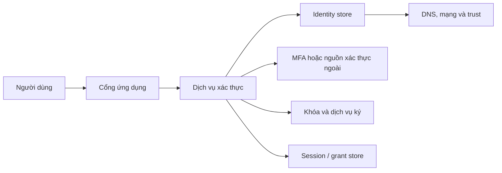

# Identity store availability

## 1. Khả dụng của kho danh tính là khả dụng cho thao tác nào?

Một nền tảng học tập có thể vẫn mở được trang chủ trong khi học viên không đăng nhập được, giảng viên không tải được nhóm quyền và quản trị viên không đình chỉ được tài khoản. Nói “hệ thống vẫn chạy” chưa mô tả đúng tình trạng IAM.

**Identity store availability** là khả năng cung cấp dữ liệu và thao tác liên quan đến danh tính khi hệ thống cần, trong thời gian và với các điều kiện đúng đắn đã xác định.

Một kho danh tính trả lời nhanh nhưng trả quyền đã bị thu hồi từ lâu không đáp ứng yêu cầu của một hành động cần quyền hiện hành. Ngược lại, một lần từ chối mật khẩu sai đúng chính sách không phải sự cố khả dụng chỉ vì người dùng không đăng nhập thành công.

Trong bài này, identity store có thể là directory, database tài khoản hoặc dịch vụ cung cấp trạng thái danh tính. Không giả định mọi kho đều có cùng giao thức, mô hình replication hoặc cơ chế failover.

Mục tiêu là thiết kế khả dụng có phạm vi: biết đường nào cần dữ liệu hiện hành, đường nào có thể tiếp tục bằng bằng chứng còn hiệu lực, khi nào phải dừng và làm sao khôi phục mà không làm sống lại quyền đã thu hồi.

## 2. Phân biệt những dữ liệu thường bị gọi chung là identity store

| Loại dữ liệu | Ví dụ | Hậu quả khi không truy cập được |
| --- | --- | --- |
| Hồ sơ | Tên hiển thị, ngôn ngữ | Có thể hiển thị nhãn dự phòng hoặc dữ liệu đã cache theo chính sách |
| Liên kết danh tính | Mapping issuer/subject về tài khoản nội bộ | Có thể không nhận diện được đúng tài khoản đăng nhập |
| Credential và trạng thái xác thực | Dữ liệu verifier hoặc binding authenticator | Không hoàn thành được một số luồng xác thực |
| Trạng thái tài khoản | Active, disabled, deleted | Không biết yêu cầu hiện tại còn được phép tiếp tục không |
| Membership và quyền | Tenant, nhóm, role, căn cứ cấp quyền | Không đánh giá được hoặc chỉ có dữ liệu cũ để đánh giá |
| Phiên và thu hồi | Session, grant, mốc vô hiệu hóa | Có thể không xác minh được hiệu lực hiện tại |
| Bằng chứng và assurance | Kết quả proofing, ngữ cảnh xác thực | Không đủ căn cứ cho hành động có yêu cầu riêng |

Những dữ liệu này có thể ở nhiều thành phần khác nhau. Bổ sung một replica cho database user không tự làm dịch vụ MFA, DNS, kho khóa ký hay session store sẵn sàng.

Cũng cần phân biệt kho danh tính với nguồn có thẩm quyền. HR có thể tạm dừng mà user store vẫn phục vụ đăng nhập; điều còn thiếu là cập nhật nhân sự mới. Nhưng nếu một nguồn bắt buộc phải được hỏi ở mỗi lần đăng nhập, sự cố của nó nằm trực tiếp trên đường phục vụ người dùng.

Không gọi mọi dữ liệu cũ là “cache vô hại”. Tên hiển thị cũ và trạng thái đình chỉ cũ có hậu quả khác nhau.

## 3. Đo khả dụng theo hành vi người dùng và kết quả đúng

### 3.1. SLI, SLO và độ trễ

SLI là chỉ báo định lượng mức dịch vụ; SLO là mục tiêu cho chỉ báo đó. Availability thường được đo từ các request hợp lệ được xử lý đúng, còn latency cho biết thời gian đáp ứng. [Google SRE — Service Level Objectives](https://sre.google/sre-book/service-level-objectives/).

Đối với IAM, nên định nghĩa rõ thao tác và thế nào là một kết quả tốt. Ví dụ minh họa:

```text
Thao tác:
  kiểm tra trạng thái tài khoản cho một request hợp lệ.

Kết quả tốt:
  trả kết luận đúng theo hợp đồng dữ liệu trong ngân sách thời gian.

Kết quả hợp lệ:
  tài khoản đang hoạt động;
  tài khoản bị đình chỉ;
  không tồn tại, nếu nguồn xác nhận có thẩm quyền.

Lỗi dịch vụ:
  timeout, lỗi nội bộ hoặc không xác định được kết quả cần thiết.
```

Một kết luận `DISABLED` đúng vẫn có thể là thao tác kiểm tra thành công. Một response HTTP 200 nhưng không có kết luận đáng tin không nên được tính như đã phục vụ đúng.

### 3.2. Tách các đường phục vụ

Các SLI hữu ích có thể gồm:

- Độ trễ và tỷ lệ lỗi của đăng nhập mới.
- Độ trễ tra cứu mapping danh tính.
- Khả năng kiểm tra phiên hiện có.
- Khả năng ghi hoặc đọc trạng thái thu hồi.
- Khả năng cập nhật membership.
- Độ trễ từ lúc gỡ quyền đến lúc quyền hết tác dụng.
- Khả năng thực hiện thao tác quản trị khẩn cấp.

Không lấy tỷ lệ đọc hồ sơ thành công để che việc mọi request đăng nhập đang timeout. Cũng không loại các request bị load shedding khỏi số liệu chỉ để availability trông đẹp hơn nếu người dùng hợp lệ thực sự không được phục vụ.

### 3.3. Error budget phải có đơn vị

Một SLO minh họa là 99,9% trong cửa sổ 30 ngày. Nếu tính theo thời gian, phần không khả dụng tương ứng 0,1% × 30 ngày, tức 43,2 phút.

Nếu SLI tính theo request, error budget là số request lỗi được phép trong tổng request đủ điều kiện, không tự chuyển thành cùng một số phút. Một đợt lỗi ngắn ở giờ cao điểm có thể tiêu tốn nhiều request hơn một đợt dài lúc ít tải.

Các con số ở đây dùng để minh họa cách tính, không phải mục tiêu bắt buộc cho mọi hệ thống IAM.

Ngoài tỷ lệ và độ trễ, cần giữ các chỉ báo tính đúng đắn, độ mới và thu hồi. “Không có outage” không phải kết luận phù hợp nếu hệ thống vẫn cho user đã bị đình chỉ tiếp tục có quyền ngoài giới hạn cam kết.

## 4. Vẽ dependency thực sự trước khi thêm máy chủ

Một luồng đăng nhập có thể phụ thuộc vào:



Đây là sơ đồ logic. Những dependency dùng chung như secret manager, nguồn thời gian hoặc hạ tầng lưu trữ cũng cần được xét theo triển khai.

Hai instance identity service cùng truy cập một database, một endpoint DNS và một credential bị rotation sai vẫn có thể lỗi đồng thời. Số lượng process không thể hiện hết khả năng chịu lỗi.

Nếu một đường yêu cầu mọi dependency cùng thành công, availability đầu cuối phụ thuộc toàn chuỗi. Trong mô hình đơn giản với các thành phần độc lập và cùng cửa sổ đo, có thể ước lượng bằng tích các xác suất thành công. Điều kiện độc lập hiếm khi đúng hoàn toàn khi các thành phần chung mạng, vùng lỗi hoặc cấu hình.

Không dùng công thức lý tưởng để kết luận chắc chắn kiến trúc đã đạt SLO. Cần đo đường phục vụ và kiểm tra các lỗi có nguyên nhân chung.

Các câu hỏi cần trả lời gồm: lỗi nào làm mất toàn bộ tenant, lỗi nào chỉ ảnh hưởng một vùng, thành phần nào được dùng chung, và đường quản trị có phụ thuộc đúng thành phần mà nó cần sửa không?

## 5. Những dạng lỗi thường gặp

| Dạng lỗi | Ví dụ trong hệ thống danh tính |
| --- | --- |
| Lỗi process hoặc node | Dịch vụ bị dừng, cạn bộ nhớ |
| Lỗi vùng hoặc mạng | Instance còn chạy nhưng client không tới được |
| Quá tải | Pool kết nối, CPU hoặc hàng đợi bị chiếm hết |
| Cấu hình | Base DN sai, endpoint sai, schema mapping không tương thích |
| Trust và secret | Chứng thư hết hạn, truststore thiếu, service credential đổi chưa đồng bộ |
| Dữ liệu hoặc index | Truy vấn chậm, index hỏng, migration gây khóa kéo dài |
| Replication | Replica còn trả trạng thái cũ hoặc không theo kịp nguồn ghi |
| Dependency | DNS, KMS, session store hoặc MFA không sẵn sàng |
| Triển khai lỗi | Mọi node cùng nhận một phiên bản có lỗi |
| Tác động độc hại | Dò credential, truy vấn tốn tài nguyên hoặc phá dữ liệu |

Một readiness endpoint chỉ trả “process còn sống” không chứng minh luồng danh tính hoạt động. Ngược lại, nếu mọi pod đều tự báo không ready chỉ vì một dependency dùng chung lỗi, hệ thống có thể mất luôn những chức năng còn có thể phục vụ.

Cần thiết kế health check theo vai trò của instance và khả năng phục vụ. Liveness chủ yếu giúp nhận biết process cần khởi động lại; readiness giúp quyết định instance có nhận loại tải phù hợp không. Không làm probe nặng đến mức chính nó gây thêm tải cho store.

Một probe đăng nhập thử bằng tài khoản riêng có thể đo đường thực, nhưng phải giới hạn tần suất, bảo vệ secret và tránh tạo tác dụng phụ như khóa tài khoản hoặc gửi MFA liên tục.

## 6. Replication, failover và trạng thái danh tính

### 6.1. Nhiều bản sao không tự bảo đảm dữ liệu mới

Replication giúp duy trì bản sao nhưng các chế độ có đánh đổi về độ trễ, khả năng mất dữ liệu và thời điểm đọc được thay đổi.

Ví dụ, tài liệu PostgreSQL mô tả cửa sổ mất dữ liệu của log shipping bất đồng bộ khi primary hỏng trước khi dữ liệu được truyền đi. Không suy ra mọi standby đã có mọi commit của primary. [PostgreSQL — Log-Shipping Standby Servers](https://www.postgresql.org/docs/current/warm-standby.html).

Trong IAM, một thay đổi chưa đến replica có thể là:

```text
Tài khoản đã bị đình chỉ.
Một session đã bị thu hồi.
Credential đã được thay.
Một group đặc quyền đã bị gỡ.
```

Việc một replica trả lời được không đủ để chọn nó cho hành động yêu cầu trạng thái hiện hành.

### 6.2. Tách khả dụng đọc và khả dụng ghi

Một topology có thể tiếp tục đọc khi nguồn ghi lỗi nhưng chưa thể ghi thay đổi. Khi đó:

- Hiển thị một số hồ sơ có thể tiếp tục.
- Cấp tài khoản mới có thể phải chờ hoặc thất bại rõ ràng.
- Đổi credential không được báo thành công nếu chưa ghi bền theo hợp đồng.
- Gỡ quyền cần một điểm thực thi có hiệu lực, không chỉ ghi vào hàng đợi.
- Các request cần xác nhận trạng thái mới nhất có thể phải dừng.

Không biến response “đã nhận yêu cầu” thành “quyền đã bị thu hồi”. Nếu thao tác bất đồng bộ, cần trạng thái và tiêu chí hoàn tất có thể kiểm chứng.

### 6.3. Failover cần kiểm soát quyền ghi

Sau khi nghi primary lỗi, không tự cho mọi replica nhận ghi độc lập. Nếu hai phía cùng nhận thay đổi mà không có cơ chế phù hợp, trạng thái có thể phân kỳ: một phía khóa tài khoản, phía khác tiếp tục cấp credential hoặc quyền.

Cơ chế bầu chọn, fencing và quản lý writer phụ thuộc sản phẩm. Cần đảm bảo writer cũ không tiếp tục được coi là có thẩm quyền sau khi writer mới được đưa vào phục vụ.

Cấu hình quorum hoặc số lượng node không tự chứng minh linearizability cho mọi loại thao tác. Phải hiểu hợp đồng của giao thức, dữ liệu được đọc và chính sách xử lý partition.

### 6.4. Chuyển vùng vẫn phải đúng miền tin cậy

Một vùng dự phòng cần có dữ liệu, khóa, cấu hình tenant, trust và chính sách phù hợp. Chuyển sang endpoint bất kỳ trả lời nhanh hơn có thể làm sai nguồn danh tính.

Không failover một user chưa tìm thấy sang một directory khác rồi nhận người cùng email hoặc username như cùng tài khoản. Mapping vẫn cần namespace và định danh ổn định của nguồn.

## 7. RTO, RPO và khả năng khôi phục

| Khái niệm | Câu hỏi |
| --- | --- |
| RTO — Recovery Time Objective | Cần khôi phục chức năng trong khoảng thời gian mục tiêu nào? |
| RPO — Recovery Point Objective | Mức mất dữ liệu tối đa chấp nhận được tính theo thời điểm khôi phục là bao nhiêu? |
| High availability | Khi một số thành phần lỗi, chức năng có thể tiếp tục theo hợp đồng nào? |
| Disaster recovery | Khi môi trường hoặc dữ liệu gặp sự cố lớn, hệ thống được phục hồi ra sao? |
| Durability | Dữ liệu đã được chấp nhận có được giữ bền theo cam kết không? |

Replication không thay thế backup. Xóa nhầm hoặc ghi sai có thể được nhân bản sang mọi replica. Backup cũng không tự thay thế HA nếu việc restore mất nhiều thời gian hơn mục tiêu gián đoạn cho phép.

Một kế hoạch phục hồi identity store cần xét cả dữ liệu bảo mật: mapping, trạng thái đình chỉ, credential, session hoặc mốc thu hồi, khóa mã hóa cần để đọc dữ liệu và các phiên bản cấu hình liên quan.

Đặc biệt, restore snapshot cũ có thể làm sống lại trạng thái `ACTIVE`, membership hoặc credential đã bị thu hồi sau snapshot. Khôi phục dữ liệu cần đi cùng đối soát các thay đổi bảo mật và quyết định về phiên, không chỉ làm dịch vụ database mở cổng trở lại.

Thử nghiệm restore phải xác nhận dữ liệu dùng được, quyền truy cập phù hợp và các thành phần phụ thuộc hoạt động; một file backup tồn tại chưa chứng minh RTO hoặc RPO đã đạt.

## 8. Timeout, deadline và retry không làm tăng tải vô hạn

Một identity store chậm có thể giữ nhiều thread và connection của dịch vụ gọi. Khi client retry đồng loạt, tải mới chồng lên tải chưa hoàn tất.

Timeout, backoff, jitter và tính an toàn khi retry cần được thiết kế cùng nhau; lỗi hoặc timeout không chứng minh thao tác trước chưa có tác dụng. [Amazon Builders’ Library — Timeouts, retries, and backoff with jitter](https://aws.amazon.com/builders-library/timeouts-retries-and-backoff-with-jitter/).

Một ngân sách minh họa:

```text
Deadline của request đăng nhập: 2 giây.

Bên trong:
  có ngân sách cho kết nối, TLS và đọc phản hồi;
  còn thời gian cho xử lý ứng dụng;
  retry, nếu được phép, phải nằm trong deadline còn lại.
```

Đặt timeout 2 giây ở cả ba tầng rồi mỗi tầng retry nhiều lần không bảo đảm request kết thúc trong 2 giây.

Cần phân loại thao tác:

| Thao tác | Điều cần xét trước retry |
| --- | --- |
| Đọc hồ sơ | Có thể đọc lặp, nhưng vẫn có tải và yêu cầu độ mới |
| Kiểm tra password | Có thể tác động bộ đếm thất bại hoặc chống dò |
| Xác minh OTP dùng một lần | Kết quả có thể đã bị tiêu thụ |
| Đổi password | Timeout có thể xảy ra sau khi thay đổi đã được áp dụng |
| Thêm group hoặc cấp quyền | Cần cơ chế xử lý lặp và trạng thái hiện hành |
| Refresh token có rotation | Request đầu có thể đã làm token cũ không còn dùng được |

Không retry credential bị kết luận sai như một lỗi mạng. Không để frontend, gateway, service và SDK mỗi nơi tự retry mà không có ngân sách chung.

Các con số thời gian cần được chọn từ yêu cầu đường phục vụ và số liệu thực tế. Không sao chép một timeout mẫu rồi coi nó phù hợp với mọi directory, địa điểm và cơ chế xác thực.

## 9. Cô lập lỗi và kiểm soát quá tải

Một store đang chậm không nên được phép chiếm hết tài nguyên của mọi chức năng trong ứng dụng.

Những cơ chế có thể dùng gồm:

- Pool kết nối có giới hạn và thời gian chờ rõ ràng.
- Giới hạn request đồng thời vào một dependency.
- Hàng đợi có kích thước và deadline, tránh nhận nhiều việc hơn khả năng phục vụ.
- Quota theo tenant hoặc nhóm client để một nguồn tải không làm mọi tenant mất dịch vụ.
- Circuit breaker để tạm ngừng các lời gọi có xác suất thất bại cao khi dependency đang có sự cố.
- Tách tải tương tác khỏi tác vụ batch hoặc đồng bộ lớn.
- Giảm tải những việc không thiết yếu theo chính sách được xác định trước.

Xử lý quá tải có thể bao gồm phục vụ chức năng giảm bớt hoặc từ chối một phần tải để bảo vệ hệ thống. [Google SRE — Handling Overload](https://sre.google/sre-book/handling-overload/).

Đối với IAM, “giảm bớt” không có nghĩa bỏ kiểm tra authorization hoặc MFA. Có thể tạm dừng đồng bộ ảnh đại diện, nhưng không vì store chậm mà cho phép cấp đặc quyền không có căn cứ.

Circuit breaker mở chỉ cho biết đường gọi đang được bảo vệ khỏi tải tiếp. Nó không chứng minh tài khoản hoạt động, user có quyền hoặc dependency chắc chắn đã chết. Tầng quyết định vẫn phải chọn kết quả đúng cho từng thao tác.

Khi dependency phục hồi, không dồn toàn bộ backlog và retry vào cùng lúc. Cần giới hạn tốc độ phục hồi, thử một phần tải và theo dõi độ trễ, pool và hàng đợi.

Cũng cần giữ năng lực cho quản trị và thu hồi khẩn cấp. Nếu tác vụ xuất danh sách toàn bộ user dùng hết connection của mọi đường gọi, hệ thống có thể không còn tài nguyên để đình chỉ một tài khoản đang bị chiếm quyền.

## 10. Chế độ suy giảm có kiểm soát

### 10.1. Phân biệt thiếu dữ liệu với một kết luận phủ định

```text
Nguồn xác nhận:
  tài khoản bị đình chỉ.

Nguồn không phản hồi:
  chưa có kết luận mới từ nguồn.

Nguồn xác nhận:
  không có tài khoản trong phạm vi có thẩm quyền.
```

Ba trường hợp không được gộp thành một giá trị `null` rồi fallback giống nhau. Nếu nguồn hiện hành đã xác nhận `DISABLED`, không dùng cache `ACTIVE` để đảo ngược kết luận.

Một kết quả không tìm thấy cũng cần đúng ngữ nghĩa của adapter. Search directory thiếu quyền nhìn thấy hoặc bị giới hạn không phải một kết luận “không tồn tại” có thẩm quyền.

### 10.2. Ma trận theo hành động

| Hành động | Hành vi minh họa khi nguồn bắt buộc đang lỗi |
| --- | --- |
| Hiển thị tên trên trang đang mở | Dùng nhãn dự phòng hoặc cache hồ sơ theo quyền xem |
| Đọc một chức năng đã có phiên | Chỉ tiếp tục nếu bằng chứng và chính sách cho phép trạng thái hiện có |
| Đăng nhập mới cần verifier ở nguồn | Trả lỗi tạm thời khi chưa xác thực được |
| Step-up bắt buộc | Không coi outage là đã hoàn thành step-up |
| Đổi credential hoặc kênh recovery | Không ghi nhận thành công khi điều kiện và kết quả chưa xác định |
| Cấp quyền quản trị | Không mặc định cho phép vì không đọc được policy hoặc trạng thái |
| Thu hồi quyền | Ghi nhận đúng phần đã thực hiện và phần chưa có hiệu lực; áp dụng xử lý khẩn đã thiết kế |

Ma trận là ví dụ ra quyết định, không phải một chính sách chung buộc mọi ứng dụng phải chấp nhận cùng mức stale data.

### 10.3. Snapshot được chấp nhận phải có phạm vi

Một snapshot dùng cho quyết định truy cập có thể cần:

```text
subject, tenant và context liên quan
kết luận về trạng thái hoặc quyền cụ thể
nguồn và phiên bản dữ liệu
mốc xác nhận có ý nghĩa về độ mới
phiên bản chính sách
hạn sử dụng và điều kiện thu hồi
```

Không lấy cache hồ sơ rồi suy ra user có mọi quyền trước đây. Không dùng cache của tenant A cho tenant B.

Đặc biệt, `cachedAt` mới không có nghĩa dữ liệu nguồn mới. Copy một bản stale giữa hai tầng cache không được đặt lại tuổi bằng chứng. Độ trễ replica và độ trễ đồng bộ phải được tính vào yêu cầu độ mới theo hợp đồng.

### 10.4. Giữ đúng giới hạn của phiên

Một phiên đang hợp lệ có thể giúp ứng dụng tiếp tục một số tương tác mà không xác thực lại ở mỗi request, nhưng vẫn có điều kiện kết thúc và tái xác thực. [NIST SP 800-63B-4 — Session Management](https://pages.nist.gov/800-63-4/sp800-63b/session/).

Không tự kéo dài hạn phiên hoặc token chỉ vì identity store đang lỗi. Khi phiên đã đến thời điểm cần tái xác thực, khả năng đọc một cache quyền cũ không thay yêu cầu tái xác thực.

Nếu hành động đòi thu hồi có hiệu lực tức thời hoặc trạng thái hiện hành không được phép stale, chế độ cache minh họa dưới đây không phù hợp. Chức năng ấy phải dùng đường kiểm tra đáp ứng yêu cầu hoặc dừng khi không có đủ căn cứ.

## 11. Java: quyết định đọc với snapshot có giới hạn

Ví dụ dùng Java 17 trở lên và thư viện chuẩn. Chính sách giả định cho phép route `GET /me/progress` dùng snapshot được xác nhận tối đa 120 giây trước, khi nguồn tạm không truy cập được.

Đây là lựa chọn có chủ đích của ví dụ, không phải mặc định an toàn cho mọi dữ liệu. Việc chấp nhận cửa sổ này phải được xác định trước; nó có nghĩa thay đổi chưa được nhận biết trong cửa sổ có thể chưa tác động tới quyết định.

Các tiền điều kiện:

- `SessionEvidence` được server tạo từ phiên đã xác minh; client không được tự gửi `verified = true`.
- `StateSnapshot` đến từ đường dữ liệu có thẩm quyền hoặc cache được bảo vệ.
- `observedAt` giữ mốc xác nhận đúng nghĩa, không bị đặt lại khi sao chép cache.
- Quyền `mayReadOwnProgress` chỉ nói về chức năng đọc dữ liệu của chính actor trong tenant đó.
- Truy vấn tài nguyên sau quyết định vẫn dùng subject và tenant của server, không lấy owner tùy ý từ client.

```java
import java.time.Duration;
import java.time.Instant;

public final class IdentityStoreAvailabilityDemo {

    enum LookupStatus {
        FOUND, NOT_FOUND, UNAVAILABLE
    }

    enum Decision {
        ALLOW,
        ALLOW_BOUNDED_FALLBACK,
        DENY,
        REAUTHENTICATE,
        TEMPORARILY_UNAVAILABLE
    }

    record SessionEvidence(
            String subjectId,
            String tenantId,
            String sessionId,
            Instant expiresAt,
            Instant reauthenticateBy,
            boolean verified) {
    }

    record StateSnapshot(
            String subjectId,
            String tenantId,
            String sessionId,
            boolean accountActive,
            boolean mayReadOwnProgress,
            Instant observedAt,
            String policyVersion) {
    }

    record LookupResult(LookupStatus status, StateSnapshot snapshot) {
    }

    private static final Duration MAX_STATE_AGE = Duration.ofSeconds(120);

    static Decision decideReadOwnProgress(
            SessionEvidence session,
            LookupResult lookup,
            StateSnapshot cached,
            String currentPolicyVersion,
            Instant now) {

        if (session == null
                || !session.verified()
                || session.subjectId() == null
                || session.tenantId() == null
                || session.sessionId() == null
                || session.expiresAt() == null
                || session.reauthenticateBy() == null
                || !now.isBefore(session.expiresAt())
                || !now.isBefore(session.reauthenticateBy())) {
            return Decision.REAUTHENTICATE;
        }

        if (lookup == null || lookup.status() == null) {
            return Decision.TEMPORARILY_UNAVAILABLE;
        }

        if (lookup.status() == LookupStatus.NOT_FOUND) {
            return Decision.DENY;
        }

        boolean fallback = lookup.status() == LookupStatus.UNAVAILABLE;
        StateSnapshot state = fallback ? cached : lookup.snapshot();

        if (state == null
                || state.observedAt() == null
                || state.observedAt().isAfter(now)
                || currentPolicyVersion == null
                || !currentPolicyVersion.equals(state.policyVersion())) {
            return Decision.TEMPORARILY_UNAVAILABLE;
        }

        if (!session.subjectId().equals(state.subjectId())
                || !session.tenantId().equals(state.tenantId())
                || !session.sessionId().equals(state.sessionId())) {
            return Decision.DENY;
        }

        Duration age = Duration.between(state.observedAt(), now);
        if (age.compareTo(MAX_STATE_AGE) > 0) {
            return Decision.TEMPORARILY_UNAVAILABLE;
        }

        if (!state.accountActive() || !state.mayReadOwnProgress()) {
            return Decision.DENY;
        }

        return fallback
                ? Decision.ALLOW_BOUNDED_FALLBACK
                : Decision.ALLOW;
    }

    public static void main(String[] args) {
        Instant now = Instant.parse("2026-11-26T04:00:00Z");
        String policyVersion = "own-progress-v3";

        SessionEvidence session = new SessionEvidence(
                "S1", "tenant-a", "session-21",
                now.plusSeconds(600),
                now.plusSeconds(300),
                true);

        StateSnapshot fresh = new StateSnapshot(
                "S1", "tenant-a", "session-21",
                true, true, now.minusSeconds(30), policyVersion);
        StateSnapshot stale = new StateSnapshot(
                "S1", "tenant-a", "session-21",
                true, true, now.minusSeconds(121), policyVersion);
        StateSnapshot disabled = new StateSnapshot(
                "S1", "tenant-a", "session-21",
                false, true, now.minusSeconds(5), policyVersion);

        LookupResult online = new LookupResult(
                LookupStatus.FOUND, fresh);
        LookupResult down = new LookupResult(
                LookupStatus.UNAVAILABLE, null);
        LookupResult disabledOnline = new LookupResult(
                LookupStatus.FOUND, disabled);
        LookupResult notFound = new LookupResult(
                LookupStatus.NOT_FOUND, null);

        System.out.println("Online: " + decideReadOwnProgress(
                session, online, fresh, policyVersion, now));
        System.out.println("Down, fresh cache: " + decideReadOwnProgress(
                session, down, fresh, policyVersion, now));
        System.out.println("Down, stale cache: " + decideReadOwnProgress(
                session, down, stale, policyVersion, now));
        System.out.println("Disabled overrides active cache: "
                + decideReadOwnProgress(
                        session, disabledOnline, fresh, policyVersion, now));
        System.out.println("Not found does not use cache: "
                + decideReadOwnProgress(
                        session, notFound, fresh, policyVersion, now));
    }
}
```

Kết quả dự kiến:

```text
Online: ALLOW
Down, fresh cache: ALLOW_BOUNDED_FALLBACK
Down, stale cache: TEMPORARILY_UNAVAILABLE
Disabled overrides active cache: DENY
Not found does not use cache: DENY
```

Chương trình minh họa quyết định của một route đã được định nghĩa, không triển khai client database, xác minh token hoặc cơ chế thu hồi phân tán.

Các điểm cần hiểu:

1. `UNAVAILABLE` khác `NOT_FOUND` và khác một tài khoản đã bị đình chỉ.
2. Một phản hồi nguồn hiện hành không hợp lệ hoặc không đủ dữ liệu không làm code tự quay lại cache tích cực để bỏ qua vấn đề.
3. Độ mới được kiểm tra ở cả nhánh live và cache theo hợp đồng của ví dụ; một response vừa nhận nhưng mang mốc cũ vẫn bị từ chối sử dụng.
4. Code không biết có thay đổi mới nào chưa tới snapshot. Giới hạn tuổi chỉ bảo vệ trong mô hình chấp nhận stale data đã nêu.
5. Hết hạn phiên hoặc tới hạn tái xác thực không được vượt qua bằng cache.
6. Không dùng hàm này cho đổi recovery, cấp role hay thao tác khác chỉ vì chúng có cùng subject.

Nếu chính sách yêu cầu biết chắc tài khoản chưa bị thu hồi tại thời điểm request, phải dùng cơ chế cho phép kiểm tra điều kiện đó. Một snapshot 30 giây tuổi vẫn không chứng minh không có thay đổi trong 30 giây vừa qua.

## 12. Quan sát được cả nguồn và chức năng suy giảm

Một hệ thống có thể phục vụ một số request từ cache trong khi origin đã lỗi. Cần giữ hai góc nhìn:

```text
Khả dụng của chức năng:
  người dùng có thực hiện được thao tác trong hợp đồng không?

Sức khỏe của nguồn:
  store đang phản hồi đúng, đủ mới và trong thời gian yêu cầu không?
```

Nếu chỉ nhìn request thành công ở frontend, sự cố origin có thể bị che cho đến khi cache hết hạn cùng lúc.

Những chỉ báo cần lựa chọn theo hệ thống gồm:

| Nhóm | Ví dụ |
| --- | --- |
| Request | Tỷ lệ lỗi nguồn, timeout, độ trễ p95/p99 |
| Tài nguyên | Connection đang dùng/chờ, thread, CPU, hàng đợi |
| Replication | Lag, writer hiện tại, lỗi áp dụng thay đổi |
| Dữ liệu bảo mật | Độ trễ thu hồi, trạng thái chưa đối soát |
| Cache | Tuổi dữ liệu, tỷ lệ dùng fallback, số quyết định bị chặn vì stale |
| Chế độ suy giảm | Tenant/chức năng bị ảnh hưởng, thời gian duy trì |
| Phục hồi | Backlog, tốc độ xử lý, tỷ lệ lỗi khi đưa tải trở lại |

Tỷ lệ cache hit cao không chứng minh trạng thái bảo mật còn mới. HTTP response 2xx từ một endpoint health cũng không phản ánh toàn bộ luồng đăng nhập.

Có thể kết hợp kiểm tra từ bên ngoài đường phục vụ với telemetry nội bộ. Synthetic request cần có tài khoản và dữ liệu riêng, giới hạn tải và tránh kích hoạt tác vụ nhạy cảm không cần thiết.

Cảnh báo cần gắn với tác động và thời gian tiêu tốn error budget; đồng thời phải có cảnh báo riêng cho vi phạm tính đúng đắn như thu hồi quyền quá chậm. Không đợi tỷ lệ lỗi cao mới quan tâm đến việc một replica đang trả quyền cũ.

Log và trace có thể ghi nguồn, loại thao tác, nhóm kết quả, correlation ID, policy version và trạng thái dùng fallback. Không ghi password, token dùng được hoặc toàn bộ hồ sơ danh tính.

Cũng không đặt subject identifier làm nhãn metric cho mọi request nếu điều đó tạo số lượng series quá lớn hoặc làm lộ dữ liệu không cần thiết. Cần chọn độ chi tiết phù hợp với chẩn đoán và quyền truy cập telemetry.

## 13. Khôi phục dịch vụ theo trạng thái đáng tin cậy

Khi store bắt đầu trả lời trở lại, chưa nên lập tức coi mọi thao tác đã trở về bình thường.

Một trình tự phục hồi minh họa:

1. Xác định thành phần nào đã hỏng và nguồn dữ liệu nào đang có thẩm quyền.
2. Xác nhận endpoint, trust, writer và trạng thái replication.
3. Kiểm tra các thay đổi bảo mật quan trọng trong thời gian sự cố.
4. Xác nhận cache, mapping và policy version còn tương thích.
5. Đưa một phần tải trở lại và quan sát lỗi, độ trễ, pool.
6. Xử lý backlog có giới hạn và bỏ qua tác vụ đã bị thay thế theo quy tắc nghiệp vụ.
7. Đối soát các thao tác có kết quả chưa xác định.
8. Chỉ đóng chế độ suy giảm khi các điều kiện hoàn tất đã đạt.

Đối với một request đổi credential đã timeout, cần biết nó có được áp dụng chưa. Không tự ghi lại password cũ hoặc chạy lại lệnh thay đổi bằng snapshot trước sự cố để làm hệ thống “đồng nhất”.

Một tác vụ cấp group đã nằm trong hàng đợi từ trước không được thực thi nếu tài khoản nay đã bị đình chỉ và chính sách hiện hành không còn cho phép. Phục hồi backlog phải hiểu trạng thái và phiên bản hiện tại.

Nếu phát hiện khôi phục từ bản sao cũ, cần xem lại session, grant và các marker thu hồi liên quan. Khôi phục được bảng user nhưng thiếu dữ liệu kiểm soát phiên có thể làm đường phục vụ hoạt động với trạng thái không đúng.

Rollback deployment cũng cần tương thích dữ liệu. Không mặc định binary cũ có thể đọc mọi schema sau migration, hoặc rollback cấu hình sẽ tự hoàn tác những cập nhật danh tính đã thực hiện.

## 14. Đường quản trị khẩn cấp và break-glass

Nếu quyền quản trị hệ thống identity chỉ có thể được cấp qua chính store đang lỗi, đội vận hành có thể mất khả năng phục hồi. Kiến trúc cần xem xét dependency của đường quản trị, không chỉ của user thường.

Một cơ chế emergency access có thể được chuẩn bị trước với:

- Danh tính và phạm vi quản trị chuyên biệt, được bảo vệ phù hợp.
- Giới hạn người được sử dụng và điều kiện kích hoạt.
- Credential hoặc bằng chứng không phụ thuộc hoàn toàn vào thành phần cần sửa, nếu mô hình rủi ro cho phép.
- Ghi nhận actor, thời gian, lý do và hành động.
- Thời hạn, phê duyệt và đối soát sau sử dụng theo chính sách.
- Kiểm tra định kỳ để biết cơ chế vẫn dùng được khi cần.

Đường này cần có quyền vừa đủ để phục hồi và cần bảo vệ khỏi bị dùng như đăng nhập quản trị thông thường. Không tạo một fallback vô điều kiện cho mọi user khi directory không trả lời.

Không đưa password admin dùng chung vào ứng dụng rồi thử nó khi xác thực nguồn lỗi. Cách đó làm thay đổi hoàn toàn mô hình quyền kiểm soát tài khoản và biến outage thành điều kiện mở một đường truy cập mạnh.

Nếu tổ chức chưa có cơ chế emergency access được chuẩn bị và phê duyệt, xử lý sự cố cần theo đường vận hành có thẩm quyền hiện hành. Một handler bắt exception trong code không phải nơi tự cấp quyền khẩn cấp.

## 15. Ví dụ xuyên suốt: identity store lỗi trong giờ học

Giả sử nền tảng đã xác định trước:

```text
Nội dung công khai:
  không cần tra cứu identity store theo từng lần đọc.

Route đọc tiến độ của chính mình:
  cần phiên còn hợp lệ;
  có thể dùng snapshot đủ điều kiện tối đa 120 giây.

Đăng nhập mới:
  cần hoàn tất xác thực với nguồn được cấu hình.

Đổi recovery hoặc cấp đặc quyền:
  cần các kiểm tra hiện hành và xác thực tương ứng;
  không dùng fallback đọc tiến độ.
```

Timeline minh họa, các mốc dùng cùng một múi giờ:

| Thời điểm | Sự kiện | Kết quả theo chính sách ví dụ |
| --- | --- | --- |
| 08:59:30 | Xác nhận snapshot đủ điều kiện cho S1 | Lưu mốc và scope, giữ nguyên tuổi khi copy cache |
| 09:00:00 | Origin bắt đầu timeout | Mở xử lý sự cố và giới hạn tải dependency |
| 09:00:30 | S1 đọc tiến độ bằng phiên còn hợp lệ | Có thể dùng snapshot 60 giây tuổi nếu mọi điều kiện khác đạt |
| 09:00:40 | S1 muốn đổi recovery | Không dùng quyền fallback của route đọc để cho phép thay đổi |
| 09:01:31 | S1 tiếp tục đọc, chưa có snapshot mới | Snapshot 121 giây tuổi không còn đáp ứng giới hạn |
| 09:02:00 | Origin phục hồi và xác nhận S1 bị đình chỉ | Không dùng cache ACTIVE cũ để tiếp tục cho phép |
| Sau phục hồi | Xử lý các request và tác vụ còn chờ | Kiểm tra trạng thái hiện tại, không tự thực hiện mọi việc cũ |

Người chưa đăng nhập có thể vẫn xem nội dung công khai, trong khi đăng nhập mới tạm không hoàn tất. Người có phiên hợp lệ cũng không được kéo dài phiên vượt hạn hoặc dùng nó cho tác vụ cần step-up chưa thực hiện.

Ví dụ cho thấy khả dụng có thể khác nhau theo chức năng. Việc công bố rõ trạng thái giúp người dùng hiểu thao tác nào tạm bị ảnh hưởng mà không nhận thông báo sai như “mật khẩu không đúng” cho lỗi nguồn.

## 16. Kiểm chứng khả năng chịu lỗi

Thiết kế HA cần được kiểm chứng trong môi trường và phạm vi được phép. Những tình huống dưới đây là kế hoạch thử nghiệm minh họa, không phải thao tác đã chạy.

| Tình huống thử | Điều cần quan sát |
| --- | --- |
| Một node dừng | Đường phục vụ có chuyển tiếp đúng và giữ đủ năng lực không? |
| DNS hoặc routing lỗi | Các instance có thật sự độc lập hay cùng mất nguồn? |
| Store phản hồi rất chậm | Deadline, pool và hàng đợi có giữ được giới hạn không? |
| Tải login tăng mạnh | Có cô lập tenant và giữ đường quản trị cần thiết không? |
| Replica stale | Hành động yêu cầu dữ liệu mới có bị chặn đúng không? |
| Gỡ quyền trong lúc partition | Cửa sổ hiệu lực cũ có nằm trong chính sách không? |
| Rotation credential/chứng thư | Các đường phục vụ có chuyển đổi được và phát hiện trust lỗi không? |
| Backup restore | Mapping, trạng thái và dữ liệu thu hồi có được phục hồi đúng không? |
| Origin trở lại | Retry và backlog có gây quá tải lần hai không? |
| Kết quả ghi không xác định | Hệ thống có đối soát trước khi retry hoặc báo thành công không? |

Thử “node chết” chưa đủ nếu nguyên nhân thực tế có thể là cấu hình sai đồng loạt, thiếu trust anchor hoặc dữ liệu bị ghi nhầm. Cần bao phủ lỗi logic và lỗi dữ liệu bên cạnh lỗi máy chủ.

Tiêu chí đạt nên là hành vi cụ thể: kết thúc trong deadline, không vượt quyền, không làm sống lại credential cũ, phục hồi đúng dữ liệu và đạt mục tiêu đã định. Việc dashboard trở lại màu xanh là một tín hiệu, chưa thay bằng chứng của các đường phục vụ.

## 17. Tình huống tự luyện

### Tình huống A: database user có ba replica nhưng login vẫn lỗi

Nguồn MFA dùng chung không phản hồi.

**Kết quả mong muốn:** phân tích toàn bộ dependency của đăng nhập. Ba replica không khắc phục một thành phần bắt buộc khác trên đường xác thực; không coi MFA lỗi là đã vượt qua yếu tố đó.

### Tình huống B: cache còn ACTIVE, nguồn trả DISABLED

Một request live xác nhận tài khoản đã bị đình chỉ, trong khi cache 20 giây tuổi còn ghi active.

**Kết quả mong muốn:** tôn trọng kết luận hiện hành. Không dùng fallback để làm ngược một kết quả phủ định đã được xác nhận.

### Tình huống C: cache còn hạn nhưng phiên hết hạn

Snapshot quyền mới được lấy, session đã đến hạn phải tái xác thực và nguồn đang lỗi.

**Kết quả mong muốn:** cache không kéo dài session. Chuyển sang yêu cầu xác thực phù hợp hoặc báo chức năng tạm không thể tiếp tục theo luồng đã thiết kế.

### Tình huống D: replication làm mất một lệnh thu hồi

Primary hỏng trước khi một thay đổi thu hồi đến bản sao được chọn phục hồi.

**Kết quả mong muốn:** xử lý theo RPO và quy trình đối soát dữ liệu bảo mật. Không tuyên bố tất cả session đã bị thu hồi chỉ vì một primary trước đó từng trả thành công.

### Tình huống E: timeout sau đổi password

Client không biết kết quả cuối cùng của lần đổi credential.

**Kết quả mong muốn:** kiểm tra kết quả bằng cơ chế được thiết kế và giữ ràng buộc của yêu cầu. Không tự retry vô hạn hoặc khôi phục password cũ từ cache.

### Tình huống F: lỗi nguồn bị biến thành user không tồn tại

Adapter trả `null` cho cả timeout và không tìm thấy.

**Kết quả mong muốn:** sửa hợp đồng kết quả để phân biệt không thể kết luận với kết luận phủ định có thẩm quyền. Tầng quyết định không nên bị buộc đoán trạng thái từ một giá trị mơ hồ.

### Tình huống G: service phục hồi nhưng tiếp tục quá tải

Mọi client retry và backlog chạy đồng thời.

**Kết quả mong muốn:** điều tiết tốc độ hồi phục, giới hạn concurrency và xử lý lặp an toàn. Khả năng mở kết nối trở lại không có nghĩa nguồn đủ sức nhận mọi tải bị dồn.

### Tình huống H: snapshot được copy qua nhiều tầng

Mỗi cache mới đặt lại `cachedAt`, khiến dữ liệu cũ trông luôn mới.

**Kết quả mong muốn:** giữ mốc nguồn và ngữ nghĩa freshness xuyên suốt. Mốc lưu cục bộ có thể hữu ích cho vận hành nhưng không được thay mốc của bằng chứng mà policy dùng.

## 18. Những quyết định cần chốt trong thiết kế

Một thiết kế identity store availability cần xác định thao tác nào là thiết yếu, dependency nào bắt buộc, độ trễ nào được chấp nhận và dữ liệu phải mới đến mức nào.

Với từng dạng lỗi, phải biết đường phục vụ tiếp tục bằng căn cứ nào, khi nào trả lỗi tạm thời, khi nào yêu cầu xác thực lại và khi nào từ chối. Fallback chỉ có ý nghĩa khi phạm vi, tuổi dữ liệu và rủi ro của nó đã được định nghĩa.

Khả dụng còn bao gồm khả năng ghi thay đổi bảo mật, thu hồi quyền và phục hồi dữ liệu đúng. Một kho danh tính có nhiều node chỉ là một phần của giải pháp; mục tiêu cuối cùng là duy trì các hành vi IAM cần thiết với dữ liệu và quyền vẫn có căn cứ.
