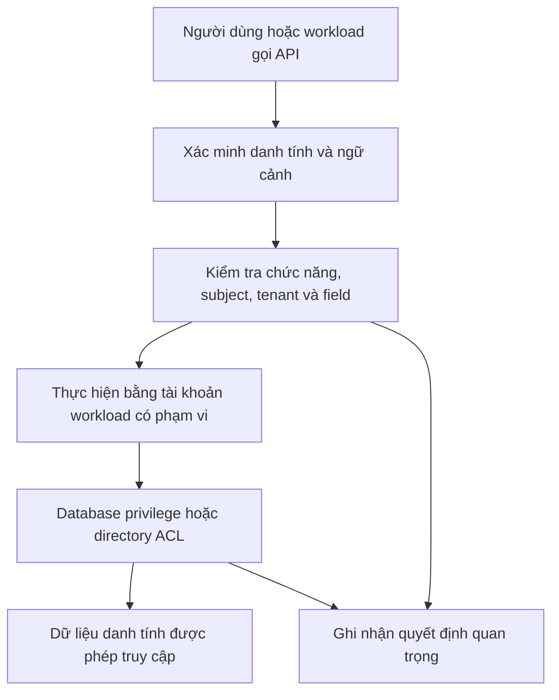

# Identity store access control — Kiểm soát truy cập kho danh tính

## 1. Vì sao kho danh tính cần được bảo vệ riêng?

Một API chỉ cần tên hiển thị để dựng trang hồ sơ. Nếu tài khoản kết nối của API có thể đọc password verifier, đổi liên kết SSO và thêm role quản trị, một lỗi trong API có thể trở thành sự cố kiểm soát tài khoản trên toàn hệ thống.

Kho danh tính chứa cả dữ liệu và các điều kiện làm phát sinh quyền: subject, membership, nhóm, role, trạng thái, phương thức khôi phục và liên kết authenticator. Sửa một field trong kho có thể thay đổi ai được đăng nhập hoặc được làm gì.

**Identity store access control** là việc xác định và thực thi chủ thể nào được thao tác trên phần nào của kho danh tính, bằng thao tác nào và trong điều kiện nào.

Ví dụ:

- Dịch vụ hồ sơ đọc tên hiển thị nhưng không đọc dữ liệu xác minh mật khẩu.
- Người dùng đề nghị sửa email của mình nhưng không tự đặt trạng thái đã xác minh.
- Connector nhân sự cập nhật phòng ban trong tenant được cấp, không sửa role quản trị nền tảng.
- Dịch vụ xác thực dùng dữ liệu verifier theo chức năng của nó nhưng không công bố chúng qua API hồ sơ.
- Người hỗ trợ được đình chỉ một membership theo nhiệm vụ, không mặc định có quyền liên kết lại mọi tài khoản.

Mục tiêu là giới hạn cả việc lộ dữ liệu lẫn khả năng thay đổi quyền kiểm soát tài khoản.

## 2. Diễn đạt một quyết định truy cập

Một chính sách rõ ràng cần ít nhất bốn phần:

```text
Chủ thể gọi
    + thao tác
    + đối tượng và thuộc tính
    + điều kiện hoặc phạm vi
```

Ví dụ cụ thể:

```text
Chủ thể: workload profile-api
Thao tác: đọc
Đối tượng: hồ sơ người dùng trong tenant-a
Thuộc tính: subjectId, displayName
Điều kiện: request đã được phân quyền ở ứng dụng
```

Cần phân biệt hai danh tính: người dùng cuối đang yêu cầu thao tác và workload thực sự kết nối database hoặc directory.

Nếu nhiều người dùng đi qua cùng một service account, kho dữ liệu thường nhìn thấy service account. Nó không tự biết người dùng cuối nào đứng sau mỗi truy vấn.

### 2.1. Kiểm tra ở nhiều mức

| Mức | Câu hỏi | Ví dụ |
| --- | --- | --- |
| Chức năng | Actor có được gọi nghiệp vụ không? | Có quyền đình chỉ membership |
| Bản ghi | Actor được thao tác subject nào? | Chỉ thành viên tenant đang quản lý |
| Thuộc tính | Field nào được đọc hoặc sửa? | Sửa tên nhưng không sửa role |
| Loại thao tác | Được tra cứu, so sánh, tạo, sửa hay xóa? | Được xác minh thông tin mà không xuất dữ liệu thô |
| Ngữ cảnh | Quyền còn hiệu lực trong điều kiện này không? | Phiên hợp lệ, nguồn provisioning đúng phạm vi |
| Quản trị | Actor có được sửa chính sách kiểm soát không? | Không cho ứng dụng tự cấp quyền database |

Một permission rộng như `identity.manage` dễ che mất khác biệt giữa sửa tên, thêm authenticator và chuyển liên kết SSO. Nên tách khi các hành động có rủi ro hoặc trách nhiệm khác nhau.

### 2.2. Danh tính phải đến từ ngữ cảnh tin cậy

Không dùng `actorId`, `tenantId` hoặc `isAdmin` trong body như bằng chứng quyền của người gọi.

Tenant có thể là lựa chọn từ request, nhưng server cần xác minh actor được hoạt động trong tenant đó. Subject đích cũng phải được kiểm tra riêng; biết một UUID không trao quyền đọc bản ghi tương ứng.

MFA là một điều kiện bảo đảm xác thực khi chính sách yêu cầu. Hoàn thành MFA không thay thế permission để sửa dữ liệu của người khác.

## 3. Hai mặt phẳng cần kiểm soát

### 3.1. Mặt phẳng dữ liệu

Đây là các thao tác trên dữ liệu danh tính:

```text
Đọc hồ sơ
Tìm kiếm người dùng
Sửa thuộc tính
Thêm hoặc gỡ membership
Thay trạng thái
Gắn hoặc thu hồi authenticator
Thay liên kết danh tính ngoài
```

Việc xem dữ liệu cũng cần giới hạn. Danh sách email, số điện thoại, nhóm đặc quyền hoặc tài khoản đang bị đình chỉ đều có thể nhạy cảm.

### 3.2. Mặt phẳng quản trị

Đây là các thao tác chi phối ai có thể dùng kho:

```text
Sửa ACL hoặc database privilege
Sửa policy theo hàng
Đổi quyền của service account
Thay mapping connector
Đổi schema
Tạo bản sao lưu hoặc xuất dữ liệu
Thay cấu hình nguồn được tin cậy
```

Một người không có quyền sửa role qua API vẫn có thể tạo đường tăng quyền nếu được sửa ACL hoặc mapping nguồn tùy ý.

Do đó, quyền quản trị kho cần được đánh giá như đặc quyền. Tài khoản chạy ứng dụng không nên đồng thời là tài khoản sở hữu và quản trị toàn bộ cấu trúc kiểm soát.

## 4. Thiết kế ma trận quyền theo nhiệm vụ

Bảng sau là chính sách minh họa cho một ứng dụng nhiều tenant:

| Chủ thể | Được làm | Giới hạn chính |
| --- | --- | --- |
| Người dùng tự phục vụ | Đọc hồ sơ của mình, đề nghị sửa field cho phép | Không tự sửa role, bằng chứng xác minh hoặc liên kết đặc quyền |
| Profile API | Đọc và cập nhật dữ liệu hồ sơ cần thiết | Không có quyền đọc secret hoặc sửa chính sách kho |
| Connector HR | Cập nhật thuộc tính do HR quản lý | Đúng tenant, đúng tập subject và field |
| Dịch vụ xác thực | Dùng dữ liệu xác minh được giao | Không trả verifier hoặc secret qua API công khai |
| Người hỗ trợ tenant | Thao tác hỗ trợ được giao | Không vượt tenant hoặc tự nhận đặc quyền nền tảng |
| Dịch vụ quản trị quyền | Ghi grant theo quy trình | Giữ căn cứ cấp và kiểm tra phạm vi ủy quyền |
| Kiểm toán viên | Đọc bằng chứng được phép | Không có quyền sửa chỉ vì cần quan sát |
| Quản trị kho | Quản lý cấu hình qua kênh đặc quyền | Có kiểm toán, giới hạn thời gian hoặc phê duyệt theo chính sách |

Các ô được phép vẫn cần điều kiện. Người hỗ trợ có quyền khóa tài khoản không mặc định có quyền khôi phục MFA, chuyển email khôi phục hoặc liên kết một IdP mới.

Nguyên tắc cấp ít quyền, mặc định từ chối và kiểm tra quyền nhất quán trên các yêu cầu được trình bày trong [OWASP Authorization Cheat Sheet](https://cheatsheetseries.owasp.org/cheatsheets/Authorization_Cheat_Sheet.html).

### 4.1. Tách quyền đọc và quyền sử dụng bằng chứng

Một verifier có thể cần kiểm tra password hash; người dùng hoặc nhân viên hỗ trợ không cần tải hash đó về máy.

Một dịch vụ xử lý authenticator có thể cần dữ liệu bảo mật chuyên biệt. Nên giới hạn giao diện theo nghiệp vụ, thay vì cho mọi service đọc nguyên bảng credential.

Đối với bí mật cần truy xuất, việc mã hóa lưu trữ không tự giới hạn service đã được cấp quyền giải mã. Quyền dùng khóa và quyền đọc dữ liệu phải được thiết kế cùng nhau.

### 4.2. Không chỉ chặn giá trị trong response

Nếu không cho đọc một field nhưng vẫn cho tìm kiếm hoặc so sánh tùy ý trên nó, người gọi có thể suy ra thông tin qua kết quả.

Ví dụ, không trả một thuộc tính nhạy cảm nhưng cho phép filter không giới hạn theo thuộc tính đó có thể làm lộ ai đáp ứng điều kiện. Cần xem xét cả các đường truy vấn, đếm, xuất và lỗi trả về theo khả năng của nền tảng.

Giới hạn tần suất và phân trang giúp kiểm soát lạm dụng, nhưng không thay thế quyết định người gọi có được tra cứu tập dữ liệu đó hay không.

## 5. Phân quyền ở ứng dụng và ở kho dữ liệu

Một kiến trúc có thể tổ chức như sau:



Lớp ứng dụng biết mục đích nghiệp vụ và người dùng cuối. Lớp kho có thể giới hạn bảng, cột, entry, thuộc tính hoặc hàng theo khả năng được cấu hình.

Nếu API có lỗi, tài khoản kho có phạm vi hẹp giúp giảm hậu quả. Nếu kho chỉ thấy một service account dùng chung, ứng dụng vẫn phải kiểm tra người dùng cuối thay vì mặc định database biết toàn bộ quan hệ nghiệp vụ.

### 5.1. Kiểm tra trước tác dụng phụ

Một thao tác đổi email cần kiểm tra quyền và quy trình xác minh trước khi kích hoạt địa chỉ mới làm kênh khôi phục.

Một thao tác đình chỉ cần bảo đảm actor có quyền trên đúng subject và phạm vi trước khi đổi trạng thái hoặc phát sự kiện thu hồi.

Trả lỗi sau khi dữ liệu đã thay đổi không phải là kiểm soát thành công.

### 5.2. Chỉ nhận field được phép

API sửa hồ sơ không nên ghi nguyên entity từ request:

```json
{
  "displayName": "Linh",
  "status": "ACTIVE",
  "roles": ["platform-admin"],
  "emailVerified": true
}
```

Nếu chức năng chỉ cho sửa tên hiển thị, DTO và câu lệnh cập nhật chỉ nên có field đó. Những field liên quan trạng thái, quyền hoặc bằng chứng cần nghiệp vụ riêng và kiểm tra riêng.

Đối tượng ORM tiện lợi không phải hợp đồng phân quyền. Việc field nằm trong cùng một bảng không có nghĩa chúng thuộc cùng một mức quyền.

## 6. Ví dụ PostgreSQL: quyền cột và phạm vi hàng

Ví dụ sau phục vụ học tập trong một môi trường riêng. Nó tạo một role chỉ đọc các cột hồ sơ cơ bản của tenant A. Role này không phải chủ bảng, superuser hoặc role được bỏ qua RLS.

```sql
CREATE SCHEMA identity;

CREATE TABLE identity.member_profile (
    tenant_id UUID NOT NULL,
    subject_id UUID NOT NULL,
    display_name TEXT NOT NULL,
    status TEXT NOT NULL,
    private_contact TEXT,
    PRIMARY KEY (tenant_id, subject_id)
);

CREATE ROLE iam_tenant_a_reader
    NOLOGIN
    NOSUPERUSER
    NOBYPASSRLS;

REVOKE ALL ON SCHEMA identity FROM PUBLIC;
REVOKE ALL ON TABLE identity.member_profile FROM PUBLIC;

GRANT USAGE ON SCHEMA identity
    TO iam_tenant_a_reader;

GRANT SELECT (tenant_id, subject_id, display_name, status)
    ON identity.member_profile
    TO iam_tenant_a_reader;

ALTER TABLE identity.member_profile
    ENABLE ROW LEVEL SECURITY;

CREATE POLICY tenant_a_profile_read
    ON identity.member_profile
    FOR SELECT
    TO iam_tenant_a_reader
    USING (
        tenant_id = '11111111-1111-4111-8111-111111111111'::UUID
    );
```

PostgreSQL cho phép cấp privilege theo cột; quyền được nhận có thể đến trực tiếp, qua role membership hoặc từ `PUBLIC`. Vì vậy cần xét tổng quyền thực tế. Xem [PostgreSQL — GRANT](https://www.postgresql.org/docs/current/sql-grant.html).

Trong ví dụ:

- Role có quyền dùng schema, không có quyền tạo đối tượng trong schema.
- Role đọc những cột được liệt kê, không được cấp đọc `private_contact`.
- Không được cấp quyền INSERT, UPDATE hoặc DELETE.
- Policy giới hạn hàng đọc thuộc tenant A đã ghi trong điều kiện.

`NOLOGIN` làm role này trở thành role gom quyền, chưa phải một tài khoản đăng nhập dùng được ngay. Việc cấp role cho một login và xác thực workload cần được cấu hình riêng, giữ đúng phạm vi đã thiết kế.

### 6.1. RLS không thay cho privilege thông thường

Role vẫn cần privilege cho thao tác. RLS bổ sung điều kiện theo hàng. Khi RLS được bật mà không có policy cho phép, việc truy cập hàng thông thường theo cơ chế này bị từ chối mặc định. Xem [PostgreSQL — Row Security Policies](https://www.postgresql.org/docs/current/ddl-rowsecurity.html).

Khi kiểm tra ví dụ, dùng danh tính thực sự mang role được giới hạn. Không lấy kết quả của tài khoản quản trị làm bằng chứng role ứng dụng bị giới hạn đúng.

Superuser và role `BYPASSRLS` bỏ qua RLS; chủ bảng thường cũng bỏ qua nếu không áp dụng cơ chế phù hợp như `FORCE ROW LEVEL SECURITY`. Nhiều policy permissive có thể mở rộng tập hàng bằng phép OR. Các đặc tính này được nêu trong [tài liệu RLS](https://www.postgresql.org/docs/current/ddl-rowsecurity.html).

Do đó, cần xem cả chủ sở hữu bảng, membership role và toàn bộ policy liên quan, không chỉ policy vừa thêm.

### 6.2. Phạm vi của ví dụ

Role minh họa được đọc hồ sơ cơ bản của toàn tenant A. Nó không phân biệt từng người dùng cuối trong tenant. Nếu nghiệp vụ chỉ cho mỗi người đọc hồ sơ của mình, cần thêm cơ chế thực thi tương ứng.

Mô hình một role riêng cho mỗi tenant cũng không phải lựa chọn bắt buộc. Có thể có kiến trúc khác, nhưng ngữ cảnh tenant mà policy sử dụng phải được thiết lập từ một ranh giới tin cậy.

Không coi một biến phiên như `app.tenant_id` là bằng chứng membership nếu bên gọi có thể tự đặt nó tùy ý. Một điều kiện RLS dựa trên dữ liệu tự khai vẫn có thể cho kết quả ngoài ý định.

### 6.3. Cần kiểm thử cả cột và hàng

Một bộ thử có thể kiểm tra:

```text
Đọc cột display_name của tenant A:
    được phép theo ví dụ

Đọc cùng cột của tenant B:
    không trả hàng ngoài phạm vi

Đọc private_contact:
    không có privilege cột

Sửa display_name:
    không có privilege cập nhật

Tự sửa policy hoặc cấp thêm quyền:
    không có quyền quản trị tương ứng
```

Không dùng `SELECT *` như truy vấn chuẩn của role giới hạn cột rồi kết luận mọi quyền đọc đều hỏng. Truy vấn cần yêu cầu đúng cột mà chức năng được phép dùng.

Nếu role được thêm một membership rộng hơn về sau, quyền hiệu quả có thể thay đổi. Rà soát quyền phải bao gồm các đường cấp gián tiếp.

## 7. Kiểm soát entry và thuộc tính trong directory

Với directory, chính sách có thể xét subtree, entry, attribute, danh tính kết nối và loại truy cập.

OpenLDAP phân biệt các mức như auth, compare, search, read và write; quyền trên entry và nhánh cha còn liên quan đến tạo, xóa hoặc đổi tên. Cấu trúc rule và cơ chế thực thi phải theo sản phẩm cụ thể. Xem [OpenLDAP — Access Control](https://www.openldap.org/doc/admin26/access-control.html).

Một bản mô tả ý định chính sách:

| Chủ thể kết nối | Đích | Ý định cấp quyền |
| --- | --- | --- |
| Profile API | Hồ sơ trong subtree tenant A | Đọc thuộc tính hồ sơ cần thiết |
| Self-service đã xác thực | Entry đã ánh xạ đúng người gọi | Sửa những field tự phục vụ được cho phép |
| Connector HR tenant A | Entry và thuộc tính HR quản lý | Ghi field thuộc phạm vi nguồn |
| Dịch vụ quản trị nhóm | Nhóm được giao | Sửa membership theo quy trình |
| Người dùng ẩn danh | Dữ liệu hồ sơ thông thường | Không được liệt kê hoặc xuất hồ sơ |
| Quản trị đặc quyền | Cấu hình được giao | Thao tác qua quy trình riêng có kiểm toán |

Đây không phải file ACL có thể nạp trực tiếp. Ý định cần được chuyển thành cấu hình đúng cú pháp và kiểm tra bằng danh tính thật trên nền tảng đang dùng.

### 7.1. Auth không đồng nghĩa đọc secret

Bước xác thực có thể cần một mức truy cập riêng theo cơ chế directory. Không nên mở quyền đọc verifier cho mọi client chỉ vì cần cho phép đăng nhập.

Tương tự, search, compare và read cần được xem xét theo từng loại dữ liệu. Không suy rằng chỉ chặn response của một attribute là đã chặn mọi khả năng khai thác thuộc tính đó.

Các mức quyền có thể mang tính bao hàm trong sản phẩm. Cần đọc ngữ nghĩa thực tế, thay vì giả định “write” luôn chỉ cho sửa mà không mang khả năng đọc nào.

### 7.2. Thứ tự rule và tài khoản đặc quyền

ACL có thể chịu thứ tự xử lý và điều kiện dừng theo nền tảng. Một rule đúng nhưng bị rule rộng hơn chi phối có thể không tạo kết quả như ý định.

Trong OpenLDAP, `rootdn` có quyền đặc biệt vượt ACL thông thường. Không dùng bind dưới danh tính này để chứng minh service account đã được giới hạn. Xem [OpenLDAP — Access Control](https://www.openldap.org/doc/admin26/access-control.html).

Quy tắc tổng quát là kiểm tra quyền hiệu quả bằng đúng danh tính, cách kết nối và cấu hình mà ứng dụng sử dụng.

### 7.3. Schema và ACL không thay thế nhau

Schema trả lời field nào hợp lệ và bắt buộc. ACL trả lời ai được đọc hoặc sửa. Cả hai vẫn chưa đủ để xác định nguồn nào có thẩm quyền khẳng định dữ liệu.

Ví dụ một attribute lưu mã subject được phép theo schema. Nếu người dùng tự sửa nó thành mã của người khác, ứng dụng có thể liên kết sai tài khoản.

Cần bảo vệ những field như mã liên kết, bằng chứng xác minh, nhóm đặc quyền và trạng thái bằng quyền cập nhật cùng nghiệp vụ phù hợp.

## 8. Giới hạn connector và nguồn thuộc tính

Một connector được xác thực không mặc định được ghi mọi dữ liệu danh tính.

Quyền của connector nên được mô tả bằng:

```text
Nguồn kết nối
    + tập subject
    + tenant
    + thuộc tính được quản lý
    + thao tác được phép
    + quy tắc rút lại hoặc xóa
```

Ví dụ connector HR được cập nhật `department` và `employmentStatus` cho nhân viên tenant A. Nó không được đặt `platformAdmin=true`, sửa liên kết đăng nhập hoặc chuyển subject sang tenant B.

### 8.1. Server gán nguồn từ kết nối đã xác minh

Không tin các field `sourceId` hoặc `trusted=true` trong request chỉ vì chúng có tên như metadata nội bộ.

Server cần gắn request với cấu hình connector và áp dụng allowlist field. Dữ liệu ngoài hợp đồng phải được xử lý rõ, không tự nhập vào tập thuộc tính dùng phân quyền.

### 8.2. Membership chứa tham chiếu cũng cần kiểm tra

Cho phép sửa một nhóm trong tenant A chưa đủ nếu connector có thể thêm tùy ý DN hoặc subject của tenant B làm thành viên.

Cần kiểm tra cả đối tượng chứa quan hệ và các chủ thể được tham chiếu. Ràng buộc syntax hoặc foreign key chỉ chứng minh tham chiếu có dạng phù hợp hay tồn tại, không chứng minh actor được tạo quan hệ đó.

### 8.3. Xóa hoặc thu hồi phải giữ đúng căn cứ

Một connector không nên xóa toàn bộ subject chỉ vì bản ghi không xuất hiện trong một phản hồi bị lỗi phân trang.

Thao tác đối soát xóa cần biết nguồn đã gửi snapshot đầy đủ hay chỉ cập nhật từng phần. Quyền xóa hoặc vô hiệu hóa cũng phải có phạm vi, nguồn có thẩm quyền và bằng chứng vận hành tương ứng.

## 9. Bảo vệ các thao tác kiểm soát tài khoản

Các thao tác sau thường cần quyền hoặc điều kiện riêng:

```text
Đổi email dùng khôi phục
Thêm phương thức đăng nhập
Đặt lại MFA
Liên kết hoặc gỡ IdP
Thay role đặc quyền
Kích hoạt lại tài khoản
Chuyển chủ sở hữu workload
Thay người được ủy quyền quản trị
```

Chúng không nên được gom vào quyền sửa hồ sơ thông thường.

Ví dụ, người hỗ trợ có thể được gửi hướng dẫn khôi phục mà không được đặt trực tiếp email của mình làm kênh khôi phục của khách hàng.

Với liên kết IdP, cần xác minh quyền kiểm soát danh tính hiện hữu và danh tính ngoài theo quy trình. Một cặp email trùng không đủ để chuyển liên kết của subject.

Các điều kiện như xác thực lại, MFA, phê duyệt hoặc đặc quyền có thời hạn cần được kiểm tra trước khi commit. Không chỉ ghi chúng vào tài liệu rồi cho API sửa field trực tiếp.

## 10. Thu hồi quyền và các bản sao đang hoạt động

### 10.1. Có nhiều loại quyền cần thu hồi

Khi một nhân viên rời nhóm hỗ trợ, có thể cần xử lý:

- Role ứng dụng của nhân viên.
- Quyền truy cập công cụ quản trị.
- Phiên đăng nhập đang tồn tại.
- Quyền đặc quyền tạm thời.
- Khả năng lấy credential kết nối kho.
- Quyền đã cấp qua nhóm hoặc nguồn liên kết.

Nếu chỉ xóa role trong một bảng nhưng công cụ quản trị vẫn dùng phiên cũ chứa quyền đã sao chép, hiệu lực thực tế có thể chưa thay đổi đúng thời điểm mong muốn.

Tương tự, đổi secret của service account không tự chứng minh mọi kết nối đã mở bằng secret cũ đều kết thúc. Cần kiểm tra hành vi của hệ thống kết nối và thu hồi phiên.

### 10.2. Cache quyền cần có vòng đời

Một cache có thể lưu:

```text
(actorId, tenantId, action, targetScope)
    -> quyết định hoặc dữ liệu quyền
```

Khóa cache chỉ có `actorId` có thể dùng nhầm quyền giữa tenant hoặc chức năng. Nếu quyết định phụ thuộc mục tiêu cụ thể, tập quyền hoặc phiên bản chính sách, cache cần phản ánh các đầu vào đó theo thiết kế.

Cần có giới hạn độ mới, cách vô hiệu hóa và hành vi khi không xác định được quyền hiện hành. Không để một quyết định cho phép tồn tại vô thời hạn chỉ vì nó từng đúng.

### 10.3. Đặt cam kết có thể kiểm chứng

Ví dụ yêu cầu vận hành:

```text
Sau khi thu hồi role hỗ trợ:
    không cho phép tạo thao tác hỗ trợ mới ngoài giới hạn đã công bố
    xử lý các phiên và yêu cầu đang thực thi theo chính sách riêng
```

Đây là mô tả mục tiêu. Muốn biết đã đạt cần kiểm tra tại điểm thực thi, bao gồm API, công cụ quản trị, database hoặc directory và những đường phụ được hỗ trợ.

Việc một màn hình không còn hiện nút quản trị chưa chứng minh các đường gọi trực tiếp đã bị chặn.

## 11. Cập nhật có phân quyền và chống ghi đè

Một kiểm tra quyền đúng ở đầu request vẫn có thể dẫn tới kết quả sai nếu cập nhật dùng dữ liệu đã cũ hoặc ghi quá nhiều field.

Giả sử người hỗ trợ đọc hồ sơ version 7. Trong lúc đó, quy trình bảo mật vô hiệu hóa subject thành version 8. Một biểu mẫu cũ gửi lại toàn bộ hồ sơ và đặt `status=ACTIVE`.

Ngay cả khi người hỗ trợ được sửa tên, họ không nên kích hoạt lại tài khoản thông qua việc ghi đè toàn entity.

Một giả mã cho sửa tên:

```text
Nhận displayName và expectedVersion
Lấy actor từ ngữ cảnh đã xác thực

Kiểm tra quyền gọi chức năng sửa tên
Kiểm tra actor được thao tác targetSubject trong tenant hiện tại
Chỉ cho phép field displayName

Thực hiện cập nhật có điều kiện:
    đúng tenant
    đúng targetSubject
    đúng expectedVersion
    thỏa điều kiện trạng thái của nghiệp vụ

Nếu không cập nhật được:
    xác định lỗi hoặc xung đột phù hợp
    không tự bỏ điều kiện để ghi lại

Ghi nhận thay đổi theo cơ chế giao dịch và audit đã thiết kế
```

### 11.1. Giữ phạm vi trong câu lệnh cuối

Nếu kiểm tra quyền trên subject A nhưng câu lệnh cuối cập nhật subject B do một ID khác trong request, lớp kiểm tra đã không bảo vệ đúng tác dụng phụ.

Nên giữ cùng định danh và ràng buộc phạm vi từ lúc quyết định đến lúc ghi. Khi quyền hoặc trạng thái có thể đổi đồng thời và rủi ro yêu cầu kiểm soát chặt, cần transaction hoặc cơ chế kiểm tra phiên bản phù hợp.

Một truy vấn có `WHERE tenant_id = ...` giúp giữ phạm vi dữ liệu, nhưng giá trị tenant vẫn phải đến từ ngữ cảnh đã được kiểm tra.

### 11.2. Audit và dữ liệu cần tránh lệch nhau

Nếu thay đổi nhạy cảm đã commit nhưng tiến trình dừng trước khi ghi log, có thể mất bằng chứng. Ngược lại, ghi “thành công” trước khi commit có thể tạo bằng chứng sai.

Có thể dùng một bản ghi audit hoặc outbox trong cùng transaction của kho, rồi xử lý phát sự kiện theo thiết kế. Khi có nhiều hệ thống độc lập, cần xác định cách phát hiện và đối soát thiếu sót.

Quyết định `ALLOW` và kết quả cập nhật `SUCCESS` là hai sự kiện có ý nghĩa khác nhau. Một request được phép vẫn có thể thất bại do xung đột dữ liệu.

## 12. Đường truy cập gián tiếp cũng thuộc phạm vi bảo vệ

### 12.1. View, hàm, export và công cụ vận hành

Một service không được đọc bảng gốc vẫn có thể nhìn dữ liệu qua một view, hàm, báo cáo hoặc endpoint export nếu chúng được cấu hình quyền rộng hơn.

Cần lập danh mục những giao diện có khả năng truy cập kho, không chỉ xét một API hoặc một tài khoản database.

Một công cụ hỗ trợ nội bộ cũng phải thực thi quyền theo người sử dụng. Nhãn “nội bộ” không tự chứng minh mọi nhân viên đều được đọc mọi danh tính.

### 12.2. Bản sao lưu và file xuất

Backup có thể chứa dữ liệu mà API chính đã che. Quyền tải backup hoặc tạo bản export rộng có thể tương đương quyền đọc trực tiếp rất nhiều hồ sơ.

Cần quản lý người được xuất, mục đích, phạm vi dữ liệu, nơi lưu và thời hạn tồn tại. File đã xuất không còn chịu nguyên vẹn policy của API nguồn, nên cần biện pháp bảo vệ riêng.

Không dùng dữ liệu danh tính sản xuất không được xử lý phù hợp để dựng môi trường thử nghiệm chỉ vì môi trường đó ít người dùng.

### 12.3. Log và hệ thống quan sát

Log debug chứa nguyên request khôi phục có thể làm lộ token. Log truy vấn chứa đầy đủ field hồ sơ có thể tạo một bản sao nhạy cảm khác.

Cần chọn dữ liệu quan sát vừa đủ để điều tra và giới hạn quyền xem. Một người có quyền quan sát lỗi hệ thống không nhất thiết có nhu cầu xem mọi dữ liệu người dùng.

### 12.4. Tài khoản triển khai

Tài khoản migration có thể cần sửa schema hoặc policy, nhưng không nên là credential cố định mà ứng dụng dùng cho mọi truy vấn.

Quyền triển khai cần có phạm vi và quy trình sử dụng phù hợp. Nếu một pipeline bị sửa để cấp thêm role rộng, việc tách quyền runtime chỉ có giá trị khi đường triển khai cũng được kiểm soát.

## 13. Khi kho hoặc bộ quyết định không khả dụng

Cần tách ba tình huống:

```text
DENY:
    đã xác định actor không có quyền phù hợp

NOT_FOUND:
    đã đọc được kho nhưng không có đối tượng trong phạm vi

UNAVAILABLE:
    chưa xác định được vì lỗi hệ thống hoặc nguồn bắt buộc
```

API có thể hạn chế thông tin trả ra ngoài, nhưng phía server vẫn cần biết nguyên nhân thực để xử lý đúng.

Một lỗi kết nối không nên kích hoạt fallback dùng tài khoản quản trị. Một lỗi policy cũng không nên mặc định cho mọi thao tác ghi tiếp tục.

Với chức năng được phép dùng cache trong sự cố, chính sách cần xác định tuổi dữ liệu, thao tác và phạm vi cụ thể. Ngoại lệ cho đọc tên hiển thị không nên tự mở rộng sang đặt lại MFA hoặc thay liên kết SSO.

### 13.1. Đường truy cập khẩn cấp

Tổ chức có thể cần cơ chế xử lý sự cố khi đường quản trị thông thường hỏng. Cơ chế đó nên có danh tính riêng, phạm vi, bằng chứng sử dụng và quy trình thu hồi sau sự cố.

Không nên để một credential quản trị dùng chung trong cấu hình của mọi service dưới tên “dự phòng”.

Sau khi dùng quyền khẩn cấp, cần đối soát thay đổi và kết thúc quyền tạm. Thời hạn ghi trong yêu cầu chỉ có tác dụng nếu công cụ hoặc quy trình thực sự thực thi.

## 14. Kiểm toán quyền truy cập kho

Một sự kiện minh họa cho thay đổi nhạy cảm:

```json
{
  "actorId": "support-42",
  "workloadId": "support-console",
  "tenantId": "tenant-a",
  "operation": "identity.membership.suspend",
  "targetSubjectId": "usr-1042",
  "changedFields": ["membershipStatus"],
  "authorizationDecision": "ALLOW",
  "operationResult": "SUCCESS",
  "targetVersion": 12,
  "policyVersion": "identity-access-9",
  "correlationId": "request-83d1"
}
```

Đây là schema ứng dụng minh họa. Việc log trường nào cần dựa trên nhu cầu truy vết và mức nhạy cảm của dữ liệu.

Đối với thay đổi quyền, liên kết hoặc authenticator, nên giữ đủ căn cứ để trả lời:

```text
Ai yêu cầu?
Workload nào thực thi?
Đối tượng và phạm vi nào bị tác động?
Quyền hoặc phê duyệt nào cho phép?
Thao tác thật sự đã thành công chưa?
Có thể lần về phiên bản dữ liệu và chính sách nào?
```

Không cần đưa giá trị secret, verifier hoặc token vào log để trả lời những câu hỏi này.

### 14.1. Những dấu hiệu nên theo dõi

| Dấu hiệu | Điều có thể cần kiểm tra |
| --- | --- |
| Nhiều yêu cầu liệt kê danh tính bị từ chối | Lỗi tích hợp hoặc hành vi dò dữ liệu |
| Profile API cố sửa role hoặc trạng thái | Binding quá rộng hoặc request trái quyền |
| Connector ghi sang tenant khác | Cấu hình sai phạm vi hoặc credential bị lạm dụng |
| Service bất ngờ nhận thêm quyền | Đường cấp gián tiếp hoặc thay đổi triển khai |
| Thao tác nhạy cảm dùng danh tính dùng chung | Thiếu khả năng quy trách nhiệm |
| Role đã thu hồi nhưng truy cập vẫn thành công | Cache, phiên hoặc đường bỏ qua kiểm tra |
| Đọc hoặc xuất số lượng lớn hồ sơ | Chức năng không cần thiết hoặc truy cập ngoài nhu cầu |
| Policy bị sửa ngoài quy trình | Rủi ro tại mặt phẳng quản trị |

Một cảnh báo cần được đối chiếu ngữ cảnh. Không phải mọi lần từ chối đều là tấn công, và không phải mọi truy cập thành công đều đúng nhu cầu.

## 15. Kiểm thử bằng danh tính thực và kết quả thực

| Tình huống | Kết quả cần xác minh |
| --- | --- |
| Người dùng đọc hồ sơ của mình | Chỉ có dữ liệu được phép |
| Người dùng đổi ID sang người khác | Không đọc hoặc sửa trái quyền |
| Cùng username ở hai tenant | Không trộn phạm vi |
| API sửa tên nhận thêm field role | Field bảo vệ không bị cập nhật |
| Service chỉ có SELECT một số cột | Không lấy thêm dữ liệu nhạy cảm qua truy vấn rộng |
| Role có RLS của tenant A | Không thấy hàng tenant B theo thiết kế |
| Role bị cấp membership rộng hơn | Phát hiện thay đổi quyền hiệu quả |
| Test chạy bằng owner hoặc quản trị | Không dùng kết quả đó làm bằng chứng role thường bị giới hạn |
| Tài khoản directory tự phục vụ | Chỉ sửa field và entry được giao |
| Bind bằng danh tính đặc quyền | Được phân biệt khỏi đường ứng dụng thông thường |
| Connector gửi source hoặc tenant giả | Không tự trở thành ngữ cảnh tin cậy |
| Sửa nhóm chứa tham chiếu ngoài phạm vi | Quan hệ trái quyền bị chặn |
| Thu hồi role khi phiên còn hoạt động | Hiệu lực theo cam kết được kiểm chứng |
| Kho timeout hoặc policy lỗi | Không fallback thành thao tác đặc quyền |
| Update dùng version cũ | Không làm sống lại trạng thái hoặc quyền cũ |
| View, export hoặc log | Không tạo đường đọc dữ liệu ngoài ý định |
| Thay đổi nhạy cảm thất bại khi commit | Audit không ghi nhầm thành công |
| Quyền khẩn cấp hết hạn | Không tiếp tục dùng ngoài giới hạn |

Kiểm thử nên đi qua đường API thật và thử cả kết nối kho dưới credential workload phù hợp. Unit test của bộ quyết định không chứng minh ACL hoặc privilege trên server đã được áp dụng.

Với thao tác bị từ chối, cần kiểm tra dữ liệu không đổi và không có tác dụng phụ ngoài dự kiến, chẳng hạn phát token, gửi thông điệp khôi phục hoặc tạo grant.

Nếu mục tiêu là chống đọc, cần kiểm tra cả response, truy vấn phụ và kênh xuất dữ liệu liên quan; nếu mục tiêu là chống ghi, cần kiểm tra trạng thái cuối cùng trong kho.

## 16. Tình huống áp dụng: nhóm hỗ trợ tenant

Một nhân viên hỗ trợ tenant A cần đọc tên, xem trạng thái membership và tạm đình chỉ thành viên theo nhiệm vụ.

Thiết kế có thể tách:

```text
identity.profile.read
identity.membership.read
identity.membership.suspend
```

Các permission này không bao gồm:

```text
identity.authenticator.reset
identity.external-link.replace
identity.role.grant-platform-admin
identity.store-policy.modify
```

Ở API, actor phải thuộc phạm vi hỗ trợ tenant A và thao tác trên membership hợp lệ của tenant A. Ở kho, workload hỗ trợ chỉ có quyền cần cho các thao tác được thiết kế, không dùng credential sở hữu toàn database.

Nếu người hỗ trợ gửi thêm `emailVerified=true`, thay target sang tenant B hoặc gọi endpoint đặt lại MFA, các yêu cầu đó phải bị từ chối theo chính sách tương ứng.

Khi ca hỗ trợ kết thúc, quyền tạm được thu hồi và hiệu lực cần được kiểm tra trên phiên còn tồn tại. Audit giữ được nhân viên nào yêu cầu, workload nào thực hiện và bản ghi nào thay đổi.

Tình huống cho thấy quyền hỗ trợ là một tập thao tác cụ thể trong phạm vi cụ thể, không phải một role quản trị toàn kho được đổi tên.

## 17. Những điều cần vận dụng

Kho danh tính không chỉ chứa thông tin để đọc; nó chứa những quan hệ và bằng chứng có thể làm thay đổi quyền kiểm soát tài khoản. Cả truy cập dữ liệu và quyền sửa chính sách của kho đều cần được quản lý.

Thiết kế nên giữ rõ người dùng cuối, workload kết nối, thao tác, target, tenant và field. Cơ chế ở ứng dụng phối hợp với database privilege, RLS hoặc directory ACL để giới hạn quyền thực tế.

Một kiểm soát hoàn chỉnh cần có thể kiểm chứng: đúng người được làm đúng việc, yêu cầu trái quyền không tạo tác dụng phụ, quyền đã thu hồi không tiếp tục tồn tại qua đường phụ và bằng chứng đủ để giải thích những thay đổi quan trọng.
