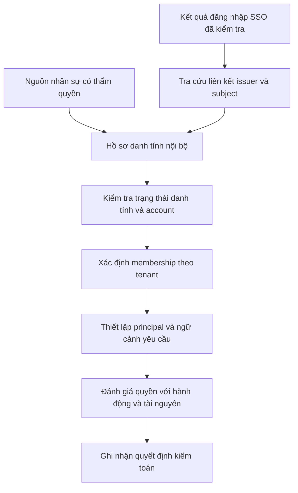

# Digital identity

Một ứng dụng cần biết ai đang đăng nhập, một API cần biết dịch vụ nào đang gọi và một quản trị viên cần biết quyền nào phải thu hồi khi nhân viên nghỉ việc. Cả ba bài toán đều bắt đầu từ **digital identity — danh tính số**: cách hệ thống biểu diễn một thực thể để nhận diện, xác thực, cấp quyền và ghi nhận hoạt động của thực thể đó trong một ngữ cảnh cụ thể.

Danh tính số không chỉ là tên đăng nhập, địa chỉ email hay một hàng trong bảng người dùng. Nó liên quan đến định danh, thuộc tính, nguồn dữ liệu, bằng chứng và vòng đời. Khi những thành phần này không rõ ràng, hệ thống có thể xác thực đúng credential nhưng gắn với sai người, cấp quyền từ thuộc tính không đáng tin hoặc tiếp tục cho truy cập sau khi quan hệ với tổ chức đã chấm dứt.

Trong nền tảng IAM, mô hình danh tính số giúp kết nối quản lý tài khoản, MFA, phiên, SSO, OAuth/OIDC, RBAC, ABAC, danh tính workload và kiểm toán. Bài học này tập trung vào mô hình chung để các cơ chế đó cùng nói về đúng một chủ thể trong đúng phạm vi.

## 1. Danh tính số biểu diễn điều gì?

### 1.1. Thực thể và biểu diễn của thực thể

**Thực thể** là đối tượng mà hệ thống cần nhận diện. Thực thể có thể là một con người, tổ chức, thiết bị, ứng dụng, dịch vụ hoặc workload đang chạy.

**Danh tính số** là biểu diễn của thực thể trong một miền hoặc ngữ cảnh, thông qua những định danh và thuộc tính mà hệ thống sử dụng. Biểu diễn này thường chỉ chứa phần thông tin cần cho mục đích của hệ thống.

Ví dụ, với cùng một người tên Lan:

- Hệ thống nhân sự quan tâm mã nhân viên, đơn vị và trạng thái làm việc.
- Ứng dụng hóa đơn quan tâm account nội bộ, tenant và quyền xử lý hóa đơn.
- Ứng dụng mua sắm cá nhân quan tâm tài khoản khách hàng và thông tin giao nhận.
- Diễn đàn kỹ thuật có thể chỉ cần biệt danh và địa chỉ liên hệ đã được xác nhận.

Không có lý do để bốn hệ thống phải có cùng tập thuộc tính, cùng mức xác minh hoặc cùng định danh công khai.

Một danh tính số cũng không mặc nhiên tương đương với một danh tính pháp lý đã được xác minh. Có dịch vụ cho phép dùng biệt danh; có dịch vụ cần xác minh mối quan hệ lao động; có quy trình yêu cầu chứng minh danh tính ở mức cao hơn. Mức xác minh phải phù hợp mục đích và rủi ro của dịch vụ.

### 1.2. Danh tính luôn có ngữ cảnh

Ngữ cảnh có thể là:

- Một tổ chức hoặc miền quản lý.
- Một tenant trong hệ thống nhiều tổ chức.
- Một nhà cung cấp danh tính.
- Một ứng dụng hoặc nhóm ứng dụng.
- Một môi trường vận hành, như thử nghiệm hoặc sản xuất.

Chuỗi `lan` chỉ có ý nghĩa khi biết nó thuộc miền nào. Hai tài khoản có cùng username ở hai tổ chức không nhất thiết đại diện cho cùng một người.

Ngược lại, cùng một người có thể có nhiều danh tính số được tách biệt có chủ đích. Tài khoản làm việc và tài khoản quản trị của Lan có thể cần hai biểu diễn riêng để tách quyền, điều kiện truy cập và dấu vết kiểm toán.

> Danh tính số là biểu diễn trong một ngữ cảnh, không phải hồ sơ toàn diện về một con người.

### 1.3. Không phải lúc nào cũng biết người thật phía sau

Một diễn đàn có thể nhận diện ổn định tài khoản `member-872` mà không biết tên pháp lý của người sử dụng. Hệ thống vẫn có thể quản lý phiên, giới hạn hành vi và gán quyền cho danh tính đó.

Đây là danh tính có biệt danh hoặc định danh thay thế. Nó không đồng nghĩa với ẩn danh tuyệt đối: nhà cung cấp dịch vụ vẫn có thể liên kết các hoạt động với nhau hoặc có dữ liệu cho phép nhận diện người sử dụng.

Vì vậy, cần tách hai câu hỏi:

1. Hệ thống có phân biệt ổn định được chủ thể này với các chủ thể khác không?
2. Hệ thống đã xác minh được những sự thật nào về chủ thể đó?

Câu trả lời cho câu thứ nhất không tự quyết định câu trả lời cho câu thứ hai.

## 2. Phân biệt những thành phần thường bị gọi chung là “user”

| Thành phần | Ý nghĩa | Ví dụ |
|---|---|---|
| Thực thể | Đối tượng được biểu diễn | Lan, dịch vụ xuất báo cáo |
| Danh tính số | Biểu diễn của thực thể trong một ngữ cảnh | Danh tính nhân viên Lan trong tổ chức A |
| Identifier | Giá trị dùng để nhận diện hoặc tham chiếu trong một phạm vi | `identity-7a2`, mã nhân viên |
| Attribute | Đặc tính gắn với thực thể hoặc quan hệ của nó | Phòng ban, loại chủ thể, trạng thái nhân sự |
| Account | Bản ghi được một hệ thống quản lý để phục vụ quan hệ và truy cập | Tài khoản nội bộ của Lan trên ứng dụng hóa đơn |
| Credential hoặc authenticator | Bằng chứng hay phương tiện tham gia xác thực theo cơ chế được dùng | Mật khẩu, khóa bảo mật, khóa riêng |
| Principal | Danh tính mà cơ chế bảo mật nhận diện để xử lý yêu cầu hoặc chính sách | Principal của Lan trong yêu cầu API |
| Session | Ngữ cảnh truy cập được duy trì qua nhiều tương tác | Phiên trình duyệt sau đăng nhập |
| Entitlement | Quyền hoặc khả năng truy cập được cấp trong phạm vi cụ thể | Quyền đọc hóa đơn tại tenant A |

Các khái niệm này liên quan nhưng không có quan hệ một–một bắt buộc trong mọi hệ thống.

Ví dụ, một danh tính nhân viên có thể được cấp tài khoản trên nhiều ứng dụng. Một account có thể hỗ trợ nhiều phương thức xác thực. Một phiên có thể được chấm dứt mà không xóa account. Thay khóa bảo mật không nhất thiết thay identifier của danh tính.

Đặc biệt, **credential không phải danh tính**. Credential giúp chứng minh quyền kiểm soát một phương tiện xác thực hoặc tham gia xác thực một danh tính theo quy trình. Nếu credential bị đánh cắp, kẻ khác có thể sử dụng nó; sự tồn tại của credential không bảo đảm người đang cầm nó luôn là chủ thể dự kiến.

## 3. Một mô hình danh tính số cần những thông tin nào?

### 3.1. Identifier ổn định

Identifier nội bộ nên nhận diện ổn định một bản ghi trong phạm vi thiết kế. Khi người dùng đổi tên hoặc email, các quan hệ quyền và lịch sử vẫn phải tham chiếu đúng thực thể.

Ví dụ:

```text
identity_id: identity-7a2
display_name: Nguyễn Lan
email: lan@example.test
```

Trong mô hình này:

- `identity_id` là định danh nội bộ.
- `display_name` phục vụ hiển thị.
- `email` phục vụ mục đích liên hệ hoặc đăng nhập nếu hệ thống cho phép.

Không dùng việc trùng tên hiển thị để hợp nhất danh tính. Cũng không mặc định email luôn bất biến, duy nhất giữa mọi nguồn và không bao giờ được tái cấp.

Khi một account bị xóa rồi một người khác đăng ký cùng email, người mới không được tự động kế thừa identifier cùng các quyền của người cũ.

### 3.2. Loại chủ thể và phạm vi quản lý

Loại chủ thể cho biết hệ thống đang nói về con người, dịch vụ, thiết bị hay loại thực thể khác.

Phạm vi quản lý cho biết bên nào quản lý bản ghi và các quy tắc áp dụng. Một mã nội bộ duy nhất trong tenant A có thể trùng với mã ở tenant B. Nếu thiết kế dùng identifier theo tenant, mọi phép tra cứu và liên kết cần đi kèm tenant tương ứng.

Không nên suy ra loại chủ thể từ cách đặt tên, chẳng hạn thấy username kết thúc bằng `-bot` thì coi là dịch vụ. Đây phải là thông tin được quản lý rõ ràng.

### 3.3. Thuộc tính và quan hệ

Thuộc tính có thể gồm phòng ban, chức danh, trạng thái nhân sự hoặc mức xác minh liên hệ. Quan hệ có thể gồm membership trong tenant, người quản lý, nhóm hoặc liên kết với một danh tính ngoài.

Không phải dữ liệu nào cũng nên lưu như một thuộc tính phẳng của danh tính. Ví dụ:

```text
Lan là người duyệt hóa đơn tại tenant A
Lan là người chỉ xem tại tenant B
```

Nếu chỉ lưu `role=approver` trên hồ sơ toàn cục, ứng dụng có thể áp dụng sai quyền sang tenant B. Membership và việc gán role cần giữ được phạm vi của chúng.

Tương tự, “chủ sở hữu workload” là quan hệ quản trị. Nó không đồng nghĩa workload được thừa hưởng mọi quyền cá nhân của chủ sở hữu.

### 3.4. Nguồn gốc và mức độ xác minh

Một thuộc tính có giá trị chưa đủ; cần biết thông tin đó đến từ đâu và được xác minh ra sao.

Ví dụ:

| Thuộc tính | Nguồn | Có thể kết luận gì? |
|---|---|---|
| Tên hiển thị do người dùng nhập | Tự khai báo | Người dùng muốn được hiển thị bằng tên đó |
| Email đã hoàn tất thử thách xác nhận | Quy trình xác nhận liên hệ | Có bằng chứng kiểm soát địa chỉ tại thời điểm xác nhận |
| Trạng thái nhân viên | Hệ thống nhân sự có thẩm quyền | Có căn cứ về quan hệ lao động theo quy trình của tổ chức |
| Phòng ban gửi trong request body | Client tự gửi | Chưa đủ căn cứ dùng để cấp quyền |
| Danh tính workload từ nền tảng thực thi được tin cậy | Cơ chế cấp danh tính workload | Có thể ánh xạ workload theo quan hệ tin cậy đã cấu hình |

Xác nhận email không tự chứng minh tên pháp lý, quyền đại diện công ty hoặc quyền quản trị. Mỗi bằng chứng chỉ hỗ trợ một kết luận trong phạm vi của nó.

### 3.5. Trạng thái và thời gian

Dữ liệu danh tính có thể đúng ở thời điểm thu thập nhưng không còn đúng khi cấp quyền.

Những mốc hữu ích có thể gồm:

- Thời điểm tạo hoặc đăng ký.
- Thời điểm xác minh một thuộc tính.
- Thời điểm nguồn có thẩm quyền cập nhật.
- Thời điểm ứng dụng đồng bộ gần nhất.
- Ngày hết hạn quan hệ hợp đồng hoặc membership.
- Thời điểm vô hiệu hóa hoặc thu hồi.

Không bắt buộc mọi mô hình đều có cùng bộ field. Tuy nhiên, hệ thống phải có cách giải thích nguồn, độ mới và vòng đời của dữ liệu được dùng cho quyết định bảo mật.

## 4. Nhận diện, xác minh danh tính, xác thực và cấp quyền

Bốn công việc này có thể nằm trong cùng một hành trình người dùng nhưng trả lời các câu hỏi khác nhau.

### 4.1. Nhận diện: đang đề cập tới danh tính nào?

Người dùng nhập email hoặc username để hệ thống tìm danh tính được khai báo.

```text
“Tôi muốn đăng nhập với tài khoản lan@example.test.”
```

Ở bước này, hệ thống chưa có đủ căn cứ kết luận người gửi là người được phép sử dụng account đó.

### 4.2. Xác minh danh tính: có căn cứ cho sự liên hệ nào?

Identity proofing là quá trình kiểm tra bằng chứng nhằm thiết lập mức tin cậy rằng người đăng ký tương ứng với danh tính được khai báo, theo mục tiêu và mức bảo đảm của quy trình.

Tùy ngữ cảnh, tổ chức còn cần xác minh các quan hệ hoặc thuộc tính cụ thể, như việc người đó là nhân viên đang làm việc hay được phép đại diện một đơn vị. Không nên coi một lần kiểm tra quan hệ là đã chứng minh mọi sự thật về con người.

Không phải ứng dụng nào cũng cần quy trình xác minh danh tính thực ở mức cao. Yêu cầu thu thập thêm dữ liệu phải có mục đích cụ thể, thay vì xem đây là điều kiện mặc định để tạo mọi tài khoản.

### 4.3. Xác thực: bên truy cập chứng minh điều gì?

Authentication kiểm tra bằng chứng theo phương thức được hỗ trợ để thiết lập danh tính của bên truy cập trong ngữ cảnh của hệ thống.

Ví dụ:

- Kiểm tra mật khẩu của account.
- Kiểm tra bằng chứng sở hữu khóa đã đăng ký.
- Tiếp nhận và kiểm tra kết quả xác thực từ nhà cung cấp danh tính đáng tin cậy.
- Xác thực workload dựa trên danh tính do nền tảng cấp theo quan hệ tin cậy.

MFA kết hợp các yếu tố xác thực theo chính sách. Nó giúp tăng mức bảo đảm xác thực, nhưng không tự sửa một liên kết account đã bị tạo sai hoặc tự xác minh lại mọi thuộc tính hồ sơ.

### 4.4. Cấp quyền: được làm gì trong hoàn cảnh này?

Authorization quyết định liệu chủ thể có được thực hiện một hành động trên tài nguyên cụ thể hay không.

```text
Danh tính đã xác thực
+ trạng thái và membership hiện hành
+ quyền được cấp
+ tài nguyên và ngữ cảnh
→ quyết định cho phép hoặc từ chối
```

Lan có thể xác thực hợp lệ nhưng vẫn bị từ chối vì đã chuyển phòng ban, membership hết hạn hoặc yêu cầu hướng tới tài nguyên của tenant khác.

Chất lượng xác minh danh tính, mức bảo đảm xác thực và phạm vi quyền là các chiều riêng. Không nên gộp chúng thành một nhãn mơ hồ như `trusted_user=true` rồi dùng nhãn đó để cho phép mọi hành động.

## 5. Nguồn dữ liệu có thẩm quyền và ranh giới tin cậy

### 5.1. Không có một nguồn đúng cho mọi thuộc tính

Nguồn có thẩm quyền là nguồn được tổ chức giao trách nhiệm xác lập hoặc quản lý một loại thông tin trong phạm vi nhất định.

Ví dụ:

- Hệ thống nhân sự quản lý trạng thái làm việc.
- Hệ thống quản lý nhà thầu quản lý đơn vị bảo trợ và ngày hết hạn hợp đồng.
- Nhà cung cấp danh tính quản lý phương thức đăng nhập và kết quả xác thực.
- Ứng dụng hóa đơn quản lý quyền duyệt hóa đơn tại từng tenant.
- Nền tảng chạy workload quản lý các thuộc tính kỹ thuật dùng để cấp danh tính cho workload đó.

Một nhà cung cấp danh tính có thể tập hợp thuộc tính từ nhiều nguồn. Việc thuộc tính xuất hiện trong kết quả đăng nhập không làm nó trở thành nguồn gốc có thẩm quyền đối với mọi nghiệp vụ.

### 5.2. Claim là lời khẳng định, cần được đặt trong quan hệ tin cậy

Claim là thông tin mà một bên khẳng định về chủ thể, phiên hoặc ngữ cảnh. Claim có thể được truyền trong token hoặc thông điệp của một giao thức.

Ví dụ:

```json
{
  "iss": "https://login.example.test",
  "sub": "subject-19c",
  "department": "finance"
}
```

Đây chỉ là minh họa dữ liệu, không phải token hoàn chỉnh và không đủ để xác thực một yêu cầu.

Để sử dụng claim, ứng dụng cần biết:

1. Ai phát hành và cơ chế nào chứng minh nguồn phát hành?
2. Thông điệp hoặc token có dành cho ứng dụng hoặc API này không?
3. Nó có hợp lệ trong luồng, thời điểm và mục đích đang xử lý không?
4. Issuer có được tin để khẳng định thuộc tính đó không?
5. Thuộc tính được ánh xạ sang dữ liệu nội bộ và chính sách theo quy tắc nào?

Chữ ký hợp lệ hỗ trợ xác minh nguồn phát hành và tính toàn vẹn theo cơ chế được dùng. Nó không tự bảo đảm issuer có thẩm quyền cấp quyền quản trị trên ứng dụng nhận.

### 5.3. Phân biệt nguồn khai báo và nguồn quyết định

Client có thể gửi tenant đang muốn truy cập. Đây là dữ liệu chọn ngữ cảnh; server vẫn phải kiểm tra membership và tenant của tài nguyên.

Người dùng có thể cập nhật tên hiển thị. Đây có thể là dữ liệu hồ sơ hợp lệ nhưng không nhất thiết là dữ liệu dùng để xác minh người lao động.

Một token có thể chứa role từ bên ngoài. Ứng dụng chỉ nên áp dụng role đó nếu đã định nghĩa quan hệ tin cậy, ý nghĩa, phạm vi và quy tắc ánh xạ tương ứng. Không tự động coi chuỗi `admin` từ mọi nguồn là quyền quản trị nội bộ.

### 5.4. Xử lý khác biệt và dữ liệu cũ

Giả sử hồ sơ nội bộ ghi Lan thuộc phòng tài chính, còn hệ thống nhân sự đã chuyển Lan sang bộ phận vận hành.

Một quy trình rõ ràng cần xác định:

- Nguồn nào quyết định giá trị chính thức.
- Đồng bộ theo sự kiện hay theo chu kỳ.
- Lần cập nhật nào mới hơn.
- Quyền nào phụ thuộc vào thuộc tính đã thay đổi.
- Khi đồng bộ lỗi, quyết định nào có thể dùng dữ liệu cũ và trong bao lâu.
- Khi không đủ căn cứ, hành động nào phải bị từ chối hoặc yêu cầu xử lý bổ sung.

Không dùng quy tắc “bản ghi nào được ghi sau cùng luôn thắng” cho mọi nguồn. Một cập nhật mới từ nguồn không có thẩm quyền vẫn không nên thay trạng thái chính thức từ nguồn có thẩm quyền.

## 6. Ví dụ mô hình danh tính cho ứng dụng hóa đơn

### 6.1. Hồ sơ danh tính và liên kết đăng nhập

Xét ứng dụng nhiều tenant có SSO doanh nghiệp. Một mô hình minh họa có thể gồm:

```json
{
  "identity_id": "identity-7a2",
  "entity_type": "human",
  "realm_id": "workforce-main",
  "status": "active",
  "authoritative_references": [
    {
      "source": "hr-directory",
      "source_entity_id": "employee-2048"
    }
  ],
  "login_links": [
    {
      "issuer": "https://login.example.test",
      "subject": "subject-19c"
    }
  ],
  "attributes": {
    "employment_status": {
      "value": "active",
      "source": "hr-directory",
      "observed_at": "2026-10-01T08:00:00Z"
    },
    "department": {
      "value": "finance",
      "source": "hr-directory",
      "observed_at": "2026-10-01T08:00:00Z"
    }
  }
}
```

Các tên field và giá trị trên là lựa chọn minh họa, không phải schema IAM bắt buộc. Trạng thái `active` của hồ sơ cũng cần có nghĩa vận hành rõ ràng trong hệ thống thực tế.

Bản ghi này không chứa mật khẩu, token phiên hay khóa riêng. Nó biểu diễn danh tính và nguồn tham chiếu, không thay thế kho quản lý credential hoặc cơ chế xác thực.

Thông tin membership có thể được quản lý riêng:

```json
{
  "identity_id": "identity-7a2",
  "account_id": "account-31f",
  "tenant_id": "tenant-a",
  "membership_status": "active",
  "roles": ["invoice_viewer"]
}
```

Tách membership giúp ứng dụng quản lý việc Lan tham gia tenant A mà không đồng nhất quan hệ đó với toàn bộ danh tính của Lan.

### 6.2. Ánh xạ danh tính ngoài vào hồ sơ nội bộ

Với OIDC, ứng dụng thường liên kết người dùng bên ngoài qua cặp issuer và subject, được biểu diễn bởi `iss` và `sub`, sau khi kiểm tra kết quả đăng nhập đúng quy trình.

```text
(issuer, subject)
      ↓ tra cứu liên kết đã được kiểm soát
identity_id nội bộ
      ↓ tìm account và membership phù hợp
ngữ cảnh truy cập của ứng dụng
```

Cần tránh ba suy luận sai:

- Hai issuer trả cùng một chuỗi `sub` thì đó là cùng một người.
- Hai kết quả đăng nhập có cùng email thì phải gộp account.
- Đăng nhập thành công ở issuer thì đương nhiên có quyền tại mọi tenant của ứng dụng.

Subject có thể có giá trị khác nhau giữa các ngữ cảnh client theo cách issuer cấu hình, chẳng hạn subject dạng pairwise. Vì thế, việc liên kết nhiều ứng dụng hay nhiều nguồn danh tính cần quy trình rõ ràng, không dựa vào giả định về chuỗi định danh.

Nếu chưa có liên kết, hệ thống có thể từ chối, tạo account theo chính sách cấp phát khi đăng nhập hoặc đưa người dùng vào quy trình đăng ký. Lựa chọn đó phải được thiết kế trước; không có một hành vi mặc định đúng cho mọi ứng dụng.

### 6.3. Luồng xử lý từ dữ liệu tới quyền truy cập



Sơ đồ này mô tả một cách triển khai, không yêu cầu mọi ứng dụng phải có cùng số tầng hoặc cùng bảng dữ liệu.

Mấu chốt là dữ liệu từ client hoặc token phải đi qua các bước kiểm tra và ánh xạ phù hợp trước khi trở thành dữ liệu tin cậy cho chính sách.

## 7. Vòng đời danh tính số

Danh tính số không kết thúc ở bước tạo account. Nó cần được quản lý trong suốt thời gian thực thể có quan hệ với hệ thống.

### 7.1. Đăng ký và khởi tạo

Ở bước đầu, hệ thống cần xác định loại chủ thể, phạm vi quản lý, dữ liệu tối thiểu và quy trình xác minh cần thiết.

Với nhân viên, danh tính có thể được khởi tạo từ nguồn nhân sự. Với khách hàng, quá trình có thể bắt đầu bằng đăng ký tự phục vụ. Với workload, danh tính có thể được thiết lập từ cấu hình triển khai và quan hệ tin cậy của nền tảng.

Không nên cho một nguồn đăng ký tự phục vụ tự khai báo rằng chủ thể là nhân viên đang làm việc hoặc quản trị viên.

### 7.2. Liên kết phương thức xác thực

Hệ thống liên kết phương tiện xác thực hoặc danh tính ngoài với hồ sơ phù hợp.

Đây là thời điểm quan trọng: nếu liên kết nhầm khóa bảo mật, số điện thoại hoặc tài khoản SSO vào hồ sơ của người khác, các lần xác thực sau có thể hoàn toàn hợp lệ về kỹ thuật nhưng dẫn tới sai danh tính nội bộ.

Đổi hoặc khôi phục phương thức xác thực cũng cần kiểm soát tương xứng. Độ mạnh của lần đăng nhập thường ngày không bù được một quy trình khôi phục cho phép chiếm quyền điều khiển account quá dễ dàng.

### 7.3. Cấp phát account và quyền

Một danh tính mới không nhất thiết được cấp ngay mọi tài khoản hoặc role.

Cần xác định:

- Ứng dụng nào cần được cấp account.
- Membership nào cần được tạo.
- Role nào có thể cấp theo chính sách.
- Quyền nào cần phê duyệt, thời hạn hoặc điều kiện bổ sung.
- Ai chịu trách nhiệm đối với quyền đặc biệt.

Danh tính trả lời “đang nói về ai”; quyền trả lời “được phép làm gì”. Tách hai lớp này giúp áp dụng nguyên tắc ít quyền nhất.

### 7.4. Thay đổi và rà soát

Khi Lan chuyển phòng ban, cần cập nhật thuộc tính và xem xét các quyền phụ thuộc vào vị trí cũ.

Không chỉ cộng quyền mới rồi để nguyên toàn bộ quyền cũ. Sự tích lũy này làm phạm vi truy cập tăng dần dù công việc thực tế đã thay đổi.

Đối với nhà thầu, ngày kết thúc hợp đồng và người bảo trợ cần được xem xét. Đối với workload, thay đổi chủ sở hữu, môi trường chạy hoặc mục đích sử dụng cũng có thể làm chính sách truy cập cần thay đổi.

### 7.5. Vô hiệu hóa, thu hồi và lưu giữ

Khi quan hệ chấm dứt, cần xem xét đồng thời:

- Khả năng xác thực và phát hành phiên mới.
- Các session đang hoạt động.
- Refresh token và các token truy cập đã phát hành.
- Account tại ứng dụng liên kết.
- Membership, role assignment và credential còn tồn tại.
- Bản sao dữ liệu danh tính hoặc quyền trong cache và hệ thống khác.

Đổi trạng thái trong một bảng không tự bảo đảm mọi hệ thống đã ngừng chấp nhận truy cập. Cơ chế thu hồi và thời gian lan truyền cần được thiết kế, đặc biệt với các thành phần dùng dữ liệu hoặc token có thời hạn riêng.

Vô hiệu hóa truy cập cũng không đồng nghĩa phải xóa ngay mọi dữ liệu nhận diện. Hệ thống có thể cần giữ các tham chiếu phục vụ kiểm toán theo chính sách lưu giữ, đồng thời hạn chế dữ liệu và chấm dứt khả năng sử dụng quyền.

Nếu người dùng quay lại, việc khôi phục hay tạo mới danh tính phải dựa trên quy trình xác minh và chính sách rõ ràng. Không tự động phục hồi toàn bộ quyền cũ chỉ vì cùng một email xuất hiện.

## 8. Danh tính con người và danh tính phi con người

Các loại danh tính có thể dùng chung một số nguyên tắc nhưng cần cách quản lý khác nhau.

| Loại | Đặc điểm cần quan tâm | Sai lầm thường gặp |
|---|---|---|
| Nhân viên | Nguồn nhân sự, chuyển vị trí, nghỉ việc, tài khoản đặc quyền | Chỉ thêm quyền khi chuyển vị trí |
| Nhà thầu hoặc đối tác | Người bảo trợ, phạm vi hợp tác, ngày hết hạn | Không có ai chịu trách nhiệm gia hạn hoặc thu hồi |
| Khách hàng | Đăng ký, khôi phục account, dữ liệu cá nhân, liên kết đăng nhập | Thu thập quá nhiều dữ liệu mà không phục vụ mục đích |
| Workload hoặc dịch vụ | Mục đích, chủ sở hữu, môi trường chạy, credential hoặc quan hệ tin cậy | Dùng credential cá nhân của lập trình viên cho tác vụ nền |
| Thiết bị | Quản lý thiết bị, liên kết khóa, trạng thái và quyền của thiết bị | Coi tên thiết bị hoặc địa chỉ mạng là bằng chứng xác thực đầy đủ |

Một dịch vụ xuất báo cáo cần danh tính riêng, quyền phù hợp với tác vụ và cơ chế quản lý credential hoặc danh tính nền tảng. Khi người viết dịch vụ nghỉ việc, hệ thống vẫn cần biết workload đó là gì và ai tiếp quản nó.

Cũng cần phân biệt danh tính logic của dịch vụ với các instance đang chạy. Nhiều instance có thể dùng cùng danh tính logic được kiểm soát; nếu cần truy vết chi tiết, log có thể bổ sung định danh instance. Không nên tự tạo một account tồn tại vĩnh viễn cho từng tiến trình ngắn hạn nếu điều đó không phù hợp mô hình vận hành.

Khi dịch vụ gọi thay người dùng, có thể cần giữ cả danh tính người được đại diện và danh tính ứng dụng thực hiện lời gọi. Nếu chỉ lưu một trường `user`, hệ thống dễ mất thông tin về ủy quyền và trách nhiệm.

## 9. Tối thiểu hóa dữ liệu và khả năng liên kết hoạt động

### 9.1. Chỉ thu thập thông tin phục vụ mục đích

Một ứng dụng cần biết người dùng thuộc tenant nào không có nghĩa nó cần ngày sinh, địa chỉ nhà hoặc giấy tờ nhận diện của người đó.

Với mỗi thuộc tính, nên xác định:

- Mục đích sử dụng.
- Nguồn cung cấp.
- Bên được phép đọc hoặc thay đổi.
- Mức xác minh cần thiết.
- Thời gian lưu.
- Điều gì xảy ra khi thuộc tính thiếu hoặc thay đổi.

Thu thập nhiều dữ liệu hơn không tự làm danh tính đáng tin hơn. Một hồ sơ có nhiều trường tự khai báo vẫn có thể có mức bảo đảm thấp đối với quyết định quan trọng.

### 9.2. Không truyền toàn bộ hồ sơ trong token và log

Token hoặc ngữ cảnh phiên chỉ nên chứa thông tin cần thiết cho cơ chế tương ứng. Không đưa toàn bộ hồ sơ nhân sự vào token chỉ để mọi ứng dụng “tiện dùng”.

Điều này giúp giảm dữ liệu bị lộ nếu token xuất hiện ngoài dự kiến và giảm phụ thuộc vào các thuộc tính có thể trở nên lỗi thời.

Log cần đủ để giải thích hành động nhưng không nên chứa mật khẩu, private key, cookie phiên hoặc toàn bộ bearer token. Với thông tin nhạy cảm, phải xác định rõ mục đích ghi nhận và quyền truy cập.

### 9.3. Identifier cũng có thể là dữ liệu nhạy cảm

Một mã ngẫu nhiên không trực tiếp chứa tên người vẫn có thể dùng để liên kết hoạt động của người đó qua nhiều hệ thống.

Do đó:

- Không coi việc thay tên bằng mã là đã loại bỏ mọi rủi ro riêng tư.
- Không công khai identifier nội bộ nếu ứng dụng chỉ cần một mã tham chiếu khác.
- Cân nhắc phạm vi identifier và nhu cầu liên kết giữa các hệ thống.
- Kiểm soát việc xuất dữ liệu chứa các quan hệ ánh xạ danh tính.

Giảm khả năng liên kết không có nghĩa bỏ khả năng kiểm toán. Có thể giới hạn bên được phép truy cập ánh xạ, trong khi vẫn giữ các tham chiếu ổn định cần thiết cho điều tra có thẩm quyền.

## 10. Ví dụ xuyên suốt: Lan chuyển bộ phận

Lan đang làm ở phòng tài chính và có quyền đọc hóa đơn tại tenant A. Sau đó Lan chuyển sang bộ phận vận hành, đổi email công việc và không còn nhiệm vụ xử lý hóa đơn.

### 10.1. Trước thay đổi

```text
Danh tính nội bộ: identity-7a2
Liên kết đăng nhập: issuer X + subject Y
Account ứng dụng: account-31f
Phòng ban: finance, từ hệ thống nhân sự
Membership tenant A: active
Role tại tenant A: invoice_viewer
```

### 10.2. Khi có sự kiện chuyển bộ phận

Một quy trình phù hợp có thể thực hiện:

1. Nhận thay đổi từ nguồn nhân sự có thẩm quyền.
2. Cập nhật thuộc tính phòng ban và dữ liệu liên hệ theo nguồn tương ứng.
3. Giữ identifier của danh tính nếu vẫn là cùng người và cùng quan hệ được quản lý.
4. Đánh giá lại quyền phát sinh từ nhiệm vụ ở phòng tài chính.
5. Thu hồi role không còn phù hợp và cấp quyền mới nếu có căn cứ.
6. Xác định ảnh hưởng tới phiên, token và dữ liệu quyền đã được lưu ở các nơi khác.
7. Ghi nhận sự thay đổi và nguồn gây ra thay đổi.

Không cần tạo một danh tính mới chỉ vì email đổi. Đồng thời, không được giữ quyền hóa đơn chỉ vì account cũ vẫn tồn tại.

### 10.3. Khi Lan tiếp tục đăng nhập

Lan có thể vẫn xác thực thành công qua SSO. Điều đó phù hợp nếu Lan vẫn là nhân viên và được phép dùng các dịch vụ khác.

Tuy nhiên, yêu cầu đọc hóa đơn phải được đánh giá bằng trạng thái và quyền phù hợp sau thay đổi. Nếu quyền đã được thu hồi, ứng dụng cần từ chối theo cơ chế và giới hạn thời gian cập nhật đã thiết kế.

Ví dụ này cho thấy:

- Danh tính có thể liên tục dù thuộc tính thay đổi.
- Phương thức xác thực có thể không đổi.
- Quyền có thể bị thu hồi độc lập.
- Việc thu hồi phải lan tới nơi ra quyết định cấp quyền.

### 10.4. Khi email cũ được tái cấp

Nếu email cũ của Lan được cấp cho người khác, hệ thống không được dựa vào email đó để liên kết người mới với `identity-7a2`.

Người mới phải có danh tính hoặc account được thiết lập theo quy trình của họ. Các liên kết, quyền sở hữu và lịch sử của Lan vẫn phải tham chiếu đúng thực thể cũ.

## 11. Các tình huống giúp kiểm tra mô hình

### 11.1. Hai người có cùng tên hiển thị

Hai nhân viên cùng tên Nguyễn Lan đăng nhập vào cùng ứng dụng.

**Cách xử lý:** mỗi người có identifier riêng và liên kết nguồn riêng. Tên hiển thị giúp con người đọc giao diện nhưng không được dùng làm khóa cấp quyền hoặc khóa hợp nhất.

### 11.2. Hai nhà cung cấp danh tính có cùng email

Một tổ chức cho phép đăng nhập từ hai issuer. Cả hai gửi cùng email trong kết quả đăng nhập.

**Cách xử lý:** trước hết vẫn coi đây là hai danh tính ngoài riêng biệt. Việc ánh xạ chúng vào cùng account cần bằng chứng và quy trình liên kết được kiểm soát. Không chỉ dựa vào chuỗi email trùng nhau.

Nếu chính sách cho phép tự động liên kết trong một miền được quản lý, chính sách phải xác định rõ nguồn nào có thẩm quyền, điều kiện xác minh và phạm vi áp dụng. Đây là một quyết định tin cậy cụ thể, không phải quy tắc chung cho mọi issuer.

### 11.3. Client tự gửi phòng ban

Một request có nội dung:

```json
{
  "department": "finance",
  "requested_action": "invoice.approve"
}
```

**Cách xử lý:** `department` do client gửi chưa phải thuộc tính danh tính đáng tin để cấp quyền. Server lấy dữ liệu cần thiết từ ngữ cảnh đã xác thực hoặc nguồn có thẩm quyền, rồi kiểm tra quyền với tài nguyên và tenant thực tế.

### 11.4. Tác vụ nền sử dụng credential cá nhân

Một lập trình viên dùng credential của mình để tác vụ đêm xuất báo cáo. Khi người đó nghỉ việc, tác vụ ngừng chạy hoặc credential vẫn bị giữ lại để tránh gián đoạn.

**Cách xử lý:** thiết lập danh tính workload phù hợp, có chủ sở hữu vận hành, quyền tối thiểu và cơ chế quản lý credential hoặc quan hệ tin cậy riêng. Người chịu trách nhiệm workload là quan hệ quản trị; không nên biến account cá nhân thành danh tính chạy dịch vụ lâu dài.

### 11.5. Tài khoản đã khóa nhưng token còn hạn

Hồ sơ nội bộ bị vô hiệu hóa, nhưng API vẫn chấp nhận token cũ.

**Cách xử lý:** xem lại cách trạng thái danh tính và account ảnh hưởng tới quyết định truy cập. Cần thiết kế kiểm tra trạng thái, thu hồi, thời hạn, làm mới hoặc biện pháp phù hợp với kiến trúc. Không thể suy ra ngừng truy cập chỉ từ một field trạng thái đã đổi.

## 12. Những lỗi mô hình phổ biến

| Lỗi | Tác động | Cách cải thiện |
|---|---|---|
| Đồng nhất danh tính với email | Thay hoặc tái cấp email làm sai liên kết | Dùng identifier ổn định, quản lý email như thuộc tính |
| Không ghi phạm vi identifier | Trộn chủ thể từ các tenant hoặc nguồn khác nhau | Giữ namespace, issuer hoặc miền tương ứng |
| Coi mọi thuộc tính hồ sơ đều đã được xác minh | Chính sách dựa trên dữ liệu tự khai báo | Ghi rõ nguồn, ý nghĩa xác minh và thẩm quyền |
| Coi SSO thành công là đủ quyền | Truy cập ngoài membership hoặc nhiệm vụ | Kiểm tra trạng thái, tài nguyên và quyền nội bộ |
| Để role toàn cục thay cho quan hệ theo tenant | Rò rỉ quyền giữa các tổ chức | Gắn việc cấp quyền với phạm vi cụ thể |
| Chỉ thêm quyền khi đổi vị trí | Tích lũy quyền không còn cần thiết | Đánh giá và thu hồi quyền cũ |
| Chia sẻ một danh tính giữa nhiều người | Không quy trách nhiệm được cho cá nhân | Dùng danh tính riêng và nhóm/role phù hợp |
| Không có chủ sở hữu danh tính workload | Không ai chịu trách nhiệm rà soát và thu hồi | Quản lý chủ sở hữu, mục đích và thời hạn liên quan |
| Thu thập toàn bộ dữ liệu có thể lấy | Tăng mức lộ lọt và liên kết không cần thiết | Tối thiểu hóa dữ liệu theo mục đích |
| Xóa hoặc tái sử dụng mã định danh tùy tiện | Mất lịch sử hoặc trao nhầm quyền cũ | Có chính sách vòng đời và bảo toàn tham chiếu |

## 13. Câu hỏi thiết kế cần trả lời được

Khi xây dựng mô hình danh tính cho một ứng dụng, nhóm phát triển nên trả lời cụ thể những câu hỏi sau:

1. **Biểu diễn ai?** Các loại chủ thể nào được hỗ trợ, và trong phạm vi nào?
2. **Nhận diện bằng gì?** Identifier nào ổn định, identifier nào có thể thay đổi, và chúng duy nhất trong miền nào?
3. **Tin dữ liệu từ đâu?** Nguồn nào có thẩm quyền với từng thuộc tính hoặc quan hệ?
4. **Đã chứng minh điều gì?** Quy trình xác minh và xác thực cho phép đưa ra những kết luận nào?
5. **Ánh xạ ra sao?** Danh tính ngoài liên kết với hồ sơ và account nội bộ bằng quy tắc nào?
6. **Quyền thuộc phạm vi nào?** Membership, role và quyền gắn với tenant, tài nguyên và điều kiện nào?
7. **Thay đổi lan đi thế nào?** Khi chuyển vị trí, hết hợp đồng hoặc khóa account, dữ liệu và quyền được cập nhật tại đâu?
8. **Thu hồi mất bao lâu?** Những phiên, token hoặc cache nào có thể còn chấp nhận trạng thái cũ?
9. **Ai chịu trách nhiệm?** Ai quản lý nguồn dữ liệu, phê duyệt liên kết và rà soát danh tính workload?
10. **Có cần lưu dữ liệu này không?** Mục đích, quyền truy cập và thời gian lưu của từng loại dữ liệu là gì?
11. **Có giải thích được quyết định không?** Log có giúp xác định chủ thể, actor nếu có, tenant, hành động, tài nguyên và nguồn dữ liệu liên quan không?

Câu trả lời nên trở thành quy tắc dữ liệu và hành vi của hệ thống, thay vì chỉ nằm trong cách hiểu riêng của từng lập trình viên.

## 14. Những điểm cần ghi nhớ

Danh tính số biểu diễn một thực thể trong một ngữ cảnh bằng identifier, thuộc tính và quan hệ phù hợp. Nó không tự đồng nghĩa với danh tính pháp lý đã xác minh, không phải credential và không phải quyền truy cập.

Một mô hình dùng được cho IAM cần giữ rõ phạm vi định danh, nguồn gốc dữ liệu, mức xác minh, độ mới và vòng đời. Xác thực thành công chỉ thiết lập một phần căn cứ cho xử lý yêu cầu; cấp quyền vẫn phải đánh giá chủ thể, hành động, tài nguyên và điều kiện thực tế.

Khi danh tính được mô hình hóa rõ ràng, việc triển khai MFA, SSO, RBAC, ABAC, quản lý phiên, danh tính workload và kiểm toán có thể dựa trên cùng một hệ quy chiếu, đồng thời giữ quyền ở mức cần thiết và thu hồi đúng lúc.
