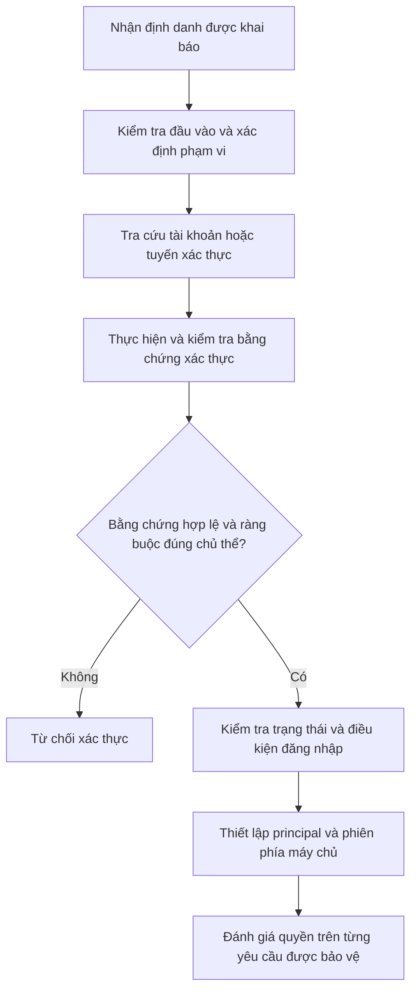

# Claimed identity

## Mục tiêu bài học

Khi người dùng nhập `lan@example.test` vào màn hình đăng nhập, hệ thống mới nhận được lời khai rằng người đang thao tác muốn đăng nhập bằng danh tính đó. Chỉ riêng địa chỉ được nhập chưa chứng minh người thao tác kiểm soát tài khoản của Lan.

Trong mô hình định danh của IAM, **claimed identity** là danh tính mà một bên khai báo hoặc đưa ra để được nhận diện trong một giao dịch. Hiểu mức tin cậy của lời khai này giúp hệ thống không nhầm dữ liệu đầu vào với danh tính đã được xác thực, cũng không nhầm danh tính đã xác thực với quyền truy cập.

Sau bài học này, bạn có thể:

- Nhận diện claimed identity trong biểu mẫu, API, phiên liên kết và lời gọi workload.
- Phân biệt định danh được khai báo, tài khoản được tìm thấy, danh tính được xác thực và danh tính được thẩm tra ngoài đời thực.
- Giải thích cách ràng buộc bằng chứng xác thực với đúng chủ thể và đúng phạm vi định danh.
- Thiết kế luồng xử lý không cấp quyền dựa trên lời khai chưa được kiểm chứng.

## 1. Claimed identity là gì?

Trong một giao dịch, chủ thể có thể khai báo danh tính bằng tên đăng nhập, email, mã nhân viên, mã tài khoản hoặc một định danh dịch vụ. Những giá trị này giúp hệ thống biết tài khoản hoặc chủ thể nào đang được đề cập.

Ví dụ:

```text
Người dùng nhập:
  username = "lan@example.test"

Ý nghĩa ở thời điểm nhận đầu vào:
  "Tôi muốn được xác thực với tài khoản mang định danh này."

Điều chưa được chứng minh:
  "Tôi đã chứng minh mình kiểm soát tài khoản đó."
```

Lời khai có thể đúng, sai, gõ nhầm hoặc cố ý giả mạo. Bản thân claimed identity không phải bằng chứng xác thực. Nó có thể chỉ là dữ liệu giúp lựa chọn tài khoản, miền đăng nhập hoặc phương thức xác thực tiếp theo.

Từ “claimed” không nhất thiết hàm ý người khai đang nói dối. Nó mô tả trạng thái và nguồn của thông tin: một danh tính đã được đưa ra, nhưng mức độ được chấp nhận còn phụ thuộc bằng chứng và quy trình kiểm tra của bên nhận.

### Đừng chỉ nhìn hình thức của dữ liệu

Một UUID, địa chỉ email đúng định dạng hoặc mã nhân viên hợp lệ vẫn có thể là lời khai chưa xác thực. Định danh khó đoán không trở thành bí mật chứng minh danh tính. Một header có tên `X-Authenticated-User` cũng không tự có thẩm quyền nếu client được tự gửi nó.

Ngược lại, một danh tính do hệ thống xác thực đáng tin cung cấp có thể được chấp nhận sau khi bên nhận kiểm tra đúng giao thức và quan hệ tin cậy. Cần xét nguồn gốc và bằng chứng, không chỉ tên trường dữ liệu.

## 2. Các khái niệm cần tách biệt

| Khái niệm | Câu hỏi được giải quyết | Ví dụ | Điều chưa tự được suy ra |
|---|---|---|---|
| Identifier — định danh | Đang nói đến bản ghi hoặc chủ thể nào trong một phạm vi? | Email đăng nhập, subject ID | Người gửi có kiểm soát tài khoản không |
| Claimed identity — danh tính được khai báo | Bên gửi muốn được nhận diện là ai? | Nhập tài khoản Lan vào form | Lời khai đã được chứng minh chưa |
| Resolved account — tài khoản được tra cứu | Hệ thống tìm thấy bản ghi nào tương ứng với lời khai? | Tìm thấy account-801 | Người gửi là chủ tài khoản |
| Authenticated identity — danh tính đã xác thực | Bằng chứng hợp lệ đã được ràng buộc với chủ thể nào? | Phiên được thiết lập cho account-801 sau xác thực | Chủ thể được truy cập mọi tài nguyên |
| Identity proofing — thẩm tra danh tính | Danh tính khai báo có được đối chiếu với người hoặc tổ chức ngoài đời theo quy trình yêu cầu không? | Đối chiếu hồ sơ khi mở tài khoản theo nghiệp vụ | Mọi lần đăng nhập sau đều hợp lệ |
| Authorization — đánh giá quyền | Chủ thể được làm gì với tài nguyên nào trong ngữ cảnh hiện tại? | Cho phép đọc hóa đơn của tenant A | Có thể bỏ qua kiểm tra ở các đường truy cập khác |

Xác thực một tài khoản thường chứng minh người gọi nắm giữ hoặc sử dụng được bằng chứng được chấp nhận cho tài khoản đó. Điều này không tự chứng minh tên pháp lý hoặc danh tính ngoài đời thực của người đang thao tác. Một dịch vụ cho phép đăng ký bằng email có thể xác thực tài khoản mà không thực hiện thẩm tra danh tính ngoài đời.

MFA tăng mức bảo đảm của quá trình xác thực theo các yếu tố được sử dụng. Nó không tự biến một tên tự khai trong hồ sơ thành tên đã được thẩm tra, cũng không tự cấp vai trò quản trị.

## 3. Claimed identity xuất hiện ở đâu?

### 3.1. Biểu mẫu đăng nhập

Tên đăng nhập hoặc email thường đóng vai trò lựa chọn tài khoản. Mật khẩu, khóa bảo mật hoặc phương thức xác thực khác mới cung cấp bằng chứng để hệ thống kiểm tra quan hệ với tài khoản đó.

Hai bước có thể nằm trên cùng một màn hình hoặc nhiều màn hình. Việc hệ thống chuyển từ bước nhập email sang bước nhập mật khẩu không có nghĩa người dùng đã được xác thực.

### 3.2. Header, body và đường dẫn API

Các trường như `userId`, `email`, `tenantId` hoặc `actingUser` do client gửi thường là đầu vào cần kiểm tra. Chúng không được phép tự ghi đè danh tính mà máy chủ đã xác thực.

```http
POST /invoices/INV-42/approve
Authorization: Bearer <credential>
Content-Type: application/json

{
  "userId": "account-801",
  "tenantId": "tenant-A"
}
```

Trong ví dụ này, máy chủ phải xác định người gọi từ credential được kiểm tra đúng. Nếu credential thuộc account-916, trường `userId=account-801` không làm người gọi trở thành account-801.

Nếu API có chức năng quản trị thao tác thay người khác, đó phải là nghiệp vụ được thiết kế riêng, có quyền đại diện và lưu vết. Không biến một trường tùy chọn trong request thành cơ chế mạo danh.

### 3.3. Gợi ý đăng nhập và lựa chọn tổ chức

Email được điền sẵn, `login_hint`, tên tổ chức hoặc miền email có thể giúp định tuyến đến nhà cung cấp danh tính phù hợp. Chúng là gợi ý cho luồng xử lý, không phải kết quả xác thực.

Tương tự, một người chọn tenant A trên giao diện chưa chứng minh họ là thành viên tenant A. Máy chủ phải kiểm tra quan hệ thành viên và quyền trong tenant đó.

### 3.4. Workload và ứng dụng khách

Một dịch vụ có thể gửi tên dịch vụ, `client_id` hoặc tên môi trường. Các giá trị này giúp chỉ ra danh tính đang được đề cập, nhưng không phải tất cả đều là bí mật hoặc bằng chứng kiểm soát danh tính.

Ví dụ, biết `client_id` của một ứng dụng không chứng minh người gọi là ứng dụng đó. Bằng chứng còn tùy loại client và cơ chế được dùng, chẳng hạn xác thực client bằng khóa, chứng chỉ hoặc một quan hệ workload federation đã cấu hình.

## 4. Một lời khai chỉ có nghĩa trong đúng phạm vi

Tên đăng nhập `lan` có thể tồn tại trong nhiều tổ chức. Mã người dùng `u-123` của nhà cung cấp danh tính A có thể khác hoàn toàn `u-123` của nhà cung cấp B. Vì vậy, không nên xem một chuỗi định danh là duy nhất trên mọi hệ thống.

Phạm vi có thể được xác lập bằng tổ chức, nguồn phát hành, miền đăng nhập hoặc mô hình định danh của ứng dụng. Với OIDC, cặp nguồn phát hành và subject đã được xác minh là cơ sở để nhận diện chủ thể theo giao thức:

```text
(verified_issuer, verified_sub) -> local_principal

(Issuer A, u-123) -> principal-801
(Issuer B, u-123) -> principal-916
```

Ứng dụng chỉ sử dụng các giá trị này như đầu vào đáng tin sau khi đã kiểm tra token hoặc phản hồi theo đúng giao thức và cấu hình chấp nhận. Đọc `iss` và `sub` từ token chưa xác minh không tạo ra danh tính đã xác thực.

### Email là bí danh có vòng đời

Email có thể thay đổi hoặc được tái cấp. Một tài khoản còn có thể có nhiều bí danh đăng nhập. Ứng dụng nên dùng định danh nội bộ ổn định cho quan hệ sở hữu, cấp quyền và kiểm toán thay vì lấy email hiển thị làm khóa danh tính lâu dài.

Việc chuẩn hóa đầu vào phải theo quy tắc của hệ thống định danh. Tùy tiện xóa dấu chấm, bỏ ký tự hoặc chuyển mọi loại định danh về chữ thường có thể hợp nhất hai tài khoản khác nhau. Cần định nghĩa rõ cách so sánh, kiểm tra tính duy nhất và quản lý bí danh.

Không tự liên kết hai tài khoản chỉ vì có cùng email. Liên kết tài khoản phải xác minh quan hệ kiểm soát theo chính sách, xử lý xung đột và bảo đảm không chuyển quyền sang nhầm chủ thể.

## 5. Từ claimed identity đến authenticated identity

Một luồng đăng nhập bằng tên tài khoản có thể được mô tả ở mức khái niệm như sau:



Đây không phải một giao thức cụ thể. Cách triển khai thực tế còn phụ thuộc mật khẩu, WebAuthn, OIDC, chứng chỉ hay phương thức khác.

Điểm quan trọng là **bằng chứng phải được ràng buộc với đúng tài khoản và đúng giao dịch**. Xác thực được tài khoản Minh rồi thiết lập phiên cho Lan chỉ vì trường username còn lưu giá trị của Lan là một lỗi nghiêm trọng về ràng buộc danh tính.

Nếu một flow cho phép người dùng đổi tài khoản tại IdP, ứng dụng cần xử lý kết quả theo chính sách rõ ràng. Với flow yêu cầu xác nhận đúng tài khoản đang thực hiện một thao tác nhạy cảm, việc xác thực thành công một tài khoản khác không được xem là đã xác nhận tài khoản ban đầu.

### Không phải flow nào cũng yêu cầu khai tên trước

Một số cơ chế, chẳng hạn đăng nhập bằng credential có thể khám phá của WebAuthn, có thể xác định tài khoản dựa trên credential mà người dùng chọn thay vì bắt nhập username trước.

Vì vậy, không nên coi “nhập claimed identity bằng văn bản” là bước bắt buộc của mọi phương thức xác thực. Dù danh tính được đưa ra theo cách nào, hệ thống vẫn phải xác minh bằng chứng và ánh xạ đúng chủ thể.

### Giả mã ràng buộc tài khoản và bằng chứng

```text
function login(request):
    loginIdentifier = validateLoginIdentifier(request.identifier)
    identityScope = resolveAllowedLoginScope(request.organizationHint)

    candidateAccount = lookupAccount(identityScope, loginIdentifier)

    result = authenticateWithConfiguredMechanism(
        candidateAccount,
        request.authenticationResponse,
        serverAuthenticationTransaction
    )

    if result is not successful:
        return genericAuthenticationFailure()

    if result.authenticatedAccountId != candidateAccount.id:
        return genericAuthenticationFailure()

    account = loadCurrentAccount(result.authenticatedAccountId)
    requireLoginAllowed(account, result.authenticationContext)

    session = establishSession(
        principalId = account.principalId,
        authenticationContext = result.authenticationContext
    )

    return session
```

Giả mã này minh họa flow yêu cầu xác thực đúng tài khoản đã khai báo. Cơ chế xác thực bên trong phải xử lý cả tài khoản không tồn tại, giao dịch không hợp lệ và các yêu cầu chống lạm dụng phù hợp. Không được triển khai tra cứu thất bại bằng cách tiết lộ ngay rằng tài khoản không tồn tại hoặc bỏ qua kiểm tra giao dịch.

Phiên được tạo từ kết quả xác thực và dữ liệu tài khoản có thẩm quyền, không từ `userId` hoặc vai trò do request tự khai. Khi nâng phiên chưa xác thực thành phiên đã xác thực, hệ thống cần quản lý và thay mới định danh phiên phù hợp để chống session fixation.

## 6. “Claim” trong token có giống claimed identity không?

Từ **claim** trong JWT hoặc OIDC chỉ một phát biểu được biểu diễn trong token, chẳng hạn `iss`, `sub`, `aud` hoặc thuộc tính người dùng. Claimed identity là khái niệm mô tả danh tính được đưa ra trong một giao dịch. Hai cách dùng có liên quan nhưng không đồng nhất.

Một token có thể chứa nhiều claim. Một số phục vụ xác minh token; một số mô tả chủ thể; một số có thể được dùng làm đầu vào cho chính sách quyền. Độ tin cậy của từng claim phụ thuộc nguồn phát hành, cách kiểm tra và thẩm quyền của nguồn đó đối với thông tin đang xét.

```text
Giải mã token:
  biết token đang chứa những giá trị nào.

Xác minh token đúng ngữ cảnh:
  kiểm tra bằng chứng, nguồn phát hành, bên nhận,
  hiệu lực và các ràng buộc theo giao thức.

Đánh giá quyền:
  quyết định chủ thể được thao tác gì trên tài nguyên cụ thể.
```

Ba công việc này không thay thế cho nhau. Một payload có `sub=account-801` chưa đủ để thiết lập phiên cho account-801. Với token ký số, chữ ký hợp lệ cũng chưa đủ nếu token hết hạn, đến từ nguồn không được chấp nhận hoặc dành cho bên nhận khác.

Ngay cả token đã được chấp nhận cũng không làm mọi thuộc tính trở thành sự thật đã thẩm tra. Ví dụ, một tên hiển thị có thể là dữ liệu người dùng tự khai mà IdP chỉ chuyển tiếp. Ứng dụng cần biết nguồn gốc và mức xác minh của thuộc tính trước khi dùng nó cho quyết định nhạy cảm.

Trong OIDC, ID token giúp ứng dụng khách xử lý kết quả xác thực theo giao thức. Nó không mặc nhiên thay thế access token dành cho API. Access token được API chấp nhận vẫn cần đi kèm kiểm tra quyền tài nguyên theo chính sách.

## 7. Ví dụ xuyên suốt: người gọi khai mình là người duyệt hóa đơn

Giả sử Lan có quyền duyệt hóa đơn của bộ phận Kinh doanh trong tenant A. Minh chỉ có quyền tạo hóa đơn trong cùng tenant.

Minh gửi một request có các giá trị:

```text
Credential hợp lệ: thuộc tài khoản Minh
userId trong body: Lan
role trong body: invoice-approver
tenantId trong body: tenant-A
Tài nguyên yêu cầu: hóa đơn INV-42
Hành động: duyệt
```

Hệ thống xử lý đúng sẽ đi theo chuỗi sau:

1. Xác minh credential và xác định principal của Minh.
2. Không dùng `userId=Lan` để thay principal của người gọi.
3. Không lấy `role=invoice-approver` từ request làm quyền có thẩm quyền.
4. Kiểm tra Minh có thuộc tenant A và có được thực hiện hành động duyệt trên INV-42 hay không.
5. Từ chối thao tác vì Minh không có quyền duyệt, đồng thời ghi vết theo chính sách.

Nếu Minh chỉ biết email của Lan nhưng chưa có bằng chứng xác thực hợp lệ cho tài khoản Lan, hệ thống còn chưa được xác thực Minh thành Lan. Nếu credential của Minh hợp lệ, việc Minh đã đăng nhập cũng không giúp lời khai về vai trò trở thành quyền thật.

Các quyết định quyền có thể dùng RBAC để kiểm tra vai trò, ABAC để kiểm tra tenant, bộ phận, hạn mức hoặc quan hệ với hóa đơn. Dữ kiện cho cả hai mô hình đều phải đến từ nguồn được chấp nhận, có phạm vi và độ mới phù hợp.

## 8. Claimed identity đối với workload

Workload là dịch vụ, pipeline hoặc tác vụ tự động. Nó cũng có thể khai “tôi là dịch vụ xuất báo cáo production”, nhưng một chuỗi tên dịch vụ hoặc biến môi trường không đủ chứng minh lời khai đó.

Một nền tảng có thể xác minh workload bằng chứng chỉ, khóa hoặc assertion từ nguồn phát hành được tin cậy. Khi dùng federation cho CI/CD, bên cấp quyền có thể cần kiểm tra các ràng buộc như repository, môi trường và ngữ cảnh chạy theo chính sách. Chỉ kiểm tra nguồn phát hành mà chấp nhận mọi workload từ nguồn đó có thể cấp quyền quá rộng.

| Đầu vào | Cách hiểu ban đầu | Điều cần có trước khi chấp nhận |
|---|---|---|
| `serviceName=report-exporter` trong body | Tên dịch vụ được tự khai | Bằng chứng được ràng buộc với danh tính workload |
| `client_id` | Định danh ứng dụng khách | Cơ chế xác thực hoặc flow phù hợp với loại client |
| Chứng chỉ được trình bày | Credential được đưa ra | Kiểm tra chuỗi tin cậy, hiệu lực, mục đích và bằng chứng sở hữu khóa theo giao thức |
| Assertion từ nền tảng CI/CD | Phát biểu về workload từ một nguồn | Xác minh assertion và các điều kiện nhận diện workload được chấp thuận |

Sau khi xác thực, workload chỉ được cấp quyền cần thiết. Danh tính dịch vụ hợp lệ không tự cho phép truy cập mọi tenant hoặc đại diện cho bất kỳ người dùng nào. Nếu có quyền đại diện, hệ thống cần biểu diễn và kiểm tra quan hệ đó riêng.

## 9. Vòng đời, dữ liệu tự khai và kiểm toán

Claimed identity phải được xử lý trong bối cảnh vòng đời danh tính. Email có thể đổi; tài khoản có thể bị vô hiệu hóa; tài khoản đối tác có thể hết hạn; credential workload có thể bị thu hồi. Một lần ánh xạ thành công trước đây không bảo đảm mọi lần truy cập sau đều hợp lệ.

Hệ thống cần duy trì định danh nội bộ ổn định, quản lý bí danh và xác định cách trạng thái hiện tại ảnh hưởng đến phiên, token và cache. Thời gian thu hồi hiệu lực phụ thuộc thiết kế; thay đổi một trường trong kho tài khoản không tự làm mọi phiên hoặc token mất hiệu lực tức thời.

### Giữ rõ nguồn gốc của thuộc tính

Với dữ liệu hồ sơ, có thể cần phân biệt:

- Giá trị do người dùng tự khai.
- Giá trị do quản trị viên hoặc hệ thống nghiệp vụ có thẩm quyền cung cấp.
- Giá trị đã được xác minh bằng một quy trình cụ thể.
- Thời điểm và phạm vi mà việc xác minh còn phù hợp.

Ví dụ, người dùng tự sửa “chức danh” trong hồ sơ không được làm hệ thống tự cấp quyền của trưởng bộ phận. Một địa chỉ email được xác nhận qua luồng kiểm tra hộp thư không tự chứng minh quan hệ lao động hay quyền đại diện tổ chức.

### Ghi vết nhưng không làm lộ dữ liệu

Trong điều tra, cần phân biệt định danh mà người gọi đã khai với principal mà hệ thống thực sự xác thực. Nếu hệ thống quyết định ghi nhận lời khai, phải xử lý nó như đầu vào không tin cậy: giới hạn độ dài, ngăn làm giả cấu trúc log và chỉ lưu lượng dữ liệu cần thiết.

Không ghi mật khẩu, OTP, access token, refresh token hoặc cookie phiên vào log. Email, định danh ngoài và lời khai đăng nhập cũng có thể là dữ liệu nhạy cảm; cần áp dụng chính sách giảm thiểu, bảo vệ truy cập và thời hạn lưu. Có thể dùng mã tham chiếu hoặc cách biểu diễn đã giảm thông tin khi đáp ứng được mục đích điều tra.

## 10. Những lỗi thiết kế cần nhận diện

| Lỗi | Vì sao sai | Cách xử lý phù hợp |
|---|---|---|
| Tìm thấy username rồi đánh dấu đã đăng nhập | Tra cứu bản ghi chưa chứng minh quyền kiểm soát tài khoản | Hoàn tất và kiểm tra bằng chứng xác thực |
| Tin `userId` từ request hơn principal đã xác thực | Cho phép người gọi tự thay danh tính | Lấy principal từ kết quả xác thực phía máy chủ |
| Giải mã JWT rồi dùng ngay `sub` | Đọc được dữ liệu chưa xác minh được nguồn và hiệu lực | Xác minh token theo giao thức trước khi ánh xạ chủ thể |
| Ghép tài khoản bằng email trùng nhau | Email có thể thay đổi, tái cấp hoặc khác nguồn thẩm quyền | Dùng định danh có phạm vi và quy trình liên kết được kiểm chứng |
| Cho người dùng tự cập nhật nhóm rồi dùng nhóm đó cấp quyền | Thuộc tính tự khai trở thành đầu vào có thẩm quyền ngoài dự kiến | Tách dữ liệu hồ sơ khỏi dữ kiện cấp quyền |
| Tin tên workload hoặc môi trường do request gửi | Một chuỗi tự khai không chứng minh nguồn thực thi | Kiểm tra credential và ràng buộc workload |
| Trả thông báo khác nhau để tiết lộ tài khoản tồn tại | Hỗ trợ dò tìm tài khoản | Thiết kế phản hồi, thời gian xử lý và giới hạn thử phù hợp |

Phản hồi chung giúp giảm tiết lộ, nhưng không thay thế toàn bộ biện pháp chống dò tài khoản và thử credential. Hệ thống còn cần giới hạn tốc độ, theo dõi bất thường và quy trình khôi phục tài khoản không tạo ra đường bỏ qua xác thực.

Khi gặp một định danh trong luồng IAM, hãy lần theo ba điểm: ai đã đưa ra giá trị đó, bằng chứng nào ràng buộc nó với chủ thể, và bên nhận đã xác minh được điều gì. Chỉ sau khi xác định đúng principal và ngữ cảnh, hệ thống mới đánh giá quyền truy cập theo nguyên tắc ít quyền nhất.
