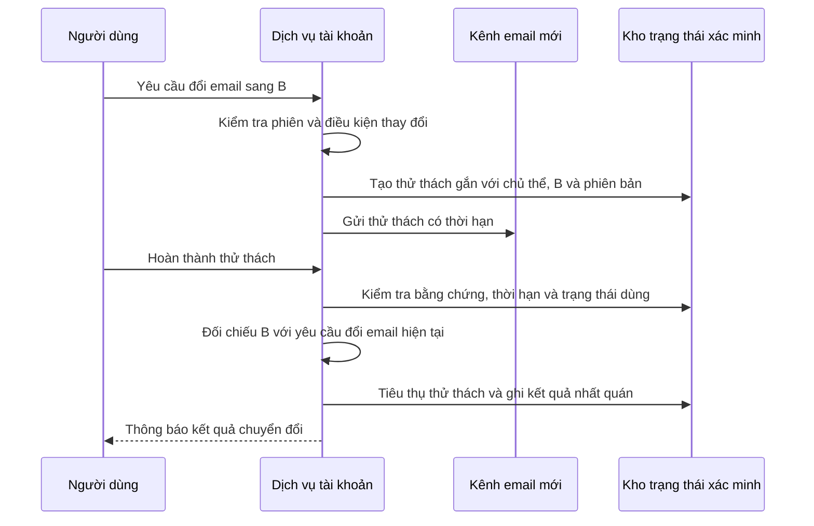

# Verified identity

## Mục tiêu bài học

Trong một hệ thống quản lý danh tính và quyền truy cập (IAM), người dùng có thể khai tên, email, số điện thoại hoặc tổ chức mà họ thuộc về. Hệ thống cần phân biệt **thông tin được khai báo** với **thông tin đã được kiểm chứng theo một quy trình xác định**. Sự phân biệt này ảnh hưởng đến đăng nhập, khôi phục tài khoản, liên kết danh tính, cấp phát tài khoản và quyết định truy cập.

Bài học giúp bạn:

- Hiểu verified identity trong phạm vi một mô hình định danh.
- Phân biệt xác minh danh tính, xác minh thuộc tính, xác thực và cấp quyền.
- Mô tả một kết quả xác minh bằng chủ thể, thuộc tính, bằng chứng, nguồn xác minh và thời điểm.
- Thiết kế vòng đời xác minh mà không gắn nhãn “đã xác minh” cho toàn bộ tài khoản một cách mơ hồ.
- Nhận diện rủi ro khi dùng email đã xác minh, dữ liệu từ nhà cung cấp danh tính hoặc bằng chứng cũ.

## 1. Verified identity có nghĩa là gì?

**Verified identity là danh tính mà một hoặc nhiều khẳng định về nó đã được kiểm chứng theo một quy trình và phạm vi cụ thể.** Giá trị của kết quả phụ thuộc vào điều đã được kiểm chứng, cách kiểm chứng, bên thực hiện và điều kiện sử dụng kết quả đó.

Trong sản phẩm khác nhau, nhãn “verified” có thể mang ý nghĩa khác nhau. Vì vậy, không nên coi đây là một trạng thái có cùng bảo đảm trong mọi hệ thống.

Ví dụ:

- Ứng dụng đã kiểm tra người dùng có thể nhận mã tại một địa chỉ email.
- Doanh nghiệp đã đối chiếu tài khoản với hồ sơ nhân sự từ nguồn có thẩm quyền.
- Một quy trình đã kiểm tra bằng chứng để liên kết người đăng ký với danh tính ngoài đời thực.
- Dịch vụ đã xác minh một workload có thể sử dụng khóa riêng tương ứng với danh tính được cấp.

Các kết quả này không tương đương. Xác minh email không chứng minh họ tên pháp lý. Việc có hồ sơ nhân sự không tự chứng minh người đang gửi request là đúng nhân viên đó. Chứng minh quyền sử dụng một khóa không tự chứng minh mọi thuộc tính của tổ chức sở hữu khóa.

Một cách diễn đạt có ích hơn câu “người dùng đã được xác minh” là:

> Hệ thống đã xác minh khẳng định nào, về chủ thể nào, bằng phương pháp nào, vào thời điểm nào và được phép dựa vào kết quả đó cho mục đích gì?

### 1.1. Claim là đơn vị cần hiểu rõ

**Claim** là một khẳng định về chủ thể, chẳng hạn:

```text
identity-42 có email liên hệ là lan@example.invalid
identity-42 là nhân viên đang hoạt động của organization-a
workload-17 thuộc ứng dụng xử lý hóa đơn trong môi trường production
```

Mỗi claim có nguồn và mức độ tin cậy riêng. Tên hiển thị do người dùng tự nhập, email đã hoàn thành thử thách và trạng thái nhân viên lấy từ hệ thống nhân sự không nên được xử lý như các dữ liệu có cùng bảo đảm.

Verified identity không có nghĩa mọi claim trên hồ sơ đều đã được xác minh. Cũng không có nghĩa hệ thống biết toàn bộ sự thật về con người hoặc workload đằng sau tài khoản.

### 1.2. Xác minh luôn có giới hạn

Một kết quả xác minh thường chỉ hỗ trợ một kết luận hẹp:

```text
Đã hoàn thành thử thách gửi tới email X tại thời điểm T.
```

Nó không tự hỗ trợ những kết luận rộng hơn như:

```text
Người này có tên pháp lý đúng như hồ sơ.
Email X chỉ có một người sử dụng.
Người này sẽ luôn kiểm soát email X.
Người này được quyền quản trị tổ chức dùng tên miền của X.
```

Giữ đúng giới hạn của bằng chứng là yêu cầu quan trọng khi đưa kết quả xác minh vào chính sách IAM.

## 2. Phân biệt các khái niệm gần nhau

| Khái niệm | Câu hỏi chính | Ví dụ | Điều chưa thể suy ra |
| --- | --- | --- | --- |
| Khai báo danh tính | Chủ thể nói mình là ai, có thuộc tính gì? | Người đăng ký nhập email và họ tên | Các giá trị đó là đúng |
| Xác minh thuộc tính | Có cơ sở tin thuộc tính cụ thể này không? | Hoàn thành thử thách gửi qua email | Danh tính ngoài đời thực đã được kiểm chứng |
| Kiểm chứng danh tính, thường gọi là identity proofing | Có đủ bằng chứng liên kết người đăng ký với danh tính được khai báo không? | Quy trình kiểm tra bằng chứng và liên kết bằng chứng với người đăng ký | Mọi phiên đăng nhập tương lai đều an toàn |
| Xác thực, authentication | Người đang truy cập có chứng minh được quan hệ với danh tính hoặc thông tin xác thực đã đăng ký không? | Đăng nhập bằng passkey, mật khẩu hoặc cơ chế phù hợp | Người đó có mọi quyền trên hệ thống |
| Liên kết danh tính, federation | Ứng dụng có thể chấp nhận khẳng định nào từ một bên cung cấp danh tính? | Đăng nhập qua nhà cung cấp danh tính của doanh nghiệp | Mọi thuộc tính do bên đó gửi đều phù hợp để cấp quyền |
| Cấp quyền, authorization | Chủ thể được thực hiện hành động nào trên tài nguyên nào? | Cho phép đọc hồ sơ thuộc dự án được giao | Danh tính đã được kiểm chứng ngoài đời thực |

### 2.1. MFA không đồng nghĩa với kiểm chứng danh tính ngoài đời thực

MFA làm tăng bảo đảm của quá trình xác thực theo các yếu tố và cơ chế được sử dụng. Tuy nhiên, một tài khoản được tạo dưới tên giả vẫn có thể đăng nhập bằng nhiều yếu tố.

Ngược lại, một người đã trải qua quy trình kiểm chứng danh tính vẫn có thể mất quyền kiểm soát thông tin xác thực. Bằng chứng lúc đăng ký không thay thế việc bảo vệ đăng nhập, phiên và khôi phục tài khoản.

Do đó, cần mô tả riêng:

- Mức tin cậy về việc danh tính được gắn với đúng chủ thể.
- Mức tin cậy của lần xác thực hoặc phiên hiện tại.
- Mức tin cậy của nguồn và quá trình truyền khẳng định giữa các hệ thống.

Các chiều này có liên quan nhưng không thay thế nhau.

### 2.2. Chữ ký hợp lệ không biến mọi nội dung thành sự thật

Chữ ký hoặc cơ chế bảo vệ thông điệp có thể giúp xác định nguồn phát hành và phát hiện sửa đổi, khi được kiểm tra đúng trong quan hệ tin cậy đã cấu hình.

Nếu bên phát hành cho người dùng tự nhập họ tên mà không kiểm chứng, một token được ký đúng vẫn có thể mang họ tên tự khai. Bên nhận cần biết ý nghĩa của claim và quy trình mà bên phát hành thực sự đã áp dụng.

Nói cách khác, phải phân biệt **thông điệp thực sự đến từ nguồn đã tin cậy** với **nguồn đó đã kiểm chứng khẳng định theo mức yêu cầu**.

## 3. Tách chủ thể, định danh đăng nhập và thuộc tính đã xác minh

Trong mô hình định danh, một chủ thể có thể có nhiều cách đăng nhập và nhiều thuộc tính liên hệ. Không nên dùng một email làm đại diện cho tất cả các khái niệm này.

Ví dụ minh họa:

```text
Chủ thể nội bộ: identity-42
├── Tài khoản nội bộ: account-81
├── Liên kết với nhà cung cấp danh tính: issuer-a + subject-963
├── Email hiện tại: lan@example.invalid
│   └── Kết quả xác minh: verification-107
└── Tư cách thành viên: organization-a
    └── Nguồn có thẩm quyền: hệ thống nhân sự của organization-a
```

Trong sơ đồ này:

- `identity-42` là định danh nội bộ để gắn các quan hệ của chủ thể.
- Email là một thuộc tính có thể thay đổi.
- Liên kết với nhà cung cấp danh tính là một quan hệ đăng nhập riêng.
- Tư cách thành viên tổ chức là một khẳng định có vòng đời riêng.
- Kết quả xác minh phải gắn với đúng thuộc tính và giá trị đã kiểm chứng.

Nếu email đổi, không nên tạo ra một con người mới chỉ vì chuỗi email thay đổi. Cũng không được chuyển nguyên kết quả xác minh email cũ sang giá trị mới.

### 3.1. Một con người có thể có nhiều tài khoản

Một người có thể dùng tài khoản nhân viên, tài khoản quản trị đặc quyền và tài khoản thử nghiệm. Việc xác minh quan hệ của một tài khoản không tự động chứng minh quan hệ của những tài khoản khác.

Ngược lại, hai tài khoản có tên hiển thị giống nhau chưa đủ cơ sở để kết luận chúng thuộc cùng một người. Bất kỳ quyết định hợp nhất hoặc liên kết tài khoản nào cũng cần một quy trình và bằng chứng phù hợp.

### 3.2. Tư cách thành viên tenant là một quan hệ riêng

Trong ứng dụng nhiều tenant, xác minh rằng người dùng kiểm soát một email không tự chứng minh người đó được gia nhập một tenant cụ thể.

Tên miền email có thể là tín hiệu đầu vào cho một quy trình đã được quản trị cấu hình, nhưng không tự cấp quyền quản trị hoặc tư cách thành viên. Cần có nguồn xác nhận phù hợp, chẳng hạn lời mời hợp lệ, hệ thống nhân sự hoặc cấu hình liên kết danh tính được tenant phê duyệt.

## 4. Những loại xác minh thường gặp và phạm vi bảo đảm

### 4.1. Xác minh địa chỉ email hoặc số điện thoại

Thử thách gửi qua email hoặc điện thoại có thể hỗ trợ kết luận rằng bên hoàn thành thử thách có khả năng nhận hoặc sử dụng kênh đó tại thời điểm kiểm tra, với các giới hạn của cơ chế đã dùng.

Kết quả này không bảo đảm kênh chỉ có một người dùng. Hộp thư có thể được chia sẻ hoặc chuyển tiếp. Số điện thoại có thể được tái cấp. Kênh cũng có thể bị chiếm đoạt sau khi xác minh.

Do đó, `emailVerified = true` cần được hiểu là một kết quả có phạm vi cụ thể, gắn với đúng địa chỉ email. Nó không nên được diễn giải thành “mọi thông tin của chủ thể đều đáng tin” hoặc “có thể dùng email này để thực hiện mọi thao tác nhạy cảm”.

### 4.2. Kiểm chứng danh tính ngoài đời thực

Một quy trình identity proofing có thể xem xét:

- Bằng chứng có phù hợp và có dấu hiệu hợp lệ không?
- Thông tin trong bằng chứng có nhất quán với các nguồn được chấp nhận không?
- Có đủ cơ sở liên kết người đang tham gia quy trình với danh tính trong bằng chứng không?

Việc chỉ nhận một ảnh tài liệu chưa tự chứng minh đã trả lời đủ các câu hỏi trên. Bản chụp có thể không chính xác, không còn giá trị hoặc thuộc về người khác.

Mức bằng chứng và quy trình cần tương ứng với mục đích sử dụng. Một diễn đàn có thể chỉ cần tài khoản và kênh liên hệ; một quy trình truy cập nhạy cảm có thể cần kiểm chứng chặt hơn. Không có yêu cầu chung rằng mọi hệ thống IAM đều phải thu giấy tờ cá nhân.

### 4.3. Xác minh quan hệ với tổ chức

Khẳng định “là nhân viên đang hoạt động” có thể dựa trên nguồn có thẩm quyền của doanh nghiệp. Quan hệ đó khác với việc người dùng chỉ có một email mang tên miền công ty.

Cần xác định rõ:

- Nguồn nào được phép xác nhận tư cách thành viên?
- Khẳng định áp dụng cho tổ chức hoặc tenant nào?
- Độ trễ cập nhật khi chuyển vị trí hoặc nghỉ việc là bao lâu?
- Việc mất tư cách thành viên tác động đến cấp phát tài khoản và quyền ra sao?

Một xác nhận từng đúng ở thời điểm vào làm không thể thay thế việc quản lý trạng thái nhân sự hiện tại.

### 4.4. Xác minh danh tính workload

Với workload, chủ thể có thể là dịch vụ, tiến trình hoặc tác vụ tự động. Việc chứng minh khả năng sử dụng khóa tương ứng có thể xác thực quan hệ với thông tin xác thực đã cấp.

Để tin thêm rằng workload thuộc đúng ứng dụng, môi trường hoặc tài khoản hạ tầng, hệ thống còn cần một cơ chế cấp phát và nguồn thuộc tính đáng tin. Tên dịch vụ do workload tự gửi không phải bằng chứng đủ.

Ngay cả khi danh tính workload đã được xác minh, quyền của nó vẫn phải giới hạn theo trách nhiệm. Một dịch vụ được nhận diện đúng không vì thế được đọc mọi bí mật hoặc truy cập dữ liệu của mọi tenant.

## 5. Mô hình hóa một kết quả xác minh

Một cờ `verified` ở cấp tài khoản dễ làm mất thông tin cần thiết. Thay vào đó, có thể lưu kết quả xác minh như một đối tượng có phạm vi rõ ràng.

Ví dụ dưới đây là mô hình dữ liệu minh họa của ứng dụng, không phải schema bắt buộc của một tiêu chuẩn:

```json
{
  "verificationId": "verification-107",
  "subjectId": "identity-42",
  "claimName": "email",
  "verifiedValue": "lan@example.invalid",
  "attributeVersion": 3,
  "status": "VERIFIED",
  "verifierId": "local-email-verification-service",
  "method": "email-challenge",
  "verifiedAt": "2026-11-01T08:30:00Z",
  "validUntil": null,
  "evidenceRef": "verification-event-8801"
}
```

| Trường | Ý nghĩa |
| --- | --- |
| `subjectId` | Chủ thể mà kết quả được gắn vào |
| `claimName` và `verifiedValue` | Chính xác thuộc tính và giá trị đã kiểm chứng |
| `attributeVersion` | Phiên bản thuộc tính để phát hiện kết quả không còn khớp dữ liệu hiện tại |
| `status` | Trạng thái của kết quả theo vòng đời do ứng dụng định nghĩa |
| `verifierId` | Thành phần hoặc tổ chức thực hiện xác minh |
| `method` | Phương pháp đã dùng, với ý nghĩa được tài liệu hóa |
| `verifiedAt` | Thời điểm hoàn thành việc xác minh |
| `validUntil` | Hạn hiệu lực nếu chính sách đặt ra |
| `evidenceRef` | Tham chiếu tới dấu vết hoặc bằng chứng được quản lý riêng |

`validUntil = null` trong ví dụ chỉ có nghĩa không đặt hạn tĩnh ở trường này. Nó không có nghĩa kết quả chắc chắn còn phù hợp mãi mãi. Thay đổi giá trị, thu hồi hoặc thay đổi chính sách vẫn có thể khiến kết quả không được chấp nhận.

### 5.1. Tách bằng chứng, kết quả và quyết định sử dụng

Ba thành phần này có trách nhiệm khác nhau:

1. **Bằng chứng hoặc dấu vết**: điều gì đã được kiểm tra và quy trình diễn ra ra sao.
2. **Kết quả xác minh**: khẳng định nào đã được chấp nhận, về ai, bằng phương pháp nào.
3. **Quyết định sử dụng**: kết quả đó có đủ cho thao tác hiện tại không.

Một kết quả có thể đủ để gửi thông báo thông thường nhưng chưa đủ để liên kết hai tài khoản hoặc khôi phục quyền quản trị. Chính sách sử dụng không nên bị ẩn trong một cờ dùng chung.

### 5.2. Ghi nhận mức bảo đảm theo tiêu chí rõ ràng

Nếu hệ thống dùng nhãn như `basic` hoặc `enhanced`, phải mô tả cụ thể quy trình và điều kiện của từng nhãn. Không nên giả định “mức 2” của nhà cung cấp A tương đương “mức 2” của nhà cung cấp B.

Ứng dụng cần biết nguồn nào được chấp nhận cho loại claim nào và yêu cầu nào. Việc ánh xạ mức bảo đảm là một phần của chính sách tin cậy, không chỉ là so sánh hai chuỗi giống nhau.

## 6. Quy trình minh họa: xác minh và đổi email

Giả sử tài khoản `account-81` đã có email A được xác minh. Người dùng muốn đổi sang email B.

Mục tiêu của quy trình là chứng minh khả năng nhận thử thách tại **B**, gắn đúng kết quả với **chủ thể đang đổi email**, đồng thời không làm sai trạng thái của A khi B còn chờ xác minh.

### 6.1. Tách email hiện tại và email đang chờ

Một trạng thái có thể là:

```text
subjectId: identity-42
activeEmail: lan-old@example.invalid
activeEmailVerification: verification-107
pendingEmail: lan-new@example.invalid
pendingEmailVersion: 4
pendingVerification: challenge-209
```

Không nên ghi B đè lên A rồi giữ nguyên cờ `emailVerified = true`. Cách làm đó sẽ gắn kết quả của A sang giá trị chưa được kiểm chứng là B.

Tùy sản phẩm, có thể tạm thời giữ A làm kênh liên hệ đang hoạt động cho tới khi hoàn tất chuyển đổi. Chính sách phải xác định rõ khi nào A ngừng được dùng và B bắt đầu được dùng cho đăng nhập, thông báo hoặc khôi phục.

### 6.2. Các bước chính



Trong quy trình này:

- Người dùng không tự đặt trạng thái xác minh qua payload.
- Thử thách gắn với đúng chủ thể, giá trị đích, mục đích và phiên bản thay đổi.
- Thử thách có thời hạn; việc thử sai hoặc gửi lại cần được kiểm soát.
- Bằng chứng bí mật cần được bảo vệ; với token ngẫu nhiên do server cấp, có thể lưu giá trị băm phù hợp để kiểm tra thay vì lưu nguyên token.
- Việc đánh dấu đã dùng và chuyển trạng thái phải chống xử lý lặp hoặc chạy đua.

Yêu cầu xác thực lại hoặc tăng mức xác thực trước khi đổi kênh quan trọng phụ thuộc chính sách rủi ro. Hoàn thành thử thách tại B chỉ chứng minh khả năng sử dụng B theo phương pháp đó; nó không tự chứng minh người yêu cầu có quyền sửa tài khoản đích.

### 6.3. Mã giả cho bước xác nhận

Đoạn sau mô tả trách nhiệm kiểm tra, không phải mã nguồn hoàn chỉnh hoặc yêu cầu phải dùng một công nghệ cụ thể:

```text
function confirmPendingEmail(presentedChallengeId, presentedProof):
    begin transaction:
        challenge = loadChallengeForConsistentUpdate(presentedChallengeId)

        require challenge exists
        require challenge.purpose == CHANGE_EMAIL
        require challenge.status == PENDING
        require challenge has not expired
        require challenge is not blocked by attempt policy
        require proofMatches(challenge, presentedProof)

        subject = loadSubjectForConsistentUpdate(challenge.subjectId)
        require subject is eligible for this change
        require subject.pendingEmail == challenge.targetValue
        require subject.pendingEmailVersion == challenge.attributeVersion

        enforceAccountPolicyForEmailChange(subject, challenge)
        enforceAddressConflictPolicy(subject, challenge.targetValue)

        result = createVerificationResult(
            subjectId = subject.id,
            claimName = "email",
            verifiedValue = challenge.targetValue,
            attributeVersion = challenge.attributeVersion
        )

        activateNewEmailAndBindResult(subject, result)
        markChallengeConsumed(challenge)
        recordVerificationOutcomeReliably()
    commit transaction
```

Các điều kiện `require` chỉ cho phép tiếp tục khi kiểm tra thành công. Luồng thất bại phải không thay đổi email hoặc tạo kết quả xác minh thành công; số lần thử sai cần được ghi nhận theo cơ chế nhất quán phù hợp.

Mã giả bỏ qua chi tiết gửi lại thử thách, giới hạn tần suất và giao diện báo lỗi. Những trách nhiệm đó vẫn cần được thiết kế khi triển khai.

### 6.4. Vì sao phải gắn phiên bản?

Giả sử người dùng yêu cầu đổi A sang B, sau đó đổi ý và yêu cầu A sang C. Liên kết xác nhận B cũ vẫn có thể được mở sau đó.

Nếu hệ thống chỉ kiểm tra token “đúng” rồi đánh dấu email hiện tại là đã xác minh, kết quả của B có thể bị áp dụng nhầm cho C. Đối chiếu giá trị và phiên bản giúp ngăn việc đó. Chính sách gửi lại hoặc thay đổi địa chỉ cũng cần quy định thử thách cũ nào bị vô hiệu hóa.

### 6.5. Hết hạn thử thách khác với hết hiệu lực kết quả

Thử thách có thời hạn để giới hạn cơ hội sử dụng bằng chứng đang chờ. Sau khi hoàn tất, kết quả xác minh có vòng đời riêng.

Không nên dùng cùng một trường `expiresAt` mà không phân biệt nó là hạn của mã xác nhận, của kết quả xác minh hay của phiên đăng nhập. Ba thời hạn này phục vụ ba mục đích khác nhau.

## 7. Khi chấp nhận kết quả từ nhà cung cấp danh tính

Ứng dụng có thể nhận claim từ nhà cung cấp danh tính qua SSO hoặc cơ chế liên kết danh tính. Lúc này có hai lớp kiểm tra:

1. Thông điệp có được chấp nhận đúng theo giao thức và quan hệ tin cậy không?
2. Các claim trong thông điệp có ý nghĩa và mức bảo đảm phù hợp với mục đích sử dụng không?

### 7.1. Kiểm tra thông điệp trước khi dùng claim

Việc giải mã một token để đọc JSON không phải là xác minh token. Thành phần nhận phải thực hiện quy trình kiểm tra của giao thức, thường bằng thư viện phù hợp và cấu hình đúng.

Tùy loại thông điệp và luồng, các kiểm tra liên quan có thể gồm nguồn phát hành, bên nhận dự kiến, thời hạn, bảo vệ mật mã và sự liên kết với yêu cầu đăng nhập ban đầu. Một chữ ký hợp lệ từ bên phát hành không được ứng dụng tin cậy vẫn không đủ để chấp nhận danh tính.

Không nên lấy một trường do client tự gửi trong JSON rồi xử lý như claim đã được nhà cung cấp danh tính xác nhận.

### 7.2. Hiểu đúng `email_verified`

Trong OpenID Connect, có thể gặp claim `email_verified`. Giá trị `true` thể hiện nhà cung cấp danh tính khẳng định đã thực hiện bước xác minh quyền kiểm soát email theo ngữ nghĩa của claim đó.

Khi dùng claim này, ứng dụng vẫn cần biết:

- Claim có nằm trong thông điệp đã được kiểm tra đúng không?
- Nhà cung cấp danh tính có được tin cậy cho loại khẳng định này không?
- Email nào đi kèm kết quả và kết quả có phù hợp với dữ liệu hiện tại không?
- Mục đích đang xử lý có cần bảo đảm mạnh hơn xác minh email không?

Không có claim không phải là có bằng chứng xác minh. `email_verified = true` cũng không chứng minh người dùng là quản trị viên tenant, nhân viên đang hoạt động hoặc có họ tên pháp lý như hồ sơ.

Claim này không có nghĩa toàn bộ danh tính đã trải qua identity proofing. Nó cũng không tự cung cấp thời điểm xác minh email nếu thông điệp không có thông tin tương ứng theo cơ chế đã thống nhất.

### 7.3. Dùng định danh của bên phát hành đúng phạm vi

Ứng dụng thường ánh xạ danh tính liên kết dựa trên bên phát hành và định danh chủ thể mà bên đó cung cấp, thay vì lấy email làm khóa gốc.

Trong bối cảnh OIDC, cặp `iss` và `sub` có vai trò quan trọng trong ánh xạ này. Tuy nhiên, định danh chủ thể có thể có phạm vi theo ứng dụng hoặc nhóm ứng dụng tùy cấu hình. Không nên giả định một người luôn có cùng `sub` ở mọi client.

Cần giữ nguyên ranh giới nguồn phát hành và quan hệ tin cậy khi ánh xạ. Chuỗi `sub` giống nhau từ hai bên phát hành khác nhau không chứng minh đó là cùng một chủ thể.

### 7.4. Không tự động liên kết tài khoản chỉ vì trùng email

Giả sử tài khoản nội bộ có email `lan@example.invalid`. Một bên phát hành khác gửi một danh tính có cùng email. Việc trùng chuỗi email, kể cả có cờ đã xác minh, chưa tự trả lời được:

- Ai có thẩm quyền khẳng định quan hệ với tài khoản nội bộ?
- Hai kết quả có cùng ý nghĩa, độ mới và nguồn tin cậy không?
- Email có bị tái cấp hoặc dùng chung không?
- Liên kết sẽ làm lộ dữ liệu hoặc quyền của tài khoản nào?

Liên kết tài khoản cần một chính sách riêng, chẳng hạn chứng minh quyền kiểm soát các tài khoản liên quan hoặc một quy trình di chuyển có kiểm soát. Không nên để phép so sánh email tự quyết định việc hợp nhất danh tính và quyền.

## 8. Vòng đời của kết quả xác minh

Xác minh là một quá trình có thể thay đổi trạng thái. Một mô hình cục bộ có thể dùng:

| Trạng thái | Ý nghĩa minh họa |
| --- | --- |
| `PENDING` | Đang chờ hoàn thành quy trình |
| `VERIFIED` | Quy trình hoàn tất và kết quả được chấp nhận theo phạm vi đã ghi nhận |
| `FAILED` | Một lần thực hiện không đạt điều kiện |
| `EXPIRED` | Thử thách hoặc kết quả hết hạn theo loại đối tượng và chính sách tương ứng |
| `REVOKED` | Kết quả bị thu hồi hoặc không còn được chấp nhận |
| `SUPERSEDED` | Kết quả được thay bằng một phiên bản mới |

Các tên này là lựa chọn thiết kế của ví dụ. Không bắt buộc dùng chung một bảng trạng thái cho thử thách và kết quả; thường nên phân biệt chúng để tránh nhập nhằng.

### 8.1. Những sự kiện cần xét lại kết quả

- Giá trị thuộc tính thay đổi, chẳng hạn đổi email.
- Nguồn có thẩm quyền thay đổi tư cách thành viên tổ chức.
- Có dấu hiệu tài khoản hoặc kênh liên hệ bị chiếm đoạt.
- Nguồn xác minh không còn được tin cậy cho loại claim đó.
- Kết quả quá cũ so với yêu cầu của thao tác hiện tại.
- Phát hiện quy trình trước đó gắn sai bằng chứng với chủ thể.

Không phải mọi sự kiện đều làm mất hiệu lực mọi claim. Đổi email không tự làm sai ngày sinh đã được kiểm chứng; nghỉ việc không tự làm sai kết quả kiểm chứng tên. Cần cập nhật đúng phạm vi bị ảnh hưởng.

### 8.2. Lưu lịch sử nhưng không dùng lịch sử như trạng thái hiện tại

Một kết quả cũ có thể cần được giữ cho kiểm toán. Tuy nhiên, “từng được xác minh” khác với “đang có một kết quả được chấp nhận cho quyết định này”.

Mô hình tốt cho phép phân biệt:

```text
Đã xác minh email A trong quá khứ.
Email hiện tại là B.
Chưa có kết quả được chấp nhận cho B.
```

Nếu chỉ dùng trường `verifiedAt` ở cấp người dùng mà không gắn với giá trị, hệ thống dễ diễn giải lịch sử của A thành bằng chứng cho B.

### 8.3. Phiên và token có thể mang trạng thái cũ

Nếu phiên hoặc token chứa claim đã xác minh, việc cập nhật cơ sở dữ liệu không tự sửa mọi bản sao đang tồn tại.

Cần xác định cơ chế cập nhật hoặc vô hiệu hóa phù hợp: thời hạn phiên, thời hạn token, kiểm tra trạng thái phía server hoặc cơ chế thu hồi mà kiến trúc hỗ trợ. Đối với quyết định nhạy cảm, phải biết ứng dụng đang dùng dữ liệu hiện tại hay một ảnh chụp trước đó.

Việc một kết quả bị thu hồi có tác động đến phiên, kênh khôi phục hoặc quyền nào phải được định nghĩa rõ. Không nên giả định mọi thành phần tự đồng bộ tức thời.

## 9. Dùng verified identity trong quyết định truy cập

Kết quả xác minh là đầu vào của chính sách, không phải giấy phép truy cập chung.

Ví dụ một quy tắc truy cập cổng nội bộ có thể yêu cầu đồng thời:

```text
Chủ thể đã được xác thực theo yêu cầu của thao tác.
Tư cách thành viên tổ chức đang hoạt động, từ nguồn được chấp nhận.
Chủ thể có quyền thực hiện action trong tenant tương ứng.
Tài nguyên thuộc phạm vi mà chủ thể được cấp quyền.
Các điều kiện phiên và ngữ cảnh khác đều đạt.
```

Email đã xác minh không thay thế các điều kiện này. RBAC có thể cung cấp quyền qua vai trò; ABAC có thể xét thêm claim và thuộc tính. Dù dùng cơ chế nào, phải giữ đúng ý nghĩa và độ mới của đầu vào.

### 9.1. Không đủ bằng chứng khác với đã xác minh thất bại

Hệ thống nên phân biệt:

- Chưa có kết quả xác minh.
- Kết quả đã hết hạn hoặc không còn khớp thuộc tính.
- Kết quả từ nguồn không được chấp nhận cho mục đích này.
- Quy trình hiện tại thất bại.
- Không lấy được dữ liệu do lỗi hạ tầng.

Các tình huống đó có thể cần thông báo và cách xử lý khác nhau. Tuy nhiên, nếu thao tác bắt buộc có một kết quả xác minh được chấp nhận, việc không xác định được điều kiện đó không được tự biến thành cho phép.

### 9.2. Quyền xác nhận phải được kiểm soát riêng

Nếu có quy trình xác minh thủ công, thao tác phê duyệt kết quả cũng là một protected operation. Cần biết ai được xem bằng chứng, ai được phê duyệt, phê duyệt loại claim nào và trong phạm vi nào.

Không nên cấp cho mọi nhân viên hỗ trợ khả năng sửa trực tiếp `verified = true`. Một giao diện quản trị vẫn phải có kiểm tra quyền phía server, lý do thay đổi và dấu vết kiểm toán phù hợp.

## 10. Những lỗi thiết kế thường gặp

| Lỗi | Hệ quả | Nguyên tắc xử lý |
| --- | --- | --- |
| Client gửi `verified: true` và server lưu nguyên | Người gọi tự tạo kết quả xác minh | Chỉ thành phần được ủy quyền mới tạo hoặc chuyển trạng thái xác minh |
| Đổi email nhưng giữ cờ đã xác minh | Kết quả gắn nhầm giá trị | Ràng buộc kết quả với giá trị và phiên bản cụ thể |
| Thử thách không gắn chủ thể hoặc mục đích | Dùng bằng chứng cho tài khoản hoặc thao tác khác | Ràng buộc chủ thể, giá trị, mục đích và thời hạn |
| Token xác minh được dùng lại | Một bằng chứng tạo nhiều hiệu ứng ngoài dự kiến | Tiêu thụ một lần với kiểm soát đồng thời |
| Tin mọi token có chữ ký đúng | Chấp nhận nguồn hoặc bên nhận không phù hợp | Kiểm tra đầy đủ theo giao thức và cấu hình tin cậy |
| Trùng email thì hợp nhất tài khoản | Gộp nhầm danh tính, dữ liệu và quyền | Dùng quy trình liên kết tài khoản có bằng chứng phù hợp |
| Đã xác minh thì cấp quyền rộng | Tăng đặc quyền ngoài mục đích | Vẫn kiểm tra action, resource, tenant và điều kiện quyền |
| Không cập nhật khi nhân viên nghỉ việc | Quyền dựa trên quan hệ đã chấm dứt | Quản lý vòng đời claim và các quyền phụ thuộc |
| Dùng mọi kết quả xác minh như nhau | Chấp nhận bằng chứng yếu cho yêu cầu mạnh | Định nghĩa chính sách theo claim, nguồn, phương pháp và độ mới |

### 10.1. Khôi phục tài khoản có thể làm suy yếu toàn bộ bảo đảm

Một tài khoản được kiểm chứng kỹ lúc đăng ký vẫn có thể bị chiếm nếu quy trình khôi phục chỉ dựa vào thông tin công khai hoặc một kênh cũ không còn đáng tin.

Phải xem xét vòng đời liên tục: đăng ký, xác minh, gắn thông tin xác thực, đăng nhập, đổi kênh liên hệ và khôi phục. Đường thay thế yếu hơn có thể cho phép một người khác tiếp quản tài khoản mà không trải qua quy trình ban đầu.

Khi nhân viên hỗ trợ thay đổi kênh hoặc liên kết danh tính, quy trình đó cũng cần bằng chứng và thẩm quyền tương ứng với tác động.

### 10.2. Thông báo lỗi và nhật ký cũng cần có phạm vi

Thông báo quá chi tiết có thể tiết lộ email có tài khoản hay không hoặc trạng thái kiểm chứng của một người. Mức thông tin trả về phải phù hợp với đối tượng nhận và chính sách bảo vệ dữ liệu.

Nhật ký nội bộ có thể cần mã lý do để điều tra, nhưng không nên ghi mã xác nhận, token bí mật hoặc toàn bộ bằng chứng nhạy cảm. Kết quả xác minh có thể chứa dữ liệu cá nhân, vì vậy quyền đọc nhật ký và bản ghi này cũng cần được kiểm soát.

## 11. Bảo vệ dữ liệu trong quá trình xác minh

Thu thập nhiều dữ liệu không tự làm kết quả xác minh đáng tin hơn. Hệ thống cần biết từng dữ liệu phục vụ bước kiểm tra nào và có thật sự cần giữ lại không.

Các quyết định thiết kế cần bao gồm:

- Chỉ thu bằng chứng phù hợp với mục đích và mức bảo đảm cần đạt.
- Tách kết quả dùng trong vận hành khỏi bằng chứng nhạy cảm lưu riêng.
- Giới hạn ai được xem, xử lý hoặc sửa bằng chứng và kết quả.
- Xác định thời hạn lưu và cách xử lý khi kết thúc nhu cầu sử dụng.
- Có dấu vết cho thao tác xem, phê duyệt hoặc thu hồi quan trọng.
- Có đường xử lý trường hợp không hoàn thành được phương pháp thông thường, với tiêu chí và kiểm soát rõ ràng.

Một `evidenceRef` không có nghĩa mọi dịch vụ được phép truy xuất bằng chứng gốc. Dịch vụ nghiệp vụ có thể chỉ cần kết quả phù hợp, còn tài liệu hoặc dữ liệu chi tiết nằm trong phạm vi truy cập hẹp hơn.

## 12. Ví dụ tổng hợp

Lan tạo tài khoản trên cổng cộng tác của một doanh nghiệp. Xét các bước sau:

| Bước | Điều hệ thống biết thêm | Điều chưa được tự suy ra |
| --- | --- | --- |
| Lan nhập họ tên và email | Có dữ liệu do người đăng ký khai báo | Họ tên hoặc email đã được kiểm chứng |
| Lan hoàn thành thử thách email | Có kết quả về khả năng sử dụng email đó theo quy trình | Lan là nhân viên của doanh nghiệp |
| Nguồn nhân sự xác nhận Lan đang hoạt động | Có khẳng định về quan hệ với tổ chức | Lan được xem mọi dự án |
| Lan đăng nhập bằng cơ chế có MFA | Có thêm bảo đảm về lần xác thực theo cơ chế sử dụng | Mọi claim trên hồ sơ đều đã được kiểm chứng |
| Quản trị viên giao vai trò cho dự án P | Có quyền trong phạm vi đã giao | Quyền tự mở rộng sang dự án Q |
| Lan đổi sang email mới | Có yêu cầu thay đổi thuộc tính | Kết quả của email cũ tự áp dụng cho email mới |
| Lan nghỉ việc | Quan hệ nhân sự cần được cập nhật theo nguồn có thẩm quyền | Các phiên và quyền ở mọi hệ thống đã tự bị thu hồi ngay lập tức |

Ví dụ cho thấy kết quả xác minh, trạng thái xác thực, quan hệ tổ chức và quyền truy cập phải phối hợp với nhau. Mỗi thành phần có nguồn, thời điểm và vòng đời riêng.

## 13. Tự kiểm tra mức hiểu

### Câu hỏi 1: Email đã xác minh có chứng minh tên thật không?

**Trả lời:** Không. Nó hỗ trợ kết luận về email theo phương pháp đã dùng. Muốn tin họ tên đã được kiểm chứng, cần một kết quả và quy trình phù hợp cho claim đó.

### Câu hỏi 2: Một token được ký đúng có làm `verified = true` đáng tin không?

**Trả lời:** Chưa đủ. Cần kiểm tra thông điệp đúng theo giao thức, nguồn có được tin cậy không, claim `verified` có nghĩa gì và quy trình xác minh có đáp ứng mục đích đang xử lý không.

### Câu hỏi 3: Hai tài khoản có cùng email đã xác minh có nên tự động gộp không?

**Trả lời:** Không nên quyết định chỉ từ sự trùng khớp đó. Cần kiểm soát việc liên kết, nguồn khẳng định, phạm vi danh tính và quyền đối với các tài khoản liên quan. Email có thể dùng chung, đổi chủ hoặc được tái cấp.

### Câu hỏi 4: Xác minh từ năm trước còn dùng được không?

**Trả lời:** Phụ thuộc claim, thay đổi đã xảy ra và chính sách độ mới. Cần biết kết quả còn khớp giá trị hiện tại không, có bị thu hồi không và thao tác hiện tại có chấp nhận phương pháp cũng như thời điểm đó không.

### Câu hỏi 5: Một workload đã chứng minh được khóa riêng có được đọc mọi bí mật không?

**Trả lời:** Không. Chứng minh quan hệ với thông tin xác thực giúp nhận diện workload. Quyền đọc bí mật vẫn phải giới hạn theo danh tính, phạm vi tài nguyên và trách nhiệm của workload.

## Kết luận

Verified identity cần được hiểu qua các khẳng định cụ thể đã được kiểm chứng. Một kết quả hữu ích phải gắn đúng chủ thể, thuộc tính, giá trị, nguồn, phương pháp và thời điểm; đồng thời có vòng đời khi dữ liệu hoặc quan hệ tin cậy thay đổi.

Khi giữ rõ những ranh giới đó, hệ thống có thể dùng kết quả xác minh làm đầu vào cho đăng nhập, liên kết danh tính, cấp phát tài khoản và chính sách truy cập. Xác thực phiên hiện tại và kiểm tra quyền trên tài nguyên vẫn là các trách nhiệm cần được thực hiện riêng trong toàn bộ vòng đời IAM.
