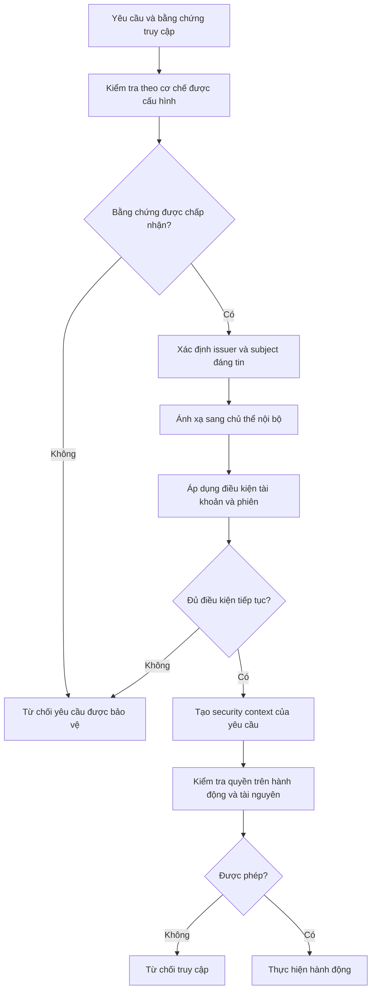

# Authenticated identity

## 1. Danh tính đã xác thực là gì?

**Authenticated identity** là danh tính mà một thành phần đã chấp nhận sau khi kiểm tra bằng chứng xác thực theo cơ chế và quan hệ tin cậy được cấu hình. Trong ứng dụng, kết quả này thường được biểu diễn bằng một **principal** cùng ngữ cảnh xác thực, rồi gắn vào phiên hoặc yêu cầu đang xử lý.

Ví dụ, một yêu cầu tự khai báo `userId = usr_710` chưa chứng minh người gửi được sử dụng danh tính đó. Sau khi kiểm tra thông tin đăng nhập, phiên hoặc token hợp lệ, ứng dụng mới có căn cứ gắn yêu cầu với `usr_710`.

Khái niệm này trả lời một câu hỏi có phạm vi rõ ràng: **hệ thống đã chấp nhận chủ thể nào, dựa trên bằng chứng nào, trong ngữ cảnh nào?** Nó không tự trả lời chủ thể được làm gì, cũng không bảo đảm người đang sử dụng thông tin xác thực là người sở hữu hợp pháp nếu thông tin đó đã bị đánh cắp.

Trong nền tảng IAM, authenticated identity là cầu nối giữa xác thực và kiểm soát quyền. RBAC, ABAC, quản lý phiên, SSO, OAuth/OIDC, danh tính workload và kiểm toán đều cần một cách biểu diễn chủ thể đáng tin cậy trước khi sử dụng thông tin đó.

Sau bài này, người học cần phân biệt được danh tính khai báo với danh tính đã được chấp nhận, hiểu các dữ kiện cần giữ trong ngữ cảnh xác thực và nhận ra khi nào một thông tin về người dùng chưa đủ tin cậy để đưa vào quyết định quyền.

## 2. Phân biệt các trạng thái của thông tin danh tính

Một hệ thống có thể nhìn thấy nhiều thông tin về danh tính trước khi xác thực thành công. Các thông tin đó không có cùng giá trị tin cậy.

| Khái niệm | Ý nghĩa | Ví dụ | Có thể dùng như principal đã xác thực không? |
| --- | --- | --- | --- |
| Claimed identity | Danh tính bên gửi tự khai báo | Tên đăng nhập trong form | Chưa thể |
| Identity record | Hồ sơ được lưu trong hệ thống | Bản ghi tài khoản `usr_710` | Việc bản ghi tồn tại chưa đủ |
| Presented evidence | Bằng chứng được gửi để kiểm tra | Cookie phiên, mật khẩu, token, chứng thư | Chưa thể chỉ vì nó đã xuất hiện |
| Authenticated identity | Danh tính được chấp nhận sau kiểm tra thích hợp | Principal được tạo sau khi phiên hợp lệ | Có, trong phạm vi tin cậy đã xác định |
| Authorization decision | Kết luận quyền cho yêu cầu cụ thể | Cho phép đọc hồ sơ của chính mình | Cần đánh giá riêng |

Một token có trường `sub` không tự tạo ra authenticated identity. Một chứng thư có tên dịch vụ cũng vậy. Bên nhận phải kiểm tra bằng chứng và xác định cách ánh xạ nó sang chủ thể trong miền quản lý của mình.

Cũng cần phân biệt **identity proofing** với authentication. Identity proofing kiểm chứng thông tin về con người trong quá trình đăng ký hoặc nâng mức bảo đảm danh tính. Authentication kiểm tra bằng chứng gắn với danh tính khi đăng nhập hoặc truy cập. Một tài khoản xác minh qua email có thể chứng minh quyền kiểm soát hộp thư theo quy trình đã dùng, nhưng chưa tự chứng minh danh tính pháp lý hoặc quan hệ lao động.

## 3. Danh tính đã xác thực luôn có phạm vi

### 3.1. Được xác thực bởi ai và được chấp nhận ở đâu?

Giả sử doanh nghiệp dùng một IdP để đăng nhập nhiều ứng dụng. IdP xác thực người dùng, nhưng từng ứng dụng vẫn cần xác minh kết quả nhận được theo giao thức và cấu hình của mình.

Không thể suy luận rằng “đã xác thực tại một nơi” đồng nghĩa với “mọi hệ thống đều phải tin”. Ứng dụng cần biết:

- Nhà cung cấp nào được tin để xác thực chủ thể.
- Bằng chứng được phát hành cho bên nhận nào.
- Danh tính bên ngoài được ánh xạ sang tài khoản nội bộ nào.
- Những phương thức và điều kiện xác thực nào đã được đáp ứng.
- Kết quả còn hợp lệ tại thời điểm sử dụng hay không.

Chữ ký hợp lệ từ một issuer không được cấu hình tin cậy không đủ để ứng dụng chấp nhận token. Tương tự, token phát hành cho ứng dụng A không tự trở thành bằng chứng hợp lệ để ứng dụng B sử dụng.

### 3.2. Chủ thể phải được định danh trong đúng miền

Tên hiển thị, tên đăng nhập và email có thể thay đổi hoặc trùng nhau giữa các hệ thống. Vì vậy, chúng không nên là căn cứ duy nhất để nhận diện một chủ thể ổn định.

Với danh tính liên kết qua OIDC, ứng dụng thường dùng cặp `iss` và `sub` để nhận diện chủ thể bên ngoài rồi ánh xạ sang mã nội bộ:

```text
(issuer, externalSubject) -> internalSubjectId
```

Ví dụ:

```text
("https://id.example.test", "opaque-subject-42") -> "usr_710"
```

Không mặc định cùng một giá trị `sub` do hai issuer cấp là cùng một người. Cũng không mặc định một người có cùng `sub` ở mọi ứng dụng, vì cách phát hành subject identifier có thể phụ thuộc vào cấu hình và phạm vi liên kết.

Việc liên kết hai tài khoản cần quy trình riêng. Trùng email không đủ để tự động gộp tài khoản và hợp nhất quyền.

### 3.3. Tenant là một ràng buộc khác với định danh chủ thể

Một người có thể tham gia nhiều tổ chức trên cùng nền tảng. Xác định đúng `usr_710` chưa xác định người đó có tư cách gì trong `org_alpha` hoặc `org_beta`.

Tenant người dùng chọn là một yêu cầu về phạm vi hoạt động. Máy chủ phải kiểm tra quan hệ thành viên và chính sách tương ứng trước khi sử dụng phạm vi đó. Không lấy một `tenantId` trong request rồi coi đó là thành viên đã được xác minh.

Authenticated identity có thể cung cấp thông tin phục vụ bước này, nhưng quyết định cho truy cập trong tenant vẫn cần các ràng buộc về quyền và trạng thái thành viên.

## 4. Từ bằng chứng đến principal của yêu cầu

Một luồng xử lý có thể được phân tích thành các bước logic:

1. Nhận yêu cầu và xác định cơ chế xác thực được endpoint chấp nhận.
2. Lấy bằng chứng từ vị trí đã quy định, như cookie phiên hoặc header chứa token.
3. Kiểm tra bằng chứng theo cơ chế đó.
4. Trích xuất định danh từ kết quả đã được kiểm chứng.
5. Ánh xạ chủ thể bên ngoài sang chủ thể nội bộ khi cần.
6. Áp dụng các điều kiện chấp nhận tài khoản và phiên của ứng dụng.
7. Tạo ngữ cảnh principal cho yêu cầu.
8. Đánh giá quyền trước khi thực hiện hành động được bảo vệ.



Các bước có thể được triển khai trong middleware, thư viện hoặc nhiều dịch vụ. Không nên hiểu đây là yêu cầu bắt buộc về thứ tự gọi của một framework cụ thể.

Một IdP có thể xác thực thành công, nhưng ứng dụng vẫn từ chối thiết lập phiên vì tài khoản nội bộ bị khóa hoặc chưa được phép sử dụng ứng dụng. Cần giữ rõ sự khác nhau giữa kết quả xác thực ở IdP và điều kiện chấp nhận truy cập tại ứng dụng.

Nếu endpoint cho phép truy cập ẩn danh, hệ thống cần biểu diễn trạng thái đó rõ ràng. Không biến người dùng ẩn danh thành một tài khoản đã xác thực chỉ để tránh giá trị rỗng trong mã.

## 5. Kiểm tra theo từng loại bằng chứng

### 5.1. Cookie phiên

Trong mô hình phiên phía máy chủ, cookie thường mang một giá trị tham chiếu. Máy chủ dùng giá trị đó để tìm trạng thái phiên, kiểm tra tính hợp lệ rồi lấy principal tương ứng.

Cookie chứa `userId=usr_710` do client có thể tự sửa không đủ để chứng minh danh tính. Nếu trạng thái phiên được lưu phía client, hệ thống cần cơ chế bảo vệ và kiểm tra phù hợp; không thể tin nội dung chỉ vì nó nằm trong cookie.

Phiên phải có vòng đời rõ ràng: thời hạn, giới hạn không hoạt động khi áp dụng, chấm dứt phiên và hành vi khi tài khoản thay đổi trạng thái. Mất cookie không đồng nghĩa máy chủ đã xóa phiên; xóa một phiên cũng không tự chấm dứt mọi phiên ở các ứng dụng SSO khác.

### 5.2. Token

Với JWT có chữ ký, việc đọc payload chỉ cho biết nội dung được trình bày. Bên nhận phải xác minh chữ ký với khóa tin cậy, thuật toán được phép, issuer, audience và các ràng buộc thời gian cùng yêu cầu của loại token đang sử dụng.

Token dạng opaque có thể cần cơ chế kiểm tra trạng thái hoặc ánh xạ phía máy chủ. Cách kiểm tra phụ thuộc vào giao thức và kiến trúc, không phải mọi access token đều có thể giải mã cục bộ.

Sau khi token được chấp nhận, cần hiểu token đang nói về chủ thể nào:

- Access token có thể gắn với một người dùng và một client được cấp quyền.
- Access token có thể chỉ biểu diễn quyền của một ứng dụng hoặc workload.
- `client_id` không tự trở thành mã người dùng.
- Một token thiếu thông tin về người dùng không cho phép ứng dụng tự suy ra người dùng từ dữ liệu client gửi thêm.

ID token của OIDC và access token có mục đích khác nhau. ID token phục vụ client trong luồng xác thực người dùng; không mặc định dùng nó làm access token cho API. Việc một access token hợp lệ cũng không tự chứng minh đã có một lần đăng nhập tương tác của con người.

### 5.3. Chứng thư và danh tính workload

Một dịch vụ có thể xác thực bằng chứng thư, cơ chế chứng minh sở hữu khóa hoặc phương thức được nền tảng hỗ trợ. Không cần có người nhập mật khẩu để hình thành authenticated identity.

Khi dùng mTLS, hệ thống cần xác minh chứng thư và ánh xạ danh tính theo cấu hình tin cậy thích hợp. Không chỉ đọc một chuỗi tên trong chứng thư rồi chấp nhận mà bỏ qua việc kiểm tra hoặc cơ chế chứng minh sở hữu khóa.

Nếu TLS kết thúc tại proxy, ứng dụng phía sau không trực tiếp quan sát cùng một kết nối mTLS với client. Việc truyền danh tính từ proxy tới ứng dụng tạo thêm ranh giới tin cậy, cần bảo vệ riêng.

## 6. Biểu diễn một authenticated identity đủ dùng

Một ngữ cảnh minh họa có thể có dạng:

```json
{
  "principal": {
    "subjectId": "usr_710",
    "type": "human"
  },
  "externalIdentity": {
    "issuer": "https://id.example.test",
    "subject": "opaque-subject-42"
  },
  "authentication": {
    "authenticatedAt": "2026-11-25T02:00:00Z",
    "evidenceValidatedAt": "2026-11-25T02:05:00Z",
    "methods": ["password", "security-key"],
    "assurancePolicyId": "workforce-policy-v2"
  },
  "session": {
    "expiresAt": "2026-11-25T10:00:00Z"
  }
}
```

Đây là mô hình ứng dụng minh họa. Các tên trường và giá trị phương thức trong ví dụ không phải hợp đồng claims bắt buộc của OAuth/OIDC hoặc một thư viện cụ thể.

Những dữ kiện đáng giữ gồm:

| Dữ kiện | Mục đích |
| --- | --- |
| Mã chủ thể ổn định | Liên kết yêu cầu với bản ghi nội bộ |
| Loại principal | Phân biệt con người, workload và các loại được hỗ trợ |
| Nguồn xác thực hoặc định danh bên ngoài | Giữ phạm vi tin cậy và hỗ trợ truy vết |
| Thời điểm xác thực | Xét độ mới của lần xác thực khi cần |
| Thời điểm kiểm tra bằng chứng | Biết khi nào bằng chứng của yêu cầu đã được chấp nhận |
| Phương thức hoặc mức bảo đảm | Áp dụng chính sách yêu cầu xác thực tăng cường |
| Ràng buộc phiên và delegation, nếu có | Giữ vòng đời và quan hệ hành động thay mặt |

Không phải hệ thống nào cũng cung cấp đầy đủ các dữ kiện này. Nếu nguồn không cung cấp một thông tin đáng tin, không tự điền giá trị giả để làm cho ngữ cảnh trông đầy đủ.

### 6.1. Thời điểm kiểm tra token khác thời điểm xác thực người dùng

API có thể kiểm tra một token lúc 09:00, trong khi người dùng đã xác thực từ 07:00. Không được lấy 09:00 làm thời điểm người dùng vừa nhập lại yếu tố xác thực.

Tương tự, cấp access token mới bằng refresh token không tự chứng minh người dùng vừa thực hiện xác thực lại. Tính mới của token và tính mới của lần xác thực là hai thuộc tính khác nhau.

### 6.2. Phương thức xác thực cần được diễn giải theo hợp đồng tin cậy

Một số giao thức hoặc nhà cung cấp có thể cung cấp thông tin như `amr` và `acr`. Ứng dụng cần hiểu các giá trị theo hợp đồng và chính sách đã cấu hình; không kiểm tra một chuỗi bất kỳ rồi tự kết luận “đã có MFA đủ mạnh”.

Sinh trắc học có thể được dùng cục bộ để mở khóa authenticator. Bên nhận có thể thấy bằng chứng mật mã hoặc mức bảo đảm đã thỏa, chứ không nhất thiết nhận dữ liệu sinh trắc học.

Thông tin phương thức giúp đánh giá mức tin cậy của xác thực. Nó không tự cấp role quản trị hoặc quyền truy cập dữ liệu.

## 7. Giữ nguồn gốc và mức tin cậy của thuộc tính

Một authenticated identity có thể đi kèm nhiều thuộc tính, nhưng không phải thuộc tính nào cũng có thể dùng để quyết định quyền.

| Thuộc tính | Nguồn minh họa | Điều cần xác định |
| --- | --- | --- |
| Mã chủ thể | Kết quả xác thực và ánh xạ nội bộ | Có ổn định, đúng issuer và đúng tài khoản không? |
| Email | IdP hoặc hồ sơ người dùng | Có được xác minh không, có thể thay đổi không? |
| Tên hiển thị | Hồ sơ tự phục vụ | Thường phục vụ hiển thị, không chứng minh đặc quyền |
| Phòng ban | Hệ thống nhân sự | Nguồn này có thẩm quyền và dữ liệu có đủ mới không? |
| Role ứng dụng | Kho quyền hoặc ánh xạ nhóm | Ai được cấp, phạm vi nào, có còn hiệu lực không? |
| Tenant được chọn | Tham số request | Tư cách thành viên đã được kiểm tra ở máy chủ chưa? |

Ví dụ, một claim `department = finance` có chữ ký chỉ cho biết issuer đã phát hành giá trị đó trong bằng chứng được xác minh. Ứng dụng còn phải biết issuer có thẩm quyền xác nhận phòng ban hay chỉ chuyển tiếp giá trị người dùng tự khai.

Vì vậy, nên phân biệt:

- Dữ kiện xác định chủ thể.
- Dữ kiện mô tả lần xác thực.
- Thuộc tính hồ sơ để hiển thị.
- Thuộc tính dùng để quyết định quyền.

Có thể đặt chúng trong cùng một cấu trúc dữ liệu kỹ thuật, nhưng trách nhiệm và mức tin cậy phải rõ. Không đưa toàn bộ hồ sơ vào principal rồi mặc định mọi trường đều đã được xác minh với cùng mức bảo đảm.

## 8. Truyền security context qua các thành phần

### 8.1. Trong ứng dụng

Security context nên được tạo bởi thành phần xác thực đáng tin và có phạm vi rõ ràng cho từng yêu cầu hoặc phiên. Mã nghiệp vụ đọc principal từ ngữ cảnh đó, thay vì nhận một `userId` do client tự chọn làm danh tính người thực hiện.

Mã giả minh họa:

```text
function getOwnProfile(request):
    context = trustedAuthenticationContext(request)
    if context.authenticatedPrincipal is absent:
        return unauthenticatedResponse()

    subjectId = context.authenticatedPrincipal.subjectId

    decision = profilePolicy.canReadOwnProfile(
        subjectId,
        trustedAccountState(subjectId)
    )
    if decision is not allow:
        return deniedResponse()

    return profileRepository.findBySubjectId(subjectId)
```

Ngay cả thao tác “xem hồ sơ của mình” cũng cần chính sách phù hợp về trạng thái tài khoản và dữ liệu được trả. Principal là đầu vào đáng tin cho quyết định, không phải lệnh tự động bỏ qua authorization.

Không đặt principal của người dùng vào biến toàn cục dùng chung cho mọi yêu cầu. Khi dùng cơ chế lưu ngữ cảnh theo luồng hoặc theo tác vụ, phải quản lý việc truyền và dọn ngữ cảnh để tránh lẫn danh tính giữa các yêu cầu, nhất là trong xử lý bất đồng bộ.

### 8.2. Qua gateway hoặc proxy

Header như `X-User-Id` không tự có giá trị xác thực. Nếu client có thể gửi header đó trực tiếp tới backend, kẻ tấn công có thể tự khai báo danh tính người khác.

Nếu kiến trúc dùng proxy để truyền danh tính, cần ít nhất làm rõ:

- Backend xác thực và tin đúng proxy nào.
- Proxy loại bỏ hoặc thay thế các header danh tính do client bên ngoài gửi.
- Kênh truyền và nội dung ngữ cảnh được bảo vệ phù hợp.
- Không tồn tại đường đi trực tiếp cho phép bỏ qua proxy và giả mạo ngữ cảnh.
- Backend vẫn áp dụng các kiểm tra quyền thuộc trách nhiệm của mình.

Trong kiến trúc truyền token qua nhiều dịch vụ, token cần phù hợp với bên nhận và mục đích sử dụng. Không chuyển tiếp mọi token sang mọi dịch vụ theo thói quen.

### 8.3. Qua hàng đợi và tác vụ nền

Một job có thể do người dùng khởi tạo nhưng được workload thực thi sau đó. Cần phân biệt:

- Người đã yêu cầu công việc.
- Workload đang được xác thực để thực thi.
- Quyền hoặc delegation cho phép workload hành động thay mặt.
- Thời điểm cần kiểm tra lại quyền trước khi đọc, sửa hoặc phân phối dữ liệu.

Một trường `requestedBy` trong message chưa tự là bằng chứng xác thực. Nguồn message, quyền ghi vào hàng đợi và tính toàn vẹn của ngữ cảnh cũng phải được kiểm soát.

## 9. Nhiều danh tính và hành động thay mặt

### 9.1. Một người có thể có nhiều tài khoản

Cùng một người có thể có tài khoản làm việc thường ngày và tài khoản quản trị. Hai tài khoản có thể thuộc cùng hồ sơ con người nhưng vẫn có thông tin xác thực, phiên và quyền riêng.

Không tự hợp nhất quyền của chúng sau khi nhận ra cùng người sở hữu. Nếu người dùng muốn chuyển sang vai trò hoặc tài khoản đặc quyền, hệ thống cần quy trình rõ về cấp quyền, xác thực tăng cường và kiểm toán.

### 9.2. Actor và subject có thể khác nhau

Trong một luồng hỗ trợ khách hàng, nhân viên hỗ trợ có thể được phép thực hiện một số thao tác thay mặt người dùng. Khi đó cần lưu được ai thực sự hành động và thao tác có hiệu lực đối với ai.

```text
actor              = nhân viên hỗ trợ usr_support_12
effective subject  = khách hàng usr_customer_88
delegation scope   = xem trạng thái đơn hàng
```

Đây là cách diễn đạt logic, không phải định dạng token tiêu chuẩn. Quyền hành động thay mặt phải được cấp và kiểm chứng; không chấp nhận một `effectiveSubjectId` do client gửi rồi thay principal.

Nếu log chỉ ghi khách hàng, cuộc kiểm toán có thể hiểu sai rằng khách hàng tự thực hiện thao tác. Nếu chỉ ghi nhân viên hỗ trợ, lại có thể mất thông tin thao tác được thực hiện thay mặt ai. Hệ thống cần giữ cả quan hệ delegation và giới hạn của nó khi có yêu cầu này.

## 10. Authenticated identity có vòng đời và giới hạn

### 10.1. Xác thực thành công không kéo dài vô hạn

Danh tính đã được chấp nhận trong một phiên không đồng nghĩa ngữ cảnh đó hợp lệ mãi mãi. Các sự kiện như hết hạn phiên, đăng xuất, mất thiết bị, đặt lại yếu tố xác thực, khóa tài khoản hoặc thay quan hệ tin cậy có thể yêu cầu chấm dứt hoặc đánh giá lại ngữ cảnh.

Thời điểm sự kiện có hiệu lực phụ thuộc vào cơ chế phiên, token, đồng bộ và kiểm tra trạng thái. Khóa tài khoản trong một hệ thống không tự bảo đảm mọi access token đã phát hành lập tức bị từ chối ở nơi khác.

### 10.2. Xác thực lại không đồng nghĩa được thêm quyền

Ứng dụng có thể yêu cầu step-up authentication trước khi đổi MFA hoặc thực hiện thao tác nhạy cảm. Sau khi xác thực tăng cường thành công, authorization vẫn phải kiểm tra người đó có được làm thao tác này trên đối tượng này hay không.

Ngược lại, một người có role phù hợp nhưng ngữ cảnh xác thực không đạt yêu cầu hiện tại cũng có thể cần xác thực lại trước khi tiếp tục.

### 10.3. Bằng chứng bị đánh cắp giới hạn ý nghĩa của “đã xác thực”

Khi kẻ tấn công dùng bearer token còn được chấp nhận, API có thể thiết lập principal của tài khoản bị chiếm. Kết quả kỹ thuật là bằng chứng hợp lệ đã được trình bày, không phải bằng chứng tuyệt đối rằng chủ tài khoản hợp pháp đang trực tiếp hành động.

Vì vậy, ngoài kiểm tra xác thực, hệ thống còn cần bảo vệ thông tin xác thực, phiên và token, có khả năng thu hồi và theo dõi bất thường theo yêu cầu rủi ro. Không nên diễn giải cờ `authenticated = true` như sự chắc chắn tuyệt đối về con người phía sau thiết bị.

## 11. Những lỗi mô hình hóa thường gặp

| Lỗi | Hệ quả | Cách mô hình hóa phù hợp hơn |
| --- | --- | --- |
| Lấy `userId` trong request làm người thực hiện | Cho phép giả danh | Lấy principal từ ngữ cảnh đã được xác minh |
| Giải mã JWT rồi dùng ngay `sub` | Tin nội dung chưa được kiểm chứng | Xác minh token và ràng buộc trước khi ánh xạ |
| Dùng email làm khóa danh tính bất biến | Gắn nhầm tài khoản khi email thay đổi hoặc được cấp lại | Dùng mã nội bộ ổn định và liên kết có phạm vi |
| Dùng cùng `sub` giữa mọi issuer | Va chạm chủ thể giữa các miền | Giữ issuer cùng subject khi ánh xạ |
| Xem mọi access token là phiên người dùng | Nhầm danh tính ứng dụng với con người | Phân biệt principal và ngữ nghĩa token |
| Lấy thời điểm kiểm tra token làm thời điểm đăng nhập | Vượt yêu cầu xác thực gần đây | Giữ riêng thời điểm xác thực và kiểm tra bằng chứng |
| Gộp mọi thuộc tính vào nhóm “đã xác minh” | Dùng dữ liệu tự khai để cấp quyền | Theo dõi nguồn và thẩm quyền của thuộc tính |
| Xem principal đã xác thực là được phép mọi thao tác | Bỏ qua kiểm soát tài nguyên và tenant | Đánh giá authorization cho từng hành động |
| Chỉ ghi subject khi có delegation | Mất dấu người thực sự hành động | Ghi actor, subject và phạm vi hành động thay mặt |
| Giữ context cũ khi đổi tài khoản hoặc xử lý job khác | Lẫn danh tính giữa các lần thực thi | Quản lý phạm vi và vòng đời security context |

## 12. Các tình huống để tự phân tích

### Tình huống 1: token hợp lệ nhưng sai bên nhận

API nhận JWT có chữ ký hợp lệ từ issuer đã biết, nhưng audience không dành cho API đó.

**Phân tích:** chưa đủ căn cứ để API chấp nhận bằng chứng cho mục đích hiện tại. Không tạo principal chỉ vì chữ ký hợp lệ; cần áp dụng các ràng buộc của loại token và bên nhận.

### Tình huống 2: người dùng mới có cùng email người dùng cũ

Một nhân viên nghỉ việc, sau đó email cũ được cấp cho người mới. Ứng dụng tìm tài khoản bằng email rồi mở lại hồ sơ cùng quyền của người cũ.

**Phân tích:** ứng dụng đã dùng thuộc tính có thể được tái sử dụng như định danh bền vững. Cần ánh xạ chủ thể và xử lý vòng đời tài khoản bằng quy trình rõ ràng, không tự kế thừa quyền chỉ vì email giống nhau.

### Tình huống 3: refresh token tạo access token mới

Người dùng xác thực từ nhiều giờ trước. Client dùng refresh token nhận access token mới rồi yêu cầu đổi yếu tố MFA.

**Phân tích:** token mới không tự chứng minh lần xác thực người dùng vừa diễn ra. Nếu chính sách yêu cầu xác thực gần đây hoặc tăng cường, ứng dụng cần kiểm tra dữ kiện phù hợp hoặc yêu cầu thực hiện lại bước xác thực.

### Tình huống 4: workload gửi thêm tên người dùng

Dịch vụ báo cáo xác thực bằng danh tính workload và gửi JSON có `userId = usr_710`.

**Phân tích:** principal được xác thực là workload. Trường trong JSON không tự biến yêu cầu thành hành động của người dùng. Nếu cần hành động thay mặt, phải có cơ chế delegation và kiểm tra quyền tương ứng.

## 13. Gắn authenticated identity với kiểm toán

Một bản ghi truy cập hữu ích cần liên hệ được yêu cầu với principal, loại chủ thể, nguồn hoặc ngữ cảnh xác thực khi cần, cùng hành động và đối tượng được truy cập. Với delegation, cần giữ actor và subject tương ứng.

Không nên ghi toàn bộ security context theo thói quen. Nó có thể chứa dữ liệu cá nhân, token hoặc thông tin phiên nhạy cảm. Chỉ ghi những trường cần thiết, bảo vệ log và kiểm soát quyền truy cập vào log.

Khi phân tích một sự kiện, cần phân biệt ba kết luận:

1. Bằng chứng nào đã được hệ thống chấp nhận?
2. Danh tính nào đã được gắn vào yêu cầu?
3. Chính sách nào đã cho phép hoặc từ chối hành động?

Authenticated identity làm rõ hai câu đầu; authorization bổ sung câu thứ ba. Giữ rõ ranh giới này giúp việc cấp quyền, quản lý phiên, liên kết danh tính và điều tra sự cố có căn cứ thay vì chỉ dựa vào một cờ “đã đăng nhập”.
