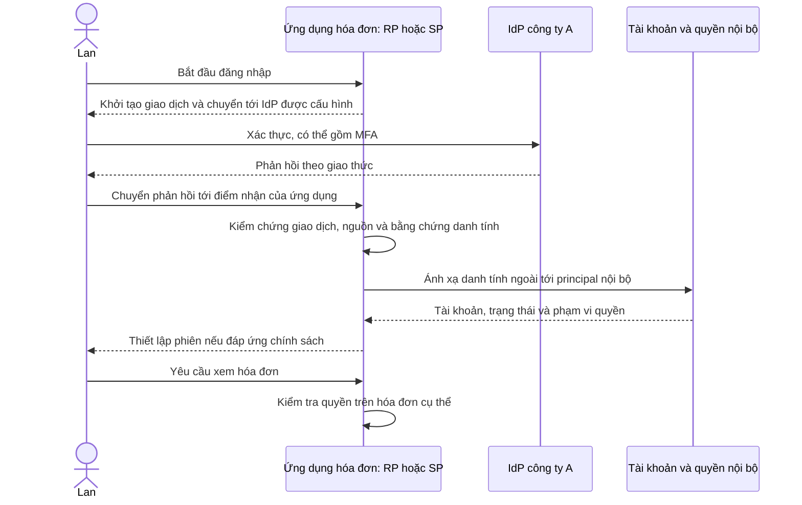
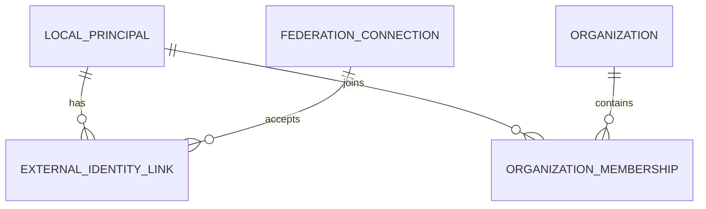
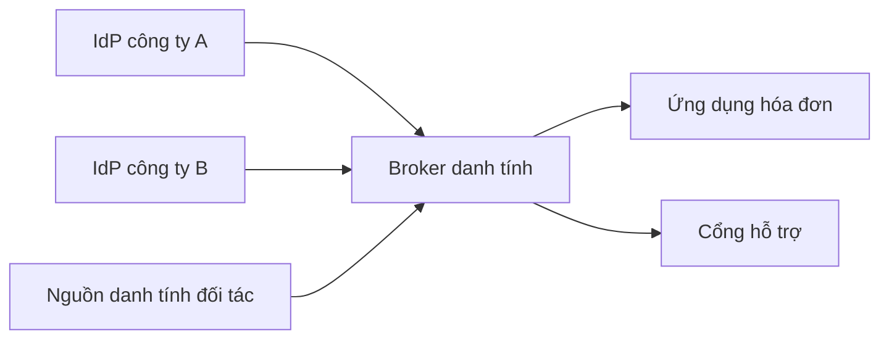

# Federated identity

## Mục tiêu bài học

Trong chương **Mô hình định danh**, bài học này giải thích cách một hệ thống sử dụng danh tính được quản lý ở một hệ thống khác. Sau khi học, bạn có thể:

- Mô tả federated identity và quan hệ tin cậy giữa bên cung cấp danh tính với ứng dụng sử dụng danh tính.
- Phân biệt federation, SSO, OAuth, xác thực cục bộ và cấp phát tài khoản.
- Xác định một danh tính bên ngoài bằng định danh có phạm vi phù hợp, thay vì dựa vào email.
- Giải thích cách ánh xạ claim, liên kết tài khoản, thiết lập phiên và thực thi quyền tại ứng dụng.
- Nhận biết các vấn đề về MFA, vòng đời truy cập, danh tính workload, kiểm toán và rủi ro khi nhà cung cấp danh tính bị sự cố.

## 1. Federated identity là gì?

**Federated identity — danh tính liên kết** là mô hình trong đó một hệ thống chấp nhận thông tin danh tính hoặc kết quả xác thực do một hệ thống khác cung cấp, dựa trên quan hệ tin cậy và quy tắc đã được thiết lập.

Ví dụ, công ty A sử dụng một nhà cung cấp danh tính để quản lý nhân viên. Khi nhân viên Lan mở ứng dụng hóa đơn của một bên cung cấp dịch vụ, ứng dụng có thể chuyển Lan tới hệ thống danh tính của công ty A để đăng nhập. Ứng dụng kiểm tra kết quả được gửi về, xác định Lan tương ứng với tài khoản nào trong ứng dụng, rồi quyết định Lan được truy cập dữ liệu nào.

Ứng dụng không cần giữ một bản sao mật khẩu công ty của Lan để thực hiện luồng này. Tuy nhiên, ứng dụng vẫn phải có cách nhận diện principal nội bộ, thiết lập phiên, kiểm tra quyền và kết thúc truy cập khi không còn hợp lệ.

Có thể nhìn federation như một chuỗi ba bước:

```text
Bên được tin cậy xác nhận danh tính
    -> ứng dụng kiểm chứng và ánh xạ danh tính
    -> ứng dụng áp dụng chính sách truy cập của mình
```

Điểm cốt lõi là **ủy thác một phần trách nhiệm xác nhận danh tính qua ranh giới hệ thống**. Federation không tự chuyển toàn bộ trách nhiệm bảo mật hay mọi quyền của bên ngoài sang ứng dụng.

### Khi nào mô hình này hữu ích?

- Nhân viên dùng tài khoản doanh nghiệp để truy cập nhiều ứng dụng nội bộ hoặc dịch vụ bên ngoài.
- Khách hàng của một ứng dụng SaaS sử dụng nhà cung cấp danh tính riêng của từng tổ chức.
- Đối tác truy cập một cổng cộng tác bằng tài khoản do tổ chức của họ quản lý.
- Người dùng đăng nhập bằng tài khoản từ một dịch vụ danh tính bên ngoài đã được ứng dụng chấp nhận.
- Workload sử dụng bằng chứng danh tính do nền tảng chạy nó phát hành để xin quyền truy cập tại hệ thống khác.

Các tình huống trên không có cùng mức bảo đảm. Một tài khoản tự đăng ký ở dịch vụ công cộng và một danh tính nhân viên được doanh nghiệp quản lý có thể khác nhau về quy trình ghi danh, xác thực, thuộc tính và vòng đời. Ứng dụng cần hiểu mình đang tin điều gì từ từng bên.

## 2. Các vai trò và đối tượng trong mô hình

| Khái niệm | Ý nghĩa | Ví dụ |
| --- | --- | --- |
| Chủ thể — subject | Thực thể mà thông tin danh tính đề cập đến | Nhân viên Lan hoặc một workload |
| Nhà cung cấp danh tính — Identity Provider, IdP | Bên xác thực hoặc cung cấp thông tin danh tính theo giao thức | Hệ thống danh tính của công ty A |
| Bên sử dụng danh tính — Relying Party, RP | Bên dựa vào kết quả đã kiểm chứng để nhận diện chủ thể | Ứng dụng hóa đơn khi dùng OIDC |
| Service Provider — SP | Tên thường dùng cho ứng dụng sử dụng danh tính trong SAML | Cổng dịch vụ tích hợp SAML |
| Nhà phát hành — issuer | Bên được xác định là nguồn phát hành một token hoặc assertion | Định danh nhà phát hành được ứng dụng cấu hình tin cậy |
| Claim hoặc thuộc tính | Một thông tin được bên phát hành cung cấp về chủ thể hay quá trình xác thực | Định danh chủ thể, tên hiển thị, thời điểm xác thực |
| Assertion | Thông điệp khẳng định thông tin theo một giao thức, thường gặp trong SAML | Assertion mang thông tin xác thực và thuộc tính |
| Principal nội bộ | Đối tượng mà ứng dụng dùng trong phiên, quyền và kiểm toán của mình | `user-781` trong ứng dụng hóa đơn |
| Broker danh tính | Thành phần trung gian nhận danh tính từ nhiều nguồn và cung cấp lại cho ứng dụng phía sau | Cổng danh tính dùng chung cho nhiều IdP khách hàng |

Một hệ thống có thể đóng nhiều vai trò. Broker có thể là RP hoặc SP khi kết nối lên IdP nguồn, đồng thời đóng vai IdP đối với ứng dụng phía sau. Vai trò cần được xét theo từng quan hệ, không chỉ theo tên sản phẩm.

### Ranh giới tin cậy trong một ví dụ



Sơ đồ biểu diễn trách nhiệm khái niệm. Một luồng thực tế có thể có trao đổi trực tiếp giữa backend ứng dụng và IdP, chẳng hạn đổi authorization code trong OIDC. Không được xem mọi dữ liệu trình duyệt chuyển về là bằng chứng hợp lệ; ứng dụng phải kiểm chứng theo giao thức và cấu hình tin cậy.

## 3. Federation khác SSO, OAuth và provisioning như thế nào?

| Khái niệm | Vấn đề chính được giải quyết | Điều không được suy ra tự động |
| --- | --- | --- |
| Xác thực cục bộ | Ứng dụng hoặc hệ thống của nó tự kiểm tra bằng chứng đăng nhập | Không đồng nghĩa có quan hệ tin cậy với tổ chức khác |
| Federation | Chấp nhận thông tin danh tính qua ranh giới hệ thống theo quan hệ tin cậy | Không tự cấp mọi quyền hoặc tạo mọi tài khoản cần thiết |
| SSO — Single Sign-On | Cho phép nhiều ứng dụng tận dụng một ngữ cảnh xác thực đã có | Không bảo đảm mọi ứng dụng có cùng phiên, quyền hoặc cách đăng xuất |
| OAuth 2.0 | Khung ủy quyền truy cập tài nguyên bằng access token | Bản thân OAuth 2.0 không định nghĩa một quy trình đăng nhập người dùng hoàn chỉnh |
| OIDC — OpenID Connect | Lớp danh tính xây trên OAuth 2.0, cung cấp kết quả xác thực cho ứng dụng | Không thay thế kiểm tra quyền trên dữ liệu nghiệp vụ |
| Provisioning | Tạo, cập nhật và vô hiệu hóa tài khoản hoặc cấu hình liên quan ở hệ thống đích | Không tự chứng minh người đang đăng nhập là chủ sở hữu tài khoản |

Federation thường được dùng để cung cấp SSO. Khi Lan đã có phiên tại IdP, một ứng dụng thứ hai có thể hoàn tất đăng nhập mà không yêu cầu nhập lại mật khẩu, tùy chính sách. Tuy vậy, federation có thể vẫn yêu cầu xác thực mới hoặc bổ sung MFA khi điều kiện thay đổi.

Federation cũng không đòi hỏi người dùng phải thấy một trải nghiệm hoàn toàn giống nhau ở mọi ứng dụng. Các ứng dụng có thể có quyền riêng, thời hạn phiên riêng và yêu cầu xác thực khác nhau.

Về vòng đời tài khoản, một ứng dụng có thể dùng federation để đăng nhập nhưng vẫn cần provisioning riêng để tạo tài khoản trước, cập nhật vai trò và vô hiệu hóa tài khoản. Các cơ chế đồng bộ như SCIM có thể đảm nhiệm một phần việc này; chúng không thay cho giao thức xác thực liên kết.

## 4. Quan hệ tin cậy phải có phạm vi rõ ràng

Câu “ứng dụng tin IdP” cần được phân tích thành những quyết định cụ thể.

### 4.1. Tin bên nào và cho mục đích nào?

Ứng dụng cần biết nguồn nào được chấp nhận, cấu hình giao thức tương ứng, cách kiểm chứng thông điệp và phạm vi tổ chức áp dụng. Một chữ ký hợp lệ từ bất kỳ khóa nào không đủ; khóa hoặc nguồn khóa phải thuộc quan hệ tin cậy mà ứng dụng đã thiết lập.

Cũng cần phân biệt tin vào một IdP với tin mọi khách hàng hoặc miền tổ chức mà hạ tầng IdP đó phục vụ. Với nhà cung cấp phục vụ nhiều tổ chức, ứng dụng phải ràng buộc đúng tổ chức hoặc connection được phép theo thiết kế của nhà cung cấp và cấu hình tích hợp.

### 4.2. Tin những claim nào?

Ứng dụng có thể chấp nhận IdP xác nhận một định danh chủ thể, nhưng không chấp nhận mọi giá trị `role` hay `department` từ nguồn đó để cấp quyền. Các thuộc tính cần có nguồn quản lý rõ ràng và ý nghĩa được thống nhất.

Ví dụ, IdP công ty A được phép cung cấp nhóm nhân viên của công ty A. Điều đó không cho IdP quyền tự gán vai trò quản trị toàn bộ nền tảng SaaS hoặc khai người dùng thuộc công ty B.

### 4.3. Tin ở mức bảo đảm nào?

Cần hiểu cách IdP ghi danh người dùng, xác thực, quản lý MFA và khôi phục tài khoản. Có chữ ký hợp lệ không chứng minh quy trình xác thực phía trước mạnh đến mức nào.

Nếu một thao tác đòi hỏi xác thực gần đây hoặc một mức bảo đảm cụ thể, ứng dụng cần có quy tắc chấp nhận thông tin xác thực từ IdP và cách yêu cầu bổ sung khi thiếu. Không nên suy ra “đã dùng MFA” chỉ từ tên nhà cung cấp hoặc việc người dùng truy cập qua federation.

### 4.4. Tin trong bao lâu và kết thúc thế nào?

Quan hệ tin cậy có vòng đời: khởi tạo, thay đổi endpoint, xoay vòng khóa, bổ sung thuộc tính và chấm dứt hợp tác. Mỗi thay đổi có thể tác động đến đăng nhập, phiên đã có và quyền của tài khoản được liên kết.

Một cấu hình federation là tài sản bảo mật nhạy cảm. Người có thể thay issuer, khóa tin cậy hoặc ánh xạ vai trò có thể ảnh hưởng đến những tài khoản mà ứng dụng chấp nhận.

## 5. Hai họ giao thức thường gặp: OIDC và SAML

### 5.1. OIDC

Trong OIDC, ứng dụng thường được gọi là RP hoặc client; IdP có thể được gọi là OpenID Provider. Một luồng authorization code có thể gồm:

1. Ứng dụng tạo giao dịch đăng nhập và gửi yêu cầu tới provider đã được cấu hình.
2. Provider xác thực người dùng theo chính sách, rồi trả authorization code về điểm nhận đã đăng ký.
3. Ứng dụng đổi code theo quy tắc của luồng và kiểm tra kết quả nhận được.
4. Sau khi kiểm chứng ID token cùng các ràng buộc giao dịch liên quan, ứng dụng ánh xạ chủ thể và tạo phiên nội bộ.

ID token phục vụ ứng dụng nhận kết quả xác thực. Access token phục vụ truy cập tài nguyên theo mục đích và đối tượng nhận của nó. Không được tùy tiện lấy một loại token thay cho loại kia.

Các ràng buộc như issuer, audience, thời hạn, giao dịch đăng nhập, `state`, `nonce` và PKCE có vai trò khác nhau, tùy luồng được dùng. Một cơ chế không tự thay cho tất cả cơ chế còn lại. Việc triển khai cần dựa trên thư viện giao thức phù hợp và cấu hình đầy đủ thay vì tự viết phần kiểm chứng mật mã.

### 5.2. SAML

Trong SAML federation cho ứng dụng web, SP có thể gửi yêu cầu xác thực tới IdP. IdP trả một phản hồi chứa assertion theo cấu hình quan hệ tin cậy. SP kiểm tra thông điệp, xác định chủ thể và ánh xạ vào tài khoản ứng dụng.

Những nội dung cần được kiểm chứng theo profile và cấu hình gồm nguồn phát hành, chữ ký trên đối tượng được yêu cầu, bên nhận và đối tượng sử dụng, điều kiện thời gian, sự liên hệ với yêu cầu ban đầu khi có, cùng kiểm soát phát lại. Dữ liệu dùng để đăng nhập phải chính là dữ liệu đã được thư viện kiểm chứng, không phải một phần khác chưa được bảo vệ trong cùng tài liệu.

Một số hệ thống hỗ trợ đăng nhập do IdP khởi tạo. Trường hợp này có đặc điểm ràng buộc giao dịch khác với luồng do SP khởi tạo, nên phải được xử lý như một luồng có chính sách riêng, không phải bỏ qua tùy ý các kiểm tra của luồng còn lại.

Chữ ký giúp bảo đảm nguồn và tính toàn vẹn trong phạm vi được ký; mã hóa giúp bảo vệ tính bí mật. Hai tính chất này khác nhau. Kênh HTTPS cũng không tự thay cho các kiểm tra giao thức mà RP hoặc SP phải thực hiện.

### 5.3. Chọn giao thức và mô hình dữ liệu là hai việc liên quan

| Góc nhìn | OIDC | SAML |
| --- | --- | --- |
| Vật mang thông tin danh tính thường gặp | ID token và claim | Assertion và thuộc tính |
| Tên vai trò ứng dụng thường gặp | RP hoặc client | SP |
| Định danh chủ thể | `sub` trong phạm vi issuer, với đặc điểm theo cấu hình provider | NameID hoặc thuộc tính định danh được hai bên thống nhất, có phạm vi theo profile và cấu hình |
| Điểm chung | Kiểm chứng nguồn, mục đích, hiệu lực và ánh xạ tài khoản | Kiểm chứng nguồn, mục đích, hiệu lực và ánh xạ tài khoản |

Việc cả hai hệ thống đều hỗ trợ một giao thức chưa đủ để khẳng định tích hợp sẽ đáp ứng nghiệp vụ. Cần thống nhất định danh, claim, quy tắc tạo hoặc liên kết tài khoản, yêu cầu bảo đảm xác thực và cách thu hồi.

## 6. Mô hình hóa danh tính ngoài và principal nội bộ

### 6.1. Một principal có thể có nhiều cách đăng nhập

Lan có thể có một principal nội bộ trong ứng dụng, nhưng dùng nhiều phương thức đăng nhập được cho phép: tài khoản doanh nghiệp liên kết, phương thức khôi phục hoặc một nhà cung cấp khác đã liên kết hợp lệ.

Không nên tạo mô hình buộc “mỗi email là một người” hoặc “mỗi provider luôn tương ứng một người mới”. Cần thể hiện rõ tài khoản nội bộ, liên kết ngoài và quan hệ thành viên tổ chức là những đối tượng khác nhau.



Các thực thể trong sơ đồ là mô hình logic, không bắt buộc tương ứng với bốn bảng cụ thể. Một membership có thể chứa trạng thái, thời hạn và quyền theo phạm vi tổ chức. Một liên kết danh tính ngoài không tự đại diện cho mọi membership của principal.

### 6.2. Định danh phải gắn với phạm vi phát hành

Trong OIDC, cặp `issuer` và `sub` là cơ sở để phân biệt chủ thể theo phạm vi nhà phát hành. Không được coi giá trị `sub` giống nhau từ hai issuer khác nhau là cùng người.

Ví dụ:

| Issuer | Subject | Cách hiểu |
| --- | --- | --- |
| `https://idp.company-a.example` | `person-482` | Một chủ thể do IdP công ty A xác định |
| `https://idp.company-b.example` | `person-482` | Chủ thể khác, dù chuỗi subject giống nhau |

Trong một số cấu hình OIDC, subject có thể khác nhau giữa các ứng dụng hoặc nhóm ứng dụng để hạn chế khả năng đối chiếu người dùng. Vì vậy, cùng một người không nhất thiết có cùng `sub` ở mọi client. Ứng dụng không nên tự suy luận hoặc gộp tài khoản dựa trên giả định ngược lại.

Với SAML, không nên lấy bất kỳ NameID nào làm khóa lâu dài mà chưa hiểu định dạng và cam kết ổn định của nó. Một định danh tạm thời có thể không phù hợp cho việc liên kết bền vững. Cần thống nhất cách xác định chủ thể và phạm vi nguồn phát hành theo tích hợp cụ thể.

### 6.3. Ví dụ dữ liệu liên kết

```text
LocalPrincipal
    principalId: user-781
    status: ACTIVE

FederationConnection
    connectionId: company-a-workforce
    allowedOrganization: company-a
    protocol: OIDC
    trustedIssuer: https://idp.company-a.example

ExternalIdentityLink
    connectionId: company-a-workforce
    issuer: https://idp.company-a.example
    subject: person-482
    principalId: user-781

OrganizationMembership
    principalId: user-781
    organizationId: company-a
    status: ACTIVE
    role: ACCOUNTANT
```

Đây là dữ liệu minh họa, không phải cấu hình của một sản phẩm. Hệ thống cần ngăn một danh tính ngoài bị liên kết đồng thời tới nhiều principal trái với chính sách. Việc tạo hoặc cập nhật liên kết phải xử lý cả trường hợp nhiều yêu cầu đăng nhập diễn ra đồng thời.

Các chuỗi định danh bảo mật cần được lưu và đối chiếu theo quy tắc giao thức. Không tự ý viết thường, cắt bớt hoặc chuẩn hóa issuer và subject như tên hiển thị nếu điều đó làm hai giá trị khác nhau bị coi là một.

## 7. Vì sao email không đủ để tự động liên kết tài khoản?

Email thuận tiện cho giao tiếp và hiển thị, nhưng có thể thay đổi, được tái cấp hoặc được quản lý với mức bảo đảm khác nhau giữa các nguồn. Việc một phản hồi có claim email cũng không có nghĩa ứng dụng đã xác định được chủ sở hữu tài khoản nội bộ tương ứng.

### Tình huống chiếm tài khoản do gộp theo email

Giả sử ứng dụng đã có tài khoản nội bộ của quản trị viên với địa chỉ `admin@company-a.example`. Một provider không thuộc quy trình quản lý của công ty A gửi về cùng chuỗi email. Nếu ứng dụng tìm tài khoản theo email rồi đăng nhập luôn, nó đã trao quyền tài khoản quản trị dựa trên lời khai từ nguồn không có thẩm quyền đối với liên kết đó.

Ngay cả khi provider cung cấp thông tin cho biết email đã được xác minh, ứng dụng vẫn cần xem xét provider nào xác minh, ý nghĩa của việc xác minh và quy tắc liên kết được cho phép. Trạng thái email đã xác minh không tự chứng minh hai danh tính ở hai miền tin cậy là cùng một tài khoản nghiệp vụ.

### Các cách liên kết có cơ sở rõ ràng

- Người dùng đã đăng nhập vào tài khoản nội bộ thực hiện một luồng liên kết riêng, có xác thực lại khi phù hợp, rồi chứng minh quyền kiểm soát danh tính ngoài muốn thêm.
- Quản trị viên có thẩm quyền chuẩn bị liên kết bằng định danh ổn định từ nguồn quản lý đáng tin cậy, theo quy trình cấp phát đã được phê duyệt.
- Một lời mời hoặc quy trình ghi danh gắn với tổ chức và danh tính được xác minh theo chính sách rõ ràng, trước khi cấp membership và quyền.

Liên kết tài khoản cần có ràng buộc giao dịch để tránh bị gắn nhầm với phiên hoặc người dùng khác. Hủy liên kết cũng cần kiểm soát: ai được thực hiện, có làm mất cách đăng nhập cuối cùng không và những phiên nào cần được xử lý sau thay đổi.

## 8. Ánh xạ claim sang thuộc tính và quyền

Một claim hợp lệ về mặt giao thức vẫn cần được diễn giải theo chính sách ứng dụng. Quy trình nên tách hai bước:

1. **Tiếp nhận thông tin từ nguồn đã được kiểm chứng:** lấy định danh và các thuộc tính mà connection được phép cung cấp.
2. **Áp dụng quy tắc nội bộ:** quyết định thuộc tính nào được cập nhật, membership nào được chấp nhận và quyền nào có hiệu lực trong phạm vi nào.

Ví dụ, IdP công ty A gửi một nhóm có tên `Finance`. Ứng dụng có thể ánh xạ nhóm đó thành vai trò kế toán trong công ty A. Điều này không có nghĩa mọi nhóm tên `Finance` từ mọi provider đều được cấp cùng quyền, hoặc người dùng được truy cập dữ liệu của mọi công ty.

| Thông tin nhận được | Cách xử lý có giới hạn rõ ràng | Điều cần tránh |
| --- | --- | --- |
| Định danh chủ thể | Tra cứu theo nguồn phát hành và quy tắc định danh của connection | Chỉ dùng subject không xét nguồn |
| Tên hiển thị | Cập nhật trường hồ sơ được cho phép | Coi tên là khóa để tìm tài khoản |
| Email | Dùng theo chính sách liên lạc, xác minh và liên kết riêng | Gộp tự động tài khoản có đặc quyền chỉ vì trùng email |
| Nhóm hoặc phòng ban | Ánh xạ theo cấu hình riêng của tổ chức và connection | Chấp nhận chuỗi `admin` như quyền quản trị toàn hệ thống |
| Thông tin xác thực | Đánh giá theo mức bảo đảm được hai bên thống nhất | Cho rằng mọi phiên federation đều có MFA hoặc vừa xác thực xong |
| Mã tổ chức | Đối chiếu với cấu hình và quan hệ thành viên đáng tin cậy | Cho phép một IdP tự khai quyền quản lý tổ chức khác |

### RBAC và ABAC sau federation

Federation giúp ứng dụng nhận diện chủ thể; RBAC và ABAC giúp ứng dụng quyết định quyền của chủ thể đó.

- Với **RBAC**, ứng dụng tổ chức quyền thành vai trò và gán vai trò theo dữ liệu nội bộ hoặc quy tắc ánh xạ đã chấp thuận.
- Với **ABAC**, ứng dụng đánh giá thêm thuộc tính của người dùng, tài nguyên và ngữ cảnh, như công ty sở hữu hóa đơn, trạng thái tài khoản và thời hạn được phân công.

Một biểu thức khái niệm có thể là:

```text
Cho phép đọc hóa đơn khi:
    principal nội bộ đang hoạt động
    AND membership tại công ty đích đang hoạt động
    AND có quyền invoice:read trong công ty đó
    AND hóa đơn thuộc phạm vi được phép
```

Không nên coi một claim về vai trò trong lần đăng nhập là quyền bất biến suốt đời tài khoản. Cần biết quyền được đánh giá lại khi nào, dữ liệu nào là nguồn quyết định và thay đổi được phản ánh đến phiên ra sao.

### Tránh biến quyền thay đổi hồ sơ thành quyền tự cấp phép

Nếu người dùng được tự sửa phòng ban hoặc nhóm trong một nguồn dữ liệu, ứng dụng không thể dùng trường đó để cấp quyền nhạy cảm mà không có kiểm soát bổ sung. Thuộc tính phục vụ phân quyền cần được đánh giá cả về nguồn phát hành lẫn người có thể thay đổi nó.

Điều này áp dụng cả khi thông điệp được ký đúng: chữ ký chứng minh thông tin đến từ nguồn được chấp nhận và không bị sửa trong phạm vi bảo vệ; nó không làm một quy trình quản lý thuộc tính yếu trở nên đáng tin cho mọi mục đích.

## 9. Tạo tài khoản: trước đăng nhập hay khi đăng nhập?

### 9.1. Cấp phát trước

Trong mô hình cấp phát trước, tài khoản hoặc membership được tạo từ quy trình quản trị, nguồn nhân sự, lời mời hoặc đồng bộ provisioning. Lần đăng nhập federation chỉ liên kết tới một tài khoản đã được chuẩn bị theo chính sách.

Cách này giúp kiểm soát ai được gia nhập trước khi có phiên truy cập. Tuy nhiên, cần giải quyết sai lệch đồng bộ, liên kết định danh ngoài và trường hợp IdP cho đăng nhập nhưng ứng dụng chưa có quyền sử dụng tương ứng.

### 9.2. Just-in-Time provisioning — JIT

**JIT provisioning** tạo tài khoản hoặc một phần hồ sơ khi người dùng đăng nhập liên kết thành công lần đầu, nếu chính sách cho phép. Xác thực thành công là một điều kiện đầu vào, không phải quyền tạo tài khoản ở mọi tổ chức.

Ví dụ, connection của công ty A có thể cho phép nhân viên từ đúng nguồn danh tính được tạo tài khoản với quyền cơ bản trong công ty A. Các vai trò duyệt hóa đơn hoặc quản trị cần quy trình riêng. Với đối tác hạn chế, ứng dụng có thể chỉ cho JIT khi đã có lời mời hợp lệ.

Cần xác định rõ:

- Connection nào được phép tạo tài khoản và tạo trong tổ chức nào.
- Định danh nào dùng để chống tạo trùng và liên kết lại ở lần đăng nhập sau.
- Thuộc tính nào được cập nhật tự động và thuộc tính nào do ứng dụng sở hữu.
- Quyền ban đầu là gì, có thời hạn không và ai chịu trách nhiệm.
- Khi dữ liệu đăng nhập không đủ hoặc mâu thuẫn, hệ thống từ chối hay chuyển sang quy trình xử lý nào.

### 9.3. JIT không thay cho quản lý vòng đời

Một người không đăng nhập lại có thể không kích hoạt quy trình cập nhật thuộc tính lúc đăng nhập. Nếu ứng dụng chỉ cập nhật quyền bằng JIT, việc chuyển phòng ban hoặc nghỉ việc có thể không được phản ánh kịp thời trong các phiên và quyền đang tồn tại.

Vì vậy, cần phối hợp nguồn vòng đời, đồng bộ hoặc cơ chế thông báo thích hợp, kiểm tra quyền lúc chạy và chính sách phiên. Federation, provisioning và thu hồi truy cập là những phần liên quan nhưng không thể đồng nhất.

## 10. Luồng nhận diện an toàn tại ứng dụng

Luồng dưới đây tập trung vào mô hình định danh sau khi nhận phản hồi OIDC. Đây là giả mã về trách nhiệm, không phải hướng dẫn tự triển khai giao thức:

```text
function finishFederatedLogin(callbackRequest):
    transaction = loadAndValidateLoginTransaction(callbackRequest)
    connection = loadApprovedConnection(transaction.connectionId)
    require(connection.status == "ACTIVE")

    result = protocolLibrary.verifyAndCompleteLogin(
        callbackRequest,
        transaction,
        connection.protocolConfiguration
    )

    externalKey = (result.verifiedIssuer, result.verifiedSubject)
    link = findExternalIdentityLink(connection.id, externalKey)

    if link does not exist:
        link = runApprovedEnrollmentOrLinkingPolicy(
            connection,
            result,
            transaction
        )

    principal = loadLocalPrincipal(link.principalId)
    require(principal.status == "ACTIVE")

    membership = loadMembership(principal.id, connection.organizationId)
    require(membership.status == "ACTIVE")

    applyPermittedAttributeMappings(connection, result, principal)
    enforceAuthenticationAssurancePolicy(result, connection)
    recordFederatedLogin(principal.id, connection.id, "SUCCESS")

    return createProtectedApplicationSession(principal.id, connection.id)
```

Một số trách nhiệm quan trọng nằm trong các hàm trừu tượng:

- Giao dịch đăng nhập phải được ràng buộc với đúng phiên khởi tạo, provider và loại thao tác. Đăng nhập và liên kết tài khoản không nên bị xử lý lẫn nhau.
- Thư viện phải kiểm chứng phản hồi theo giao thức và cấu hình tin cậy; không chỉ giải mã token rồi đọc claim.
- Quy trình ghi danh hoặc liên kết phải xác minh điều kiện của nó, không mặc định tìm tài khoản theo email rồi gán liên kết.
- Nếu kết quả không đáp ứng điều kiện, hệ thống dừng hoặc chuyển tới bước xác minh bổ sung thích hợp trước khi tạo phiên.
- Phiên mới cần được tạo theo chính sách bảo vệ phiên của ứng dụng. Các endpoint dữ liệu sau đó vẫn phải kiểm tra quyền trên tài nguyên.

Ví dụ dùng một connection gắn với một tổ chức để dễ theo dõi. Nếu một connection được thiết kế phục vụ nhiều tổ chức, bước chọn và xác minh membership phải được mở rộng rõ ràng; không được lấy tổ chức đích tùy ý từ đầu vào rồi coi là đã được chấp thuận.

## 11. Federation nhiều tổ chức và định tuyến đăng nhập

Ứng dụng SaaS có thể hỗ trợ nhiều khách hàng, mỗi khách hàng kết nối tới IdP riêng. Lúc đó, **chọn connection** là một bước bảo mật chứ không chỉ là tiện ích giao diện.

### 11.1. Chọn nguồn danh tính

Ứng dụng có thể sử dụng đường dẫn riêng của tổ chức, lựa chọn trên giao diện hoặc gợi ý từ miền email để định tuyến tới connection đã được cấu hình. Tuy nhiên, dữ liệu định tuyến chỉ giúp tìm nơi bắt đầu đăng nhập.

```text
Người dùng nhập email có miền company-a.example
    -> gợi ý connection của công ty A
    -> xác thực và kiểm chứng với connection được cấu hình
    -> xác minh tài khoản và membership nội bộ
```

Việc người dùng nhập một email công ty không chứng minh họ thuộc công ty đó. Tương tự, xác minh quyền kiểm soát tên miền phục vụ thiết lập connection không tự xác minh mọi tài khoản con người hoặc mọi quyền nghiệp vụ trong tổ chức.

### 11.2. Không để người gọi tự chọn nguồn tin cậy tùy ý

Ứng dụng không nên nhận một URL issuer bất kỳ từ người dùng rồi tự động coi đó là nguồn đăng nhập được phép. Endpoint, metadata và cơ chế lấy khóa phải xuất phát từ quy trình cấu hình tin cậy được kiểm soát.

Nếu cần khả năng khám phá động, chính khả năng đó phải có giới hạn và chính sách chấp nhận rõ ràng. Khám phá được một endpoint có cấu trúc hợp lệ không có nghĩa tổ chức đã cho phép endpoint ấy xác nhận nhân viên của mình.

### 11.3. Một người thuộc nhiều tổ chức

Lan có thể có membership ở công ty A và công ty B với những vai trò khác nhau. Ứng dụng cần giữ rõ ngữ cảnh đang hoạt động và kiểm tra quyền trong từng tổ chức. Không nên cộng toàn bộ vai trò thành một tập quyền toàn cục rồi áp dụng cho mọi dữ liệu.

Ngoài ra, nguồn đăng nhập có thể là điều kiện của membership. Ví dụ, công ty A chỉ cho phép truy cập dữ liệu của mình khi Lan đăng nhập bằng connection doanh nghiệp do công ty A quản lý. Một phương thức đăng nhập cá nhân đã liên kết với cùng principal không nhất thiết đáp ứng chính sách đó.

## 12. Federation qua broker hoặc identity hub

Thay vì mỗi ứng dụng kết nối trực tiếp mọi IdP, một tổ chức có thể dùng broker làm trung gian:



Broker có thể thống nhất giao thức, ánh xạ thuộc tính và giảm số tích hợp trực tiếp. Tuy nhiên, nó thêm một ranh giới tin cậy và trở thành thành phần có ảnh hưởng lớn.

### Những điều cần giữ rõ khi qua trung gian

- Ứng dụng phía sau đang trực tiếp tin broker, theo issuer và quy tắc định danh mà broker cung cấp.
- Broker phải kiểm chứng đúng từng IdP nguồn và ngăn claim từ tổ chức này bị diễn giải thành quyền của tổ chức khác.
- Nếu quyền phụ thuộc nguồn đăng nhập hoặc mức xác thực ở phía trước, broker cần truyền thông tin thích hợp theo hợp đồng tin cậy, và ứng dụng cần biết cách đánh giá.
- Cần có chiến lược duy trì ánh xạ tài khoản khi thêm, đổi hoặc bỏ IdP nguồn; không được vô tình đổi subject làm mất liên kết hoặc gộp nhầm người.
- Nhật ký phải hỗ trợ nối principal nội bộ, danh tính do broker phát hành và nguồn danh tính gốc trong phạm vi cần thiết.

Quan hệ tin cậy không tự có tính bắc cầu. Việc ứng dụng tin broker và broker có một kết nối mới không có nghĩa kết nối mới được phép cấp mọi loại người dùng hoặc quyền cho ứng dụng. Phạm vi các nguồn được chấp nhận phải được quyết định và thực thi.

## 13. Workload identity federation

Federation không chỉ áp dụng cho con người. Một workload có thể sử dụng bằng chứng danh tính từ nền tảng chạy nó để xin thông tin xác thực ngắn hạn ở hệ thống đích, thay vì lưu sẵn một khóa truy cập dài hạn.

Ví dụ, một tác vụ triển khai hoặc xử lý báo cáo được nền tảng cấp một token nhận diện workload. Hệ thống đích kiểm chứng nguồn phát hành, subject, đối tượng nhận và điều kiện được chấp nhận, rồi cấp khả năng truy cập giới hạn theo chính sách.

```text
Nền tảng chạy workload
    -> cấp bằng chứng danh tính có phạm vi
    -> bên đích hoặc dịch vụ trao đổi kiểm chứng
    -> cấp quyền hoặc thông tin xác thực ngắn hạn
    -> workload truy cập đúng tài nguyên được phép
```

Các ràng buộc cần mô tả chính xác workload nào được tin: môi trường, ứng dụng, tác vụ, không gian tên hoặc các thuộc tính thích hợp với nền tảng. Không nên tin mọi workload chỉ vì chúng cùng sử dụng một nhà phát hành chung.

Workload federation giảm nhu cầu phân phối bí mật dài hạn trong những thiết kế phù hợp, nhưng không tự bảo đảm ít quyền nhất. Nếu chính sách cho mọi subject từ nền tảng một vai trò quản trị, phạm vi ảnh hưởng vẫn rất rộng.

MFA là cơ chế gắn với xác thực người dùng theo các yếu tố tương ứng; không thể áp nguyên cách yêu cầu một người nhập mã MFA vào mọi tác vụ máy. Với workload, cần tập trung vào bằng chứng nguồn chạy, phạm vi quyền, thời hạn, người sở hữu và khả năng thu hồi.

## 14. Vòng đời truy cập, phiên và đăng xuất

Một lần đăng nhập federation thường dẫn đến nhiều đối tượng có vòng đời khác nhau: tài khoản IdP, liên kết danh tính, membership nội bộ, phiên IdP, phiên ứng dụng và các token được cấp.

| Thay đổi | Tác động cần xác định |
| --- | --- |
| Người dùng đổi email | Có cập nhật thông tin liên lạc hay ảnh hưởng liên kết không? Liên kết bền vững không nên phụ thuộc việc email giữ nguyên |
| Nhân viên chuyển nhóm | Nguồn quyền nào được cập nhật, quyền cũ kết thúc khi nào, phiên đang hoạt động có còn dùng dữ liệu cũ không? |
| Tài khoản IdP bị khóa | Đăng nhập mới, làm mới token, phiên ứng dụng và token đã cấp bị ảnh hưởng thế nào? |
| Membership nội bộ bị thu hồi | Ứng dụng có chặn truy cập trong tổ chức đó dù người dùng vẫn xác thực thành công ở IdP không? |
| Một liên kết ngoài bị xóa | Có kết thúc phiên sinh từ liên kết đó không, và còn phương thức đăng nhập được phép nào? |
| Connection bị chấm dứt | Ngừng nhận đăng nhập mới và xử lý tài khoản, phiên, khóa, quyền còn liên quan như thế nào? |

### 14.1. Đăng xuất có nhiều phạm vi

Đăng xuất ở ứng dụng có thể chỉ kết thúc phiên ứng dụng. Phiên tại IdP có thể vẫn còn, vì vậy một lần đăng nhập sau có thể được hoàn tất nhanh theo chính sách SSO.

Ngược lại, đăng xuất hoặc vô hiệu hóa ở IdP không mặc nhiên làm mọi ứng dụng kết thúc phiên tức thời. Khả năng đồng bộ đăng xuất phụ thuộc giao thức, cơ chế thông báo, cấu hình và cách từng ứng dụng xử lý. Các tab, thiết bị và tác vụ đã nhận token cũng có thể khác nhau về hiệu lực còn lại.

Vì vậy, cần đặt yêu cầu cụ thể về phạm vi đăng xuất và thu hồi, thay vì chỉ cung cấp một nút mang tên “đăng xuất toàn bộ” mà chưa có cơ chế tương ứng.

### 14.2. Xoay vòng khóa và xử lý sự cố nguồn danh tính

Khi IdP thay khóa ký, ứng dụng cần lấy và sử dụng khóa theo cơ chế tin cậy đã cấu hình, có chính sách cập nhật và xử lý lỗi phù hợp. Không được chấp nhận một khóa do thông điệp tự cung cấp nếu chưa có cơ sở tin cậy.

Nếu nghi ngờ khóa hoặc IdP bị xâm phạm, chỉ ngừng đăng nhập mới có thể chưa đủ. Cần đánh giá phiên đã được tạo, token còn hạn, tài khoản và vai trò đã được JIT hoặc ánh xạ trong khoảng bị ảnh hưởng. Việc thay khóa không tự đảo ngược những thay đổi đã xảy ra tại ứng dụng.

Nếu IdP không sẵn sàng, đăng nhập mới có thể thất bại. Các phiên hiện có có được tiếp tục hay không phải theo thiết kế và chính sách, không phải bỏ qua kiểm chứng để duy trì hoạt động. Với thao tác nhạy cảm, thiếu bằng chứng bắt buộc phải dẫn đến dừng hoặc yêu cầu xử lý bổ sung phù hợp.

## 15. Rủi ro thường gặp và điểm kiểm soát

| Rủi ro | Vì sao xảy ra | Điểm kiểm soát trong mô hình |
| --- | --- | --- |
| Chấp nhận phản hồi từ nguồn không được phép | Ứng dụng lấy issuer hoặc khóa tùy ý từ đầu vào | Connection được phê duyệt, kiểm chứng nguồn và khóa theo cấu hình tin cậy |
| Dùng token cho sai bên nhận | Không kiểm tra audience hoặc nhầm ID token với access token | Kiểm tra loại bằng chứng, bên nhận và mục đích theo giao thức |
| Gắn phản hồi vào sai giao dịch | Thiếu ràng buộc giữa lần khởi tạo và lần hoàn tất đăng nhập | Quản lý giao dịch và dùng các cơ chế ràng buộc của luồng đúng cách |
| Phát lại thông điệp | Bằng chứng còn hiệu lực bị sử dụng ngoài giao dịch hoặc phạm vi được phép | Kiểm tra thời gian, ràng buộc giao dịch và chống phát lại theo giao thức |
| Chiếm tài khoản qua trùng email | Tự liên kết với tài khoản có sẵn dựa trên một thuộc tính không đủ | Liên kết bằng quy trình chứng minh và định danh nguồn ổn định |
| Vượt ranh giới tổ chức | Claim công ty hoặc vai trò ngoài được dùng toàn cục | Ràng buộc connection, nguồn claim, membership và phạm vi tài nguyên |
| Tăng quyền qua ánh xạ nhóm | IdP hoặc người dùng điều chỉnh thuộc tính được ánh xạ quá rộng | Giới hạn thẩm quyền ánh xạ, phân tách quyền quản trị và ghi nhận thay đổi |
| Quyền cũ tiếp tục có hiệu lực | Phiên, token hoặc dữ liệu đệm chưa phản ánh thay đổi | Chính sách cập nhật, thời hạn và thu hồi có hiệu lực rõ ràng |
| Nguồn danh tính bị xâm phạm | Bên được tin có thể phát hành bằng chứng sai | Giới hạn phạm vi tin cậy, quản lý đặc quyền và có kế hoạch xử lý phiên, quyền bị ảnh hưởng |

Federation có thể giúp giảm số nơi giữ mật khẩu và tập trung chính sách xác thực, nhưng cũng làm tăng tác động khi nguồn danh tính hoặc cấu hình tin cậy bị xâm phạm. Cần bảo vệ tài khoản quản trị IdP, quản trị connection và luồng khôi phục tương xứng với quyền mà chúng có thể ảnh hưởng.

## 16. Kiểm toán và quy trách nhiệm

Hệ thống cần trả lời được: ai đăng nhập, bằng nguồn nào, được ánh xạ vào principal nào và quyền được quyết định từ đâu.

Những sự kiện hữu ích gồm:

- Tạo, sửa và vô hiệu hóa connection; thay đổi nguồn khóa hoặc ánh xạ thuộc tính, vai trò.
- Bắt đầu và hoàn tất đăng nhập, từ chối do sai nguồn, không đủ mức xác thực hoặc tài khoản nội bộ bị khóa.
- Tạo hoặc hủy liên kết danh tính, tạo tài khoản bằng JIT và thay đổi membership.
- Cấp, thay đổi, thu hồi quyền; thực hiện thao tác đặc quyền liên quan đến federation.
- Hành động truy cập tài nguyên sau đăng nhập, gắn với principal và ngữ cảnh cần cho điều tra.

Ví dụ một sự kiện hoàn tất đăng nhập có thể chứa mã tương quan, connection, principal nội bộ, định danh ngoài cần thiết, kết quả và mã lý do. Cần kiểm soát dữ liệu cá nhân trong log và tránh ghi toàn bộ assertion, token, cookie hoặc bí mật.

Nhật ký cũng cần phân biệt **xác thực thất bại** với **xác thực thành công nhưng ứng dụng từ chối truy cập**. Hai trạng thái này có nguyên nhân và thành phần chịu trách nhiệm khác nhau. IdP có thể xác thực Lan chính xác, còn ứng dụng từ chối vì membership của Lan đã hết hạn; đây là hành vi phân quyền hợp lệ.

## 17. Ví dụ tổng hợp: khách hàng doanh nghiệp truy cập SaaS

Công ty A thuê nền tảng hóa đơn. Quản trị viên được ủy quyền thiết lập connection tới IdP của công ty; bên vận hành SaaS kiểm soát thẩm quyền thay đổi cấu hình và phạm vi tin cậy.

Luồng được thiết kế như sau:

1. Connection được gắn với công ty A, nguồn phát hành và các quy tắc claim được chấp nhận.
2. Khi Lan đăng nhập, ứng dụng kiểm chứng giao thức và tìm liên kết theo định danh ngoài có phạm vi nguồn rõ ràng.
3. Nếu chưa có liên kết, quy trình ghi danh kiểm tra điều kiện của công ty A trước khi tạo tài khoản hoặc membership; không gộp với tài khoản có sẵn chỉ vì cùng email.
4. Nhóm nhân viên tài chính có thể ánh xạ thành vai trò kế toán trong công ty A. Quyền duyệt và quyền quản trị dùng quy trình phê duyệt riêng.
5. Khi Lan đọc hóa đơn, API kiểm tra principal, membership, quyền đọc và công ty sở hữu hóa đơn. Đăng nhập federation thành công không cho phép đọc dữ liệu công ty B.
6. Khi Lan chuyển việc hoặc nghỉ việc, nguồn vòng đời kích hoạt cập nhật và thu hồi; hệ thống xử lý cả phiên hoặc phương tiện truy cập còn hiệu lực theo yêu cầu đã đặt ra.
7. Khi thay IdP hoặc chấm dứt hợp đồng, việc chuyển liên kết, giữ principal và xử lý quyền được quản lý như một thay đổi bảo mật có kiểm soát.

Trong mô hình này, IdP chịu trách nhiệm cho phần danh tính và xác thực mà nó được ủy thác. Ứng dụng giữ trách nhiệm với tài khoản nội bộ, membership, quyền trên tài nguyên và việc thực thi chính sách của mình.

## 18. Các câu hỏi để mô tả một liên kết danh tính đầy đủ

Trước một đề xuất tích hợp federation, hãy tìm câu trả lời cụ thể:

1. Ai là IdP, ai là RP hoặc SP, có broker không, và từng bên trực tiếp tin nguồn nào?
2. Giao thức và luồng nào được dùng; bằng chứng nào phải được kiểm chứng, dành cho bên nào và gắn với giao dịch nào?
3. Định danh chủ thể có phạm vi và độ ổn định ra sao; ứng dụng ánh xạ nó vào principal nội bộ như thế nào?
4. Khi trùng email, thiếu liên kết hoặc phát hiện danh tính đã gắn với tài khoản khác, quy trình xử lý là gì?
5. Claim nào được phép cập nhật hồ sơ, claim nào được dùng cho quyền, và ai có thể thay đổi nguồn claim đó?
6. Ai được tạo tài khoản hoặc membership, có JIT không, và quyền ban đầu được giới hạn thế nào?
7. Thay đổi vai trò, nghỉ việc, đăng xuất, mất khóa hoặc mất quan hệ tin cậy ảnh hưởng đến phiên và quyền khi nào?
8. Nhật ký có nối được nguồn danh tính, principal nội bộ, thay đổi quyền và hành động trên tài nguyên mà không làm lộ bí mật không?

Những câu trả lời này biến một kết nối đăng nhập thành một mô hình danh tính liên kết có phạm vi tin cậy, vòng đời và trách nhiệm rõ ràng trong toàn bộ hệ thống IAM.
