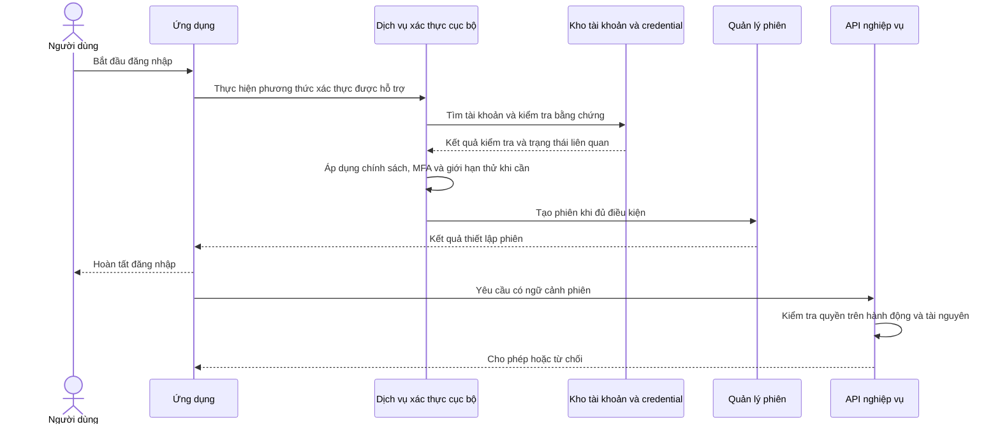

# Local identity

## 1. Local identity là gì?

**Local identity — danh tính cục bộ** là danh tính được tạo và quản lý trong miền định danh của chính hệ thống đang xét. Với phương thức đăng nhập cục bộ, hệ thống trực tiếp quản lý các phương tiện xác thực được gắn với tài khoản, thay vì chỉ dựa vào kết quả xác thực do một nhà cung cấp danh tính bên ngoài phát hành.

Ví dụ, một cổng thông tin cho phép người dùng đăng ký tài khoản, thiết lập mật khẩu hoặc passkey, khôi phục truy cập và đóng tài khoản ngay tại cổng đó. Hệ thống chịu trách nhiệm quản lý danh tính cục bộ cùng các đường xác thực này.

Từ “local” phải được hiểu theo **ranh giới hệ thống hoặc miền quản trị**. Một tài khoản có thể là cục bộ đối với nhà cung cấp danh tính, trong khi ứng dụng sử dụng nhà cung cấp đó nhìn nhận nó qua cơ chế liên kết danh tính. Do đó, trước khi phân loại, cần nói rõ đang xét hệ thống nào.

Local identity cũng không nhất thiết nằm trên một máy tính duy nhất. Kho tài khoản có thể được triển khai trên nhiều máy chủ hoặc vùng hạ tầng nhưng vẫn thuộc cùng một miền quản lý. Ngược lại, một ứng dụng chạy trên máy của tổ chức vẫn có thể sử dụng danh tính do bên ngoài xác thực.

Trong ngữ cảnh hệ điều hành, thuật ngữ này thường được dùng cho tài khoản do máy đó quản lý, phân biệt với tài khoản thuộc một miền danh tính dùng chung. Bài học tập trung vào mô hình IAM ở ứng dụng và dịch vụ, nơi các nguyên tắc về định danh, thông tin xác thực, quyền và vòng đời vẫn áp dụng tương tự.

Sau bài học, bạn có thể nhận diện local identity, mô hình hóa các thành phần liên quan, phân chia trách nhiệm xác thực và phân quyền, đồng thời đánh giá rủi ro khi vận hành hoặc chuyển đổi tài khoản cục bộ.

## 2. Phân biệt danh tính, tài khoản và phương thức đăng nhập

### 2.1. Danh tính không đồng nhất với tên đăng nhập

Danh tính biểu diễn một chủ thể trong phạm vi hệ thống. Tài khoản là bản ghi mà hệ thống dùng để quản lý chủ thể đó. Tên đăng nhập là một thông tin giúp tìm tài khoản trong quá trình đăng nhập.

Một tài khoản nên có **định danh nội bộ ổn định** để liên kết dữ liệu và quyền. Tên đăng nhập, email hoặc tên hiển thị có thể thay đổi mà không làm người dùng trở thành một chủ thể mới.

Ví dụ:

| Thành phần | Giá trị minh họa | Vai trò |
|---|---|---|
| Định danh nội bộ | `usr_781a` | Tham chiếu ổn định đến tài khoản |
| Miền tài khoản | `partner-portal` | Xác định phạm vi quản lý và tính duy nhất |
| Tên đăng nhập | `linh.nguyen` | Dùng để tìm tài khoản khi đăng nhập |
| Email liên hệ | `linh@example.test` | Liên lạc, xác minh hoặc khôi phục theo chính sách |
| Tên hiển thị | `Nguyễn Linh` | Hiển thị trong giao diện |

Các giá trị trong bảng là ví dụ. Không nên suy ra quyền chỉ từ tên đăng nhập hoặc email có dạng quen thuộc.

### 2.2. Credential là phương tiện xác thực

**Credential — thông tin xác thực** là phương tiện được dùng để chứng minh khả năng sử dụng một danh tính. Với tài khoản cục bộ, hệ thống có thể quản lý bộ kiểm tra mật khẩu, khóa công khai của passkey, phương thức MFA hoặc các phương tiện khác được hỗ trợ.

Một tài khoản có thể có nhiều phương thức xác thực. Xóa một passkey bị mất không nhất thiết phải xóa tài khoản; đổi mật khẩu cũng không nên tạo một định danh người dùng mới.

Local identity không đồng nghĩa với “chỉ có username và password”. Hệ thống vẫn có thể áp dụng MFA, xác thực bằng khóa công khai, kiểm soát phiên và yêu cầu xác thực bổ sung cho thao tác nhạy cảm.

### 2.3. Bản ghi người dùng cục bộ chưa đủ để kết luận xác thực cục bộ

Một ứng dụng dùng SSO thường vẫn lưu bản ghi người dùng để gắn đơn hàng, tùy chọn hoặc quyền nghiệp vụ. Trong trường hợp đó, việc bản ghi nằm trong cơ sở dữ liệu ứng dụng không có nghĩa ứng dụng trực tiếp quản lý phương thức đăng nhập của người dùng.

Ví dụ, ứng dụng nhận kết quả đăng nhập OIDC từ một nhà cung cấp danh tính, rồi ánh xạ chủ thể bên ngoài vào `usr_781a`. Ứng dụng có bản ghi tài khoản cục bộ, nhưng lần đăng nhập đó dựa trên xác thực liên kết.

Nếu cùng tài khoản còn cho phép đăng nhập bằng mật khẩu do ứng dụng quản lý, nó có thêm một đường xác thực cục bộ. Cần quản lý từng đường truy cập thay vì chỉ đặt một cờ chung rồi giả định tài khoản hoàn toàn cục bộ hoặc hoàn toàn liên kết.

### 2.4. Xác thực thành công chưa đồng nghĩa có quyền

Xác thực trả lời chủ thể đang truy cập là ai trong phạm vi tin cậy của hệ thống. Phân quyền quyết định chủ thể đó được thực hiện hành động nào trên tài nguyên nào.

Một tài khoản cục bộ có mật khẩu hợp lệ vẫn có thể bị tạm ngừng, chưa hoàn tất đăng ký hoặc không có quyền xem tài liệu đang yêu cầu. API cần kiểm tra trạng thái và quyền tương ứng với thiết kế, kể cả khi phiên đăng nhập còn tồn tại.

## 3. Những thành phần hệ thống phải quản lý

Một thiết kế local identity thường bao gồm các trách nhiệm sau:

| Thành phần | Trách nhiệm chính |
|---|---|
| Kho tài khoản | Lưu định danh, trạng thái, thông tin hồ sơ và phạm vi quản lý |
| Bộ xác thực | Kiểm tra bằng chứng theo phương thức đã đăng ký |
| Quản lý phương thức xác thực | Đăng ký, thay đổi, vô hiệu hóa và khôi phục credential |
| Quản lý phiên | Tạo phiên, gia hạn, hết hạn, kết thúc và thu hồi theo chính sách |
| Quản lý quyền | Gắn vai trò, nhóm hoặc thuộc tính được phép dùng để cấp quyền |
| Kiểm tra truy cập | Áp dụng chính sách trên từng hành động và tài nguyên |
| Quản lý vòng đời | Tạo, kích hoạt, tạm ngừng, đóng và xử lý tài khoản không còn nhu cầu |
| Kiểm toán | Ghi nhận đăng nhập, thay đổi credential, thay đổi quyền và hoạt động quan trọng |

Các trách nhiệm này có thể được thực hiện bằng thư viện hoặc dịch vụ đã được kiểm chứng. Việc hệ thống sở hữu danh tính cục bộ không đòi hỏi nhóm phát triển tự thiết kế thuật toán mật mã hoặc tự viết mọi cơ chế xác thực từ đầu.

### Luồng đăng nhập cục bộ ở mức khái niệm



Sơ đồ không mô tả chi tiết một giao thức cụ thể. Xác thực bằng mật khẩu và xác thực bằng passkey có cách trao đổi bằng chứng khác nhau. Điểm chung là hệ thống quản lý đường xác thực cục bộ và chỉ tạo phiên sau khi các điều kiện cần thiết đã được đáp ứng.

## 4. Mô hình dữ liệu cho local identity

### 4.1. Tách các thực thể có vòng đời khác nhau

Nếu gộp danh tính, mật khẩu, quyền và phiên vào một bản ghi khó kiểm soát, việc đổi một thành phần dễ kéo theo sai sót ở thành phần khác. Có thể mô hình hóa chúng thành các nhóm dữ liệu riêng:

| Thực thể | Dữ liệu quan trọng | Nguyên tắc |
|---|---|---|
| Tài khoản | Định danh nội bộ, miền, loại chủ thể, trạng thái | Định danh ổn định, không dùng lại cho chủ thể khác |
| Tên đăng nhập | Giá trị hiển thị, giá trị dùng để tra cứu, phạm vi duy nhất | Có quy tắc so khớp rõ ràng và được thực thi nhất quán |
| Phương thức xác thực | Loại phương thức, dữ liệu kiểm tra hoặc tham chiếu, trạng thái | Có thể thay đổi mà không thay danh tính |
| Vai trò hoặc quan hệ cấp quyền | Tài khoản, vai trò, tài nguyên hoặc phạm vi, thời hạn | Không nhận giá trị cấp quyền trực tiếp từ dữ liệu người dùng tự khai |
| Phiên | Tài khoản, thời điểm xác thực, thời hạn, trạng thái | Có thể hết hạn và thu hồi theo khả năng của thiết kế |
| Liên kết danh tính ngoài | Miền hoặc bên phát hành, định danh ngoài, tài khoản đích | Chỉ tạo liên kết sau khi xác minh đúng quan hệ sở hữu |
| Sự kiện kiểm toán | Chủ thể thực hiện, đối tượng bị tác động, hành động, kết quả, thời điểm | Không chứa credential có thể sử dụng để đăng nhập |

Đây là mô hình trách nhiệm, không bắt buộc mỗi dòng phải tương ứng với một bảng cơ sở dữ liệu. Cách lưu trữ phụ thuộc kiến trúc, nhưng quan hệ và ranh giới cần được giữ rõ ràng.

### 4.2. Ví dụ bản ghi tài khoản

```json
{
  "subject_id": "usr_781a",
  "realm_id": "partner-portal",
  "subject_type": "human",
  "login_name": "linh.nguyen",
  "display_name": "Nguyễn Linh",
  "status": "active"
}
```

Ví dụ này chỉ thể hiện tài khoản. Dữ liệu kiểm tra mật khẩu, khóa của phương thức xác thực, token khôi phục và phiên cần được quản lý theo mục đích riêng, với quyền truy cập phù hợp. Không nên trả các dữ liệu đó trong API hồ sơ người dùng.

### 4.3. Tính duy nhất cần có phạm vi

Hai tổ chức khác nhau có thể cùng có tên đăng nhập `admin`. Hệ thống cần xác định chúng thuộc hai miền độc lập hay một không gian tên dùng chung.

Nếu tên đăng nhập chỉ duy nhất trong từng miền, việc tra cứu phải xét cả miền và tên đăng nhập. Miền được dùng để xác thực phải được xác lập hoặc kiểm tra từ ngữ cảnh đáng tin cậy; không để một tham số tùy ý khiến người dùng chuyển sang tài khoản ở miền khác.

Quy tắc về chữ hoa, chữ thường, Unicode và khoảng trắng cần được xác định rõ cho tên đăng nhập, rồi áp dụng nhất quán khi đăng ký, đổi tên và đăng nhập. Ràng buộc duy nhất ở tầng dữ liệu giúp ngăn tạo trùng trong các yêu cầu đồng thời.

Không áp dụng máy móc quy tắc của tên đăng nhập lên email. Cách xử lý địa chỉ email cần được thiết kế riêng; không tự ý bỏ dấu chấm, phần sau dấu cộng hoặc sửa địa chỉ theo giả định về một nhà cung cấp thư cụ thể.

### 4.4. Không gắn dữ liệu nghiệp vụ vào tên có thể đổi

Đơn hàng, tài liệu và lịch sử hoạt động nên tham chiếu định danh nội bộ của tài khoản. Khi đổi tên đăng nhập hoặc email, quan hệ với dữ liệu vẫn giữ nguyên.

Nếu một tên đăng nhập được cấp lại sau khi tài khoản cũ đóng, tài khoản mới phải có định danh mới. Không được tự động nhận quyền và dữ liệu của tài khoản cũ chỉ vì trùng tên hoặc email. Việc bảo lưu dữ liệu lịch sử và xóa dữ liệu cá nhân cần được xử lý bằng chính sách riêng, không giải quyết bằng cách tái sử dụng danh tính.

## 5. Vòng đời tài khoản cục bộ

### 5.1. Tạo tài khoản

Tài khoản có thể được tạo qua tự đăng ký, lời mời hoặc thao tác quản trị. Mỗi cách cần xác định ai được phép tạo, điều kiện kích hoạt và quyền ban đầu.

Người dùng tự khai “tôi là quản trị viên” hoặc gửi trường `role=admin` không phải là căn cứ cấp quyền. Các thuộc tính ảnh hưởng đến quyền phải được xác lập qua nguồn hoặc quy trình được tin cậy.

Nếu đăng ký bằng email, việc xác minh email chứng minh khả năng kiểm soát hộp thư tại thời điểm xác minh trong phạm vi cơ chế đó. Nó không tự động chứng minh quan hệ lao động, chức vụ hay quyền sở hữu tài khoản cũ có cùng email.

### 5.2. Trạng thái vòng đời

Một hệ thống có thể chọn mô hình trạng thái như sau:

| Trạng thái minh họa | Ý nghĩa | Hành vi truy cập cần xác định |
|---|---|---|
| `pending` | Tài khoản chưa đủ điều kiện kích hoạt | Chỉ cho phép các bước hoàn tất đăng ký nếu chính sách có hỗ trợ |
| `active` | Tài khoản đủ điều kiện sử dụng | Vẫn phải xác thực và kiểm tra quyền trên từng yêu cầu |
| `suspended` | Tạm ngừng vì sự cố hoặc quyết định quản lý | Chặn truy cập theo chính sách; chỉ khôi phục qua quy trình phù hợp |
| `closed` | Tài khoản đã kết thúc vòng đời sử dụng | Không cho phép đăng nhập; xử lý dữ liệu và dấu vết theo chính sách |

Tên trạng thái do hệ thống tự quy định. Điều quan trọng là xác định hành vi và quyền chuyển trạng thái, bao gồm tác động lên credential, phiên và token đã phát hành.

Giới hạn thử đăng nhập hoặc khóa tạm thời vì nhiều lần thất bại là một cơ chế chống lạm dụng, không nhất thiết cùng một trạng thái với quyết định đình chỉ tài khoản. Tách hai khái niệm giúp tránh việc người dùng vô tình được khôi phục sau một quyết định quản trị chỉ vì hết thời gian khóa tạm.

### 5.3. Thay đổi vai trò và thông tin liên hệ

Thay đổi thông tin hồ sơ không nên tự động tăng quyền, trừ khi đó là thuộc tính được thiết kế để cấp quyền và có nguồn quản lý đáng tin cậy.

Đổi email dùng cho khôi phục là thay đổi nhạy cảm. Hệ thống cần kiểm tra quyền thực hiện, xác minh thông tin mới theo chính sách và ghi nhận sự kiện. Nếu kẻ tấn công chiếm được phiên rồi đổi ngay email khôi phục mà không có kiểm soát bổ sung, họ có thể duy trì khả năng chiếm tài khoản.

Khi đổi nhiệm vụ, cần rà soát cả quyền mới và quyền cũ. Chỉ thêm vai trò mà không gỡ vai trò hết nhu cầu sẽ tạo quyền tích lũy.

### 5.4. Tạm ngừng hoặc đóng tài khoản

Một thao tác đổi `status` trong kho tài khoản chưa chắc đã kết thúc mọi đường truy cập. Cần xét:

- Đăng nhập mới có bị chặn không?
- Phiên hiện tại có được kiểm tra lại trạng thái không?
- Token đã phát hành còn được chấp nhận bao lâu?
- API key hoặc credential phụ có bị thu hồi không?
- Tài khoản có liên kết với phương thức đăng nhập khác không?
- Tài nguyên và công việc đang do tài khoản sở hữu sẽ được chuyển giao thế nào?

Nếu API xác minh token tự chứa mà không kiểm tra trạng thái trực tuyến, token đã phát hành có thể còn được chấp nhận đến khi hết hạn hoặc đến khi một cơ chế thu hồi bổ sung có hiệu lực. Vì vậy, cần xác định độ trễ thu hồi thực tế thay vì mặc định rằng cập nhật tài khoản sẽ lập tức vô hiệu hóa mọi token.

## 6. Bảo vệ các đường xác thực cục bộ

### 6.1. Mật khẩu

Nếu hỗ trợ mật khẩu, hệ thống phải bảo vệ dữ liệu dùng để kiểm tra mật khẩu và toàn bộ luồng xử lý liên quan.

Các nguyên tắc quan trọng gồm:

- Dùng hàm băm mật khẩu chuyên dụng với salt riêng và tham số chi phí phù hợp; sử dụng thư viện đáng tin cậy thay vì tự thiết kế thuật toán.
- Không lưu mật khẩu dạng rõ hoặc dạng có thể giải mã chỉ để so sánh khi đăng nhập.
- Truyền thông tin xác thực qua kênh được bảo vệ.
- Không ghi mật khẩu vào log, công cụ theo dõi lỗi hoặc dữ liệu phân tích.
- Có khả năng nâng cấp cấu hình lưu trữ credential khi yêu cầu bảo vệ thay đổi.
- Hạn chế quyền truy cập vào dữ liệu kiểm tra mật khẩu và các bản sao lưu liên quan.

Một hàm băm nhanh dùng cho mục đích tổng quát không tự trở thành cơ chế lưu mật khẩu an toàn chỉ vì đầu ra trông ngẫu nhiên. Mật khẩu do con người chọn thường có thể đoán được; chi phí kiểm tra mỗi lần đoán là một phần quan trọng của thiết kế bảo vệ.

### 6.2. Passkey và MFA

Tài khoản cục bộ có thể sử dụng passkey hoặc phương thức dựa trên khóa công khai. Hệ thống lưu thông tin khóa công khai cần thiết để xác minh; khóa riêng được quản lý bởi phương tiện xác thực của người dùng theo cơ chế tương ứng.

MFA có thể được áp dụng theo chính sách cho tài khoản hoặc thao tác nhạy cảm. Tuy nhiên, cần quản lý cả bước đăng ký phương thức, thay thế phương thức và khôi phục khi mất thiết bị. Một quy trình khôi phục yếu có thể làm giảm mức bảo vệ của phương thức đăng nhập mạnh.

Không nên suy ra mức bảo đảm chỉ từ nhãn tên phương thức. Kết quả còn phụ thuộc cấu hình, cách kiểm tra bằng chứng và các đường thay thế mà tài khoản được phép dùng.

### 6.3. Chống đoán và lạm dụng đăng nhập

Hệ thống cần kiểm soát các lần thử đăng nhập và theo dõi hành vi bất thường. Giới hạn có thể kết hợp tín hiệu tài khoản, nguồn truy cập và ngữ cảnh, thay vì chỉ dựa vào một địa chỉ IP.

Khóa tài khoản vô thời hạn sau một số lần thất bại đơn giản có thể bị lợi dụng để làm người khác mất quyền sử dụng. Cần cân bằng chống đoán mật khẩu với khả năng phục hồi và hỗ trợ người dùng.

Thông báo đăng nhập hoặc khôi phục nên hạn chế việc tiết lộ tài khoản có tồn tại hay không. Thiết kế này cần được áp dụng trên toàn bộ luồng liên quan; chỉ sửa một câu thông báo nhưng để các phản hồi khác lộ trạng thái vẫn không giải quyết đầy đủ vấn đề.

### 6.4. Khôi phục tài khoản

Khôi phục là một đường lấy lại khả năng sử dụng danh tính, nên phải được xem là một phần của hệ thống xác thực.

Với cơ chế liên kết khôi phục, bằng chứng cần có tính khó đoán, thời hạn, mục đích rõ ràng và giới hạn sử dụng. Việc tiêu thụ bằng chứng phải ngăn được sử dụng lại, kể cả khi có yêu cầu đồng thời. Không đưa token khôi phục nguyên vẹn vào log hoặc phát tán qua các kênh không phục vụ khôi phục.

Đặt lại mật khẩu, đặt lại MFA và đổi thông tin khôi phục là các thao tác khác nhau. Không nên coi việc hoàn tất một thao tác là căn cứ tự động vô hiệu hóa tất cả kiểm soát còn lại.

Sau thay đổi credential hoặc khôi phục tài khoản, cần xử lý các phiên và phương thức liên quan theo rủi ro. Nếu nghi tài khoản bị chiếm, chỉ thay mật khẩu nhưng để phiên của kẻ tấn công tiếp tục hoạt động có thể chưa đủ.

### 6.5. Quản trị và hỗ trợ người dùng

Nhân viên hỗ trợ có thể cần tạm ngừng tài khoản hoặc hỗ trợ khôi phục, nhưng không nên được xem mật khẩu hiện tại. Các quyền hỗ trợ nhạy cảm cần được phân tách, giới hạn và ghi log.

Ví dụ, quyền xem hồ sơ không mặc nhiên bao gồm quyền đặt lại MFA; quyền đặt lại credential cũng không mặc nhiên bao gồm quyền cấp vai trò quản trị. Một tài khoản hỗ trợ bị xâm phạm có thể trở thành đường chiếm nhiều tài khoản nếu những quyền này bị gộp quá rộng.

## 7. Phiên và phân quyền của local identity

### 7.1. Phiên có vòng đời riêng

Sau xác thực, ứng dụng thường thiết lập phiên hoặc sử dụng token để liên kết các yêu cầu tiếp theo với tài khoản. Phiên không phải bản thân danh tính và không nhất thiết còn hợp lệ đến khi tài khoản bị xóa.

Cần xác định thời gian không hoạt động, thời hạn tổng, điều kiện xác thực lại và hành vi khi người dùng đăng xuất. Với phiên dùng cookie, cần cấu hình bảo vệ cookie và cơ chế chống giả mạo yêu cầu phù hợp với kiến trúc. Việc thay thế hoặc xoay định danh phiên ở các thời điểm nhạy cảm cũng giúp hạn chế rủi ro sử dụng phiên sai ngữ cảnh.

Đăng xuất một phiên, đăng xuất mọi thiết bị và đóng tài khoản là ba hành động khác nhau. Giao diện và hệ thống xử lý cần phản ánh đúng phạm vi của mỗi hành động.

### 7.2. Quyền phải được kiểm tra ở phía thực thi

Ẩn nút quản trị trên giao diện không thay thế việc kiểm tra quyền tại API. Người gọi vẫn có thể gửi yêu cầu trực tiếp đến endpoint nếu nó không được bảo vệ.

Ví dụ, quyền xem tài liệu có thể yêu cầu đồng thời:

```text
Tài khoản được phép hoạt động
VÀ ngữ cảnh xác thực hoặc phiên đáp ứng chính sách
VÀ có quyền đọc loại tài nguyên này
VÀ có quan hệ hợp lệ với tài liệu hoặc tenant đang yêu cầu
```

Đây là biểu diễn logic minh họa, không phải mã triển khai. Một vai trò chung như `member` chưa đủ để kết luận người dùng được xem mọi tài liệu. API cần kiểm tra tài nguyên cụ thể và xử lý trường hợp từ chối.

### 7.3. Thuộc tính hồ sơ không mặc nhiên là thuộc tính cấp quyền

RBAC tổ chức quyền theo vai trò; ABAC có thể xét thuộc tính và ngữ cảnh. Với local identity, hệ thống cần phân biệt thuộc tính người dùng được tự sửa với thuộc tính dùng để ra quyết định quyền.

Nếu người dùng có thể tự sửa `department` thành `finance` và chính sách tự cấp quyền tài chính dựa trên trường đó, quyền đã bị đặt dưới sự kiểm soát của người cần được giới hạn. Thuộc tính cấp quyền cần có nguồn quản lý và quy trình thay đổi đáng tin cậy.

## 8. Ví dụ tổng hợp: cổng tài liệu dành cho đối tác

Giả sử một công ty cung cấp cổng tài liệu cho các đối tác chưa có quan hệ SSO chung. Cổng tạo local identity qua lời mời và có các vai trò `viewer`, `editor` và `partner-admin`.

### 8.1. Tạo và kích hoạt tài khoản

Quản trị viên được phép mời một người vào tổ chức đối tác A. Lời mời gắn với phạm vi và thời hạn đã xác định. Người nhận hoàn tất các bước xác minh và thiết lập phương thức xác thực được hỗ trợ.

Hệ thống tạo định danh nội bộ, gắn quan hệ thành viên với đối tác A và cấp quyền ban đầu theo quy trình. Không lấy vai trò do người nhận tự gửi lên làm quyết định cuối cùng.

Nếu tài khoản đã tồn tại, hệ thống cần xác minh rằng người nhận đang kiểm soát đúng tài khoản trước khi liên kết thêm quan hệ. Trùng email trong yêu cầu không đủ để bỏ qua quy trình đó.

### 8.2. Truy cập tài liệu

Người dùng đăng nhập thành công và yêu cầu đọc tài liệu của đối tác B. API phải kiểm tra quan hệ với tài liệu, không chỉ kiểm tra rằng tài khoản có vai trò `viewer`.

Nếu người dùng thuộc đối tác A và không có quan hệ cho phép với B, yêu cầu bị từ chối. Đây là phân quyền theo phạm vi tài nguyên; bản thân việc sử dụng local identity không tự bảo đảm cách ly giữa các đối tác.

### 8.3. Chuyển vai trò hoặc rời đối tác

Khi một người chuyển từ biên tập sang chỉ đọc, quyền chỉnh sửa phải được gỡ, bao gồm cách xử lý quyền đã được lưu trong phiên hoặc token. Khi người đó rời đối tác A, quan hệ thành viên bị thu hồi theo quy trình.

Nếu một tài khoản có thể thuộc nhiều tổ chức, việc gỡ quan hệ với A không nhất thiết phải đóng toàn bộ tài khoản. Mô hình cần tách vòng đời tài khoản khỏi vòng đời từng quan hệ thành viên. Ngược lại, việc đóng tài khoản toàn cục phải được kiểm tra trên mọi phạm vi liên quan.

### 8.4. Dấu vết kiểm toán

Một sự kiện thay đổi quyền nên trả lời được ai thực hiện, tài khoản nào bị tác động, phạm vi nào thay đổi và kết quả là gì.

```json
{
  "event": "membership.role_changed",
  "actor_subject_id": "usr_admin_24",
  "target_subject_id": "usr_781a",
  "organization_id": "partner-a",
  "previous_role": "editor",
  "new_role": "viewer",
  "result": "success",
  "request_id": "req_6d92"
}
```

Tên trường do hệ thống tự quy định. Dữ liệu actor và phạm vi phải xuất phát từ ngữ cảnh đã được kiểm tra, không chỉ sao chép một giá trị do client khai báo. Log không nên chứa mật khẩu, token phiên hay mã khôi phục có thể sử dụng.

## 9. Khi nào mô hình cục bộ phù hợp và điều gì phải đánh đổi?

Local identity có thể phù hợp khi sản phẩm tự quản lý quan hệ với người dùng, chưa có miền danh tính bên ngoài phù hợp, hoặc cần hỗ trợ một nhóm người dùng độc lập với hệ thống nhân sự nội bộ.

Đổi lại, đơn vị vận hành phải chịu trách nhiệm đầy đủ về bảo vệ credential, MFA, khôi phục, chống lạm dụng, vòng đời tài khoản, phiên và hỗ trợ sự cố. Đây là trách nhiệm vận hành liên tục sau khi chức năng đăng nhập được hoàn thành.

| Khía cạnh | Xác thực cục bộ tại ứng dụng | Xác thực liên kết với nhà cung cấp danh tính |
|---|---|---|
| Bên quản lý phương thức đăng nhập | Hệ thống cục bộ đang xét | Nhà cung cấp danh tính theo quan hệ tin cậy |
| Nguồn tạo và thay đổi tài khoản | Quy trình cục bộ hoặc tích hợp cấp phát đã thiết kế | Có thể có nguồn bên ngoài, cùng ánh xạ tại ứng dụng |
| Trải nghiệm qua nhiều ứng dụng | Có thể phải có tài khoản và phiên riêng | Có thể hỗ trợ SSO theo cấu hình |
| Thu hồi truy cập | Phải xử lý tài khoản, credential và phiên trong phạm vi cục bộ | Vẫn phải xử lý cả danh tính ngoài, ánh xạ và phiên ứng dụng theo thiết kế |
| Quyền nghiệp vụ | Ứng dụng chịu trách nhiệm thực thi | Ứng dụng vẫn chịu trách nhiệm thực thi |
| Phụ thuộc vận hành | Kho tài khoản, bộ xác thực, khôi phục và các thành phần cục bộ | Thêm quan hệ tin cậy và tính sẵn sàng của nhà cung cấp danh tính |

Độc lập với một nhà cung cấp SSO không có nghĩa hệ thống không còn phụ thuộc. Cơ sở dữ liệu, dịch vụ gửi thư, phương thức MFA và hạ tầng phiên vẫn có thể ảnh hưởng khả năng đăng nhập hoặc khôi phục.

Khi nhiều ứng dụng cùng phục vụ một tập người dùng, việc mỗi nơi duy trì tài khoản riêng dễ tạo chính sách không đồng nhất và khó thu hồi đầy đủ. Đó là thời điểm cần xem xét năng lực IAM dùng chung hoặc liên kết danh tính theo nhu cầu thực tế.

## 10. Chuyển từ tài khoản cục bộ sang đăng nhập liên kết

Việc chuyển đổi cần giữ đúng quan hệ giữa người dùng, dữ liệu và quyền. Không nên coi đây chỉ là thay biểu mẫu đăng nhập bằng một nút SSO.

Một trình tự khái niệm gồm:

1. Kiểm kê tài khoản, credential, phiên, quyền và các đường đăng nhập cục bộ.
2. Xác định miền hoặc nhà cung cấp danh tính sẽ được chấp nhận.
3. Thiết kế ánh xạ từ danh tính bên ngoài sang tài khoản nội bộ ổn định.
4. Xác minh quan hệ sở hữu trước khi liên kết hoặc hợp nhất tài khoản.
5. Kiểm tra quyền, tài nguyên và phiên sau liên kết.
6. Quyết định đường đăng nhập cục bộ nào được đóng, đường nào còn là ngoại lệ.
7. Theo dõi tài khoản chưa chuyển đổi và kiểm chứng việc thu hồi ở cả hai phía.

Với OIDC, bên phát hành và định danh chủ thể là những dữ liệu quan trọng trong ánh xạ. Không mặc định email là khóa duy nhất hoặc `sub` giống nhau giữa mọi client. Ánh xạ cần tuân theo ý nghĩa mà nhà cung cấp danh tính bảo đảm trong cấu hình đang sử dụng.

Nếu còn cho phép đăng nhập cục bộ bên cạnh SSO, phải xác định chính sách áp dụng cho cả hai đường. Một tài khoản bị vô hiệu hóa ở bên cung cấp danh tính nhưng vẫn đăng nhập được bằng mật khẩu cục bộ có thể tạo đường đi vòng ngoài dự kiến.

## 11. Local identity cho workload và truy cập khẩn cấp

### 11.1. Tài khoản kỹ thuật cục bộ

Một hệ thống cũng có thể tạo service account cục bộ cho ứng dụng hoặc tác vụ tự động. Danh tính này cần được phân biệt với human identity và có nhóm sở hữu rõ ràng.

Không nên để job dùng tài khoản cá nhân chỉ vì tài khoản đó đã có đủ quyền. Workload cần credential và quyền phục vụ nhiệm vụ riêng, cùng quy trình thay đổi, xoay vòng và thu hồi phù hợp. Việc một người dùng MFA để tạo credential cho job không có nghĩa mỗi lần job sử dụng credential đều đã thực hiện MFA.

Trong môi trường hỗ trợ, có thể dùng cơ chế cấp credential tạm thời hoặc liên kết danh tính workload để giảm nhu cầu giữ bí mật lâu dài. Dù credential được cấp theo cách nào, API đích vẫn phải kiểm tra phạm vi quyền.

### 11.2. Tài khoản khẩn cấp

Một số hệ thống duy trì tài khoản cục bộ để phục hồi khi đường truy cập thông thường không dùng được. Tài khoản này cần mục đích rõ ràng, phạm vi hạn chế, bảo vệ credential, cảnh báo sử dụng và quy trình kiểm tra định kỳ.

Không nên dùng tài khoản khẩn cấp như tài khoản làm việc hằng ngày hoặc chia sẻ không kiểm soát. Các thao tác sử dụng nó phải có khả năng truy vết; sau sự kiện cần rà soát và xử lý credential theo quy trình đã định.

## 12. Các hiểu nhầm thường gặp

| Hiểu nhầm | Cách hiểu đúng |
|---|---|
| “Có bảng users là đang xác thực cục bộ.” | Bảng có thể chỉ lưu hồ sơ và quyền cho danh tính được xác thực bên ngoài. |
| “Local identity chỉ dùng được trên một máy.” | Tính cục bộ nói đến phạm vi quản lý; triển khai vật lý có thể phân tán. |
| “Local identity bắt buộc dùng mật khẩu.” | Có thể hỗ trợ passkey, MFA hoặc phương thức phù hợp khác. |
| “Email đã xác minh chứng minh mọi thuộc tính của người dùng.” | Nó chỉ cung cấp bằng chứng trong phạm vi kiểm soát địa chỉ theo cơ chế xác minh. |
| “Đăng nhập thành công là được xem mọi tài nguyên.” | Phải kiểm tra quyền và quan hệ với tài nguyên cụ thể. |
| “Đổi email nghĩa là có danh tính mới.” | Định danh nội bộ có thể giữ nguyên; việc thay đổi cần được kiểm soát. |
| “Khóa tài khoản lập tức vô hiệu hóa mọi token.” | Hành vi phụ thuộc cách kiểm tra trạng thái, thời hạn và cơ chế thu hồi. |
| “Chuyển sang SSO thì không cần quản lý bản ghi cục bộ.” | Ánh xạ, phiên, quyền và dữ liệu nghiệp vụ vẫn có vòng đời cần quản lý. |
| “Tài khoản kỹ thuật không có người đăng nhập nên ít rủi ro.” | Credential và quyền của nó vẫn có thể bị lạm dụng, đôi khi trên phạm vi lớn. |

## 13. Tự kiểm tra qua tình huống

**Tình huống 1:** Một ứng dụng dùng nhà cung cấp danh tính bên ngoài nhưng vẫn có bảng tài khoản trong cơ sở dữ liệu. Có thể kết luận người dùng đang đăng nhập cục bộ không?

Không. Cần xem bên nào kiểm tra bằng chứng và quản lý phương thức đăng nhập. Bản ghi cục bộ có thể chỉ biểu diễn chủ thể bên ngoài để gắn dữ liệu và quyền.

**Tình huống 2:** Tài khoản cũ bị đóng, sau đó một người khác đăng ký bằng cùng địa chỉ email. Người mới có nên nhận tài liệu của tài khoản cũ không?

Không được tự động nhận chỉ dựa vào email trùng nhau. Tài khoản mới cần định danh riêng; mọi chuyển giao dữ liệu hoặc liên kết tài khoản phải theo quy trình được xác minh và cấp quyền.

**Tình huống 3:** Người dùng tự sửa hồ sơ từ bộ phận bán hàng sang tài chính và ngay lập tức có quyền đọc báo cáo tài chính. Lỗi nằm ở đâu?

Hệ thống đang dùng thuộc tính tự khai như nguồn có thẩm quyền để cấp quyền. Cần tách dữ liệu hồ sơ được tự sửa khỏi thuộc tính và quan hệ dùng cho quyết định truy cập.

**Tình huống 4:** Quản trị viên tạm ngừng tài khoản, nhưng access token đã phát hành vẫn gọi API được. Điều này cho thấy gì?

Cơ chế thu hồi chưa được thiết kế hoặc thực thi để có hiệu lực ngay trên đường truy cập đó. Cần xem thời hạn token, cách API xác minh và khả năng chặn bổ sung. Chỉ cập nhật trạng thái tài khoản không chứng minh mọi quyền truy cập đã bị chặn.

**Tình huống 5:** Sau khi chuyển sang SSO, ứng dụng vẫn giữ đăng nhập bằng mật khẩu cho mọi người để tiện xử lý sự cố. Cần làm rõ điều gì?

Cần xác định mục đích, đối tượng được phép, chính sách xác thực, vòng đời và cách thu hồi của đường cục bộ còn lại. Nếu không, người đã bị chặn ở SSO có thể vẫn dùng đường này ngoài dự kiến.

## 14. Những điểm cần ghi nhớ

- Local identity được hiểu trong một ranh giới quản lý cụ thể; cần nêu rõ hệ thống đang xét.
- Định danh nội bộ, tên đăng nhập, credential, phiên và quyền là các thành phần có vai trò và vòng đời khác nhau.
- Bản ghi tài khoản cục bộ không tự chứng minh rằng phương thức xác thực cũng được quản lý cục bộ.
- Sở hữu đường đăng nhập cục bộ đồng nghĩa phải vận hành cả bảo vệ credential, MFA, khôi phục, chống lạm dụng và kiểm toán.
- Xác thực hợp lệ vẫn cần đi cùng phân quyền trên hành động, tài nguyên và phạm vi tổ chức.
- Thay đổi trạng thái hoặc credential phải xét cả phiên, token và các phương thức truy cập còn tồn tại.
- Khi liên kết hoặc chuyển đổi danh tính, cần bảo toàn quan hệ với dữ liệu bằng định danh ổn định và ánh xạ đã được xác minh.
