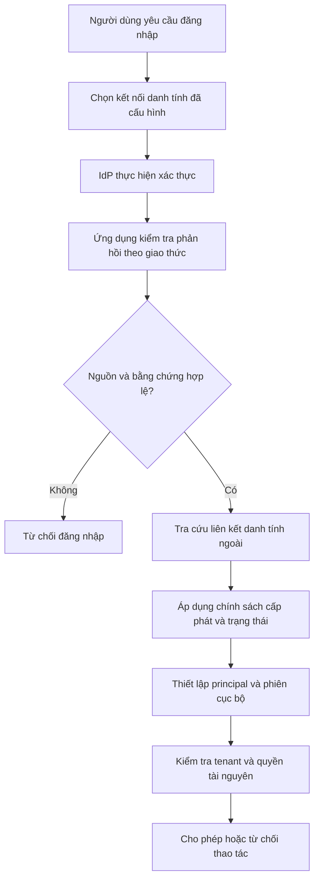

# External identity

## Mục tiêu bài học

Một ứng dụng cộng tác có thể cho nhân viên, khách hàng và đối tác đăng nhập bằng những hệ thống danh tính khác nhau. Ứng dụng cần biết danh tính nào đến từ bên ngoài, nguồn đó được tin cậy đến mức nào và danh tính được ánh xạ thành chủ thể có quyền gì trong ứng dụng.

Trong mô hình định danh của IAM, **external identity** là danh tính được một nguồn nằm ngoài phạm vi quản lý danh tính đang xét thiết lập hoặc quản lý. Để sử dụng danh tính đó, hệ thống nhận phải xác minh bằng chứng phù hợp và áp dụng chính sách của mình.

Sau bài học này, bạn có thể:

- Phân biệt danh tính bên ngoài với người dùng bên ngoài tổ chức.
- Mô tả quan hệ giữa nguồn danh tính, liên kết danh tính ngoài và principal nội bộ.
- Giải thích vì sao đăng nhập qua IdP không tự cấp quyền truy cập tenant hoặc tài nguyên.
- Thiết kế việc cấp phát, liên kết, thu hồi và kiểm toán danh tính bên ngoài.
- Nhận diện các rủi ro khi tin email, nhóm, vai trò hoặc trạng thái từ sai nguồn.

## 1. “Bên ngoài” là so với hệ thống nào?

External identity là một khái niệm có tính tương đối. Với một ứng dụng nghiệp vụ, danh tính được quản lý ở hệ thống danh tính tập trung của công ty có thể là danh tính ngoài ứng dụng, dù người dùng vẫn là nhân viên nội bộ. Với nền tảng danh tính tập trung đó, tài khoản nhân viên lại có thể thuộc phạm vi quản lý trực tiếp của nó.

Vì vậy, khi thiết kế cần nói rõ đang xét ranh giới của **ứng dụng**, **tenant**, **tổ chức** hay **nền tảng danh tính**. Trong bài này, góc nhìn chính là ứng dụng tiếp nhận danh tính từ một nhà cung cấp danh tính khác.

| Tình huống | Người dùng có ở ngoài tổ chức không? | Danh tính xác thực có thể ở ngoài ứng dụng không? |
|---|---|---|
| Nhân viên đăng nhập ứng dụng bằng IdP công ty | Không | Có, ứng dụng dựa vào IdP thay vì tự quản lý mật khẩu |
| Nhà thầu đăng nhập bằng IdP của đối tác | Có | Có |
| Khách hàng dùng tài khoản từ nhà cung cấp đăng nhập xã hội | Có | Có |
| Đối tác dùng tài khoản cục bộ do ứng dụng tạo | Có | Không nhất thiết; credential có thể do chính ứng dụng quản lý |

**External user** mô tả quan hệ của người dùng với tổ chức. **External identity** mô tả nguồn hoặc phạm vi quản lý danh tính. Hai khái niệm thường đi cùng nhau nhưng không đồng nhất.

Một bản ghi khách hoặc tài khoản cục bộ vẫn có thể tồn tại để đại diện cho người dùng ngoài. Điều đó không có nghĩa ứng dụng phải quản lý mật khẩu của người đó. Bản ghi cục bộ có thể chỉ lưu principal, trạng thái và quyền, còn xác thực được chuyển cho IdP ngoài.

## 2. Các thành phần trong mô hình

**Identity provider — IdP** là bên cung cấp thông tin danh tính và kết quả xác thực theo cơ chế đã thỏa thuận. **Relying party — RP**, trong ngữ cảnh OIDC, là ứng dụng dựa vào kết quả đó. Các giao thức khác có cách gọi thành phần tương ứng, chẳng hạn service provider trong SAML.

**Principal nội bộ** là biểu diễn chủ thể mà ứng dụng dùng để quản lý trạng thái, quyền và quan hệ với tài nguyên. **Liên kết danh tính ngoài** là quan hệ giữa danh tính đã xác minh tại nguồn ngoài và principal đó.

```text
Nguồn danh tính ngoài
  -> Danh tính ngoài đã được xác minh
  -> Liên kết đến principal nội bộ
  -> Thành viên tenant và quyền ứng dụng
  -> Quyết định truy cập tài nguyên
```

Không nên gộp tất cả những lớp này thành một trường email. Một principal có thể có nhiều danh tính đăng nhập đã được liên kết hợp lệ. Ngược lại, một danh tính đăng nhập không được tùy tiện trỏ sang principal khác chỉ vì người dùng sửa thông tin hồ sơ.

### Federation và SSO giải quyết phần nào?

**Identity federation**, hay liên kết danh tính, thiết lập cách các hệ thống trao đổi và chấp nhận thông tin danh tính qua một quan hệ tin cậy. **SSO** là trải nghiệm có thể sử dụng một lần đăng nhập để tiếp cận nhiều ứng dụng trong phạm vi phù hợp.

Federation có thể hỗ trợ SSO, nhưng không tự quyết định việc cấp tài khoản, tenant membership hay quyền nghiệp vụ. Một người đã có phiên tại IdP vẫn có thể bị ứng dụng từ chối vì chưa được mời, hợp đồng đã hết hạn hoặc tài khoản cục bộ bị khóa.

## 3. Nhận diện đúng danh tính ngoài

Tên hiển thị, email và tên nhóm có thể thay đổi hoặc trùng nhau giữa các hệ thống. Chúng không phải khóa duy nhất toàn cục cho mọi danh tính.

Với OIDC, ứng dụng dùng cặp `issuer` và `sub` đã được xác minh để nhận diện chủ thể theo giao thức:

```text
(verified_issuer, verified_sub) -> local_principal_id

(Issuer A, u-123) -> principal-801
(Issuer B, u-123) -> principal-916
```

Cùng giá trị `sub=u-123` nhưng khác issuer có thể là hai chủ thể khác nhau. Một số cấu hình OIDC còn tạo subject khác nhau cho các ứng dụng hoặc nhóm ứng dụng khác nhau; không nên tự suy ra quan hệ giữa các tài khoản chỉ từ việc so chuỗi.

Nếu dùng SAML hoặc cơ chế khác, phải chọn định danh theo đúng ngữ nghĩa và tính ổn định mà giao thức, cấu hình và IdP cung cấp. Không mặc định một định danh tạm thời là khóa liên kết lâu dài, hoặc áp dụng máy móc cấu trúc OIDC cho mọi giao thức.

### Mô hình dữ liệu minh họa cho OIDC

```text
Principal
  principal_id
  principal_type
  status

ExternalIdentity
  issuer
  subject
  principal_id
  status
  linked_at
  UNIQUE(issuer, subject)

TenantMembership
  principal_id
  tenant_id
  status
  valid_until

RoleAssignment
  principal_id
  role_id
  resource_scope
  valid_until
```

Đây là mô hình khái niệm cho một ứng dụng dùng principal chung và các liên kết OIDC, không phải lược đồ bắt buộc cho mọi sản phẩm. Cấu hình nhà cung cấp được tin cậy cần được quản lý riêng; một bản ghi `issuer` trong bảng không tự làm nguồn đó đáng tin.

Các ràng buộc cần bảo đảm một cặp issuer–subject không đồng thời bị gắn tùy tiện vào nhiều principal trong mô hình này. Việc liên kết, hủy liên kết hoặc thay đổi principal đích phải đi qua quy trình được kiểm soát và có lưu vết.

Tách `ExternalIdentity`, `TenantMembership` và `RoleAssignment` giúp thể hiện rõ: có khả năng đăng nhập không đồng nghĩa có quyền sử dụng mọi tenant hay giữ mọi vai trò.

## 4. Quan hệ tin cậy phải có phạm vi

Ứng dụng không đơn giản “tin IdP” theo một nghĩa bao trùm. Nó chấp nhận một nguồn cụ thể để đưa ra một số phát biểu trong điều kiện cụ thể.

Cấu hình quan hệ này cần trả lời:

- Chấp nhận bên phát hành nào và dùng giao thức nào?
- Phản hồi hoặc token được tạo cho ứng dụng hay API nào?
- Khóa và metadata đáng tin được lấy từ cấu hình hoặc quy trình nào?
- Những thuộc tính nào được chấp nhận, với mức bảo đảm nào?
- Nguồn ngoài được ảnh hưởng đến quyền nội bộ tới đâu?
- Có giới hạn theo tổ chức, tenant, loại tài khoản hoặc ngữ cảnh xác thực không?

Ví dụ, ứng dụng có thể tin IdP của đối tác xác nhận người dùng kiểm soát một tài khoản của đối tác. Điều đó không tự chứng minh người dùng đang có hợp đồng còn hiệu lực với công ty vận hành ứng dụng, và không trao cho IdP đó quyền chỉ định quản trị viên toàn nền tảng.

| Dữ kiện | Nguồn có thẩm quyền trong một thiết kế minh họa | Cách dùng |
|---|---|---|
| Chủ thể đã xác thực | IdP đã được cấu hình và kiểm tra đúng | Ánh xạ danh tính ngoài |
| Tên hiển thị | Hồ sơ IdP hoặc người dùng, tùy chính sách | Hiển thị; không tự dùng để cấp quyền |
| Quan hệ thành viên tenant | Kho cấp quyền hoặc quy trình mời của ứng dụng | Giới hạn phạm vi truy cập |
| Hợp đồng còn hiệu lực | Hệ thống quản lý hợp đồng hoặc người bảo trợ có thẩm quyền | Quyết định tiếp tục cho phép truy cập |
| Vai trò duyệt tài liệu | Chính sách quyền của ứng dụng | Đánh giá hành động nghiệp vụ |
| Mức xác thực | IdP và thỏa thuận về ngữ nghĩa thông tin xác thực | Đánh giá có cần xác thực tăng cường không |

Thiết kế khác có thể trao quyền quản lý thành viên cho một nguồn ngoài, miễn có quy tắc rõ ràng. Điều quan trọng là biết ai được khẳng định dữ kiện nào và không mở rộng quyền tin cậy ngoài dự kiến.

## 5. Luồng đăng nhập và truy cập

Sơ đồ sau mô tả các trách nhiệm ở mức khái niệm; không thay thế đặc tả trao đổi của một flow OAuth/OIDC hay SAML cụ thể.



### Xác minh trước khi ánh xạ

Ứng dụng phải kiểm tra phản hồi theo giao thức và flow đang sử dụng. Với token ký số, việc giải mã payload để đọc `iss`, `sub` hay `email` không thay thế kiểm tra chữ ký, nguồn phát hành, đối tượng nhận, hiệu lực và các ràng buộc giao dịch cần thiết.

Ứng dụng nên dùng thư viện giao thức phù hợp và cấu hình bên phát hành được chấp nhận. Không tự tải khóa từ một URL bất kỳ do token chưa xác minh chỉ ra rồi coi đó là khóa tin cậy.

Với OIDC, ID token phục vụ ứng dụng khách xử lý kết quả xác thực. Không mặc nhiên dùng ID token thay access token để gọi API. API tiếp nhận access token phải kiểm tra token theo ngữ cảnh của mình rồi đánh giá quyền tài nguyên.

### Ánh xạ xong vẫn phải kiểm tra trạng thái

Danh tính ngoài có thể hợp lệ nhưng principal cục bộ đã bị vô hiệu hóa, liên kết đã bị thu hồi hoặc membership đã hết hạn. Những trạng thái này cần được áp dụng trước khi cho phép truy cập theo chính sách.

Phiên cục bộ cũng cần thời hạn, cơ chế bảo vệ và điều kiện xác thực lại phù hợp. Không mặc định rằng phiên tại IdP và phiên tại ứng dụng luôn có cùng vòng đời.

## 6. Cấp phát danh tính ngoài: mời, tạo trước và JIT

Có nhiều cách tạo biểu diễn cục bộ cho external identity. Lựa chọn phụ thuộc mức độ mở của sản phẩm và cách quản trị tenant.

| Cách cấp phát | Cách hoạt động | Điều cần kiểm soát |
|---|---|---|
| Tạo trước | Tài khoản hoặc membership được chuẩn bị trước khi đăng nhập | Liên kết đúng danh tính ngoài và xử lý tài khoản không còn sử dụng |
| Mời tham gia | Người có thẩm quyền mời một người vào tenant hoặc tài nguyên | Người nhận thực sự chấp nhận lời mời bằng danh tính được phép; lời mời có phạm vi và thời hạn |
| JIT — just-in-time | Tạo principal hoặc liên kết ở lần đăng nhập được chấp nhận đầu tiên | Điều kiện được tạo, tenant đích, quyền mặc định và dữ kiện được tin cậy |
| Đồng bộ cấp phát | Nguồn có thẩm quyền gửi thay đổi, có thể qua SCIM | Ánh xạ dữ liệu, xử lý lỗi, cập nhật trạng thái và thu hồi |

JIT không có nghĩa “ai có token hợp lệ cũng được vào mọi tenant”. Hệ thống phải quy định ai đủ điều kiện đăng ký hoặc tham gia. Một nền tảng mở có thể cho tạo tài khoản cá nhân nhưng vẫn yêu cầu lời mời riêng để gia nhập tenant doanh nghiệp.

Lời mời cũng không được biến thành quyền đăng nhập vĩnh viễn chỉ vì biết một địa chỉ email. Cần xác định cách xác minh người nhận, ràng buộc với tenant và vai trò được mời, xử lý lời mời hết hạn hoặc bị thu hồi, và tránh tự ghép nhầm vào một principal đã tồn tại.

Trong đồng bộ cấp phát, một IdP hoặc thư mục cung cấp dữ liệu tài khoản không nhất thiết đồng thời là nguồn xác thực. **Cấp phát**, **xác thực** và **cấp quyền** là các trách nhiệm có thể được phối hợp nhưng phải được mô hình hóa riêng.

## 7. Liên kết tài khoản và thay đổi nguồn đăng nhập

Một người có thể muốn dùng cả IdP công ty và một nguồn đăng nhập khác cho cùng tài khoản. Liên kết nhiều external identity vào một principal mang lại tiện lợi, nhưng cũng tạo thêm đường truy cập đến toàn bộ quyền của principal đó.

### Không tự liên kết chỉ bằng email

Email có thể thay đổi, được tái cấp hoặc được nguồn ngoài xác nhận theo quy trình không phù hợp với mức tin cậy mà ứng dụng yêu cầu. Ngay cả thuộc tính `email_verified` cũng phải được hiểu trong ngữ cảnh nhà cung cấp; nó không tự chứng minh quan hệ lao động hoặc quyền đại diện cho tổ chức.

Nếu hệ thống tự ghép một danh tính mới vào tài khoản quyền cao chỉ vì email trùng, một sai sót tại nguồn hoặc quy trình liên kết có thể trở thành chiếm đoạt tài khoản.

### Một quy trình liên kết cần chứng minh quan hệ kiểm soát

Thông thường, hệ thống cần xác nhận quyền kiểm soát tài khoản hiện tại và danh tính ngoài muốn thêm, với mức xác thực và độ mới phù hợp. Luồng liên kết phải được ràng buộc với đúng phiên, đúng principal, đúng giao dịch, và không cho kẻ khác tráo danh tính đích.

Nếu tổ chức dùng quy trình quản trị hoặc di chuyển danh tính thay vì người dùng tự liên kết, quy trình đó phải có dữ kiện có thẩm quyền, kiểm soát xung đột và phê duyệt theo chính sách. Không suy đoán ánh xạ từ tên hiển thị.

Việc hủy liên kết cần xem xét khả năng đăng nhập còn lại để tránh khóa nhầm tài khoản. Khôi phục tài khoản hoặc thêm phương thức đăng nhập thay thế cũng phải đạt mức bảo đảm phù hợp; không tạo một đường khôi phục yếu làm mất tác dụng của MFA hoặc chính sách doanh nghiệp.

## 8. Ví dụ xuyên suốt: chuyên gia bên ngoài truy cập tài liệu

Nền tảng cộng tác phục vụ hai tenant:

- Công ty Hải An sử dụng tenant A.
- Công ty Bình Minh sử dụng tenant B.
- Linh là chuyên gia của đối tác Sao Bắc, xác thực qua IdP Sao Bắc.
- Chủ sở hữu tenant A mời Linh đọc dự án P-24 trong thời gian hợp đồng.
- Linh không được cấp membership tại tenant B.

Sau xác minh OIDC, ứng dụng có các quan hệ minh họa:

```text
External identity:
  issuer = IdP Sao Bắc đã được chấp thuận
  subject = partner-user-72

Ánh xạ:
  (issuer, subject) -> principal-501

Quyền cục bộ:
  principal-501 là thành viên còn hiệu lực của tenant A
  được đọc tài liệu thuộc dự án P-24
  không có quyền quản trị tenant
```

Khi Linh yêu cầu đọc tài liệu D-24, API cần kiểm tra:

1. Credential hoặc phiên được tiếp nhận có hợp lệ cho ngữ cảnh này không?
2. Nó ánh xạ đến principal-501 nào và principal có đang hoạt động không?
3. Membership của principal trong tenant A còn hiệu lực không?
4. Tài liệu D-24 có thuộc tenant A và dự án P-24 không?
5. Chính sách có cho phép hành động đọc và có điều kiện bổ sung nào không?

Giả sử IdP Sao Bắc gửi nhóm `manager`. Ứng dụng không tự biến nhóm đó thành quyền quản trị tenant A. Nếu cần ánh xạ nhóm, chỉ những quy tắc đã được cấu hình với phạm vi thích hợp mới được áp dụng.

Nếu Linh đổi đường dẫn để đọc tài liệu tenant B, danh tính ngoài hợp lệ vẫn không đủ. API phải từ chối vì không có phạm vi truy cập tương ứng. Nếu hợp đồng hết hạn, membership hoặc quyền liên quan cần bị thu hồi theo thiết kế ngay cả khi tài khoản của Linh tại Sao Bắc vẫn hoạt động.

MFA tại IdP có thể đáp ứng yêu cầu xác thực của nền tảng nếu thông tin và mức bảo đảm được chấp nhận. Nó không tự mở rộng quyền đọc sang dự án khác.

## 9. Vòng đời và thu hồi xuyên hệ thống

External identity tạo ra sự phụ thuộc giữa nhiều hệ thống quản lý trạng thái. Cần xác định bên nào chịu trách nhiệm cho mỗi thay đổi:

- IdP ngoài quản lý credential, phương thức MFA và trạng thái tài khoản nguồn theo phạm vi của họ.
- Ứng dụng quản lý principal, phiên, liên kết và quyền do mình cấp.
- Chủ sở hữu tenant hoặc người bảo trợ quản lý nhu cầu cộng tác và thời hạn quyền.
- Hệ thống cấp phát truyền thay đổi giữa các bên khi được triển khai.

Vô hiệu hóa tài khoản tại IdP không bảo đảm phiên cục bộ hay access token đã phát hành mất hiệu lực tức thời. Đăng xuất khỏi một ứng dụng cũng không mặc nhiên đăng xuất toàn bộ hệ sinh thái.

Thiết kế cần xác định thời hạn phiên và token, khả năng kiểm tra trạng thái trực tuyến, sự kiện thu hồi, cập nhật cache hoặc cơ chế đăng xuất liên kết khi có hỗ trợ. Mức thu hồi thực tế phụ thuộc toàn bộ chuỗi xử lý, không chỉ nơi quản trị thay đổi trạng thái.

### Hai tình huống thu hồi khác nhau

| Tình huống | Hướng xử lý cần xem xét |
|---|---|
| Một người hết hợp đồng nhưng IdP vẫn đáng tin | Thu hồi membership, quyền và các phiên liên quan của người đó theo phạm vi cần thiết |
| Kết nối IdP bị cấu hình sai hoặc không còn được tin cậy | Ngừng chấp nhận kết nối theo chính sách, xác định các principal và phiên bị ảnh hưởng, xử lý quyền truy cập đã được thiết lập |

Cần rà soát tài khoản mồ côi, lời mời chưa dùng, quyền quá hạn và các liên kết không còn chủ sở hữu nghiệp vụ. Với quyền đặc biệt, nên giới hạn phạm vi và thời gian sử dụng, áp dụng yêu cầu xác thực hoặc phê duyệt phù hợp và lưu vết đầy đủ.

## 10. External identity của workload

External identity cũng có thể thuộc về workload. Ví dụ, một pipeline chạy ở nền tảng CI/CD ngoài cần xin quyền triển khai vào môi trường của tổ chức.

Trong một thiết kế workload federation, hệ thống nhận xác minh assertion từ nguồn được chấp thuận và ánh xạ các thuộc tính được kiểm tra sang danh tính workload nội bộ. Các ràng buộc có thể bao gồm repository, môi trường và ngữ cảnh thực thi tùy nền tảng và chính sách.

Chấp nhận đúng nguồn phát hành nhưng cho phép mọi workload của nguồn đó nhận quyền production vẫn có thể là cấp quyền quá rộng. Tên dịch vụ hoặc môi trường tự gửi trong body không thay thế bằng chứng có thể xác minh.

Workload cần principal hoặc biểu diễn tương ứng, chủ sở hữu, phạm vi quyền, thời hạn credential và cơ chế thu hồi riêng. Quyền của pipeline không nên mặc nhiên bằng quyền cá nhân của người kích hoạt nó. Nếu có hành động thay người dùng, quan hệ đại diện cần được kiểm tra và ghi nhận riêng.

## 11. Kiểm toán và các lỗi thường gặp

Để theo dõi truy cập từ bên ngoài, bản ghi kiểm toán có thể cần principal nội bộ, nguồn danh tính và subject đã xác minh, tenant, hành động, tài nguyên, kết quả quyết định và mã tương quan. Sự kiện liên kết tài khoản, đổi nguồn đăng nhập, thay đổi membership và thu hồi quyền cũng cần lưu vết phù hợp.

Không ghi nguyên token, mật khẩu, OTP hoặc cookie phiên vào log. Dữ liệu định danh và hoạt động cũng cần quyền truy cập, thời hạn lưu và bảo vệ tính toàn vẹn phù hợp.

| Lỗi thiết kế | Hệ quả | Cách sửa mô hình |
|---|---|---|
| Dùng email làm khóa danh tính ngoài duy nhất | Ghép nhầm hoặc mất liên kết khi email thay đổi | Dùng định danh ổn định có phạm vi và quy trình liên kết rõ ràng |
| Nhận token hợp lệ rồi tạo quyền quản trị mặc định | Nguồn ngoài gián tiếp quyết định quyền quá rộng | Áp dụng chính sách cấp phát và quyền ít nhất |
| Tin mọi nhóm hoặc vai trò IdP gửi | Vượt ranh giới thẩm quyền | Giới hạn ánh xạ thuộc tính theo nguồn và phạm vi |
| JIT tự thêm người dùng vào tenant theo dữ liệu client | Người ngoài có thể gia nhập sai tổ chức | Xác minh điều kiện tham gia và tenant đích |
| Chỉ khóa tài khoản nguồn, bỏ qua phiên cục bộ | Truy cập có thể tiếp tục đến khi phiên hoặc token hết hiệu lực | Thiết kế thu hồi và kiểm tra độ trễ xuyên hệ thống |
| Dùng cùng một tên dịch vụ để nhận quyền production | Nhầm môi trường hoặc workload | Ràng buộc bằng chứng với workload và môi trường được chấp thuận |
| Thêm phương thức khôi phục yếu cho tài khoản liên kết | Bỏ qua mức bảo đảm của cơ chế đăng nhập chính | Quản lý khôi phục và phương thức thay thế theo mức bảo đảm cần thiết |

Khi đánh giá một external identity, hãy lần theo chuỗi: nguồn ngoài xác nhận ai, ứng dụng xác minh bằng chứng nào, danh tính được ánh xạ sang principal nào và principal có quyền gì tại thời điểm truy cập. Giữ rõ từng mắt xích giúp sử dụng danh tính bên ngoài mà vẫn quản lý được tenant, vòng đời và nguyên tắc ít quyền nhất.
