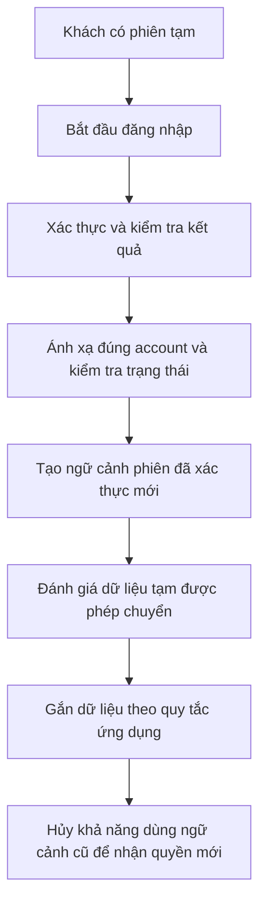

# Anonymous identity

Một người chưa đăng nhập vẫn có thể đọc tài liệu công khai, thêm sản phẩm vào giỏ hàng hoặc gửi biểu mẫu liên hệ. Hệ thống cần xử lý các yêu cầu đó dù chưa thiết lập được danh tính tài khoản của người truy cập.

Trong IAM, **anonymous identity — danh tính ẩn danh** thường chỉ cách biểu diễn chủ thể mà ứng dụng chưa xác thực hoặc chưa gắn với một danh tính tài khoản đã biết. Cách biểu diễn này giúp ứng dụng áp dụng chính sách, quản lý một số trạng thái tạm thời và ghi nhận hoạt động trong phạm vi phù hợp.

Tuy nhiên, “ẩn danh” không có một nghĩa duy nhất. Chưa đăng nhập không bảo đảm không thể bị nhận diện. Một cookie phiên khách có thể liên kết nhiều hoạt động với nhau. Một tài khoản dùng biệt danh có thể đã được xác thực đầy đủ dù ứng dụng không biết tên pháp lý của người sử dụng.

Hiểu các ranh giới này giúp thiết kế quyền công khai, phiên khách, RBAC, ABAC, luồng đăng nhập và kiểm toán mà không nhầm trạng thái ẩn danh với một mức quyền hoặc một cam kết riêng tư không có căn cứ.

## 1. “Ẩn danh với ai” và “chưa xác thực điều gì”?

### 1.1. Ẩn danh là một tính chất phụ thuộc ngữ cảnh

Khi nói một hoạt động là ẩn danh, cần xác định bên quan sát và thông tin mà bên đó có thể biết.

Ví dụ:

- Người đọc diễn đàn không thấy tên thật của tác giả.
- Ứng dụng không yêu cầu tạo account.
- Máy chủ không ánh xạ yêu cầu vào một account đã xác thực.
- Một nhà cung cấp danh tính biết người dùng là ai nhưng ứng dụng nhận chỉ thấy identifier thay thế.
- Một người quản trị có thể liên kết hoạt động qua log dù giao diện công khai không hiển thị thông tin cá nhân.

Các trường hợp trên không tương đương.

Trong bài học này, trọng tâm là **chủ thể chưa có danh tính account được xác thực tại ứng dụng đang xét**. Đây là cách dùng phổ biến trong mô hình truy cập của ứng dụng web và API. Nếu thiết kế yêu cầu bảo vệ danh tính trước một bên quan sát cụ thể, cần mô tả riêng bên quan sát, dữ liệu họ thấy và khả năng liên kết hoạt động.

### 1.2. Chưa đăng nhập không đồng nghĩa không để lại dấu vết

Một yêu cầu chưa đăng nhập vẫn có thể chứa hoặc tạo ra:

- Địa chỉ mạng và thông tin thiết bị/trình duyệt.
- Cookie hoặc identifier do ứng dụng phát hành trước đó.
- Thông tin do người dùng nhập.
- Thời điểm, đường dẫn và nội dung tương tác.
- Liên kết tới một phiên khách hoặc dữ liệu tạm thời.

Một người cũng có thể gửi email thật trong biểu mẫu khi chưa đăng nhập. Khi đó, ứng dụng đang có dữ liệu liên hệ tự khai báo, nhưng chưa thể kết luận người gửi kiểm soát địa chỉ đó nếu chưa có bước xác minh thích hợp.

Không nên hiển thị thông điệp “hoàn toàn không thể nhận diện” chỉ vì trang không có nút đăng nhập.

### 1.3. Có nhận diện hoạt động không có nghĩa đã xác thực con người

Một cookie có thể cho phép máy chủ nhận ra rằng hai yêu cầu thuộc cùng một phiên khách.

Điều đó không tự chứng minh:

- Hai yêu cầu do cùng một con người thực hiện.
- Người đang dùng trình duyệt là chủ tài khoản cụ thể.
- Người đó thuộc một tổ chức hoặc tenant.
- Người đó có quyền đọc dữ liệu của account mà họ khai báo.
- Danh tính pháp lý của người sử dụng đã được xác minh.

Máy dùng chung, cookie bị sao chép, trình duyệt được đặt lại hoặc nhiều thiết bị đều làm quan hệ giữa phiên và con người trở nên không đơn giản.

## 2. Phân biệt các khái niệm gần nhau

| Khái niệm | Ý nghĩa trong ngữ cảnh này | Ví dụ | Không nên suy ra |
|---|---|---|---|
| Unauthenticated | Chưa thiết lập được danh tính qua cơ chế xác thực của ứng dụng | Yêu cầu không có credential đăng nhập | Không có dữ liệu có thể liên kết người truy cập |
| Anonymous principal | Biểu diễn bảo mật cho chủ thể chưa xác thực, theo quy ước framework hoặc ứng dụng | Principal có loại `ANONYMOUS` | Đây là một account cá nhân riêng |
| Phiên khách | Ngữ cảnh tạm thời để duy trì trạng thái trước đăng nhập | Giỏ hàng gắn với cookie phiên | Người giữ phiên đã chứng minh danh tính tài khoản |
| Pseudonymous identity | Danh tính dùng identifier hoặc biệt danh thay cho tên thật | Account `member-872` có cơ chế đăng nhập | Account này chưa xác thực hoặc không thể truy vết |
| Guest account | Account có phạm vi khách theo thiết kế sản phẩm | Đối tác được mời vào một tenant | Chủ thể chưa đăng nhập |
| Quyền công khai | Quyền thực hiện một hành động mà không cần danh tính account đã xác thực | Đọc bài giới thiệu sản phẩm | Mọi API hoặc mọi dữ liệu đều công khai |
| Identity proofing | Quy trình kiểm tra bằng chứng về danh tính được khai báo theo mục tiêu cụ thể | Kiểm tra danh tính khi đăng ký một dịch vụ | Mọi account đăng nhập đều đã trải qua mức xác minh này |

Một “guest user” trong hệ thống liên kết danh tính doanh nghiệp có thể là người đã đăng nhập qua tổ chức đối tác. Họ có account, membership và quyền được quản lý, dù giao diện gọi họ là khách.

Ngược lại, “khách mua hàng” ở một cửa hàng trực tuyến có thể chỉ là người giữ phiên tạm thời. Vì vậy, chính sách phải dựa vào trạng thái và bằng chứng thực tế, không chỉ dựa vào tên gọi.

## 3. Biểu diễn anonymous identity trong ngữ cảnh bảo mật

### 3.1. Dùng trạng thái rõ ràng

Một mô hình đơn giản có thể phân biệt:

```text
ANONYMOUS
AUTHENTICATED
```

Ứng dụng có thể cần thêm trạng thái như yêu cầu xác thực bổ sung, credential không hợp lệ hoặc đang chờ hoàn tất một bước đăng nhập. Không bắt buộc tất cả framework dùng cùng tên hoặc cùng số trạng thái.

Ngữ cảnh cho yêu cầu ẩn danh có thể được biểu diễn như sau:

```json
{
  "subject_type": "anonymous",
  "authentication_state": "unauthenticated",
  "account_id": null,
  "tenant_membership": null,
  "anonymous_session_ref": "guest-context-28a"
}
```

Đây là cấu trúc minh họa phía server. `anonymous_session_ref` là tham chiếu nội bộ cho ví dụ; không phải token phiên thật và không phải claim chuẩn của một giao thức.

Các điểm quan trọng:

- `account_id` không được lấy từ dữ liệu tự khai báo để biến yêu cầu thành đã xác thực.
- Không mặc định có membership chỉ vì client gửi `tenant_id`.
- Tham chiếu phiên khách không nên được đặt vào trường có nghĩa “account đã đăng nhập”.
- Context được tạo bởi lớp bảo mật từ các đầu vào đã kiểm tra, không được client trực tiếp quyết định.

### 3.2. Principal ẩn danh có thể là đối tượng dùng chung

Một framework có thể tạo principal ẩn danh thay vì trả về `null`. Điều này giúp phần cấp quyền xử lý nhất quán và tránh lỗi khi không có user.

Tuy nhiên, principal đó có thể chỉ biểu diễn **một nhóm trạng thái**, chẳng hạn “mọi người chưa đăng nhập”. Nó không phân biệt từng khách.

Nếu hệ thống dùng cùng tên `anonymous` cho mọi yêu cầu, không được dùng tên đó làm khóa sở hữu giỏ hàng hoặc tài liệu tạm.

```text
Sai:
  cart.owner = principal.name
  principal.name = "anonymous" cho mọi khách

Hậu quả:
  nhiều khách có thể bị gộp vào cùng một phạm vi dữ liệu
```

Quyền cho cả nhóm truy cập công khai và quyền đối với dữ liệu của từng phiên khách là hai quyết định khác nhau.

### 3.3. Kiểm tra trạng thái xác thực theo ngữ nghĩa framework

Việc có principal, có đối tượng authentication hoặc có một cờ trong đối tượng không bảo đảm đó là người dùng đã đăng nhập.

Một số framework dùng token hoặc principal đặc biệt để biểu diễn anonymous. Khi tích hợp, cần sử dụng cách kiểm tra trạng thái mà framework định nghĩa, thay vì tự suy luận “đối tượng khác null là đã xác thực”.

Tương tự, tên như `ROLE_ANONYMOUS` nếu được framework dùng là một nhãn phục vụ chính sách. Nó không chứng minh danh tính cá nhân và không nên được coi là account thường với một mật khẩu mặc định.

## 4. Cấp quyền cho chủ thể ẩn danh

### 4.1. Từ chối theo mặc định, cho phép theo hành động cụ thể

Anonymous identity không có nghĩa “bỏ qua authorization”. Nó là một đầu vào của quyết định cấp quyền.

Ví dụ chính sách:

| Hành động | Tài nguyên | Điều kiện | Quyết định với khách chưa đăng nhập |
|---|---|---|---|
| Đọc bài giới thiệu | Nội dung đã xuất bản công khai | Đúng trạng thái công khai | Cho phép |
| Tìm sản phẩm | Danh mục công khai | Trong giới hạn sử dụng | Cho phép |
| Xem giỏ hàng tạm | Giỏ hàng thuộc phiên khách | Có phiên hợp lệ và quyền trên giỏ đó | Có thể cho phép |
| Xem lịch sử hóa đơn | Dữ liệu account | Cần danh tính account và quyền phù hợp | Từ chối |
| Duyệt hóa đơn | Hóa đơn doanh nghiệp | Cần role, tenant và điều kiện nghiệp vụ | Từ chối |
| Đổi quyền người dùng | Cấu hình IAM | Cần quyền quản trị phù hợp | Từ chối |

“Công khai” thường là thuộc tính của tài nguyên hoặc tuyến chức năng. Nó không nên tự lan sang toàn bộ tài nguyên cùng loại.

Ví dụ, bài viết đã xuất bản có thể đọc công khai; bản nháp của cùng bài viết vẫn phải bị bảo vệ.

### 4.2. Danh tính chưa xác thực không có quyền chọn account khác

Yêu cầu sau không chứng minh người gọi là chủ account:

```http
GET /api/accounts/account-2048/invoices
X-User-Id: account-2048
```

Mã account trong URL hoặc header chỉ là dữ liệu đầu vào nếu không có cơ chế tin cậy bổ sung. Server phải yêu cầu xác thực và kiểm tra quyền phù hợp đối với hóa đơn.

Tương tự, endpoint cho khách xem giỏ hàng không được chỉ nhận `cart_id` rồi trả dữ liệu nếu thiết kế đòi hỏi giỏ đó thuộc phiên khách đang giữ.

### 4.3. RBAC và ABAC vẫn áp dụng được

Trong RBAC, hệ thống có thể dùng một nhóm quyền tối thiểu cho truy cập chưa đăng nhập. Quyền đó chỉ nên bao gồm các hành động được công khai có chủ đích.

Trong ABAC, chính sách có thể kết hợp trạng thái chủ thể và trạng thái tài nguyên:

```text
Cho phép article.read khi:
  resource.publication_status == "published"
  và resource.visibility == "public"
```

Quyền đọc công khai trong ví dụ có thể áp dụng cho cả người đã đăng nhập và chưa đăng nhập. Không cần buộc một người đã đăng nhập phải đăng xuất chỉ để đọc nội dung công khai.

Với dữ liệu theo phiên, chính sách cần điều kiện riêng:

```text
Cho phép cart.read khi:
  guest_session còn hợp lệ
  và cart.guest_session_ref == guest_session.internal_ref
  và cart còn trong thời hạn sử dụng
```

Đây là mô hình kiểm soát quyền dựa trên phiên được hệ thống cấp, không phải bằng chứng rằng người giữ phiên là một người cụ thể.

## 5. Phiên khách: có trạng thái nhưng chưa có account đã xác thực

### 5.1. Khi nào cần phiên khách?

Không phải mọi lượt đọc công khai đều cần tạo session. Một trang giới thiệu tĩnh có thể phục vụ mà không thiết lập identifier riêng cho từng khách.

Phiên khách hữu ích khi cần duy trì trạng thái như:

- Giỏ hàng tạm.
- Các lựa chọn trong một quy trình nhiều bước.
- Nội dung biểu mẫu chưa gửi.
- Một tác vụ tạm thời mà người giữ phiên được phép tiếp tục.

Tạo session cho mọi yêu cầu làm tăng dữ liệu, chi phí và khả năng liên kết hoạt động. Nên tạo khi chức năng thực sự cần.

### 5.2. Identifier phiên có thể đồng thời là bí mật truy cập

Cần phân biệt ba loại giá trị:

| Loại | Chức năng | Có nên tự cấp quyền dựa vào nó? |
|---|---|---|
| Request ID | Liên kết log của một yêu cầu | Không |
| Identifier công khai của tài nguyên | Chỉ tới giỏ hàng hoặc bản nháp | Không, trừ khi được thiết kế rõ là capability |
| Token phiên hoặc capability | Cho phép người giữ thực hiện một tập thao tác theo cơ chế hệ thống | Có thể, nhưng phải kiểm tra tính hợp lệ, phạm vi và điều kiện |

Nếu ai giữ token phiên là có thể mở giỏ hàng, token đó là dữ liệu bảo mật. Không thể coi nó vô hại chỉ vì phiên chưa đăng nhập.

Trong cách triển khai dùng token opaque, server cấp giá trị khó đoán, lưu ánh xạ tới ngữ cảnh phiên và kiểm tra giá trị đó ở các yêu cầu tiếp theo. Nên dùng cơ chế session được hỗ trợ và nguồn sinh ngẫu nhiên an toàn của nền tảng, thay vì tự ghép timestamp, số tăng dần hoặc thông tin thiết bị.

Nếu hệ thống dùng token tự chứa, tính toàn vẹn, thời hạn, mục đích sử dụng và cơ chế thu hồi cũng cần được thiết kế phù hợp. Một token có chữ ký vẫn không tự chứng minh danh tính con người.

### 5.3. Quyền truy cập theo sự sở hữu token

Trong mô hình capability, việc giữ một giá trị bí mật có thể cho phép một số hành động đối với một tài nguyên cụ thể.

Ví dụ, một liên kết xem bản nháp có thể cho người giữ nó quyền đọc bản nháp trong thời hạn nhất định mà không cần đăng nhập.

Đây là một cơ chế cấp quyền có chủ đích. Thiết kế cần xác định:

- Token cấp quyền cho tài nguyên nào.
- Được phép đọc, sửa hay chia sẻ.
- Có thể sử dụng bao nhiêu lần hoặc trong bao lâu.
- Có thể thu hồi hay thay thế bằng cách nào.
- Nguy cơ lộ qua lịch sử trình duyệt, referrer, log hoặc việc chuyển tiếp liên kết.
- Trường hợp nào phải yêu cầu xác thực account.

Không dùng identifier dễ đoán làm capability. Cũng không biến mọi URL chứa mã tài nguyên thành đường dẫn truy cập không cần kiểm tra.

Đối với dữ liệu nhạy cảm hoặc thao tác đặc quyền, một liên kết bí mật có thể không đủ đáp ứng yêu cầu. Cần chọn cơ chế phù hợp thay vì mặc định “có link là được làm mọi việc”.

### 5.4. Bảo vệ phiên khách

Với ứng dụng web dùng cookie, các biện pháp thường cần xem xét gồm:

- HTTPS và thuộc tính `Secure` cho cookie bảo mật.
- `HttpOnly` khi JavaScript phía client không cần truy cập cookie đó.
- `SameSite` theo luồng sử dụng.
- Bảo vệ CSRF cho thao tác thay đổi trạng thái dựa trên cookie.
- Thời hạn không hoạt động và thời hạn tuyệt đối phù hợp.
- Cơ chế hủy phiên và dọn dữ liệu tạm.
- Ngăn identifier phiên xuất hiện trong log hoặc dữ liệu phân tích không cần thiết.

Các thuộc tính cookie có mục tiêu riêng; không thuộc tính nào thay thế toàn bộ kiểm soát xác thực và cấp quyền.

Phiên khách vẫn có thể bị lạm dụng để tạo dữ liệu rác, chiếm tài nguyên hoặc truy cập trạng thái tạm của người khác nếu token bị lộ. Vì vậy, nó cần giới hạn và bảo vệ tương ứng với dữ liệu được giữ.

## 6. Chuyển từ phiên khách sang danh tính đã xác thực

### 6.1. Xác thực thành công không phải lệnh chuyển toàn bộ dữ liệu

Một khách có giỏ hàng rồi đăng nhập. Ứng dụng cần quyết định dữ liệu nào được giữ, gộp hoặc loại bỏ.

Không nên có quy tắc chung “mọi thứ của phiên khách trở thành của account vừa đăng nhập”.

Có thể xử lý khác nhau theo loại dữ liệu:

| Dữ liệu trước đăng nhập | Cách xử lý có thể phù hợp |
|---|---|
| Sản phẩm trong giỏ hàng | Gộp theo quy tắc rõ ràng, tính lại giá và khả năng mua |
| Ngôn ngữ giao diện | Giữ như một tùy chọn nếu không xung đột chính sách |
| Tenant do khách chọn | Chỉ coi là lựa chọn; kiểm tra membership sau đăng nhập |
| Role do client gửi | Không sử dụng làm quyền của account |
| Email tự khai báo | Không tự đánh dấu đã xác minh |
| Bản nháp có dữ liệu nhạy cảm | Yêu cầu điều kiện chuyển giao phù hợp và xử lý xung đột |
| Đối tượng đã thuộc account khác | Không chuyển chỉ vì cùng trình duyệt hoặc trùng email |

Trên máy dùng chung, trạng thái khách có thể do người khác tạo trước đó. Việc đăng nhập chứng minh quyền kiểm soát account theo phương thức xác thực, không tự chứng minh người đăng nhập là tác giả của mọi trạng thái đã tồn tại trong trình duyệt.

### 6.2. Tạo ranh giới phiên mới

Sau đăng nhập, nên sử dụng cơ chế của framework để thay đổi identifier phiên hoặc phát hành ngữ cảnh xác thực mới, đồng thời xử lý token cũ theo thiết kế.

Mục tiêu là tránh việc một identifier có trước đăng nhập tiếp tục mở được phiên có quyền cao hơn. Đây là điểm liên quan trực tiếp tới phòng chống session fixation.

Luồng minh họa:



Ở kiến trúc dùng token, nguyên tắc tương tự là không biến một token khách cũ thành bằng chứng có thể sử dụng lại để nhận quyền account. Cách triển khai phụ thuộc cơ chế xác thực và quản lý phiên đang dùng.

### 6.3. Giả mã cho việc chuyển giỏ hàng

```text
function finishLogin(loginResponse, request):
    authenticatedIdentity = validateLoginResponse(loginResponse)
    account = resolveAccount(authenticatedIdentity)

    if account is missing or account is not allowed to sign in:
        deny()

    guestContext = resolveValidGuestSession(request)
    newSession = createAuthenticatedSession(account)

    if guestContext exists:
        transferableCart = loadCartOwnedBy(guestContext)

        if transferableCart exists:
            mergeCartUsingApplicationRules(
                source = transferableCart,
                destinationAccount = account,
                recalculatePrices = true
            )

        closeGuestContextForTransfer(guestContext)

    return newSession
```

Giả mã chỉ minh họa ranh giới trách nhiệm, không phải mã triển khai hoàn chỉnh.

Trong hệ thống thật, bước chuyển dữ liệu cần kiểm soát đồng thời và tính nhất quán. Ví dụ, hai request cùng hoàn tất đăng nhập không nên chuyển cùng một bản nháp sang hai account hoặc tạo hai kết quả ngoài ý muốn.

Quan trọng hơn, dữ liệu được chuyển là dữ liệu mà phiên khách có quyền kiểm soát theo mô hình đã chọn. Không có bước nào được lấy một account ID do client cung cấp rồi chuyển dữ liệu của account đó.

### 6.4. Đăng xuất cần chấm dứt ngữ cảnh có quyền

Khi đăng xuất, phải hủy hoặc làm mất hiệu lực ngữ cảnh xác thực theo thiết kế. Nếu ứng dụng tiếp tục cho duyệt với trạng thái khách, ngữ cảnh khách mới không được giữ lại quyền account.

Cần xem xét cả dữ liệu hiển thị:

- Cache trong ứng dụng phía client.
- Dữ liệu nhạy cảm còn trong bộ nhớ hoặc giao diện.
- Giỏ hàng và bản nháp đã được gắn với account.
- Các token hoặc cookie liên quan.

Một khách mới dùng cùng thiết bị không nên nhìn thấy dữ liệu cá nhân của người vừa đăng xuất chỉ vì giao diện vẫn giữ kết quả cũ.

## 7. Không nhầm yêu cầu thiếu credential với xác thực thất bại

### 7.1. Ba trường hợp cần tách biệt

```text
Không gửi credential
    → có thể xử lý như anonymous nếu endpoint cho phép

Gửi credential hợp lệ
    → thiết lập chủ thể đã xác thực, rồi cấp quyền

Gửi credential không hợp lệ
    → áp dụng quy tắc lỗi xác thực của endpoint
```

Credential không hợp lệ có thể là token hết hạn, chữ ký không hợp lệ, issuer không được chấp nhận hoặc token không dành cho API.

Không nên tự động coi tất cả các trường hợp này là “khách bình thường” ở một luồng cần đăng nhập. Nếu có bước ghi dữ liệu, việc hạ xuống anonymous có thể làm dữ liệu được ghi vào sai phạm vi hoặc khiến người dùng hiểu sai trạng thái phiên.

### 7.2. Endpoint có xác thực tùy chọn phải có hợp đồng rõ ràng

Một endpoint công khai có thể hỗ trợ cá nhân hóa khi người dùng đã đăng nhập. Ví dụ, trang sản phẩm luôn công khai nhưng có thêm trạng thái yêu thích nếu có account.

Thiết kế cần quy định rõ điều gì xảy ra khi client gửi credential hỏng:

- Trả lỗi để client xử lý phiên.
- Hoặc tiếp tục phục vụ phần công khai trong những điều kiện được xác định trước.

Nếu chọn hành vi thứ hai, không được sử dụng claim chưa xác minh hoặc giữ một phần quyền từ credential lỗi. Phản hồi và phía client cũng phải tránh thể hiện rằng danh tính đã được xác thực.

Không có lý do để một token đã kiểm tra thất bại vẫn cung cấp `account_id`, role hoặc tenant cho quyết định cấp quyền.

### 7.3. Thực thi ở phía server

Ẩn nút trên giao diện không bảo vệ API. Endpoint nhạy cảm vẫn cần kiểm tra trạng thái xác thực và quyền khi xử lý yêu cầu trực tiếp.

Ngược lại, gắn cookie bất kỳ vào request không làm nó trở thành có quyền. Server phải kiểm tra cookie thuộc loại nào, có hợp lệ không và cho phép điều gì.

Các giá trị như `isGuest=false`, `loggedIn=true` hoặc `role=admin` trong dữ liệu client chỉ là dữ liệu tự khai báo nếu không được thiết lập và kiểm chứng qua cơ chế tin cậy.

## 8. SSO và danh tính workload không xóa ranh giới ẩn danh

### 8.1. Có phiên ở nhà cung cấp danh tính chưa chắc có phiên ở ứng dụng

Một người có thể đã đăng nhập tại nhà cung cấp SSO nhưng ứng dụng vẫn chưa hoàn tất quy trình nhận và kiểm tra kết quả đăng nhập.

Ứng dụng chỉ nên thiết lập danh tính account sau khi hoàn tất luồng giao thức và ánh xạ theo chính sách của nó.

Biết địa chỉ email của người truy cập, nhìn thấy một tham số redirect hoặc nhận một chuỗi có hình dạng JWT không đủ để chuyển chủ thể từ anonymous sang authenticated.

### 8.2. Backend có credential không làm khách trở thành người dùng đã xác thực

Một website công khai có thể dùng credential dịch vụ để gọi API nội bộ. API nội bộ nhận diện được workload của website, nhưng người tương tác với website vẫn có thể chưa đăng nhập.

Cần giữ rõ:

- **Actor dịch vụ:** backend đang thực hiện lời gọi.
- **Chủ thể người dùng:** đã xác thực, chưa xác thực hoặc không có trong tác vụ.
- **Hành động được ủy quyền cho dịch vụ:** phạm vi mà backend được phép thực hiện.

Nếu dịch vụ có quyền rộng nhưng cho mọi khách tùy ý chọn account hoặc tài nguyên đích, dịch vụ có thể bị lợi dụng để thực hiện hành động vượt quyền thay khách.

Do đó, lớp công khai phải giới hạn thao tác, còn API nội bộ cần kiểm tra quyền của workload và các ràng buộc liên quan. Không gắn một danh tính người dùng giả định chỉ để lời gọi “có user”.

## 9. Chống lạm dụng mà không giả định đã biết con người

Truy cập ẩn danh vẫn cần giới hạn tài nguyên và hành vi. Tuy nhiên, các tín hiệu kỹ thuật không nên bị diễn giải thành bằng chứng chắc chắn về danh tính.

### 9.1. Identifier phiên không phải “mỗi người một lượt”

Một người có thể tạo nhiều phiên khách hoặc sử dụng nhiều thiết bị. Nhiều người cũng có thể dùng chung một địa chỉ mạng hoặc một trình duyệt.

Vì vậy:

- Giới hạn theo session chỉ giới hạn một ngữ cảnh phiên.
- Giới hạn theo IP có thể ảnh hưởng nhiều người cùng mạng.
- Một chuỗi user-agent không xác định duy nhất thiết bị hoặc người.
- Cookie bị xóa không đồng nghĩa một con người mới xuất hiện.

Có thể kết hợp giới hạn theo endpoint, tài nguyên, phiên, địa chỉ mạng và tổng dung lượng hệ thống. Mỗi tín hiệu có giới hạn riêng và cần được vận hành theo mục đích cụ thể.

### 9.2. Giới hạn dữ liệu và chi phí

Các chức năng ẩn danh có thể cần:

- Giới hạn kích thước và số lượng dữ liệu tạm.
- Thời hạn lưu bản nháp hoặc giỏ hàng.
- Giới hạn số tác vụ đắt tiền được tạo.
- Kiểm soát tần suất gửi biểu mẫu hoặc yêu cầu gửi email.
- Kiểm tra đầu vào và nội dung theo loại chức năng.
- Cơ chế dọn các tài nguyên không còn được sử dụng.

Không nhất thiết cấp cùng hạn mức cho khách và account đã xác thực. Tuy nhiên, đăng nhập thành công cũng không phải lý do bỏ mọi hạn mức.

### 9.3. Thử thách bổ sung không tự chứng minh danh tính account

Một cơ chế chống bot có thể hỗ trợ giảm tự động hóa. Nó không tự chứng minh người hoàn tất là chủ account hoặc có quyền với dữ liệu cụ thể.

Tương tự, xác nhận một email hoặc sử dụng một liên kết một lần chỉ hỗ trợ kết luận trong phạm vi thiết kế của quy trình đó. Không nên biến một bước xác nhận liên hệ thành quyền quản trị hoặc thành bằng chứng cho mọi thuộc tính hồ sơ.

Nếu một hành động cần danh tính account, quyền theo tenant hoặc MFA, phải yêu cầu đúng các điều kiện đó. Cơ chế giảm lạm dụng và cơ chế xác thực/cấp quyền có vai trò khác nhau.

## 10. Quyền riêng tư và kiểm toán

### 10.1. Thu thập theo nhu cầu của chức năng

Không phải mọi trang công khai đều cần một identifier bền vững. Nếu chức năng chỉ cần trả tài liệu công khai, việc tạo hồ sơ theo dõi dài hạn có thể không cần thiết.

Với phiên khách có trạng thái, cần xác định:

- Dữ liệu nào phải giữ để chức năng hoạt động.
- Identifier có phạm vi và thời hạn ra sao.
- Có liên kết hoạt động trước và sau đăng nhập không.
- Bên nào được truy cập liên kết đó.
- Dữ liệu và log được lưu trong bao lâu.
- Thông tin hiển thị cho người dùng có phản ánh đúng cách vận hành không.

Không gọi dữ liệu là không thể liên kết chỉ vì không lưu tên thật.

### 10.2. Ghi nhận đúng mức hiểu biết

Một sự kiện có thể được ghi như sau:

```json
{
  "event": "authorization_decision",
  "subject_type": "anonymous",
  "authentication_state": "unauthenticated",
  "account_id": null,
  "guest_context_ref": "internal-guest-28a",
  "action": "cart.read",
  "resource_ref": "cart-93b",
  "decision": "PERMIT",
  "reason": "VALID_GUEST_CONTEXT",
  "request_id": "request-71f",
  "occurred_at": "2026-10-01T08:00:00Z"
}
```

Các giá trị trên chỉ là ví dụ. `guest_context_ref` là tham chiếu nội bộ được phép dùng để liên kết sự kiện, không phải raw cookie hoặc bearer token.

Nếu không có phiên khách, trường tham chiếu có thể không tồn tại. Không cần tạo session chỉ để mọi log đều có một user ID.

Log nên thể hiện giới hạn kết luận: hệ thống biết một yêu cầu được phép dựa trên phiên khách hợp lệ; nó không biết chắc người thật nào đứng sau.

### 10.3. Bảo vệ các dữ liệu có thể trở thành credential

Không ghi toàn bộ:

- Token phiên khách.
- Cookie xác thực.
- Capability hoặc liên kết bí mật.
- Token truy cập.
- Nội dung biểu mẫu nhạy cảm chỉ để thuận tiện gỡ lỗi.

Một identifier dùng trong log nên được tách khỏi giá trị cho phép truy cập. Dữ liệu liên kết trong log vẫn có thể nhạy cảm và cần quyền truy cập, mục đích cùng thời hạn lưu phù hợp.

Nếu hệ thống lưu địa chỉ mạng phục vụ vận hành hoặc chống lạm dụng, không được mặc định đó là mã định danh con người. Cũng cần kiểm soát dữ liệu này theo mục đích đã xác định.

### 10.4. Liên kết trước và sau đăng nhập là một quyết định dữ liệu

Việc chuyển giỏ hàng sang account và việc hợp nhất mọi hoạt động duyệt web trước đó là hai mục đích khác nhau.

Một tính năng có thể cần chuyển vài mục trong giỏ hàng nhưng không cần tạo hồ sơ theo dõi vĩnh viễn toàn bộ lịch sử khách.

Vì vậy, cần quy định riêng:

- Dữ liệu vận hành nào được chuyển để hoàn tất chức năng.
- Quan hệ nào được giữ cho kiểm toán.
- Dữ liệu phân tích nào được liên kết.
- Khi nào liên kết bị xóa hoặc không được tạo.

Không coi việc người dùng đăng nhập là lý do tự động mở rộng mọi mục đích xử lý dữ liệu trước đó.

## 11. Ví dụ thực tế và cách suy luận

### 11.1. Tài liệu công khai và bản nháp nội bộ

Một cổng tài liệu cho phép khách đọc bài đã xuất bản. Mỗi bài có identifier và trạng thái xuất bản.

**Quyết định đúng:** endpoint kiểm tra trạng thái công khai của tài nguyên. Biết identifier của bản nháp không làm khách có quyền đọc bản nháp.

Nếu chỉ đánh dấu toàn bộ `/documents/**` là công khai mà bỏ kiểm tra từng đối tượng, tài liệu nội bộ có thể bị lộ. Quyền công khai phải đúng với tài nguyên thực tế.

### 11.2. Hai khách cùng có principal tên “anonymous”

Khách A và khách B cùng thêm dữ liệu vào giỏ hàng.

**Quyết định đúng:** mỗi phiên có ngữ cảnh dữ liệu riêng theo cơ chế phiên. Principal ẩn danh dùng chung chỉ giúp áp chính sách chung; không dùng nó làm khóa sở hữu.

Khi khách A gửi identifier giỏ của khách B, server vẫn kiểm tra quan hệ với phiên đang giữ hoặc capability phù hợp. Không cho phép chỉ vì cả hai đều là anonymous.

### 11.3. Mất cookie của bản nháp

Một người tạo bản nháp trong phiên khách, xóa cookie rồi quay lại yêu cầu lấy dữ liệu bằng tên đã nhập.

**Quyết định đúng:** tên tự khai báo không đủ để khôi phục quyền truy cập. Hệ thống cần cơ chế khôi phục đã thiết kế, chẳng hạn một quy trình xác minh quyền kiểm soát phù hợp hoặc một capability khôi phục đã cấp trước đó.

Nếu chức năng không có cách chứng minh quyền kiểm soát khác, có thể không khôi phục được dữ liệu. Không nên tạo một cửa hậu cho phép lấy mọi bản nháp chỉ bằng thông tin đoán được.

Điều này cần được cân nhắc khi thiết kế trải nghiệm: dữ liệu quan trọng không nên chỉ phụ thuộc vào một phiên tạm mà người dùng không hiểu giới hạn của nó.

### 11.4. Người dùng đăng nhập sau khi ai đó đã dùng máy

Một máy dùng chung có giỏ hàng khách do người A tạo. Sau đó người B đăng nhập.

**Quyết định đúng:** áp dụng quy tắc chuyển giỏ hàng và xác nhận phù hợp với tính chất dữ liệu. Không kết luận người B là tác giả mọi hành động khách trước đó.

Với dữ liệu nhạy cảm, có thể cần tránh chuyển tự động. Với dữ liệu ít nhạy cảm như danh sách sản phẩm, có thể cho phép lựa chọn gộp hoặc bỏ qua.

### 11.5. Backend gọi API bằng danh tính dịch vụ

Một biểu mẫu công khai gửi yêu cầu tới backend; backend dùng credential riêng để tạo bản ghi trong hệ thống nội bộ.

**Quyết định đúng:** backend chỉ cho khách sử dụng tập thao tác đã công khai và kiểm tra dữ liệu đầu vào. API nội bộ nhận diện workload nhưng không được suy ra đã có một người dùng doanh nghiệp được xác thực.

Nếu cần tạo yêu cầu thay mặt một nhân viên cụ thể, phải có bằng chứng và quyền phù hợp cho quan hệ đó, thay vì lấy email nhân viên do khách nhập làm subject đã xác thực.

## 12. Những lỗi thiết kế cần tránh

| Lỗi | Hậu quả | Cách thiết kế phù hợp |
|---|---|---|
| Coi không đăng nhập là không thể nhận diện | Cam kết riêng tư sai với dữ liệu thực tế | Mô tả rõ phạm vi ẩn danh và dữ liệu có thể liên kết |
| Dùng một account `anonymous` chung cho mọi dữ liệu | Trộn quyền sở hữu giữa các khách | Tách principal phân loại khỏi ngữ cảnh phiên/tài nguyên |
| Coi có đối tượng principal là đã đăng nhập | Bỏ qua trạng thái anonymous của framework | Kiểm tra trạng thái theo ngữ nghĩa framework |
| Tin `userId`, role hoặc tenant do client gửi | Gắn nhầm danh tính và vượt quyền | Thiết lập ngữ cảnh từ nguồn tin cậy và kiểm tra phạm vi |
| Dùng mã tăng dần làm token truy cập bản nháp | Người khác có thể đoán và mở dữ liệu | Dùng cơ chế session/capability phù hợp và kiểm tra quyền |
| Giữ nguyên token khách khi nâng quyền | Tăng nguy cơ session fixation | Tạo ngữ cảnh xác thực mới và xử lý token cũ |
| Chuyển mọi trạng thái khách sang account | Gộp sai dữ liệu hoặc thuộc tính chưa xác minh | Chỉ chuyển dữ liệu được phép theo quy tắc rõ ràng |
| Hạ credential lỗi thành khách ở mọi endpoint | Che giấu lỗi và có thể ghi sai phạm vi | Quy định rõ hợp đồng xác thực của từng endpoint |
| Coi IP hoặc cookie là một con người duy nhất | Giới hạn và kết luận sai | Dùng tín hiệu đúng mục đích, ghi rõ giới hạn |
| Ghi token khách hoặc liên kết bí mật vào log | Log trở thành nguồn truy cập trái phép | Dùng tham chiếu kiểm toán tách khỏi credential |
| Coi credential của backend là xác thực người dùng | Dịch vụ bị dùng để làm thay ngoài ý muốn | Phân biệt actor workload với chủ thể người dùng |

## 13. Các câu hỏi cần trả lời trước khi triển khai

1. **Ẩn danh trong phạm vi nào?** Chưa xác thực account tại ứng dụng hay cần bảo vệ danh tính trước một bên quan sát cụ thể?
2. **Hành động nào thực sự công khai?** Chính sách có kiểm tra đúng tài nguyên và trạng thái xuất bản không?
3. **Có cần session không?** Nếu chỉ phục vụ dữ liệu công khai, có thể tránh tạo identifier riêng không?
4. **Dữ liệu tạm thuộc phạm vi nào?** Principal dùng chung, phiên riêng và quyền trên tài nguyên đã được tách rõ chưa?
5. **Giá trị nào là credential?** Token phiên, capability và identifier công khai đã được phân biệt chưa?
6. **Đăng nhập thay đổi điều gì?** Ngữ cảnh mới được tạo ra sao và dữ liệu nào được phép chuyển?
7. **Credential hỏng được xử lý thế nào?** Endpoint có quy tắc rõ cho thiếu credential, hợp lệ và không hợp lệ không?
8. **Đăng xuất có làm sạch đúng chỗ không?** Quyền account và dữ liệu nhạy cảm có còn ở phiên khách hoặc giao diện không?
9. **Chống lạm dụng bằng tín hiệu gì?** Giới hạn có vô tình coi IP, cookie hoặc thiết bị là một con người không?
10. **Log cho phép kết luận gì?** Có đủ dữ liệu giải thích quyết định mà không lưu credential hoặc khẳng định danh tính quá mức không?
11. **Trạng thái tạm sống bao lâu?** Có giới hạn dung lượng, thời hạn và cơ chế dọn dữ liệu không?
12. **Thông tin cho người dùng có đúng không?** Cách gọi “ẩn danh” có phù hợp với việc thu thập và liên kết dữ liệu thực tế không?

## 14. Những điểm cần ghi nhớ

Anonymous identity trong một ứng dụng IAM thường là cách biểu diễn chủ thể chưa có danh tính account được xác thực. Nó không đồng nghĩa không có session, không có dữ liệu cá nhân, không thể liên kết hoạt động hoặc không cần cấp quyền.

Quyền công khai phải được cho phép theo hành động và tài nguyên cụ thể. Quyền đối với trạng thái khách cần một cơ chế phiên hoặc capability phù hợp; principal ẩn danh dùng chung không đủ để phân biệt quyền sở hữu của từng khách.

Khi chuyển sang account đã xác thực, cần tạo ranh giới phiên mới, kiểm tra dữ liệu được chuyển và giữ rõ nguồn tin cậy của thuộc tính. Việc quản lý quyền tối thiểu, vòng đời phiên, workload và kiểm toán vẫn áp dụng đầy đủ, kể cả khi người tương tác chưa đăng nhập.
