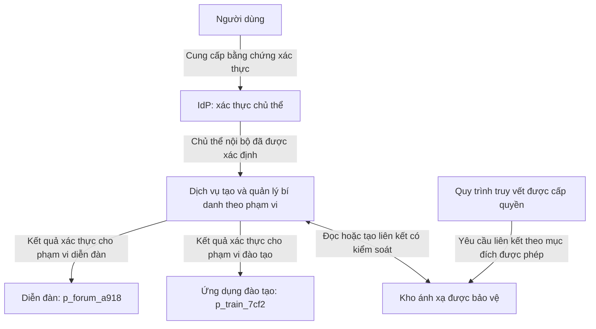

# Pseudonymous identity

## 1. Danh tính dùng bí danh là gì?

**Pseudonymous identity** là danh tính được biểu diễn bằng một bí danh hoặc định danh thay thế, cho phép hệ thống nhận biết chủ thể trong một phạm vi nhất định mà không cần trực tiếp sử dụng tên thật hay các thuộc tính nhận diện trực tiếp.

Ví dụ, ứng dụng đào tạo có thể nhận biết một nhân viên bằng mã `p_train_7cf2`. Ứng dụng lưu tiến độ học và kiểm tra quyền của chủ thể này mà không cần biết họ tên, email hoặc mã nhân viên dùng chung trong toàn doanh nghiệp.

Pseudonymous identity vẫn có thể là danh tính đã xác thực. Người dùng có thể đăng nhập bằng một phương thức mạnh; sau đó ứng dụng chỉ nhận một định danh có phạm vi phù hợp. **Ẩn tên thật với ứng dụng không đồng nghĩa bỏ xác thực.**

Mục tiêu của cách biểu diễn này là giảm thông tin nhận diện được đưa đến nơi không cần, đồng thời kiểm soát khả năng liên kết hoạt động của cùng một chủ thể giữa các hệ thống. Nó không tự bảo đảm rằng chủ thể không thể bị nhận diện lại.

Trong IAM, danh tính dùng bí danh cần phối hợp với xác thực, quản lý phiên, RBAC/ABAC, SSO, liên kết danh tính và kiểm toán. Đổi tên người dùng thành một chuỗi khó đọc chỉ là một phần nhỏ của thiết kế.

Sau bài này, người học cần giải thích được bí danh hoạt động trong phạm vi nào, nhận ra các đường liên kết ngoài định danh chính và lựa chọn mô hình định danh phù hợp với nhu cầu sử dụng.

## 2. Phân biệt pseudonymity với các khái niệm gần nhau

| Khái niệm | Đặc điểm | Ví dụ | Giới hạn cần nhớ |
| --- | --- | --- | --- |
| Named identity | Biểu diễn trực tiếp bằng thông tin nhận diện | Hồ sơ có họ tên và email công việc | Dễ làm lộ thông tin hơn mức ứng dụng cần |
| Pseudonymous identity | Dùng định danh thay thế trong một phạm vi | Chủ thể `p_train_7cf2` trong ứng dụng học tập | Vẫn có thể bị liên kết hoặc nhận diện lại |
| Anonymous access | Không thiết lập một danh tính người dùng được nhận biết theo mô hình của dịch vụ | Xem một trang công khai mà không đăng nhập | Metadata vẫn có thể cho phép theo dõi hoặc suy luận |
| Pseudonymization | Quá trình thay thông tin nhận diện bằng bí danh | Thay mã nhân viên bằng mã riêng của ứng dụng | Cần bảo vệ ánh xạ và các dữ liệu còn lại |
| Anonymization | Xử lý nhằm loại bỏ khả năng nhận diện theo mô hình đánh giá đã xác định | Dữ liệu được xử lý để không còn quy về cá nhân trong phạm vi đánh giá | Không đạt được chỉ bằng cách bỏ tên hoặc thay bằng ID |
| Encryption | Bảo vệ nội dung bằng cơ chế mật mã có khóa | Mã hóa một trường dữ liệu khi lưu | Không tự tạo sự tách biệt danh tính giữa các ứng dụng |
| Tokenization | Thay dữ liệu bằng một giá trị đại diện, thường có cơ chế ánh xạ | Dùng mã thay thế từ một kho ánh xạ | “Token” ở đây không tự là OAuth access token |

Một tài khoản diễn đàn mang tên “Gió Biển” có thể là pseudonymous identity nếu dịch vụ nhận biết cùng một chủ thể qua các lần sử dụng mà không cần công khai tên thật. Tuy nhiên, nếu hồ sơ vẫn hiển thị email công việc và ảnh chân dung, mức che giấu danh tính thực tế có thể rất thấp.

Tương tự, một bảng sự kiện chỉ có `user_id` nhưng mỗi dòng gắn với lịch trình, vị trí và chức danh hiếm chưa chắc khó quy về một người cụ thể.

## 3. Bí danh không phải thông tin xác thực hay quyền truy cập

Cần tách ba vai trò:

1. **Định danh:** mã nào dùng để tham chiếu chủ thể?
2. **Xác thực:** bằng chứng nào cho phép chấp nhận yêu cầu là của chủ thể đó?
3. **Authorization:** chủ thể được làm gì trên tài nguyên nào?

Một bí danh thường chỉ làm nhiệm vụ thứ nhất. Biết mã `p_train_7cf2` không cho phép người khác đăng nhập hoặc đọc tiến độ học của chủ thể đó.

Ví dụ:

```text
subject = p_train_7cf2
action = learning-progress.read
resource.owner = p_train_7cf2
```

API vẫn phải xác thực yêu cầu và kiểm tra quan hệ sở hữu. Không nhận một `subjectId` do client tự gửi rồi coi đó là danh tính đã xác thực.

Bí danh khó đoán có thể giảm một số cách dò tìm định danh, nhưng không thay thế kiểm tra quyền trên từng đối tượng. Một URL chứa mã ngẫu nhiên vẫn cần kiểm soát truy cập nếu tài nguyên không được thiết kế để chia sẻ công khai.

Ngược lại, nếu hệ thống chủ động dùng một đường dẫn bí mật như capability để cấp quyền, giá trị đó đang đóng thêm vai trò thông tin mang quyền truy cập. Không nên nhầm mô hình này với một định danh chủ thể thông thường.

## 4. Ba câu hỏi xác định phạm vi của bí danh

### 4.1. Ai cần nhận biết cùng một chủ thể?

Ứng dụng học tập cần liên kết nhiều lần đăng nhập để khôi phục tiến độ. Vì vậy, nó thường cần bí danh ổn định trong phạm vi tài khoản học tập.

Một báo cáo tổng hợp có thể không cần mã người dùng. Một hoạt động chỉ cần phân biệt các phiên có thể dùng định danh ngắn hạn, nhưng không được mặc định rằng thay ID mỗi phiên đã loại bỏ khả năng liên kết bằng dữ liệu khác.

Độ ổn định của bí danh phải phục vụ mục đích cụ thể. Mã càng bền vững và xuất hiện càng rộng thì càng thuận tiện cho truy vết, nhưng cũng càng dễ trở thành điểm nối dữ liệu.

### 4.2. Những hệ thống nào được phép liên kết hoạt động?

Giả sử doanh nghiệp có ứng dụng đào tạo và diễn đàn trao đổi. Cả hai cần xác thực tư cách thành viên, nhưng không cần tự động ghép lịch sử hoạt động của người dùng với nhau.

Có thể cấp hai bí danh khác nhau:

```text
Chủ thể nội bộ: usr_710

Trong ứng dụng đào tạo: p_train_7cf2
Trong diễn đàn:         p_forum_a918
```

Nếu cả hai ứng dụng đều nhận thêm `employeeId = E0710`, việc đổi `sub` không ngăn chúng ghép dữ liệu bằng mã nhân viên. Phạm vi không chỉ nằm ở định danh chính mà còn ở toàn bộ dữ liệu được chia sẻ.

Phạm vi có thể dựa trên ứng dụng, nhóm ứng dụng, tenant hoặc mục đích xử lý. Cần định nghĩa rõ thay vì mặc định “mỗi nơi một mã” là đủ cho mọi trường hợp.

### 4.3. Ai được phép biết hoặc khôi phục liên kết?

Trong mô hình liên kết danh tính, IdP hoặc dịch vụ ánh xạ có thể biết bí danh thuộc chủ thể nội bộ nào. Ứng dụng chỉ biết bí danh của mình.

Một số dịch vụ dùng bí danh do người dùng tự tạo và không lưu tên thật hay ánh xạ tới danh tính ngoài đời. Vì vậy, không phải mọi pseudonymous identity đều có một bảng để tìm ra tên thật.

Khi có cơ chế nhận diện lại, cần xác định ai có thể sử dụng, vì mục đích nào và để lại dấu vết gì. Không nên cấp cho mọi quản trị viên ứng dụng quyền truy cập toàn bộ ánh xạ danh tính.

## 5. Mô hình tách danh tính trong hệ thống IAM



Sơ đồ mô tả một phương án có kho ánh xạ, không phải cấu trúc bắt buộc của mọi hệ thống. Việc truyền kết quả xác thực cần dùng giao thức và cơ chế bảo vệ phù hợp; không chỉ gửi một chuỗi bí danh rồi yêu cầu ứng dụng tin.

Tại ứng dụng đào tạo, principal có thể được ánh xạ từ định danh bên ngoài sang tài khoản cục bộ. Ứng dụng lưu tiến độ dưới khóa cục bộ đó và không cần lưu mã nhân sự gốc.

Dịch vụ giữ ánh xạ trở thành thành phần nhạy cảm. Nếu bị truy cập trái phép, nó có thể làm lộ liên kết giữa nhiều ứng dụng dù từng ứng dụng riêng lẻ chỉ giữ một bí danh.

## 6. Bí danh trong SSO và OIDC

### 6.1. SSO không bắt buộc mọi ứng dụng thấy cùng một mã người dùng

SSO cho phép tái sử dụng kết quả đăng nhập trong một quan hệ tin cậy phù hợp. Các ứng dụng vẫn có thể nhận những định danh chủ thể khác nhau.

Trong OIDC, subject identifier có thể được phát hành theo mô hình public hoặc pairwise. Với pairwise subject identifier, giá trị `sub` được phân biệt theo sector mà client thuộc về. Các client trong cùng sector có thể nhận cùng giá trị cho một chủ thể.

Do đó, không nên mô tả pairwise là “mỗi client chắc chắn luôn có một mã khác nhau”. Việc nhóm client và cấu hình sector quyết định ranh giới liên kết.

### 6.2. Ứng dụng vẫn phải xác minh kết quả xác thực

Trích đoạn claims minh họa cho hai bên nhận:

```json
{
  "iss": "https://id.example.test",
  "sub": "p_train_7cf2",
  "aud": "training-app"
}
```

```json
{
  "iss": "https://id.example.test",
  "sub": "p_forum_a918",
  "aud": "discussion-app"
}
```

Đây chỉ là trích đoạn dữ liệu để minh họa phạm vi định danh, không phải token hoàn chỉnh. Ứng dụng phải kiểm tra bằng chứng và các ràng buộc của giao thức trước khi tin claims.

Trong phạm vi issuer, ứng dụng dùng `sub` phù hợp để nhận diện chủ thể. Khi lưu liên kết bên ngoài, cần giữ cả issuer và subject; không mặc định `sub` là duy nhất toàn cục.

Một `sub` có dạng chuỗi khó đọc không tự chứng minh hệ thống đã có thiết kế bảo vệ riêng tư tốt. Cần xem thêm các claims, cấu hình sector, metadata và các API mà ứng dụng có thể gọi.

### 6.3. Pairwise subject không chặn mọi cách liên kết

Hai ứng dụng vẫn có thể liên kết người dùng nếu cùng nhận:

- Email hoặc số điện thoại.
- Mã nhân viên dùng chung.
- Một định danh ổn định khác trong custom claim.
- Một tập thuộc tính hiếm đủ để suy luận.
- Dữ liệu theo dõi hoặc thông tin từ một hệ thống trung gian dùng chung.

IdP cũng có thể biết người dùng đăng nhập vào những ứng dụng nào. Pairwise subject chủ yếu giới hạn việc dùng trực tiếp subject identifier để liên kết giữa các phạm vi được tách; nó không làm hoạt động vô hình với mọi bên.

Nếu nền tảng danh tính đã hỗ trợ pairwise identifier, cần cấu hình và kiểm tra phạm vi của tính năng đó thay vì tự xây một cơ chế thay thế mà không hiểu hợp đồng định danh.

## 7. Các cách tạo bí danh và đánh đổi

### 7.1. Mã ngẫu nhiên cùng kho ánh xạ

Một cách là cấp mã ngẫu nhiên đủ mạnh cho mỗi cặp chủ thể và phạm vi, sau đó lưu ánh xạ:

```text
(internalSubjectId, pseudonymScope) -> pseudonymousId
```

Kho dữ liệu cần ràng buộc duy nhất thích hợp và xử lý va chạm khi cấp mã. Cùng chủ thể đăng nhập lại trong cùng phạm vi phải nhận đúng bí danh trước đó nếu ứng dụng yêu cầu tính liên tục.

Ưu điểm là dễ quản lý từng liên kết, không cần để lộ cấu trúc mã nội bộ. Đánh đổi là phải bảo vệ, sao lưu và vận hành kho ánh xạ.

Nên dùng nguồn ngẫu nhiên phù hợp cho mục tiêu bảo mật. Mã tuần tự hoặc mã chứa trực tiếp tenant, phòng ban và số nhân viên có thể tiết lộ cấu trúc không cần thiết.

### 7.2. Giá trị dẫn xuất có khóa và có phạm vi

Một phương án khác là dẫn xuất mã bằng cơ chế có khóa, chẳng hạn mô hình logic sau:

```text
pseudonym = Encode(
    HMAC(
        key,
        CanonicalEncode(
            domain = "iam-pseudonym",
            scopeId,
            internalSubjectId,
            derivationVersion
        )
    )
)
```

Đây là mô tả khái niệm, không phải hướng dẫn triển khai mật mã hoàn chỉnh. Việc quản lý khóa, cách mã hóa dữ liệu đầu vào, độ dài đầu ra và quá trình đổi phiên bản cần được thiết kế thích hợp.

`scopeId` trong công thức là phạm vi bí danh do hệ thống quản lý, không đồng nghĩa với OAuth scope. Không cho client tùy ý chọn phạm vi để lấy định danh của ứng dụng khác.

Cách này có thể giảm nhu cầu lưu từng ánh xạ, nhưng tạo sự phụ thuộc vào khóa và quy tắc dẫn xuất. Nếu khóa bị lộ cùng các dữ liệu cần thiết, khả năng tách biệt có thể suy giảm. Đổi khóa cũng có thể làm thay đổi toàn bộ mã đầu ra nếu không có kế hoạch chuyển tiếp.

### 7.3. Vì sao hash trực tiếp email thường không đủ?

Ví dụ đơn giản:

```text
pseudonym = SHA256(email)
```

Có ít nhất ba vấn đề:

1. Email có thể đoán hoặc liệt kê; bên nhận có thể hash các giá trị ứng viên rồi so sánh.
2. Dùng cùng công thức ở nhiều ứng dụng tạo cùng đầu ra, thuận tiện cho liên kết chéo.
3. Email thay đổi hoặc được cấp lại có thể làm hỏng tính liên tục và ánh xạ tài khoản.

Thêm một hằng số công khai không tự loại bỏ việc thử các giá trị ứng viên. Cơ chế có khóa và phân tách phạm vi xử lý được một số rủi ro khác với hash trực tiếp, nhưng vẫn cần bảo vệ dữ liệu đi kèm và vòng đời khóa.

### 7.4. Bảng lựa chọn theo nhu cầu

| Cách | Phù hợp khi | Cần chú ý |
| --- | --- | --- |
| Mã ngẫu nhiên có ánh xạ | Cần kiểm soát từng liên kết và giữ mã ổn định | Kho ánh xạ là tài sản nhạy cảm |
| Dẫn xuất có khóa theo phạm vi | Cần đầu ra xác định từ chủ thể và phạm vi | Bảo vệ khóa, đổi phiên bản và duy trì liên kết |
| Pairwise identifier của IdP | Dùng liên kết danh tính qua nền tảng hỗ trợ | Cấu hình sector, claims và ánh xạ của từng ứng dụng |
| Bí danh do người dùng chọn | Cộng đồng hoặc sản phẩm cần tên hiển thị riêng | Tên có thể trùng, đổi hoặc tiết lộ danh tính; nên tách khỏi khóa tài khoản |

Mã hóa một email có thể bảo vệ nội dung khi lưu hoặc truyền trong thiết kế phù hợp, nhưng không tự bảo đảm các ứng dụng không liên kết được dữ liệu. Cần đánh giá ai có khóa giải mã, đầu ra có ổn định hay không và các định danh khác còn xuất hiện ở đâu.

## 8. Bí danh ổn định, thay đổi và vòng đời tài khoản

### 8.1. Giữ tính liên tục trong đúng phạm vi

Nếu ứng dụng cần lưu tiến độ, thay bí danh sau mỗi lần đăng nhập có thể tạo nhiều tài khoản rời rạc. Nếu cần thay mã, phải có cơ chế chuyển tiếp được cấp quyền để bảo toàn dữ liệu và quan hệ sở hữu.

Không nên tái cấp bí danh của người dùng đã rời hệ thống cho người dùng khác. Nếu ứng dụng coi mã đó là khóa chủ thể cũ, người mới có thể nhận nhầm dữ liệu hoặc quyền.

Trong hệ thống nhiều tenant, cần xác định bí danh có thay đổi khi chủ thể gia nhập, rời hoặc chuyển tổ chức hay không. Không có một lựa chọn đúng cho mọi sản phẩm; điều quan trọng là giữ đúng phạm vi và tránh kế thừa quyền ngoài dự kiến.

### 8.2. Đổi bí danh không tự xóa liên kết lịch sử

Nếu ứng dụng lưu bảng nối mã cũ và mã mới, nó vẫn có thể liên kết hoạt động. Nếu URL, log hoặc hồ sơ khác giữ mã cũ, việc thay mã hiển thị cũng không loại bỏ các điểm nối đó.

Đổi bí danh có thể đáp ứng nhu cầu cụ thể, nhưng không nên được mô tả như thao tác tự động xóa dấu vết hoặc làm dữ liệu thành vô danh.

### 8.3. Khôi phục tài khoản vẫn cần bằng chứng phù hợp

Người dùng quên thông tin đăng nhập không thể chỉ cung cấp một bí danh công khai để được đặt lại tài khoản. Khôi phục phải kiểm tra bằng chứng theo mô hình của dịch vụ.

Với danh tính liên kết, ứng dụng có thể dựa vào quy trình xác thực và khôi phục của IdP. Với tài khoản dùng bí danh độc lập, dịch vụ cần cơ chế riêng. Nếu không giữ thông tin có thể khôi phục, cần hiểu giới hạn đó ngay khi thiết kế.

Không tự liên kết lại tài khoản chỉ vì người yêu cầu đưa ra cùng email hoặc tên hiển thị. Các thuộc tính này có thể thay đổi, bị chiếm hoặc được cấp lại.

### 8.4. Đổi khóa và sao lưu là vấn đề danh tính

Nếu bí danh được dẫn xuất từ khóa, thay khóa không có kế hoạch có thể khiến ứng dụng nhận người cũ như một chủ thể mới. Nếu dùng kho ánh xạ, mất kho có thể khiến dữ liệu ứng dụng không còn liên kết được với tài khoản đăng nhập.

Cần xác định cách phục hồi, chuyển phiên bản và xử lý bản sao lưu. Khả năng khôi phục phải được cân bằng với việc giới hạn những ai có thể truy cập liên kết danh tính.

## 9. Giảm khả năng nhận diện lại từ dữ liệu đi kèm

Không chỉ định danh chính mới tiết lộ chủ thể. Các thuộc tính có vẻ vô hại có thể kết hợp thành một dấu hiệu rất riêng.

Ví dụ, diễn đàn chỉ nhận một bí danh nhưng hồ sơ có:

```text
Phòng ban: kiểm toán nội bộ
Văn phòng: chi nhánh có 8 người
Chức danh: trưởng bộ phận
Ngày bắt đầu làm việc: một ngày cụ thể
```

Những người biết cơ cấu tổ chức có thể đoán được người dùng dù không có tên thật.

Các câu hỏi hữu ích khi quyết định claims hoặc trường dữ liệu:

- Ứng dụng có thật sự cần trường này không?
- Có thể dùng giá trị thô hơn, như nhóm phòng ban thay vì chức danh cụ thể không?
- Có cần gửi dữ liệu trong mọi lần đăng nhập hay chỉ khi một chức năng yêu cầu?
- Có định danh ổn định nào khác đang vô tình được chia sẻ không?
- Nội dung người dùng tự đăng, tệp đính kèm hoặc đường dẫn có lộ danh tính không?

Địa chỉ mạng, thiết bị, thời gian hoạt động và công cụ phân tích dùng chung cũng có thể tạo khả năng liên kết. Pseudonymous identity là một phần của thiết kế giảm dữ liệu và giới hạn liên kết, không thay thế việc xem xét toàn bộ luồng dữ liệu.

## 10. Kiểm soát quyền trên dữ liệu dùng bí danh

Pseudonymity không làm dữ liệu trở nên không nhạy cảm. Tiến độ học, nội dung thảo luận, lịch sử truy cập hoặc hồ sơ sử dụng sản phẩm vẫn cần được bảo vệ theo tính chất của chúng.

Tại ứng dụng, có thể dùng khóa chủ thể cục bộ để kiểm tra quyền sở hữu:

```text
function readLearningProgress(request, progressId):
    principal = verifiedApplicationPrincipal(request)
    if principal is absent:
        return unauthenticated()

    progress = loadProgressInAllowedTenant(
        principal,
        progressId
    )
    if progress is absent:
        return resourceNotAvailable()

    if progress.ownerSubjectId != principal.localSubjectId:
        if not policy.canReadOthersProgress(principal, progress):
            return deny()

    return permittedProgressFields(progress, principal)
```

Đoạn mã chỉ minh họa trách nhiệm logic. Danh tính người thực hiện phải đến từ ngữ cảnh đã xác minh; mã chủ thể trong URL hoặc body không phải nguồn xác thực.

RBAC có thể cấp quyền quản lý học tập; ABAC có thể giới hạn theo tenant, lớp học hoặc quan hệ phụ trách. Những quyền này vẫn cần phạm vi rõ ràng. Không cấp khả năng đọc mọi hồ sơ chỉ vì dữ liệu đang sử dụng bí danh.

Với workload phân tích dữ liệu, cũng cần giới hạn quyền đọc, xuất và nối dữ liệu. Một dịch vụ có thể không cần tên người dùng nhưng vẫn có thể tạo hồ sơ hành vi chi tiết từ một bí danh ổn định.

## 11. Kiểm toán mà không mở rộng liên kết quá mức

Ứng dụng có thể cần trả lời “chủ thể nào đã sửa tài nguyên này?” bằng bí danh trong phạm vi của mình. Không phải mọi bản ghi kiểm toán đều cần tên thật hay mã nhân sự toàn cục.

Có thể ghi các dữ kiện cần thiết như:

```json
{
  "requestId": "req_420",
  "application": "training-app",
  "localSubjectId": "subject_882",
  "action": "learning-progress.update",
  "resourceId": "progress_661",
  "decision": "allow"
}
```

Thông tin bổ sung như tenant, thời điểm và phiên bản chính sách được chọn theo nhu cầu truy vết. Không ghi toàn bộ token, thông tin xác thực hoặc bảng ánh xạ vào log ứng dụng.

Nếu có yêu cầu hợp lệ để liên kết một sự kiện với danh tính nội bộ, nên dùng quy trình được cấp quyền tại nơi quản lý ánh xạ. Quy trình có thể ghi nhận mục đích, phạm vi, người thực hiện và kết quả. Mức phê duyệt cần tương xứng với tác động.

Một hệ thống log tập trung chứa cả mã nội bộ toàn cục lẫn mọi bí danh có thể vô tình trở thành kho liên kết giữa các ứng dụng. Cần kiểm soát nơi này chặt chẽ như một thành phần giữ ánh xạ, thay vì coi log là dữ liệu ít nhạy cảm.

## 12. Những nhầm lẫn thường gặp

| Nhầm lẫn | Vì sao không đủ | Hướng xử lý |
| --- | --- | --- |
| Không lưu tên thật là đã vô danh | Thuộc tính và lịch sử vẫn có thể nhận diện lại | Đánh giá cả khả năng liên kết và suy luận |
| UUID ngẫu nhiên tự tạo tính riêng tư | Cùng UUID dùng khắp nơi vẫn nối được dữ liệu | Xác định phạm vi sử dụng và dữ liệu đi kèm |
| Hash email là bí danh an toàn trong mọi trường hợp | Email dễ đoán và đầu ra có thể dùng chung | Chọn cơ chế tạo mã theo mô hình rủi ro |
| Pairwise subject chặn mọi cách liên kết | Email, custom claims và metadata vẫn tạo điểm nối | Giảm dữ liệu và kiểm tra toàn bộ luồng |
| Biết bí danh là được truy cập tài khoản | Định danh không phải bằng chứng xác thực | Xác thực và kiểm tra quyền riêng |
| Dữ liệu dùng bí danh không cần phân quyền | Dữ liệu vẫn có thể nhạy cảm và liên kết được | Áp dụng ít quyền nhất trên dữ liệu và ánh xạ |
| Đổi bí danh là xóa lịch sử | Mã cũ và bảng nối có thể vẫn tồn tại | Quản lý vòng đời dữ liệu và các điểm liên kết |
| Mọi quản trị viên đều cần biết tên thật | Nhiệm vụ vận hành có thể chỉ cần mã cục bộ | Tách quyền quản trị ứng dụng khỏi quyền nhận diện lại |

## 13. Các tình huống để tự phân tích

### Tình huống 1: khác subject nhưng cùng email

Hai ứng dụng nhận pairwise subject khác nhau nhưng đều nhận email công việc.

**Phân tích:** subject identifier đã được tách nhưng email vẫn cho phép ghép trực tiếp. Nếu một ứng dụng không cần email, nên tránh phát hành thuộc tính đó cho ứng dụng. Không đánh giá khả năng tách biệt chỉ bằng trường `sub`.

### Tình huống 2: đổi khóa làm xuất hiện tài khoản mới

Dịch vụ dẫn xuất bí danh thay khóa. Lần đăng nhập tiếp theo, ứng dụng tạo hồ sơ mới vì không tìm thấy mã cũ.

**Phân tích:** việc đổi khóa đã thay đổi khóa định danh mà ứng dụng dựa vào. Cần kế hoạch chuyển tiếp có kiểm soát, tránh mất dữ liệu hoặc tự gộp tài khoản bằng thuộc tính dễ nhầm như email.

### Tình huống 3: bộ phận hỗ trợ cần xử lý sự cố

Nhân viên hỗ trợ có mã yêu cầu và bí danh nhưng không biết tên thật của người dùng.

**Phân tích:** nhiều việc có thể xử lý ngay trong phạm vi ứng dụng bằng mã yêu cầu và tài khoản cục bộ. Nếu cần liên kết sang danh tính nội bộ, nên dùng quyền và quy trình thích hợp; không mở toàn bộ kho ánh xạ chỉ để thuận tiện.

### Tình huống 4: xuất dữ liệu “đã bỏ tên”

Một nhóm xuất lịch sử hoạt động với mã người dùng ổn định, chức danh hiếm và thời gian chi tiết, rồi gọi đó là dữ liệu vô danh.

**Phân tích:** bỏ tên chưa loại bỏ định danh bền vững hoặc các thuộc tính có thể suy luận. Cần xác định mục đích, người nhận và mức chi tiết cần thiết trước khi đánh giá khả năng nhận diện lại.

## 14. Chọn mô hình phù hợp với mục đích

Khi thiết kế pseudonymous identity, hãy xác định rõ:

1. Ứng dụng cần nhận biết cùng một chủ thể trong bao lâu?
2. Phạm vi nào được phép chia sẻ cùng bí danh?
3. Ai giữ ánh xạ hoặc khóa dẫn xuất, và ai được sử dụng?
4. Claims, log và metadata còn tạo điểm liên kết nào?
5. Đổi bí danh, khôi phục tài khoản và thu hồi quyền diễn ra ra sao?
6. Cách xác thực và kiểm tra quyền có còn đầy đủ không?

Một mô hình tốt cho phép hệ thống giữ tính liên tục và trách nhiệm cần thiết trong đúng phạm vi, đồng thời giảm việc phân phối danh tính trực tiếp và khả năng nối dữ liệu ngoài mục đích. Bí danh là lựa chọn về cách biểu diễn và liên kết danh tính; chất lượng của nó phụ thuộc vào toàn bộ cách IAM cấp, truyền, sử dụng và quản lý định danh đó.
