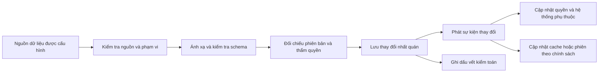

# Identity attributes

## Mục tiêu bài học

Một hệ thống quản lý danh tính và quyền truy cập (IAM) cần nhiều thông tin hơn một mã người dùng. Nó cần biết chủ thể là người dùng hay workload, tài khoản còn hoạt động không, chủ thể thuộc tổ chức nào và những dữ liệu đó đến từ đâu. Các thông tin này được biểu diễn bằng **identity attributes**, tức các thuộc tính của danh tính.

Thuộc tính có thể phục vụ hiển thị hồ sơ, liên hệ, cấp phát tài khoản hoặc quyết định quyền. Một sai lệch nhỏ trong dữ liệu như gán nhầm tenant, giữ phòng ban cũ hoặc tin vào một cờ do client gửi có thể trở thành lỗi truy cập nghiêm trọng.

Sau bài học, bạn có thể:

- Phân loại thuộc tính và phân biệt chúng với định danh, thông tin xác thực, quyền và ngữ cảnh phiên.
- Thiết kế kiểu dữ liệu, số lượng giá trị, phạm vi và vòng đời của thuộc tính.
- Xác định nguồn có thẩm quyền và quyền cập nhật theo từng thuộc tính.
- Sử dụng thuộc tính trong RBAC, ABAC, SSO và cấp phát tài khoản mà giữ đúng ranh giới tin cậy.
- Nhận diện rủi ro khi ánh xạ, đồng bộ, lưu cache hoặc cho phép chỉnh sửa hồ sơ.

## 1. Identity attribute là gì?

**Identity attribute là một thông tin mô tả chủ thể định danh hoặc một khía cạnh được mô hình hóa của chủ thể đó.** Một thuộc tính có tên, giá trị và ý nghĩa trong một schema nhất định.

Ví dụ:

```text
identityId = identity-42
kind = HUMAN
displayName = Nguyễn Lan
preferredLanguage = vi
email = lan@example.invalid
```

Với workload, các thuộc tính có thể là:

```text
identityId = workload-17
kind = WORKLOAD
applicationId = billing-service
environment = production
ownerTeamId = team-finance-platform
```

Những tên trường và giá trị trong bài là quy ước minh họa. Hệ thống thực tế phải định nghĩa ý nghĩa của chúng, không chỉ sao chép tên trường.

### 1.1. Giá trị chỉ có ý nghĩa khi có ngữ nghĩa và phạm vi

Chuỗi `active` đứng riêng không trả lời được:

- Con người còn là nhân viên đang hoạt động hay tài khoản được phép đăng nhập?
- Trạng thái áp dụng cho tổ chức nào?
- Ai có quyền xác nhận trạng thái?
- Dữ liệu có hiệu lực từ lúc nào và có còn mới không?

Tương tự, `department = finance` có thể nói về phòng ban nhân sự, nhóm nhận thông báo hoặc phạm vi truy cập báo cáo. Dùng một trường cho nhiều ý nghĩa sẽ làm chính sách khó hiểu và dễ cấp quyền sai.

### 1.2. Thuộc tính không tự tạo ra sự thật

Việc lưu `employee = true` không chứng minh người dùng là nhân viên. Cần biết giá trị do ai cung cấp, được kiểm tra ra sao và có được chấp nhận cho mục đích hiện tại không.

Một nguyên tắc thực hành là:

> Với mỗi thuộc tính quan trọng, mô tả nó có nghĩa gì, áp dụng cho ai, ai được xác nhận, ai được sửa và khi nào giá trị được chấp nhận.

## 2. Các nhóm thuộc tính thường gặp

| Nhóm | Ví dụ | Mục đích | Điểm cần chú ý |
| --- | --- | --- | --- |
| Định danh | ID nội bộ, định danh từ nguồn ngoài | Tham chiếu và liên kết chủ thể | Phạm vi duy nhất và quy tắc tái sử dụng |
| Hồ sơ hiển thị | Tên hiển thị, ảnh đại diện, ngôn ngữ | Trải nghiệm người dùng | Có thể do người dùng tự khai; không dùng thay bằng chứng định danh |
| Liên hệ | Email, số điện thoại | Thông báo hoặc quy trình tài khoản | Giá trị hiện tại và kết quả xác minh phải khớp nhau |
| Quan hệ tổ chức | Tenant, phòng ban, người quản lý | Cấp phát và chính sách truy cập | Thường có phạm vi và thời gian hiệu lực |
| Vòng đời | Trạng thái tài khoản, trạng thái thành viên | Bật, hạn chế hoặc thu hồi khả năng truy cập | Không gộp các trạng thái khác nhau thành một cờ |
| Phục vụ quyền | Nhóm, liên kết vai trò, phạm vi được giao | RBAC hoặc điều kiện chính sách | Cần quy trình quản lý đặc quyền riêng |
| Độ tin cậy | Nguồn xác minh, thời điểm xác minh | Đánh giá khả năng sử dụng dữ liệu | Phải gắn đúng claim và giá trị |
| Workload | Ứng dụng, môi trường, đội sở hữu | Nhận diện và giới hạn trách nhiệm dịch vụ | Nguồn cấp phải được ràng buộc với workload thực tế |

Các nhóm có thể giao nhau. Ví dụ email vừa là kênh liên hệ vừa có thể là tên đăng nhập. Điều đó không có nghĩa mọi nơi dùng email đều được phép giả định cùng một tính duy nhất hoặc cùng mức tin cậy.

### 2.1. Thuộc tính, claim và thông tin xác thực

**Attribute** thường nói về dữ liệu trong mô hình danh tính. **Claim** là một khẳng định về chủ thể được biểu diễn hoặc truyền trong một ngữ cảnh, chẳng hạn trong thông điệp từ nhà cung cấp danh tính.

Claim nhận được không tự trở thành thuộc tính có thẩm quyền trong hệ thống nội bộ. Nó còn phải được kiểm tra nguồn, ngữ nghĩa, kiểu dữ liệu và phạm vi trước khi ánh xạ.

Thông tin xác thực có trách nhiệm khác: nó hỗ trợ chứng minh quan hệ với danh tính khi xác thực. Mật khẩu, khóa riêng, mã khôi phục hoặc token bí mật không nên được đưa vào hồ sơ thuộc tính dùng chung hay phát hành cho các ứng dụng chỉ cần thông tin người dùng.

### 2.2. Vai trò và nhóm có thể được biểu diễn như dữ liệu nhưng vẫn là đối tượng quản trị quyền

Một hệ thống có thể trả về mảng `groups` hoặc `roles` cùng hồ sơ. Việc chúng xuất hiện trong JSON không làm chúng trở thành các trường hồ sơ mà người dùng được tự chỉnh sửa.

Liên kết vai trò còn có phạm vi: vai trò `admin` của dự án A không phải quyền quản trị toàn hệ thống. Nếu biểu diễn bằng một chuỗi `role = admin` mà bỏ mất phạm vi, dữ liệu quyền đã bị mất ngữ nghĩa quan trọng.

## 3. Đặt thuộc tính đúng đối tượng và phạm vi

Không phải mọi thông tin liên quan đến một người đều nên nằm trực tiếp trên một bản ghi người dùng toàn cục.

| Đối tượng mô hình | Thuộc tính phù hợp | Ví dụ |
| --- | --- | --- |
| Chủ thể nội bộ | ID, loại chủ thể, hồ sơ chung phù hợp | `identityId`, `kind`, `displayName` |
| Tài khoản | Trạng thái và cấu hình của tài khoản cụ thể | `accountState`, phương thức đăng nhập đã đăng ký |
| Quan hệ thành viên | Thông tin áp dụng trong một tổ chức hoặc tenant | `tenantId`, `departmentCode`, trạng thái thành viên |
| Liên kết danh tính ngoài | Nguồn phát hành và định danh tại nguồn đó | `issuer`, `subject` |
| Workload | Danh tính ứng dụng, môi trường, trách nhiệm sở hữu | `applicationId`, `environment`, `ownerTeamId` |
| Phiên hoặc lần xác thực | Thông tin của lần truy cập | Thời điểm xác thực, phương pháp, mức bảo đảm hiện tại |
| Tài nguyên nghiệp vụ | Thuộc tính của đối tượng được truy cập | Tenant sở hữu hóa đơn, độ nhạy của báo cáo |

Thuộc tính tài nguyên và ngữ cảnh phiên có thể tham gia quyết định quyền, nhưng không nên bị nhập nhằng với thuộc tính ổn định của chủ thể.

### 3.1. Một người thuộc nhiều tenant

Lan có thể là thành viên phòng tài chính tại tenant A và cộng tác viên phòng vận hành tại tenant B:

```text
identity-42
├── membership-17
│   ├── tenantId: tenant-a
│   ├── departmentCode: FIN
│   └── memberState: ACTIVE
└── membership-29
    ├── tenantId: tenant-b
    ├── departmentCode: OPS
    └── memberState: ACTIVE
```

Nếu gán một trường toàn cục `departmentCode = FIN`, ứng dụng có thể dùng nhầm dữ liệu của tenant A khi xử lý yêu cầu ở tenant B.

Với thuộc tính có phạm vi, việc tra cứu cần làm rõ ít nhất chủ thể, quan hệ thành viên và tenant đang xét. Giá trị `tenantId` do client yêu cầu không chứng minh người gọi có tư cách hợp lệ trong tenant đó.

### 3.2. Định danh ổn định khác với thuộc tính có thể thay đổi

Email, tên đăng nhập và mã nhân viên đều có thể thay đổi hoặc được tái cấp tùy hệ thống. Không nên mặc nhiên coi chúng là khóa bất biến liên kết toàn bộ dữ liệu và lịch sử quyền.

Một ID nội bộ được quản lý đúng có thể giữ quan hệ tham chiếu khi email đổi. Với định danh từ nguồn ngoài, cần lưu cả phạm vi nguồn; cùng một chuỗi ID ở hai nguồn không nhất thiết là cùng chủ thể.

Nếu nhà cung cấp thay đổi định danh hoặc có quy trình di chuyển tài khoản, cần một ánh xạ có kiểm soát. Không dùng việc trùng tên hiển thị hoặc email để tự động kết luận hai bản ghi thuộc cùng người.

## 4. Thiết kế schema cho thuộc tính

Một schema hữu ích mô tả nhiều hơn cặp tên và giá trị.

| Thành phần | Câu hỏi cần trả lời |
| --- | --- |
| Tên và ý nghĩa | Thuộc tính mô tả điều gì, có cùng nghĩa ở mọi ứng dụng không? |
| Kiểu dữ liệu | Chuỗi, boolean, thời điểm, enum, tham chiếu hay cấu trúc? |
| Số lượng giá trị | Một giá trị, nhiều giá trị hay một tập giá trị có thứ tự? |
| Phạm vi | Toàn chủ thể, theo tài khoản, tổ chức, tenant hay phiên? |
| Tính bắt buộc | Khi nào phải có giá trị, khi nào được thiếu? |
| Tính duy nhất | Duy nhất toàn hệ thống hay chỉ trong một namespace? |
| Quy tắc chuẩn hóa | Chuẩn hóa thế nào mà không thay đổi sai ý nghĩa? |
| Quyền cập nhật | Nguồn hoặc chủ thể nào được phép sửa? |
| Thời gian | Giá trị có hiệu lực từ lúc nào, đến lúc nào? |
| Mức nhạy cảm | Ai được đọc, phát hành hoặc ghi vào nhật ký? |

### 4.1. Kiểu dữ liệu phải được giữ nhất quán

`false`, `"false"`, `0`, `null` và trường không tồn tại không phải các giá trị tương đương trong mọi hệ thống.

Ví dụ, kiểm tra một chuỗi không rỗng như boolean có thể khiến `"false"` bị xử lý thành đúng. Bộ ánh xạ cần kiểm tra kiểu dữ liệu và từ chối hoặc xử lý rõ các giá trị không hợp lệ.

Các mã như `departmentCode = "001"` thường phải giữ kiểu chuỗi; chuyển thành số `1` có thể làm thay đổi mã. Với trạng thái, enum như `ACTIVE`, `SUSPENDED`, `ENDED` giúp mô tả rõ hơn một cờ chung `enabled` nếu nghiệp vụ thật sự có nhiều trạng thái.

### 4.2. Giá trị thiếu, rỗng và chưa xác định

Giả sử một claim `isEmployee` không xuất hiện. Có thể nguồn không phát hành claim, dữ liệu chưa đồng bộ hoặc chủ thể không thuộc mô hình nhân sự đó. Không nên tự kết luận thiếu claim nghĩa là nhân viên hợp lệ.

Cần phân biệt:

- **Thiếu trường**: không được cung cấp trong ngữ cảnh hiện tại.
- **Giá trị rỗng**: được cung cấp nhưng không có nội dung theo schema.
- **Giá trị xác định là không**: nguồn có thẩm quyền đã khẳng định điều kiện không đúng.
- **Không xác định được**: không thể đánh giá do dữ liệu lỗi, xung đột hoặc nguồn không sẵn sàng.

Trong cập nhật từng phần, trường bị bỏ qua có thể có nghĩa “giữ nguyên”; `null` có thể có nghĩa “xóa” nếu hợp đồng quy định như vậy. Không được đoán hai hành vi này từ tiện ích ánh xạ đối tượng.

### 4.3. Chuẩn hóa không đồng nghĩa với biến mọi thứ thành chữ thường

Quy tắc so sánh phải phù hợp loại dữ liệu và hợp đồng với nguồn. Cắt khoảng trắng hoặc đổi kiểu chữ tùy tiện có thể làm thay đổi định danh.

Với email, không nên mặc nhiên áp dụng một quy tắc chữ thường cho mọi thành phần rồi dùng kết quả để hợp nhất tài khoản. Với mã tổ chức, cần biết nguồn có phân biệt chữ hoa chữ thường không. Với tên người, không nên ép mọi dữ liệu về cấu trúc tên riêng và họ theo một giả định duy nhất.

Tên hiển thị cũng không phải khóa định danh. Hai người có thể cùng tên và một người có thể đổi cách hiển thị tên.

### 4.4. Thuộc tính nhiều giá trị cần cấu trúc rõ

Một người có thể có nhiều email hoặc nhiều quan hệ thành viên. Mảng chuỗi đơn giản có thể không đủ nếu mỗi giá trị có loại, trạng thái xác minh và thời gian riêng.

Ví dụ:

```json
{
  "contacts": [
    {
      "contactId": "contact-8",
      "type": "email",
      "value": "lan@example.invalid",
      "purpose": "work-notification",
      "verificationRef": "verification-107"
    }
  ]
}
```

Cần xác định giá trị nào dùng cho đăng nhập, giá trị nào dùng cho thông báo và giá trị nào đủ điều kiện cho khôi phục. Không nên mặc nhiên coi email đứng đầu mảng là kênh có thẩm quyền cho mọi mục đích.

## 5. Xác định nguồn có thẩm quyền theo từng thuộc tính

**Nguồn có thẩm quyền** là nguồn được hệ thống chấp nhận để xác định một thuộc tính trong phạm vi cụ thể. Không nhất thiết có một nguồn duy nhất cho toàn bộ hồ sơ.

| Thuộc tính | Nguồn có thể được giao thẩm quyền | Quy tắc cần giữ |
| --- | --- | --- |
| Ngôn ngữ ưa dùng | Người dùng | Chỉ tác động cấu hình trải nghiệm theo hợp đồng |
| Trạng thái nhân viên | Hệ thống nhân sự của tổ chức | Gắn đúng quan hệ thành viên và thời gian hiệu lực |
| Tư cách thành viên dự án | Dịch vụ quản lý thành viên | Kiểm soát ai được thêm, sửa hoặc thu hồi |
| Email đã xác minh | Dịch vụ xác minh hoặc nguồn được tin cậy tương ứng | Kết quả phải gắn đúng địa chỉ |
| Liên kết vai trò đặc quyền | Quy trình quản trị quyền | Không bị ghi đè bởi cập nhật hồ sơ thông thường |
| Môi trường của workload | Nền tảng cấp danh tính hoặc triển khai được tin cậy | Ràng buộc với workload đã được nhận diện |

Đây là các lựa chọn minh họa. Mỗi hệ thống cần quy định cụ thể nguồn nào có thẩm quyền cho thuộc tính nào.

### 5.1. Phân biệt nguồn gốc và kênh vận chuyển

Một thư mục danh tính có thể nhận trạng thái nhân viên từ hệ thống nhân sự rồi phát hành cho ứng dụng. Thư mục là nơi cung cấp dữ liệu cho ứng dụng, nhưng nguồn gốc và quy trình quản trị vẫn quan trọng.

Nếu dữ liệu do người dùng tự khai được đồng bộ qua một nguồn đáng tin về vận chuyển, nó không tự trở thành dữ liệu đã kiểm chứng. Tương tự, token được kiểm tra đúng không làm mọi claim trở thành cơ sở cấp quyền phù hợp.

### 5.2. Xung đột phải có quy tắc giải quyết

Giả sử nguồn nhân sự cho biết phòng ban là `FIN`, còn hồ sơ người dùng tự nhập là `OPS`. Hệ thống cần biết hai trường có cùng ý nghĩa không và nguồn nào được phép quyết định.

Không dùng quy tắc “bản ghi đến sau thắng” cho mọi thuộc tính. Một cập nhật hồ sơ mới hơn không được ghi đè trạng thái nhân sự có thẩm quyền hoặc liên kết vai trò được phê duyệt.

Nếu cho phép ngoại lệ thủ công, ngoại lệ cần có người phê duyệt, phạm vi, lý do và thời hạn phù hợp. Nó không nên trở thành một giá trị không thể phân biệt với dữ liệu gốc.

## 6. Mô hình dữ liệu minh họa

Ví dụ dưới đây tách hồ sơ chung, liên hệ và quan hệ thành viên. Đây là cấu trúc ứng dụng minh họa, không phải schema tiêu chuẩn bắt buộc:

```json
{
  "schemaVersion": 1,
  "identityId": "identity-42",
  "kind": "HUMAN",
  "profile": {
    "displayName": "Nguyễn Lan",
    "preferredLanguage": "vi"
  },
  "contacts": [
    {
      "contactId": "contact-8",
      "type": "email",
      "value": "lan@example.invalid",
      "verificationRef": "verification-107"
    }
  ],
  "memberships": [
    {
      "membershipId": "membership-17",
      "tenantId": "tenant-a",
      "departmentCode": "FIN",
      "memberState": "ACTIVE",
      "effectiveFrom": "2026-11-01T00:00:00Z"
    }
  ]
}
```

Với thuộc tính quan trọng cho quyền, có thể quản lý thêm metadata về nguồn và phiên bản:

```json
{
  "subjectId": "identity-42",
  "scope": {
    "tenantId": "tenant-a",
    "membershipId": "membership-17"
  },
  "attributeName": "departmentCode",
  "value": "FIN",
  "sourceId": "hr-organization-a",
  "sourceRecordId": "employee-206",
  "sourceVersion": 17,
  "ingestedAt": "2026-11-01T00:05:00Z",
  "effectiveFrom": "2026-11-01T00:00:00Z",
  "effectiveTo": null
}
```

Không bắt buộc mọi thuộc tính đều phải nằm trong một bảng key–value tổng quát. Có thể dùng bảng quan hệ, đối tượng có kiểu hoặc kho dữ liệu khác. Điều cần giữ là ngữ nghĩa, nguồn và phạm vi có thể được xác định đáng tin cậy.

### 6.1. Ba loại thời gian không nên nhập làm một

- **Thời gian hiệu lực**: giá trị đúng với nghiệp vụ từ lúc nào đến lúc nào.
- **Thời gian tiếp nhận**: hệ thống nhận hoặc cập nhật dữ liệu lúc nào.
- **Thời gian xác minh**: một quy trình đã kiểm chứng khẳng định vào lúc nào, nếu có.

Ví dụ, Lan chuyển phòng ban có hiệu lực từ đầu ngày nhưng sự kiện đến ứng dụng sau năm phút. Thời gian tiếp nhận muộn hơn không làm ngày hiệu lực nghiệp vụ tự thay đổi.

Hạn của token chứa thuộc tính lại là một khái niệm khác. Token chưa hết hạn không chứng minh phòng ban hoặc tư cách thành viên bên trong chưa thay đổi ở nguồn.

## 7. Thu thập, ánh xạ và đồng bộ thuộc tính

Một luồng xử lý thường có các trách nhiệm sau:



### 7.1. Ánh xạ phải kiểm tra cả ý nghĩa

Một nguồn dùng `department`, nguồn khác dùng `costCenter`. Hai trường có thể liên quan nhưng không mặc nhiên đồng nghĩa. Nếu chính sách truy cập cần phòng ban, không nên lấy trung tâm chi phí thay thế chỉ vì dữ liệu trông giống nhau.

Với trạng thái, cần mô tả rõ ánh xạ. Ví dụ `terminated`, `leave` và `disabled` có thể nói về những trạng thái khác nhau của nhân sự, quan hệ thành viên hoặc tài khoản. Gộp tất cả vào `active = false` có thể làm mất thông tin cần cho vận hành.

### 7.2. Xử lý sự kiện lặp và sai thứ tự

Đồng bộ có thể gửi lại sự kiện hoặc gửi sự kiện cũ sau sự kiện mới. Nếu chỉ áp dụng theo thứ tự nhận, trạng thái cũ có thể ghi đè trạng thái mới và khôi phục quyền đã thu hồi.

Cần có quy tắc nhận diện sự kiện, so sánh phiên bản hoặc thứ tự trong phạm vi mà nguồn bảo đảm. Không so sánh tùy tiện số phiên bản của hai nguồn độc lập như thể chúng nằm trên cùng một dòng thời gian.

Tính lặp an toàn cũng quan trọng: xử lý lại một sự kiện không được tạo thêm quan hệ thành viên hoặc cấp lặp quyền ngoài ý định.

### 7.3. Vắng trong bản đồng bộ không luôn có nghĩa là bị xóa

Một bản cập nhật từng phần có thể bỏ qua thuộc tính không đổi. Một bản nhập đầy đủ có thể dùng sự vắng mặt để thể hiện đối tượng không còn tồn tại trong phạm vi nguồn.

Hai hợp đồng đó phải được phân biệt. Không nên vô hiệu hóa hàng loạt tài khoản vì một nguồn tạm thời chỉ trả về một phần dữ liệu, hoặc giữ quyền mãi vì không bao giờ xử lý sự kiện kết thúc quan hệ.

Các hành động thu hồi dựa trên bản nhập đầy đủ cần biết bản nhập đã hoàn tất, đúng phạm vi và được chấp nhận theo hợp đồng đồng bộ.

## 8. Thuộc tính trong quyết định cấp quyền

ABAC sử dụng thuộc tính của chủ thể, tài nguyên và ngữ cảnh để đánh giá chính sách. RBAC cũng có thể phụ thuộc thuộc tính khi cấp vai trò hoặc giới hạn phạm vi của vai trò.

Ví dụ một quy tắc minh họa cho báo cáo nội bộ:

```text
Cho phép report:read khi đồng thời thỏa mãn:
  tài khoản được phép hoạt động
  chủ thể có tư cách thành viên ACTIVE trong tenant của báo cáo
  có liên kết vai trò report-reader trong phạm vi tương ứng
  departmentCode của quan hệ thành viên khớp departmentCode của báo cáo
  dữ liệu dùng cho quyết định đến từ nguồn được chấp nhận
  dữ liệu còn đáp ứng yêu cầu về độ mới
```

Đây là một chính sách ví dụ, không phải quy tắc chung rằng cùng phòng ban luôn được xem mọi báo cáo.

### 8.1. Không lấy thuộc tính quyền từ request chưa đáng tin

Client có thể gửi:

```json
{
  "tenantId": "tenant-a",
  "departmentCode": "FIN",
  "memberState": "ACTIVE"
}
```

Payload chỉ mô tả dữ liệu được yêu cầu hoặc khai báo. Nó không chứng minh các điều kiện đó đúng đối với người đang gọi.

Backend cần lấy thuộc tính chủ thể từ ngữ cảnh đã xác thực và nguồn được chấp nhận. Thuộc tính báo cáo phải lấy từ nguồn tài nguyên đáng tin. Tenant do người dùng chọn phải được đối chiếu với tư cách và phạm vi thực tế.

### 8.2. Mã giả minh họa

Đoạn sau mô tả trách nhiệm logic, không phải mã nguồn hoàn chỉnh:

```text
function readReport(request):
    subject = resolveAuthenticatedSubject(request.credentials)
    report = loadTrustedReportMetadata(request.reportId)
    membership = resolveTrustedMembership(subject.id, report.tenantId)

    require accountStateAllowsAccess(subject)
    require membership exists
    require membership.memberState == ACTIVE
    require membership is currently effective
    require membership.departmentCode is known
    require report.departmentCode is known
    require attributeSourcesAreAccepted(membership, report)
    require attributesMeetFreshnessPolicy(membership, report)
    require hasScopedRole(subject, "report-reader", report)
    require membership.departmentCode == report.departmentCode

    return permittedReportFields(report)
```

Không được để hai giá trị cùng thiếu vô tình thỏa điều kiện “bằng nhau”. Nếu chính sách bắt buộc biết phòng ban, việc không xác định được phòng ban không cung cấp cơ sở để cho phép đọc.

Trong triển khai, kiểm tra phải diễn ra trước khi tiết lộ dữ liệu. Việc đọc metadata nội bộ để đánh giá quyền không có nghĩa toàn bộ báo cáo được phép trả cho client.

### 8.3. Thay đổi thuộc tính có thể thay đổi quyền gián tiếp

Đổi `departmentCode` có thể thay đổi tập báo cáo được xem. Đổi `managerId` có thể thay đổi quyền phê duyệt. Đổi `ownerTeamId` của workload có thể tác động quy trình cấp bí mật.

Do đó, một trường nhìn giống dữ liệu hồ sơ có thể mang tác động bảo mật. Quyền sửa trường phải được đánh giá theo các chính sách phụ thuộc vào nó, không chỉ theo vị trí xuất hiện trên giao diện.

## 9. Thuộc tính từ SSO và nhà cung cấp danh tính

SSO giúp ứng dụng nhận danh tính và các claim từ một nguồn khác, nhưng ứng dụng vẫn phải xác định claim nào được chấp nhận và cho mục đích gì.

Các bước cần làm rõ gồm:

1. Kiểm tra thông điệp theo giao thức và cấu hình tin cậy trước khi dùng nội dung.
2. Xác định đúng nhà cung cấp và chủ thể tại nhà cung cấp đó.
3. Ánh xạ claim theo schema của ứng dụng, gồm kiểu, phạm vi và số lượng giá trị.
4. Chỉ cho nguồn cập nhật những thuộc tính mà nó có thẩm quyền.
5. Xác định dữ liệu được dùng trực tiếp trong phiên hay được đồng bộ thành trạng thái nội bộ.

Ví dụ, `groups = ["admin"]` từ một nhà cung cấp không được tự chuyển thành quyền quản trị toàn hệ thống. Cần ánh xạ nhóm theo nguồn và phạm vi đã được phê duyệt. Hai nguồn dùng cùng tên nhóm có thể mô tả hai nhóm hoàn toàn khác nhau.

Nếu token mang một ảnh chụp nhóm lúc đăng nhập, việc người dùng bị xóa khỏi nhóm ở nguồn không tự sửa token đang tồn tại. Ứng dụng phải có chính sách về thời hạn, làm mới hoặc kiểm tra trạng thái đáp ứng yêu cầu thu hồi.

## 10. Thuộc tính của workload và danh tính máy

Workload có vòng đời và nguồn thuộc tính khác người dùng. Các thuộc tính thường cần xét gồm ứng dụng, môi trường, tài khoản hạ tầng, đơn vị sở hữu và phạm vi triển khai.

Một request tự khai:

```json
{
  "applicationId": "billing-service",
  "environment": "production"
}
```

không chứng minh nó đến từ dịch vụ production. Các giá trị dùng cho quyền phải được ràng buộc với danh tính workload đã được xác thực và nguồn cấp thuộc tính phù hợp.

Đặc biệt:

- Tách cùng tên ứng dụng giữa môi trường thử nghiệm và production.
- Không coi nhãn triển khai do người phát triển tự sửa là nguồn cấp đặc quyền mặc định.
- Xác định ai được đổi đơn vị sở hữu hoặc phạm vi workload.
- Xử lý phiên bản triển khai, xoay vòng thông tin xác thực và kết thúc workload mà không giữ quyền không còn cần thiết.

Không nên ép workload phải có email hoặc mã nhân viên chỉ để phù hợp schema dành cho người. Thuộc tính cần phản ánh đúng loại chủ thể và trách nhiệm thực tế.

## 11. Kiểm soát quyền đọc và sửa thuộc tính

Mỗi thuộc tính nên có chính sách cho ít nhất hai câu hỏi: ai được đọc và ai được sửa. Hai tập quyền đó không nhất thiết giống nhau.

| Chủ thể thực hiện | Có thể được phép | Không nên tự suy ra |
| --- | --- | --- |
| Người dùng | Sửa ngôn ngữ hoặc tên hiển thị theo chính sách | Được sửa tenant, phòng ban có thẩm quyền hoặc vai trò |
| Hệ thống nhân sự | Cập nhật dữ liệu nhân sự trong tổ chức được giao | Được cấp mọi quyền quản trị ứng dụng |
| Nhân viên hỗ trợ | Thực hiện một số thao tác hỗ trợ được kiểm soát | Được đổi tùy ý kết quả xác minh hoặc chủ sở hữu tài khoản |
| Quản trị tenant | Quản lý thuộc tính và thành viên trong phạm vi tenant | Được sửa thuộc tính của tenant khác |
| Connector đồng bộ | Ghi các trường được cấu hình | Được ghi đè mọi trường chỉ vì kết nối đã xác thực |

### 11.1. Tránh gán hàng loạt trường từ payload

Một endpoint sửa hồ sơ chỉ dự kiến cho phép:

```json
{
  "displayName": "Nguyễn Lan",
  "preferredLanguage": "vi"
}
```

Nếu server ánh xạ toàn bộ body vào thực thể danh tính rồi lưu, người gọi có thể gửi thêm các trường như `accountState`, `roles` hoặc `emailVerified`.

Cần dùng hợp đồng cập nhật rõ ràng, kiểm tra danh sách trường được phép và kiểm tra quyền theo trường có tác động đặc biệt. Chỉ kiểm tra quyền “sửa hồ sơ” ở cấp đối tượng chưa bảo đảm người gọi được sửa mọi thuộc tính bên trong.

Các thay đổi như gán vai trò, đổi kênh khôi phục hoặc chuyển tenant thường cần thao tác và quy trình riêng. Không nên giấu chúng trong một endpoint cập nhật hồ sơ tổng quát.

### 11.2. Giá trị hiển thị vẫn là dữ liệu cần xử lý đúng

Tên hiển thị hoặc mô tả có thể chứa nội dung không đáng tin. Ứng dụng phải xử lý dữ liệu đúng ngữ cảnh khi hiển thị, tìm kiếm hoặc ghi nhật ký. Việc một giá trị nằm trong kho danh tính không có nghĩa nó an toàn để chèn nguyên vào HTML hay câu lệnh.

Giới hạn độ dài và kiểu dữ liệu cũng giúp tránh dữ liệu bất thường làm hỏng đồng bộ, token hoặc phản hồi của các dịch vụ phụ thuộc.

## 12. Vòng đời thuộc tính, cache và quyền đã cấp

Thuộc tính dùng cho quyền là dữ liệu thay đổi theo thời gian. Cần xác định tác động của từng thay đổi đến các trạng thái phụ thuộc.

| Sự kiện | Những nơi cần xem xét |
| --- | --- |
| Đổi phòng ban | Vai trò phát sinh, điều kiện ABAC, cache quyết định quyền |
| Kết thúc tư cách thành viên | Tài khoản ứng dụng, phiên, quyền theo tenant |
| Đổi email | Trạng thái xác minh, đăng nhập, thông báo và khôi phục theo chính sách |
| Đổi người quản lý | Quan hệ phê duyệt và quyền theo quan hệ |
| Đổi môi trường workload | Chính sách bí mật, dữ liệu và tài nguyên hạ tầng |
| Thu hồi một nguồn thuộc tính | Các claim và quyết định đang dựa vào nguồn đó |

Nếu vai trò được cấp từ thuộc tính, cần quản lý cả chiều cấp và chiều thu hồi. Chỉ thêm vai trò khi gia nhập phòng ban mà không xóa vai trò phát sinh khi rời phòng ban sẽ dẫn đến tích lũy đặc quyền.

### 12.1. Cache cần giữ đúng phạm vi và độ mới

Cache chỉ theo `identityId` có thể vô tình dùng thuộc tính của tenant A cho tenant B. Cache quyết định quyền còn có thể phụ thuộc phiên bản thuộc tính, tài nguyên, action và phiên bản chính sách.

Không có một khóa cache chung đúng cho mọi kiến trúc. Yêu cầu là kết quả không bị tái sử dụng ngoài phạm vi hoặc độ mới mà quyết định ban đầu bảo đảm.

Cần xác định cách hết hạn hoặc vô hiệu hóa khi thuộc tính thay đổi, và độ trễ chấp nhận được cho việc mất quyền. Cập nhật kho dữ liệu không tự làm mọi cache và phiên đồng bộ ngay lập tức.

### 12.2. Giữ lịch sử nhưng phân biệt với hiện trạng

Lịch sử cho biết Lan từng thuộc phòng tài chính không chứng minh Lan vẫn thuộc phòng đó hôm nay. Truy vấn quyền hiện tại phải xét giá trị đang có hiệu lực theo chính sách, thay vì chọn bất kỳ bản ghi lịch sử nào khớp điều kiện.

Ngược lại, kiểm toán một quyết định trong quá khứ có thể cần biết phiên bản thuộc tính và chính sách được dùng lúc đó. Dấu vết cần giúp phân biệt dữ liệu tại thời điểm quyết định với dữ liệu đang thấy trên hồ sơ hiện tại.

## 13. Bảo vệ dữ liệu thuộc tính

Không phải ứng dụng nào cũng cần toàn bộ hồ sơ danh tính. Một dịch vụ thông báo có thể cần email và ngôn ngữ; dịch vụ báo cáo có thể cần tenant và phạm vi quyền; chúng không nhất thiết cần thông tin cá nhân chi tiết khác.

Các nguyên tắc thiết kế gồm:

- Chỉ thu thập và phát hành thuộc tính cần cho mục đích đã xác định.
- Giới hạn quyền đọc theo ứng dụng, đối tượng gọi và phạm vi tenant.
- Không đưa bí mật hoặc bằng chứng nhạy cảm vào token hoặc hồ sơ dùng chung.
- Xác định thời hạn lưu, nhu cầu giữ lịch sử và cách xử lý dữ liệu không còn cần.
- Ghi dấu vết thay đổi quan trọng mà tránh lộ toàn bộ giá trị nhạy cảm.

Khi kiểm toán, có thể ghi tên thuộc tính, chủ thể bị tác động, nguồn cập nhật, phiên bản và mã liên kết sự kiện. Giá trị cũ hoặc mới chỉ nên được ghi khi thật sự cần và nằm trong phạm vi bảo vệ phù hợp.

Băm một email không tự làm dữ liệu trở thành ẩn danh trong mọi tình huống. Khả năng đoán giá trị hoặc liên kết giữa các bộ dữ liệu vẫn phải được xem xét khi thiết kế nhật ký và phân tích.

## 14. Ví dụ xuyên suốt: Lan chuyển phòng ban

Lan đang thuộc phòng tài chính của tenant A và có vai trò đọc báo cáo được phát sinh từ quan hệ đó. Ngày chuyển sang phòng vận hành, quy trình cần xử lý nhiều hơn việc đổi một chuỗi trên màn hình hồ sơ.

1. Nguồn nhân sự phát thay đổi cho đúng chủ thể và quan hệ thành viên tại tenant A.
2. Hệ thống kiểm tra nguồn, kiểu dữ liệu, phạm vi, phiên bản và thời gian hiệu lực.
3. Thuộc tính phòng ban được cập nhật; lịch sử cũ được giữ theo nhu cầu kiểm toán.
4. Các quyền phát sinh từ phòng tài chính được xét thu hồi; quyền mới chỉ được cấp theo chính sách phù hợp.
5. Cache, phiên hoặc các hệ thống ứng dụng nhận thay đổi theo cơ chế và độ trễ đã xác định.
6. Dấu vết cho biết ai hoặc nguồn nào tạo thay đổi và các kết quả xử lý liên quan.

Nếu Lan đồng thời là cộng tác viên tại tenant B, thay đổi này không tự sửa quan hệ ở tenant B. Nếu một hệ thống nhận sự kiện cũ đến muộn, nó không được khôi phục phòng ban cũ chỉ vì sự kiện đó đến sau.

Ví dụ thể hiện mối liên hệ giữa mô hình dữ liệu, nguồn tin cậy, cấp phát tài khoản và nguyên tắc ít quyền nhất.

## 15. Tự kiểm tra mức hiểu

### Tình huống 1: Người dùng được tự sửa phòng ban

Một ứng dụng dùng `departmentCode` để quyết định quyền đọc báo cáo, nhưng endpoint hồ sơ cho phép người dùng tự sửa trường này. Vấn đề ở đâu?

**Phân tích:** Thuộc tính có tác động đến quyền lại được lấy từ nguồn mà người nhận quyền tự điều khiển. Cần xác định nguồn có thẩm quyền và quyền cập nhật phù hợp; nếu muốn người dùng khai phòng ban, phải phân biệt trường tự khai với dữ liệu dùng cho chính sách.

### Tình huống 2: Hai tenant dùng chung trường vai trò

Lan có `role = admin` trong tenant A. Ứng dụng dùng trường đó khi Lan chọn tenant B. Vì sao không đủ?

**Phân tích:** Vai trò đã mất phạm vi. Cần gắn vai trò với quan hệ thành viên hoặc phạm vi được cấp; tư cách quản trị ở A không tự mở rộng sang B.

### Tình huống 3: Token còn hạn nhưng nhân viên đã nghỉ việc

Token còn hiệu lực và chứa `memberState = ACTIVE`, trong khi nguồn nhân sự đã kết thúc quan hệ. Có thể dựa vào thời hạn token để kết luận trạng thái vẫn đúng không?

**Phân tích:** Không. Thời hạn token và độ mới của thuộc tính là hai vấn đề khác nhau. Hệ thống cần chính sách thu hồi, làm mới hoặc kiểm tra trạng thái đáp ứng yêu cầu của thao tác.

### Tình huống 4: Sự kiện cũ đến sau sự kiện mới

Sự kiện phiên bản 18 kết thúc tư cách thành viên được xử lý trước, rồi phiên bản 17 báo đang hoạt động mới đến. Nên làm gì?

**Phân tích:** Khi nguồn bảo đảm ý nghĩa và thứ tự phiên bản trong phạm vi đó, hệ thống cần ngăn phiên bản cũ ghi đè hiện trạng mới. Nếu dùng thứ tự nhận làm thẩm quyền, quyền đã thu hồi có thể bị khôi phục.

### Tình huống 5: Hai thuộc tính cùng thiếu

Chính sách cho xem báo cáo nếu phòng ban người dùng bằng phòng ban báo cáo. Cả hai trường đều `null`. Có được cho phép không?

**Phân tích:** Không thể suy ra đủ điều kiện từ hai giá trị chưa biết. Chính sách cần yêu cầu các thuộc tính bắt buộc được xác định, hợp lệ và đến từ nguồn được chấp nhận trước khi so sánh.

### Tình huống 6: Workload tự nhận là production

Một dịch vụ gửi `environment = production` trong request để xin bí mật production. Thuộc tính đó có đủ không?

**Phân tích:** Không. Giá trị phải được ràng buộc với danh tính workload và nguồn cấp đáng tin. Payload do người gọi tự đặt không chứng minh môi trường triển khai.

## Kết luận

Identity attributes giúp IAM mô tả chủ thể và vận hành các chính sách truy cập. Giá trị của thuộc tính phụ thuộc vào ngữ nghĩa, kiểu dữ liệu, phạm vi, nguồn có thẩm quyền và thời gian hiệu lực.

Khi tách đúng hồ sơ, quan hệ thành viên, dữ liệu quyền và ngữ cảnh phiên, hệ thống có thể sử dụng thuộc tính nhất quán trong đăng nhập, SSO, cấp phát tài khoản, RBAC và ABAC. Những thuộc tính ảnh hưởng đến quyền cần được bảo vệ và quản lý vòng đời với mức nghiêm túc tương ứng với tác động của chúng.
