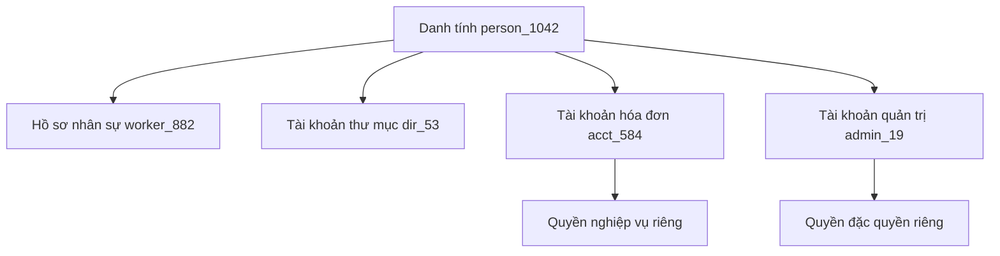

# Identity correlation

## 1. Identity correlation giải quyết vấn đề gì?

Trong một tổ chức, cùng một người có thể xuất hiện dưới nhiều bản ghi: hồ sơ nhân sự, tài khoản thư mục, tài khoản ứng dụng tài chính, tài khoản quản trị và tài khoản ở nhà cung cấp dịch vụ. Tên đăng nhập ở mỗi nơi có thể khác nhau; email có thể thay đổi; không phải bản ghi nào cũng có cùng một mã nhân viên.

**Identity correlation — đối chiếu và liên kết danh tính** là quá trình xác định các bản ghi hoặc tài khoản có đại diện cho cùng một chủ thể trong phạm vi đang quản lý hay không, rồi lưu quan hệ đó cùng bằng chứng và ngữ cảnh cần thiết.

Ví dụ, tổ chức cần biết hồ sơ nhân sự `worker_882`, tài khoản thư mục `dir_53` và tài khoản ứng dụng `acct_584` đều gắn với danh tính nội bộ `person_1042`. Nhờ đó, khi người này đổi nhiệm vụ hoặc nghỉ việc, hệ thống có thể tìm đúng các tài khoản cần xử lý.

Liên kết sai có thể khiến một người nhận quyền, dữ liệu hoặc phương thức khôi phục của người khác. Không liên kết được cũng có thể để sót tài khoản khi thu hồi. Vì vậy, identity correlation là một phần của ranh giới bảo mật, không chỉ là thao tác làm sạch dữ liệu.

Sau bài học, bạn có thể mô hình hóa quan hệ giữa danh tính và tài khoản, đánh giá độ tin cậy của thuộc tính dùng để đối chiếu, xử lý trường hợp mơ hồ và thiết kế vòng đời của một liên kết có thể kiểm toán.

## 2. Phân biệt các khái niệm liên quan

| Khái niệm | Câu hỏi chính | Ví dụ |
|---|---|---|
| Identity correlation | Những bản ghi nào đại diện cho cùng một chủ thể? | Tài khoản thư mục này thuộc người nào trong nguồn nhân sự? |
| Identity provisioning | Cần tạo, cập nhật hoặc ngừng tài khoản nào? | Tạo tài khoản ứng dụng cho người mới gia nhập |
| Account linking | Những phương thức hoặc tài khoản nào được liên kết trong một sản phẩm? | Gắn đăng nhập liên kết vào tài khoản cục bộ đã tồn tại |
| Identity merge | Có cần hợp nhất các bản ghi danh tính trùng lặp không? | Hợp nhất hai hồ sơ chuẩn đã xác nhận cùng đại diện một người |
| Event correlation | Những sự kiện nào thuộc cùng phiên, yêu cầu hoặc chuỗi hoạt động? | Nối đăng nhập, phiên pipeline và lần triển khai |
| Authorization | Chủ thể được làm gì trên tài nguyên nào? | Cho phép xem một hóa đơn thuộc phạm vi được giao |

Các hoạt động này liên quan nhưng không thay thế nhau. Correlation có thể cung cấp đầu vào cho provisioning; nó không tự động cho phép cấp quyền. Account linking có thể sử dụng kết quả correlation, nhưng vẫn cần kiểm soát thao tác liên kết. Nối hai sự kiện cùng địa chỉ IP cũng không chứng minh chúng do cùng một người thực hiện.

Một người có thể có cả tài khoản thông thường và tài khoản quản trị. Correlation giúp biết chúng liên quan đến cùng người, nhưng không có nghĩa phải hợp nhất credential, phiên hoặc quyền của hai tài khoản.

## 3. Mô hình danh tính và tài khoản

### 3.1. Bản ghi danh tính chuẩn có phạm vi

Một hệ thống quản trị có thể tạo bản ghi danh tính chuẩn, còn gọi là canonical identity, để làm điểm tham chiếu cho các tài khoản liên quan. Bản ghi này nên có định danh nội bộ ổn định.

“Chuẩn” ở đây có nghĩa là bản ghi được chọn làm điểm quản lý trong một phạm vi. Nó không tự chứng minh rằng mọi thuộc tính đều chính xác hoặc danh tính đã được xác minh ở mức cao nhất. Mỗi thuộc tính vẫn cần nguồn có thẩm quyền và lịch sử cập nhật.

Phạm vi có thể là một tổ chức, một tenant hoặc một miền quản trị. Không nên mặc định cần một định danh duy nhất cho cùng một người trên mọi khách hàng và mọi dịch vụ. Việc liên kết xuyên phạm vi phải có mục đích và quyền thực hiện rõ ràng.

### 3.2. Một danh tính có thể liên quan nhiều tài khoản



Sơ đồ chỉ biểu diễn quan hệ, không yêu cầu cộng tất cả quyền vào danh tính chuẩn. Tài khoản quản trị có thể phải dùng phương thức xác thực, phiên và quy trình phê duyệt riêng dù đã được đối chiếu về cùng một người.

Tài khoản dùng chung là trường hợp khác. Nếu nhiều người sử dụng một tài khoản `operations`, không thể gắn tài khoản đó cho một người rồi coi mọi hành động của nó là hành động cá nhân. Cần mô hình hóa tính dùng chung và thu thập thêm ngữ cảnh truy vết, hoặc chuyển sang cơ chế truy cập cá nhân phù hợp.

### 3.3. Khóa tài khoản phải bao gồm nguồn và phạm vi

Một giá trị `12345` không có ý nghĩa duy nhất nếu chưa biết nó đến từ hệ thống nào. Hai nhà cung cấp hoặc hai tenant có thể cùng sử dụng giá trị đó cho các chủ thể khác nhau.

Khóa nguồn có thể được mô hình hóa như sau:

```text
Khóa bản ghi nguồn
= Nguồn hoặc phiên kết nối đã đăng ký
  + Phạm vi tenant hoặc miền
  + Loại đối tượng
  + Định danh đối tượng trong nguồn
```

Cách biểu diễn cụ thể phụ thuộc hệ thống. Cần bảo toàn các thành phần như trường riêng hoặc cấu trúc có quy tắc rõ ràng, thay vì ghép chuỗi tùy ý dễ tạo va chạm.

Nguồn cũng phải có vòng đời. Nếu tổ chức thay hệ thống nhân sự hoặc kết nối lại một tenant mới, không nên tái sử dụng nhãn nguồn cũ mà bỏ qua việc các định danh có thể đã thay đổi ý nghĩa.

### 3.4. Liên kết cần dữ liệu chứng minh và thời gian hiệu lực

Một liên kết có ích cho quản trị cần nhiều hơn cặp `account_id → person_id`.

```json
{
  "correlation_id": "corr_731",
  "canonical_identity_id": "person_1042",
  "source_instance": "billing-production",
  "source_tenant": "company-a",
  "source_object_type": "human_account",
  "source_subject_id": "acct_584",
  "relationship": "represents",
  "correlation_status": "confirmed",
  "matching_method": "trusted_provisioning_reference",
  "evidence_ref": "provisioning_event_8821",
  "valid_from": "2026-11-01T02:00:00Z",
  "valid_until": null,
  "revision": 1
}
```

Đây là mô hình minh họa. `evidence_ref` tham chiếu đến bằng chứng được bảo vệ, không phải nơi chứa mật khẩu hoặc token có thể dùng lại. `matching_method` giúp phân biệt liên kết được tạo từ chuỗi cấp phát đáng tin cậy với liên kết được xác nhận thủ công.

Với tài khoản cá nhân, cần có quy tắc ngăn cùng một bản ghi nguồn được xác nhận đồng thời cho hai người khác nhau trong cùng khoảng hiệu lực. Nếu nghiệp vụ có quan hệ phức tạp hơn, phải mô hình hóa rõ thay vì bỏ qua xung đột.

## 4. Chọn bằng chứng để đối chiếu

### 4.1. Thuộc tính bằng nhau chưa đủ để kết luận cùng danh tính

Một thuộc tính chỉ có giá trị đối chiếu khi hiểu rõ:

- Ai có quyền tạo hoặc thay đổi nó?
- Nó có duy nhất trong phạm vi đang xét không?
- Nó có ổn định theo thời gian không?
- Nó có thể bị tái sử dụng hoặc cấp lại không?
- Dữ liệu được nhận từ nguồn đã kiểm tra hay từ người dùng tự khai?
- Thuộc tính mô tả con người, hợp đồng làm việc, tài khoản hay một quan hệ khác?

Ví dụ, một mã hợp đồng có thể thay đổi khi người lao động ký hợp đồng mới, dù người đó không thay đổi. Ngược lại, một mã nhân viên có thể bị cấp lại nếu quy trình nguồn cho phép. Tên trường không đủ để kết luận nó là định danh cá nhân vĩnh viễn.

### 4.2. Các nhóm bằng chứng thường gặp

| Bằng chứng | Giá trị đối chiếu có thể có | Điều kiện và giới hạn |
|---|---|---|
| Định danh từ nguồn có thẩm quyền | Hỗ trợ đối chiếu xác định trong phạm vi nguồn | Cần hiểu tính duy nhất, ổn định và chính sách cấp lại |
| Tham chiếu được ghi khi cấp phát tài khoản | Nối tài khoản đích với danh tính đã khởi tạo nó | Chuỗi cấp phát và dữ liệu phản hồi phải đáng tin cậy |
| Định danh từ đăng nhập liên kết | Xác định chủ thể trong miền của bên phát hành | Phải kiểm tra bằng chứng theo giao thức và phạm vi tin cậy |
| Chứng minh quyền kiểm soát hai tài khoản | Hỗ trợ thao tác account linking | Vẫn phải kiểm tra chính sách có cho phép liên kết hai tài khoản đó không |
| Email, số điện thoại, tên đăng nhập | Tìm ứng viên để xem xét | Có thể đổi, dùng chung, tái sử dụng hoặc được người dùng tự khai |
| Họ tên, đơn vị, địa điểm | Bổ sung ngữ cảnh đối chiếu | Dễ trùng và không nên là căn cứ duy nhất để tự động liên kết |

Không có một thuộc tính tốt cho mọi môi trường. Cần chọn bằng chứng phù hợp với miền quản trị và hậu quả của quyết định sai.

### 4.3. Vì sao email là khóa đối chiếu dễ gây nhầm?

Email thuận tiện vì thường có ở nhiều hệ thống, nhưng có nhiều giới hạn:

- Người dùng đổi tên hoặc chuyển tên miền.
- Một hộp thư được nhiều người cùng sử dụng.
- Địa chỉ cũ được cấp cho người khác.
- Một người có nhiều địa chỉ khác nhau.
- Một ứng dụng cho người dùng tự sửa email hồ sơ.
- Hai tenant độc lập có bản ghi mang cùng địa chỉ.

Xác minh email cung cấp bằng chứng kiểm soát địa chỉ theo cơ chế xác minh tại thời điểm đó. Nó không tự động chứng minh người đang kiểm soát địa chỉ là chủ tài khoản lịch sử, cũng không chứng minh người đó được phép liên kết với một danh tính đặc quyền.

Không nên tự động cộng quyền của tài khoản cũ vào tài khoản mới chỉ vì email trùng nhau. Nếu dùng email để tìm ứng viên, bước xác nhận phải xét nguồn, thời gian và bằng chứng bổ sung phù hợp.

### 4.4. Trường hợp đăng nhập liên kết

Với OIDC, cặp bên phát hành và `sub` là thông tin quan trọng để xác định chủ thể trong ngữ cảnh token đã được kiểm tra hợp lệ. Không nên chỉ đọc claim từ một token bất kỳ rồi dùng nó làm bằng chứng đối chiếu.

`sub` cũng không nhất thiết giống nhau giữa mọi client; một số cấu hình dùng định danh riêng theo client hoặc nhóm client. Việc nối các danh tính đó cần một ánh xạ hoặc quy trình được thiết kế rõ ràng, thay vì mặc định rằng chúng phải có cùng giá trị.

Một tham chiếu do quy trình provisioning truyền sang ứng dụng có thể hỗ trợ correlation, nhưng chỉ đáng tin nếu bên được phép đặt tham chiếu và phạm vi duy nhất của nó được kiểm soát. Không coi một trường được đặt tên `externalId` trong mọi hệ thống là khóa toàn cục có cùng ý nghĩa.

## 5. Hai hướng đối chiếu: xác định và dựa trên mức tương đồng

### 5.1. Đối chiếu xác định

Đối chiếu xác định sử dụng quy tắc rõ ràng, chẳng hạn ánh xạ nguồn đã được xác nhận hoặc tham chiếu danh tính được ghi trong quá trình cấp phát đáng tin cậy.

Ví dụ, hệ thống quản lý vòng đời tạo tài khoản ứng dụng cho `person_1042`, nhận định danh tài khoản đích và lưu liên kết ngay trong quá trình đó. Lần đồng bộ sau dùng khóa tài khoản nguồn đã được xác nhận để tìm đúng danh tính.

Quy tắc xác định vẫn có thể sai nếu dữ liệu nguồn hoặc quy trình ban đầu sai. Vì vậy, cần kiểm tra xung đột và bảo vệ quyền sửa ánh xạ, không coi một chuỗi bằng nhau là bằng chứng tuyệt đối.

### 5.2. Đối chiếu theo nhiều thuộc tính

Khi tiếp nhận hệ thống cũ chưa có tham chiếu ổn định, có thể dùng email, họ tên, đơn vị và các thuộc tính khác để tìm ứng viên. Kỹ thuật có thể là quy tắc kết hợp hoặc mô hình chấm điểm tương đồng.

Điểm tương đồng nên được hiểu đúng theo thiết kế. Một điểm `0.97` không mặc nhiên có nghĩa xác suất đúng là 97%. Muốn diễn giải như xác suất cần có cơ sở đánh giá và hiệu chỉnh tương ứng.

Trong quyết định ảnh hưởng quyền truy cập, một kết quả tương đồng cao vẫn có thể cần xác nhận. Đặc biệt, không nên dùng so khớp tên gần giống để tự động liên kết tài khoản quản trị hoặc tài khoản có quyền trên dữ liệu nhạy cảm.

### 5.3. Không biết cũng là một kết quả hợp lệ

Công cụ đối chiếu không nên buộc mọi tài khoản phải khớp với một người. Các kết quả có thể gồm:

| Kết quả minh họa | Ý nghĩa | Hành động |
|---|---|---|
| `matched` | Đủ bằng chứng theo chính sách để xác nhận | Lưu liên kết, nguồn và bằng chứng |
| `needs_review` | Có ứng viên nhưng chưa đủ chắc chắn | Chuyển đến người có trách nhiệm xác minh |
| `unmatched` | Chưa tìm thấy ứng viên phù hợp | Kiểm tra nguồn và quy trình tạo danh tính hoặc tài khoản |
| `conflict` | Có nhiều ứng viên hoặc bằng chứng mâu thuẫn | Không tự động ghi đè; xử lý xung đột |

Thuộc tính thiếu hoặc rỗng không được coi là khớp. Hai bản ghi cùng không có mã nhân viên không phải là bằng chứng chúng đại diện cùng một người.

## 6. Quy trình correlation có kiểm soát

### Bước 1: Xác định nguồn và phạm vi

Đăng ký nguồn dữ liệu, tenant, loại đối tượng và quyền của kết nối nhập dữ liệu. Chỉ chấp nhận thuộc tính cho mục đích mà nguồn có thẩm quyền xác lập.

Ví dụ, ứng dụng cộng tác có thể cung cấp định danh tài khoản của chính nó, nhưng trường phòng ban mà người dùng tự sửa trong ứng dụng đó không nên được coi là nguồn quyết định phòng ban nhân sự.

### Bước 2: Chuẩn bị dữ liệu và giữ nguồn gốc

Chuẩn hóa dữ liệu theo quy tắc đã xác định, đồng thời giữ thông tin nguồn và phiên bản cần thiết để giải thích quyết định. Không sửa định danh mờ hoặc định danh có phân biệt chữ hoa, chữ thường nếu nguồn không cho phép.

Email, tên người và mã nguồn có thể có quy tắc khác nhau. Việc chuẩn hóa quá mức có thể làm hai bản ghi khác nhau trở thành giống nhau giả tạo.

### Bước 3: Tìm ứng viên

Ưu tiên ánh xạ đã xác nhận và các tham chiếu có nguồn đáng tin cậy. Các thuộc tính yếu hơn có thể được dùng để mở rộng danh sách ứng viên, không tự động trở thành quyết định cuối cùng.

Giới hạn tìm kiếm theo miền quản trị và loại chủ thể. Không đối chiếu service account với một nhân viên chỉ vì chúng có cùng email liên hệ.

### Bước 4: Đánh giá bằng chứng và xung đột

Kiểm tra thời gian hiệu lực, tính duy nhất và các mâu thuẫn. Nếu một tài khoản đã gắn với người A nhưng bản đồng bộ mới đề xuất người B, cần làm rõ nguyên nhân thay vì tự chuyển liên kết.

Nguyên nhân có thể là lỗi nguồn, tài khoản bị cấp lại, kết nối nhầm tenant hoặc ánh xạ cũ sai. Mỗi nguyên nhân đòi hỏi xử lý khác nhau.

### Bước 5: Xác nhận và ghi liên kết

Chỉ xác nhận khi đủ điều kiện của chính sách. Ghi lại phương pháp, bằng chứng, thời gian, phiên bản quy tắc và người phê duyệt nếu có.

Việc ghi liên kết cần bảo vệ khỏi xử lý đồng thời gây mâu thuẫn. Một yêu cầu được gửi lại không nên tạo thêm liên kết trùng hoặc vô tình thay đổi quyết định đã xác nhận.

### Bước 6: Áp dụng tác động tiếp theo một cách riêng biệt

Nếu liên kết được dùng để đồng bộ trạng thái hoặc đề xuất quyền, các bước đó cần chính sách và kiểm soát riêng. Tránh thiết kế trong đó mọi tài khoản vừa được liên kết đều lập tức nhận hợp của tất cả quyền đang có.

### Bước 7: Theo dõi thay đổi và đối soát

Theo dõi việc đổi thuộc tính, thay chủ sở hữu, đóng tài khoản hoặc thay nguồn dữ liệu. Một liên kết đúng trong quá khứ không bảo đảm mọi quyết định về trạng thái và quyền trong tương lai đều đúng.

Luồng xử lý có thể được biểu diễn ở mức khái niệm như sau:

```text
Nhận bản ghi từ nguồn đã đăng ký
  → Kiểm tra nguồn, phạm vi và loại đối tượng
  → Tìm ánh xạ hiện có và ứng viên
  → Kiểm tra bằng chứng, thời gian và xung đột
  → Xác nhận / chờ xem xét / chưa khớp / có xung đột
  → Lưu dấu vết quyết định
  → Thực hiện quy trình vòng đời hoặc quyền được phê duyệt riêng
```

## 7. False match và missed match

### 7.1. False match: liên kết nhầm

False match xảy ra khi hai bản ghi thuộc các chủ thể khác nhau bị coi là cùng danh tính.

Ví dụ, email của nhân viên cũ được cấp cho người mới. Quy tắc chỉ dựa vào email gắn tài khoản mới với hồ sơ cũ, kéo theo quyền hoặc dữ liệu lịch sử. Hậu quả có thể là truy cập sai, khôi phục nhầm tài khoản và log quy trách nhiệm sai người.

Với quyền đặc quyền, false match có thể gây tác động lớn ngay cả khi số lần xảy ra ít. Tỷ lệ liên kết đúng nhìn chung cao chưa đủ để kết luận rủi ro đã được kiểm soát.

### 7.2. Missed match: bỏ sót liên kết đúng

Missed match xảy ra khi các bản ghi cùng một chủ thể không được nhận ra là liên quan.

Ví dụ, người dùng đổi email nhưng tài khoản ứng dụng chưa cập nhật. Khi nghỉ việc, tổ chức chỉ thu hồi các tài khoản đã liên kết và bỏ sót tài khoản cũ. Một hệ quả khác là tạo tài khoản trùng, gây khó khăn cho quyền và dữ liệu nghiệp vụ.

Giảm false match bằng cách yêu cầu bằng chứng mạnh hơn có thể làm tăng số bản ghi cần xem xét. Cần có quy trình xử lý các trường hợp đó thay vì bỏ mặc chúng.

### 7.3. Đánh giá bằng dữ liệu đã được xác minh

Hai chỉ số thường được dùng khi có tập đối chiếu đáng tin cậy là:

```text
Precision = Số liên kết đúng được tạo / Tổng số liên kết được tạo

Recall = Số liên kết đúng được tìm thấy / Tổng số liên kết đúng cần tìm
```

Giả sử có 120 quan hệ đúng đã được xác minh trong phạm vi đánh giá. Công cụ tạo 100 liên kết, trong đó 98 đúng và 2 sai. Precision là 98%; recall khoảng 81,7%. Hai liên kết sai vẫn cần được đánh giá theo quyền và tài nguyên mà chúng có thể ảnh hưởng.

Không thể tính recall đáng tin cậy nếu chưa biết đủ các quan hệ đúng trong phạm vi đo. Cần phân biệt kết quả đo trên mẫu với kết luận cho toàn hệ thống, và không loại các ca chưa giải quyết khỏi báo cáo chỉ để làm chỉ số tốt hơn.

Ngoài tỷ lệ, nên theo dõi số xung đột, số tài khoản chưa khớp theo mức rủi ro, thời gian xử lý và số quyết định phải sửa lại.

## 8. Account linking không được trở thành đường chiếm tài khoản

Một sản phẩm có thể cho phép người dùng gắn tài khoản cục bộ với đăng nhập từ bên ngoài. Khi đó, correlation và thao tác liên kết nằm trên một đường truy cập nhạy cảm.

Thiết kế cần xác định:

- Bên nào được phép khởi tạo liên kết?
- Người dùng đã chứng minh quyền kiểm soát tài khoản hiện tại và tài khoản muốn liên kết theo chính sách chưa?
- Hai tài khoản có được phép liên kết trong cùng miền hoặc tenant không?
- Định danh bên ngoài đã gắn với tài khoản khác chưa?
- Bằng chứng có đủ mới và có bị dùng lại ngoài luồng dự kiến không?
- Hệ thống sẽ xử lý quyền, credential và khôi phục sau liên kết như thế nào?

Luồng liên kết cần ràng buộc với phiên, mục đích và tài khoản đích đã được kiểm tra; có biện pháp ngăn yêu cầu giả mạo và phát lại phù hợp với giao thức. Không chỉ nhận một `target_user_id` từ client rồi ghi quan hệ.

Chứng minh quyền kiểm soát hai tài khoản cũng chưa tự động chứng minh việc liên kết là hợp lệ về mặt tổ chức. Một người có thể quản lý tài khoản cá nhân và tài khoản dùng chung, nhưng chính sách không nhất thiết cho phép hợp nhất chúng hoặc chuyển quyền giữa chúng.

Việc hủy liên kết cũng cần kiểm soát. Hệ thống phải biết người dùng còn phương thức truy cập hợp lệ nào và hành động đó ảnh hưởng thế nào đến khôi phục, trạng thái tài khoản và kiểm toán.

## 9. Vòng đời liên kết và sửa quyết định sai

### 9.1. Thay đổi thuộc tính không nhất thiết thay đổi chủ thể

Đổi tên, email hoặc phòng ban không nên làm hệ thống tự tạo một danh tính chuẩn mới nếu định danh và bằng chứng hiện có vẫn xác nhận cùng chủ thể. Ngược lại, thuộc tính giống nhau không đủ để giữ liên kết nếu có bằng chứng tài khoản đã được cấp lại.

### 9.2. Nghỉ việc rồi quay lại

Một người có thể quay lại tổ chức với quan hệ làm việc mới. Nguồn có thẩm quyền có thể xác nhận đây là cùng người, nhưng quyền của lần làm việc trước không nên tự động được khôi phục chỉ vì correlation nhận ra danh tính cũ.

Cần tách bản ghi con người khỏi từng quan hệ làm việc, thời hạn và quyền phát sinh từ quan hệ đó. Việc cấp quyền mới phải đi qua quy trình tương ứng.

### 9.3. Hợp nhất danh tính trùng lặp

Nếu hai danh tính chuẩn thực sự cùng đại diện một người, có thể cần hợp nhất. Trước khi làm, phải xem xét tài khoản, dữ liệu, quyền, phạm vi tenant và các ràng buộc phân tách nhiệm vụ.

Không nên hiểu hợp nhất là cộng toàn bộ quyền của hai bản ghi rồi xóa một bản ghi. Cần giữ khả năng tham chiếu lịch sử và quyết định rõ quyền nào còn hợp lệ. Các sự kiện cũ phải tiếp tục có thể giải thích theo ngữ cảnh tại thời điểm phát sinh.

### 9.4. Gỡ liên kết sai

Khi phát hiện liên kết sai, cần:

1. Chặn các thay đổi tự động có thể tiếp tục lan từ liên kết đó.
2. Xác định tài khoản, quyền, phiên và dữ liệu đã bị tác động.
3. Xác minh lại chủ thể và phạm vi đúng.
4. Gỡ hoặc thay thế liên kết theo phiên bản, giữ dấu vết quyết định cũ.
5. Thu hồi quyền hoặc truy cập đã cấp nhầm theo cơ chế hệ thống hỗ trợ.
6. Kiểm tra các bản ghi và quy trình hạ nguồn còn giữ ánh xạ cũ.
7. Điều chỉnh quy tắc hoặc quy trình nguồn gây ra lỗi.

Gỡ một dòng ánh xạ không tự động thu hồi quyền đã được sao chép sang hệ thống khác. Cũng không nên âm thầm viết lại actor của mọi log lịch sử; cần lưu bằng chứng sửa sai để phân biệt dữ liệu gốc với kết luận đối chiếu được cập nhật sau này.

## 10. Correlation với workload identity

Workload cũng xuất hiện ở nhiều hệ thống: danh mục ứng dụng, môi trường chạy, service account, nền tảng cấp credential và tài nguyên đích. Correlation giúp biết các bản ghi nào đại diện cho cùng workload hoặc có quan hệ với nó.

Tuy nhiên, cần phân biệt các loại quan hệ:

| Quan hệ | Ý nghĩa |
|---|---|
| Tài khoản đại diện workload | Service account được dùng cho dịch vụ cụ thể |
| Instance là lần chạy của workload | Một container hoặc job thực thi một ứng dụng |
| Nhóm sở hữu workload | Nhóm chịu trách nhiệm vận hành và quyền của dịch vụ |
| Người khởi chạy tác vụ | Cá nhân hoặc hệ thống đã kích hoạt một lần chạy |
| Workload hành động thay mặt người dùng | Có quan hệ ủy quyền trong một ngữ cảnh truy cập |

Các quan hệ này không đồng nghĩa “cùng một danh tính”. Một kỹ sư sở hữu dịch vụ không phải chính workload; hai service account cùng có một chủ sở hữu cũng không tự động là một chủ thể.

Danh tính development và production thường cần ranh giới quyền riêng. Có thể cùng thuộc một ứng dụng logic trong danh mục quản trị, nhưng không nên hợp nhất quyền hoặc chấp nhận credential qua lại chỉ vì được correlation về cùng tên ứng dụng.

Kiểu quan hệ rõ ràng giúp phục vụ kiểm toán mà không vô tình mở rộng quyền. Khi một người khởi chạy pipeline, log có thể liên kết người đó với mã job và workload thực thi, đồng thời vẫn giữ tách biệt các principal.

## 11. Ví dụ: đối chiếu nhân viên với tài khoản ứng dụng hóa đơn

Giả sử tổ chức quản lý danh tính chuẩn `person_1042`. Nguồn nhân sự đã xác nhận hồ sơ `worker_882`; quy trình cấp phát tạo tài khoản thư mục và tài khoản ứng dụng hóa đơn cho danh tính này.

### 11.1. Tài khoản được tạo qua quy trình mới

Quy trình lưu định danh tài khoản đích cùng tham chiếu đến danh tính chuẩn và bằng chứng cấp phát. Lần đồng bộ sau dùng khóa nguồn đã xác nhận, không cần đoán lại bằng họ tên hoặc email.

Khi email của người dùng thay đổi, các liên kết vẫn giữ nguyên nếu nguồn và định danh tài khoản không đổi. Các thuộc tính được cập nhật theo nguồn có thẩm quyền của chúng.

### 11.2. Tiếp nhận tài khoản có từ trước

Ứng dụng còn một tài khoản cũ tên `linh.n`, trùng email với hồ sơ nhân sự nhưng chưa có tham chiếu cấp phát. Công cụ đưa tài khoản vào danh sách ứng viên để xem xét.

Người có trách nhiệm kiểm tra thêm dữ liệu nguồn, lịch sử và bằng chứng sở hữu theo quy trình. Nếu đủ điều kiện, liên kết được xác nhận với phương pháp rõ ràng. Nếu tài khoản thực ra là tài khoản dùng chung, nó phải được phân loại đúng thay vì gán cho một cá nhân.

### 11.3. Có xung đột

Nếu hai tài khoản nguồn khác nhau đều mang một mã được kỳ vọng là duy nhất, hệ thống không tự chọn bản ghi mới nhất rồi bỏ qua bản còn lại. Cần xác định mã bị nhập sai, bị tái sử dụng hay phạm vi duy nhất được hiểu sai.

Trong thời gian xử lý, các tác động nhạy cảm như cấp thêm quyền hoặc đổi tài khoản khôi phục cần được giữ lại theo chính sách. Không dùng sự mơ hồ làm căn cứ chọn chủ thể có nhiều quyền hơn.

### 11.4. Thu hồi khi nghỉ việc

Khi quan hệ làm việc kết thúc, danh sách liên kết đã xác nhận giúp xác định các tài khoản cần xử lý. Tuy nhiên, vẫn cần tìm tài khoản chưa khớp hoặc ngoại lệ có liên quan, và kiểm tra việc thu hồi tại hệ thống đích.

Correlation cung cấp quan hệ để điều phối vòng đời. Nó không chứng minh rằng việc vô hiệu hóa tài khoản, kết thúc phiên hoặc thu hồi token đã hoàn tất.

## 12. Kiểm toán, trách nhiệm và giới hạn dữ liệu

Quyền tạo, sửa hoặc xác nhận liên kết có thể ảnh hưởng nhiều tài khoản. Cần giới hạn quyền đó và ghi nhận các quyết định quan trọng, đặc biệt với danh tính đặc quyền.

Dấu vết hữu ích gồm nguồn dữ liệu, phiên bản bản ghi, các ứng viên, quy tắc được dùng, bằng chứng tham chiếu, kết quả, người phê duyệt và các tác động hạ nguồn. Với thao tác tự động, cần biết phiên bản cấu hình hoặc quy tắc nào đã tạo quyết định.

Không nên sao chép mọi thuộc tính cá nhân vào mọi nơi chỉ để thuận tiện đối chiếu. Chỉ thu thập và chia sẻ dữ liệu cần cho mục đích đã xác định; bảo vệ kho ánh xạ vì nó có thể kết nối hoạt động của cùng một người qua nhiều hệ thống.

Một báo cáo kiểm toán cũng cần phân biệt:

- “Tài khoản được đối chiếu về người A” với “người A trực tiếp thực hiện mọi hành động”.
- “Workload do nhóm B sở hữu” với “nhóm B là principal của lời gọi”.
- “Các sự kiện có cùng mã tương quan” với “chúng đại diện cùng một danh tính”.

Giữ rõ những khác biệt này giúp tránh kết luận quá mức từ dữ liệu liên kết.

## 13. Những lỗi thường gặp

| Lỗi | Hệ quả | Cách xử lý phù hợp |
|---|---|---|
| Dùng email làm khóa toàn cục | Liên kết nhầm khi email đổi, dùng chung hoặc được cấp lại | Dùng định danh có phạm vi và bằng chứng phù hợp |
| Bỏ qua bên phát hành hoặc tenant | Hai định danh giống nhau bị coi là một | Giữ đầy đủ nguồn và phạm vi của khóa |
| Coi hai giá trị rỗng là khớp | Nhiều bản ghi thiếu dữ liệu bị gộp sai | Xử lý thiếu dữ liệu như chưa đủ bằng chứng |
| Tự động hợp nhất theo tên gần giống | Nhầm người, đặc biệt với tên phổ biến | Dùng để tìm ứng viên và xác minh thêm |
| Dùng trường người dùng tự sửa làm nguồn có thẩm quyền | Người dùng điều khiển được liên kết và quyền | Phân loại nguồn, thuộc tính và quyền sửa |
| Cộng mọi quyền sau correlation | Tạo quyền vượt nhu cầu hoặc vi phạm phân tách nhiệm vụ | Tách liên kết danh tính khỏi quyết định cấp quyền |
| Mặc định người sở hữu là chính workload | Sai mô hình truy cập và quy trách nhiệm | Mô hình hóa quan hệ có kiểu rõ ràng |
| Chỉ xóa ánh xạ khi phát hiện sai | Quyền và dữ liệu hạ nguồn vẫn bị ảnh hưởng | Sửa liên kết cùng xử lý tác động đã phát sinh |
| Không lưu lịch sử quyết định | Không giải thích được vì sao tài khoản bị liên kết | Lưu bằng chứng, thời gian và phiên bản |

## 14. Tự kiểm tra qua tình huống

**Tình huống 1:** Hai tài khoản ở hai tenant có cùng `subject_id`. Có thể coi chúng là cùng danh tính không?

Không. Cần xét bên phát hành, nguồn, tenant và ý nghĩa định danh. Giá trị giống nhau ở hai không gian tên không chứng minh cùng chủ thể.

**Tình huống 2:** Một nhân viên có tài khoản thường và tài khoản quản trị. Sau khi correlation xác nhận cùng người, có nên dùng chung quyền và phiên không?

Không tự động. Correlation biểu diễn quan hệ với cùng người; ranh giới credential, phiên và đặc quyền vẫn phải được giữ theo chính sách.

**Tình huống 3:** Email của nhân viên cũ được cấp lại cho người mới. Quy tắc hiện tại liên kết theo email và khôi phục quyền cũ. Cần sửa điều gì?

Cần loại bỏ việc coi email trùng là bằng chứng đủ, xác định lại danh tính theo nguồn có thẩm quyền, kiểm tra thời gian và lịch sử cấp lại. Sau đó phải xử lý các quyền đã cấp nhầm, không chỉ sửa bản ghi correlation.

**Tình huống 4:** Một người quay lại công ty và được xác nhận là cùng danh tính trước đây. Có nên khôi phục toàn bộ quyền cũ không?

Không. Quan hệ làm việc mới cần quyền được phê duyệt theo nhiệm vụ hiện tại. Nhận ra cùng một người không đồng nghĩa quan hệ và nhu cầu truy cập cũ vẫn còn hiệu lực.

**Tình huống 5:** Hai service account cùng do một nhóm sở hữu và cùng chứa tên ứng dụng trong mô tả. Có đủ bằng chứng để coi chúng là cùng workload không?

Chưa đủ. Cần kiểm tra mục đích, môi trường, nguồn cấp và quan hệ thực thi. Chúng có thể phục vụ hai nhiệm vụ hoặc hai ranh giới quyền khác nhau.

## 15. Những điểm cần ghi nhớ

- Identity correlation xác định quan hệ giữa các bản ghi và tài khoản trong một phạm vi quản trị cụ thể.
- Khóa đối chiếu cần bao gồm nguồn và phạm vi; tên, email và giá trị định danh đứng riêng thường không đủ.
- Nguồn gốc, quyền sửa thuộc tính, tính ổn định và thời gian hiệu lực quyết định giá trị của bằng chứng.
- Liên kết nhầm có thể gây truy cập sai; bỏ sót liên kết có thể làm thu hồi không đầy đủ.
- Trường hợp mơ hồ cần được xem xét hoặc để chưa khớp, không buộc phải có kết quả tự động.
- Correlation không tự cấp quyền, không thay thế kiểm tra quyền và không chứng minh thu hồi đã hoàn tất.
- Liên kết cần có vòng đời, bằng chứng và khả năng sửa sai cùng các tác động hạ nguồn.
- Với workload, phải phân biệt quan hệ cùng chủ thể, sở hữu, thực thi và ủy quyền để giữ đúng ranh giới IAM.
