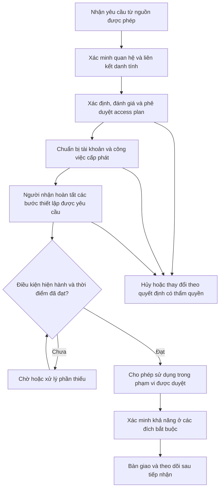

# Joiner process — tiếp nhận danh tính và cấp quyền cho người mới

Linh sẽ bắt đầu làm việc tại một doanh nghiệp vào sáng thứ Ba. Nhóm vận hành có thể tạo tài khoản trước vài ngày, nhưng không vì thế mà Linh được truy cập tài liệu nội bộ ngay. Đồng thời, chờ tới phút đầu tiên của ngày làm việc mới chuẩn bị mọi tài khoản có thể khiến Linh không có công cụ để bắt đầu công việc.

**Joiner process** là quy trình IAM tiếp nhận một chủ thể mới vào một quan hệ sử dụng hệ thống: xác nhận nguồn yêu cầu, nhận diện đúng chủ thể, xác định quyền cần thiết, chuẩn bị tài khoản và phương tiện xác thực, rồi cho phép sử dụng đúng điều kiện và thời điểm.

Trong ngữ cảnh nhân sự, joiner thường là nhân viên mới. Quy trình tương tự còn có thể phục vụ nhà thầu, đối tác hoặc một đợt hợp tác mới, với nguồn xác nhận và điều kiện khác nhau. Joiner không chỉ là tạo một hàng user, gửi email chào mừng hoặc sao chép quyền của người cùng nhóm.

## 1. Mục tiêu của quy trình joiner

Sau bài học, bạn có thể:

- Phân biệt chuẩn bị tài khoản, kích hoạt, thiết lập xác thực và cấp quyền.
- Xác định đầu vào có thẩm quyền cùng những bên chịu trách nhiệm trong quy trình.
- Thiết kế quyền nền theo nguyên tắc ít quyền nhất và tách quyền cần phê duyệt bổ sung.
- Tổ chức trạng thái trước ngày bắt đầu và điều kiện cho phép truy cập nghiệp vụ.
- Xử lý công việc lặp, lỗi từng phần, đổi ngày bắt đầu và hủy onboarding.
- Xác nhận người mới có đúng khả năng cần thiết tại các hệ thống bắt buộc.

Một quy trình tốt đạt đồng thời ba mục tiêu: đúng người nhận tài khoản, đúng bộ quyền được chấp nhận và đúng thời điểm hiệu lực. Tốc độ cấp phát có ý nghĩa khi ba điều kiện này được bảo đảm.

### 1.1. Các hoạt động liên quan nhưng khác nhau

| Hoạt động | Kết quả trực tiếp | Không tự chứng minh |
| --- | --- | --- |
| Xác nhận quan hệ nhân sự/hợp tác | Có yêu cầu nghiệp vụ hợp lệ | Đã liên kết đúng người nhận tài khoản |
| Tạo subject | Có định danh nội bộ | Đã được phép đăng nhập nghiệp vụ |
| Provisioning | Có tài khoản hoặc quan hệ ở đích | Người nhận đã hoàn tất thiết lập xác thực |
| Enrollment/binding | Phương tiện xác thực được gắn đúng tài khoản | Mọi quyền đã được phê duyệt |
| Activation | Cho phép sử dụng trong phạm vi xác định | Được làm mọi hành động |
| Authorization | Cho phép hành động trên tài nguyên cụ thể | Có quyền với mọi tài nguyên khác |
| Readiness verification | Những khả năng bắt buộc đã được xác nhận | Mọi ứng dụng tùy chọn cũng đã sẵn sàng |

## 2. Trách nhiệm và nguồn có thẩm quyền

### 2.1. Ai chịu trách nhiệm cho từng quyết định?

| Bên tham gia | Trách nhiệm trong ví dụ |
| --- | --- |
| Nguồn nhân sự hoặc quản lý đối tác | Xác nhận quan hệ, đơn vị, ngày hiệu lực và việc thay đổi/hủy |
| Quản lý hoặc sponsor được ủy quyền | Xác nhận nhu cầu công việc trong phạm vi được giao |
| Chủ sở hữu ứng dụng/dữ liệu | Định nghĩa và phê duyệt những quyền cần thẩm quyền của mình |
| Dịch vụ IAM | Chuẩn hóa danh tính, thực thi policy, điều phối và lưu căn cứ |
| Connector/provisioning worker | Áp dụng công việc đã được ủy quyền tới đúng đối tượng đích |
| Người mới | Hoàn tất các bước nhận tài khoản và thiết lập xác thực được yêu cầu |
| Nhóm hỗ trợ/vận hành | Xử lý lỗi và ngoại lệ theo quy trình đã được phân quyền |

Quản lý trực tiếp không nhất thiết có quyền phê duyệt mọi đặc quyền ở mọi hệ thống. Connector có quyền kỹ thuật tạo User cũng không có nghĩa được tự quyết định cấp role quản trị.

### 2.2. Nguồn yêu cầu phải phù hợp loại danh tính

Nhân viên có thể đến từ HR; nhà thầu có thể đến từ quy trình quản lý hợp tác; đối tác có sponsor nội bộ. Nguồn nào được chấp nhận và ai được khẳng định thuộc tính phải là lựa chọn có quản lý.

Không coi một form tự đăng ký là bằng chứng người gửi thuộc doanh nghiệp. Việc xác minh một địa chỉ email cũng chưa tự chứng minh người đó có quan hệ nhân sự hoặc cần quyền trên dữ liệu nội bộ.

### 2.3. Thẩm quyền của field và thẩm quyền cấp quyền

HR có thể xác nhận department, nhưng department không tự cấp quyền ký duyệt, xem bảng lương hoặc quản trị sản xuất. Các field tổ chức cung cấp ngữ cảnh cho policy; quyền đặc thù cần những điều kiện và phê duyệt tương ứng.

Nếu người mới được tự sửa tên hiển thị, điều đó không nên cho phép họ sửa `tenantId`, role, manager được dùng để phê duyệt hoặc ngày hiệu lực. Quyền sửa hồ sơ cần tách khỏi quyền thay đổi dữ liệu cấp quyền.

## 3. Mô hình đầu vào và liên kết danh tính

### 3.1. Một yêu cầu joiner cần thông tin nào?

Ví dụ một bản ghi nội bộ sau khi được tiếp nhận:

```json
{
  "joinerRequestId": "joiner-901",
  "tenantId": "tenant-a",
  "sourceSystem": "hr-a",
  "sourceRecordId": "worker-901",
  "engagementId": "engagement-31",
  "subjectId": "subject-linh",
  "relationshipType": "employee",
  "departmentId": "dep-finance",
  "managerSubjectId": "subject-manager-18",
  "effectiveFrom": "2026-12-01T09:00:00+07:00",
  "sourceRevision": "hr-record-184",
  "accessPlanRevision": 7,
  "status": "APPROVED"
}
```

Đây là schema thiết kế minh họa, không phải payload bắt buộc của một giao thức. Các ID chỉ dùng để giải thích. `subjectId` đã được gán hoặc liên kết qua bước kiểm tra danh tính; không phải một giá trị tùy ý do người nhận lời mời tự chọn.

`sourceRevision` giúp tham chiếu trạng thái nguồn theo hợp đồng của nguồn. `accessPlanRevision` quản lý phiên bản kế hoạch cấp quyền nội bộ. Hai giá trị không tự so sánh được với nhau.

### 3.2. Người, quan hệ công việc và tài khoản là các đối tượng khác nhau

Một người có thể quay lại doanh nghiệp, có nhiều đợt hợp tác hoặc tham gia nhiều tenant. Quan hệ công việc mới không nhất thiết phải tạo một người hoàn toàn mới, nhưng cũng không tự cho phép tái sử dụng tài khoản cũ bằng bất kỳ cách nào.

Nên phân biệt:

- Subject ổn định dùng để nhận diện chủ thể trong hệ thống.
- Engagement hoặc assignment mô tả quan hệ hiện hành và thời hạn của nó.
- Tài khoản đích là đối tượng cục bộ tại từng ứng dụng.
- Login identifier là tên dùng để tìm hoặc đăng nhập, có thể thay đổi theo policy.

NIST SP 800-63A-4 mô tả tài khoản subscriber có định danh duy nhất và hồ sơ các authenticator liên quan. Bài dùng nguyên tắc quản lý định danh ổn định để giải thích thiết kế; quy trình minh họa không tự tuyên bố đáp ứng toàn bộ yêu cầu NIST. [Nguồn: NIST — Subscriber Accounts](https://pages.nist.gov/800-63-4/sp800-63a/accounts/).

### 3.3. Correlation phải rõ trước khi cấp quyền

Hai hồ sơ cùng email hoặc tên không đủ để tự gộp. Email có thể được tái sử dụng; một tài khoản đã tồn tại có thể thuộc người khác hoặc nguồn quản lý khác.

Nếu phát hiện tài khoản đích cùng tên, bước tiếp theo là kiểm tra correlation và quyền nhận quản lý tài khoản đó. Không ghi đè mật khẩu, liên kết SSO hoặc role chỉ để quá trình tạo user không bị báo trùng.

Mapping nên ghi rõ tenant, miền nguồn, ID nguồn, subject nội bộ, đích và ID tài khoản đích. Những liên kết này cần được lưu bền vững để xử lý retry, thay tên hoặc thay đổi nhân sự.

## 4. Xác minh điều kiện nghiệp vụ trước khi chuẩn bị

### 4.1. Điều kiện đầu vào tối thiểu theo policy

Một policy có thể yêu cầu nguồn đã được xác thực, quan hệ được chấp nhận, tenant hợp lệ, thời gian bắt đầu rõ và người phê duyệt có thẩm quyền. Với một số danh tính còn cần thời điểm kết thúc, sponsor hoặc thông tin tổ chức đã được xác minh.

Khi thiếu dữ liệu bắt buộc, yêu cầu nên ở trạng thái chờ hoặc cần xử lý. Không điền một manager giả, department quyền rộng hoặc thời điểm bắt đầu bằng “ngay bây giờ” chỉ để hoàn tất provisioning.

### 4.2. Xác minh danh tính theo mức cần thiết

Nguồn HR xác nhận có người sẽ làm việc không đồng nghĩa IAM đã chứng minh người đang nhận lời mời chính là chủ thể đó. Mức kiểm chứng và kênh nhận tài khoản cần phù hợp với mô hình đe dọa và loại quyền sẽ cấp.

Trong tổ chức dùng federation, luồng có thể dựa vào một IdP đã được cấu hình tin cậy và phép liên kết đúng subject. Không tự liên kết theo email từ một issuer chưa được phép hoặc chấp nhận mọi tenant của đối tác.

### 4.3. Điều kiện có thể đổi trong khi quy trình đang chạy

Ngày bắt đầu có thể bị lùi, đề nghị tuyển dụng bị hủy hoặc bộ quyền được duyệt thay đổi. Một quyết định hợp lệ lúc tiếp nhận không đủ để kích hoạt sau vài ngày mà không kiểm tra lại.

Cần giữ trạng thái mong muốn hiện hành và những phiên bản liên quan. Dữ liệu cũ không được phục hồi kế hoạch đã bị thay thế chỉ vì một event đến muộn.

## 5. Xây dựng bộ quyền theo nhu cầu công việc

### 5.1. Quyền nền và quyền cần phê duyệt riêng

Một access plan cho Linh có thể gồm:

| Khả năng | Căn cứ trong ví dụ | Điều kiện bổ sung |
| --- | --- | --- |
| Cổng nhân viên | Quan hệ nhân viên hợp lệ | Đúng tenant, tới thời điểm được sử dụng |
| Tài liệu chung của nhóm | Assignment phòng ban được chấp nhận | Giới hạn phạm vi và loại dữ liệu |
| Tạo đề nghị chi phí của bản thân | Quyền chức năng cơ bản đã duyệt | Chỉ dữ liệu thuộc phạm vi được phép |
| Duyệt chi phí | Vai trò nghiệp vụ riêng | Thẩm quyền phê duyệt, hạn mức và tách biệt nhiệm vụ |
| Quản trị sản xuất | Nhu cầu đặc quyền riêng | Quy trình cấp đặc quyền, thời hạn và điều kiện xác thực tương ứng |

Phân loại như vậy giúp chuẩn bị những công cụ cần thiết mà không biến việc gia nhập thành quyền quản trị mặc định.

### 5.2. Không sao chép nguyên quyền của đồng nghiệp

Một người cùng chức danh có thể có quyền tạm thời, quyền lịch sử chưa thu hồi hoặc quyền của dự án khác. Sao chép tất cả sẽ mang những khác biệt đó sang người mới.

Template theo chức năng hoặc assignment được quản lý tốt hơn một ảnh chụp quyền ngẫu nhiên. Template vẫn cần phiên bản, chủ sở hữu, điều kiện áp dụng và quá trình xem xét khi tổ chức thay đổi.

### 5.3. Phê duyệt phải gắn với một kế hoạch xác định

Một phê duyệt nên cho biết người phê duyệt, quyền/phạm vi được chấp nhận, đối tượng, thời hạn nếu có và phiên bản policy hoặc access plan liên quan. Không dùng một ô “approved” chung để sau đó cấp thêm quyền ngoài nội dung đã duyệt.

Nếu kế hoạch thay đổi theo cách ảnh hưởng quyền, cần xác định phần nào phải được đánh giá hoặc phê duyệt lại. Thay tên hiển thị không nhất thiết có cùng tác động với thêm quyền phê duyệt giao dịch.

Các ràng buộc tách biệt nhiệm vụ cần được kiểm tra trước khi cấp những tổ hợp nhạy cảm. Đăng ký thành công không tự cho phép một người vừa tạo vừa tự duyệt công việc mà policy không chấp nhận.

### 5.4. Ghi lý do cấp để chuẩn bị cho vòng đời tiếp theo

Mỗi role hoặc membership được tạo tự động nên có căn cứ như assignment, rule hoặc quyết định phê duyệt. Khi Linh chuyển nhóm hoặc kết thúc hợp tác, IAM có thể tính lại quyền từ các lý do còn hiệu lực.

Nếu chỉ lưu “Linh là thành viên nhóm Finance” mà không biết do đâu, các quy trình mover/leaver sau này khó phân biệt quyền nền với một ngoại lệ còn hợp lệ.

## 6. Tổ chức các trạng thái và phụ thuộc

### 6.1. Không dùng một cờ cho toàn bộ onboarding

Một hồ sơ joiner có thể đồng thời có những trạng thái:

```text
Yêu cầu nghiệp vụ: đã được duyệt
Subject: đã chuẩn bị, chưa cho truy cập nghiệp vụ
Thiết lập xác thực: đang chờ người dùng hoàn tất
Ứng dụng A: đã tạo tài khoản ở chế độ hạn chế
Ứng dụng B: chờ retry do lỗi kết nối
Thời điểm sử dụng nghiệp vụ: chưa đến
```

Nếu gộp tất cả thành `onboardingComplete=true/false`, vận hành khó biết người mới đang bị chặn vì điều kiện nào. Cũng dễ coi việc tạo một tài khoản thành công là toàn bộ luồng đã sẵn sàng.

### 6.2. Luồng tổng quát



Sơ đồ là mô hình minh họa, không buộc mọi tổ chức phải triển khai đúng một thứ tự kỹ thuật. Một số bước có thể song song, nhưng phụ thuộc bảo mật và điều kiện hiệu lực phải được giữ.

### 6.3. Thiết lập trước ngày bắt đầu cần một phạm vi riêng

Doanh nghiệp có thể cho người mới nhận hướng dẫn, kiểm tra thiết bị hoặc đăng ký authenticator trước ngày làm việc. Luồng này cần phiên hoặc quyền thiết lập có giới hạn, không mặc nhiên có quyền đọc kho dữ liệu nghiệp vụ.

Tài khoản đã tồn tại hoặc lời mời đã được nhận không tự vượt qua điều kiện ngày bắt đầu. Ngược lại, khi ngày bắt đầu đến mà còn thiếu bước bắt buộc, không được bỏ bước đó để đạt chỉ số “sẵn sàng ngày đầu”.

## 7. Chuẩn bị tài khoản tại từng hệ thống đích

### 7.1. Tạo tài khoản có trạng thái và mapping rõ ràng

Mỗi đích cần một công việc được theo dõi: tạo hoặc liên kết tài khoản, gán thuộc tính được quản lý, thiết lập các quan hệ đã duyệt và xác định trạng thái chưa/đã được phép dùng.

Một request SCIM minh họa, giả định đích đã hỗ trợ trạng thái chuẩn bị không cho sử dụng:

```http
POST /scim/v2/Users HTTP/1.1
Host: document-app.example.com
Authorization: Bearer <authorized-provisioning-token>
Content-Type: application/scim+json

{
  "schemas": ["urn:ietf:params:scim:schemas:core:2.0:User"],
  "externalId": "connector-a:subject-linh",
  "userName": "linh@example.com",
  "displayName": "Linh",
  "active": false
}
```

SCIM định nghĩa tạo resource bằng POST tới endpoint của loại resource. `active` trong User là trạng thái quản trị với ý nghĩa cụ thể do service provider xác định, nên cần kiểm tra hành vi đích trước khi dùng nó cho preboarding. [Nguồn: RFC 7644 — Creating Resources](https://www.rfc-editor.org/rfc/rfc7644.html#section-3.3), [RFC 7643 — User Attributes](https://www.rfc-editor.org/rfc/rfc7643.html#section-4.1.1).

Payload trên không cấp mật khẩu chung hoặc role quản trị. Sau khi đích tạo resource, connector cần ghi ID do đích cấp và mapping tương ứng. `externalId` trong ví dụ thuộc miền quản lý của connector, không phải bằng chứng cho phép nhận quản lý một tài khoản có sẵn bất kỳ.

### 7.2. Tài khoản có sẵn cần được xác minh trước khi nhận quản lý

Nếu đích báo username đã tồn tại, không tự reset tài khoản ấy hoặc gán SSO cho Linh. Cần biết nó thuộc subject nào, nguồn nào làm chủ và có quy trình liên kết hợp lệ hay không.

Khi phát hiện xung đột, giữ công việc ở trạng thái cần xử lý. Không chuyển sang một tên đăng nhập khác rồi âm thầm tạo hai danh tính cho cùng một chủ thể nếu điều đó không đúng mô hình của hệ thống.

### 7.3. Sẵn sàng theo từng đích

Các đích có thể khác nhau về khả năng tạo tài khoản trước, thời gian cấp license, trạng thái inactive và cách gán quyền. Access plan cần phân biệt hệ thống bắt buộc với hệ thống tùy chọn hoặc đang chờ phê duyệt riêng.

Nhận một phản hồi thành công từ API provisioning chỉ là một bằng chứng ở bước tương ứng. Cần biết tài khoản, entitlement và các phụ thuộc cần thiết đã thực sự có ở đích trước khi báo khả năng đó sẵn sàng.

## 8. Nhận tài khoản và thiết lập xác thực an toàn

### 8.1. Lời mời là một quyền hạn chế theo mục đích

Một lời mời có thể cho phép người nhận bắt đầu luồng nhận tài khoản hoặc thiết lập authenticator. Nó không nên tự cho phép đổi tenant, lựa chọn role, thay subject đích hoặc bỏ qua điều kiện ngày bắt đầu.

Thông tin lời mời nên gắn với subject, tenant, yêu cầu joiner, mục đích và thời hạn cụ thể. Giá trị bí mật cần được tạo bằng nguồn ngẫu nhiên phù hợp, bảo vệ khi lưu và truyền, dùng một lần theo hợp đồng và có thể thu hồi khi yêu cầu không còn hợp lệ.

OWASP mô tả các nguyên tắc token ngẫu nhiên, có hạn dùng, dùng một lần và lưu an toàn cho luồng khôi phục mật khẩu. Có thể tham chiếu những nguyên tắc đó khi thiết kế lời mời, nhưng joiner vẫn cần điều kiện nghiệp vụ và ràng buộc riêng; đây không phải khẳng định OWASP định nghĩa toàn bộ quy trình joiner. [Nguồn: OWASP — Forgot Password Cheat Sheet](https://cheatsheetseries.owasp.org/cheatsheets/Forgot_Password_Cheat_Sheet.html).

### 8.2. Mở liên kết không nên tự cấp quyền nghiệp vụ

Email scanner hoặc trình duyệt có thể truy cập liên kết trước người nhận. Luồng nên dùng bước mở trang để trình bày và bắt đầu quy trình thích hợp, còn thay đổi bảo mật cần một thao tác xác nhận được bảo vệ cùng các điều kiện server kiểm tra.

HTTP định nghĩa safe methods theo ngữ nghĩa chủ yếu chỉ đọc, trong đó GET không phải yêu cầu thực hiện một chuyển trạng thái nghiệp vụ như kích hoạt tài khoản. Thiết kế đường dẫn activation cần phù hợp ngữ nghĩa đó. [Nguồn: RFC 9110 — Safe Methods](https://www.rfc-editor.org/rfc/rfc9110.html#section-9.2.1).

Đừng coi việc chuyển thao tác sang POST là đủ: còn phải kiểm tra token, request hiện hành, phiên thiết lập, chống yêu cầu giả mạo theo mô hình ứng dụng và quyền tác động đến đúng tài khoản.

### 8.3. Authenticator phải được gắn đúng tài khoản

Luồng có thể yêu cầu thiết lập mật khẩu, đăng ký khóa xác thực hoặc phương thức khác theo policy. Nếu cần MFA, phải hoàn tất các bước đăng ký và kiểm chứng tương ứng; hiển thị một QR hoặc tên thiết bị chưa chứng minh authenticator đã được gắn thành công.

NIST SP 800-63B-4 định nghĩa authenticator binding là thiết lập liên kết giữa một authenticator cụ thể và subscriber account. Tài khoản cần giữ thông tin cần thiết về những authenticator đã được gắn và các sự kiện vòng đời liên quan. [Nguồn: NIST — Authenticator Event Management](https://pages.nist.gov/800-63-4/sp800-63b/events/).

Không gửi cùng một mật khẩu mặc định cho nhiều người. Không yêu cầu người mới gửi mật khẩu hoặc mã MFA cho bộ phận hỗ trợ để họ “kích hoạt hộ”. Hỗ trợ phải đi qua luồng được ủy quyền có bằng chứng và giới hạn phù hợp.

### 8.4. Phân biệt bằng chứng kênh liên lạc và bằng chứng danh tính

Việc nhận email hoặc nhập mã có thể chứng minh khả năng kiểm soát một kênh trong phạm vi giao thức đó. Nó chưa tự chứng minh quan hệ nhân sự, mức kiểm chứng ngoài đời hoặc quyền được duyệt.

Nếu người nhận báo kênh liên lạc sai hoặc đã mất quyền kiểm soát, xử lý thay đổi kênh theo quy trình xác minh phù hợp. Không chỉ gửi lại lời mời đến một địa chỉ mới do bất kỳ caller nào cung cấp.

### 8.5. Enrollment và recovery có điều kiện khác nhau

Người đã mất authenticator sau khi onboarding không nên dùng lại lời mời cũ để thêm phương tiện xác thực mới. Lời mời có thể đã hết hạn, đã sử dụng hoặc thuộc một engagement đã kết thúc.

Recovery cần chính sách và bằng chứng riêng. Việc có một bản ghi joiner trong lịch sử không thay thế khả năng chứng minh quyền kiểm soát tài khoản hiện tại.

## 9. Kích hoạt đúng thời điểm và đúng trạng thái hiện hành

### 9.1. Điều kiện phải được đánh giá tại thời điểm thực hiện

Một quyết định cho sử dụng nghiệp vụ có thể yêu cầu:

```text
+ Nguồn hiện hành vẫn chấp nhận quan hệ tương ứng
+ Yêu cầu chưa bị hủy và không có hạn chế bảo mật áp dụng
+ Danh tính đã được liên kết đúng theo chính sách
+ Access plan đang thực hiện có phê duyệt còn hiệu lực
+ Các bước thiết lập bắt buộc cho phạm vi này đã hoàn tất
+ Đã tới thời điểm được phép sử dụng
+ Bằng chứng và ngữ cảnh dùng để đánh giá còn được chấp nhận
```

Đây là tập điều kiện minh họa. Một tổ chức có thể cho phép truy cập những chức năng thiết lập trước khi đủ điều kiện nghiệp vụ, nhưng phạm vi đó cần được biểu diễn riêng.

Ngày bắt đầu cần có múi giờ và ý nghĩa rõ ràng. Ví dụ `2026-12-01T09:00:00+07:00` tương ứng `2026-12-01T02:00:00Z`; đó là cùng một thời điểm, không phải hai lịch kích hoạt khác nhau.

### 9.2. Ví dụ Java cho cổng điều kiện kích hoạt

Đoạn mã chỉ đánh giá một snapshot đã được server xác minh. Nó không đọc HR, gửi lời mời, tạo user hoặc thay thế kiểm tra quyền của người gọi.

`relationshipEligible` trong ví dụ có nghĩa nguồn hiện hành chấp nhận quan hệ để kích hoạt khi các điều kiện khác và thời điểm đạt; không có nghĩa tài khoản đã được phép truy cập ngay. `approvedAccessPlanRevision` phải tương ứng kế hoạch đang được thực thi.

```java
import java.time.Instant;
import java.util.UUID;

public final class JoinerActivationGate {
    public enum Result { READY, WAIT, REJECT }
    public record Decision(Result result, String reason) {}

    public record Snapshot(
            UUID tenantId,
            UUID subjectId,
            boolean relationshipEligible,
            boolean cancelled,
            boolean securityHold,
            boolean identityLinked,
            boolean mandatoryEnrollmentComplete,
            long desiredAccessPlanRevision,
            long approvedAccessPlanRevision,
            Instant startsAt,
            Instant evidenceConfirmedAt,
            Instant evidenceUsableUntil) {}

    public static Decision evaluate(Snapshot input, Instant now) {
        if (input == null || now == null || input.tenantId() == null
                || input.subjectId() == null || input.startsAt() == null
                || input.evidenceConfirmedAt() == null
                || input.evidenceUsableUntil() == null
                || input.desiredAccessPlanRevision() <= 0) {
            return new Decision(Result.WAIT, "INCOMPLETE_CONTEXT");
        }
        if (input.cancelled()) {
            return new Decision(Result.REJECT, "JOINER_REQUEST_CANCELLED");
        }
        if (input.securityHold()) {
            return new Decision(Result.REJECT, "SECURITY_HOLD");
        }
        if (!input.relationshipEligible()) {
            return new Decision(Result.REJECT, "RELATIONSHIP_NOT_ELIGIBLE");
        }
        if (now.isBefore(input.evidenceConfirmedAt())
                || !now.isBefore(input.evidenceUsableUntil())) {
            return new Decision(Result.WAIT, "REFRESH_EVIDENCE");
        }
        if (!input.identityLinked()) {
            return new Decision(Result.WAIT, "IDENTITY_NOT_LINKED");
        }
        if (input.approvedAccessPlanRevision()
                != input.desiredAccessPlanRevision()) {
            return new Decision(Result.WAIT, "CURRENT_PLAN_NOT_APPROVED");
        }
        if (!input.mandatoryEnrollmentComplete()) {
            return new Decision(Result.WAIT, "ENROLLMENT_INCOMPLETE");
        }
        if (now.isBefore(input.startsAt())) {
            return new Decision(Result.WAIT, "BEFORE_EFFECTIVE_TIME");
        }
        return new Decision(Result.READY, "ACTIVATION_CONDITIONS_MET");
    }
}
```

Mã dùng record của Java hiện đại và các trạng thái do ví dụ định nghĩa. Dữ liệu được bind trực tiếp từ request không trở nên đáng tin cậy chỉ vì có kiểu `Snapshot`; tầng IAM phải kiểm soát nguồn tạo nó.

`READY` nghĩa các điều kiện trong snapshot thỏa tại thời điểm đánh giá. Nó chưa chứng minh mọi tài khoản đích đã sẵn sàng hoặc không có thay đổi sau đó.

### 9.3. Ghi chuyển trạng thái phải kiểm soát cạnh tranh

Giữa lúc evaluate và lúc ghi active, yêu cầu có thể bị hủy hoặc plan thay đổi. Luồng ghi cần gắn với version/điều kiện hiện hành và ranh giới transaction hoặc cơ chế phối hợp phù hợp.

Một scheduled job cũ không được kích hoạt dựa trên payload đã lưu nhiều ngày trước. Nó phải kiểm tra lại ngày bắt đầu, intent, phê duyệt, hạn chế và điều kiện cần thiết hiện hành.

Nếu nguồn HR hoặc kho policy là bản sao, còn cần xác định độ mới được phép và cơ chế nhận thay đổi. Helper Java không tự bảo đảm rằng hệ thống đã biết một thay đổi mới nhất chưa được đồng bộ tới nó.

## 10. Điều phối cấp phát trong một hệ thống phân tán

### 10.1. Mỗi đích có trạng thái công việc riêng

Một yêu cầu joiner có thể gồm tạo tài khoản directory, thư điện tử, ứng dụng tài liệu và một ứng dụng nghiệp vụ. Một đích thành công không làm các đích còn lại tự thành công.

Nên lưu công việc, trạng thái mong muốn, số lần thử, lỗi, mapping và bằng chứng kết quả theo từng đích. Những trạng thái như đang chờ, đã gửi, chưa rõ outcome, cần can thiệp và đã xác minh cần được phân biệt.

### 10.2. Idempotency cho request và tác dụng phụ

Một event HR gửi lại không được tạo thêm subject hoặc tài khoản khác cho cùng quan hệ được quản lý. Cần khóa nhận diện request, correlation và những ràng buộc dữ liệu phù hợp.

Nếu API tạo User timeout sau khi đã gửi, kết quả có thể đã xảy ra tại đích. Trước khi tạo lại, connector phải xác minh outcome hoặc dùng cơ chế chống trùng mà đích hỗ trợ. Không tự nhận tài khoản cùng email khi chưa có đủ căn cứ mapping.

Gửi lại lời mời cũng cần hợp đồng: lời mời nào còn hiệu lực, cái nào đã thu hồi và một lần retry có tạo thêm bí mật dùng được hay không. “Đã gửi email hai lần” không được biến thành hai luồng nhận tài khoản độc lập ngoài ý định.

### 10.3. Lưu công việc bền vững trước khi coi đã tiếp nhận

Nếu cập nhật request rồi lỗi trước khi gửi công việc ra hàng đợi, một bước provisioning có thể bị bỏ quên. Thiết kế có thể lưu trạng thái và outbox trong cùng transaction cục bộ, sau đó chuyển công việc tới worker có khả năng giao lại.

Đó là bảo đảm ở ranh giới lưu trữ được chọn, không phải transaction chung bao trùm mọi ứng dụng đích. Consumer vẫn cần xử lý lặp, thứ tự và thất bại từng phần.

### 10.4. Cấp quyền sai không được sửa bằng cách cấp rộng hơn

Nếu một ứng dụng đang lỗi connector, không tạo tài khoản dùng chung hoặc cấp role quản trị tạm để người mới có thể làm việc nhanh. Ngoại lệ cần được phê duyệt với phạm vi, thời hạn và cách kết thúc rõ.

Nếu một entitlement được cấp nhưng entitlement khác thất bại, quyết định giữ phần đã cấp, chờ, hay thực hiện bù trừ phải theo policy và các phụ thuộc. Không xóa tùy tiện mọi tài khoản đã tạo để làm dashboard trông như chưa có lỗi.

### 10.5. Trạng thái mong muốn mới phải thắng công việc cũ theo hợp đồng

Khi joiner bị hủy hoặc ngày bắt đầu thay đổi, công việc cũ cần được thu hồi hoặc lập lại kế hoạch. Nếu request cũ đã được gửi và outcome chưa rõ, phải xử lý theo giao thức đích thay vì giả định hủy local job đã hủy remote operation.

Với những yêu cầu cần bảo đảm mạnh chống kích hoạt muộn, cơ chế tại đích và điểm kiểm soát truy cập phải đáp ứng yêu cầu đó. Một khóa trong worker nội bộ không tự ngăn đích xử lý muộn một request đã nhận.

## 11. Thay đổi, hủy và các loại joiner khác

### 11.1. Lùi hoặc đổi ngày bắt đầu

Thay đổi thời điểm phải cập nhật intent, lịch kích hoạt và những phiên hoặc quyền preboarding phụ thuộc thời hạn. Cần biết lịch cũ còn nằm ở đâu, không chỉ đổi một field trên hồ sơ.

Khi job lịch cũ chạy, điều kiện version/thời gian hiện hành phải khiến nó chờ hoặc dừng. Không lấy thời điểm tạo job làm bằng chứng ngày bắt đầu còn đúng.

### 11.2. Hủy yêu cầu sau khi đã chuẩn bị tài khoản

Cần thu hồi lời mời hoặc phiên thiết lập liên quan, ngăn kích hoạt theo lịch cũ và xử lý những quyền/tài khoản do yêu cầu đó tạo ra. Các đích đã được cấp phát cần được theo dõi tới kết quả phù hợp.

Bù trừ phải đúng phạm vi: một subject có thể còn quan hệ hợp lệ khác. Không vô hiệu hóa mọi tài khoản của họ chỉ vì một joiner request cũ bị hủy nếu mô hình cho phép nhiều quan hệ độc lập.

Giữ dấu vết để giải thích những gì đã được chuẩn bị và đã thu hồi. Xóa lịch sử công việc không đồng nghĩa đã thu hồi khả năng truy cập.

### 11.3. Người quay lại làm việc

Có thể liên kết lại với subject cũ nếu đã xác minh đúng người theo policy. Tuy nhiên, access plan cần dựa trên công việc hiện hành; không tự phục hồi mọi quyền cũ, session hoặc phương tiện khôi phục chỉ vì đã từng là nhân viên.

Quan hệ mới cần có thời gian hiệu lực và lý do cấp riêng. Tài khoản cũ còn dữ liệu hoặc ownership nghiệp vụ cũng cần được xử lý theo quy tắc của từng hệ thống.

### 11.4. Nhà thầu và đối tác

Nguồn xác nhận, sponsor, phạm vi quyền và ngày kết thúc có thể khác nhân viên. Hợp tác được gia hạn cần một thay đổi được chấp nhận, không mặc định kéo dài vô thời hạn vì tài khoản vẫn được sử dụng.

Không gán một phòng ban nội bộ giả hoặc chuyển loại người dùng thành employee chỉ để áp một template quyền không phù hợp.

### 11.5. Workload mới

Một service account hoặc workload mới cần chủ sở hữu, mục đích, môi trường, tài nguyên được phép và vòng đời credential phù hợp. Nó không hoàn tất onboarding bằng cùng lời mời email hoặc phương thức MFA của con người theo mặc định.

Có thể tái sử dụng nguyên tắc nguồn có thẩm quyền, phê duyệt, ít quyền nhất, cấp phát và kiểm chứng. Nhưng quyền workload phải theo công việc dịch vụ, không sao chép toàn bộ quyền cá nhân của người tạo hoặc người sở hữu nó.

## 12. Bảo vệ quy trình và lưu bằng chứng

### 12.1. API quản trị joiner là một điểm cấp quyền

Các thao tác tạo yêu cầu, đổi tenant, sửa access plan, phê duyệt, gửi lại lời mời và kích hoạt cần quyền riêng theo vai trò và phạm vi. Chỉ ẩn nút trên giao diện không đủ nếu API vẫn nhận caller không phù hợp.

Tách những field người dùng được nhập khỏi những field server quyết định. Không mass-bind các cờ như approved, active hoặc privileged từ payload client vào đối tượng có quyền ghi.

### 12.2. Giới hạn quyền của thành phần cấp phát

Connector chỉ cần quyền ở các tenant, loại resource và field mà nó quản lý. Tài khoản vận hành không nên tự có quyền thay phê duyệt, tạo ngoại lệ truy cập hoặc bỏ qua hạn chế nguồn.

Quyền sửa template, mapping và lịch hiệu lực có thể ảnh hưởng nhiều joiner cùng lúc, nên những thay đổi cấu hình đó cần được quản lý cùng mức quan tâm phù hợp với tác động.

### 12.3. Audit cho quyết định và kết quả

Một bộ bằng chứng hữu ích gồm request/engagement ID, subject, tenant, nguồn và revision, thời điểm hiệu lực, access plan, người phê duyệt, bước thiết lập đã hoàn tất và kết quả từng đích.

Cần giải thích được vì sao một quyền được cấp và tại sao được phép sử dụng ở một thời điểm cụ thể. Chỉ lưu “job thành công” không đủ khi thiếu bằng chứng tài khoản hoặc entitlement ở đích.

Không ghi raw invitation token, password, mã MFA, secret connector hoặc toàn bộ hồ sơ nhân sự vào log để tiện xử lý lỗi. Người xem tiến độ không nhất thiết phải được xem mọi dữ liệu nhạy cảm của người mới.

## 13. Tiêu chí hoàn tất và ma trận thực hành

### 13.1. Hoàn tất theo những khả năng bắt buộc đã định

Một bộ tiêu chí có thể yêu cầu quan hệ còn hợp lệ, đúng subject/tenant, current access plan được chấp nhận, các điều kiện xác thực bắt buộc đạt và những đích bắt buộc đã được xác minh có trạng thái phù hợp.

Một ứng dụng tùy chọn đang chờ phê duyệt có thể được báo riêng theo hợp đồng. Ngược lại, không đánh dấu hoàn tất toàn bộ nếu một đích bắt buộc vẫn chưa xác định kết quả.

Việc xác nhận khả năng cần dựa vào bằng chứng của hệ thống và luồng được phép, không yêu cầu người dùng đưa secret để quản trị viên đăng nhập thay. Ngoài quyền cần có, cần kiểm chứng những phạm vi không được mở, như dữ liệu tenant khác hoặc quyền quản trị chưa duyệt.

### 13.2. Chỉ số vận hành có ý nghĩa

Có thể theo dõi tỷ lệ sẵn sàng ở thời điểm cần bắt đầu, thời gian chờ phê duyệt, độ trễ cấp phát từng đích, số xung đột danh tính, lời mời chưa hoàn tất, công việc lỗi và quyền cấp ngoài access plan.

Không tối ưu tỷ lệ hoàn tất bằng cách bỏ MFA, mở quyền sớm hoặc hạ điều kiện kiểm chứng. Chỉ số nhanh cần được nhìn cùng chất lượng liên kết, độ chính xác quyền và khả năng hủy/thu hồi.

### 13.3. Ma trận tự kiểm chứng

| Tình huống | Kết quả mong đợi | Điều được xem xét |
| --- | --- | --- |
| Event joiner được gửi lại | Không tạo thêm subject/tài khoản ngoài ý định | Correlation và idempotency |
| Hai người có tên giống nhau | Không tự gộp | Định danh nguồn và mapping |
| Tài khoản đích cùng email đã tồn tại | Xác minh trước khi liên kết | Không nhận quản lý sai chủ thể |
| HR chưa xác nhận dữ liệu bắt buộc | Chờ xử lý | Không tự điền dữ liệu cấp quyền |
| Người mới tự khai role quản trị | Không được cấp từ payload đó | Quyền quyết định access plan |
| Plan thay đổi thêm quyền sau phê duyệt | Đánh giá lại phần cần phê duyệt | Phê duyệt gắn với nội dung cụ thể |
| Người nhận hoàn tất MFA trước ngày bắt đầu | Chỉ phạm vi preboarding được phép | Setup khác với quyền nghiệp vụ |
| Ngày bắt đầu tới nhưng enrollment chưa đạt | Không bỏ điều kiện bắt buộc | Activation gate |
| Ngày bắt đầu bị lùi | Lịch cũ không tự kích hoạt | Intent và thời gian hiện hành |
| Yêu cầu bị hủy sau khi đã gửi lời mời | Lời mời và công việc liên quan được xử lý thu hồi | Vòng đời toàn luồng |
| POST tạo User timeout | Xác minh outcome trước khi tạo lại | Tránh cấp phát trùng |
| Một đích bắt buộc còn lỗi | Báo chưa đủ tiêu chí hoàn tất | Trạng thái theo từng đích |
| Linh có quyền cơ bản nhưng xin quyền sản xuất | Đi qua quy trình riêng | Active không đồng nghĩa đặc quyền |
| Người quay lại làm việc | Plan dựa trên quan hệ hiện hành | Không phục hồi mù quáng quyền cũ |
| Hủy một engagement khi subject còn quan hệ hợp lệ khác | Xử lý đúng phạm vi và lý do cấp | Không thu hồi vượt đối tượng công việc |

Đây là các tình huống để người học dự đoán và kiểm chứng trong môi trường thực hành, không phải báo cáo rằng mã Java hoặc hạ tầng đã được chạy trong bài này.

## 14. Tình huống hoàn chỉnh: chuẩn bị trước nhưng chưa mở quyền sớm

Linh dự kiến bắt đầu vào `2026-12-01T09:00:00+07:00`. HR là nguồn xác nhận quan hệ trong ví dụ. Access plan đã duyệt gồm cổng nhân viên và quyền đọc tài liệu nhóm; quyền quản trị sản xuất không nằm trong plan.

1. IAM nhận yêu cầu, xác minh nguồn và liên kết Linh với subject phù hợp. Những tài khoản nguồn/đích cùng email được kiểm tra theo quy tắc correlation.
2. Plan được tính từ assignment và nhu cầu đã duyệt. Mỗi entitlement có căn cứ cấp để sau này có thể thu hồi đúng.
3. Connector tạo các tài khoản đích theo chế độ chuẩn bị được đích hỗ trợ và lưu mapping. Tiến độ được theo dõi theo từng hệ thống.
4. Linh nhận lời mời, hoàn tất các bước xác minh và gắn authenticator phù hợp. Phiên thiết lập chưa cho phép đọc tài liệu nghiệp vụ trước thời điểm hiệu lực.
5. HR cập nhật ngày bắt đầu sang ngày muộn hơn. IAM cập nhật intent và lịch; một job cũ tới hạn phải kiểm tra trạng thái mới nên không mở quyền theo ngày ban đầu.
6. Tại thời điểm mới, hệ thống đánh giá lại nguồn, phê duyệt hiện hành, điều kiện xác thực và các hạn chế. Nếu đạt, nó thực hiện chuyển trạng thái trong phạm vi đã duyệt.
7. Các đích bắt buộc được xác minh; đích còn lỗi được báo riêng và xử lý theo phụ thuộc. Chỉ những khả năng đủ bằng chứng mới được công bố sẵn sàng.
8. Khi Linh cần quyền sản xuất, yêu cầu được đưa vào luồng cấp đặc quyền riêng. Việc đã hoàn tất joiner không thay thế quyết định đó.

Nếu yêu cầu bị hủy ở bước 4, lời mời, lịch kích hoạt và những quyền/tài khoản liên quan phải được xử lý theo phạm vi mà yêu cầu tạo ra. Nếu một remote request cũ còn chưa rõ outcome, quy trình phải tiếp tục xác minh và thu hồi phù hợp thay vì chỉ đóng ticket nội bộ.

Tình huống nhấn mạnh ba kết quả độc lập cần được nối đúng: điều kiện nghiệp vụ còn hiệu lực, danh tính nhận tài khoản đúng và khả năng thực tế ở đích đúng access plan.

## 15. Những điểm cần ghi nhớ

Joiner process tiếp nhận danh tính vào một quan hệ sử dụng hệ thống bằng nguồn có thẩm quyền, liên kết đúng subject, access plan ít quyền nhất và các bước thiết lập phù hợp.

Chuẩn bị tài khoản, nhận lời mời, đăng ký authenticator và được phép dùng nghiệp vụ là những mốc khác nhau. Quyết định tại thời điểm kích hoạt phải dựa trên trạng thái hiện hành, không chỉ dựa vào một phê duyệt hoặc lịch cũ.

Quy trình cần theo dõi từng đích, xử lý retry và thay đổi/hủy có kiểm soát, đồng thời giữ đủ bằng chứng về lý do cấp quyền và kết quả. Hoàn tất joiner là đạt các khả năng bắt buộc theo policy, với phạm vi truy cập được xác nhận rõ ràng.
