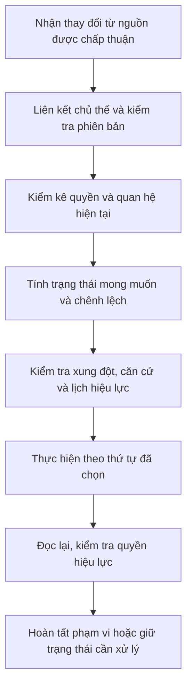

# Mover process — Điều chỉnh quyền khi thay đổi vai trò

## 1. Mover process giải quyết vấn đề gì?

Lan chuyển từ nhóm mua hàng sang nhóm kiểm soát thanh toán. Lan vẫn làm việc trong cùng doanh nghiệp, vẫn dùng danh tính hiện có, nhưng những việc cần làm và dữ liệu cần tiếp cận đã thay đổi.

Nếu IAM chỉ cấp thêm quyền của nhóm mới, Lan có thể giữ cả quyền sửa thông tin thanh toán nhà cung cấp và quyền phê duyệt khoản chi. Hai quyền này có thể tạo xung đột theo quy định kiểm soát của doanh nghiệp.

**Mover process** là quy trình đánh giá và điều chỉnh tài khoản, thuộc tính, quan hệ và quyền truy cập khi một chủ thể thay đổi vị trí, nhiệm vụ hoặc phạm vi công việc nhưng chưa kết thúc toàn bộ quan hệ với tổ chức.

Một thay đổi có thể là:

- Chuyển phòng ban hoặc nhóm dự án.
- Thay chức danh, quản lý trực tiếp hoặc đơn vị chịu trách nhiệm.
- Chuyển địa điểm làm việc hoặc phạm vi dữ liệu.
- Nhận nhiệm vụ tạm thời hoặc kết thúc một nhiệm vụ kiêm nhiệm.
- Chuyển từ nhà thầu sang nhân viên theo mô hình tổ chức.
- Thay đổi phạm vi tenant, môi trường hoặc đặc quyền cần sử dụng.

Trong mô hình joiner–mover–leaver, mover là giai đoạn thay đổi ranh giới công việc hoặc quyền trong thời gian chủ thể còn có quan hệ tham gia. Microsoft sử dụng cách phân loại này trong tài liệu về quản trị vòng đời danh tính. [Microsoft — Lifecycle workflows](https://learn.microsoft.com/en-us/entra/id-governance/what-are-lifecycle-workflows)

Mục tiêu không phải xóa hết quyền rồi cấp lại tùy tiện. Cần đưa người dùng từ trạng thái quyền đang có sang trạng thái phù hợp với nhiệm vụ mới, đồng thời bảo toàn những quan hệ vẫn hợp lệ và thu hồi các quyền không còn căn cứ.

## 2. Phân biệt mover với joiner và leaver

| Quy trình | Thay đổi chính | Câu hỏi trọng tâm |
| --- | --- | --- |
| Joiner | Bắt đầu một quan hệ tham gia | Danh tính nào được tạo hoặc liên kết và được cấp quyền ban đầu gì? |
| Mover | Thay đổi một quan hệ, nhiệm vụ hoặc phạm vi đang có | Quyền nào cần giữ, thêm, gỡ hoặc xem xét lại? |
| Leaver | Kết thúc phạm vi cần truy cập | Những đường truy cập nào phải chấm dứt và khi nào? |

Một người có thể là mover ở một phạm vi và leaver ở phạm vi khác. Lan vẫn là nhân viên doanh nghiệp nhưng rời dự án X, nên cần kết thúc quyền dự án X trong khi tiếp tục dùng cổng nhân viên.

Không nên dùng cùng một thao tác “disable user” cho mọi chuyển nhóm. Cũng không nên coi việc vẫn còn làm trong công ty là lý do giữ mọi quyền cũ.

### 2.1. Thường cần giữ danh tính ổn định

Khi người dùng chuyển vai trò, nhiều trường hợp vẫn cần giữ principal và các liên kết hợp lệ của cùng người đó. Tạo một danh tính mới chỉ vì đổi chức danh có thể làm đứt lịch sử, tạo tài khoản trùng hoặc làm mất quan hệ dữ liệu.

Tuy nhiên, danh tính ổn định không có nghĩa giữ nguyên mọi tài khoản và quyền. Có thể cần ngừng một tài khoản đặc quyền cũ hoặc tạo tài khoản chuyên biệt mới theo kiến trúc.

Nếu việc chuyển quan hệ đòi hỏi tài khoản mới, phải có quy trình liên kết và thu hồi rõ ràng, không tự nối bằng tên hiển thị hay email trùng.

### 2.2. Mover không chỉ là cập nhật hồ sơ

Đổi department trong directory có thể mới là một bước. Quyền tại ứng dụng cũ, nhóm cục bộ, token đã phát hành và quan hệ tới tài nguyên có thể chưa thay đổi.

Ngược lại, nếu policy dựa trực tiếp vào thuộc tính, cập nhật department có thể làm quyền thay đổi ngay khi policy đọc giá trị mới. Cần hiểu tác động của từng đường thay vì mặc định mọi quyền chỉ nằm trong membership.

## 3. Vì sao quyền dễ tích lũy sau nhiều lần chuyển việc?

**Privilege accumulation** là tình trạng một chủ thể giữ lại quyền từ các nhiệm vụ trước rồi tiếp tục nhận quyền mới. Sau nhiều lần chuyển, quyền thực tế có thể lớn hơn nhiều so với nhu cầu hiện tại.

Những nguyên nhân thường gặp:

| Nguyên nhân | Hệ quả |
| --- | --- |
| Chỉ có tác vụ cấp quyền mới | Quyền cũ không có đường thu hồi |
| Quyền đến từ nhiều nguồn | Gỡ một nhóm nhưng vẫn còn cấp trực tiếp |
| Không ghi lý do hoặc chủ sở hữu quyền | Không biết quyền nào gắn với nhiệm vụ đã kết thúc |
| Ngoại lệ không có thời hạn thực thi | Quyền tạm trở thành quyền thường xuyên |
| Ứng dụng giữ vai trò riêng | Directory đã đổi nhưng đích chưa đổi |
| Chỉ kiểm tra lúc đăng nhập | Phiên hoặc token cũ tiếp tục mang quyền |
| Chuyển nhóm nhiều lần liên tiếp | Sự kiện cũ có thể cấp lại trạng thái đã lỗi thời |

Trong ví dụ, Lan có quyền đọc kho tài liệu toàn nhân viên, sửa tài khoản nhà cung cấp và đọc hồ sơ một đợt kiểm toán tạm thời. Khi sang nhóm thanh toán, ba quyền này có căn cứ khác nhau:

- Quyền toàn nhân viên có thể vẫn phù hợp.
- Quyền sửa nhà cung cấp có thể phải gỡ vì nhiệm vụ cũ kết thúc.
- Quyền kiểm toán cần được xem theo phê duyệt và thời hạn riêng.

Không thể quyết định đúng chỉ từ tên phòng ban mới. Cần biết nguồn cấp, mục đích và scope của từng quyền.

## 4. Nguồn khởi tạo và thời điểm có hiệu lực

Mover có thể bắt đầu từ hệ thống nhân sự, nguồn quản lý nhà thầu, thay đổi dự án hoặc một yêu cầu đã được phê duyệt. Nguồn khởi tạo phải có thẩm quyền với loại thay đổi đó.

HR-driven provisioning là một mô hình trong đó hệ thống nhân sự cung cấp dữ liệu nguồn cho vòng đời danh tính; tài liệu Microsoft cũng mô tả cập nhật tên, chức danh và quản lý như những tình huống cập nhật tài khoản. Đây là ví dụ triển khai, không có nghĩa HR quản lý mọi quyền của mọi ứng dụng. [Microsoft — HR-driven provisioning](https://learn.microsoft.com/en-us/entra/identity/app-provisioning/what-is-hr-driven-provisioning)

Một sự kiện nội bộ có thể được biểu diễn:

```json
{
  "changeId": "mover-example-002",
  "sourceId": "approved-workforce-source",
  "sourceSubjectId": "worker-145",
  "subjectId": "principal-820",
  "relationshipId": "employment-a",
  "changeVersion": 18,
  "effectiveAt": "2026-12-01T09:00:00+07:00",
  "newContext": {
    "organizationId": "organization-a",
    "departmentId": "payment-control",
    "managerId": "manager-32"
  }
}
```

Đây là schema minh họa của ứng dụng, không phải định dạng chuẩn của một sản phẩm. Những field như subjectId phải được hệ thống liên kết từ nguồn tin cậy, không nhận tùy ý từ client rồi áp dụng lên tài khoản bất kỳ.

### 4.1. Nhận sự kiện và có hiệu lực là hai thời điểm khác nhau

Một quyết định chuyển việc có thể được nhập trước ngày bắt đầu. IAM có thể chuẩn bị kế hoạch, nhưng không tự cấp mọi quyền mới ngay lúc nhận nếu policy quy định chỉ có hiệu lực vào một thời điểm sau.

Cần ghi rõ múi giờ và cách xử lý thay đổi lịch. Một giá trị ngày không có giờ cần được diễn giải theo quy tắc được tổ chức thống nhất, thay vì mỗi connector tự chọn mốc khác nhau.

### 4.2. Sự kiện phải được kiểm tra lại trước khi thực hiện

Quyết định có thể bị hủy hoặc thay đổi trước thời điểm có hiệu lực. Một tác vụ đã xếp lịch cần xác nhận nó vẫn tương ứng với trạng thái được chấp thuận hiện tại.

Không để một kế hoạch mover cũ kích hoạt quyền khi chủ thể đã bị đình chỉ hoặc quan hệ công việc đã kết thúc. Các đường mover, leaver và đình chỉ phải có quy tắc phối hợp rõ ràng.

### 4.3. Một phiên bản không thay thế mọi kiểm tra

Số phiên bản có thể giúp nhận biết thay đổi mới hơn nếu nguồn có bảo đảm về thứ tự. Chỉ so sánh theo miền và contract của nguồn; không đặt các bộ đếm từ hai hệ thống cạnh nhau như thể chúng cùng một chuỗi.

Nguồn nhân sự cũng không tự có quyền ghi mọi field quyền. Phạm vi nguồn và policy ánh xạ vẫn cần được quản lý.

## 5. Xác định phạm vi bị ảnh hưởng

Mover cần kiểm kê theo chủ thể và quan hệ đang thay đổi, không chỉ mở directory rồi xem một danh sách nhóm.

| Lớp | Ví dụ cần xem xét |
| --- | --- |
| Tài khoản và liên kết | Tài khoản thường, tài khoản đặc quyền, nguồn ngoài |
| Nhóm và vai trò | Nhóm trực tiếp, nhóm lồng nhau, vai trò tại ứng dụng |
| Thuộc tính làm đầu vào policy | Department, project, manager, location, employment type |
| Quyền cấp trực tiếp | Chia sẻ tài liệu, quyền repository, quyền DB |
| Đặc quyền và ủy quyền | Quyền tạm, quyền được kích hoạt, quyền phê duyệt thay |
| Quan hệ tài nguyên | Chủ sở hữu dự án, người duyệt, thành viên nhóm xử lý |
| Phiên và thông tin xác thực | Phiên ứng dụng, token, API key thuộc phạm vi cần đổi |
| Quyền ngoài hệ thống tự động | Hệ thống quản lý thủ công hoặc chưa có connector |

Không nhất thiết phải thay mật khẩu hoặc đăng ký lại MFA cho mọi lần chuyển vai trò. Cần căn cứ vào sự thay đổi phạm vi, chính sách và mức rủi ro, thay vì thực hiện thao tác không liên quan chỉ vì có sự kiện mover.

### 5.1. Kiểm kê trạng thái hiện có tại đích

Nguồn có thể cho biết quyền đáng lẽ đã được cấp, nhưng đích có thể đang khác vì thao tác thủ công hoặc đồng bộ lỗi.

Cần phân biệt:

```text
Trạng thái nguồn: dữ liệu tổ chức được chấp thuận.
Trạng thái mong muốn: tài khoản và quyền cần có theo policy.
Trạng thái quan sát: những gì đang thực sự tồn tại ở đích.
```

Một bản kiểm kê thiếu dữ liệu không đủ để tạo kế hoạch gỡ toàn bộ phần chưa nhìn thấy. Nếu một hệ thống trả kết quả phân trang hoặc lỗi một phần, phải ghi nhận giới hạn đó.

### 5.2. Phạm vi dựa trên tenant và tài nguyên

Quyền đọc báo cáo tenant A khác với quyền tương tự ở tenant B. Quyền sửa một repository khác với quyền sửa mọi repository.

Khi so sánh trước–sau, không rút quyền thành một tên vai trò chung mà bỏ scope. Nếu Lan chuyển từ quản lý dự án A sang dự án B, cùng tên project-manager vẫn có thể cần thay quan hệ tài nguyên.

## 6. Phân loại quyền cần giữ, thêm, gỡ và xem xét

Một kế hoạch có thể phân quyền thành bốn nhóm:

| Nhóm quyết định | Ý nghĩa | Ví dụ |
| --- | --- | --- |
| Giữ | Vẫn có căn cứ theo nhiệm vụ hoặc phê duyệt hiện hành | Quyền cổng nhân viên |
| Thêm | Cần cho nhiệm vụ mới và đã đạt điều kiện cấp | Quyền xem hồ sơ thanh toán trong tenant-a |
| Gỡ | Không còn căn cứ hoặc vi phạm policy sau chuyển đổi | Quyền sửa thông tin ngân hàng nhà cung cấp của nhiệm vụ cũ |
| Xem xét | Thiếu căn cứ, ownership chưa rõ hoặc có xung đột | Quyền cấp trực tiếp từ một dự án ngoài phạm vi chuyển việc |

Quyền thủ công không tự động có nghĩa là được giữ vĩnh viễn. Nó có thể cần chủ sở hữu xác nhận hoặc cần thu hồi theo quy tắc áp dụng.

Ngược lại, không xóa mọi quyền không thuộc workflow quản lý chỉ vì workflow không biết nguồn gốc. Cần xử lý chúng qua phạm vi có thẩm quyền và ghi nhận việc chưa giải quyết; đặc biệt không tuyên bố chuyển đổi đã hoàn tất nếu còn quyền cũ bắt buộc phải gỡ.

Một căn cứ giữ quyền nên trả lời được: quyền nào, scope nào, lý do hiện tại, người hoặc policy chịu trách nhiệm và thời hạn nếu có.

## 7. Lập kế hoạch chênh lệch quyền

Với một tập assignment đã được kiểm kê đầy đủ và cùng nằm trong phạm vi quản lý, có thể mô tả:

```text
Giữ = hiện có giao với mong muốn.
Gỡ = hiện có trừ mong muốn.
Thêm = mong muốn trừ hiện có.
```

Công thức chỉ có ý nghĩa khi hai tập cùng mô hình định danh và scope. Nó không tự suy ra mong muốn, không thay phê duyệt và không chứng minh đã nhìn thấy mọi quyền.

Một assignment cần đủ thông tin để phân biệt quyền:

```text
Chủ thể + ứng dụng đích + tenant + entitlement
+ phạm vi tài nguyên + điều kiện quyền + nguồn cấp
```

Hai quyền có cùng tên nhưng khác tenant hoặc hạn mức không nên bị coi là tương đương.

### 7.1. Minh họa bộ tính chênh lệch bằng Java

```java
import java.util.HashSet;
import java.util.Set;

public final class MoverDiffExample {

    record GrantKey(
            String subjectId,
            String targetId,
            String tenantId,
            String entitlement,
            String resourceScope,
            String constraintKey,
            String origin) {}

    record Plan(
            Set<GrantKey> keep,
            Set<GrantKey> revoke,
            Set<GrantKey> grant) {}

    static Plan compare(
            Set<GrantKey> observedOwned,
            Set<GrantKey> desiredOwned) {

        Set<GrantKey> keep = new HashSet<>(observedOwned);
        keep.retainAll(desiredOwned);

        Set<GrantKey> revoke = new HashSet<>(observedOwned);
        revoke.removeAll(desiredOwned);

        Set<GrantKey> grant = new HashSet<>(desiredOwned);
        grant.removeAll(observedOwned);

        return new Plan(
                Set.copyOf(keep),
                Set.copyOf(revoke),
                Set.copyOf(grant));
    }
}
```

Mẫu giả định dữ liệu đã được kiểm tra và chuẩn hóa. `observedOwned` và `desiredOwned` chỉ chứa assignment thuộc phạm vi mà bộ điều phối được quản lý.

`constraintKey` đại diện cho điều kiện đã được chuẩn hóa trong mô hình mẫu. Trong triển khai thật, điều kiện và hạn mức cần cấu trúc đủ rõ; không dùng một nhãn mơ hồ để bỏ qua sự khác biệt.

Hàm không gọi ứng dụng đích và không quyết định thứ tự thực hiện. Nó cũng không xét xung đột trách nhiệm, thời điểm có hiệu lực hoặc quyền qua quan hệ tài nguyên. Những việc đó nằm ở các bước khác của mover.

### 7.2. Gỡ một nguồn cấp chưa chắc gỡ quyền hiệu lực

Lan có quyền đọc báo cáo qua cả nhóm phòng ban và một phê duyệt kiểm toán độc lập. Khi nguồn cấp theo phòng ban bị gỡ, quyền đọc vẫn có thể tồn tại hợp lệ qua phê duyệt kiểm toán.

Ngược lại, nếu mục tiêu yêu cầu Lan không còn quyền sửa nhà cung cấp, chỉ gỡ một nhóm chưa đủ khi một vai trò trực tiếp khác vẫn cấp cùng khả năng.

Cần phân biệt:

- **Assignment:** bản ghi cấp quyền từ một căn cứ cụ thể.
- **Quyền hiệu lực:** kết quả cuối cùng sau khi xét các đường cấp, điều kiện và policy.

Một hệ thống đích có thể không lưu nguồn cấp chi tiết. Khi đó, bộ quản trị cần sổ liên kết phù hợp và cách tính kết quả tổng hợp trước khi thêm hoặc gỡ quyền ở đích. Không xóa một membership còn được căn cứ khác yêu cầu chỉ vì một nguồn đã hết hạn.

### 7.3. ABAC không luôn biểu diễn thành một danh sách assignment hữu hạn

Nếu quyền phụ thuộc vào thuộc tính người dùng và tài nguyên tại thời điểm yêu cầu, thay đổi department có thể làm nhiều quyết định thay đổi mà không tạo tác vụ gỡ từng quyền.

NIST mô tả ABAC là việc đánh giá thuộc tính của chủ thể, đối tượng, thao tác và có thể cả môi trường theo policy. Vì vậy, mover cần xem cả tác động của dữ liệu làm đầu vào cho policy, không chỉ các grant tĩnh. [NIST SP 800-162](https://csrc.nist.gov/pubs/sp/800/162/upd2/final)

## 8. Kiểm tra xung đột và xác nhận căn cứ cấp quyền

Một kế hoạch thêm quyền mới có thể hợp lệ khi xét riêng nhưng tạo xung đột với quyền cũ.

Ví dụ policy của doanh nghiệp:

```text
Một chủ thể không được đồng thời:
  sửa thông tin ngân hàng nhà cung cấp
  và phê duyệt thanh toán cho phạm vi liên quan.
```

Đây là ví dụ về separation of duties, tức tách biệt trách nhiệm. Cần kiểm tra tổ hợp quyền hiệu lực, bao gồm quyền gián tiếp hoặc được cấp ở nhiều ứng dụng.

### 8.1. Người quản lý mới không nhất thiết sở hữu mọi tài nguyên

Người quản lý mới có thể xác nhận nhu cầu công việc nhưng chưa có thẩm quyền cấp quyền tới hệ thống tài chính hoặc dữ liệu của một đơn vị khác.

Quy trình cần xác định vai trò của người quản lý, chủ sở hữu ứng dụng, chủ sở hữu dữ liệu và policy tự động. Quyền chuẩn có thể được cấp theo quy tắc; quyền nhạy cảm có thể cần bước xem xét riêng.

Không biến mọi mover thành một chuỗi phê duyệt thủ công nếu policy đã đủ rõ. Cũng không bỏ qua căn cứ cho quyền đặc biệt chỉ vì nguồn sự kiện là hệ thống nhân sự.

### 8.2. Phê duyệt gắn với nội dung và thời điểm

Một phê duyệt nên nêu được quyền, scope, điều kiện và kế hoạch được chấp nhận. Nếu kế hoạch thay đổi đáng kể, không dùng lại phê duyệt cũ như thể nội dung vẫn giống nhau.

Ví dụ, người quản lý duyệt quyền đọc trong tenant-a không có nghĩa duyệt quyền phê duyệt trên toàn nền tảng. Một sự kiện sửa tenant hoặc vai trò cần được đánh giá lại theo phạm vi ảnh hưởng.

### 8.3. Ngoại lệ chuyển tiếp phải được quản lý

Lan có thể cần quyền đọc hồ sơ cũ trong vài ngày để bàn giao. Ngoại lệ cần có:

- Nhu cầu và tài nguyên cụ thể.
- Mức quyền tối thiểu cho bàn giao.
- Người hoặc policy có thẩm quyền chấp thuận.
- Thời điểm bắt đầu và kết thúc.
- Cơ chế hết hạn hoặc thu hồi có thể kiểm chứng.
- Kiểm tra không tạo tổ hợp quyền bị cấm.

Ghi một ngày hết hạn vào ticket không tự làm quyền biến mất. Cần tác vụ hoặc cơ chế đích thực sự thực thi điều kiện.

## 9. Chọn thứ tự cấp và thu hồi

Không có một thứ tự đúng cho mọi thay đổi. Cần xét đồng thời nguy cơ quyền chồng lấn và khả năng gián đoạn công việc.

| Chiến lược | Có thể phù hợp khi | Điều phải kiểm soát |
| --- | --- | --- |
| Gỡ trước, xác nhận rồi cấp | Không được có tổ hợp cũ–mới hoặc quyền cũ đã hết căn cứ | Khoảng tạm thiếu quyền và tác vụ khôi phục phù hợp |
| Cấp trước rồi gỡ | Có thể chấp nhận chồng lấn được phê duyệt | Thời hạn chồng lấn và xác nhận gỡ thật |
| Chuyển theo nhóm phụ thuộc | Các quyền cần được điều phối theo từng ứng dụng hoặc chức năng | Trạng thái giữa chừng và điều kiện mở chức năng |
| Quyền bàn giao giới hạn | Chỉ cần một phần quyền cũ trong thời gian ngắn | Scope, mức quyền, hết hạn và xung đột |

### 9.1. Ví dụ bắt buộc gỡ trước

Nếu Lan không được đồng thời sửa thông tin ngân hàng nhà cung cấp và phê duyệt thanh toán, workflow phải xác nhận quyền sửa cũ không còn hiệu lực trước khi mở quyền phê duyệt mới.

Một phản hồi “đã nhận yêu cầu gỡ nhóm” chưa đủ cho điều kiện này. Có thể còn quyền trực tiếp hoặc phiên ứng dụng giữ vai trò cũ.

Nếu hệ thống cũ lỗi, quyền mới tạo xung đột không nên tự được cấp chỉ để workflow có nhãn hoàn tất. Cần trạng thái chờ xử lý và đường giải quyết theo policy.

### 9.2. Không đổi nguồn chuẩn thành dữ liệu sai để điều khiển cutover

Một số policy động đọc department trực tiếp. Nếu thay thuộc tính có tác động ngay, kế hoạch phải tính đến điều đó.

Có thể cần mô hình trạng thái chuẩn bị và trạng thái có hiệu lực, hoặc một kiểm soát tạm thời tại điểm thực thi theo thiết kế. Không tự ghi sai department ở nguồn nhân sự chỉ để trì hoãn một ứng dụng mà không có quy trình sở hữu dữ liệu phù hợp.

### 9.3. Quyền sẵn sàng và quyền đang hiệu lực khác nhau

Hệ thống có thể chuẩn bị tài khoản hoặc cấu hình nhưng giữ quyền chưa hiệu lực cho đến mốc chuyển đổi. Cần biết công cụ có hỗ trợ cách này không.

Không coi một field `pending` trong workflow là bằng chứng quyền ở đích chưa hoạt động. Phải kiểm tra trạng thái mà dịch vụ đích thực sự thực thi.

## 10. Workflow và trạng thái từng đích

Một luồng tổng quát:



Một bộ trạng thái nội bộ minh họa:

```text
RECEIVED -> PLANNED -> READY -> APPLYING -> VERIFYING -> COMPLETED

Các nhánh cần quản lý:
  WAITING_FOR_EFFECTIVE_TIME
  REVIEW_REQUIRED
  RETRY_REQUIRED
  PARTIALLY_APPLIED
  SUPERSEDED
  CANCELLED
```

Tên trạng thái là quy ước mẫu, không phải chuẩn chung. Cần định nghĩa điều kiện của từng trạng thái thay vì chỉ hiển thị nhãn.

Một bản ghi theo đích có thể là:

```json
{
  "changeId": "mover-example-002",
  "planVersion": 3,
  "targetId": "supplier-portal",
  "subjectId": "principal-820",
  "operation": "REVOKE_OLD_DUTY",
  "desiredState": "NO_SUPPLIER_BANK_EDIT",
  "observedState": "SUPPLIER_BANK_EDIT_PRESENT",
  "state": "RETRY_REQUIRED",
  "lastObservationRef": "observation-example-71"
}
```

Mẫu này cho thấy quyết định gỡ đã có nhưng quyền thực tế chưa đạt mục tiêu. Không nên báo mover hoàn tất trên toàn hệ thống khi một điều kiện bắt buộc còn ở trạng thái này.

### 10.1. SCIM là một cơ chế cập nhật, không phải giao dịch toàn tổ chức

Một connector có thể dùng SCIM để cập nhật thuộc tính hoặc membership. RFC 7644 quy định tính nguyên tử của một yêu cầu PATCH trên tài nguyên tương ứng; điều đó không biến nhiều yêu cầu tới nhiều ứng dụng thành một giao dịch duy nhất. [IETF — RFC 7644, mục 3.5.2](https://www.rfc-editor.org/rfc/rfc7644.html#section-3.5.2)

Nếu đích hỗ trợ versioning, có thể dùng cơ chế điều kiện như If-Match để tránh ghi đè một phiên bản đã thay đổi. Khi điều kiện không còn khớp, cần đọc lại và đánh giá lại thay vì ép ghi theo kế hoạch cũ. [IETF — RFC 7644, mục 3.14](https://www.rfc-editor.org/rfc/rfc7644.html#section-3.14)

Cách sửa membership phải theo schema và khả năng thực tế của đích. Không tự coi mọi field nhóm trên hồ sơ người dùng là một field được phép ghi.

## 11. Xử lý lặp, lỗi một phần và thay đổi đồng thời

### 11.1. Sự kiện hoặc yêu cầu có thể đến nhiều lần

Cùng một sự kiện được gửi lại không nên làm tạo nhiều tài khoản hoặc nhiều grant không cần thiết. Cần giữ khóa tương quan của thay đổi và kiểm tra trạng thái thực tế.

Khóa xử lý lặp phải phù hợp với thao tác, đích, chủ thể và phiên bản kế hoạch. Chỉ dùng một mã user cho mọi lần mover có thể khiến một thay đổi mới bị coi nhầm là lần lặp của thay đổi cũ.

### 11.2. Timeout không chứng minh thao tác thất bại tại đích

Đích có thể đã gỡ quyền nhưng phản hồi bị mất. Trước khi thử lại một thao tác có thể tạo tác dụng lặp, connector cần đối soát hoặc dùng cơ chế lặp an toàn mà đích hỗ trợ.

Không đánh dấu thành công khi chỉ gửi được request. Cũng không tự hoàn tác một bước đã đạt chỉ vì bước sau hết thời gian chờ.

### 11.3. Hoàn tác phải được kiểm tra về quyền

Một kế hoạch cấp quyền mới thất bại không có nghĩa được phép cấp lại mọi quyền cũ. Một số quyền cũ đã hết căn cứ hoặc sẽ tạo xung đột với phần quyền mới đã có.

Hướng xử lý có thể là tiếp tục đạt trạng thái mong muốn, thu hẹp quyền để chờ xử lý hoặc thực hiện một kế hoạch bù được phê duyệt. Không dùng “rollback” như thao tác khôi phục mù toàn bộ quyền trước mover.

### 11.4. Nguồn đã có thay đổi mới hơn

Lan có thể được điều chuyển lại hoặc quyết định ban đầu bị hủy. Một job chậm phải biết kế hoạch của nó đã bị thay thế.

Trước tác vụ nhạy cảm, kiểm tra kế hoạch còn hiện hành, điều kiện chủ thể và trạng thái đích. Nếu có workflow leaver hoặc đình chỉ có hiệu lực, mover không được tự kích hoạt tài khoản để tiếp tục cấp quyền.

Nếu đích có tác vụ không đồng bộ đang chạy, hủy workflow tại nguồn chưa chắc dừng tác vụ đó. Cần theo dõi và đối soát kết quả của phần đã gửi.

### 11.5. Không đủ dữ liệu để lập kế hoạch

Khi kiểm kê lỗi hoặc nguồn policy không khả dụng, cần ghi rõ phần chưa biết. Không dùng một tập quyền rỗng do lỗi để gỡ tất cả, hoặc dùng một tập mong muốn không được xác minh để cấp mới.

Có thể tiếp tục những phần độc lập đã có đủ căn cứ nếu thiết kế cho phép, nhưng phải bảo toàn các ràng buộc giữa chúng. Không chia nhỏ xử lý theo cách vô tình bỏ qua xung đột tổng thể.

## 12. Phiên, token và thông tin xác thực

Cập nhật nhóm hoặc vai trò có thể chưa làm mọi yêu cầu đang chạy thay đổi quyền ngay. Một token hoặc phiên có thể giữ thông tin được tạo trước khi mover có hiệu lực.

Cần xác định cho từng đường:

- Quyền được đọc trực tiếp hay sao chép vào phiên.
- Token có được kiểm tra trạng thái hiện hành không.
- Cache quyền được làm mới hoặc vô hiệu hóa thế nào.
- Phiên đặc quyền, kết nối DB hoặc phiên quản trị dài được xử lý ra sao.
- Thông tin xác thực độc lập nào cần thu hồi hoặc chuyển quản lý.

RFC 7009 mô tả cơ chế thu hồi token OAuth; ảnh hưởng tới token liên quan phụ thuộc chính sách và hỗ trợ của authorization server. Cập nhật nhóm không tự gọi cơ chế này hoặc bảo đảm mọi resource server đã biết thay đổi. [IETF — RFC 7009](https://www.rfc-editor.org/rfc/rfc7009.html)

Introspection là một cơ chế để resource server truy vấn trạng thái và thông tin token trong các triển khai sử dụng nó. Nó không phải khả năng phải có trong mọi ứng dụng; cache kết quả cũng cần được tính vào độ trễ thu hồi. [IETF — RFC 7662](https://www.rfc-editor.org/rfc/rfc7662.html)

### 12.1. Thông tin xác thực dùng chung hoặc đã biết

Nếu người chuyển vai trò từng biết một bí mật dùng chung, chỉ gỡ tên họ khỏi danh sách chủ sở hữu chưa làm bí mật đó ngừng sử dụng được.

Tùy trường hợp có thể cần luân chuyển, thu hồi hoặc chuyển sang danh tính riêng. Phải phối hợp với các dịch vụ đang dùng để giữ khả dụng theo kế hoạch.

Không luân chuyển mọi bí mật của toàn tổ chức cho mọi mover. Cần xác định thông tin nào thuộc phạm vi truy cập đã mất và cơ chế nào thực sự ngăn chủ thể tiếp tục sử dụng.

### 12.2. Kiểm tra trên cả phiên cũ và phiên mới

Một phép thử đăng nhập mới không đủ để chứng minh phiên cũ đã mất quyền. Với các thao tác nhạy cảm, cần kiểm tra đường truy cập mà người dùng thực sự có trước thời điểm chuyển đổi.

Mục tiêu thu hồi phải đo từ mốc được định nghĩa tới lúc các đường bắt buộc đã đạt trạng thái mong muốn, không chỉ tới lúc request cập nhật membership được chấp nhận.

## 13. Ví dụ xuyên suốt: từ mua hàng sang kiểm soát thanh toán

Lan đang làm việc trong tenant-a. Tại ngày chuyển vai trò, hệ thống quan sát được những quyền sau:

| Quyền hiện có | Căn cứ | Quyết định trong ví dụ |
| --- | --- | --- |
| Đọc cổng nhân viên | Quyền cơ bản của nhân viên | Giữ |
| Tạo đề nghị mua hàng cho đơn vị cũ | Nhiệm vụ mua hàng | Gỡ theo thời điểm chuyển |
| Sửa thông tin ngân hàng nhà cung cấp | Nhóm nghiệp vụ cũ | Gỡ và xác minh trước khi mở quyền phê duyệt |
| Đọc hồ sơ kiểm toán quý | Phê duyệt độc lập còn hiệu lực | Xem lại scope và hạn dùng, không tự gỡ chỉ vì đổi phòng |
| Đọc báo cáo một dự án đã kết thúc | Cấp trực tiếp nhưng chưa có căn cứ hiện hành | Đưa vào xử lý xem xét |
| Phê duyệt thanh toán | Chưa có | Cấp sau khi đủ điều kiện và không còn xung đột |

Các quyền và quyết định trên là dữ liệu minh họa cho policy của một doanh nghiệp giả định.

### 13.1. Chuẩn bị

Nguồn có thẩm quyền xác nhận Lan chuyển công việc từ 09:00 ngày có hiệu lực. Bộ điều phối xác định đúng principal và quan hệ, đọc quyền hiện tại ở các đích và tạo phiên bản kế hoạch.

Chủ sở hữu quy trình thanh toán xác nhận phạm vi mới. Khoản phê duyệt kiểm toán được xét theo căn cứ riêng; không mặc định mọi quyền theo dự án cũ đều thuộc nhiệm vụ mua hàng.

Kế hoạch yêu cầu Lan không được đồng thời sửa thông tin ngân hàng nhà cung cấp và phê duyệt thanh toán trong phạm vi liên quan.

### 13.2. Đến thời điểm chuyển

Bộ điều phối kiểm tra quyết định vẫn còn hiệu lực và Lan chưa bị đình chỉ hoặc kết thúc quan hệ. Nó gửi thao tác gỡ quyền mua hàng theo thứ tự đã lập.

Hệ thống mua hàng xác nhận quyền tạo đề nghị đã mất. Nhưng hệ thống nhà cung cấp đang lỗi, nên quyền sửa thông tin ngân hàng chưa được xác minh là đã gỡ.

Trạng thái đúng là chuyển đổi chưa hoàn tất đối với điều kiện bắt buộc đó. Quyền phê duyệt tạo xung đột vẫn chưa được mở.

### 13.3. Đích khôi phục hoạt động

Connector đọc lại và phát hiện thao tác gỡ thực ra đã thành công trước khi mất phản hồi. Nó xác nhận quyền hiệu lực, kiểm tra các đường cấp khác và tiếp tục phần kế hoạch còn hiện hành.

Nếu quyền vẫn tồn tại do một vai trò trực tiếp, workflow không được coi mục tiêu đã đạt chỉ vì membership nhóm cũ đã mất. Cần giải quyết vai trò đó trong phạm vi có thẩm quyền.

### 13.4. Cấp quyền mới

Sau khi điều kiện xung đột được xử lý, hệ thống cấp quyền mới theo scope và điều kiện được duyệt. Kiểm tra ở ứng dụng xác nhận Lan có thể thực hiện thao tác phù hợp nhưng không được vượt tenant hoặc hạn mức.

Nếu kế hoạch chỉ cấp khả năng đề nghị phê duyệt, không kiểm tra bằng một thao tác thanh toán thật ngoài phạm vi diễn tập. Dữ liệu và cách kiểm tra phải được thiết kế để tránh tác động nghiệp vụ ngoài ý định.

### 13.5. Hoàn tất

Workflow ghi nhận kết quả từng đích, các quyền giữ theo căn cứ riêng, phần quyền đã thu hồi và những quyết định xem xét đã được giải quyết theo tiêu chí hoàn tất.

Nếu còn ngoại lệ bàn giao hợp lệ, báo cáo phải chỉ rõ nó và cơ chế quản lý tới hạn. Không che ngoại lệ trong một nhãn “đã gỡ mọi quyền cũ”.

## 14. Bàn giao tài nguyên, nhiệm vụ và danh tính workload

Mover không chỉ liên quan danh sách quyền của một người. Người đó có thể đang là chủ sở hữu hoặc người chịu trách nhiệm cho các đối tượng khác.

Ví dụ:

- Chủ sở hữu nhóm hoặc access package.
- Người phê duyệt yêu cầu đang chờ.
- Chủ sở hữu ứng dụng tích hợp.
- Người chịu trách nhiệm service account.
- Chủ sở hữu repository, dashboard hoặc tác vụ định kỳ.
- Người nhận cảnh báo và yêu cầu gia hạn quyền.

Nếu chỉ gỡ quyền mà không chuyển trách nhiệm, tổ chức có thể để lại tài nguyên không có người quản lý hoặc quy trình phê duyệt bị kẹt.

### 14.1. Chuyển trách nhiệm không tự chuyển mọi quyền cá nhân

Người tiếp nhận một dự án cần được cấp quyền theo căn cứ và phạm vi phù hợp. Không sao chép toàn bộ quyền của người chuyển đi sang người mới như một cách bàn giao nhanh.

Cũng không dùng chung tài khoản cá nhân hoặc bàn giao mật khẩu của người cũ. Việc duy trì lịch sử và ownership cần cơ chế quản trị, không làm mất trách nhiệm của từng danh tính.

### 14.2. Workload có vòng đời riêng

Lan chuyển nhóm không có nghĩa dịch vụ do Lan từng quản lý phải ngừng hoạt động. Cần chuyển trách nhiệm cho người hoặc nhóm phù hợp, xem lại quyền quản trị của Lan và các bí mật Lan từng có khả năng sử dụng.

Nếu chính workload thay môi trường, phạm vi hoặc chủ sở hữu, có thể cần một quy trình điều chỉnh quyền tương tự về nguyên tắc. Nhưng nguồn bằng chứng và cách xác thực workload khác với một sự kiện điều chuyển nhân sự.

### 14.3. Dữ liệu nghiệp vụ không tự bị xóa

Thu hồi quyền của người chuyển vai trò không đồng nghĩa xóa các giao dịch, tài liệu hay lịch sử mà người đó tạo. Cần chính sách giữ dữ liệu và quản lý tài nguyên riêng.

Việc chuyển quyền sở hữu cần giữ lịch sử đúng người thực hiện; không sửa tác giả của giao dịch cũ chỉ để thể hiện người đang tiếp quản công việc.

## 15. Các biến thể của mover

### 15.1. Kiêm nhiệm nhiều vai trò

Một người có thể cùng lúc có hai nhiệm vụ hợp lệ. Khi một nhiệm vụ kết thúc, chỉ những quyền mất căn cứ mới được gỡ; quyền dùng chung còn được nhiệm vụ khác yêu cầu có thể được giữ.

Cần quản lý căn cứ của từng assignment hoặc một mô hình tổng hợp tương đương. Nếu chỉ có một nhãn role duy nhất trên user, hệ thống có thể không biểu diễn đủ nhiều quan hệ đồng thời.

Dù hai nhiệm vụ đều được chấp thuận, tổ hợp quyền vẫn phải vượt qua kiểm tra xung đột.

### 15.2. Điều chuyển tạm thời

Quyền tạm cần có mốc kết thúc và cơ chế xử lý khi nhiệm vụ kéo dài hoặc bị hủy. Sau khi hết hạn, không mặc định quay về mọi quyền trước đó.

Trạng thái công việc có thể đã đổi trong thời gian tạm nhiệm. Khi kết thúc, cần tính lại trạng thái mong muốn theo dữ liệu và policy hiện hành thay vì phát lại một snapshot quyền cũ.

### 15.3. Chuyển tenant hoặc đơn vị pháp nhân

Ranh giới này có thể yêu cầu quy trình mạnh hơn đổi nhóm trong cùng tenant. Cần xem lại tài khoản, liên kết, quyền dữ liệu và trách nhiệm của từng miền.

Không chuyển quyền và dữ liệu liên tenant chỉ vì cùng một con người. Một principal có thể cần các quan hệ độc lập hoặc một quy trình di chuyển được quản lý.

### 15.4. Chuyển từ nhà thầu sang nhân viên

Cần xác minh đó là cùng người, quan hệ cũ và mới có hiệu lực thế nào, tài khoản nào được giữ hoặc ngừng. Không tự giữ toàn bộ quyền nhà thầu như quyền cơ bản của nhân viên mới.

Nếu phải tạo tài khoản khác theo policy, cần bảo toàn liên kết hợp lệ và xử lý tài khoản cũ. Không nối tự động bằng tên hoặc email trùng rồi trao quyền đã có.

## 16. Bằng chứng hoàn tất và đo lường

Một workflow đã chạy hết danh sách tác vụ chưa chắc đã đạt trạng thái quyền mong muốn. Cần tiêu chí hoàn tất theo kết quả.

Một phạm vi có thể được coi là hoàn tất khi:

1. Quyết định chuyển đổi hiện hành được xác định đúng.
2. Các thay đổi bắt buộc đã được xác nhận tại đích.
3. Những quyền cũ phải thu hồi không còn hiệu lực trên các đường đã định.
4. Quyền mới đáp ứng scope và điều kiện được cấp.
5. Xung đột và các mục xem xét được giải quyết theo policy.
6. Ngoại lệ hợp lệ được ghi nhận và có vòng đời thực thi.
7. Trách nhiệm tài nguyên thuộc phạm vi bàn giao đã được xử lý.

### 16.1. Các mốc thời gian cần phân biệt

```text
Thời điểm nguồn ghi nhận thay đổi
Thời điểm IAM nhận thay đổi
Thời điểm nghiệp vụ có hiệu lực
Thời điểm gửi yêu cầu tới đích
Thời điểm đích xác nhận trạng thái
Thời điểm các đường truy cập bắt buộc đạt mục tiêu
```

Độ trễ nghiệp vụ cần được tính theo mốc phù hợp. Một kế hoạch nhận trước ngày chuyển một tuần không có nghĩa hệ thống thu hồi chậm một tuần; nhưng thu hồi chỉ xong lâu sau mốc hiệu lực vẫn có thể vi phạm mục tiêu.

### 16.2. Nhật ký quyết định

Thông tin hữu ích gồm:

- ChangeId, planVersion, chủ thể và quan hệ đang thay đổi.
- Nguồn và phiên bản dữ liệu được sử dụng.
- Policy hoặc mapping đã tạo trạng thái mong muốn.
- Các quyền giữ, thêm, gỡ, xem xét và lý do.
- Người hoặc cơ chế chấp thuận theo phạm vi.
- Kết quả thao tác và quan sát thực tế tại từng đích.
- Ngoại lệ, hạn dùng và kết quả thu hồi sau đó.
- Các lỗi, lần thử lại và kế hoạch đã bị thay thế.

Không cần ghi mật khẩu, token hoặc toàn bộ hồ sơ nhân sự vào mỗi sự kiện. Dữ liệu phục vụ audit vẫn phải được giới hạn và quản lý quyền đọc.

### 16.3. Những chỉ số có ý nghĩa

| Chỉ số | Điều giúp nhận biết |
| --- | --- |
| Độ trễ thu hồi quyền cũ bắt buộc | Khoảng tiếp tục có quyền sau khi nhiệm vụ hết hiệu lực |
| Tỷ lệ đích còn khác trạng thái mong muốn | Công việc chưa thực sự hoàn tất |
| Số quyền không có căn cứ hoặc owner rõ ràng | Nợ quản trị có thể tích lũy |
| Ngoại lệ quá hạn chưa gỡ | Quyền tạm đang tồn tại ngoài kế hoạch |
| Lần cấp lại do sự kiện cũ | Lỗi thứ tự hoặc kiểm tra kế hoạch hiện hành |
| Chênh lệch giữa trạng thái báo cáo và quyền hiệu lực | Hạn chế của xác minh hoặc connector |
| Thời gian xử lý các mục cần xem xét | Điểm nghẽn trong quy trình quyết định |

Tốc độ cấp quyền mới không nên là thước đo duy nhất. Một hệ thống cấp rất nhanh nhưng giữ mọi quyền cũ có thể làm mover thuận tiện hơn mà tăng tích lũy đặc quyền.

## 17. Ma trận kiểm tra mover

Bảng dưới là thiết kế kiểm tra, không phải kết quả đã thực hiện trên một hệ thống triển khai:

| Trường hợp | Kết quả cần kiểm chứng |
| --- | --- |
| Chuyển nhóm thông thường | Có quyền mới cần thiết và mất quyền cũ hết căn cứ |
| Quyền cơ bản còn hợp lệ | Không bị xóa chỉ vì không thuộc nhóm cũ |
| Quyền từ hai nguồn cấp | Gỡ một căn cứ không làm mất căn cứ còn được chấp thuận |
| Quyền cũ còn qua vai trò trực tiếp | Không báo thu hồi xong chỉ nhờ gỡ nhóm |
| Có xung đột cũ–mới | Không mở tổ hợp bị cấm trong quá trình chuyển |
| Có ngoại lệ bàn giao | Đúng scope, thời hạn và cơ chế hết hạn |
| Sự kiện gửi lại | Không tạo grant hoặc tài khoản trùng |
| Timeout sau khi đích đã thực hiện | Đối soát và tiếp tục đúng, không áp dụng bù mù |
| Một đích lỗi | Giữ trạng thái lỗi một phần và ràng buộc phụ thuộc |
| Quyết định đổi trước ngày hiệu lực | Không áp dụng kế hoạch đã bị thay thế |
| Leaver đến khi mover đang chạy | Không tự kích hoạt lại hoặc cấp tiếp theo kế hoạch lỗi thời |
| Hai thay đổi liên tiếp | Kết quả cuối tương ứng với quyết định hiện hành |
| Quyền thay đổi qua ABAC | Thuộc tính và quyết định policy thay đổi theo mục tiêu |
| Phiên cũ và token cũ | Không giữ quyền vượt yêu cầu thu hồi |
| Cùng tên quyền ở tenant khác | Không trộn scope |
| Có tài nguyên cần bàn giao | Trách nhiệm được chuyển mà không chia sẻ tài khoản cá nhân |
| Đích chưa có API | Có bằng chứng thao tác và xác minh theo quy trình được quản lý |
| Hết tạm nhiệm | Tính lại quyền hiện hành, không trả mù toàn bộ quyền cũ |

Cần kiểm tra cả kết quả cho phép và từ chối. User làm được chức năng mới chưa chứng minh chức năng cũ đã bị gỡ.

Một lần bị từ chối vì ứng dụng ngừng hoạt động cũng chưa chứng minh thu hồi đúng. Phép thử phải có bằng chứng về lớp ra quyết định và trạng thái tài nguyên phù hợp.

## 18. Quản trị automation và phạm vi connector

Automation có thể tác động tới nhiều quyền từ một thay đổi thuộc tính. Cần kiểm soát cả nguồn dữ liệu lẫn logic chuyển đổi.

Những quyền quản trị đáng chú ý:

| Quyền thay đổi | Ảnh hưởng có thể có |
| --- | --- |
| Sửa thuộc tính nguồn | Thay tập vai trò hoặc phạm vi mà policy tính ra |
| Sửa mapping phòng ban–quyền | Cấp hoặc gỡ quyền cho nhiều người |
| Sửa phạm vi connector | Tác động sang ứng dụng hoặc tenant khác |
| Thay điều kiện thứ tự | Cho phép tổ hợp cũ–mới ngoài policy |
| Bỏ bước xác minh | Báo thành công dù đích chưa đạt |
| Nới ngoại lệ hoặc hạn dùng | Kéo dài quyền của nhiệm vụ đã kết thúc |

Tài khoản connector cần đủ quyền cho thao tác được giao, không mặc định có quản trị toàn bộ mọi đích. Nếu một phần cần xử lý thủ công, cần xác định người chịu trách nhiệm và bằng chứng thay vì cho automation mở quyền rộng để “tự xử lý mọi lỗi”.

Sau khi workflow hoàn tất, đối soát định kỳ vẫn có thể phát hiện quyền được cấp thêm thủ công hoặc trạng thái bị drift. Đối soát không thay thế yêu cầu xử lý đúng tại thời điểm chuyển đổi, nhưng bổ sung khả năng phát hiện sai lệch.

Quy tắc quyền cần được quản lý theo phiên bản. Khi policy thay đổi, phải hiểu kế hoạch nào đã được tính bằng phiên bản cũ và khi nào cần lập lại kế hoạch.

## 19. Bài tập phân tích

### Tình huống 1: Chỉ cấp quyền nhóm mới

Mỗi lần nhân viên chuyển phòng, IAM thêm nhóm mới mà không gỡ nhóm cũ. Sau ba lần chuyển, nhân viên giữ cả quyền phát triển, triển khai và kiểm soát.

**Phân tích:** Quy trình mới xử lý phần grant, chưa có quyết định giữ–gỡ dựa trên căn cứ. Cần kiểm kê quyền hiệu lực, quản lý provenance và tính trạng thái mong muốn cho nhiệm vụ hiện tại.

### Tình huống 2: Gỡ nhóm nhưng quyền vẫn còn

Workflow đã xóa membership mua hàng. Lan vẫn sửa được thông tin nhà cung cấp vì có một vai trò được cấp trực tiếp tại ứng dụng.

**Phân tích:** Assignment bị gỡ không phải đường cấp duy nhất. Điều kiện hoàn tất phải xét quyền hiệu lực và xử lý vai trò trực tiếp theo phạm vi có thẩm quyền.

### Tình huống 3: Cấp quyền mới trước khi gỡ quyền xung đột

Hệ thống cấp quyền phê duyệt thanh toán ngay, còn bước gỡ quyền sửa nhà cung cấp sẽ thử lại sau vì đích lỗi.

**Phân tích:** Kế hoạch tạo tổ hợp quyền bị cấm trong lúc chuyển. Cần thứ tự và điều kiện xác minh trước khi mở quyền mới; lỗi đích phải giữ trạng thái cần xử lý theo policy.

### Tình huống 4: Sự kiện mover cũ đến sau leaver

Một sự kiện điều chuyển bị chậm. Khi được xử lý, quan hệ công việc đã kết thúc nhưng workflow lại bật tài khoản để cấp vai trò mới.

**Phân tích:** Workflow thiếu kiểm tra trạng thái hiện hành và phối hợp các quy trình vòng đời. Sự kiện mover không được ghi đè đình chỉ hoặc chấm dứt đang có hiệu lực.

### Tình huống 5: Kết thúc tạm nhiệm rồi trả quyền từ snapshot

Nhân viên tạm nhiệm hai tháng. Trong thời gian đó, quyền ban đầu đã thay đổi do một sự cố, nhưng khi hết tạm nhiệm hệ thống phục hồi nguyên snapshot cũ.

**Phân tích:** Snapshot lịch sử bị dùng thay trạng thái quyền hiện hành. Cần tính lại căn cứ và policy tại lúc kết thúc, không làm sống lại quyền đã bị thu hồi.

### Tình huống 6: Phiên cũ còn khả năng triển khai

Directory đã gỡ nhóm triển khai. Nhân viên vẫn dùng phiên quản trị được tạo trước đó để thực hiện thao tác.

**Phân tích:** Đường thu hồi mới thay dữ liệu nguồn, chưa xử lý phiên đang giữ quyền. Cần kiểm tra kiến trúc phiên, cache và cơ chế thực thi để đạt mục tiêu thu hồi trên đường truy cập đó.

## 20. Những điều người học cần làm được

Người học cần mô tả được mover như một quá trình chuyển trạng thái quyền có nguồn, căn cứ, thời điểm và bằng chứng hoàn tất. Cần phân biệt cập nhật hồ sơ, gỡ assignment và mất quyền hiệu lực.

Khi thiết kế kế hoạch, hãy chỉ rõ quyền nào giữ, thêm, gỡ hoặc cần xem xét; ràng buộc nào chi phối thứ tự; và điều gì xảy ra khi đích lỗi, sự kiện bị lặp hoặc quyết định đã thay đổi.

Một mover process tốt giúp người dùng làm được nhiệm vụ mới mà không tích lũy quyền của mọi nhiệm vụ cũ, đồng thời giữ được danh tính, các quan hệ vẫn hợp lệ và khả năng truy vết của toàn bộ quá trình.
