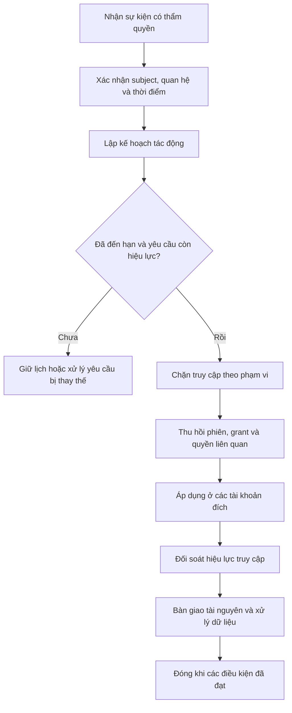

# Leaver process

## 1. Leaver process là quá trình kết thúc quyền theo một quan hệ

Một nhân viên nghỉ việc, một nhà thầu hết hạn hợp đồng hoặc một cộng tác viên rời tenant đều có thể là sự kiện **leaver**. Điều cần kết thúc không chỉ là một dòng hồ sơ, mà là các quyền truy cập không còn căn cứ sau khi quan hệ tương ứng chấm dứt.

**Leaver process** là quy trình xác nhận sự kiện kết thúc quan hệ, xác định phạm vi, thu hồi truy cập, xử lý tài khoản và tài nguyên liên quan, rồi kiểm chứng kết quả.

Ví dụ, một giảng viên rời tổ chức A nhưng vẫn là học viên cá nhân trên cùng nền tảng. Quy trình cần gỡ quyền giảng viên và membership thuộc A theo chính sách; không mặc định xóa tài khoản cá nhân hoặc membership hợp lệ ở tổ chức B.

Bốn kết quả cần được theo dõi riêng:

```text
Quyền truy cập:
  những đường truy cập không còn căn cứ đã bị chặn.

Tài khoản đích:
  các ứng dụng liên quan đã áp dụng trạng thái yêu cầu.

Tài nguyên:
  dữ liệu, tác vụ và quyền sở hữu đã có phương án xử lý.

Bằng chứng:
  biết thao tác nào đã có hiệu lực và phần nào còn thiếu.
```

Một email thông báo nghỉ việc hoặc một HTTP response thành công từ connector chưa chứng minh tất cả bốn kết quả đã đạt.

Bài học dùng quy trình kỹ thuật minh họa cho một tổ chức có nguồn nhân sự, IdP và nhiều ứng dụng. Thời hạn, trạng thái và thứ tự cụ thể phải được tổ chức định nghĩa theo yêu cầu của mình; không có một thời gian offboarding chung áp dụng cho mọi hệ thống.

## 2. Xác định đúng chủ thể và đúng phạm vi

### 2.1. Leaver của quan hệ nào?

Một chủ thể có thể đồng thời có:

- Quan hệ nhân viên với tổ chức.
- Quan hệ cộng tác viên hoặc nhà thầu trong một dự án.
- Membership ở nhiều tenant.
- Vai trò giảng viên trong một lớp.
- Tài khoản cá nhân sử dụng ngoài quan hệ doanh nghiệp.
- Trách nhiệm sở hữu hoặc bảo trợ cho một workload.

Kết thúc một quan hệ không tự chứng minh mọi quan hệ còn lại đều phải kết thúc. Phạm vi cần có nguồn có thẩm quyền và căn cứ rõ ràng.

Một khóa xử lý nội bộ có thể gồm:

```text
source_id
tenant_id hoặc organization_id
subject_id
relationship_id
lifecycle_generation hoặc định danh vòng quan hệ
```

Tên field là thiết kế minh họa. Mục tiêu là phân biệt cùng một người qua nhiều quan hệ và nhiều lần gia nhập.

### 2.2. Không nhận diện bằng email hoặc tên

Email, username và display name có thể đổi hoặc được cấp lại. Một lệnh “disable người có email này” gửi muộn có thể tác động nhầm người nếu địa chỉ đã đổi chủ.

Connector cần mapping từ định danh ổn định của nguồn sang subject và tài khoản đích. Trước mỗi thao tác nhạy cảm, xác nhận lại tenant, target account và phiên bản hoặc thế hệ quan hệ phù hợp.

Không chuyển email cũ cho người mới rồi coi người mới là chủ thể cũ. Cũng không xóa mapping trước khi còn cần nó để thu hồi quyền ở các hệ thống đích.

### 2.3. Phân biệt account toàn cục và membership

Nếu ứng dụng dùng một account chung cho nhiều tenant, leaver ở tenant A có thể chỉ cần kết thúc membership của A. Disable account toàn cục có thể chặn quyền hợp lệ của các tenant khác.

Ngược lại, nếu account là danh tính doanh nghiệp chuyên biệt chỉ tồn tại cho một quan hệ đã kết thúc, chính sách có thể yêu cầu đình chỉ account đó.

Quyết định này cần nằm trong mô hình danh tính và policy, không để connector tự đoán từ tên user hoặc vị trí thư mục.

## 3. Nguồn kích hoạt, thời điểm và thẩm quyền

Nguồn kích hoạt có thể là HR, hệ thống quản lý nhà thầu, chủ tenant hoặc quy trình bảo mật được ủy quyền. Không coi mọi yêu cầu từ manager hoặc một field tự sửa trong hồ sơ là lệnh thu hồi có thẩm quyền.

Một thông điệp minh họa:

```json
{
  "eventId": "leaver-event-8401",
  "sourceId": "hr-main",
  "organizationId": "org-a",
  "tenantId": "tenant-a",
  "subjectId": "S1",
  "relationshipId": "employment-2024-071",
  "sourceVersion": 42,
  "effectiveAt": "2026-11-26T04:00:00Z",
  "reasonCategory": "RELATIONSHIP_ENDED"
}
```

Đây là schema ứng dụng minh họa, không phải một tiêu chuẩn sự kiện JML bắt buộc.

Thông điệp cần được xác thực nguồn, kiểm tra schema và phân quyền xử lý. Một chữ ký hoặc credential của integration chứng minh nguồn gửi; còn nguồn ấy có được phép kết thúc quan hệ trong tenant này hay không là điều phải được kiểm tra riêng.

Các mốc nên được phân biệt:

| Mốc | Ý nghĩa |
| --- | --- |
| Requested at | Yêu cầu được tạo khi nào |
| Received at | IAM tiếp nhận khi nào |
| Effective at | Quan hệ kết thúc có hiệu lực khi nào |
| Access blocked at | Điểm kiểm soát đã chặn truy cập khi nào |
| Verified at | Kết quả tại đích được xác nhận khi nào |
| Closed at | Quy trình đạt điều kiện đóng khi nào |

Với leaver đã lên lịch, thời điểm đến hạn cần được tính theo hợp đồng múi giờ và được kiểm tra lại trước khi thực hiện. “Ngày cuối cùng” không đủ rõ nếu hệ thống không biết thời điểm hiệu lực và cách xử lý cuối ngày.

Với tình huống cần thu hồi khẩn, tổ chức có thể có đường xử lý riêng. Nó vẫn cần xác định đúng chủ thể, phạm vi và actor có thẩm quyền; tính khẩn không làm một request tùy ý trở thành hợp lệ.

Nếu yêu cầu đã được hủy, sửa thời điểm hoặc thay thế, các job cũ phải nhận biết được. Kiểm tra khi tạo lịch chưa đủ cho một job sẽ chạy nhiều ngày sau.

## 4. Kiểm kê các đường truy cập và tài nguyên

Một account trong IdP thường chỉ là một phần của bề mặt truy cập.

| Nhóm | Những thứ cần rà soát theo phạm vi |
| --- | --- |
| Đăng nhập tương tác | IdP, directory, tài khoản local trong ứng dụng |
| Phiên | Browser session, mobile session, session ứng dụng độc lập |
| Token và grant | Refresh grant, access token, delegated OAuth access |
| Credential riêng | Personal access token, API key, SSH key hoặc certificate liên quan |
| Quyền | Role, group, entitlement, membership trực tiếp và gián tiếp |
| Đặc quyền | Quyền quản trị, phiên đặc quyền, quyền đủ điều kiện để kích hoạt |
| Tác vụ | Job định kỳ, tích hợp, automation chạy dưới danh tính cá nhân |
| Tài nguyên | Dự án, repo, tài liệu, mailbox hoặc tài nguyên mà người đó sở hữu |
| Danh tính máy | Service account hoặc workload do người đó bảo trợ |
| Thiết bị và đường mạng | Các đường truy cập được tổ chức quản lý và nằm trong phạm vi xử lý |

Danh sách là điểm xuất phát, không phải khẳng định mọi tổ chức có tất cả các loại tài nguyên này.

Cần biết account nào ở ứng dụng đích thực sự thuộc chủ thể. Một login trùng tên không đủ để xác nhận mapping.

Cũng cần phân biệt credential cá nhân với credential của dịch vụ dùng chung. Thu hồi token cá nhân có thể đúng; tắt bừa một service account đang vận hành cho nhiều đội có thể gây gián đoạn ngoài phạm vi.

Nếu người rời tổ chức từng biết shared secret, cần có kế hoạch thay secret, cập nhật consumer và kiểm chứng. Việc xóa người đó khỏi một group không làm họ quên secret đã biết.

## 5. Quy trình theo giai đoạn và mức ưu tiên

Một quy trình có thể tách như sau:



Sơ đồ mô tả các trách nhiệm chính, không bắt mọi tác vụ phải chạy nối tiếp hoàn toàn. Nhiều bước độc lập có thể chạy song song; những bước phụ thuộc cần barrier hoặc điều kiện rõ ràng.

### 5.1. Trước thời điểm hiệu lực

Có thể kiểm kê tài nguyên, tìm owner kế nhiệm, chuẩn bị task và kiểm tra connector. Những bước chuẩn bị không nhất thiết yêu cầu giữ quyền cho người rời quan hệ sau thời điểm kết thúc.

Quy trình bàn giao nên tránh một tài nguyên quan trọng chỉ có duy nhất người sắp rời đi đủ quyền quản lý.

### 5.2. Tại thời điểm hiệu lực

Ưu tiên các điểm có thể chặn quyền truy cập trong phạm vi đã xác định, nhất là đường đặc quyền và các đường tạo credential mới.

Không chờ mọi tác vụ hành chính như thu hồi license hoặc xóa ảnh đại diện hoàn tất rồi mới chặn một quyền cần kết thúc đúng hạn.

Nếu hệ thống chỉ chặn login mới mà phiên cũ vẫn dùng được, phải ghi trạng thái thực tế. Không gọi đó là đã thu hồi toàn bộ truy cập.

### 5.3. Sau khi chặn truy cập

Hoàn tất các tác động đích, bàn giao tài nguyên, thu hồi hoặc thay credential liên quan, rồi đối soát.

Một bước bàn giao lỗi không nên tự động mở lại quyền đã thu hồi chỉ để làm quy trình dễ tiếp tục. Xử lý lỗi cần bảo toàn mục tiêu thu hồi và có actor được ủy quyền để thực hiện phần còn lại.

## 6. Chặn đăng nhập, thu hồi phiên và token

Chặn đăng nhập mới không tự chấm dứt mọi tương tác đang diễn ra. Một app có thể duy trì session riêng hoặc tiếp tục chấp nhận access token đã phát.

Tài liệu Microsoft Entra mô tả độ trễ giữa yêu cầu thu hồi và lúc truy cập thực sự kết thúc, tùy loại token và cách ứng dụng thực thi. Đây là ví dụ sản phẩm cho thấy cần hiểu từng đường truy cập. [Microsoft Learn — Revoke user access](https://learn.microsoft.com/en-us/entra/identity/users/users-revoke-access).

Trong thiết kế tổng quát, cần trả lời:

```text
Có ngăn được tạo phiên hoặc grant mới không?
Refresh token hoặc grant cũ còn dùng được không?
Access token đã phát được kiểm tra trạng thái như thế nào?
Session của từng app được kết thúc bằng cơ chế nào?
Tài khoản local hoặc đường đăng nhập phụ có còn dùng được không?
```

RFC 7009 định nghĩa cơ chế thu hồi token OAuth tại authorization server; tác động đối với token liên quan còn phụ thuộc loại token và chính sách của server. Không suy ra một request thu hồi tự chấm dứt mọi session ứng dụng. [RFC 7009 — OAuth 2.0 Token Revocation](https://www.rfc-editor.org/rfc/rfc7009.html).

Một JWT đã phát không tự đổi payload khi user rời tổ chức. Tốc độ mất hiệu lực thực tế cần đến cơ chế như kiểm tra trạng thái, thu hồi được thực thi tại resource server hoặc giới hạn hiệu lực đã được chấp nhận trong thiết kế.

Đổi password cũng không phải bằng chứng mọi token hay session đã bị thu hồi. Cần quản lý các đường xác thực và đường tiếp tục phiên theo hợp đồng cụ thể.

Nếu có bước xóa binding authenticator hoặc kênh recovery, hãy đảm bảo đường cấp lại credential không thể mở lại tài khoản ngoài quy trình hợp lệ. Việc xử lý binding cần giữ bằng chứng kiểm toán và không phá dữ liệu cần cho điều tra chỉ để làm hồ sơ trống.

## 7. Thu hồi quyền trực tiếp, gián tiếp và đặc quyền

Một người có thể có cùng quyền từ nhiều căn cứ:

```text
group phòng ban
membership dự án
role cấp trực tiếp
ngoại lệ có thời hạn
quyền quản trị có thể kích hoạt
quan hệ owner của tài nguyên
```

Gỡ một group không chứng minh quyền đã hết nếu còn căn cứ khác. Ngược lại, leaver trong một dự án không nhất thiết xóa các quyền có căn cứ độc lập ở dự án khác.

Kế hoạch cần xác định **quyền nào phải kết thúc theo quan hệ**, rồi kiểm tra cả các đường cấp quyền dẫn đến nó. Quyền trực tiếp có thể bị bỏ sót nếu báo cáo chỉ nhìn group.

Đối với đặc quyền, cần xem cả quyền đang hoạt động, quyền có thể kích hoạt, phiên đặc quyền và khả năng tạo thêm account, key hoặc grant. Một account bị gỡ role nhưng vẫn giữ credential quản trị ở hệ thống đích có thể còn đường truy cập.

Nếu có ngoại lệ chuyển tiếp, ngoại lệ phải nêu phạm vi, người phê duyệt, thời hạn và cách thu hồi khi hết hạn. Không dùng một ghi chú “cần bàn giao” để giữ nguyên mọi quyền vô thời hạn.

Quyền xem dữ liệu bàn giao cũng thuộc người được phép nhận. Không mặc định manager được đọc mọi dữ liệu của người rời đi chỉ vì tên manager có trong HR.

## 8. Tác động tại ứng dụng đích và ví dụ SCIM

Một ứng dụng có thể được provisioning qua SCIM. Thuộc tính `active` của SCIM thể hiện trạng thái quản trị của user; nghĩa cụ thể do service provider quyết định, với trạng thái false thường biểu diễn đình chỉ. [RFC 7643, §4.1.1](https://www.rfc-editor.org/rfc/rfc7643.html#section-4.1.1).

Do đó, connector cần hợp đồng rõ ràng: đặt `active=false` chặn login mới, vô hiệu hóa session đang mở hay có tác động khác? Không suy ra mọi hành vi từ tên field.

Ví dụ request giả định cho một server hỗ trợ PATCH và cho phép connector sửa trạng thái:

```http
PATCH /scim/v2/Users/target-user-071 HTTP/1.1
Host: app.example.org
Content-Type: application/scim+json
Accept: application/scim+json

{
  "schemas": [
    "urn:ietf:params:scim:api:messages:2.0:PatchOp"
  ],
  "Operations": [
    {
      "op": "replace",
      "path": "active",
      "value": false
    }
  ]
}
```

Ví dụ lược bỏ credential tích hợp và không phải request đã thực hiện. Target ID phải đến từ mapping đã xác minh, không lấy username hoặc email rồi đoán đường dẫn.

SCIM PATCH mô tả các thao tác trên resource; nó không tạo một giao dịch chung cho IdP, ứng dụng, group và session store. [RFC 7644, §3.5.2](https://www.rfc-editor.org/rfc/rfc7644.html#section-3.5.2).

Khi đích hỗ trợ kiểm soát phiên bản, dùng cơ chế tương ứng để phát hiện xung đột. Nếu gặp kết quả không xác định do timeout, đọc lại trạng thái và đối soát trước khi quyết định retry.

Các kiểm tra sau thao tác nên trả lời:

```text
Đúng target account và tenant chưa?
Trạng thái đích đã đạt giá trị yêu cầu chưa?
Ứng dụng còn cho session cũ hoạt động không?
Đường local login hoặc token riêng có bị ảnh hưởng không?
Quyền và group liên quan đã được xử lý riêng chưa?
Có tác vụ hoặc credential cá nhân tiếp tục hoạt động không?
```

Một response thành công cho việc sửa user không thay câu trả lời cho các câu hỏi còn lại.

Xóa resource là thao tác khác với đình chỉ. Không gửi DELETE hàng loạt như bước đầu mặc định khi còn cần mapping, tài nguyên sở hữu hoặc bằng chứng để hoàn tất thu hồi.

## 9. Điều phối phân tán, retry và idempotency

### 9.1. Giữ trạng thái mong muốn và trạng thái quan sát

Một workflow có thể ghi:

```text
Desired:
  quan hệ R đã kết thúc;
  membership của quan hệ không còn hiệu lực;
  tài khoản doanh nghiệp thuộc phạm vi phải bị đình chỉ.

Observed:
  IdP đã chặn;
  ứng dụng A đã xác nhận đình chỉ;
  ứng dụng B đang lỗi connector;
  chuyển owner của tác vụ C còn chờ.
```

Không gộp tất cả thành `offboarded = true` ngay sau bước đầu tiên.

Một mô hình trạng thái minh họa:

| Trạng thái | Ý nghĩa |
| --- | --- |
| SCHEDULED | Đã chuẩn bị, chưa đến thời điểm có hiệu lực |
| VALIDATING | Kiểm tra nguồn, scope và phiên bản hiện hành |
| ACCESS_BLOCK_APPLIED | Một điểm chặn đã có hiệu lực theo phạm vi ghi nhận |
| REVOCATION_PENDING | Còn phiên, grant hoặc đường truy cập phải xử lý |
| TARGETS_PENDING | Còn ứng dụng đích chưa đạt trạng thái yêu cầu |
| HANDOVER_PENDING | Còn trách nhiệm hoặc tài nguyên cần bàn giao |
| PARTIAL_FAILURE | Có phần không hoàn tất và cần xử lý |
| COMPLETED | Các điều kiện đóng đã được xác nhận |
| CANCELLED_OR_SUPERSEDED | Yêu cầu không còn là ý định hiện hành |

Các trạng thái không bắt buộc là một chuỗi đơn. Có thể cần nhiều cờ tiến độ hoặc task ledger để biểu diễn các phần đang chạy song song.

### 9.2. Mỗi tác vụ phải có phạm vi và dấu vết

Một task key có thể dựa trên workflow, target, hành động và phiên bản ý định. Tác vụ lặp cần nhận biết phần đã hoàn thành để không tạo thông báo, yêu cầu bàn giao hoặc bản ghi cấp quyền trùng không cần thiết.

Tuy nhiên, idempotency không giải quyết mọi vấn đề thứ tự. Một tác vụ leaver cũ có thể khác event ID nhưng vẫn không còn hợp lệ sau khi yêu cầu bị hủy hoặc một quan hệ mới đã được thiết lập.

Trước tác động đích, kiểm tra lại ý định hiện tại. Với dữ liệu có phiên bản, so sánh trong cùng phạm vi nguồn và quan hệ; không so số sequence của HR với số sequence của một ứng dụng như cùng một thang đo.

### 9.3. Retry có giới hạn và chống tự kích hoạt lại

Lỗi mạng hoặc rate limit có thể cần retry theo chính sách. Không retry liên tục một lỗi mapping sai, thiếu quyền connector hoặc tài khoản đích đang mơ hồ.

Một lần timeout có thể xảy ra sau khi ứng dụng đã áp dụng disable. Worker cần đối soát kết quả thay vì giả định tác động chưa xảy ra.

Nếu một tác vụ downstream lỗi, không bù bằng cách enable lại account ở IdP như một rollback mặc định. Mục tiêu thu hồi ở các điểm đã thành công cần được giữ; phần còn lại được xử lý riêng.

Các luồng đồng bộ khác cũng phải tôn trọng ý định leaver. Một payload profile cũ có `active=true` không được mở lại account chỉ vì nó đến sau thông điệp đình chỉ.

## 10. Java: kiểm tra tác vụ leaver còn hợp lệ không

Ví dụ Java 17 trở lên dưới đây chỉ kiểm tra **điều kiện bắt đầu tác vụ có phạm vi**. Nó không gọi IdP, không disable tài khoản thật và không khẳng định đã hoàn tất offboarding.

Event phải được adapter xác thực nguồn và phân quyền nhận vào. Snapshot hiện hành phải được lấy từ nguồn trạng thái có thẩm quyền. So sánh các chuỗi `sourceId` trong code không thay việc xác thực integration.

```java
import java.time.Instant;
import java.util.Objects;
import java.util.Set;

public final class LeaverEligibilityDemo {

    enum Intent {
        LEAVE, CANCELLED
    }

    enum Decision {
        READY_FOR_SCOPED_REVOKE,
        WAIT_UNTIL_EFFECTIVE,
        SKIP_SUPERSEDED,
        SKIP_CANCELLED,
        RELOAD_CURRENT_STATE,
        REVIEW_SCOPE_OR_DATA
    }

    record SourceTenant(String sourceId, String tenantId) {
    }

    record Scope(
            String sourceId,
            String tenantId,
            String subjectId,
            String relationshipId) {
    }

    record LeaverEvent(
            String eventId,
            Scope scope,
            long sourceVersion,
            Instant effectiveAt) {
    }

    record CurrentIntent(
            Scope scope,
            long sourceVersion,
            Intent intent,
            Instant effectiveAt) {
    }

    static Decision evaluate(
            LeaverEvent event,
            CurrentIntent current,
            Set<SourceTenant> allowedSources,
            Instant now) {

        if (event == null || current == null || now == null
                || allowedSources == null
                || !present(event.eventId())
                || !validScope(event.scope())
                || !validScope(current.scope())
                || event.sourceVersion() < 1
                || current.sourceVersion() < 1
                || event.effectiveAt() == null
                || current.intent() == null) {
            return Decision.REVIEW_SCOPE_OR_DATA;
        }

        SourceTenant authority = new SourceTenant(
                event.scope().sourceId(), event.scope().tenantId());

        if (!allowedSources.contains(authority)
                || !event.scope().equals(current.scope())) {
            return Decision.REVIEW_SCOPE_OR_DATA;
        }

        if (event.sourceVersion() < current.sourceVersion()) {
            return Decision.SKIP_SUPERSEDED;
        }

        if (event.sourceVersion() > current.sourceVersion()) {
            return Decision.RELOAD_CURRENT_STATE;
        }

        if (current.intent() == Intent.CANCELLED) {
            return Decision.SKIP_CANCELLED;
        }

        if (!Objects.equals(event.effectiveAt(), current.effectiveAt())) {
            return Decision.REVIEW_SCOPE_OR_DATA;
        }

        if (now.isBefore(current.effectiveAt())) {
            return Decision.WAIT_UNTIL_EFFECTIVE;
        }

        return Decision.READY_FOR_SCOPED_REVOKE;
    }

    private static boolean validScope(Scope scope) {
        return scope != null
                && present(scope.sourceId())
                && present(scope.tenantId())
                && present(scope.subjectId())
                && present(scope.relationshipId());
    }

    private static boolean present(String value) {
        return value != null && !value.isBlank();
    }

    public static void main(String[] args) {
        Instant now = Instant.parse("2026-11-26T04:00:00Z");
        Scope original = new Scope(
                "hr-main", "tenant-a", "S1", "employment-old");

        Set<SourceTenant> authorities = Set.of(
                new SourceTenant("hr-main", "tenant-a"));

        LeaverEvent due = new LeaverEvent(
                "event-42", original, 42, now);
        CurrentIntent current = new CurrentIntent(
                original, 42, Intent.LEAVE, now);

        System.out.println("Current and due: "
                + evaluate(due, current, authorities, now));

        LeaverEvent future = new LeaverEvent(
                "event-43", original, 43, now.plusSeconds(3600));
        CurrentIntent futureIntent = new CurrentIntent(
                original, 43, Intent.LEAVE, now.plusSeconds(3600));

        System.out.println("Future effective time: "
                + evaluate(future, futureIntent, authorities, now));

        CurrentIntent cancelled = new CurrentIntent(
                original, 43, Intent.CANCELLED, null);
        System.out.println("Old event after cancellation: "
                + evaluate(due, cancelled, authorities, now));

        Scope newRelationship = new Scope(
                "hr-main", "tenant-a", "S1", "employment-new");
        CurrentIntent otherRelationshipIntent = new CurrentIntent(
                newRelationship, 1, Intent.LEAVE, now);

        System.out.println("Different relationship: "
                + evaluate(due, otherRelationshipIntent, authorities, now));

        LeaverEvent newer = new LeaverEvent(
                "event-44", original, 44, now);
        System.out.println("Event newer than snapshot: "
                + evaluate(newer, current, authorities, now));
    }
}
```

Kết quả dự kiến:

```text
Current and due: READY_FOR_SCOPED_REVOKE
Future effective time: WAIT_UNTIL_EFFECTIVE
Old event after cancellation: SKIP_SUPERSEDED
Different relationship: REVIEW_SCOPE_OR_DATA
Event newer than snapshot: RELOAD_CURRENT_STATE
```

Trong ví dụ:

- Event cũ không được thực hiện chỉ vì đã đến giờ chạy.
- Phiên bản mới hơn snapshot yêu cầu đọc lại trạng thái, không tự coi event là đủ căn cứ.
- Cùng subject nhưng khác relationship không được dùng thay nhau.
- Sự kiện và ý định hiện tại phải khớp thời điểm hiệu lực.
- `READY_FOR_SCOPED_REVOKE` chỉ cho phép sang bước đánh giá và thực hiện kế hoạch trong scope, không có nghĩa được disable mọi account của chủ thể.

Đây là kiểm tra tại một thời điểm. Giữa kiểm tra và tác động vẫn có thể có yêu cầu mới. Triển khai thực tế cần cơ chế kiểm soát đồng thời, phiên bản hoặc fencing phù hợp để tác vụ cũ không vượt qua thay đổi mới.

Code cũng không thay task ledger: gọi cùng hàm hai lần có thể trả cùng kết quả READY. Connector vẫn cần xử lý lặp an toàn và lưu bằng chứng hoàn thành từng tác vụ.

## 11. Tài nguyên, workload và credential từng do người rời đi quản lý

Leaver process cần xử lý khả năng truy cập lẫn tính liên tục của công việc.

Một job định kỳ chạy bằng token cá nhân có thể dừng sau thu hồi. Cách xử lý phù hợp là xác định owner mới và chuyển sang danh tính workload được quản lý nếu kiến trúc yêu cầu; không giữ token của người đã rời đi như một ngoại lệ không thời hạn.

Một service account độc lập có thể cần tiếp tục hoạt động, nhưng phải có owner hoặc sponsor còn hiệu lực, quyền đúng mục đích và credential được quản lý. Đổi tên owner trong database chưa đủ nếu người cũ vẫn giữ secret hoặc đường recovery.

Có thể lập danh sách xử lý như sau:

| Tài nguyên | Quyết định cần có |
| --- | --- |
| Repo, dự án hoặc workspace | Owner kế nhiệm có thẩm quyền và đủ quyền nhận |
| Tác vụ định kỳ | Tiếp tục, thay danh tính chạy hoặc dừng có kiểm soát |
| OAuth connection cá nhân | Thu hồi grant hoặc tái cấp theo chủ thể phù hợp |
| Shared secret từng được biết | Có cần thay, consumer nào bị ảnh hưởng, bằng chứng cập nhật |
| Service account được bảo trợ | Sponsor mới, phạm vi quyền và thời hạn cần rà soát |
| Tài liệu và dữ liệu nghiệp vụ | Bàn giao theo quyền được phép và chính sách lưu giữ |
| Thiết bị hoặc dữ liệu tổ chức | Xử lý theo phạm vi quản lý đã được ủy quyền |

Thu hồi truy cập không thể tự thu lại mọi bản dữ liệu đã được sao chép trước đó. Những yêu cầu liên quan đến thiết bị, dữ liệu offline hoặc điều tra cần quy trình và công cụ phù hợp.

Không mặc định xóa hoặc điều khiển toàn bộ thiết bị cá nhân. Phạm vi quản lý kỹ thuật và quyền thực hiện từng thao tác phải được xác định riêng.

## 12. Đình chỉ, xóa và lưu giữ dữ liệu là các quyết định khác nhau

Leaver không đồng nghĩa phải xóa ngay subject hoặc mọi dữ liệu liên quan.

Có thể cần giữ một account đã đình chỉ để bảo toàn tham chiếu giao dịch, kiểm toán, mapping đích hoặc quy trình bàn giao. Việc giữ bản ghi không đồng nghĩa giữ quyền truy cập cho người đã rời quan hệ.

Ngược lại, một tài khoản đã bị xóa ở một nơi chưa chắc đã mất truy cập ở mọi nơi nếu còn account local, token hoặc session độc lập.

Các quyết định nên được tách:

```text
Kết thúc truy cập:
  chặn những hành động không còn căn cứ.

Kết thúc tài khoản:
  đình chỉ, archive hoặc xóa tại từng hệ thống theo hợp đồng.

Xử lý tài nguyên:
  chuyển owner, đóng tác vụ hoặc bàn giao dữ liệu cần thiết.

Lưu giữ và xóa dữ liệu:
  thực hiện theo chính sách đã được phê duyệt cho từng loại dữ liệu.
```

Không tự đặt một thời gian lưu giữ chung cho toàn bộ hồ sơ, log, mailbox và bằng chứng bảo mật. Quy định của tổ chức và yêu cầu áp dụng có thể khác nhau.

Nếu đang có yêu cầu bảo toàn dữ liệu được ủy quyền, thao tác xóa cần tôn trọng yêu cầu đó. Quyền xem dữ liệu được bảo toàn vẫn phải giới hạn; “để phục vụ điều tra” không tự cho mọi admin quyền đọc tất cả.

Khi dữ liệu cá nhân được xử lý hoặc xóa, có thể vẫn cần một tham chiếu tối thiểu để không cấp lại nhầm định danh và để giải thích các giao dịch còn lưu. Thiết kế tham chiếu phải có mục đích, quyền đọc và vòng đời riêng.

## 13. Hủy nghỉ, thay thời điểm và tái gia nhập

### 13.1. Hủy yêu cầu trước khi có hiệu lực

Nếu một leaver đã lên lịch bị hủy, scheduler và consumer cần nhận phiên bản ý định mới. Xóa một job khỏi giao diện không đủ nếu thông điệp cũ vẫn nằm trong queue hoặc retry store.

Một thao tác bị hủy cần được ghi dấu để sự kiện cũ đến sau không khôi phục ý định thu hồi đã hết hiệu lực.

Không dựa vào đồng hồ xử lý để quyết định “event đến sau thắng”. Sự kiện cũ có thể đến muộn, còn nguồn mới hơn có thể được tiếp nhận trước.

### 13.2. Thay thời điểm trong khi workflow đang chạy

Nếu một phần quyền đã bị thu hồi rồi yêu cầu đổi thời điểm mới xuất hiện, cần một quyết định có thẩm quyền về trạng thái mong muốn hiện tại.

Không mặc định undo toàn bộ các bước đã làm. Có thể dữ liệu hoặc quyền đã thay đổi, có phát hiện bảo mật mới hoặc account đích không cho khôi phục tương đương.

Các bước bổ sung quyền trở lại phải qua đúng điều kiện hiện hành. Workflow được tạo để thu hồi không tự trở thành quyền cấp lại mọi entitlement cũ.

### 13.3. Tái tuyển dụng hoặc gia nhập lại

Một người có thể trở lại với quan hệ mới. Tổ chức có thể giữ subject cũ hoặc cấp account mới theo mô hình, nhưng cần phân biệt vòng quan hệ và thực hiện provisioning theo căn cứ mới.

Không tự khôi phục toàn bộ role, token, grant hoặc ngoại lệ của lần làm việc trước. Quyền hiện tại cần được tính từ vai trò và phê duyệt còn hiệu lực.

Credential từng bị thu hồi không được coi là hợp lệ trở lại chỉ vì account chuyển sang active. Các liên kết và phương thức xác thực cần đi theo quy trình cấp hoặc khôi phục đã thiết kế.

Một retry của leaver cũ không được vô hiệu hóa account của quan hệ mới. Đây là lý do quan trọng để có relationship ID, generation hoặc cơ chế phiên bản đủ rõ ở từng tác vụ.

## 14. Điều kiện hoàn tất và xử lý thất bại một phần

Một workflow chỉ nên được đóng theo tiêu chí được định nghĩa trước cho phạm vi của nó.

Ví dụ điều kiện kỹ thuật:

| Phần | Bằng chứng cần có theo hợp đồng |
| --- | --- |
| Chặn trung tâm | Điểm kiểm soát đã áp dụng đúng subject và scope |
| Phiên và grant | Đã xử lý các loại cần thu hồi; biết giới hạn hiệu lực còn lại |
| Ứng dụng bắt buộc | Từng đích xác nhận trạng thái và hiệu lực cần thiết |
| Quyền | Những entitlement phải kết thúc đã không còn căn cứ có hiệu lực |
| Credential riêng | Token hoặc key liên quan đã được xử lý theo phạm vi |
| Tài nguyên | Có owner mới hoặc quyết định dừng, lưu giữ được phép |
| Tác vụ chờ | Không còn job cũ có thể tự cấp lại quyền ngoài ý định |
| Audit và ngoại lệ | Có kết quả, actor, thời điểm và phần còn rủi ro |

Đọc lại một field tại đích là một loại bằng chứng; nó không luôn đủ để chứng minh session đang mở đã bị chặn. Cần tiêu chí phù hợp với cách ứng dụng thực thi.

Nếu một ứng dụng bắt buộc chưa thu hồi được, trạng thái nên thể hiện phần thiếu và owner xử lý. Có thể cần giới hạn bổ sung tại điểm khác có hiệu lực trong phạm vi được ủy quyền, thay vì chỉ tiếp tục retry.

Nếu tổ chức chấp nhận một ngoại lệ tạm thời, phải ghi rõ phạm vi truy cập còn tồn tại, người nhận trách nhiệm, thời hạn và cách kết thúc. Không biến ngoại lệ thành báo cáo “đã xác minh không còn truy cập”.

Sự cố connector không được dùng để mặc định giữ quyền không thời hạn. Nhưng lỗi của một đích cũng không có nghĩa phải xóa mọi bản ghi để làm báo cáo trống.

Quy trình cần phân biệt **đã hoàn tất tác vụ** và **đã đạt kết quả truy cập mong muốn**. Một lệnh gọi API chạy xong có thể chỉ là một bước trên đường đạt kết quả.

## 15. Ví dụ xuyên suốt: nhân viên rời tổ chức

Giả sử S1 có:

```text
Quan hệ:
  nhân viên của tenant-a.

Đường truy cập:
  IdP doanh nghiệp;
  session đang mở ở ứng dụng học tập;
  account local trong một công cụ cũ;
  token cá nhân của một automation.

Tài nguyên:
  owner của dự án P;
  sponsor của workload W.

Quan hệ khác:
  học viên cá nhân ngoài tenant-a.
```

Kế hoạch minh họa:

| Giai đoạn | Tác vụ | Điều cần kiểm chứng |
| --- | --- | --- |
| Chuẩn bị | Xác nhận nguồn, relationship và thời điểm | Ý định có thẩm quyền, mapping đúng |
| Chuẩn bị | Tìm owner mới cho P và sponsor cho W | Người nhận đủ quyền, không đổi phạm vi ngoài yêu cầu |
| Có hiệu lực | Chặn truy cập của quan hệ doanh nghiệp | Không disable nhầm tài khoản cá nhân độc lập |
| Có hiệu lực | Thu hồi session và grant liên quan | Ứng dụng thực thi, biết phần còn hiệu lực |
| Có hiệu lực | Đình chỉ account local của công cụ cũ | Không còn đường bypass IdP |
| Có hiệu lực | Xử lý token automation cá nhân | Thu hồi hoặc thay bằng cơ chế được phê duyệt |
| Sau đó | Chuyển trách nhiệm workload và shared secret liên quan | Không để người cũ còn secret hoặc quyền quản trị |
| Đối soát | Kiểm tra các quyền và task còn lại | Không có payload cũ tự enable lại account |
| Đóng | Lưu bằng chứng và phần ngoại lệ nếu có | Trạng thái báo cáo phản ánh đúng kết quả |

Nếu ứng dụng học tập đã chặn nhưng công cụ cũ đang mất kết nối, workflow phải thể hiện phần truy cập chưa được xác nhận. Account cá nhân của S1 không tự bị xóa chỉ để làm trạng thái tổng thể đơn giản hơn.

Nếu owner mới của workload chưa được phê duyệt, quyền cá nhân của S1 cũng không vì thế được giữ mãi. Cần người được ủy quyền xử lý tính liên tục của workload trong mô hình quyền phù hợp.

Ví dụ cho thấy leaver là bài toán về kết quả trên nhiều đường truy cập và trách nhiệm, không chỉ thay một field trạng thái.

## 16. Audit, số liệu vận hành và quyền riêng tư

### 16.1. Ghi nhận theo chủ thể và tác động

Một sự kiện kỹ thuật có thể gồm:

```json
{
  "eventType": "LEAVER_TARGET_VERIFIED",
  "workflowId": "leaver-workflow-8401",
  "sourceEventId": "leaver-event-8401",
  "tenantId": "tenant-a",
  "subjectId": "S1",
  "relationshipId": "employment-2024-071",
  "sourceVersion": 42,
  "targetSystem": "learning-app",
  "targetAccountRef": "target-user-071",
  "action": "SUSPEND_RELATIONSHIP_ACCESS",
  "result": "VERIFIED",
  "verifiedAt": "2026-11-26T04:00:08Z"
}
```

Đây là record minh họa, không phải bằng chứng một tài khoản thật đã bị thu hồi.

Cần có actor thực hiện hoặc danh tính dịch vụ theo trace liên quan, policy version và tham chiếu nguồn phê duyệt khi cần. Thông tin việc làm chi tiết không nhất thiết xuất hiện trong mọi log connector.

Không ghi token còn dùng được, password, secret hoặc toàn bộ hồ sơ nhân sự vào log. Những người vận hành một ứng dụng đích có thể chỉ cần biết quan hệ kết thúc và tác vụ kỹ thuật cần làm, không cần đọc toàn bộ lý do nhân sự.

### 16.2. Đo độ trễ theo các mốc đúng nghĩa

Các chỉ báo hữu ích có thể gồm:

- Thời gian từ thời điểm có hiệu lực đến khi điểm chặn áp dụng.
- Thời gian đến khi các ứng dụng bắt buộc xác nhận kết quả.
- Số đường truy cập hoặc target còn chưa được xử lý.
- Số tác vụ stale hoặc event bị bỏ qua vì đã bị thay thế.
- Retry kéo dài, lỗi mapping và lỗi quyền connector.
- Số tài nguyên chưa có owner kế nhiệm.
- Số ngoại lệ quá hạn hoặc chưa được đối soát.
- Tài khoản hoặc grant phát hiện còn hoạt động sau khi workflow báo hoàn tất.

Nếu event đến muộn từ nguồn, cần tách độ trễ tiếp nhận khỏi độ trễ xử lý nội bộ. Không dùng thời điểm IAM nhận được sự kiện thay cho thời điểm quan hệ có hiệu lực để làm số liệu trông tốt hơn.

Mục tiêu thời gian cần được tổ chức xác định cho từng nhóm rủi ro và loại đường truy cập. Bài này không đặt một SLA chung cho mọi môi trường.

## 17. Tình huống tự luyện

### Tình huống A: rời một tenant nhưng còn tenant khác

S1 rời tenant A, vẫn là thành viên hợp lệ ở tenant B.

**Kết quả mong muốn:** thu hồi quyền thuộc A theo quan hệ đã kết thúc. Không disable account toàn cục nếu mô hình và thẩm quyền chỉ cho phép kết thúc membership A.

### Tình huống B: IdP đã chặn, app vẫn mở

Admin thấy account disabled tại IdP, nhưng session ứng dụng cũ vẫn đọc dữ liệu được.

**Kết quả mong muốn:** xử lý đường session của ứng dụng và ghi rõ độ trễ hiệu lực. Disable tại IdP chưa đủ làm bằng chứng thu hồi toàn bộ.

### Tình huống C: event cũ đến sau thông báo hủy nghỉ

Job version 42 đang chờ retry, ý định mới version 43 đã hủy leaver.

**Kết quả mong muốn:** job cũ nhận biết nó đã bị thay thế. Không thực hiện chỉ vì event được ký hợp lệ hoặc đến giờ chạy.

### Tình huống D: cùng email, quan hệ mới

Một người trở lại làm việc hoặc email được cấp cho người khác; task cũ chỉ biết email.

**Kết quả mong muốn:** không tác động theo email. Cần mapping ổn định và thế hệ quan hệ để xác định target; trường hợp mơ hồ chuyển xử lý có kiểm soát.

### Tình huống E: app cuối cùng bị lỗi connector

Mọi đích khác đã đạt trạng thái yêu cầu, một app quan trọng chưa được xác nhận.

**Kết quả mong muốn:** giữ kết quả đã thu hồi, ghi phần thiếu, xử lý theo rủi ro và owner được chỉ định. Không enable lại account trung tâm và không báo hoàn tất sai.

### Tình huống F: automation chạy bằng token cá nhân

Token bị thu hồi khiến một báo cáo định kỳ ngừng chạy.

**Kết quả mong muốn:** giải quyết danh tính và owner vận hành của automation. Không dùng lý do báo cáo cần chạy để giữ token của người đã rời đi vô thời hạn.

### Tình huống G: tác vụ cập nhật profile cũ mở lại user

Consumer nhận payload `active=true` từ trước thời điểm leaver.

**Kết quả mong muốn:** quy tắc nguồn và phiên bản ngăn tác vụ cũ đảo ngược ý định hiện hành. Không áp dụng “message đến sau thắng” cho mọi loại thay đổi.

### Tình huống H: quay lại tổ chức

S1 được cấp quan hệ mới, yêu cầu khôi phục quyền cũ.

**Kết quả mong muốn:** xác định quyền theo căn cứ và phê duyệt mới; credential, grant và ngoại lệ từng bị thu hồi không tự sống lại. Task của quan hệ cũ không tác động sang vòng quan hệ mới.

## 18. Những câu hỏi cần trả lời trước khi triển khai

Quy trình cần xác định ai được phát sự kiện, quan hệ nào kết thúc, thời điểm nào có hiệu lực và định danh nào được dùng để tìm account ở từng đích.

Với truy cập, cần biết đường nào chặn login mới, đường nào kết thúc phiên, grant hoặc credential, quyền nào đến từ quan hệ đã hết và còn tài khoản local nào ngoài IdP.

Với vận hành, cần có trạng thái tác vụ, xử lý lặp, kiểm soát sự kiện cũ, điều kiện đóng, owner cho phần thất bại và bằng chứng về hiệu lực thực tế.

Với tài nguyên và dữ liệu, cần người nhận trách nhiệm có thẩm quyền, phương án workload và secret liên quan, cùng chính sách lưu giữ hoặc xóa riêng.

Leaver process đạt mục tiêu khi những quyền không còn căn cứ đã được xử lý đúng phạm vi và đúng thời điểm theo chính sách, trong khi tài nguyên, quan hệ còn hợp lệ và lịch sử kiểm toán vẫn được quản lý có căn cứ.
