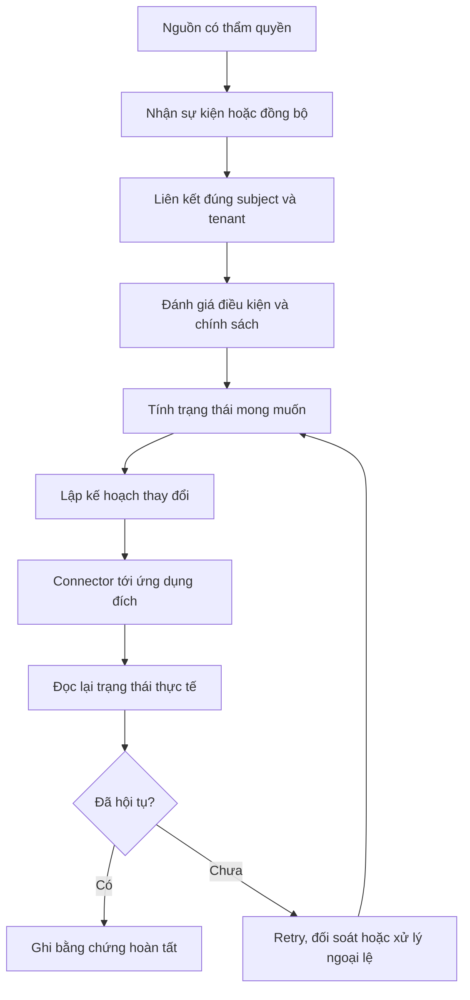

# Automated provisioning — Cấp phát danh tính và quyền truy cập tự động

## 1. Tự động cấp phát giải quyết vấn đề gì?

Một nhân viên mới cần tài khoản trong directory, nền tảng học tập và hệ thống cộng tác. Nếu mỗi nhóm tạo tài khoản bằng tay, người dùng có thể phải chờ, nhận sai role hoặc được cấp quyền không còn phù hợp sau khi đổi nhiệm vụ.

**Automated provisioning** là việc dùng các quy tắc, dữ liệu nguồn và kết nối kỹ thuật để tự động tạo hoặc cập nhật tài khoản, thuộc tính và quan hệ truy cập tại các hệ thống đích.

Một luồng đơn giản:

```text
Nguồn nhân sự xác nhận người mới đủ điều kiện
    -> xác định ứng dụng cần dùng
    -> tạo hoặc đối chiếu tài khoản đích
    -> cập nhật thuộc tính được quản lý
    -> cấp membership và quyền đã được phép
    -> xác minh kết quả
```

Tự động hóa không chỉ là chạy một request tạo người dùng. Nó cần giữ đúng danh tính, đúng phạm vi, đúng thời điểm và đúng căn cứ cấp quyền.

Ví dụ, Linh bắt đầu làm giảng viên tại tenant A. Hệ thống có thể tự cấp quyền sử dụng ứng dụng giảng dạy theo vai trò công việc. Quyền quản trị nền tảng hoặc phê duyệt thanh toán không nên xuất hiện chỉ vì cùng một quy trình đã tạo tài khoản.

## 2. Phân biệt provisioning với các quy trình liên quan

| Quy trình | Câu hỏi chính |
| --- | --- |
| Identity creation | Có bản ghi danh tính nào cần được tạo? |
| Provisioning | Đích nào cần tài khoản, thuộc tính và quyền gì? |
| Authentication | Người hoặc workload đang gọi có bằng chứng hợp lệ không? |
| SSO | Ứng dụng nhận kết quả xác thực từ hệ thống nào? |
| Authorization | Chủ thể được thực hiện hành động nào trên tài nguyên nào? |
| Deprovisioning | Tài khoản hoặc quyền nào cần ngừng hiệu lực? |
| Reconciliation | Trạng thái thực tế có còn khớp trạng thái được phép không? |

Một người đăng nhập SSO thành công chưa chắc đã có tài khoản hoặc membership tại ứng dụng. Ngược lại, tài khoản đã được cấp phát không có nghĩa mọi request từ người dùng đó đều được phép.

### 2.1. Cấp phát trước và tạo khi đăng nhập lần đầu

Có thể cấp phát tài khoản trước ngày sử dụng dựa trên nguồn và chính sách. Một số ứng dụng tạo hồ sơ khi người dùng đăng nhập lần đầu, thường được gọi là JIT provisioning.

JIT không tự giải quyết việc cập nhật các tài khoản không đăng nhập lại, thu hồi quyền cũ hoặc đồng bộ nhóm. Nó cũng không nên cấp mặc định mọi quyền chỉ vì issuer đã xác thực người dùng.

Khi một hệ thống hỗ trợ cả hai cách, cần thống nhất quy tắc đối chiếu để provisioning và lần đăng nhập đầu không tạo hai tài khoản cho cùng chủ thể.

### 2.2. Tự động thực thi khác tự động phê duyệt

Một quyền có thể được phê duyệt bởi người có thẩm quyền rồi được cấp tự động. Không bắt buộc mọi quyết định cấp quyền đều do một quy tắc hoàn toàn tự động.

Với quyền ít rủi ro, chính sách có thể cho phép cấp theo nhóm công việc. Với đặc quyền, có thể cần yêu cầu riêng, phê duyệt, phân tách nhiệm vụ và thời hạn.

Hệ thống tự động hóa phải giữ căn cứ cấp thay vì làm biến mất bước quản trị quyền.

## 3. Các thành phần của một luồng cấp phát



Các thành phần có thể nằm trong một sản phẩm hoặc nhiều service. Điều quan trọng là trách nhiệm và ranh giới tin cậy rõ ràng.

| Thành phần | Trách nhiệm |
| --- | --- |
| Nguồn danh tính | Cung cấp thuộc tính và sự kiện trong phạm vi có thẩm quyền |
| Bộ liên kết | Đối chiếu khóa nguồn với subject nội bộ và tài khoản đích |
| Bộ chính sách | Xác định điều kiện, ứng dụng, role và phê duyệt cần thiết |
| Bộ lập kế hoạch | So sánh trạng thái mong muốn với trạng thái thực tế |
| Connector | Gọi giao diện đích bằng credential có phạm vi |
| Kho trạng thái công việc | Giữ tiến độ, phiên bản và kết quả để tiếp tục an toàn |
| Đối soát | Phát hiện sai lệch hoặc tác vụ bị bỏ sót |
| Audit và giám sát | Giải thích quyền đã được cấp và phát hiện lỗi vận hành |

Một ví dụ sản phẩm là Microsoft Entra provisioning, nơi các kết nối, attribute mapping và phạm vi đối tượng được dùng để quản lý tài khoản đích. Cách tổ chức cụ thể phụ thuộc ứng dụng và connector, không phải mọi đích có cùng tính năng. Xem [Microsoft — How application provisioning works](https://learn.microsoft.com/en-us/entra/identity/app-provisioning/how-provisioning-works).

## 4. Bắt đầu từ nguồn và điều kiện được phép

### 4.1. Nguồn có thẩm quyền theo từng thuộc tính

Trong một doanh nghiệp giả định:

```text
HR:
    tình trạng làm việc, đơn vị công tác, ngày bắt đầu

Directory:
    nhóm đã được quản lý theo chính sách

Hệ thống quản trị quyền:
    yêu cầu và phê duyệt entitlement

Ứng dụng đích:
    ID tài khoản, trạng thái và khả năng thực thi thực tế
```

Không phải dữ liệu nào có trong HR cũng là quyết định cấp quyền. Phòng ban có thể là một đầu vào, còn role ứng dụng cần ánh xạ được duyệt.

Một sự kiện có chữ ký hoặc đi qua kết nối được xác thực vẫn cần đúng phạm vi nguồn. Không cho connector tenant A khẳng định quyền quản trị tenant B chỉ vì request hợp lệ về kỹ thuật.

### 4.2. Kiểm tra điều kiện trước khi tạo hoặc kích hoạt

Một chính sách minh họa:

```text
Người dùng thuộc tập được quản lý
AND quan hệ công việc còn hiệu lực
AND đã đến thời điểm bắt đầu
AND được gán ứng dụng
AND các phê duyệt bắt buộc đã hoàn tất
```

Không có một tập điều kiện cố định cho mọi tổ chức. Nhà thầu có thể có ngày kết thúc; người dùng bên ngoài có thể cần lời mời; workload có thể cần chủ sở hữu và mục đích riêng.

Đừng đồng nhất “đã nhận sự kiện” với “được kích hoạt ngay”. Một thay đổi có thời điểm hiệu lực tương lai cần được thực hiện đúng lúc.

### 4.3. Dữ liệu thiếu không nên tạo quyền rộng

Nếu phòng ban hoặc căn cứ cấp không xác định được, không dùng role quản trị như một giá trị mặc định để tránh lỗi.

Cần phân biệt dữ liệu không hợp lệ, chưa có dữ liệu và nguồn đang không khả dụng. Các trạng thái đó cần retry hoặc xử lý nghiệp vụ phù hợp, không tự trở thành bằng chứng cho phép.

## 5. Đối chiếu danh tính trước khi tác động tới đích

Tự động hóa nhanh một phép đối chiếu sai có thể cập nhật hoặc cấp quyền cho sai người trên nhiều ứng dụng.

Nên giữ những khóa có phạm vi rõ:

```text
(sourceConnectionId, sourceRecordId)
    -> internalSubjectId

(targetConnectionId, internalSubjectId)
    -> targetAccountId
```

Nếu sản phẩm tách subject theo tenant hoặc có nhiều quan hệ công việc, khóa còn cần phản ánh mô hình đó. Một mã `781` từ hai hệ thống khác nhau không tự là cùng một người.

### 5.1. Không dùng email làm quy tắc gộp tùy ý

Email có thể đổi, được chia sẻ hoặc được cấp lại. Nếu connector tìm thấy một tài khoản trùng email, cần áp dụng quy tắc đối chiếu đã thiết kế và xử lý trường hợp mơ hồ.

Không chọn kết quả đầu tiên khi có nhiều tài khoản phù hợp. Không tự chuyển dữ liệu hoặc quyền của tài khoản cũ sang subject mới chỉ để hoàn tất tác vụ.

### 5.2. Lưu ID do ứng dụng đích trả về

Tên đăng nhập dùng cho hiển thị hoặc đăng nhập có thể thay đổi. Connector nên lưu định danh tài nguyên mà đích cung cấp và dùng đúng namespace của kết nối đó.

Trong SCIM, `id` do service provider cấp là định danh ổn định của tài nguyên; `externalId` do provisioning client cấp và có phạm vi provisioning domain. Không nên giả định provider tự bảo đảm uniqueness cho mọi `externalId`. Xem [RFC 7643, mục 3.1](https://www.rfc-editor.org/rfc/rfc7643.html#section-3.1).

### 5.3. Xử lý người quay lại và tái sử dụng địa chỉ

Một nhân viên quay lại công ty có thể cần liên kết với hồ sơ cũ hoặc tạo một quan hệ mới theo chính sách. Điều này không có nghĩa tự động khôi phục mọi role, authenticator hoặc phương thức khôi phục trước đây.

Quy trình rehire cần xét khóa nhân sự, vòng đời tài khoản và căn cứ cấp hiện tại. Trùng email hoặc tên không đủ để quyết định phục hồi đặc quyền.

## 6. Tính trạng thái mong muốn trước khi gọi connector

Thay vì chỉ chạy lệnh “thêm role” theo từng sự kiện rời rạc, có thể tính trạng thái mong muốn từ dữ liệu hiện hành và chính sách:

```json
{
  "subjectId": "usr-1042",
  "tenantId": "tenant-a",
  "targetConnectionId": "teaching-app-a",
  "desiredRevision": 18,
  "accountRequired": true,
  "accountEnabled": true,
  "managedAttributes": {
    "displayName": "Linh Nguyen"
  },
  "managedEntitlements": [
    "course-editor"
  ],
  "policyVersion": "teaching-access-6",
  "grantBasis": "APPROVED_JOB_FUNCTION"
}
```

Đây là mô hình nội bộ minh họa, không phải payload SCIM chuẩn.

Bộ lập kế hoạch đọc trạng thái đích rồi xác định phần cần thay đổi. Nếu đích đã đúng, không cần lặp lại mọi thao tác ghi.

### 6.1. Chỉ quản lý những gì thuộc phạm vi của quy trình

Giả sử:

```text
Quyền mong muốn do quy trình quản lý:
    course-editor

Quyền đang có:
    finance-reader
    approved-audit-exception

Tập quyền mà quy trình được giao quản lý:
    finance-reader
    course-editor
```

Kế hoạch có thể thêm `course-editor` và gỡ `finance-reader`. Quyền ngoại lệ có căn cứ riêng không nên bị xóa chỉ vì không nằm trong danh sách do quy trình này quản lý.

Có thể biểu diễn phần quản lý bằng tập hợp:

```text
Cần thêm = desired - actual

Cần gỡ trong phạm vi quản lý =
    (actual ∩ managedScope) - desired
```

Công thức giả định desired đã được kiểm tra thuộc phạm vi có thẩm quyền. Quyền ngoài phạm vi nhưng không có căn cứ vẫn cần được phát hiện và xử lý theo quy trình kiểm soát quyền; không được mặc định là hợp lệ chỉ vì connector không sở hữu nó.

### 6.2. Chuyển nhiệm vụ cần xét cả quyền cũ

Khi nhân viên chuyển phòng, chỉ thêm quyền mới làm phát sinh tích lũy đặc quyền.

Một chính sách cần xác định quyền nào hết căn cứ, quyền nào được giữ trong giai đoạn bàn giao và quyền nào cần phê duyệt lại. Thời gian bàn giao phải là điều kiện rõ ràng có thể hết hạn.

Thứ tự gỡ và thêm cần theo rủi ro nghiệp vụ. Không có quy tắc chung rằng luôn thêm trước rồi gỡ sau; khoảng chồng lấn có thể vi phạm phân tách nhiệm vụ.

## 7. SCIM là một giao diện phổ biến cho provisioning

SCIM cung cấp schema và giao thức quản lý tài nguyên danh tính như User hoặc Group. Connector vẫn cần xác thực, được cấp đúng quyền và kiểm tra khả năng thực tế của đích.

Tạo tài nguyên dùng POST; thay đổi có thể dùng PUT hoặc PATCH theo hợp đồng và khả năng server. Cần phân biệt thay thế tài nguyên với cập nhật từng phần. Xem [RFC 7644](https://www.rfc-editor.org/rfc/rfc7644.html).

### 7.1. Ví dụ tạo User

Request rút gọn, giả định kênh HTTPS và xác thực connector đã được cấu hình:

```http
POST /scim/v2/Users HTTP/1.1
Host: teaching.example.com
Content-Type: application/scim+json

{
  "schemas": [
    "urn:ietf:params:scim:schemas:core:2.0:User"
  ],
  "externalId": "hr-employee-781",
  "userName": "linh@example.com",
  "name": {
    "givenName": "Linh",
    "familyName": "Nguyen"
  },
  "active": true
}
```

`userName` dùng email trong ví dụ không biến email thành khóa liên kết bất biến. Client không tự đặt `id` của tài nguyên mới thay cho server.

Sau phản hồi tạo thành công, connector lưu ID đích và đọc lại những field cần thiết. Nếu API yêu cầu field riêng hoặc extension khác, mapping phải theo schema và hợp đồng của đích.

Trong SCIM, `active` là trạng thái quản trị có ngữ nghĩa cụ thể do service provider xác định. Không suy rằng thay cờ này tự hoàn tất mọi xử lý phiên hoặc token. Xem [RFC 7643](https://www.rfc-editor.org/rfc/rfc7643.html#section-4.1.1).

### 7.2. Ví dụ thêm membership nhóm

Giả sử User đích có ID `target-user-2047` và nhóm được phép có ID `group-course-editors`:

```http
PATCH /scim/v2/Groups/group-course-editors HTTP/1.1
Host: teaching.example.com
Content-Type: application/scim+json
If-Match: "group-version-12"

{
  "schemas": [
    "urn:ietf:params:scim:api:messages:2.0:PatchOp"
  ],
  "Operations": [
    {
      "op": "add",
      "path": "members",
      "value": [
        {
          "value": "target-user-2047"
        }
      ]
    }
  ]
}
```

Ví dụ giả định server hỗ trợ versioning, và giá trị `If-Match` chính là entity tag đã nhận từ đích. Cách dùng điều kiện phiên bản được mô tả trong [RFC 7644, mục 3.14](https://www.rfc-editor.org/rfc/rfc7644.html#section-3.14).

Nếu phiên bản không còn phù hợp, cần đọc lại và tính lại thay đổi; không tự bỏ điều kiện để ghi đè danh sách thành viên.

### 7.3. Giao thức không thay cho chính sách quyền

Nhóm đích phải được ánh xạ đúng tenant và permission. Một group name giống nhau trong hai kết nối không có nghĩa đó là cùng một nhóm.

Tạo User thành công cũng không chứng minh tài khoản đã có đúng license, membership hoặc điều kiện truy cập. Các bước cần thiết phải được theo dõi riêng và xác minh theo hợp đồng ứng dụng.

## 8. Theo dõi trạng thái công việc có thể tiếp tục

Một tác vụ có thể phải đi qua nhiều ứng dụng và nhiều bước. Nên lưu tiến độ bền vững thay vì chỉ giữ trong bộ nhớ tiến trình.

Ví dụ trạng thái:

```text
PENDING
    -> PLANNED
    -> APPLYING
    -> VERIFYING
    -> CONVERGED

Có thể chuyển sang:
    RETRYABLE_ERROR
    REVIEW_REQUIRED
    SUPERSEDED
```

Tên trạng thái là lựa chọn thiết kế. `CONVERGED` trong ví dụ nghĩa trạng thái đích đã được quan sát khớp revision mong muốn của tác vụ, không phải mọi lần đăng nhập trong tương lai chắc chắn thành công.

Một journal minh họa:

```text
jobId
sourceConnectionId
sourceEventId
subjectId
tenantId
targetConnectionId
desiredRevision
policyVersion
steps và kết quả từng bước
targetAccountId khi đã có
lastObservedState
retryCount
lastErrorCode
nextAttemptAt
```

Không lưu secret connector hoặc token đầy đủ trong journal và log.

### 8.1. Lưu ý định không có nghĩa đích đã được cập nhật

Một message được đưa vào queue chỉ cho biết có công việc cần xử lý. Một request được gửi chỉ cho biết bên gọi đã thực hiện gửi.

Cần phân biệt:

```text
Đã nhận sự kiện
Đã lưu công việc bền vững
Đã gửi thay đổi
Đích báo chấp nhận hoặc thành công
Đã quan sát kết quả cần thiết
Đã xác minh hiệu lực truy cập khi yêu cầu
```

Các mốc này không nên bị gộp thành một cờ “done”.

### 8.2. Hoàn tất từng ứng dụng

Nếu ứng dụng A đã đúng nhưng B đang lỗi, tác vụ tổng cần thể hiện trạng thái từng đích. Không đánh dấu tất cả thành công hoặc chạy lại vô điều kiện mọi bước của A.

Khi có thay đổi nguồn mới, tác vụ cũ có thể không còn phù hợp. Nó cần được đánh dấu đã bị thay thế hoặc được tính lại theo trạng thái hiện hành, thay vì tiếp tục cấp quyền cũ.

## 9. Idempotency và retry an toàn

Một timeout sau POST tạo User có thể xảy ra khi server đã tạo thành công nhưng response bị mất. Gửi lại ngay cùng POST có thể tạo trùng hoặc trả xung đột.

HTTP phân biệt các phương thức idempotent theo tác động dự kiến khi lặp request; không phải mọi thao tác ghi đều có tính chất đó. Xem [RFC 9110, mục 9.2.2](https://www.rfc-editor.org/rfc/rfc9110.html#section-9.2.2).

### 9.1. Idempotency cần ở nhiều lớp

| Lớp | Vấn đề cần xử lý |
| --- | --- |
| Nhận sự kiện | Cùng một sự kiện được gửi lại |
| Lập công việc | Hai lần xử lý tạo cùng ý định |
| Chạy tác vụ | Hai worker cùng tác động một subject và đích |
| Gọi API đích | Response mất sau khi thao tác đã có hiệu lực |
| Ghi kết quả | Đích thành công nhưng journal chưa ghi nhận |
| Phát sự kiện sau cấp phát | Consumer nhận trùng hoặc đến sai thứ tự |

Khử trùng theo `sourceEventId` không tự giải quyết response POST bị mất. Ngược lại, một API đích có idempotency key cũng không sửa được lỗi ánh xạ sai người.

### 9.2. Tiếp tục sau kết quả không xác định

Một luồng có thể:

```text
1. Kiểm tra journal và binding hiện có.
2. Nếu đã biết ID đích, đọc tài nguyên đó.
3. Nếu chưa biết và lần tạo trước có kết quả không xác định,
   đối chiếu bằng khóa đã được thỏa thuận.
4. Chỉ nhận binding khi kết quả duy nhất và có đủ bằng chứng.
5. Nếu mơ hồ, dừng việc tạo tiếp để xử lý riêng.
6. Tính lại phần thay đổi còn thiếu.
```

Một request tìm kiếm trước khi tạo không tự chống được hai tác vụ cùng tạo đồng thời. Cần điều phối công việc, ràng buộc duy nhất hoặc cơ chế đích phù hợp.

Nếu đích hỗ trợ idempotency key theo hợp đồng riêng, connector có thể tận dụng. Không coi một header tự đặt tên là bảo đảm chuẩn có sẵn trên mọi API SCIM.

### 9.3. Phân loại lỗi

| Tình huống | Hướng xử lý |
| --- | --- |
| Lỗi mạng hoặc dịch vụ tạm thời | Retry có giới hạn và đọc lại khi kết quả chưa rõ |
| Bị giới hạn tần suất | Theo hướng dẫn đích, backoff và phân phối lại tải |
| Credential hết hạn | Khôi phục kết nối theo quy trình, không đổi sang tài khoản toàn quyền |
| Không đủ quyền | Kiểm tra phạm vi connector, không retry vô hạn |
| Schema hoặc giá trị sai | Sửa mapping hoặc nguồn, không gửi lặp cùng dữ liệu lỗi |
| Xung đột đối chiếu tài khoản | Kiểm tra danh tính và binding |
| Xung đột phiên bản | Đọc lại và lập kế hoạch theo trạng thái mới |
| Dữ liệu nguồn không còn đủ điều kiện | Dừng tác vụ cũ và tính lại desired state |

Retry nên có backoff, jitter và giới hạn phù hợp. Sau ngưỡng cần chuyển sang hàng đợi xử lý hoặc cảnh báo có người chịu trách nhiệm; chuyển sang hàng đợi lỗi không có nghĩa công việc đã hoàn thành.

## 10. Thứ tự sự kiện và cập nhật đồng thời

Một tài khoản nhận hai thay đổi:

```text
revision 18: chuyển sang giảng viên
revision 19: kết thúc quan hệ công việc
```

Nếu tác vụ revision 18 chạy muộn sau revision 19, nó có thể tạo hoặc kích hoạt lại tài khoản trái ý định.

Cần kiểm tra revision hiện hành và điều kiện trước các thay đổi có tác động, giữ cơ chế điều phối cho cùng subject–đích và xử lý phiên bản ở đích khi có.

Version chỉ so sánh lớn nhỏ được nếu nguồn cam kết ngữ nghĩa đó. Không so revision của hai hệ thống khác nhau như cùng một bộ đếm.

### 10.1. Lease không tự ngăn mọi thao tác cũ

Một worker bị treo có thể tiếp tục chạy sau khi lease hết hạn và worker khác đã nhận việc. Nếu đích không có cơ chế chặn request cũ, việc khóa trong hệ thống điều phối chưa chắc đủ.

Cần xác định khả năng kiểm tra phiên bản, token điều phối hoặc cách đọc lại và khắc phục tại đích. Không tuyên bố thực thi đúng một lần chỉ vì queue thường giao một message cho một worker.

### 10.2. Checkpoint nguồn cần có dữ liệu bền vững

Có thể xác nhận đã nhận sự kiện sau khi lưu công việc bền vững, không nhất thiết phải chờ mọi ứng dụng đích hoàn tất trong cùng request.

Nhưng không nên tiến checkpoint qua dữ liệu chưa được lưu, khiến một lần khởi động lại làm mất các thay đổi cần xử lý.

Với đồng bộ phân trang, cần biết snapshot đã đầy đủ trước khi suy ra “không còn thấy bản ghi” là phải xóa hoặc thu hồi.

## 11. Ví dụ Java: lập kế hoạch quyền trong đúng phạm vi

Ví dụ dùng Java 17 trở lên để tính phần thay đổi, chưa gọi API hoặc cấp quyền thật.

Đầu vào `desired` phải là kết quả chính sách đã được duyệt, `actual` là trạng thái đích đã đọc trong đúng phạm vi, còn `managedScope` là tập entitlement quy trình được phép quản lý.

```java
import java.util.HashSet;
import java.util.Set;

public final class ProvisioningPlanExample {

    record Changes(Set<String> toAdd, Set<String> toRemove) {
        Changes {
            toAdd = Set.copyOf(toAdd);
            toRemove = Set.copyOf(toRemove);
        }
    }

    static Changes plan(
            Set<String> desired,
            Set<String> actual,
            Set<String> managedScope) {

        desired = Set.copyOf(desired);
        actual = Set.copyOf(actual);
        managedScope = Set.copyOf(managedScope);

        if (!managedScope.containsAll(desired)) {
            throw new IllegalArgumentException(
                    "DESIRED_OUTSIDE_MANAGED_SCOPE");
        }

        var toAdd = new HashSet<>(desired);
        toAdd.removeAll(actual);

        var toRemove = new HashSet<>(actual);
        toRemove.retainAll(managedScope);
        toRemove.removeAll(desired);

        return new Changes(toAdd, toRemove);
    }

    public static void main(String[] args) {
        var changes = plan(
                Set.of("course-editor"),
                Set.of("finance-reader", "approved-audit-exception"),
                Set.of("finance-reader", "course-editor"));

        System.out.println(changes.toAdd());
        System.out.println(changes.toRemove());
        System.out.println(
                changes.toRemove().contains("approved-audit-exception"));
    }
}
```

Kết quả dự kiến:

```text
[course-editor]
[finance-reader]
false
```

Ví dụ cho thấy kế hoạch không xóa quyền ngoài phạm vi quản lý. Nó không chứng minh quyền ngoại lệ đang hợp lệ; quy trình riêng vẫn phải theo dõi căn cứ và thời hạn của ngoại lệ đó.

### 11.1. Bộ lập kế hoạch không phải bộ phân quyền

Tên quyền trong ví dụ là chuỗi nội bộ đã ánh xạ vào đúng tenant và đích. Trong hệ thống thật, cùng tên role ở hai ứng dụng hoặc tenant có thể là hai quyền khác nhau.

Kế hoạch cũng chưa kiểm tra tình trạng công việc, phê duyệt, phân tách nhiệm vụ hoặc hiệu lực thời gian. Những điều kiện đó phải được đánh giá trước khi tạo desired state và kiểm tra lại khi cần.

Sau khi thực thi, cần đọc lại trạng thái đích. Một tập `toAdd` đúng về mặt tính toán không chứng minh connector đã thêm thành công.

## 12. Xử lý thành công một phần

Giả sử tác vụ cần:

```text
A. Tạo tài khoản directory
B. Tạo tài khoản ứng dụng học tập
C. Thêm nhóm giảng viên
D. Cấp license nếu chính sách yêu cầu
```

A và B thành công, C thành công, D thất bại. Hệ thống cần biết hiện trạng thật và người dùng đang có khả năng truy cập nào.

Không nên đánh dấu toàn bộ thành công chỉ vì tài khoản đã tồn tại. Cũng không nên tự xóa mọi thứ ngay khi D lỗi nếu điều đó gây mất dữ liệu hoặc tác động ngoài phạm vi.

### 12.1. Quyết định tiếp tục hoặc bù trừ

Có thể chọn tiếp tục từ bước thiếu, tạm giữ tài khoản ở trạng thái chưa đủ điều kiện, hoặc thực hiện hành động bù trừ đã được thiết kế.

Hành động bù trừ không có nghĩa khôi phục mọi quyền cũ vô điều kiện. Nếu chính sách đã thay đổi trong lúc xử lý, việc khôi phục có thể cấp lại quyền không còn căn cứ.

Một kế hoạch cần nêu rõ:

| Câu hỏi | Ví dụ điều cần xác định |
| --- | --- |
| Bước nào đã có hiệu lực? | Tài khoản và nhóm đã hiện diện |
| Trạng thái đó có được phép tồn tại tạm không? | Chưa được truy cập chức năng nhạy cảm |
| Có thể retry phần thiếu không? | Theo binding và revision hiện hành |
| Nếu dừng, cần gỡ phần nào? | Chỉ phần do tác vụ tạo và còn thuộc phạm vi |
| Ai xử lý ngoại lệ? | Chủ ứng dụng hoặc nhóm quản trị được giao |
| Bằng chứng nào đóng tác vụ? | Đọc lại kết quả và điều kiện cần thiết |

### 12.2. Không giả định transaction xuyên mọi ứng dụng

Các đích độc lập thường không cùng một transaction database. Ghi journal thành công không làm mọi API từ xa cùng commit.

Cần thiết kế trạng thái trung gian, cơ chế tiếp tục và giới hạn tác động thay vì giả vờ có một bước “rollback toàn hệ thống” luôn thực hiện được.

## 13. Reconciliation: giữ trạng thái đúng sau lần cấp đầu

Tài khoản có thể bị sửa trực tiếp tại ứng dụng, một sự kiện có thể bị bỏ sót hoặc connector có thể từng lỗi. Vì vậy, chỉ xử lý sự kiện chưa đủ.

Reconciliation so sánh trạng thái được phép với trạng thái đang có để phát hiện sai lệch:

```text
Tài khoản cần có nhưng thiếu
Tài khoản không còn cần nhưng vẫn hoạt động
Thuộc tính được quản lý bị đổi ngoài quy trình
Membership chưa được cấp hoặc chưa được gỡ
Binding trỏ tới đối tượng không còn tồn tại
Quyền ngoài căn cứ đang được giữ
```

### 13.1. Phát hiện không đồng nghĩa tự sửa mọi thứ

Với field do connector quản lý, có thể cho phép tự sửa về desired state. Với thay đổi nhạy cảm hoặc quan hệ mơ hồ, có thể cần review.

Cần giữ nguồn và ownership của field hoặc grant. Nếu một ngoại lệ được cấp hợp lệ nhưng không được đưa vào mô hình mong muốn, tác vụ đối soát có thể liên tục gỡ rồi nhóm hỗ trợ lại thêm.

Đó là vấn đề hợp đồng quản trị, không nên xử lý bằng cách tắt toàn bộ đối soát.

### 13.2. Đối soát không được biến sự cố nguồn thành thu hồi hàng loạt

Nếu nguồn trả một danh sách rỗng do lỗi, không suy ngay rằng mọi tài khoản đều đã hết điều kiện.

Cần kiểm tra tính đầy đủ của phiên đồng bộ, phạm vi, kết quả phân trang và các điều kiện bảo vệ phù hợp. Thay đổi có ảnh hưởng lớn có thể cần được giữ lại để xem xét theo chính sách đã thiết kế.

Điều này không có nghĩa bỏ qua các sự kiện thu hồi hợp lệ. Cần phân biệt thông tin nguồn có thẩm quyền với kết quả đọc chưa đáng tin cậy.

## 14. Bảo vệ hệ thống tự động cấp phát

### 14.1. Credential connector là đặc quyền cần quản lý

Connector có thể tạo tài khoản và cấp quyền cho nhiều người. Credential của nó cần được giới hạn theo môi trường, tenant, đích và chức năng.

Không dùng tài khoản cá nhân của một quản trị viên làm credential cố định cho mọi kết nối. Nên có danh tính workload được quản lý, cơ chế bảo vệ bí mật và quy trình xoay vòng phù hợp.

Không ghi token hoặc secret vào payload sự kiện, log lỗi hay báo cáo provisioning.

### 14.2. Mapping và quy tắc cũng là đường cấp quyền

Người được sửa biểu thức mapping có thể biến một thuộc tính bình thường thành role đặc quyền. Người được đổi nhóm nguồn có thể mở phạm vi cấp phát sang nhiều subject.

Cần kiểm soát ai được sửa connector, scope, mapping, điều kiện phê duyệt và tập entitlement được quản lý. Thay đổi cần được ghi nhận và kiểm thử theo mức ảnh hưởng.

### 14.3. Hạn chế dữ liệu cá nhân được truyền

Ứng dụng đích chỉ nên nhận thuộc tính cần cho chức năng đã xác định. Không gửi toàn bộ hồ sơ nhân sự chỉ vì nguồn có sẵn dữ liệu.

Nếu đích chỉ cần tên và mã subject, không mặc định cần ngày sinh, địa chỉ cá nhân hoặc dữ liệu nhạy cảm khác.

File xuất phục vụ điều tra hoặc migration cũng cần quyền đọc, nơi lưu và thời hạn bảo vệ riêng.

### 14.4. Provisioning không tự thiết lập mức xác thực

Tạo một User và thêm nhóm không tự đăng ký MFA, không chứng minh email đã được xác minh và không tự bảo đảm SSO đã được cấu hình đúng.

Cần phân biệt điều kiện kích hoạt, phương thức đăng nhập và quyền truy cập. Nếu có bước đăng ký authenticator, nó phải dùng quy trình tin cậy tương ứng.

## 15. Xác minh kết quả và ghi bằng chứng

Một mức kiểm tra hữu ích có thể chia như sau:

| Mức | Điều được kiểm tra |
| --- | --- |
| Gửi thành công | Request đã được chuyển đi |
| Phản hồi API | Đích báo kết quả theo giao thức |
| Trạng thái tài nguyên | Tài khoản, thuộc tính, nhóm thực tế phù hợp |
| Hiệu lực nghiệp vụ | Chủ thể dùng được chức năng cần thiết và không có quyền ngoài ý định |
| Hiệu lực theo thời gian | Thay đổi đến đúng thời điểm và trong giới hạn độ trễ đã chọn |

Không phải tác vụ nào cũng cần tự động đăng nhập như người dùng để kiểm tra. Cần chọn bằng chứng và phương thức kiểm thử phù hợp, tránh thu thập credential người dùng để làm phép thử tùy tiện.

Ví dụ một bản ghi kết quả:

```json
{
  "subjectId": "usr-1042",
  "tenantId": "tenant-a",
  "targetConnectionId": "teaching-app-a",
  "targetAccountId": "target-user-2047",
  "desiredRevision": 18,
  "policyVersion": "teaching-access-6",
  "accountObserved": true,
  "managedAttributesMatched": true,
  "managedEntitlementsMatched": true,
  "jobState": "CONVERGED",
  "correlationId": "provisioning-job-58"
}
```

Đây là bằng chứng cho phạm vi và revision đã kiểm tra. Nếu nguồn đổi sang revision 19, kết quả cũ không tự chứng minh đích còn đúng.

### 15.1. Theo dõi các chỉ số gắn với trải nghiệm và rủi ro

| Chỉ số | Ý nghĩa |
| --- | --- |
| Thời gian hội tụ | Từ lúc thay đổi có hiệu lực đến lúc đích đạt trạng thái cần thiết |
| Tuổi công việc chờ | Có yêu cầu bị kẹt hoặc không ai xử lý không |
| Lỗi theo connector và bước | Phân biệt lỗi tạo, mapping, nhóm và xác minh |
| Kết quả không xác định | Những lần cần đọc lại sau mất response |
| Số tài khoản hoặc binding trùng | Dấu hiệu đối chiếu hoặc điều phối sai |
| Sai lệch qua reconciliation | Trạng thái thực tế không khớp căn cứ cấp |
| Quyền thừa trong phạm vi quản lý | Quyền cũ chưa được gỡ khi nhiệm vụ đổi |
| Phạm vi ảnh hưởng của thay đổi mapping | Số subject và đích có thể bị tác động |

Một tỷ lệ request thành công cao vẫn có thể che giấu một nhóm nhỏ tác vụ quan trọng bị kẹt nhiều ngày. Cần nhìn cả thời gian, phạm vi và mức nhạy cảm.

## 16. Ma trận kiểm thử luồng cấp phát

| Tình huống | Kết quả cần xác minh |
| --- | --- |
| Người mới đủ điều kiện | Tạo hoặc đối chiếu đúng tài khoản, đúng quyền tối thiểu |
| Chưa đến ngày bắt đầu | Không kích hoạt sớm ngoài chính sách |
| Thiếu phê duyệt bắt buộc | Không cấp đặc quyền chỉ vì đã tạo User |
| Email thay đổi | Binding vẫn gắn đúng subject |
| Nhiều tài khoản khớp điều kiện | Không chọn ngẫu nhiên hoặc tự gộp |
| Hai tác vụ tạo cùng subject–đích | Không hình thành hai binding mâu thuẫn |
| POST thành công nhưng response mất | Không tạo trùng khi retry |
| Sự kiện bị gửi lại | Không tạo thêm quyền hoặc tác dụng phụ ngoài ý định |
| Sự kiện cấp quyền cũ đến sau kết thúc nhiệm vụ | Không kích hoạt lại theo revision cũ |
| Xung đột phiên bản tại đích | Đọc lại và lập kế hoạch, không ghi đè mù |
| Một ứng dụng thành công, ứng dụng khác lỗi | Tiến độ từng đích chính xác và tiếp tục được |
| Người dùng chuyển nhiệm vụ | Quyền cũ trong phạm vi được gỡ theo chính sách |
| Có ngoại lệ hợp lệ do nguồn khác quản lý | Không bị xóa tùy tiện, vẫn có giám sát vòng đời |
| Connector bị giới hạn tần suất | Retry có điều tiết, không làm tăng tải vô hạn |
| Credential hết hạn hoặc thiếu quyền | Báo đúng nguyên nhân, không fallback toàn quyền |
| Nguồn trả snapshot không đầy đủ | Không thu hồi hàng loạt từ kết quả chưa đủ căn cứ |
| Người quay lại công ty | Không tự phục hồi mọi đặc quyền hoặc authenticator cũ |
| Đối soát phát hiện drift | Sửa hoặc chuyển review đúng phạm vi |

Unit test của bộ tính thay đổi không đủ để xác nhận connector hoạt động. Cần kiểm thử hợp đồng API, điều phối công việc và hành vi thực tế trên môi trường phù hợp.

Với thay đổi quyền, cần có cả trường hợp được phép và không được phép. Thấy người dùng vào được ứng dụng chưa chứng minh họ không có thêm một chức năng ngoài nhu cầu.

## 17. Triển khai từng phạm vi có thể quan sát

Một cách đưa tự động hóa vào vận hành là:

1. Lập danh mục nguồn, đích, khóa đối chiếu và ownership.
2. Viết rõ điều kiện cấp, thay đổi và ngừng cấp.
3. Xác định field, entitlement và quyền connector được quản lý.
4. Chạy tính kế hoạch hoặc đối chiếu chưa tạo tác dụng phụ.
5. Kiểm tra các trường hợp trùng, thiếu và xung đột.
6. Áp dụng cho một nhóm subject hoặc ứng dụng có phạm vi rõ.
7. Theo dõi kết quả, sai lệch và các lỗi cần xử lý.
8. Mở rộng sau khi có bằng chứng quy trình và khôi phục phù hợp.

Chế độ quan sát chỉ tạo bằng chứng về kế hoạch; nó chưa chứng minh trạng thái đích đã thay đổi. Ngược lại, áp dụng thành công một lần chưa chứng minh lifecycle được giữ đúng sau nhiều tháng.

Nếu cần dừng một connector, phải biết phần nào đã được cấp và phần nào đang chờ. Dừng tiến trình không tự thu hồi các quyền mà nó từng tạo.

## 18. Những điều cần vận dụng

Automated provisioning chuyển các quyết định danh tính và quyền đã được phép thành trạng thái thực tế tại các ứng dụng đích.

Một thiết kế tốt giữ liên kết subject ổn định, tính desired state theo nguồn và chính sách, chỉ tác động phần thuộc phạm vi quản lý và có thể tiếp tục sau lỗi mà không tạo trùng hoặc cấp lại quyền cũ.

Kết quả cần được quan sát và đối soát theo thời gian. Chính khả năng giải thích vì sao một tài khoản có quyền, quyền đó đã có hiệu lực chưa và khi nào nó phải thay đổi giúp tự động hóa phục vụ nguyên tắc ít quyền nhất trong IAM.
