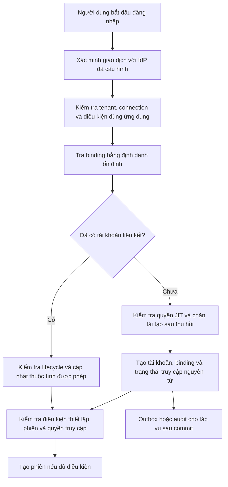

# Just-in-time provisioning

## 1. Tạo tài khoản khi người dùng thực sự cần đăng nhập

Just-in-time provisioning, thường viết là JIT provisioning, là cách tạo tài khoản hoặc hồ sơ cục bộ tại hệ thống đích khi người dùng lần đầu đi qua một luồng xác thực được chấp nhận. Ứng dụng không nhất thiết phải có sẵn tài khoản của mọi người trong directory trước khi họ sử dụng dịch vụ.

Ví dụ, Lan đã có tài khoản doanh nghiệp tại identity provider (IdP), nhưng chưa từng dùng cổng học tập. Lần đầu Lan đăng nhập bằng SSO, cổng học tập xác minh giao dịch danh tính, kiểm tra điều kiện sử dụng rồi tạo hồ sơ cục bộ gắn với danh tính liên kết của Lan. Những lần sau, ứng dụng tìm lại hồ sơ đó thay vì tạo người dùng mới.

NIST SP 800-63C-4 mô tả JIT trong các mô hình provisioning của relying party (RP): tài khoản RP được tạo hoặc giải quyết từ giao dịch federation và được gắn với định danh liên kết tương ứng. Tài khoản RP cần được provision trước khi thiết lập phiên đã xác thực tại RP theo mô hình được chọn. [Nguồn: NIST SP 800-63C-4 — Provisioning Models](https://pages.nist.gov/800-63-4/sp800-63c.html).

JIT là một cách quản lý thời điểm tạo tài khoản. Nó không tự chứng minh người dùng được phép vào mọi tenant, có role quản trị hoặc được khôi phục sau khi bị đình chỉ.

Sau bài học, người học cần có khả năng:

- Phân biệt authentication, SSO, provisioning và authorization.
- Giải thích luồng tạo tài khoản lần đầu và xử lý tài khoản đã tồn tại.
- Chọn khóa liên kết danh tính ổn định thay cho email hoặc tên hiển thị.
- Định nghĩa mapping thuộc tính và quyền tạo tài khoản theo tenant.
- Xử lý retry, đăng nhập đồng thời và các tác dụng phụ sau provisioning.
- Ngăn JIT vô tình tái tạo hoặc bật lại tài khoản đã bị deprovision.
- Hiểu vì sao JIT cần được kết hợp với cơ chế quản lý vòng đời ngoài thời điểm đăng nhập.

Các schema, trạng thái và policy của ứng dụng dưới đây là thiết kế minh họa, không phải cấu hình mặc định của một sản phẩm cụ thể.

## 2. Phân biệt bốn việc xảy ra quanh lần đăng nhập đầu tiên

| Công việc | Câu hỏi chính | Kết quả ví dụ |
| --- | --- | --- |
| Authentication | Bên đang đăng nhập là ai theo cơ chế được tin cậy? | Danh tính liên kết đã được xác minh |
| Federation/SSO | Ứng dụng nhận và kiểm chứng kết quả từ IdP thế nào? | Một giao dịch đăng nhập hợp lệ cho đúng RP |
| Provisioning | Ứng dụng có hồ sơ và quan hệ tài khoản cần thiết chưa? | Tạo user, binding hoặc membership cục bộ |
| Authorization | Chủ thể được thực hiện hành động nào trên tài nguyên nào? | Được đọc khóa học, chưa được quản trị tenant |

SSO có thể thành công ở tầng giao thức nhưng ứng dụng vẫn từ chối tạo tài khoản vì tenant không cho JIT hoặc người dùng chưa được cấp phép sử dụng. Ngược lại, tài khoản được tạo trước bằng SCIM không có nghĩa người đó đã xác thực trong một phiên hiện tại.

Một luồng JIT an toàn phải giữ rõ các bước này. Không dùng việc nhận một assertion có chữ ký từ một IdP bất kỳ làm điều kiện đủ để tạo tài khoản có quyền.

### JIT provisioning khác JIT access

JIT access thường nói đến việc kích hoạt quyền trong thời gian ngắn theo yêu cầu, chẳng hạn quyền quản trị có phê duyệt. JIT provisioning trong bài này nói đến việc tạo hoặc thiết lập hồ sơ tài khoản khi cần sử dụng.

Có thể triển khai JIT provisioning mà không cấp bất kỳ quyền đặc biệt nào. Cũng có thể có tài khoản đã tồn tại từ lâu nhưng quyền đặc quyền chỉ được kích hoạt theo mô hình JIT access. Không dùng cùng từ JIT để gộp hai quy trình thành một thao tác tự động nâng quyền.

## 3. So sánh JIT với những cách cấp tài khoản khác

| Cách làm | Khi nào tài khoản đích xuất hiện? | Ưu điểm trong ví dụ | Điểm cần quản lý |
| --- | --- | --- | --- |
| Tạo thủ công | Quản trị viên tạo trước | Có bước xét duyệt trực tiếp | Dễ chậm và sai khi số lượng lớn |
| Import theo đợt | Trước đăng nhập, theo lịch | Có thể chuẩn bị tài khoản hàng loạt | Độ trễ, xử lý thay đổi và lỗi import |
| Provisioning API hoặc SCIM | Theo sự kiện hoặc chu kỳ được thiết kế | Hỗ trợ vòng đời không phụ thuộc đăng nhập | Connector, mapping, correlation và reconciliation |
| JIT | Trong luồng sử dụng đầu tiên được chấp nhận | Chỉ tạo hồ sơ cho người thực sự dùng | Độ trễ đăng nhập đầu, race condition và deprovisioning |
| Ephemeral provisioning | Theo phiên hoặc giao dịch, không giữ cùng loại hồ sơ lâu dài | Giảm trạng thái lâu dài nếu nghiệp vụ phù hợp | Ngữ nghĩa tài khoản và liên kết phải theo contract |

JIT không đồng nghĩa “không có quản trị”. Việc bật JIT cho một connection là quyết định về ai có thể làm xuất hiện tài khoản trong ứng dụng. Cần xác định nguồn IdP, đối tượng được phép, tenant đích và dữ kiện bắt buộc.

Một sản phẩm có thể hỗ trợ bật/tắt JIT, cập nhật thuộc tính khi đăng nhập hoặc dùng directory sync riêng. Chẳng hạn, tài liệu Clerk mô tả JIT cho SAML và phân biệt nó với đồng bộ danh tính không chờ sự kiện đăng nhập. Đây là khả năng của sản phẩm đó, không phải quy tắc rằng mọi nền tảng có cùng mặc định. [Nguồn: Clerk — JIT Provisioning during SAML SSO](https://clerk.com/docs/guides/configure/auth-strategies/enterprise-connections/jit-provisioning).

## 4. Luồng JIT đầy đủ trong một ứng dụng



Sơ đồ không có nhánh “chưa tìm thấy thì luôn tạo”. Một danh tính đã xác thực vẫn có thể không đủ điều kiện tạo tài khoản. Tương tự, nhánh đã tồn tại phải kiểm tra trạng thái cục bộ thay vì chỉ cập nhật rồi cho đăng nhập.

### 4.1. Xác minh giao dịch trước khi tin thuộc tính

Với OIDC hoặc SAML, dùng thư viện phù hợp và cấu hình đúng trust relationship. Những kiểm tra về nguồn phát hành, đối tượng nhận, thời hạn, liên kết với request và chống replay phải theo giao thức đang dùng.

Không tự decode token hoặc parse XML rồi tạo user từ những trường đọc được. Dữ liệu có cấu trúc hợp lệ chưa phải kết quả xác thực hợp lệ.

Một email hoặc domain người dùng nhập ở bước khám phá IdP có thể giúp chọn luồng đăng nhập, nhưng không phải chứng cứ rằng họ thuộc doanh nghiệp đó. Thẩm quyền tenant cần được xác lập qua cấu hình và giao dịch được kiểm chứng.

### 4.2. Kiểm tra eligibility riêng với việc xác thực

Điều kiện tạo tài khoản trong ví dụ có thể gồm:

```text
connection được tenant cấu hình và đang bật;
issuer đúng với connection;
danh tính được phép dùng ứng dụng này;
tenant cho phép JIT trong workflow tương ứng;
không có quyết định chặn hoặc thu hồi còn hiệu lực;
các thuộc tính bắt buộc có nguồn được chấp nhận;
các điều kiện nghiệp vụ cần thiết đã đạt.
```

Nếu ứng dụng có cơ chế mời, giấy phép sử dụng hoặc giới hạn đối tượng, JIT phải tuân theo những điều kiện đó. Không tạo quyền chỉ vì người dùng có thể đăng nhập vào IdP của một tổ chức lớn.

### 4.3. Tạo hồ sơ trước, cấp quyền theo policy

Ứng dụng có thể tạo tài khoản ở trạng thái chờ quyền hoặc chờ hoàn tất onboarding. Việc tạo hàng user không bắt buộc đồng nghĩa được vào màn hình nghiệp vụ ngay.

Nếu policy cho phép quyền cơ bản tự động, tập quyền đó cần được định nghĩa hẹp và có phạm vi tenant. Những quyền như quản trị, duyệt dữ liệu nhạy cảm hoặc quản lý thành viên không nên trở thành mặc định để làm lần đăng nhập đầu thuận tiện hơn.

## 5. Correlation: liên kết đúng danh tính với đúng tài khoản

### 5.1. Giữ khóa liên kết ổn định

Đối với OIDC, cặp `iss` và `sub` của ID Token là định danh ổn định mà RP có thể dựa vào theo ngữ nghĩa của chuẩn; email hoặc `preferred_username` không được bảo đảm là khóa duy nhất thay thế. [Nguồn: OpenID Connect Core, mục 5.7](https://openid.net/specs/openid-connect-core-1_0.html#ClaimStability).

Trong ứng dụng nhiều tenant, một khóa binding nội bộ có thể là:

```text
tenantId + connectionId + issuer + subject
```

Các thành phần scope phải theo thiết kế tài khoản thực tế. Ví dụ trên chọn tài khoản nằm trong tenant; hệ thống có một principal toàn cục và nhiều membership tenant có thể dùng mô hình khác. Điều cần giữ là không mất namespace và ranh giới tin cậy.

Với SAML, cần thống nhất một định danh ổn định phù hợp giữa IdP và SP. Không dùng một định danh chỉ có tính chất tạm thời của phiên làm khóa tạo tài khoản lâu dài. Ngữ nghĩa NameID hoặc attribute định danh phải nằm trong contract của integration.

### 5.2. Email là thuộc tính liên hệ, không phải phép chứng minh account linking

Hai identity provider có thể phát cùng email cho hai danh tính khác nhau. Email cũng có thể đổi hoặc được tái sử dụng theo vòng đời của nguồn.

Một lỗi nguy hiểm:

```text
Nhận email từ IdP mới.
Tìm local user có cùng email.
Tự gắn IdP mới vào local user đó.
Cho đăng nhập bằng tài khoản đã có quyền.
```

Luồng này đã thực hiện account linking ngoài ý định. Ngay cả khi email được nguồn đánh dấu verified, vẫn cần policy liên kết phù hợp giữa các nguồn và tài khoản. Không lấy việc cùng chuỗi email làm bằng chứng đủ để nhận quyền của tài khoản khác.

Nếu có tài khoản tạo thủ công từ trước, cần một luồng migration, account resolution hoặc linking được quản lý. Khi không xác định được đúng danh tính, nên dừng ở trạng thái cần xử lý thay vì đoán bằng tên.

### 5.3. JIT và SCIM phải thống nhất correlation

Một user có thể đã được tạo bằng SCIM nhưng lần SSO đầu gửi một định danh khác với khóa mà ứng dụng đã lưu. JIT không thấy binding rồi tạo thêm user, gây hai hồ sơ cho cùng người hoặc lỗi vì username trùng.

Cần thống nhất các trường tương quan giữa nguồn provisioning và nguồn authentication. `externalId` trong một integration, NameID trong SAML và `sub` trong OIDC không tự bằng nhau hoặc thay thế cho nhau nếu chưa có mapping.

Một quyết định về correlation cần được kiểm chứng với người có sẵn tài khoản, người đổi email, nhiều tenant và thay đổi IdP. Không chỉ thử một user hoàn toàn mới trong môi trường trống.

## 6. Mapping thuộc tính và nguồn có thẩm quyền

### 6.1. Chỉ cập nhật trường mà nguồn được quản lý

JIT có thể dùng thuộc tính đã được kiểm chứng để điền hồ sơ. Tuy nhiên, không nên ánh xạ nguyên payload vào entity người dùng.

| Trường cục bộ | Nguồn trong ví dụ | Hành vi khi đăng nhập lại |
| --- | --- | --- |
| Binding issuer/subject | Giao dịch danh tính và cấu hình connection | Không đổi tùy ý để khớp email mới |
| Tên hiển thị doanh nghiệp | IdP theo mapping đã phê duyệt | Cập nhật nếu integration là chủ sở hữu trường |
| Email công việc | Nguồn được cấu hình | Cập nhật theo contract, không dùng tự liên kết tài khoản |
| Tùy chọn giao diện | Người dùng hoặc ứng dụng | Không ghi đè chỉ vì assertion không có trường đó |
| Trạng thái đình chỉ cục bộ | Hệ thống quản trị lifecycle | Không tự bật lại khi IdP còn cho đăng nhập |
| Role đặc quyền | Workflow cấp quyền hoặc mapping được phê duyệt | Không lấy tên role tùy ý từ payload |
| Audit và lý do thu hồi | Hệ thống quản lý truy cập | Không cho claim bên ngoài ghi đè |

Một IdP được tin để xác thực không nhất thiết có thẩm quyền cấp mọi role hoặc bỏ mọi hạn chế cục bộ. Phạm vi tin cậy cần được xác định theo loại dữ kiện.

### 6.2. Thuộc tính thiếu không có một nghĩa mặc định cho mọi trường

Nếu một trường tùy chọn không được gửi, ứng dụng có thể giữ nguyên giá trị cục bộ theo contract. Nếu membership là tập đầy đủ do nguồn có thẩm quyền gửi, không có một membership cũ trong tập mới có thể mang nghĩa phải gỡ. Hai tình huống này khác nhau.

Không dùng cùng một quy tắc “field thiếu thì xóa hết” hoặc “field thiếu thì giữ mọi quyền cũ” cho tất cả dữ liệu. Cần biết payload có đầy đủ không, trường nào do ai quản lý và phép cập nhật đang là merge hay replace.

### 6.3. Không tích lũy role qua mọi lần đăng nhập

Một đoạn logic chỉ union roles mới vào roles cũ có thể khiến người chuyển nhiệm vụ giữ quyền trước đây. Nếu IdP được chỉ định quản lý một tập assignment, luồng đồng bộ cần xử lý cả việc gỡ trong chính phạm vi nguồn đó.

Ngược lại, không xóa role cục bộ hợp lệ do workflow khác cấp chỉ vì nó không xuất hiện trong assertion. Provenance và phạm vi quản lý giúp phân biệt các đường cấp quyền.

Những cập nhật JIT tại thời điểm đăng nhập cũng không cung cấp bảo đảm liên tục giữa hai lần đăng nhập. Quyền thay đổi trong khoảng đó cần một cơ chế đáp ứng yêu cầu của ứng dụng.

## 7. Idempotency, transaction và đăng nhập đồng thời

### 7.1. Một người có thể gửi nhiều request đầu tiên cùng lúc

Hai tab trình duyệt hoặc một lần retry có thể cùng đi tới bước chưa tìm thấy user:

```text
Request A: không thấy binding của Lan.
Request B: không thấy binding của Lan.
Request A: tạo local user U1.
Request B: tạo local user U2.
```

Nếu chỉ kiểm tra trước khi insert mà không có ràng buộc ở nơi ghi, cả hai có thể thành công. Cache hoặc read replica chưa cập nhật còn làm tăng khả năng này.

### 7.2. Ràng buộc duy nhất trên binding

Một schema SQL tối giản cho mô hình một user thuộc một tenant:

```sql
CREATE TABLE app_user (
    user_id UUID PRIMARY KEY,
    tenant_id UUID NOT NULL,
    lifecycle VARCHAR(32) NOT NULL,
    display_name VARCHAR(200),
    UNIQUE (user_id, tenant_id)
);

CREATE TABLE federated_identity (
    tenant_id UUID NOT NULL,
    connection_id VARCHAR(100) NOT NULL,
    issuer VARCHAR(500) NOT NULL,
    subject VARCHAR(500) NOT NULL,
    user_id UUID NOT NULL,
    PRIMARY KEY (tenant_id, connection_id, issuer, subject),
    FOREIGN KEY (user_id, tenant_id)
        REFERENCES app_user (user_id, tenant_id)
);
```

Đây là DDL minh họa, không phải migration dùng chung. Kiểu dữ liệu, độ dài, collation và cách so sánh định danh phải theo contract của nguồn; không tự hạ chữ hoặc cắt chuỗi issuer/subject để vừa một cột.

Ràng buộc duy nhất ngăn một external key gắn với hai binding cùng scope. Foreign key theo tenant trong ví dụ giúp tránh gắn binding tenant A vào user tenant B.

Việc tạo user và binding cần nằm trong transaction phù hợp. Nếu insert binding bị conflict, transaction tạo user thừa phải được rollback hoặc xử lý theo thiết kế, rồi đọc lại binding đã thắng và kiểm tra lifecycle. Không bắt mọi lỗi database rồi coi là đã provision thành công.

### 7.3. Các tác dụng phụ không nên chạy lặp ngoài ý định

Email chào mừng, cấp giấy phép, tạo workspace hoặc gán quyền bên ngoài có thể chạy hai lần nếu phát ngay trong mỗi callback đăng nhập. Nên xác định thao tác nào phải nguyên tử trong store, thao tác nào đi qua outbox và thao tác nào cần idempotency key riêng.

Ví dụ, ghi user, binding và sự kiện tạo tài khoản trong cùng transaction; worker xử lý sự kiện sau commit. Outbox giảm nguy cơ mất sự kiện giữa database và hàng đợi, nhưng consumer vẫn phải xử lý retry và gửi trùng.

Không phát hành phiên ứng dụng có quyền sử dụng trước khi tài khoản và trạng thái truy cập cần thiết đã được ghi thành công. Nếu chỉ tạo hồ sơ chờ quyền, kết quả luồng phải phản ánh trạng thái đó.

## 8. JIT không được đảo ngược deprovisioning

### 8.1. Luồng tái tạo ngoài ý định

```text
T0: Ứng dụng gỡ tài khoản Lan vì chấm dứt quyền truy cập.
T1: IdP hoặc một luồng federation vẫn cho Lan đăng nhập.
T2: JIT không tìm thấy local user.
T3: JIT tạo user mới và cấp lại quyền mặc định.
```

Nếu hệ thống chỉ xóa hàng user mà không giữ hoặc nhận biết quyết định chặn tái tạo, JIT có thể đi vòng qua deprovisioning.

Giải pháp phụ thuộc mô hình dữ liệu: giữ lifecycle của binding, lưu quyết định chặn theo external key hoặc truy vấn nguồn eligibility có thẩm quyền trước khi tạo. Metadata chặn cần được bảo vệ và có vòng đời phù hợp; không nhất thiết giữ toàn bộ hồ sơ cá nhân chỉ để nhớ quyết định đó.

### 8.2. Tài khoản đã tồn tại không được tự bật lại

Nếu local account ở trạng thái `SUSPENDED` hoặc `DEPROVISIONED`, một lần SSO thành công không tự làm trạng thái chuyển thành `ACTIVE`. Tái kích hoạt cần workflow và điều kiện rõ ràng.

Một nhân viên quay lại làm việc cũng cần được xử lý theo policy rehire: có giữ tài khoản cũ không, có khôi phục dữ liệu không và quyền nào phải xét lại. Không tự phục hồi toàn bộ role trước đây chỉ vì email hoặc mã nhân sự giống nhau.

### 8.3. Cạnh tranh giữa JIT và sự kiện thu hồi

Một request JIT có thể đã kiểm tra eligibility trước khi sự kiện deprovision đến. Khi nó ghi sau đó, không được làm mất quyết định thu hồi mới hơn.

Cần quy tắc nhất quán cho lifecycle, version hoặc security epoch và các đường ghi. Một cách trong mô hình một store là để JIT và deprovisioning khóa cùng một khóa điều phối theo external identity, kiểm tra trạng thái mới trong transaction và không cho đường JIT ghi đè trạng thái cuối.

Khóa một bản ghi không tồn tại không tự tạo ra loại trừ trên mọi database. Adapter có thể cần một guard row có unique key hoặc cơ chế đồng bộ phù hợp. Nếu JIT và deprovisioning nằm ở hai hệ thống khác nhau, transaction cục bộ không đủ để tạo tính nguyên tử toàn cục; phải định nghĩa cửa sổ và giao thức xử lý tương ứng.

## 9. Ví dụ Java: lập kế hoạch JIT trước khi ghi

### 9.1. Phạm vi của ví dụ

Ví dụ Java 17 trở lên minh họa logic quyết định sau khi tầng federation đã xác minh giao dịch. Nó không xác minh JWT hoặc SAML, không tự thực hiện transaction và không cấp phiên đăng nhập.

Thiết kế chọn:

- Chỉ connection và issuer được cấu hình cho tenant mới được dùng.
- Eligibility phải đúng identity key và còn trong cửa sổ hiệu lực do nguồn quản lý cung cấp.
- Tài khoản bị chặn không được JIT khôi phục.
- Người dùng mới được tạo ở trạng thái chờ quyền, không có role quản trị mặc định.
- Chỉ tên hiển thị được đưa vào profile plan; không tự liên kết bằng email.

### 9.2. Các kiểu dữ liệu

```java
import java.time.Instant;
import java.util.Map;
import java.util.Objects;
import java.util.Optional;
import java.util.UUID;

record ExternalIdentityKey(
        UUID tenantId,
        String connectionId,
        String issuer,
        String subject) {
    ExternalIdentityKey {
        Objects.requireNonNull(tenantId);
        Objects.requireNonNull(connectionId);
        Objects.requireNonNull(issuer);
        Objects.requireNonNull(subject);
        if (connectionId.isBlank() || issuer.isBlank() || subject.isBlank()) {
            throw new IllegalArgumentException("Missing external identity");
        }
    }
}

record VerifiedLogin(ExternalIdentityKey key, Optional<String> displayName) {
    VerifiedLogin {
        Objects.requireNonNull(key);
        Objects.requireNonNull(displayName);
    }
}

record JitConnection(
        UUID tenantId,
        String connectionId,
        String issuer,
        boolean creationEnabled) {
}

record Eligibility(
        ExternalIdentityKey key,
        boolean appAccessPermitted,
        Instant confirmedAt,
        Instant validUntil) {
    Eligibility {
        Objects.requireNonNull(key);
        Objects.requireNonNull(confirmedAt);
        Objects.requireNonNull(validUntil);
        if (!validUntil.isAfter(confirmedAt)) {
            throw new IllegalArgumentException("Invalid eligibility interval");
        }
    }
}

enum LocalState {
    PENDING_ACCESS,
    ACTIVE,
    SUSPENDED,
    DEPROVISIONED
}

record LocalBinding(UUID userId, ExternalIdentityKey key, LocalState state) {
    LocalBinding {
        Objects.requireNonNull(userId);
        Objects.requireNonNull(key);
        Objects.requireNonNull(state);
    }
}

enum JitOutcome {
    DENY,
    RETRY_REQUIRED,
    CREATE_PENDING_ACCESS,
    WAIT_FOR_ACCESS,
    USE_ACTIVE_ACCOUNT
}

record JitPlan(JitOutcome outcome, Map<String, String> managedProfile) {
    JitPlan {
        Objects.requireNonNull(outcome);
        managedProfile = Map.copyOf(managedProfile);
    }
}
```

Tên `VerifiedLogin` diễn đạt contract đầu vào, không phải bảo đảm được Java tự cung cấp. Nếu controller bind trực tiếp JSON của client vào record này, luồng đã vi phạm giả định trước khi planner chạy.

`JitConnection` đến từ cấu hình server; `Eligibility` đến từ nguồn được quản lý. Các trường thời gian không được lấy từ đồng hồ client. Nếu thiếu hoặc không xác nhận được eligibility, hệ thống cần xử lý riêng với trường hợp biết chắc không được phép.

### 9.3. Planner giữ việc tạo tài khoản tách khỏi quyền truy cập

```java
final class JitPlanner {
    JitPlan plan(
            VerifiedLogin login,
            JitConnection connection,
            Eligibility eligibility,
            Optional<LocalBinding> existing,
            boolean recreationBlocked,
            Instant now) {
        Objects.requireNonNull(login);
        Objects.requireNonNull(connection);
        Objects.requireNonNull(existing);
        Objects.requireNonNull(now);

        ExternalIdentityKey key = login.key();
        boolean trustedContext = key.tenantId().equals(connection.tenantId())
                && key.connectionId().equals(connection.connectionId())
                && key.issuer().equals(connection.issuer());
        if (!trustedContext) {
            return result(JitOutcome.DENY);
        }

        if (eligibility == null
                || !key.equals(eligibility.key())
                || eligibility.confirmedAt().isAfter(now)
                || !now.isBefore(eligibility.validUntil())) {
            return result(JitOutcome.RETRY_REQUIRED);
        }
        if (!eligibility.appAccessPermitted() || recreationBlocked) {
            return result(JitOutcome.DENY);
        }

        if (existing.isPresent()) {
            LocalBinding binding = existing.get();
            if (!key.equals(binding.key())) {
                return result(JitOutcome.DENY);
            }
            return switch (binding.state()) {
                case ACTIVE -> result(JitOutcome.USE_ACTIVE_ACCOUNT);
                case PENDING_ACCESS -> result(JitOutcome.WAIT_FOR_ACCESS);
                case SUSPENDED, DEPROVISIONED -> result(JitOutcome.DENY);
            };
        }

        if (!connection.creationEnabled()) {
            return result(JitOutcome.DENY);
        }

        Map<String, String> profile = login.displayName()
                .filter(value -> !value.isBlank())
                .map(value -> Map.of("displayName", value))
                .orElseGet(Map::of);
        return new JitPlan(JitOutcome.CREATE_PENDING_ACCESS, profile);
    }

    private JitPlan result(JitOutcome outcome) {
        return new JitPlan(outcome, Map.of());
    }
}
```

Trong ví dụ, `creationEnabled=false` ngăn tạo tài khoản mới nhưng không tự có nghĩa chặn mọi user hiện có. Việc vô hiệu hóa cả connection là policy khác, cần được kiểm tra trước hoặc bổ sung vào cấu hình tương ứng.

`recreationBlocked` phải phản ánh quyết định được quản lý theo đúng identity key và đủ mới. Không để client tự đặt boolean này hoặc dùng cache cũ mà không đánh giá yêu cầu thu hồi.

`USE_ACTIVE_ACCOUNT` chỉ cho phép đi tiếp tới bước kiểm tra và thiết lập phiên phù hợp. Nó không trả role, không cấp token và không chứng minh mọi hành động nghiệp vụ được cho phép. `CREATE_PENDING_ACCESS` còn rõ hơn: tài khoản mới chưa được dùng như tài khoản đã có quyền.

Ví dụ không cập nhật profile tài khoản đã tồn tại. Nếu tích hợp yêu cầu cập nhật khi đăng nhập, cần thêm plan cho những trường do nguồn quản lý và kiểm tra version phù hợp, không serialize toàn bộ assertion vào entity.

### 9.4. Áp dụng plan cần transaction và kiểm tra lại

Một luồng ứng dụng có thể là:

```text
xác minh federation và nạp điều kiện được quản lý
    -> bắt đầu transaction cục bộ
    -> lấy trạng thái binding và quyết định chặn mới nhất cần thiết
    -> lập hoặc kiểm tra lại plan
    -> tạo user + binding + trạng thái truy cập + outbox khi được phép
    -> commit
    -> tiếp tục luồng phiên hoặc hiển thị trạng thái chờ quyền
```

Một plan được lập trước transaction có thể đã cũ khi được áp dụng. Các guard về lifecycle và tính duy nhất cần nằm tại nơi ghi thực sự. Nếu gặp conflict, đọc lại trạng thái hiện tại và đánh giá lại, không biến retry thành đường bỏ qua deprovisioning.

Một bảng unique chỉ ngăn trùng key; nó không tự bảo đảm nguồn eligibility ngoài hệ thống chưa thay đổi. Thiết kế phải nêu rõ độ mới và bảo đảm của dữ kiện đó, thay vì tuyên bố một transaction đã làm toàn bộ federation trở nên nguyên tử.

## 10. Trải nghiệm lần đăng nhập đầu và lỗi từng phần

### 10.1. Không để mọi tác vụ ngoài hệ thống chặn lâu trong callback

Lần đầu đăng nhập có thể cần tạo workspace, gán license hoặc chuẩn bị dữ liệu. Nếu kéo mọi lời gọi mạng vào một transaction dài, hệ thống dễ bị timeout, lock kéo dài và trạng thái khó phục hồi.

Nên tách những điều kiện bắt buộc trước khi cho truy cập với tác vụ có thể hoàn tất sau. Nếu một tài nguyên bắt buộc chưa sẵn sàng, tài khoản có thể ở trạng thái pending và người dùng nhận thông báo phù hợp. Không báo thành công đầy đủ khi hệ thống mới tạo được một phần.

### 10.2. Những lỗi cần phân biệt

| Tình huống | Ý nghĩa | Hành vi trong thiết kế giả định |
| --- | --- | --- |
| Assertion không hợp lệ | Chưa xác thực được danh tính | Không provision từ payload đó |
| Connection không được tenant cho phép | Thiếu trust context | Không tạo tài khoản tenant đích |
| Eligibility được xác nhận là không cho phép | Không được dùng ứng dụng | Từ chối theo policy |
| Nguồn eligibility timeout | Chưa biết kết luận | Không tự coi là được phép; cho retry có kiểm soát |
| Tài khoản pending | Hồ sơ tồn tại, quyền chưa sẵn sàng | Không cấp quyền đầy đủ |
| Tài khoản suspended/deprovisioned | Đang có hạn chế lifecycle | Không tự bật lại qua JIT |
| Unique conflict đúng external key | Có request khác đã tạo binding | Đọc lại và kiểm tra trạng thái hiện tại |
| Tác vụ sau commit lỗi | Tài khoản có thể đã tồn tại | Retry tác vụ theo ID, không tạo user mới |
| Trùng email với tài khoản khác | Chưa chứng minh account linking | Không tự ghép; chuyển workflow phù hợp |

Thông báo cho người dùng nên giúp xác định bước tiếp theo mà không tiết lộ tenant, trạng thái điều tra hoặc thông tin tài khoản của người khác. Reason code nội bộ cần đủ rõ cho vận hành và audit.

### 10.3. Thiếu thuộc tính bắt buộc không được bổ sung bằng dữ liệu đoán

Không tạo ID ổn định bằng tên hiển thị vì thiếu subject. Không tự chọn tenant mặc định nếu không xác định được tenant đã được cấp quyền. Một trường bắt buộc cho correlation hoặc scope thiếu thì luồng chưa có đủ dữ kiện để tạo tài khoản đúng.

Đối với trường chỉ phục vụ giao diện, có thể dùng một giá trị hiển thị trung tính theo thiết kế. Nhưng không để giá trị dự phòng đó trở thành khóa định danh hoặc căn cứ cấp quyền.

## 11. JIT và deprovisioning phải hoạt động ngoài lần đăng nhập

### 11.1. Không đăng nhập thì không có sự kiện JIT để cập nhật

Nếu người dùng nghỉ việc và không quay lại ứng dụng, một cơ chế chỉ cập nhật lúc đăng nhập sẽ không nhận biết việc đó qua chính đường JIT. Local account, dữ liệu cá nhân và các context truy cập có thể còn tồn tại.

Vì vậy JIT cần được kết hợp với cơ chế quản lý vòng đời phù hợp: provisioning API, SCIM, tín hiệu sự kiện, kiểm tra trạng thái hoặc reconciliation theo kiến trúc. NIST lưu ý RP có thể tích lũy tài khoản không còn dùng được từ IdP nếu không nhận thông tin chấm dứt, đồng thời mô tả việc đồng bộ trạng thái và thuộc tính. [Nguồn: NIST SP 800-63C-4 — Attribute Synchronization và Time-Based Removal](https://pages.nist.gov/800-63-4/sp800-63c.html).

### 11.2. SSO bị chặn không tự kết thúc mọi phiên cũ

Một người không lấy được assertion mới có thể vẫn giữ session tại RP hoặc access token đã phát hành. Deprovisioning cần xác định các đối tượng phải xử lý: tài khoản cục bộ, membership, phiên, token, API key và job liên quan theo scope sự kiện.

Không tuyên bố “người đó đã mất mọi truy cập” chỉ vì IdP đã tắt tài khoản. Cần bằng chứng các điểm thực thi thuộc phạm vi yêu cầu đã phản ánh trạng thái mới.

### 11.3. JIT và SCIM có thể bổ sung nhau nhưng cần phân quyền sở hữu

Một thiết kế có thể dùng JIT để tạo hồ sơ khi người dùng bắt đầu sử dụng, rồi dùng cơ chế đồng bộ ngoài luồng đăng nhập để nhận thay đổi và thu hồi. Một thiết kế khác yêu cầu chỉ tài khoản được SCIM tạo trước mới được đăng nhập, còn JIT create bị tắt.

SCIM là giao thức quản lý tài nguyên danh tính qua API, có những thao tác tạo và cập nhật được đặc tả riêng; nó không tự xác thực phiên đăng nhập của người được provision. [Nguồn: RFC 7644 — SCIM Protocol](https://www.rfc-editor.org/rfc/rfc7644.html).

Điều cần chốt là nguồn nào sở hữu trường nào và sự kiện nào thắng khi có cạnh tranh. Không để JIT cập nhật từ assertion cũ ghi đè một trạng thái disabled vừa được nguồn quản lý vòng đời gửi tới.

## 12. Bảo vệ quyền và dữ liệu trong JIT

### 12.1. Giới hạn đối tượng được tạo

Allowlist connection, ràng buộc tenant và eligibility giúp giới hạn việc tạo tài khoản ngoài ý định. Các ứng dụng mở đăng ký công khai có policy khác với ứng dụng chỉ dành cho nhân viên; không dùng cùng điều kiện cho cả hai mà không có quyết định rõ.

Tài khoản service hoặc workload không nên được tạo theo cùng handler JIT dành cho người dùng nếu mô hình credential, chủ sở hữu và vòng đời khác nhau. Hãy xác định loại principal trước khi áp dụng chính sách.

### 12.2. Không tạo credential cục bộ không cần thiết

Nếu tài khoản chỉ dùng federation, không cần tự sinh một mật khẩu mặc định để điền đủ entity. Một đường đăng nhập cục bộ bị bật ngoài ý định có thể trở thành đường vượt chính sách SSO hoặc deprovisioning.

Nếu cần cơ chế khôi phục hoặc đăng nhập thay thế, đó phải là chức năng được thiết kế với binding, quyền và vòng đời riêng. Không dùng JIT làm lý do tự thêm phương tiện xác thực dự phòng.

### 12.3. Tối thiểu hóa thuộc tính được lưu

Ứng dụng chỉ nên nhận và lưu những thuộc tính phục vụ chức năng. Không lưu toàn bộ assertion, ID token hoặc danh sách nhóm doanh nghiệp vào hồ sơ hay log chỉ để tiện debug.

Tạo tài khoản khi thực sự sử dụng có thể giảm số hồ sơ đích chưa từng hoạt động, nhưng tài khoản đã tạo vẫn cần retention, đồng bộ và xử lý khi kết thúc mục đích. JIT không tự là cơ chế xóa dữ liệu.

### 12.4. Handler có đặc quyền cần được thu hẹp

Handler JIT thường có khả năng ghi user hoặc membership. Chỉ cấp quyền cần thiết cho đúng thao tác và scope. Không dùng một handler chung với quyền quản trị toàn hệ thống chỉ để tạo tài khoản đọc cơ bản.

Các field như `isAdmin`, `accountState`, `tenantOwner` hoặc `approvalLimit` phải có nguồn và policy riêng. Một claim cùng tên do IdP khách hàng gửi không tự có thẩm quyền thay đổi những field đó.

## 13. Audit, quan sát và reconciliation

Một sự kiện tạo tài khoản giả định:

```json
{
  "event": "jit_account_created",
  "tenantId": "tenant-a",
  "connectionId": "corp-sso-a",
  "localUserId": "user-example-042",
  "externalIdentityAuditRef": "external-ref-example-17",
  "initialState": "PENDING_ACCESS",
  "mappingVersion": "jit-mapping-example-v3",
  "policyVersion": "jit-policy-example-v5",
  "correlationId": "login-example-501"
}
```

Các ID là dữ liệu giả. Mã tham chiếu audit vẫn có khả năng liên kết hoạt động, nên cần giới hạn truy cập và thời gian lưu. Không ghi secret hoặc toàn bộ nội dung token để giải thích vì sao JIT tạo tài khoản.

Những sự kiện nên phân biệt gồm:

- Tìm thấy và dùng lại binding hiện có.
- Tạo mới tài khoản chờ quyền.
- Từ chối vì connection hoặc eligibility.
- Chặn tái tạo do quyết định deprovisioning.
- Conflict khi tạo đồng thời và kết quả đọc lại.
- Tác vụ ngoài hệ thống đang chờ hoặc đã lỗi.
- Tái kích hoạt qua workflow riêng, nếu được phép.

Các chỉ số như tỷ lệ tạo mới, tỷ lệ trùng binding, số tài khoản pending lâu hoặc số lần JIT gặp tài khoản đã bị thu hồi giúp phát hiện sai mapping và sự cố vận hành.

Reconciliation có thể tìm binding mồ côi, tài khoản trùng, quyền tồn đọng và sự lệch giữa nguồn lifecycle với ứng dụng. Không sửa hàng loạt dựa trên một lần đọc nguồn bị timeout hoặc dữ liệu chưa đầy đủ.

## 14. Các lỗi triển khai thường gặp

| Cách làm | Lỗi có thể xảy ra | Hướng thiết kế phù hợp hơn |
| --- | --- | --- |
| Assertion hợp lệ là luôn tạo user | Người ngoài đối tượng được phép có tài khoản | Kiểm tra tenant, assignment và quyền JIT |
| Tìm user bằng email rồi tự liên kết | Chiếm hoặc ghép nhầm tài khoản | Binding ổn định và workflow linking riêng |
| Role mặc định là admin để tránh lỗi onboarding | Tạo đặc quyền ngoài ý định | Trạng thái chờ hoặc baseline hẹp theo policy |
| Chỉ kiểm tra tồn tại trước insert | Hai request tạo hai user | Transaction và unique constraint đúng scope |
| JIT ghi `active=true` mỗi lần đăng nhập | Bật lại tài khoản bị đình chỉ | Tôn trọng lifecycle và workflow khôi phục |
| Xóa binding nhưng không nhớ quyết định chặn | Tạo lại tài khoản đã deprovision | Registry chặn hoặc eligibility có thẩm quyền |
| Merge role bằng union mãi mãi | Tích lũy quyền sau đổi nhiệm vụ | Đồng bộ theo ownership và semantics đầy đủ |
| Payload thiếu trường là xóa mọi dữ liệu cũ | Mất cấu hình hoặc quyền hợp lệ ngoài nguồn | Mapping theo field và nguồn |
| JIT và SCIM dùng khóa khác nhau | User trùng hoặc không đăng nhập được | Correlation thống nhất và kiểm chứng migration |
| Mỗi retry gửi lại email/cấp license | Tác dụng phụ trùng | Outbox và idempotency theo nghiệp vụ |
| Chỉ cập nhật khi đăng nhập | Không xử lý người đã rời tổ chức | Vòng đời ngoài luồng JIT |
| Tạo session trước commit | Có context truy cập khi tài khoản chưa sẵn sàng | Xác nhận ghi và điều kiện phiên trước khi cấp truy cập |

## 15. Kiểm chứng luồng JIT

| Ca kiểm chứng | Kết quả cần quan sát |
| --- | --- |
| User mới, trust và eligibility hợp lệ | Chỉ một tài khoản/binding được tạo theo policy |
| User đã có binding | Dùng lại đúng tài khoản, không tạo hồ sơ mới |
| Cùng email nhưng issuer/subject khác | Không tự nhận quyền tài khoản cũ |
| User đổi email, external key giữ nguyên | Binding vẫn tìm đúng tài khoản |
| Tenant A gửi identity nhằm tạo ở B | Không vượt ranh giới tenant |
| Claim có role quản trị ngoài mapping | Không phát sinh đặc quyền |
| Hai request đầu tiên chạy đồng thời | Không có user thừa hoặc cấp license lặp ngoài contract |
| Retry sau commit nhưng trước response | Kết quả hội tụ về tài khoản đã tạo |
| Tài khoản suspended/deprovisioned | JIT không tự bật lại |
| Sự kiện thu hồi đến giữa kiểm tra và ghi | Guard lifecycle ngăn ghi đè quyết định mới theo contract |
| JIT create tắt, tài khoản hợp lệ đã tồn tại | Hành vi theo policy hiện có, không suy ra từ cờ create |
| Thuộc tính tùy chọn thiếu | Không tự xóa các field ngoài phạm vi nguồn |
| Nguồn eligibility lỗi | Không tạo tài khoản có quyền từ giả định cho phép |
| User đã được SCIM tạo | SSO tìm đúng binding hoặc chuyển resolution được quản lý |
| Tác vụ sau tạo tài khoản lỗi | Trạng thái pending và retry phản ánh đúng tiến độ |
| Người nghỉ việc không đăng nhập lại | Cơ chế ngoài JIT vẫn xử lý vòng đời cần thiết |

Không chỉ kiểm tra số hàng user. Cần kiểm tra binding, tenant, trạng thái truy cập, role, phiên được phát hành và các tác dụng phụ. Một request trả lỗi nhưng đã cấp quyền hoặc tạo license không kiểm soát vẫn cần được xử lý.

Phép kiểm chứng concurrency cần chạy trên adapter và store thật trong môi trường thử nghiệm. Unit test planner có thể kiểm tra nhánh quyết định nhưng không chứng minh unique constraint, transaction hay thứ tự sự kiện được thực thi đúng.

## 16. Bài tập vận dụng

### Tình huống 1: Cùng email, khác identity provider

Một người đăng nhập từ IdP B với email trùng tài khoản quản trị cũ từ IdP A. Handler tự gắn vào user cũ để tránh tạo trùng. Quyết định nào đang bị thực hiện ngoài ý định?

**Gợi ý:** đây là account linking, không đơn thuần là provisioning. Cần chứng cứ và workflow liên kết riêng; cùng email không đủ để kế thừa quyền.

### Tình huống 2: Tài khoản bị xóa rồi xuất hiện lại

Ứng dụng xóa local account khi chấm dứt quyền truy cập. IdP vẫn phát assertion, JIT tạo lại user ở lần đăng nhập sau. Cần bổ sung guard nào và đặt ở đâu?

**Gợi ý:** xem nguồn eligibility, quyết định chặn tái tạo và cách giữ metadata lifecycle đúng scope. Guard phải nằm trên đường tạo thực tế và phối hợp với transaction, không chỉ trên giao diện quản trị.

### Tình huống 3: User chưa từng dùng ứng dụng nhưng cần được cấp quyền trước

Nghiệp vụ cần quản trị viên phân công hồ sơ và chuẩn bị dữ liệu nhiều ngày trước khi người dùng đăng nhập. JIT thuần túy có đáp ứng trực tiếp không?

**Gợi ý:** JIT tạo hồ sơ theo nhu cầu sử dụng đầu tiên; có thể cần pre-provisioning, lời mời hoặc một mô hình đối tượng nghiệp vụ tách khỏi tài khoản đăng nhập. Chọn luồng theo nhu cầu thay vì ép mọi việc vào callback SSO.

### Tình huống 4: Hai tab tạo hai workspace

Unique constraint đã giữ chỉ một user, nhưng hai callback vẫn tạo hai workspace và gửi hai email. Ràng buộc nào còn thiếu?

**Gợi ý:** tính duy nhất của user không tự làm tác dụng phụ idempotent. Cần kiểm soát sự kiện sau commit và khóa nghiệp vụ của từng tác vụ.

### Tình huống 5: Role cũ không bao giờ mất

Handler thêm mọi role mới từ assertion vào role cục bộ. Khi Lan chuyển bộ phận, role cũ không còn trong assertion nhưng vẫn nằm tại ứng dụng. Cần làm rõ contract nào?

**Gợi ý:** dữ liệu group/role có đầy đủ không, nguồn quản lý những assignment nào và thao tác là merge hay replace. Phải gỡ quyền cũ trong đúng phạm vi nguồn mà không xóa assignment của workflow khác.

### Tình huống 6: SSO bị khóa nhưng phiên ứng dụng vẫn chạy

Đội vận hành tắt tài khoản tại IdP và cho rằng JIT sẽ xử lý nốt khi người dùng đăng nhập lại. Trong khi đó phiên RP cũ vẫn còn. Thiếu đường xử lý nào?

**Gợi ý:** JIT không chạy trên mọi request và không tự là cơ chế deprovisioning phiên. Cần xử lý lifecycle, session/token và các điểm thực thi theo yêu cầu thu hồi đã xác định.

## 17. Các câu hỏi cần trả lời trước khi bật JIT

1. Connection và issuer nào được phép tạo tài khoản trong tenant nào?
2. Khóa correlation ổn định là gì và có thống nhất với tài khoản được tạo trước không?
3. Điều kiện nào cho phép tạo, chỉ tạo pending hoặc từ chối?
4. Những field nào do IdP quản lý, field nào do ứng dụng hoặc người dùng quản lý?
5. Retry và đăng nhập đồng thời có tạo tài khoản hoặc tác dụng phụ trùng không?
6. Tài khoản đã đình chỉ hoặc deprovision được bảo vệ khỏi tái tạo và bật lại thế nào?
7. Khi người dùng không đăng nhập nữa, hệ thống nhận thay đổi lifecycle bằng cách nào?
8. Bằng chứng nào cho biết account, binding, quyền và phiên đã ở trạng thái mong muốn?

JIT provisioning có thể làm gọn việc đưa người dùng vào ứng dụng khi thực sự cần sử dụng. Giá trị đó đi cùng trách nhiệm giữ đúng liên kết danh tính, phạm vi tenant và vòng đời truy cập. Một lần đăng nhập được xác thực là đầu vào để xử lý provisioning có kiểm soát, không phải mệnh lệnh tự động tạo lại tài khoản hoặc khôi phục mọi quyền cũ.
