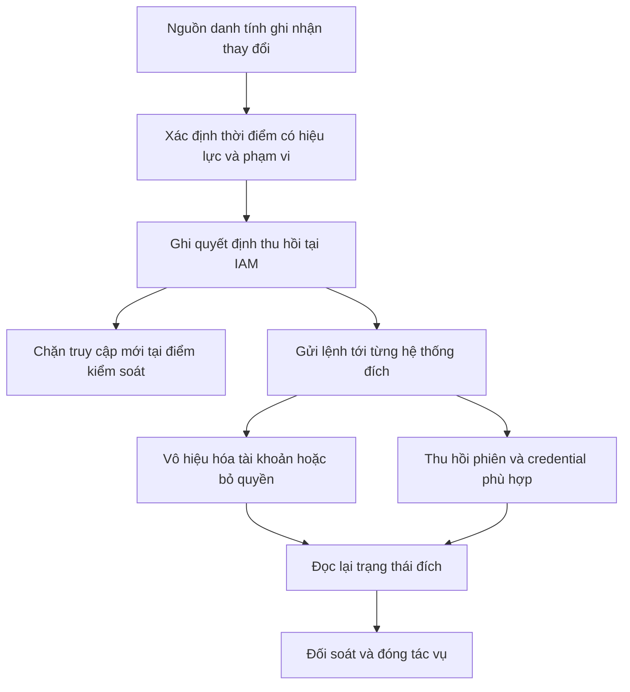

# Just-in-time deprovisioning

## 1. Thu hồi quyền khi điều kiện truy cập không còn đúng

Một nhân viên có thể được tạo tài khoản ngay lần đầu đăng nhập vào ứng dụng. Nhưng khi nhân viên nghỉ việc, người đó thường không đăng nhập thêm để hệ thống có cơ hội phát hiện rằng tài khoản cần bị vô hiệu hóa. Nếu ứng dụng chỉ kiểm tra danh tính khi đăng nhập, phiên đã mở và quyền đã cấp có thể tiếp tục tồn tại.

**Just-in-time deprovisioning** trong bài này là cách tổ chức thu hồi quyền sát với thời điểm điều kiện truy cập chấm dứt: khi nhận được sự kiện thay đổi danh tính hoặc khi xử lý một yêu cầu truy cập cần kiểm tra lại điều kiện đó. Đây là cách mô tả một thiết kế vòng đời truy cập, không phải tên của một giao thức duy nhất hay lời bảo đảm rằng mọi hệ thống đều thu hồi tức thời.

Mục tiêu cần đạt là: từ lúc một quyết định thu hồi có hiệu lực, danh tính không được tiếp tục thực hiện các hành động đã bị thu hồi, trong giới hạn độ trễ mà hệ thống công bố và đo lường được.

Ví dụ:

- Nhân viên nghỉ việc: chặn đăng nhập mới, kết thúc phiên có thể kết thúc và thu hồi các quyền gắn với quan hệ lao động.
- Nhân viên chuyển nhóm: bỏ quyền của nhóm cũ nhưng giữ tài khoản và những quyền vẫn còn hợp lệ.
- Nhà thầu hết hạn hợp đồng: quyền hết hiệu lực tại thời điểm đã xác định, kể cả khi không có lần đăng nhập mới.
- Workload bị loại bỏ: vô hiệu hóa danh tính dịch vụ hoặc credential liên quan theo đúng phạm vi sở hữu của workload đó.
- Tài khoản bị nghi xâm phạm: tạm ngừng truy cập và thu hồi các phương tiện truy cập liên quan trước khi hoàn tất điều tra.

Deprovisioning vì vậy không đồng nghĩa với xóa ngay một bản ghi người dùng. Kết quả quan trọng nhất trước mắt là **chấm dứt khả năng truy cập không còn được phép**; việc lưu trữ, chuyển giao dữ liệu và xóa tài khoản có thể diễn ra sau đó.

## 2. Phân biệt với các thao tác dễ nhầm

| Cơ chế | Điều gì kích hoạt? | Kết quả chính | Điểm cần lưu ý |
|---|---|---|---|
| Just-in-time provisioning | Một lần đăng nhập hoặc sử dụng hợp lệ đầu tiên | Tạo tài khoản hoặc ánh xạ danh tính tại ứng dụng | Không tự giải quyết việc thu hồi tài khoản đang tồn tại |
| Deprovisioning theo lịch đồng bộ | Một đợt quét định kỳ | Đồng bộ trạng thái tài khoản và quyền | Có khoảng trễ giữa hai đợt quét |
| Just-in-time deprovisioning | Sự kiện thu hồi hoặc yêu cầu truy cập cần đánh giá lại | Ngăn sử dụng quyền đã hết hiệu lực và thực thi thu hồi | Phụ thuộc khả năng nhận sự kiện, kiểm tra trạng thái và cưỡng chế của từng đích |
| Logout | Người dùng hoặc hệ thống kết thúc một phiên | Đóng phiên trong phạm vi được hỗ trợ | Không mặc nhiên thu hồi mọi token, API key và tài khoản ở ứng dụng khác |
| Xóa tài khoản | Quy trình quản trị hoặc chính sách lưu giữ | Loại bỏ tài khoản hay dữ liệu tương ứng | Có thể quá chậm hoặc không phù hợp để làm biện pháp chặn truy cập đầu tiên |

Một thiết kế thực tế thường kết hợp phản ứng theo sự kiện, kiểm tra tại thời điểm sử dụng và đối soát định kỳ. Ba cơ chế này giải quyết những khoảng trống khác nhau.

## 3. Hai đường thực thi bổ trợ nhau

### 3.1. Thu hồi chủ động theo sự kiện

Nguồn quản lý vòng đời phát ra thay đổi, chẳng hạn nhân sự đã nghỉ việc hoặc hợp đồng đã hết hạn. Hệ thống IAM xác minh thay đổi, xác định phạm vi quyền bị ảnh hưởng và gửi lệnh tới các hệ thống đích.



Điểm mạnh của đường này là không cần đợi chủ thể thực hiện thêm một yêu cầu. Nó phù hợp với sự kiện nghỉ việc, đóng dự án, hết hạn hợp đồng và ứng phó sự cố.

Tuy nhiên, gửi lệnh thành công chưa chứng minh mọi quyền đã mất hiệu lực. Một ứng dụng có thể nhận lệnh vô hiệu hóa tài khoản nhưng vẫn còn phiên cục bộ, credential riêng hoặc bản sao quyền trong bộ nhớ đệm. Vì vậy, cần theo dõi kết quả cho từng loại truy cập.

### 3.2. Chặn tại thời điểm yêu cầu sử dụng quyền

Ứng dụng hoặc cổng kiểm soát kiểm tra thêm trạng thái truy cập hiện hành trước khi cho phép hành động. Ví dụ, chủ thể đã bị đình chỉ sẽ bị từ chối khi thực hiện yêu cầu tiếp theo, dù tác vụ đồng bộ tài khoản phía sau chưa hoàn tất.

Một quyết định truy cập có thể phụ thuộc vào:

```text
Được phép =
    credential hợp lệ
    AND danh tính được nhận diện đúng trong tenant
    AND trạng thái truy cập còn hiệu lực
    AND quyền hiện hành cho phép hành động
    AND điều kiện ngữ cảnh bắt buộc được thỏa mãn
```

Chữ ký token hợp lệ chỉ đáp ứng một phần điều kiện trên. Nó không tự chứng minh rằng tài khoản chưa bị thu hồi sau lúc token được phát hành.

Đường kiểm tra tại thời điểm sử dụng chỉ có tác dụng đối với những đường truy cập thực sự đi qua điểm kiểm soát đó. Một API quản trị đi thẳng tới hệ thống đích hoặc một tác vụ nền không kiểm tra lại quyền có thể nằm ngoài phạm vi cưỡng chế.

### 3.3. Vì sao vẫn cần đối soát định kỳ?

Sự kiện có thể đến trễ, connector có thể gián đoạn, tác vụ có thể thất bại hoặc quản trị viên có thể cấp lại quyền trực tiếp tại ứng dụng. Đối soát so sánh trạng thái mong muốn với trạng thái thực tế để phát hiện các sai lệch này.

Đối soát là cơ chế phục hồi và phát hiện khoảng trống. Nó không thay thế biện pháp chặn truy cập nhanh khi yêu cầu an toàn đòi hỏi độ trễ thấp.

## 4. Xác định đúng danh tính và đúng phạm vi thu hồi

### 4.1. Dùng khóa ổn định, có phạm vi tenant

Email và tên đăng nhập có thể thay đổi hoặc được cấp lại cho người khác. Nếu dùng chúng làm khóa thu hồi duy nhất, một lệnh cũ có thể tác động nhầm tài khoản mới.

Thông tin định vị nên thể hiện được ánh xạ ổn định, ví dụ:

```text
tenantId + subjectId nguồn + targetSystemId + targetAccountId
```

Tại một hệ thống cụ thể, có thể chỉ cần một phần các trường này nếu mô hình định danh đã bảo đảm duy nhất. Điều bắt buộc là lệnh thu hồi xác định được đúng đối tượng và không vượt qua ranh giới tenant.

### 4.2. Tách đình chỉ danh tính khỏi thu hồi một quyền

Nếu nhân viên chuyển từ bộ phận kế toán sang bộ phận vận hành, quyết định phù hợp có thể là bỏ quyền duyệt chi. Vô hiệu hóa toàn bộ danh tính sẽ làm mất cả những quyền vẫn còn cần thiết.

| Thay đổi nghiệp vụ | Phạm vi xử lý thường cần |
|---|---|
| Nghỉ việc | Chấm dứt các quyền thuộc quan hệ lao động, chặn đăng nhập và xử lý phương tiện truy cập liên quan |
| Chuyển phòng ban | Bỏ quyền phát sinh từ nhiệm vụ cũ, đánh giá các quyền được giữ lại |
| Hết thời hạn một quyền đặc biệt | Thu hồi quyền đó và các phiên nâng quyền liên quan |
| Workload bị hủy | Thu hồi danh tính hoặc credential riêng của workload, xử lý quyền tài nguyên liên quan |
| Nghi ngờ lộ credential | Vô hiệu hóa hoặc thay credential bị ảnh hưởng, đánh giá các phiên và quyền cần thu hồi thêm |

Nếu tài khoản có nhiều quan hệ hợp lệ, chẳng hạn vừa là nhân viên vừa là đối tác trong một tenant khác, phải xử lý từng quan hệ theo chính sách. Không suy ra rằng một sự kiện nghỉ việc cho phép xóa mọi tài khoản mang cùng địa chỉ email.

### 4.3. Phân biệt nguồn phát hiện với nguồn có thẩm quyền

Không phải mọi sự kiện đều đủ thẩm quyền để đình chỉ một tài khoản. Một ứng dụng thông báo lỗi đăng nhập không tương đương quyết định nghỉ việc từ hệ thống nhân sự.

Hệ thống cần quy định nguồn nào được quyết định trạng thái nào. Thông điệp thu hồi phải được xác thực, kiểm tra quyền của bên gửi và giới hạn theo tenant, chủ thể, loại quyền và hệ thống đích.

## 5. Những gì phải xem xét ngoài tài khoản

### 5.1. Phiên tại nhà cung cấp danh tính và phiên cục bộ

Người dùng có thể đồng thời có phiên SSO, phiên web ở từng ứng dụng và phiên trên thiết bị di động. Chấm dứt một phiên không mặc nhiên chấm dứt tất cả phiên còn lại.

Với từng ứng dụng, cần biết:

- Phiên được lưu ở đâu và gắn với định danh nào?
- Ứng dụng có hỗ trợ kết thúc phiên từ phía quản trị hay từ sự kiện bên ngoài không?
- Sau khi tài khoản bị vô hiệu hóa, phiên cũ còn được chấp nhận không?
- Có đường đăng nhập cục bộ nào bỏ qua SSO không?

Nếu ứng dụng không có khả năng kết thúc phiên ngay, chính sách thời hạn phiên và kiểm tra trạng thái khi sử dụng phải phản ánh giới hạn đó.

### 5.2. Access token và refresh token

Một access token tự chứa có thể được API xác minh cục bộ bằng chữ ký và thời hạn. Nếu API không tham khảo trạng thái thu hồi, việc khóa tài khoản tại IAM không tự thay đổi token đã phát hành. Token có thể còn được chấp nhận tới lúc hết hạn, tùy cách hệ thống xác thực và cấp quyền.

Thu hồi refresh token giúp ngăn việc sử dụng refresh token đó để xin token mới theo cơ chế được hỗ trợ. Không nên suy ra rằng thao tác này luôn làm mọi access token đã cấp mất hiệu lực tại mọi API; phải xác minh hành vi thực tế của máy chủ cấp token và tài nguyên đích.

Các lựa chọn thiết kế gồm:

- Access token có thời hạn phù hợp với ngân sách rủi ro.
- Kiểm tra trạng thái token hoặc trạng thái chủ thể trực tuyến khi cần.
- Dùng danh sách thu hồi hoặc phiên bản trạng thái truy cập tại điểm cưỡng chế.
- Phát sự kiện thay đổi để làm mới bộ nhớ đệm trạng thái và quyền.

Không có một lựa chọn luôn phù hợp. Kiểm tra trực tuyến tăng phụ thuộc vào dịch vụ trạng thái; xác minh cục bộ giảm phụ thuộc đó nhưng cần giải quyết khoảng trễ thu hồi.

### 5.3. API key, credential và quyền trực tiếp

Một người dùng bị khóa SSO vẫn có thể có API key riêng trong ứng dụng, SSH key, credential của cơ sở dữ liệu hoặc quyền được cấp trực tiếp vào tài nguyên. Quy trình phải kiểm kê các phương tiện này thay vì chỉ theo dõi tài khoản đăng nhập tương tác.

Credential dùng chung cần kế hoạch riêng: thay credential và cập nhật các bên sử dụng còn hợp lệ, hoặc chuyển sang danh tính riêng. Không được vô hiệu hóa credential dùng chung một cách mù quáng rồi làm gián đoạn các hệ thống không thuộc phạm vi thu hồi.

### 5.4. Dữ liệu và tác vụ đang chạy

Thu hồi quyền không thu hồi được dữ liệu đã tải xuống trước đó. Nó cũng không tự hủy giao dịch đã hoàn tất hoặc đảo ngược mọi tác vụ nền đang chạy.

Với tác vụ kéo dài, cần xác định điểm kiểm tra lại quyền, khả năng hủy và cách xử lý kết quả sau khi quyền hết hiệu lực. Các thao tác không thể đảo ngược cần kiểm tra quyền gần thời điểm thực thi hiệu lực nhất có thể, thay vì chỉ kiểm tra khi đưa công việc vào hàng đợi.

## 6. Đo độ trễ thu hồi bằng bằng chứng

Gọi:

- `t_effective`: thời điểm quyết định thu hồi có hiệu lực.
- `t_blocked`: thời điểm đường truy cập đang xét thực sự chặn quyền bị thu hồi.
- `L = t_blocked - t_effective`: độ trễ thực thi thu hồi trên đường đó; nếu đã chặn sẵn trước thời điểm có hiệu lực thì ghi nhận độ trễ bằng 0.

Độ trễ có thể đến từ việc nhận sự kiện, xử lý hàng đợi, cập nhật đích, bộ nhớ đệm và credential hoặc phiên vẫn còn được chấp nhận. Những công đoạn này có thể chạy song song nên không phải lúc nào cũng cộng trực tiếp thành một tổng.

Ví dụ giả định: API tự xác minh access token, không kiểm tra trạng thái hiện hành, và token còn 12 phút hiệu lực vào lúc tài khoản bị khóa. Nếu không có biện pháp thu hồi bổ sung, riêng đường API đó có thể vẫn chấp nhận token trong khoảng thời gian còn lại. Một thông báo “tài khoản đã bị khóa” không đủ chứng minh thu hồi API đã hoàn tất.

Khi công bố mục tiêu như “chặn quyền đặc quyền trong vòng 60 giây”, cần chỉ rõ đường truy cập, điểm bắt đầu đo, điều kiện vận hành và cách phát hiện vi phạm. Các số trong ví dụ là mục tiêu thiết kế minh họa, không phải ngưỡng áp dụng chung cho mọi hệ thống.

Các mốc hữu ích để lưu:

```text
Quyết định có hiệu lực
→ IAM ghi nhận
→ điểm kiểm soát chặn
→ từng đích áp dụng
→ xác minh trạng thái thực tế
```

## 7. Thiết kế luồng thu hồi có thể phục hồi

### 7.1. Ghi quyết định trước, theo dõi thực thi sau

Nên phân biệt trạng thái truy cập mong muốn và trạng thái thực thi tại từng đích. Một mô hình minh họa:

```text
desiredAccessState = DISABLED

targets:
  expense-app:
    accountDisable = CONFIRMED
    sessionTermination = CONFIRMED
  analytics-app:
    accountDisable = RETRY_REQUIRED
    sessionTermination = UNSUPPORTED
```

Không gộp tất cả thành một cờ `done` khi mới đẩy được thông điệp vào hàng đợi. Trạng thái `UNSUPPORTED` cũng không có nghĩa là thu hồi thành công; nó thể hiện khoảng trống cần biện pháp bù hoặc quyết định vận hành.

### 7.2. Chịu được sự kiện trùng lặp và sai thứ tự

Hệ thống phân tán có thể giao lại sự kiện. Lệnh “đưa tài khoản về trạng thái bị vô hiệu hóa” nên có tính idempotent: xử lý lại không tạo tác dụng phụ ngoài ý muốn.

Thời điểm nhận sự kiện không bảo đảm thứ tự nghiệp vụ. Ví dụ, một sự kiện cấp quyền cũ đến sau sự kiện nghỉ việc có thể vô tình mở lại truy cập. Có thể dùng số phiên bản vòng đời tăng dần theo chủ thể và quan hệ để phát hiện sự kiện cũ. Cần quy định cách xử lý khoảng trống phiên bản, nguồn cập nhật và thao tác kích hoạt lại được cho phép.

Đối với sự kiện trong tương lai, lưu thời điểm có hiệu lực và lập lịch thực thi. Nếu sự kiện đến muộn hơn thời điểm đó, áp dụng thu hồi ngay khi xác minh được và ghi nhận phần độ trễ đã phát sinh.

### 7.3. Retry có giới hạn và có người chịu trách nhiệm

Nếu đích tạm thời không sẵn sàng, tác vụ có thể thử lại với khoảng chờ tăng dần. Phải phân biệt lỗi tạm thời với lỗi ánh xạ hoặc lỗi quyền của connector; thử lại cùng yêu cầu sai không giải quyết được lỗi cấu hình.

Sau ngưỡng retry, chuyển tác vụ sang hàng đợi xử lý lỗi hoặc quy trình vận hành có người sở hữu. Trong thời gian đó, điểm kiểm soát trung tâm vẫn phải thực thi quyết định thu hồi trong phạm vi của nó.

### 7.4. Xác minh theo từng khả năng của đích

Đọc lại trạng thái tài khoản, membership và kết quả thu hồi phiên nếu API hỗ trợ. Khi yêu cầu độ tin cậy cao hơn, có thể kiểm tra hành vi truy cập bằng cơ chế kiểm thử được cho phép trong môi trường phù hợp.

“Đã gửi yêu cầu”, “đích xác nhận tài khoản bị khóa” và “đường truy cập bị từ chối” là ba mức bằng chứng khác nhau. Báo cáo cần nói rõ mức đã đạt.

## 8. Ví dụ một quyết định chặn tại thời điểm truy cập

Đoạn mã dưới đây chỉ minh họa trình tự kiểm tra, không phải thư viện IAM hoàn chỉnh hay hợp đồng của một giao thức:

```text
function authorize(request):
    credential = verifyCredential(request)
    subjectKey = mapVerifiedIdentityToTenantSubject(credential)

    snapshot = accessStateStore.get(subjectKey)
    if snapshot is unavailable:
        return applyDocumentedFailurePolicy(request)

    if snapshot.hasPendingChangeEffectiveNow:
        snapshot = applyOrLoadEffectiveState(subjectKey)

    if snapshot.accessState != ACTIVE:
        auditDenied(subjectKey, request, "ACCESS_DISABLED")
        return DENY

    if not currentPolicyAllows(snapshot, request.action, request.resource):
        return DENY

    return ALLOW
```

Một bản triển khai thật cần giải quyết tính mới của `snapshot`, ranh giới tenant, thứ tự cập nhật, khả năng mở rộng và khoảng đua giữa quyết định cho phép với lúc thao tác được thực hiện. Chỉ thêm một hàm đọc trạng thái không làm những vấn đề này tự biến mất.

Với bộ nhớ đệm, phải xác định thời hạn dữ liệu, cơ chế vô hiệu hóa và cách xử lý khi không nhận được cập nhật. Thời hạn cache là một phần của ngân sách độ trễ thu hồi, không chỉ là tham số tối ưu hiệu năng.

## 9. Khi không lấy được trạng thái hiện hành

Nếu dịch vụ trạng thái không truy cập được, hệ thống phải có chính sách rõ ràng. Không nên tự động coi “không biết” là “còn quyền”.

- Với thao tác nhạy cảm hoặc đặc quyền, thường cần từ chối hoặc yêu cầu một cơ chế xác minh được kiểm soát.
- Với thao tác có mức rủi ro thấp hơn, có thể cho phép dùng trạng thái được xác nhận trước đó trong một khoảng thời gian hữu hạn, nếu chính sách chấp nhận rủi ro đó.
- Truy cập khẩn cấp cần danh tính, phê duyệt, phạm vi, thời hạn và nhật ký riêng; lỗi dịch vụ IAM không phải lý do để biến mọi yêu cầu thành truy cập khẩn cấp.

Đây là quyết định cân bằng giữa an toàn và tính sẵn sàng. Nếu có sử dụng trạng thái cũ, thời gian cho phép và các loại thao tác được phép phải được đo lường và kiểm thử, đồng thời tính vào giới hạn thu hồi đã công bố.

## 10. Tình huống xuyên suốt: nhân viên nghỉ việc

Giả sử Lan có tài khoản SSO, phiên tại ứng dụng chi phí và access token để gọi API báo cáo. Quyết định chấm dứt quan hệ lao động có hiệu lực lúc 17:00.

Trước 17:00, hệ thống tiếp nhận sự kiện có thời điểm hiệu lực, xác minh đúng Lan bằng định danh ổn định và chuẩn bị danh sách đích. Các quyền vẫn hoạt động theo chính sách cho tới thời điểm đã xác định.

Đúng thời điểm có hiệu lực, IAM chuyển trạng thái truy cập sang bị vô hiệu hóa và chặn đăng nhập mới. Các điểm kiểm soát nhận thay đổi để từ chối yêu cầu tiếp theo. Đồng thời, tác vụ thu hồi gửi lệnh khóa tài khoản ứng dụng chi phí, kết thúc phiên nếu được hỗ trợ và xử lý token hoặc credential liên quan.

Nếu connector của ứng dụng chi phí lỗi, tác vụ đó vẫn ở trạng thái chưa xác nhận và được retry. Không được báo toàn bộ việc thu hồi đã hoàn tất chỉ vì IAM đã khóa tài khoản trung tâm. Nếu API báo cáo chỉ xác minh token cục bộ, phải sử dụng cơ chế thu hồi bổ sung đã thiết kế hoặc ghi nhận khoảng thời gian token còn có thể được chấp nhận.

Sau đó, đối soát xác minh trạng thái đích và phát hiện tài khoản hoặc quyền bị bỏ sót. Dữ liệu công việc của Lan được chuyển giao và lưu giữ theo quy trình riêng. Việc xóa tài khoản, nếu cần, diễn ra theo chính sách dữ liệu thay vì dùng làm điều kiện tiên quyết để chặn truy cập.

Nếu Lan được tuyển lại, kích hoạt lại là một quyết định vòng đời mới. Không tự khôi phục mọi quyền cũ, cũng không để sự kiện cấp quyền cũ phát lại mở tài khoản ngoài quy trình.

## 11. Nhật ký và kiểm chứng vận hành

Một hồ sơ thu hồi nên trả lời được ai quyết định, quyết định áp dụng cho đối tượng nào, hiệu lực từ lúc nào, đã tác động tới đâu và còn khoảng trống nào.

Những trường thường hữu ích gồm mã sự kiện hoặc mã tương quan, tenant và định danh chủ thể, nguồn quyết định, lý do thu hồi, phiên bản vòng đời, thời điểm hiệu lực, đích xử lý, kết quả từng hành động, số lần retry và thời điểm xác minh. Không ghi nguyên token, mật khẩu hoặc bí mật vào nhật ký.

Các tình huống kiểm chứng cần bao quát:

| Tình huống | Hành vi cần quan sát |
|---|---|
| Chủ thể bị thu hồi không đăng nhập thêm | Luồng theo sự kiện hoặc lịch hiệu lực vẫn thực thi thu hồi |
| Phiên cũ tiếp tục gửi yêu cầu | Các hành động bị thu hồi bị chặn theo giới hạn đã thiết kế |
| Token tự chứa chưa hết hạn | Hành vi thực tế khớp cơ chế thu hồi và ngân sách độ trễ |
| Sự kiện bị giao hai lần | Không tạo lại tài khoản, quyền hoặc tác dụng phụ không mong muốn |
| Sự kiện cấp quyền cũ đến muộn | Không mở lại truy cập đã bị thu hồi |
| Một đích bị mất kết nối | Tác vụ chưa bị đánh dấu hoàn tất; có retry, cảnh báo và đối soát |
| Chỉ thu hồi một quyền | Những quyền không thuộc phạm vi vẫn giữ đúng trạng thái |
| Email được dùng lại | Lệnh cũ không tác động nhầm danh tính mới |
| Đến đúng thời điểm hết hạn | Kiểm tra hiệu lực không đợi một lần đăng nhập mới |

Các chỉ số nên tập trung vào độ trễ chặn trên từng đường truy cập, số tác vụ chưa được xác nhận theo đích, tuổi tác vụ lỗi và số sai lệch tìm thấy khi đối soát. Chỉ đếm số lệnh đã gửi sẽ bỏ qua phần quan trọng nhất: quyền có thực sự ngừng được sử dụng hay chưa.

## 12. Những nguyên tắc cần giữ

Just-in-time deprovisioning hiệu quả cần một nguồn quyết định đáng tin cậy, ánh xạ danh tính chính xác, điểm cưỡng chế bao phủ các đường truy cập và cơ chế kiểm chứng kết quả. Phản ứng theo sự kiện giúp hành động khi chủ thể không còn đăng nhập; kiểm tra tại thời điểm sử dụng giúp chặn quyền cũ; đối soát giúp tìm và sửa sai lệch.

Điều cần chứng minh không chỉ là tài khoản đã đổi trạng thái, mà là các hành động không còn được phép đã bị chặn trong thời gian cam kết. Phiên, token, credential, quyền trực tiếp và tác vụ đang chạy phải được xem xét theo khả năng thực tế của từng hệ thống. Việc lưu giữ hoặc xóa dữ liệu được xử lý riêng, sau khi phạm vi truy cập đã được kiểm soát.
