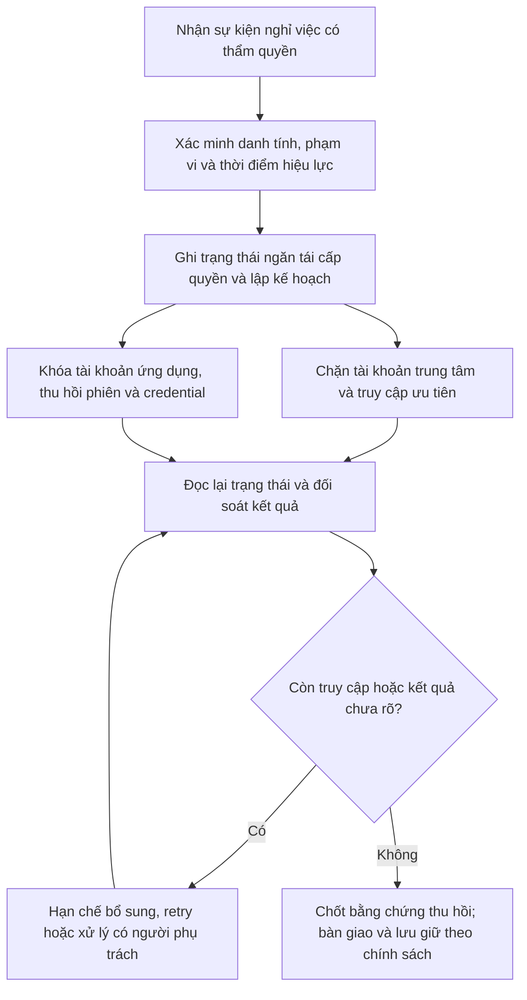

# Account disable on exit: vô hiệu hóa tài khoản khi nhân sự rời tổ chức

## 1. Mục tiêu của việc vô hiệu hóa tài khoản

Trong vòng đời danh tính, **account disable on exit** là việc chuyển các tài khoản gắn với một người rời tổ chức sang trạng thái không được tiếp tục sử dụng, tại thời điểm nghỉ việc có hiệu lực. Đây là một phần của deprovisioning: thu hồi khả năng truy cập khi quan hệ lao động, hợp đồng hoặc sự ủy quyền đã kết thúc.

Giả sử Lan có tài khoản doanh nghiệp để dùng email, kho mã nguồn, VPN và hệ thống tài chính. Khi Lan nghỉ việc, thay đổi một thuộc tính trong hồ sơ nhân sự chưa chứng minh rằng bốn hệ thống này đã chặn Lan. Mỗi hệ thống có thể giữ tài khoản, quyền, phiên đăng nhập và thông tin xác thực riêng.

Mục tiêu cần diễn đạt dưới dạng kết quả quan sát được:

- Các tài khoản thuộc phạm vi nghỉ việc không thể được dùng để thiết lập truy cập mới.
- Những phiên và thông tin xác thực còn hoạt động được xử lý theo khả năng của từng hệ thống.
- Các nguồn cấp quyền không tiếp tục tạo, bật lại hoặc cấp lại quyền cho người đã nghỉ việc.
- Những mục chưa xử lý được có người chịu trách nhiệm, biện pháp hạn chế truy cập và bằng chứng theo dõi.
- Dữ liệu và dấu vết cần giữ được bàn giao hoặc bảo toàn theo chính sách.

Việc khóa tài khoản thường là biện pháp ngăn truy cập sớm; việc xóa tài khoản và dữ liệu có thể diễn ra sau. Một quy trình tốt tách rõ hai thời điểm này.

## 2. Phân biệt disable, revoke, remove và delete

Các thao tác liên quan đến nghỉ việc có thể cùng xuất hiện nhưng không thay thế hoàn toàn cho nhau.

| Thao tác | Tác động chính | Điều vẫn cần kiểm tra |
| --- | --- | --- |
| Disable account | Đặt tài khoản vào trạng thái bị chặn theo cơ chế của hệ thống đích | Phiên đã mở, token và các đường truy cập khác có còn dùng được không |
| Revoke sessions | Chấm dứt hoặc làm mất hiệu lực các phiên thuộc phạm vi được hỗ trợ | Ứng dụng có phiên riêng ngoài hệ thống đã thu hồi không |
| Revoke credentials/tokens | Thu hồi thông tin xác thực, grant hoặc token mà hệ thống có thể thu hồi | Access token tự chứa hoặc credential ở hệ thống khác có còn hiệu lực không |
| Remove entitlements | Gỡ vai trò, nhóm, quyền trực tiếp hoặc quyền được ủy quyền | Quyền có được một nguồn đồng bộ khác cấp lại không |
| Delete account | Xóa đối tượng tài khoản theo chính sách của hệ thống | Dữ liệu, chủ sở hữu tài nguyên và dấu vết kiểm toán được xử lý thế nào |

Đổi mật khẩu đơn thuần không phải là bằng chứng hoàn tất nghỉ việc. Nó có thể không chấm dứt phiên hiện có, không thu hồi API key và không tác động đến tài khoản cục bộ ở ứng dụng khác.

Tương tự, gỡ người dùng khỏi một nhóm SSO không mặc nhiên khóa mọi tài khoản đã được provision trước đó. Quan hệ giữa nhóm, tài khoản ứng dụng và phiên truy cập phải được xác định cụ thể.

## 3. Xác định đúng sự kiện nghỉ việc

### 3.1. Nguồn phát lệnh và thời điểm hiệu lực

Lệnh nghỉ việc cần đến từ nguồn có thẩm quyền, chẳng hạn hệ thống nhân sự và quy trình phê duyệt đã xác định. Một email tự do hoặc sự vắng mặt trong một lần đồng bộ chưa đủ để suy ra rằng người đó đã nghỉ việc.

Sự kiện nên cho biết tối thiểu:

| Dữ liệu | Mục đích |
| --- | --- |
| Định danh nhân sự ổn định | Xác định đúng người, tránh nhầm do trùng tên hoặc đổi email |
| Định danh quan hệ làm việc | Phân biệt hai hợp đồng, hai vai trò hoặc một lần tái tuyển dụng |
| Mã sự kiện và phiên bản | Phát hiện gửi trùng, cập nhật và sự kiện đến sai thứ tự |
| Thời điểm có hiệu lực kèm múi giờ | Xác định lúc phải bắt đầu chặn truy cập |
| Loại nghỉ việc và mức khẩn cấp | Chọn cách điều phối, thông báo và mức ưu tiên |
| Nguồn xác nhận, tham chiếu phê duyệt | Phục vụ kiểm tra thẩm quyền và truy vết |

Không dùng địa chỉ email làm khóa nhận diện duy nhất. Email có thể được đổi hoặc cấp lại cho người khác. Quy trình cần đối chiếu định danh ổn định với các ID tài khoản đích đã được liên kết.

### 3.2. Nghỉ việc theo lịch và nghỉ việc tức thời

Với nghỉ việc theo lịch, hệ thống có thể chuẩn bị danh sách tài khoản và người nhận bàn giao trước ngày nghỉ. Đến thời điểm hiệu lực, các hành động chặn truy cập được thực thi. Thời điểm kết thúc một ngày làm việc phải được quy định rõ, thay vì để từng ứng dụng tự hiểu “cuối ngày”.

Với nghỉ việc có hiệu lực tức thời, nhóm có thẩm quyền kích hoạt luồng ưu tiên để giảm khoảng thời gian truy cập còn tồn tại. Việc gửi thông báo cho người nghỉ việc, quản lý hoặc đơn vị hỗ trợ cần được điều phối theo quy trình đã phê duyệt.

Nghỉ phép dài hạn, chuyển bộ phận, kết thúc một hợp đồng trong nhiều hợp đồng và nghỉ việc toàn bộ là các tình huống khác nhau. Nếu một người vẫn giữ quan hệ làm việc hợp lệ, phạm vi thu hồi cần dựa trên quyền được cấp từ quan hệ đã kết thúc. Không tự suy ra rằng mọi tài khoản của người đó đều phải bị khóa.

## 4. Lập phạm vi tài khoản và đường truy cập

Một danh tính có thể được liên kết với nhiều tài khoản. Trước thời điểm thực thi, quy trình cần dựng danh sách đối tượng đích từ dữ liệu provisioning, danh mục ứng dụng và thông tin sở hữu đã có.

Các nhóm thường cần xem xét gồm:

- Tài khoản người dùng tại directory và identity provider (IdP).
- Tài khoản SaaS, ứng dụng nội bộ và ứng dụng dùng cơ sở dữ liệu người dùng riêng.
- Tài khoản quản trị, tài khoản cloud, VPN và các cổng truy cập từ xa.
- Tài khoản dùng để truy cập kho mã nguồn, CI/CD và nền tảng vận hành.
- Phiên đăng nhập, refresh token, personal access token, API key và khóa SSH cá nhân.
- Quyền truy cập được cấp trực tiếp, qua nhóm, qua vai trò hoặc qua cơ chế ủy quyền.
- Kết nối do người dùng cấp quyền cho ứng dụng bên thứ ba, nếu có.
- Tài nguyên mà người dùng đang là chủ sở hữu hoặc là người duy nhất có thể quản trị.

Danh sách “đã provision qua IAM” có thể bỏ sót tài khoản tạo thủ công hoặc tài khoản cũ. Vì vậy, việc đối soát inventory cần là hoạt động thường xuyên, không chỉ bắt đầu khi một người nghỉ việc.

Một người có thể sở hữu service account phục vụ một ứng dụng. Service account đó không tự động trở thành tài khoản cá nhân phải khóa cùng lúc. Cần xác định chức năng, chuyển chủ sở hữu, loại bỏ quyền truy cập cá nhân của người nghỉ việc và thay đổi secret khi cần. Khóa mù một danh tính workload có thể làm gián đoạn dịch vụ nhưng vẫn không xử lý hết quyền của cá nhân.

## 5. Luồng thực thi từ sự kiện đến xác minh

Có thể mô tả quy trình tổng quát như sau:



Các nhánh có thể chạy song song hoặc theo thứ tự phụ thuộc của từng hệ thống. Không nên để một ứng dụng ít quan trọng đang lỗi ngăn việc khóa truy cập quản trị hoặc truy cập từ xa đã sẵn sàng thực thi.

### Bước 1: Ghi nhận trạng thái mong muốn

Khi xác nhận sự kiện, hệ thống quản lý danh tính ghi nhận rằng quan hệ làm việc đã hoặc sẽ kết thúc. Trạng thái này phải được đưa vào quyết định provisioning, để các đồng bộ thông thường không tiếp tục cấp lại tài khoản hoặc quyền.

Nếu là nghỉ việc trong tương lai, việc ngăn cấp lại quyền cần tôn trọng thời điểm hiệu lực; không khóa sớm ngoài chính sách. Đồng thời, không đưa người đó vào các đợt cấp quyền mới vượt quá phạm vi còn được phép.

### Bước 2: Chặn tại các điểm kiểm soát chính

Tại thời điểm hiệu lực, khóa tài khoản trung tâm và các tài khoản ưu tiên theo kế hoạch. Với IdP, cần xử lý cả khả năng đăng nhập mới và các phiên SSO đang tồn tại theo cơ chế được hỗ trợ.

Nếu ứng dụng liên kết danh tính cho phép đăng nhập bằng tài khoản cục bộ, khóa IdP vẫn chưa đủ. Tài khoản hoặc đường đăng nhập cục bộ đó cần một hành động riêng.

### Bước 3: Xử lý tài khoản và quyền ở hệ thống đích

Mỗi connector áp dụng hành động đã được xác định cho ứng dụng: disable, deactivate, gỡ assignment hoặc cơ chế tương đương. Tên thao tác giống nhau giữa hai sản phẩm không bảo đảm tác động giống nhau.

Một phản hồi API thành công chỉ chứng minh yêu cầu đã được chấp nhận ở mức nào đó. Nếu ứng dụng xử lý bất đồng bộ, cần theo dõi tác vụ và đọc lại trạng thái sau khi việc xử lý hoàn tất.

### Bước 4: Thu hồi phiên và thông tin xác thực

Quy trình thực hiện thu hồi phiên, grant và credential theo từng loại. Cần ghi nhận trường hợp không thể thu hồi ngay, thời hạn còn hiệu lực và biện pháp giảm truy cập còn lại.

### Bước 5: Xác minh và xử lý phần còn sót

Đọc lại trạng thái tài khoản tại hệ thống đích, đối soát quyền và kiểm tra trạng thái phiên theo khả năng quan sát. Không sử dụng mật khẩu hoặc token của người nghỉ việc để tự đăng nhập thử; dùng công cụ quản trị, log và phép kiểm tra được ủy quyền.

Nếu một mục chưa xác minh được, kết quả của mục đó vẫn là chưa rõ hoặc đang xử lý, không tự chuyển sang hoàn tất.

## 6. Vì sao khóa tài khoản chưa chắc kết thúc truy cập

### 6.1. Phiên ứng dụng độc lập với phiên SSO

Trong mô hình SSO, IdP có thể xác thực người dùng rồi ứng dụng tạo cookie phiên riêng. Sau đó ứng dụng có thể tiếp tục chấp nhận cookie mà không hỏi lại IdP ở mỗi yêu cầu.

Vì vậy, thu hồi phiên IdP và chặn xác thực mới chưa chắc hủy phiên ứng dụng. Ứng dụng cần hỗ trợ thu hồi phiên của chính nó, nhận thông báo kết thúc phiên hoặc kiểm tra trạng thái tài khoản tại thời điểm thích hợp.

Với các giao thức liên kết danh tính như SAML hoặc OIDC, không nên mặc định mọi ứng dụng đều hỗ trợ cùng một cơ chế đăng xuất hay thu hồi phiên. Khả năng thực tế phải được xác định cho từng tích hợp.

### 6.2. Access token và refresh token có vòng đời khác nhau

Thu hồi refresh token có thể ngăn việc xin access token mới trong phạm vi cơ chế thu hồi được hỗ trợ. Nhưng access token đã phát hành có thể còn được resource server chấp nhận.

Đặc biệt, nếu resource server chỉ kiểm chữ ký và thời hạn của token tự chứa mà không kiểm tra trạng thái thu hồi, việc disable tài khoản không tự thay đổi token đó. Thời gian sống ngắn, kiểm tra trạng thái, denylist hoặc biện pháp tại gateway có thể hỗ trợ giảm khoảng tồn tại này; mỗi phương án có điều kiện triển khai riêng.

Không đánh đồng “đã gọi API revoke” với “mọi token đã mất hiệu lực”. Báo cáo cần nêu rõ loại token, phạm vi thu hồi và giới hạn còn lại.

### 6.3. Khóa và token ngoài luồng đăng nhập

Personal access token của kho mã nguồn, khóa SSH, API key cá nhân hoặc credential được lưu trong công cụ tự động hóa có thể không phụ thuộc vào mật khẩu SSO.

Khi một secret từng được chia sẻ, không thể chỉ xóa bản secret khỏi máy người nghỉ việc rồi coi như đã thu hồi. Cần thay đổi hoặc thu hồi tại nơi xác thực, đồng thời cập nhật bên sử dụng hợp lệ để duy trì hoạt động.

Bản sao dữ liệu đã được tải ra trước đó cũng không biến mất khi khóa tài khoản. Việc xử lý dữ liệu trên thiết bị và thu hồi thiết bị thuộc quy trình liên quan, với thẩm quyền và chính sách riêng.

## 7. Chống tái kích hoạt ngoài ý muốn

Một lỗi nguy hiểm xảy ra khi quy trình nghỉ việc và quy trình provisioning cùng thay đổi một tài khoản.

Ví dụ:

1. Hệ thống IAM khóa tài khoản lúc 17:00.
2. Một tác vụ đồng bộ đã lấy ảnh chụp dữ liệu từ 16:55.
3. Tác vụ đó chạy lúc 17:05 và ghi tài khoản trở lại trạng thái active.
4. Dashboard nghỉ việc vẫn hiển thị kết quả khóa ở bước đầu là thành công.

Để ngăn tình huống này, việc ngừng quan hệ làm việc phải trở thành ràng buộc của luồng cấp quyền, không chỉ là một lệnh ghi đơn lẻ.

Các biện pháp thường dùng gồm:

- Gắn phiên bản sự kiện hoặc phiên bản trạng thái với từng thay đổi vòng đời.
- Kiểm tra trạng thái có thẩm quyền mới nhất trước khi áp dụng tác vụ enable hoặc grant.
- Vô hiệu hóa các yêu cầu cấp quyền đang chờ thuộc quan hệ làm việc đã kết thúc.
- Không cho một cập nhật hồ sơ thông thường tự đảo ngược trạng thái nghỉ việc.
- Chạy đối soát để phát hiện tài khoản đã bị khóa nhưng lại được bật.
- Yêu cầu một quyết định có thẩm quyền riêng khi hủy nghỉ việc hoặc tái tuyển dụng.

Nếu người lao động quay lại, quy trình phải xác minh quan hệ làm việc mới và phê duyệt quyền cần có ở thời điểm đó. Việc bật lại mọi nhóm quyền cũ có thể khôi phục đặc quyền đã không còn phù hợp.

## 8. Idempotency, retry và trạng thái kết quả

Sự kiện nhân sự có thể được gửi lại; connector có thể timeout dù ứng dụng đã thực hiện lệnh. Hệ thống phải xử lý được những điều này mà không gây sai trạng thái.

**Idempotency** trong ngữ cảnh này nghĩa là xử lý lại cùng một yêu cầu khóa không tạo ra tác động ngoài ý muốn. Có thể dùng khóa thao tác gồm mã sự kiện, hệ thống đích, ID tài khoản và loại hành động.

Ví dụ, yêu cầu disable một tài khoản vốn đã bị disable có thể được coi là đạt trạng thái mong muốn sau khi xác minh đúng đối tượng. Tuy nhiên, “không tìm thấy tài khoản” cần được đối chiếu: có thể tài khoản đã bị xóa, cũng có thể mapping đang sai. Không tự chuyển mọi lỗi tìm kiếm thành thành công.

Một mô hình trạng thái cho từng hành động có thể là:

| Trạng thái | Ý nghĩa |
| --- | --- |
| PENDING | Chưa gửi hành động đến hệ thống đích |
| IN_PROGRESS | Đã bắt đầu xử lý, chưa có kết quả cuối |
| APPLIED_UNVERIFIED | Có dấu hiệu đã áp dụng, chưa đọc lại đủ bằng chứng |
| VERIFIED | Đã xác minh trạng thái mong muốn cho đúng đối tượng |
| RETRY_REQUIRED | Lỗi tạm thời, còn trong chính sách thử lại |
| MANUAL_REQUIRED | Cần người xử lý hoặc bổ sung thông tin có thẩm quyền |
| FAILED | Không đạt yêu cầu sau xử lý theo chính sách |

Retry nên có giới hạn, backoff và thời hạn xử lý gắn với rủi ro. Chờ một connector phục hồi không đồng nghĩa được phép để quyền đặc biệt tiếp tục tồn tại mà không theo dõi.

Quyền của tài khoản thực thi connector cũng cần giới hạn: đủ để thực hiện hành động được giao và đọc trạng thái cần thiết, không mặc định dùng một tài khoản quản trị toàn hệ thống cho mọi ứng dụng.

## 9. Ví dụ minh họa quy trình có trạng thái

Đoạn dưới là pseudocode thể hiện ý tưởng điều phối, không phải API của một sản phẩm. Các thao tác được lưu bền để một lần khởi động lại không làm mất phần việc đang chờ.

```text
handleExit(event):
    requireTrustedSource(event)
    requireStableIdentityAndRelationship(event)

    current = lifecycleStore.read(event.identityId, event.relationshipId)

    if isOlderThanAcceptedDecision(event, current):
        recordIgnoredEvent(event, reason = "stale decision")
        return

    decision = acceptOrLoadSameDecision(event)

    if now() < decision.effectiveAt:
        scheduleDurably(decision)
        return

    plan = buildOrLoadPlan(decision)
    plan.requireCurrentDecisionBeforeAnyChange()

    recordEntitlementSourceAsEnded(decision)
    preventNormalProvisioningFromReenabling(decision)

    for action in plan.actionsReadyToRun():
        operation = operations.loadOrCreate(
            decision.id, action.targetAccountId, action.kind
        )

        if operation.isVerifiedForThisDecision():
            continue

        if not lifecycleStore.isCurrentDecision(decision):
            stopAndReconcile(plan)
            return

        try:
            applyDesiredState(action, operation.idempotencyKey)
            observation = readTargetState(action)
            recordResult(operation, observation)
        catch TemporaryFailure:
            scheduleBoundedRetry(operation)
        catch PermanentOrAmbiguousFailure:
            assignOwnerAndContainRemainingAccess(operation)

    reconcileAccountsSessionsCredentialsAndEntitlements(plan)
    publishActualProgress(plan)
```

Hai điểm cần chú ý:

Thứ nhất, lưu trạng thái sự kiện và lưu kết quả hành động là hai việc khác nhau. Sự kiện đã được tiếp nhận không có nghĩa các hệ thống đích đều đã xử lý xong.

Thứ hai, xác minh trạng thái mong muốn phải bao phủ từng loại hành động. Đọc thấy tài khoản disabled không đủ để đánh dấu tác vụ thu hồi API key là hoàn tất. Một hành động không áp dụng cho tài khoản nào đó cần có lý do rõ ràng thay vì bị bỏ qua im lặng.

## 10. Ví dụ nghỉ việc với một ứng dụng đang gián đoạn

Công ty quy định nhân viên An kết thúc truy cập lúc 18:00 theo múi giờ được ghi trong sự kiện. An có tài khoản IdP, VPN, kho mã nguồn và một SaaS tài chính. SaaS tài chính đang không nhận yêu cầu quản trị.

Một kế hoạch xử lý có thể như sau:

| Đối tượng | Hành động | Kết quả quan sát | Cách diễn giải |
| --- | --- | --- | --- |
| IdP | Disable và thu hồi phiên theo cơ chế hỗ trợ | Đọc lại trạng thái disabled; có bằng chứng thu hồi phiên IdP | Đã xử lý tại IdP, chưa đại diện cho mọi ứng dụng |
| VPN | Khóa tài khoản, ngắt kết nối còn hoạt động | Hệ thống báo tài khoản bị chặn và phiên đã đóng | Đã xác minh phần VPN trong phạm vi quan sát |
| Kho mã nguồn | Khóa tài khoản và thu hồi credential cá nhân liên quan | Trạng thái khóa và danh sách credential đã thu hồi được ghi nhận | Cần giữ liên kết tác giả với lịch sử commit theo chính sách |
| SaaS tài chính | Deactivate, kết thúc phiên và gỡ quyền liên quan | API quản trị timeout | Chưa hoàn tất; cần hạn chế truy cập và người chịu trách nhiệm |

Trong trường hợp SaaS, chặn SSO mới có thể là một biện pháp hạn chế, nhưng chưa chứng minh phiên đang mở hoặc tài khoản đăng nhập cục bộ bị chặn. Chủ ứng dụng phải xác định và thực hiện cơ chế còn khả dụng. Nếu chưa chấm dứt được truy cập, báo cáo phải giữ trạng thái chưa hoàn tất và nêu khoảng truy cập còn lại.

Không nên bật lại tài khoản IdP chỉ vì cần lấy báo cáo từ SaaS. Việc bàn giao dữ liệu nên dùng cơ chế quản trị được ủy quyền, có log và phạm vi truy cập phù hợp.

## 11. Dữ liệu, quyền sở hữu và lưu giữ

Khóa tài khoản cần được phối hợp với bàn giao để tránh mất khả năng quản lý tài nguyên của tổ chức.

Các hạng mục thường cần xác định trước gồm:

- Ai tiếp nhận tài liệu, hộp thư, kho mã nguồn và tài nguyên cộng tác.
- Tài khoản có đang là chủ sở hữu duy nhất của một nhóm, subscription hoặc quy trình tự động không.
- Dữ liệu nào được giữ, trong bao lâu và ai được phép truy cập.
- Có yêu cầu bảo toàn bằng chứng hoặc hạn chế xóa dữ liệu đang có hiệu lực không.
- Khi nào được xóa tài khoản, license và dữ liệu sau giai đoạn khóa.

Không dùng tài khoản của người nghỉ việc như một tài khoản dùng chung để tiếp tục công việc. Chuyển quyền sở hữu hoặc cấp quyền cho người nhận bàn giao tạo được trách nhiệm rõ ràng hơn.

Việc xóa tài khoản quá sớm có thể làm khó đối chiếu nhật ký hoặc gây tác động đến dữ liệu tùy sản phẩm. Vì vậy, bước delete phải dựa trên chính sách lưu giữ và khả năng cụ thể của hệ thống, sau khi đã đáp ứng yêu cầu chặn truy cập.

## 12. Bằng chứng và tiêu chí hoàn tất

Báo cáo nghỉ việc cần giúp người kiểm tra trả lời được: ai ra quyết định, tài khoản nào bị tác động, lúc nào hành động có hiệu lực, phần nào chưa hoàn tất và ai đang xử lý.

Một bản ghi hành động nên có:

- Mã sự kiện, định danh nhân sự, quan hệ làm việc và ID tài khoản đích.
- Thời điểm hiệu lực, thời điểm gửi lệnh và thời điểm xác minh.
- Hệ thống đích, loại hành động, kết quả và mã tham chiếu tác vụ.
- Người hoặc danh tính tự động hóa thực thi.
- Bằng chứng đọc lại đã được giảm thiểu dữ liệu nhạy cảm.
- Lỗi, số lần thử, người phụ trách và thời hạn xử lý phần còn lại.

Không đưa mật khẩu, token, private key hoặc nội dung nhạy cảm không cần thiết vào log. Bằng chứng phải đủ truy vết mà không tạo ra kho credential mới.

Có thể đo khoảng thời gian từ lúc nghỉ việc có hiệu lực đến khi từng điểm kiểm soát được xác minh đã chặn truy cập. Cần theo dõi thêm thời gian từ khi nguồn có thẩm quyền ghi nhận sự kiện đến khi IAM nhận được sự kiện; nếu chỉ đo từ lúc connector bắt đầu chạy, một sự kiện đến muộn có thể bị che khuất.

Đừng chỉ nhìn số trung bình của thời gian khóa. Một tài khoản quản trị bị bỏ sót hoặc một phiên còn tồn tại lâu có thể quan trọng hơn nhiều tài khoản thông thường đã xử lý nhanh.

Về kết quả, nên phân biệt:

- **Thu hồi truy cập đã xác minh:** các tài khoản, quyền, phiên và credential trong phạm vi đã được xử lý hoặc chứng minh không áp dụng; giới hạn quan sát được nêu rõ.
- **Còn ngoại lệ:** có mục thất bại, chưa rõ hoặc chưa chấm dứt truy cập; ngoại lệ có chủ sở hữu và cách xử lý nhưng không được mô tả thành “đã thu hồi toàn bộ”.
- **Deprovisioning đã đóng:** ngoài thu hồi truy cập, các bước bàn giao, lưu giữ, license và xóa theo chính sách đã đạt điều kiện tương ứng.

## 13. Các sai lầm thường gặp

| Sai lầm | Hậu quả | Cách tiếp cận phù hợp |
| --- | --- | --- |
| Chỉ khóa directory | Bỏ sót tài khoản cục bộ và phiên ứng dụng | Lập danh sách đường truy cập và hành động theo từng hệ thống |
| Chỉ đổi mật khẩu | Token, khóa và phiên có thể tiếp tục dùng | Thu hồi từng loại credential và phiên theo cơ chế hỗ trợ |
| Xem phản hồi API thành công là hoàn tất | Tác vụ bất đồng bộ hoặc trạng thái đích chưa đổi | Theo dõi kết quả cuối và đọc lại trạng thái |
| Tự khóa theo email hoặc tên hiển thị | Khóa nhầm người hoặc bỏ sót tài khoản đã đổi tên | Dùng định danh ổn định và mapping được quản lý |
| Để nguồn cấp quyền tiếp tục chạy như cũ | Tài khoản hoặc quyền được cấp lại | Áp dụng trạng thái nghỉ việc vào quyết định provisioning |
| Xóa ngay mọi tài khoản và dữ liệu | Mất khả năng bàn giao hoặc bảo toàn dấu vết | Tách disable sớm khỏi delete theo chính sách |
| Khóa mọi service account do người nghỉ việc sở hữu | Gián đoạn dịch vụ nhưng vẫn có thể sót truy cập cá nhân | Phân loại danh tính, chuyển chủ sở hữu và xử lý secret phù hợp |
| Đánh dấu hoàn tất khi còn connector lỗi | Che khuất quyền truy cập tồn tại | Theo dõi ngoại lệ, biện pháp hạn chế và bằng chứng xử lý |

Account disable on exit đạt mục tiêu khi quyết định kết thúc quyền truy cập được chuyển thành trạng thái thực tế có thể kiểm chứng trên các hệ thống liên quan. Khả năng ngăn tái cấp quyền, xử lý phiên và credential, cùng bằng chứng về phần còn lại quyết định hiệu quả của quy trình.

