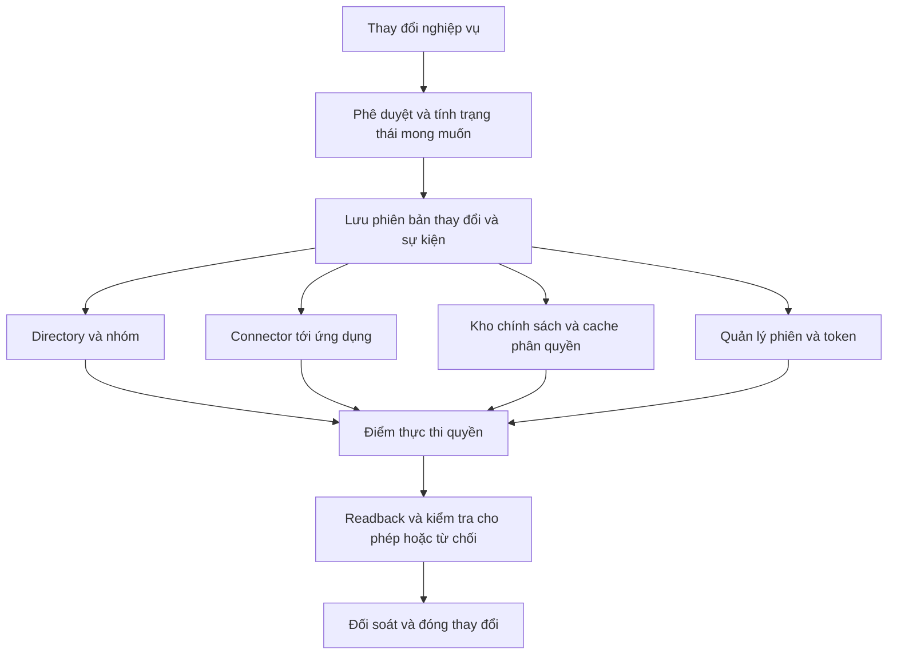

# Role change propagation — Lan truyền thay đổi vai trò

## 1. Thay đổi vai trò chỉ hoàn tất khi quyền thực tế đã thay đổi

Trong vòng đời danh tính, một nhân viên có thể chuyển phòng ban, nhận nhiệm vụ tạm thời, hết nhiệm kỳ phê duyệt hoặc được điều chỉnh phạm vi phụ trách. Danh tính của người đó vẫn tồn tại, nhưng tập quyền phù hợp với công việc đã thay đổi. Đây là tình huống **mover**: cần cấp quyền mới và thu hồi quyền cũ mà không mặc định xóa tài khoản.

**Role change propagation** là quá trình đưa một thay đổi vai trò từ nguồn quản lý tới mọi nơi quyết định hoặc thực thi quyền truy cập. Những nơi này có thể gồm nhóm trong directory, ứng dụng SaaS, cơ sở dữ liệu phân quyền, bộ máy chính sách, bộ nhớ đệm, phiên đăng nhập và dịch vụ xử lý tác vụ nền.

Một thông báo “đã đổi role thành công” trên trang quản trị chỉ chứng minh một bước ghi dữ liệu đã thành công. Nó chưa chứng minh ứng dụng đích đã thu hồi quyền, cũng chưa chứng minh access token hoặc phiên đang mở đã mất hiệu lực của quyền cũ.

Ví dụ: Lan chuyển từ bộ phận duyệt hóa đơn sang bộ phận mua hàng. Hệ thống nhân sự đã ghi nhận phòng ban mới, nhưng ứng dụng thanh toán vẫn cho phép Lan duyệt hóa đơn bằng phiên đăng nhập từ buổi sáng. Thay đổi tổ chức đã được lưu; thay đổi quyền chưa được thực thi đầy đủ.

Trong chương provisioning và deprovisioning, một lần đổi vai trò thường gồm cả hai hướng:

- **Provisioning:** tạo hoặc cập nhật những quyền mới đã được phê duyệt.
- **Deprovisioning:** loại bỏ những quyền không còn căn cứ nghiệp vụ.

Mục tiêu là đưa quyền thực tế về trạng thái mong muốn theo nguyên tắc ít quyền nhất, trong thời hạn xác định và có bằng chứng kiểm tra được.

## 2. Vai trò, liên kết vai trò và quyền hiệu lực

### 2.1. Không chỉ có tên vai trò

Một liên kết vai trò thường cần nhiều thông tin hơn chuỗi `approver`:

```text
subjectId: person-1842
tenantId: company-a
role: invoice_approver
scope: business-unit-south
validUntil: null
```

Đổi phạm vi từ miền Nam sang miền Bắc cũng là thay đổi quyền, dù tên vai trò giữ nguyên. Quy trình chỉ so sánh tên role sẽ bỏ sót việc thu hồi quyền ở phạm vi cũ.

Các thay đổi liên quan gồm gán hoặc gỡ vai trò, đổi phạm vi, hết hạn liên kết và sửa định nghĩa vai trò. Sửa định nghĩa một vai trò dùng chung có thể ảnh hưởng nhiều người cùng lúc, nên cần theo dõi riêng phiên bản chính sách hoặc định nghĩa vai trò; một phiên bản liên kết của riêng người dùng không tự bao quát được trường hợp đó.

### 2.2. Phân biệt dữ liệu mong muốn và quyền đang được thực thi

**Desired state** là tập liên kết vai trò và quyền mà hệ thống quản trị đã phê duyệt. **Observed state** là trạng thái đọc được từ các hệ thống đích. **Effective access** là kết quả quyền mà hệ thống đích thực sự cho phép ở một thời điểm, sau khi tính cả điều kiện, deny, scope và phiên đang dùng.

Ba trạng thái này có thể khác nhau trong thời gian lan truyền. Directory đã gỡ thành viên nhóm nhưng ứng dụng chưa đồng bộ là một ví dụ. Ứng dụng đã cập nhật bảng quyền nhưng cache vẫn cũ là ví dụ khác.

Với mô hình quyền cộng gộp đơn giản, có thể diễn đạt:

```text
OldPermissions = quyền suy ra từ mọi liên kết cũ còn hợp lệ
NewPermissions = quyền suy ra từ mọi liên kết mới đã được phê duyệt

ToRevoke = OldPermissions − NewPermissions
ToGrant  = NewPermissions − OldPermissions
ToKeep   = OldPermissions ∩ NewPermissions
```

Đây là cách giải thích sự chênh lệch, không phải công thức đầy đủ cho mọi hệ thống. Với ABAC, deny ưu tiên, quyền kế thừa hoặc điều kiện theo tài nguyên, phải dùng quy tắc đánh giá chính sách tương ứng.

Đặc biệt, không nên gỡ một permission chỉ vì một role bị gỡ nếu permission đó vẫn được một liên kết hợp lệ khác cấp. Hệ thống đích quản lý role membership thì nên đồng bộ các membership có căn cứ; hệ thống chỉ quản lý entitlement trực tiếp cần tính lại tập entitlement mong muốn.

### 2.3. Ví dụ chuyển nhiệm vụ

Giả sử mọi vai trò dưới đây đều giới hạn trong cùng một đơn vị kinh doanh:

| Liên kết vai trò | Trước thay đổi | Sau thay đổi |
| --- | --- | --- |
| `finance_reader` | Có | Có |
| `invoice_approver` | Có | Không |
| `procurement_editor` | Không | Có |

Giả sử `finance_reader` cho phép xem hóa đơn, `invoice_approver` cho phép xem và duyệt hóa đơn, còn `procurement_editor` cho phép xem và sửa đơn mua hàng. Kết quả cần đạt là:

| Thao tác | Kết quả mong muốn |
| --- | --- |
| Xem hóa đơn trong đơn vị được giao | Tiếp tục cho phép qua `finance_reader` |
| Duyệt hóa đơn | Từ chối |
| Xem và sửa đơn mua hàng trong đơn vị được giao | Cho phép sau phê duyệt và áp dụng |
| Truy cập dữ liệu của đơn vị khác | Không tự phát sinh quyền |

Chỉ kiểm tra rằng role mới đã có là chưa đủ. Cần kiểm tra cả thao tác mất quyền và ranh giới phạm vi.

## 3. Những điểm cần nhận thay đổi



Mỗi nhánh có thể chạy ở tốc độ khác nhau. Directory dùng push, một SaaS nhận cập nhật qua connector, còn một ứng dụng cũ chỉ lấy dữ liệu định kỳ. Vì vậy cần biết cụ thể hệ thống nào giữ bản sao quyền và đường truy cập nào dùng bản sao đó.

| Thành phần | Câu hỏi cần trả lời |
| --- | --- |
| Nguồn nghiệp vụ | Thay đổi nào là có thẩm quyền, có hiệu lực lúc nào? |
| Directory hoặc IdP | Nhóm và thuộc tính mới đã được ghi chưa? |
| Kho phân quyền của ứng dụng | Quyền cũ đã bị gỡ khỏi tài khoản đích chưa? |
| Cache | Bản ghi quyền cũ còn được dùng trong bao lâu? |
| Token và phiên | Yêu cầu đang dùng thông tin quyền nào để được chấp nhận? |
| Tác vụ nền | Tác vụ dùng quyền người dùng được chụp lúc tạo hay kiểm tra lại khi chạy? |
| Nhật ký và bộ đối soát | Có chứng cứ xác nhận từng đích đã thực thi trạng thái mới không? |

SSO giúp đăng nhập giữa các ứng dụng, nhưng không tự đảm bảo mọi ứng dụng cập nhật quyền hoặc kết thúc phiên nội bộ khi role ở IdP thay đổi.

## 4. Quy trình lan truyền có kiểm soát

### 4.1. Xác định danh tính và nguồn có thẩm quyền

Thay đổi phải gắn với một định danh ổn định và đúng tenant. Email hoặc tên hiển thị có thể đổi; dùng chúng làm khóa duy nhất có thể dẫn tới cập nhật nhầm tài khoản.

Cần xác định rõ nguồn nào có quyền quyết định thuộc tính và quyền nào. Hệ thống nhân sự có thể xác nhận phòng ban, nhưng quyền duyệt khoản chi lớn vẫn cần người sở hữu nghiệp vụ phê duyệt. Connector không nên coi mọi thay đổi phòng ban là đủ căn cứ để tự cấp đặc quyền.

Thông tin tối thiểu của yêu cầu thường gồm danh tính, vai trò hoặc scope cũ và mới, thời điểm có hiệu lực, lý do, người phê duyệt và mã thay đổi để truy vết.

### 4.2. Tính trạng thái đích và kiểm tra xung đột

Tính lại trạng thái mong muốn từ các liên kết còn hợp lệ, bao gồm quyền trực tiếp và các ngoại lệ được quản lý. Quyền tạm thời nên có thời hạn rõ ràng; không nên được giữ vô hạn chỉ vì người dùng chuyển phòng ban.

Trước khi cấp quyền mới, kiểm tra phân tách nhiệm vụ. Ví dụ, người tạo đề nghị thanh toán và người duyệt đề nghị có thể không được là cùng một người. Nếu role mới kết hợp với role cũ tạo ra xung đột, việc “cấp trước rồi gỡ sau” có thể tạo một cửa sổ quyền không hợp lệ.

Thời điểm hiệu lực cũng quan trọng. Thay đổi có hiệu lực ngày mai cần được lên lịch và tái kiểm tra tại thời điểm áp dụng; không nên phát sự kiện rồi vô tình cấp quyền ngay hôm nay.

### 4.3. Lưu thay đổi và phát sự kiện tin cậy

Một rủi ro phổ biến là ghi trạng thái mới vào cơ sở dữ liệu thành công nhưng phát sự kiện thất bại. Khi đó giao diện quản trị hiển thị trạng thái mới, còn các đích không biết để cập nhật.

Một thiết kế thường dùng là **transactional outbox**: lưu trạng thái mong muốn và bản ghi sự kiện trong cùng giao dịch cơ sở dữ liệu. Một tiến trình khác đọc outbox và chuyển sự kiện đến các bên nhận. Cách này nối việc lưu dữ liệu với ý định phát sự kiện; nó không tự bảo đảm bên nhận chỉ nhận đúng một lần hoặc xử lý thành công.

Sự kiện có thể mang một snapshot quyền mong muốn hoặc yêu cầu bên nhận tải snapshot hiện hành. Ví dụ minh họa:

```json
{
  "eventId": "evt-8421",
  "changeId": "chg-619",
  "subjectId": "person-1842",
  "tenantId": "company-a",
  "authorizationVersion": 28,
  "desiredBindings": [
    {"role": "finance_reader", "scope": "business-unit-south"},
    {"role": "procurement_editor", "scope": "business-unit-south"}
  ]
}
```

Đây là cấu trúc minh họa, không phải schema bắt buộc của một giao thức. Danh sách role chỉ có ý nghĩa trong phạm vi quản lý đã thống nhất. Một connector quản lý hai nhóm không được dùng snapshot đó để xóa toàn bộ nhóm ngoài phạm vi sở hữu của nó.

### 4.4. Áp dụng theo thứ tự phù hợp với rủi ro

Không có một thứ tự duy nhất cho mọi trường hợp:

- Với quyền nhạy cảm hoặc hai vai trò xung đột, ưu tiên chặn quyền cũ và xác nhận thu hồi trước khi cho phép quyền mới.
- Với quyền không xung đột, tổ chức có thể cho phép khoảng chồng lấn ngắn nếu đã được phê duyệt và giới hạn thời gian.
- Với ứng dụng hỗ trợ thay thế nguyên tử tập quyền, có thể cập nhật toàn bộ tập quyền trong một giao dịch tại chính ứng dụng đó.

Tính nguyên tử tại một ứng dụng không tạo ra giao dịch nguyên tử trên toàn bộ directory, SaaS và dịch vụ nội bộ. Nếu một đích lỗi, quy trình phải ghi nhận trạng thái hoàn tất một phần và tiếp tục xử lý phần còn thiếu.

Không nên tự khôi phục role cũ chỉ để làm cho mọi đích “đồng nhất” khi việc cấp role mới thất bại. Khôi phục quyền đã hết căn cứ có thể tạo thêm rủi ro; bước phục hồi cần dựa vào trạng thái mong muốn hiện hành và chính sách nghiệp vụ.

### 4.5. Đọc lại và xác nhận quyền đã có hiệu lực

Phản hồi “đã nhận yêu cầu” từ connector chưa phải là bằng chứng quyền đã được thực thi. Sau khi cập nhật, cần đọc lại trạng thái đích và, khi phù hợp, kiểm tra quyết định phân quyền bằng danh tính thử nghiệm hoặc cơ chế kiểm tra không gây tác động nghiệp vụ.

Một thay đổi chỉ được đóng khi các đích bắt buộc đã đạt điều kiện hoàn thành. Đích chưa xác minh được cần giữ trạng thái chờ hoặc lỗi, kèm người chịu trách nhiệm và thời hạn xử lý.

## 5. Token, phiên và cache: nơi quyền cũ thường tồn tại

### 5.1. Access token chứa quyền được chụp tại thời điểm cấp

Nếu một access token chứa claim vai trò và dịch vụ chỉ xác minh chữ ký cùng hạn dùng, việc sửa role trong cơ sở dữ liệu không làm nội dung token đang lưu trên máy người dùng tự đổi theo. Token cũ có thể tiếp tục được chấp nhận cho đến khi hết hạn hoặc bị một cơ chế kiểm tra bổ sung từ chối.

Những lựa chọn thiết kế gồm token sống ngắn, tra cứu trạng thái hiện hành, kiểm tra phiên bản phân quyền, danh sách thu hồi hoặc xác thực lại trước thao tác nhạy cảm. Mỗi lựa chọn cần được thực hiện trên đường truy cập thực tế; chỉ ghi một trường phiên bản vào token chưa làm quyền cũ mất hiệu lực.

Ví dụ, token có `authorizationVersion=27` trong khi trạng thái hiện hành là `28`. Dịch vụ chỉ phát hiện sự lệch này nếu nó lấy được phiên bản đủ mới và thực hiện so sánh trước khi quyết định. Nếu dịch vụ tiếp tục đọc một cache phiên bản cũ, độ trễ cache vẫn thuộc cửa sổ thu hồi.

Thu hồi refresh token giúp ngăn việc dùng refresh token đó lấy token tiếp theo trong cơ chế có hỗ trợ thu hồi. Điều này không tự vô hiệu hóa mọi access token đã cấp và cũng không tự đóng phiên riêng của mọi ứng dụng.

### 5.2. Phiên ứng dụng có thể giữ bản sao role

Một ứng dụng có thể sao chép role vào server session khi đăng nhập rồi dùng bản sao đó cho toàn bộ phiên. Khi đổi role, ứng dụng cần có cách cập nhật phiên, đánh dấu phiên cần đánh giá lại, hoặc kết thúc phiên theo mức rủi ro.

Đăng xuất khỏi IdP chưa chắc đã kết thúc phiên nội bộ nếu ứng dụng không có cơ chế phối hợp tương ứng. Vì vậy, thiết kế thu hồi phải kiểm kê cả phiên tại IdP và phiên tại ứng dụng đích.

### 5.3. Cache cần khóa đúng phạm vi và có giới hạn cũ hóa

Cache phân quyền nên phân biệt những chiều có thể ảnh hưởng quyết định như tenant, chủ thể, tài nguyên, hành động và phiên bản chính sách. Khóa chỉ theo `userId` có thể tái sử dụng quyết định sai giữa hai tenant hoặc hai scope.

Có thể phối hợp invalidation theo sự kiện với thời gian sống giới hạn. Sự kiện giúp cập nhật nhanh; giới hạn thời gian sống giúp giảm tác động nếu bỏ lỡ sự kiện. Cần tính cả cache kết quả “allow” và cache phiên bản mà cơ chế kiểm tra đang dựa vào.

Nếu yêu cầu thu hồi nghiêm ngặt hơn thời gian tồn tại của token hoặc cache, kiến trúc phải bổ sung một cơ chế kiểm tra hoặc chặn phù hợp. Không thể cam kết thu hồi tức thời chỉ bằng việc giảm thời gian đồng bộ directory.

### 5.4. Tác vụ đang chạy và tác vụ đã xếp hàng

Một tác vụ xuất dữ liệu được tạo khi người dùng còn quyền có thể chạy sau khi role đã bị gỡ. Hệ thống cần quy định điểm nào phải kiểm tra lại quyền: lúc nhận yêu cầu, lúc bắt đầu xử lý, trước bước nhạy cảm hoặc trước khi cung cấp kết quả.

Với luồng dài, việc kiểm tra ở một điểm không tự bảo vệ mọi bước tiếp theo. Ngược lại, quyền đã bị gỡ cũng không thể thu hồi dữ liệu người dùng đã tải xuống trước đó. Cần phân biệt ngăn truy cập tương lai với xử lý hậu quả của truy cập đã xảy ra.

## 6. Xử lý sự kiện trùng, sai thứ tự và thất lạc

### 6.1. Idempotency

Hạ tầng có thể giao cùng một sự kiện nhiều lần. Áp dụng lại một phiên bản không được tạo membership trùng, gia hạn quyền tạm ngoài ý muốn hoặc phát sinh tác dụng phụ lặp lại.

`eventId` hỗ trợ nhận diện sự kiện trùng, nhưng cần thiết kế cả cách xử lý tình huống tiến trình bị dừng sau khi đã ghi vào đích mà chưa lưu kết quả cục bộ. Các thao tác “đưa trạng thái về tập mong muốn” thường dễ làm idempotent hơn một chuỗi lệnh thêm/bớt không có điều kiện.

### 6.2. Phiên bản và thứ tự

Giả sử phiên bản 28 gỡ quyền duyệt, nhưng sự kiện phiên bản 27 đến muộn và cấp lại quyền đó. Dedupe theo `eventId` không ngăn được vì đây là hai sự kiện khác nhau.

Với snapshot đầy đủ trong phạm vi quản lý, adapter có thể bỏ qua phiên bản cũ và hội tụ về phiên bản mới nhất. Với sự kiện chỉ chứa phần chênh lệch, không được tùy tiện bỏ qua các phiên bản trung gian: một phần thay đổi cần thiết có thể bị mất. Khi phát hiện khoảng trống, cần tải lại snapshot hoặc phát lại các thay đổi còn thiếu theo contract đã chọn.

Điều kiện kiểm tra phiên bản và thao tác ghi phải được phối hợp. Nếu hai tiến trình cùng đọc “phiên bản hiện tại là 26” rồi lần lượt ghi 28 và 27, một lần so sánh ban đầu vẫn có thể để dữ liệu cũ ghi đè dữ liệu mới. Tùy khả năng đích, có thể dùng cập nhật có điều kiện, xử lý tuần tự theo danh tính và tenant, hoặc một adapter sở hữu duy nhất đường ghi đó. Cần kiểm soát cả những người ghi ngoài adapter; đối soát vẫn cần để phát hiện drift.

### 6.3. Retry và đối soát

Retry nên phân biệt lỗi tạm thời, như timeout hoặc giới hạn tốc độ, với lỗi cần xử lý cấu hình, như ánh xạ sai tài khoản hoặc thiếu quyền của connector. Retry có khoảng nghỉ và giới hạn giúp tránh làm quá tải hệ thống đích.

Timeout tạo ra trạng thái không chắc chắn: đích có thể đã áp dụng dù bên gửi không nhận được phản hồi. Đọc lại hoặc thử lại thao tác idempotent an toàn hơn việc giả định yêu cầu chưa từng chạy.

Hàng đợi xử lý lỗi giúp giữ lại thay đổi chưa áp dụng, nhưng không thay thế cơ chế cảnh báo và người chịu trách nhiệm. Không nên đánh dấu toàn bộ quy trình thành công chỉ vì sự kiện lỗi đã được chuyển sang một hàng đợi khác.

Đối soát định kỳ so sánh trạng thái mong muốn với trạng thái quan sát được để phát hiện sự kiện thất lạc, quyền cấp trực tiếp ngoài luồng hoặc quyền cũ còn sót. Khi sửa drift, phải phân biệt quyền thuộc phạm vi connector quản lý với ngoại lệ đã được phê duyệt; không xóa quyền ngoài phạm vi một cách máy móc.

## 7. Thời hạn thu hồi và bằng chứng hoàn thành

Một yêu cầu vận hành nên nói rõ “quyền nào phải mất hiệu lực ở đích nào trong bao lâu”. Chỉ đặt mục tiêu cho độ trễ phát sự kiện là chưa đủ.

Đặt các mốc:

```text
t0 = thời điểm thay đổi phải có hiệu lực
t1 = thời điểm trạng thái mong muốn có hiệu lực được lưu
t2 = thời điểm đích xác nhận đã áp dụng
t3 = thời điểm xác minh đường truy cập thực sự từ chối quyền cũ

Độ trễ thu hồi được xác minh = t3 − t0
```

Với thay đổi lên lịch, bản kế hoạch có thể được lưu trước `t0`; cần tách thời điểm lập kế hoạch khỏi thời điểm chuyển trạng thái thực sự. Nếu không quan sát trực tiếp được `t3`, báo rõ giới hạn bằng chứng và giới hạn thời gian cũ hóa của cơ chế đang dùng.

Mức yêu cầu phụ thuộc rủi ro. Quyền quản trị hoặc duyệt thanh toán có thể cần biện pháp chặn nhanh trên các đường truy cập bắt buộc đi qua điểm thực thi đó, trong khi quyền đọc ít nhạy cảm có thể chấp nhận hội tụ chậm hơn. Một biện pháp chặn tập trung không bao phủ đường truy cập trực tiếp hoặc dịch vụ ngoại tuyến vốn không kiểm tra nó.

Các số liệu hữu ích gồm độ trễ thu hồi theo đích, số thay đổi quá hạn, số quyền thừa qua đối soát, số lỗi connector chưa xử lý và tỷ lệ thay đổi đã xác minh đầy đủ. Theo dõi riêng chiều cấp quyền và chiều thu hồi để tránh tốc độ cấp quyền tốt che khuất việc gỡ quyền chậm.

Nhật ký thay đổi nên cho phép nối từ yêu cầu nghiệp vụ tới kết quả ở từng đích: ai yêu cầu và phê duyệt, danh tính và tenant nào, role/scope trước và sau, phiên bản nào, thời điểm có hiệu lực, các lần thử và kết quả readback. Không cần ghi token hoặc bí mật xác thực để chứng minh quy trình.

## 8. Ví dụ một lần chuyển vai trò có lỗi một phần

Lan được chuyển nhiệm vụ lúc 09:00. Trạng thái mong muốn mới giữ `finance_reader`, bỏ `invoice_approver` và thêm `procurement_editor`. Chính sách yêu cầu quyền duyệt hóa đơn phải được thu hồi trước khi role mới hoạt động.

1. Hệ thống lưu phiên bản 28 và sự kiện cùng giao dịch. Trạng thái thay đổi là đang áp dụng.
2. Ứng dụng hóa đơn gỡ liên kết duyệt; cơ chế phiên và cache tại ứng dụng được cập nhật theo thiết kế. Readback cùng kiểm tra thao tác xác nhận Lan không còn duyệt được.
3. Connector cấp role mua hàng gọi đích nhưng gặp timeout. Thay đổi vẫn chưa hoàn tất; hệ thống chưa có bằng chứng role mới đã được áp dụng.
4. Adapter đọc lại đích, xác định yêu cầu trước đã thành công và ghi nhận phiên bản đã áp dụng, thay vì cấp thêm một liên kết trùng.
5. Kiểm tra cuối xác nhận Lan xem được hóa đơn, không duyệt được hóa đơn, sửa được đơn mua hàng trong đúng scope và bị từ chối ở đơn vị khác. Khi mọi đích bắt buộc đạt yêu cầu, thay đổi mới được đóng.

Nếu bước 2 thất bại, không tiếp tục cấp một role tạo xung đột chỉ để hoàn thành nhanh. Cần giữ trạng thái lỗi, cảnh báo theo thời hạn thu hồi và áp dụng biện pháp hạn chế đã được thiết kế cho tình huống đó. Nếu bước 4 xác nhận role mới chưa có, retry theo trạng thái mong muốn hiện hành; không tự cấp lại role duyệt cũ.

## 9. Những sai lầm thường gặp

| Sai lầm | Hệ quả | Hướng xử lý |
| --- | --- | --- |
| Chỉ thêm role mới | Người chuyển vị trí tích lũy quyền qua thời gian | Tính cả quyền cần gỡ và quyền cần giữ |
| Chỉ sửa role tại IdP | Quyền trong SaaS, phiên hoặc cache còn cũ | Kiểm kê các bản sao quyền và điểm thực thi |
| So sánh tên role, bỏ qua scope | Người dùng giữ quyền ở phạm vi cũ | Đồng bộ đầy đủ liên kết role và scope |
| Cho rằng JWT tự cập nhật sau khi đổi role | Token cũ vẫn được chấp nhận | Thiết kế giới hạn thời gian hoặc kiểm tra trạng thái hiện hành |
| Chỉ dedupe sự kiện, bỏ qua phiên bản | Sự kiện cũ có thể cấp lại quyền đã gỡ | Kiểm soát phiên bản và thứ tự áp dụng |
| Đánh dấu thành công khi API trả “accepted” | Công việc phía đích có thể chưa chạy | Phân biệt nhận yêu cầu, áp dụng và xác minh |
| Khôi phục role cũ khi một bước cấp quyền lỗi | Quyền hết căn cứ xuất hiện trở lại | Phục hồi dựa trên trạng thái mong muốn mới nhất |
| Đối soát chỉ tìm thiếu quyền | Quyền thừa không bị phát hiện | Kiểm tra cả quyền thiếu và quyền vượt quá |

## 10. Tự kiểm tra thiết kế

Khi xem xét một hệ thống lan truyền thay đổi vai trò, hãy thử các tình huống sau:

- Một quyền được cấp từ hai role, sau đó chỉ một role bị gỡ: quyền còn căn cứ có được giữ đúng không?
- Tên role giữ nguyên nhưng scope chuyển sang đơn vị khác: scope cũ có bị thu hồi không?
- Người dùng tiếp tục gọi API bằng token hoặc phiên được tạo trước thay đổi: thao tác nhạy cảm bị chặn vào thời điểm nào?
- Một sự kiện bị gửi hai lần, hoặc phiên bản mới đến trước phiên bản cũ: trạng thái cuối có đúng không?
- Connector đã ghi thành công nhưng mất phản hồi: lần xử lý tiếp theo có an toàn không?
- Một đích ngừng hoạt động quá thời hạn thu hồi: ai nhận cảnh báo và biện pháp hạn chế nào có hiệu lực trên đường truy cập đó?
- Quản trị viên cấp trực tiếp một quyền ngoài luồng: bộ đối soát phân biệt drift với ngoại lệ hợp lệ bằng căn cứ nào?

Một cơ chế role change propagation đáng tin cậy cần trả lời được cả hai câu hỏi: **người dùng đã nhận những quyền mới nào** và **từ lúc nào họ thực sự không còn dùng được những quyền cũ nào**. Bằng chứng nằm ở các điểm thực thi quyền, không chỉ ở bản ghi vai trò trung tâm.
