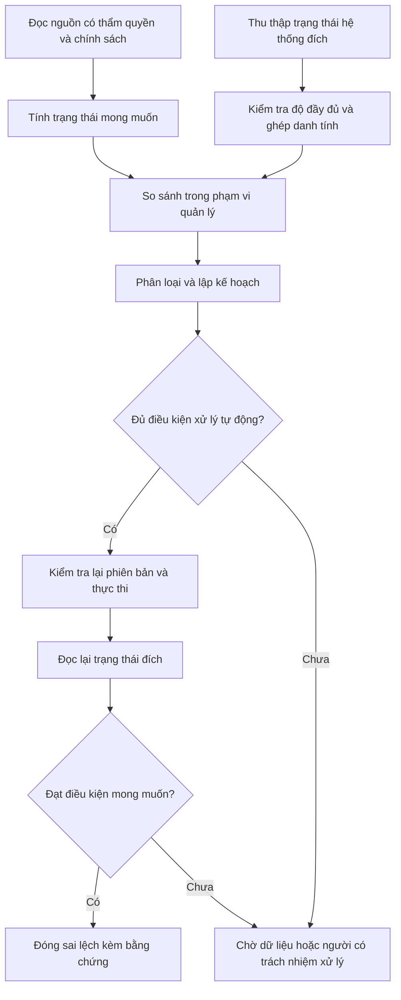

# Reconciliation

## 1. Vì sao cần đối soát sau provisioning?

Trong quản lý danh tính và quyền truy cập, **reconciliation** là quá trình thu thập trạng thái tài khoản, thuộc tính và quyền từ các hệ thống liên quan, đối chiếu với trạng thái mong muốn đã được xác định theo chính sách, rồi xử lý hoặc chuyển người có trách nhiệm giải quyết sai lệch. Có thể gọi đây là **đối soát danh tính và quyền truy cập**.

Provisioning gửi thay đổi xuống hệ thống đích: tạo tài khoản, cập nhật phòng ban, thêm nhóm hoặc cấp vai trò. Deprovisioning thu hồi những gì không còn hợp lệ. Reconciliation trả lời một câu hỏi khác: **trạng thái thực tế hiện nay có phù hợp với quyết định cấp và thu hồi quyền hay không?**

Một lệnh được ghi nhận là thành công chưa đủ để trả lời câu hỏi đó. Chẳng hạn:

- Connector đã gửi yêu cầu nhưng ứng dụng vẫn đang xử lý bất đồng bộ.
- Yêu cầu thu hồi thất bại và chưa được thử lại thành công.
- Quản trị viên cấp quyền trực tiếp trên ứng dụng sau lần đồng bộ gần nhất.
- Người dùng chuyển phòng ban nhưng nhóm cũ chưa bị gỡ.
- Một tài khoản cục bộ tồn tại từ trước khi ứng dụng được tích hợp với IAM.

Sai lệch giữa trạng thái mong muốn và trạng thái quan sát được thường được gọi là **drift**. Đối soát giúp phát hiện cả quyền thiếu gây gián đoạn công việc lẫn quyền thừa gây rủi ro truy cập. Với nguyên tắc ít quyền nhất, việc tìm ra quyền thừa quan trọng không kém việc cấp đủ quyền.

Ví dụ, Lan chuyển từ Kế toán sang Chăm sóc khách hàng. IAM đã cấp vai trò `support-reader`, nhưng quyền `payment-approver` trên ứng dụng tài chính vẫn còn. Nếu chỉ theo dõi lệnh cấp vai trò mới, quy trình có thể báo hoàn tất trong khi Lan vẫn có quyền duyệt thanh toán. Đối soát cần phát hiện và theo dõi việc loại bỏ quyền cũ đến khi có bằng chứng xác nhận.

## 2. Ba thành phần của phép đối soát

### 2.1. Trạng thái mong muốn

Trạng thái mong muốn là kết quả tính toán từ các nguồn và quyết định có thẩm quyền, không đơn thuần là bản sao của một bảng nhân sự. Những đầu vào thường gặp gồm:

- Danh tính còn hiệu lực, loại quan hệ lao động và ngày kết thúc từ nguồn quản lý nhân sự hoặc nhà thầu.
- Chính sách cấp quyền theo vai trò, bộ phận, địa điểm hoặc thuộc tính liên quan.
- Yêu cầu truy cập đã được phê duyệt, còn hiệu lực và đúng phạm vi.
- Ngoại lệ có người chịu trách nhiệm và thời điểm hết hạn.
- Các hạn chế như không được đồng thời yêu cầu và duyệt cùng một giao dịch.

Nguồn có thẩm quyền có thể khác nhau theo từng trường dữ liệu. Nhân sự có thể quyết định trạng thái làm việc, IAM quyết định tập quyền được phê duyệt, còn ứng dụng giữ một số tùy chọn cá nhân. Cần định nghĩa rõ quyền quyết định theo thuộc tính và quan hệ, thay vì coi một hệ thống luôn đúng đối với mọi dữ liệu.

Quyền thực tế đang có không tự trở thành quyền được phép có. Nếu phát hiện vai trò quản trị được thêm trực tiếp tại ứng dụng, đưa nó vào trạng thái mong muốn chỉ để làm hết sai lệch sẽ hợp thức hóa một thay đổi chưa được phê duyệt.

### 2.2. Trạng thái thực tế quan sát được

Đây là dữ liệu đọc từ hệ thống đích: tài khoản có tồn tại không, có đang hoạt động không, thuộc nhóm nào, được gán vai trò nào và những thuộc tính nào đang có giá trị.

Mỗi lần thu thập cần đi kèm thông tin về chất lượng quan sát: thời điểm đọc, phạm vi truy vấn, phân trang đã hoàn tất chưa, lỗi connector và phiên bản bản ghi nếu hệ thống cung cấp. Một danh sách tài khoản không có thông tin về độ đầy đủ có thể dẫn đến quyết định thu hồi sai.

Ví dụ, connector chỉ đọc được 200 trong 1.000 tài khoản vì lỗi ở trang thứ ba. 800 tài khoản chưa đọc được có trạng thái **chưa biết**, không phải đã bị xóa. Tương tự, tài khoản đọc dữ liệu không nhìn thấy một nhóm do thiếu quyền không chứng minh nhóm đó không tồn tại.

### 2.3. Quy tắc so sánh và phạm vi quản lý

Đối soát phải biết IAM được quản lý đối tượng và trường dữ liệu nào. Một ứng dụng có thể chứa đồng thời tài khoản nhân viên do IAM quản lý, tài khoản tích hợp do đội vận hành quản lý và tài khoản khẩn cấp có cơ chế kiểm soát riêng.

Phạm vi đọc để phát hiện có thể rộng hơn phạm vi được phép sửa. Nhìn thấy một tài khoản lạ không tự động cho phép hệ thống đối soát xóa tài khoản đó.

Cũng cần phân biệt hai mô hình quản lý quyền:

- **Quản lý toàn bộ một tập quyền xác định:** IAM có thẩm quyền quyết định toàn bộ quyền thuộc tập này. Quyền dư trong tập là ứng viên thu hồi sau các kiểm tra an toàn.
- **Quản lý bổ sung:** IAM chỉ chịu trách nhiệm cho các quyền do một luồng cụ thể cấp. Các quyền ngoài phạm vi đó cần được phân loại hoặc chuyển chủ sở hữu; không tự động bị coi là quyền được phép xóa.

Mô hình bổ sung không có nghĩa quyền ngoài phạm vi chắc chắn an toàn. Nó xác định ai có quyền xử lý, còn quyền đáng ngờ vẫn phải được điều tra.

## 3. Những sai lệch cần phân loại

| Loại sai lệch | Ví dụ | Hướng xử lý ban đầu |
|---|---|---|
| Thiếu tài khoản | Nhân viên thuộc phạm vi ứng dụng nhưng chưa có tài khoản | Kiểm tra ghép danh tính, điều kiện cấp và lỗi provisioning |
| Sai trạng thái | Người đã nghỉ việc vẫn có tài khoản hoạt động | Ưu tiên xử lý theo quy trình thu hồi, xác minh trạng thái thực tế |
| Sai thuộc tính | Phòng ban hoặc người quản lý chưa được cập nhật | Đối chiếu nguồn có thẩm quyền và quy tắc ánh xạ |
| Thiếu quyền | Quyền đã phê duyệt chưa xuất hiện ở đích | Kiểm tra thời điểm hiệu lực, điều kiện chính sách và quyền tương đương |
| Thừa quyền | Vai trò cũ vẫn còn sau khi chuyển vị trí | Xác định đường cấp quyền rồi lập phương án thu hồi |
| Tài khoản chưa xác định chủ | Có tài khoản ở đích nhưng chưa liên kết được danh tính | Điều tra nguồn gốc, chủ sở hữu và phạm vi trước khi xử lý |
| Ghép danh tính mơ hồ | Hai tài khoản cùng khớp một thuộc tính | Chặn sửa tự động và yêu cầu xác minh |
| Không đủ dữ liệu | API bị lỗi hoặc danh sách chưa đọc hết | Ghi nhận chưa biết; chưa kết luận khớp hoặc không tồn tại |

Một **orphan account**, tức tài khoản không còn liên kết với chủ thể hoặc chủ sở hữu hợp lệ theo tiêu chí quản trị, cần được phân biệt với tài khoản đơn thuần chưa ghép được. Một tài khoản dịch vụ có chủ sở hữu ở hệ thống khác có thể chưa được ghép trong IAM nhưng vẫn có mục đích hợp lệ. Việc phân loại phải dựa trên bằng chứng, không chỉ trên việc tài khoản vắng trong danh sách nhân viên.

## 4. Ghép đúng danh tính trước khi tính sai lệch

So sánh đúng thuộc tính của hai người khác nhau vẫn tạo ra kết quả nguy hiểm. Vì vậy, bước **correlation** — xác định tài khoản đích thuộc danh tính nào — phải diễn ra trước bước sửa sai lệch.

Một thiết kế thường dùng là lưu liên kết giữa mã danh tính ổn định trong IAM và mã tài khoản của ứng dụng:

```text
identityId: person-0742
targetSystem: expense-app
targetAccountId: account-39186
```

Tên hiển thị, email hoặc tên đăng nhập có thể thay đổi hoặc được cấp lại cho người khác. Không nên mặc định chúng là định danh bất biến. Với người nghỉ rồi quay lại làm việc, hệ thống cũng cần biết chính sách có khôi phục tài khoản cũ hay tạo một lần liên kết mới; không suy đoán chỉ vì email giống nhau.

Quy tắc ghép cần nêu rõ:

1. Thuộc tính nào được dùng để tìm ứng viên.
2. Điều kiện nào đủ để xác nhận liên kết.
3. Cách xử lý khi không có hoặc có nhiều ứng viên.
4. Cách phát hiện liên kết đã lỗi thời hoặc tài khoản được tái sử dụng.

Không chọn bản ghi đầu tiên khi kết quả có nhiều ứng viên. Đó là tình huống cần dừng thao tác tự động đối với các bản ghi liên quan và chuyển người có trách nhiệm xác minh.

Chuẩn hóa dữ liệu cũng phải theo ngữ nghĩa từng trường. Có thể so sánh tập thành viên mà không xét thứ tự, nhưng không được tùy tiện chuyển mọi định danh sang chữ thường hoặc bỏ ký tự. Quy tắc chuẩn hóa sai có thể làm hai tài khoản khác nhau bị coi là một.

## 5. Một chu trình đối soát hoàn chỉnh



### Bước 1: Chốt ngữ cảnh của lần chạy

Mỗi lần chạy nên có mã định danh, phạm vi ứng dụng, phiên bản chính sách và khoảng thời gian quan sát. Trạng thái mong muốn phải xét cả thời điểm hiệu lực. Một quyền được phê duyệt cho tuần sau chưa phải quyền cần cấp ngay hôm nay.

### Bước 2: Thu thập và kiểm tra dữ liệu

Đọc các nguồn cần thiết và kiểm tra phân trang, quyền của connector, độ mới dữ liệu, bản ghi bị lỗi và sự thay đổi bất thường về số lượng. Nếu nguồn nhân sự trả về rỗng do lỗi tích hợp, chưa được biến kết quả đó thành quyết định cho toàn bộ nhân viên nghỉ việc.

Hệ thống phân tán không nhất thiết cung cấp ảnh chụp đồng thời của mọi nguồn. Khi các lần đọc cách nhau đáng kể, cần ghi nhận khoảng thời gian đó và kiểm tra lại trước các thay đổi quan trọng.

### Bước 3: Tính sai lệch

Với một tài khoản đã ghép đúng, ký hiệu:

```text
D = tập quyền mong muốn hợp lệ tại thời điểm đánh giá
A = tập quyền thực tế quan sát được
M = tập quyền thuộc phạm vi IAM được phép quản lý

Quyền thiếu = (D ∩ M) − A
Quyền dư    = (A ∩ M) − D
```

Phép tính này giả định hai tập dùng cùng cách biểu diễn quyền. Ví dụ, nếu `A` chứa nhóm còn `D` chứa vai trò nghiệp vụ, cần có ánh xạ phù hợp trước khi lấy hiệu tập hợp.

Kết quả là **ứng viên thay đổi**, chưa phải lệnh thực thi. Quyền tạm thời đã được phê duyệt, ngoại lệ còn hạn và điều kiện nghiệp vụ phải được tính vào trạng thái mong muốn; dữ liệu thiếu, ghép mơ hồ hoặc phạm vi chưa rõ phải chặn quyết định tự động tương ứng.

### Bước 4: Lập kế hoạch và áp dụng kiểm soát

Mỗi đề xuất cần ghi rõ tài khoản, thuộc tính hoặc quan hệ bị ảnh hưởng, giá trị trước và sau, căn cứ chính sách, chủ sở hữu và mức rủi ro. Hành động ít rủi ro có thể tự động hóa theo chính sách; hành động có ảnh hưởng lớn cần quy trình phê duyệt hoặc kiểm tra riêng.

Trước khi thực thi, đọc lại hoặc kiểm tra phiên bản trạng thái mong muốn và bản ghi đích. Nếu chúng đã thay đổi, tính lại thay vì áp dụng kế hoạch cũ. Cơ chế điều kiện theo phiên bản chỉ dùng được khi hệ thống đích hỗ trợ; nếu không có, phải có biện pháp phối hợp và xác minh phù hợp với rủi ro.

### Bước 5: Xác minh và đóng vòng

Sau khi gửi thay đổi, đọc lại dữ liệu đích để xác nhận điều kiện sau thao tác. Với hệ thống xử lý bất đồng bộ, có thể cần chờ và đọc lại trong giới hạn thời gian đã định. Nếu hết thời gian mà chưa chứng minh được kết quả, giữ sai lệch ở trạng thái chưa xác minh và chuyển xử lý; không đánh dấu thành công chỉ từ phản hồi nhận lệnh.

Một chuỗi trạng thái vận hành minh họa là:

```text
DETECTED → PLANNED → APPLIED → VERIFIED → CLOSED
```

`APPLIED` chỉ phản ánh bước gửi hoặc thực hiện thay đổi theo quy ước nội bộ. `VERIFIED` cần bằng chứng quan sát điều kiện đích. Nếu chính sách thay đổi khiến đề xuất không còn phù hợp, hủy kế hoạch với lý do rõ ràng thay vì báo đã sửa thành công.

## 6. Ví dụ: đối soát sau khi nhân viên chuyển vị trí

Giả sử ứng dụng quản lý chi phí có các quyền `expense-read`, `expense-approve` và `expense-admin`. IAM có thẩm quyền quản lý ba quyền này cho tài khoản nhân viên. Tài khoản khẩn cấp được phát hiện nhưng thuộc quy trình quản lý riêng.

| Tài khoản | Trạng thái mong muốn | Trạng thái quan sát | Kết luận |
|---|---|---|---|
| `account-101` | Hoạt động, `expense-read` | Hoạt động, `expense-read`, `expense-approve` | Có ứng viên thu hồi `expense-approve` |
| `account-102` | Hoạt động, `expense-read` | Chưa tìm thấy tài khoản | Kiểm tra việc ghép và tính đầy đủ trước khi đề xuất tạo |
| `account-103` | Vô hiệu hóa sau khi nghỉ việc | Vẫn hoạt động | Sai lệch cần ưu tiên xử lý |
| `emergency-01` | Do quy trình tài khoản khẩn cấp quyết định | Hoạt động, `expense-admin` | Chuyển đúng chủ sở hữu; không tự xóa do vắng trong danh sách nhân viên |

Với `account-101`, quy trình xử lý có thể là:

1. Xác nhận liên kết tài khoản đúng người và việc chuyển vị trí đã có hiệu lực.
2. Tính trạng thái mong muốn từ chính sách và các phê duyệt còn hạn.
3. Xác định nguồn của `expense-approve`: gán trực tiếp, thành viên nhóm hay vai trò kế thừa.
4. Chọn thay đổi đúng đường cấp quyền và kiểm tra ảnh hưởng đến người khác.
5. Thực hiện sau khi kiểm tra lại dữ liệu và điều kiện an toàn.
6. Đọc lại quan hệ quyền; nếu có khả năng quan sát quyền hiệu lực, xác minh người dùng không còn quyền duyệt theo phạm vi cần kiểm tra.

Nếu quyền duyệt đến từ một nhóm, xóa một phép gán trực tiếp cùng tên có thể không giải quyết được vấn đề. Ngược lại, sửa vai trò dùng chung cho cả nhóm có thể ảnh hưởng nhiều người. Reconciliation cần xác định đúng **đường cấp quyền**, không chỉ so tên quyền cuối cùng.

Một hệ thống chỉ đọc được phép gán trực tiếp nên báo phạm vi xác minh là phép gán trực tiếp. Nó không nên tuyên bố đã kiểm chứng toàn bộ quyền hiệu lực khi chưa quan sát được nhóm lồng nhau, quyền kế thừa hoặc chính sách tại thời điểm truy cập.

## 7. Đối soát toàn bộ, gia tăng và theo sự kiện

**Đối soát toàn bộ** quét toàn bộ phạm vi đã xác định. Cách này hữu ích khi thiết lập ban đầu, kiểm tra lại sau thay đổi cấu hình lớn hoặc tìm sai lệch không xuất hiện trong luồng sự kiện. Đổi lại, nó tiêu tốn nhiều truy vấn và cần quản lý phân trang, giới hạn tốc độ, độ mới dữ liệu.

**Đối soát gia tăng** chỉ xử lý những đối tượng thay đổi từ mốc theo dõi trước đó. Mốc này có thể là cursor, watermark hoặc cơ chế tương đương do nguồn cung cấp. Nó giúp giảm khối lượng công việc, nhưng cần hiểu rõ nguồn có thông báo thay đổi, xóa và hết hạn mốc như thế nào. Không suy ra bản ghi đã bị xóa chỉ vì nó không xuất hiện trong một tập thay đổi gia tăng.

**Đối soát theo sự kiện** được kích hoạt khi có thay đổi như chuyển bộ phận hoặc kết thúc hợp đồng. Cách này giúp phản ứng nhanh, nhưng sự kiện có thể đến trùng, đến muộn hoặc sai thứ tự. Việc xử lý phải xét trạng thái có thẩm quyền hiện tại và thời điểm hiệu lực, không áp dụng máy móc từng thông báo theo thứ tự nhận.

Trong một triển khai cụ thể, Microsoft Entra mô tả chu kỳ provisioning ban đầu rồi các chu kỳ gia tăng, sử dụng watermark để theo dõi thay đổi. Đây là ví dụ về cơ chế của sản phẩm; không phải mọi connector đều có cùng chu kỳ hoặc khả năng quan sát. [Tài liệu về chu kỳ provisioning của Microsoft Entra](https://learn.microsoft.com/en-us/entra/identity/app-provisioning/how-provisioning-works).

Một phương án thiết kế là dùng sự kiện cho phản ứng nhanh, xử lý gia tăng cho vận hành thường xuyên và quét rộng hơn theo lịch để phát hiện các khoảng trống. Tần suất cần dựa trên rủi ro, cam kết thu hồi, khả năng API và mức bao phủ thực tế; không có một khoảng thời gian chung phù hợp cho mọi ứng dụng.

Với workload hoặc tài khoản dịch vụ, nguồn có thẩm quyền có thể là danh mục dịch vụ và thông tin chủ sở hữu thay vì hệ thống nhân sự. Nguyên tắc đối soát vẫn tương tự, nhưng điều kiện tồn tại, ngừng hoạt động và phụ thuộc vận hành phải được xác định riêng.

## 8. Kiểm soát việc sửa sai lệch

### 8.1. Dừng theo mức độ bất thường

Nếu một lần chạy đột ngột đề xuất vô hiệu hóa phần lớn tài khoản, cần kiểm tra khả năng nguồn rỗng, lỗi bộ lọc, sai ánh xạ hoặc mất quyền đọc. Các ngưỡng theo số lượng, tỷ lệ và nhóm tài khoản quan trọng có thể giúp giới hạn ảnh hưởng. Ngưỡng chỉ là tín hiệu kiểm soát, không chứng minh các thay đổi dưới ngưỡng đều đúng.

Microsoft Entra có tính năng phòng tránh xóa nhầm bằng ngưỡng, đưa các thay đổi liên quan vào trạng thái cần xem xét khi chạm điều kiện kiểm soát. Tính năng này minh họa việc bổ sung chốt an toàn cho luồng thu hồi tự động. [Tài liệu về phòng tránh xóa nhầm](https://learn.microsoft.com/en-us/entra/identity/app-provisioning/accidental-deletions).

Chặn một lô thay đổi do dữ liệu chưa đáng tin không có nghĩa bỏ qua một trường hợp nghỉ việc đã được xác minh độc lập. Trường hợp khẩn cấp vẫn cần được xử lý qua quy trình có thẩm quyền, với bằng chứng và phạm vi riêng.

### 8.2. Không nhầm vô hiệu hóa với xóa

Vô hiệu hóa, gỡ quyền và xóa tài khoản là những hành động khác nhau. Xóa có thể làm mất liên kết dữ liệu nghiệp vụ hoặc khó khôi phục. Tùy ứng dụng, quy trình có thể cần chặn truy cập, thu hồi quyền, chuyển giao dữ liệu rồi mới xử lý tài khoản theo chính sách lưu giữ.

Vô hiệu hóa tài khoản ở một hệ thống cũng chưa chắc kết thúc mọi phiên đăng nhập, token hoặc khóa truy cập đã được cấp. Nếu mục tiêu là chấm dứt truy cập, điều kiện hoàn thành phải xét các cơ chế có liên quan trong phạm vi ứng dụng. Không đưa bí mật, token hoặc mật khẩu vào log đối soát để chứng minh việc thu hồi.

### 8.3. Xử lý thử lại và cạnh tranh thay đổi

Thao tác cần hướng đến tính **idempotent**: chạy lại cùng một ý định hợp lệ không tạo thêm tài khoản hoặc quan hệ quyền trùng. Sau khi tạo tài khoản bị timeout, cần tra cứu và xác định kết quả trước khi thử tạo lại; timeout không khẳng định yêu cầu đầu tiên thất bại.

Lỗi tạm thời có thể được thử lại với khoảng chờ tăng dần và giới hạn phù hợp. Lỗi dữ liệu như ghép mơ hồ hoặc thuộc tính không hợp lệ cần được phân loại để xử lý, thay vì lặp vô hạn. Trong mọi lần thử lại, phải kiểm tra ý định còn hiệu lực; một lệnh cấp quyền cũ không được khôi phục quyền vừa bị thu hồi hợp lệ.

Hai lần đối soát cũng có thể cùng nhìn thấy một sai lệch. Cần phối hợp theo tài khoản hoặc công việc, chống xử lý trùng và phát hiện phiên bản thay đổi. Dù có cơ chế phối hợp, bước xác minh sau ghi vẫn cần thiết vì hệ thống đích có thể nhận thay đổi từ những kênh khác.

### 8.4. Giữ ngoại lệ có kiểm soát

Ngoại lệ cần có lý do, người phê duyệt, chủ sở hữu, phạm vi và thời điểm hết hạn. Tại thời điểm đánh giá, ngoại lệ hợp lệ có thể ảnh hưởng trạng thái mong muốn. Sau khi hết hạn, phải đánh giá lại theo chính sách.

Không giải quyết sai lệch bằng cách thêm tài khoản vào danh sách bỏ qua vô thời hạn. Nếu phải tạm hoãn xử lý, bản ghi cần tiếp tục thể hiện rủi ro còn mở và người chịu trách nhiệm.

## 9. Mã giả cho bước lập kế hoạch

Ví dụ dưới đây minh họa tư duy lập kế hoạch, không phải mã dùng trực tiếp cho một sản phẩm. Các hàm kiểm tra bao gồm quy tắc nghiệp vụ và chất lượng dữ liệu của từng hệ thống.

```text
function planReconciliation(identityId, targetSystem):
    context = loadAuthoritativeContext(identityId, targetSystem)
    if not context.isValidForDecision():
        return WAIT_FOR_VALID_SOURCE

    link = correlateIdentity(identityId, targetSystem)
    if link.isAmbiguous():
        return MANUAL_REVIEW

    observation = observeTarget(identityId, link, targetSystem)
    if not observation.isSufficientForDecision():
        return WAIT_FOR_TARGET_EVIDENCE

    desired = evaluatePolicy(context)
    scope = resolveManagementAuthority(identityId, targetSystem)
    if not scope.isKnown():
        return MANUAL_REVIEW

    candidates = compare(desired, observation, scope)
    plan = attachReasonsAndPreconditions(candidates, context, observation)

    if plan.hasAmbiguousRightsOrProtectedAccounts():
        return MANUAL_REVIEW
    if not passesBatchSafetyControls(plan):
        return HOLD_AND_INVESTIGATE

    return PLAN_READY_FOR_AUTHORIZED_EXECUTION
```

Hàm không thực hiện thay đổi ngay sau khi tính hiệu hai tập quyền. Tách lập kế hoạch khỏi thực thi giúp xem xét ảnh hưởng, kiểm tra lại điều kiện và lưu bằng chứng. Trước khi áp dụng một kế hoạch đã chờ lâu, cần đánh giá lại độ mới của dữ liệu và hiệu lực phê duyệt.

## 10. Bằng chứng và chỉ số vận hành

Một bản ghi sai lệch có ích nên cho biết đối tượng nào bị ảnh hưởng, nguồn và chính sách nào dẫn đến trạng thái mong muốn, đã quan sát gì ở đích, hành động nào được chọn và kết quả xác minh ra sao. Có thể lưu mã lần chạy, thời điểm phát hiện, phiên bản, mã yêu cầu, người xử lý và thời điểm đóng để truy vết. Chỉ thu thập dữ liệu cần thiết và bảo vệ log vì chúng chứa thông tin danh tính và quyền truy cập.

Các chỉ số nên phản ánh kết quả, không chỉ số lần gửi lệnh:

- Số sai lệch còn mở theo loại, mức rủi ro và hệ thống đích.
- Thời gian từ lúc phát hiện đến khi xác minh xử lý xong.
- Số trường hợp thu hồi quá thời hạn đã cam kết.
- Số tài khoản chưa xác định được chủ sở hữu hoặc ghép mơ hồ.
- Tỷ lệ phạm vi được quan sát thành công và tuổi của lần quét đầy đủ gần nhất.
- Số ngoại lệ hết hạn, số công việc chờ xác minh và số lô bị giữ để điều tra.

“Không phát hiện sai lệch” chỉ có ý nghĩa cùng thông tin về mức bao phủ. Nếu connector chỉ quan sát được một phần ứng dụng, báo cáo phải thể hiện phần chưa biết. Đừng trình bày số không như bằng chứng hệ thống đã hoàn toàn tuân thủ.

Reconciliation cũng khác **access review**, tức việc người có trách nhiệm xem xét một quyền còn cần thiết và hợp lệ về nghiệp vụ hay không. Đối soát kiểm tra sự phù hợp giữa quyết định và thực tế; access review có thể thay đổi chính quyết định đó. Hai cơ chế bổ sung cho nhau: một hệ thống có thể khớp hoàn toàn với danh sách quyền đã phê duyệt nhưng danh sách ấy vẫn cần được xem xét lại.

## 11. Tình huống tự kiểm tra

**Nguồn nhân sự trả về danh sách rỗng. Có nên vô hiệu hóa mọi tài khoản nhân viên?**

Chưa. Trước hết phải xác minh dữ liệu có đầy đủ và phản ánh trạng thái nghiệp vụ thật hay không. Giữ các quyết định phụ thuộc nguồn chưa đáng tin, cảnh báo người chịu trách nhiệm và kiểm tra tích hợp. Những trường hợp thu hồi đã có bằng chứng độc lập vẫn được xử lý qua quy trình riêng có thẩm quyền.

**Lệnh gỡ vai trò trả về thành công nhưng lần đọc lại vẫn thấy vai trò đó. Có thể đóng sai lệch không?**

Chưa đủ bằng chứng để đóng. Cần xét độ trễ xử lý, khả năng dữ liệu đọc còn cũ và các đường cấp quyền khác. Tiếp tục xác minh trong giới hạn đã định hoặc chuyển xử lý, thay vì coi phản hồi nhận lệnh là trạng thái cuối cùng.

**Một tài khoản không có trong IAM nhưng đang có quyền quản trị. Bước đầu tiên là xóa tài khoản?**

Bước đầu là xác định chủ thể, nguồn gốc, mục đích, phạm vi quản lý và rủi ro. Nó có thể là tài khoản khẩn cấp hợp lệ, tài khoản dịch vụ thiếu liên kết hoặc tài khoản trái phép. Kết quả điều tra và quy trình ứng phó quyết định biện pháp tiếp theo.

**Một quyền bị thu hồi hôm qua xuất hiện trở lại sau lần đối soát hôm nay. Cần kiểm tra gì?**

Kiểm tra phiên bản chính sách và dữ liệu nguồn, công việc thử lại còn tồn, thứ tự sự kiện, đường cấp quyền kế thừa và thay đổi trực tiếp tại ứng dụng. Sửa biểu hiện một lần chưa đủ nếu nguồn quyết định hoặc cơ chế cấp vẫn tiếp tục tái tạo quyền đó.

Khi triển khai, tiêu chí hoàn thành cần gắn với trạng thái đã xác minh trong phạm vi quan sát cụ thể: danh tính được ghép đúng, nguồn đủ tin cậy, thay đổi nằm trong thẩm quyền và sai lệch được đóng bằng bằng chứng ở hệ thống đích.
