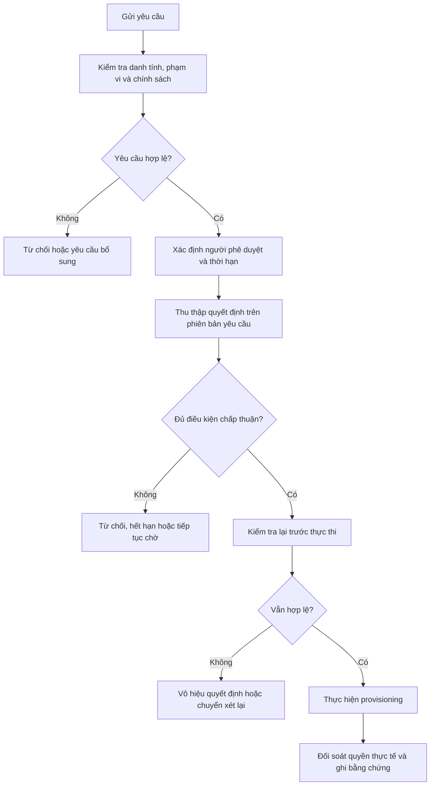

# Approval workflow

## 1. Vai trò của phê duyệt trong vòng đời quyền truy cập

**Approval workflow** là quy trình xác định một yêu cầu thay đổi quyền cần ai chấp thuận, dựa trên điều kiện nào, trong bao lâu và với bằng chứng gì. Trong provisioning và deprovisioning, workflow thường xử lý yêu cầu cấp tài khoản, thêm vai trò, mở quyền đặc quyền, gia hạn hoặc thay đổi phạm vi truy cập.

Ví dụ, một nhân viên cần đọc báo cáo doanh thu để tham gia dự án trong 30 ngày. Việc nhân viên đăng nhập thành công không chứng minh họ cần quyền này. Workflow giúp người có trách nhiệm xác nhận nhu cầu nghiệp vụ, chủ sở hữu dữ liệu kiểm tra phạm vi, rồi hệ thống cấp đúng quyền đã được duyệt với ngày hết hạn cụ thể.

Cần phân biệt bốn hoạt động:

| Hoạt động | Câu hỏi được giải quyết | Kết quả |
|---|---|---|
| Xác thực | Người hoặc workload đang hành động là ai? | Danh tính đã được xác thực |
| Phê duyệt | Nhu cầu thay đổi quyền này có được chấp nhận không? | Quyết định gắn với một yêu cầu cụ thể |
| Cấp phát hoặc thu hồi | Thay đổi đã được thực hiện tại hệ thống đích chưa? | Kết quả thực thi và bằng chứng đối soát |
| Kiểm tra quyền khi sử dụng | Chủ thể có được thực hiện hành động này tại thời điểm hiện tại không? | Cho phép hoặc từ chối truy cập |

Một yêu cầu được phê duyệt không tự tạo ra quyền. Ngược lại, việc quyền đã xuất hiện ở hệ thống đích cũng chưa chứng minh quyền đó được cấp hợp lệ. Hệ thống cần liên kết được nhu cầu, quyết định, lần thực thi và quyền thực tế.

## 2. Thành phần của một workflow

Một workflow IAM thường có các vai trò sau:

- **Requester:** người hoặc hệ thống gửi yêu cầu. Requester có thể yêu cầu cho chính mình hoặc thay mặt người khác nếu được phép.
- **Subject:** danh tính sẽ nhận hoặc mất quyền; có thể là nhân viên, đối tác hoặc workload.
- **Approver:** người có thẩm quyền đưa ra quyết định cho phạm vi đang xét.
- **Policy engine:** thành phần áp dụng chính sách để xác định tính hợp lệ, mức rủi ro và tuyến phê duyệt.
- **Workflow engine:** quản lý trạng thái, thời hạn, quyết định và việc chuyển bước.
- **Provisioning connector:** thực hiện thay đổi trong directory, ứng dụng hoặc nền tảng đích.
- **Auditor hoặc reviewer:** xem lại bằng chứng khi kiểm toán, điều tra hoặc rà soát quyền.

Luồng thông thường:



Workflow phải xác định rõ ai chịu trách nhiệm ở từng bước. Gửi email cho một nhóm người mà không có quy tắc quyết định, thời hạn và trạng thái cuối chưa tạo thành một quy trình phê duyệt có thể kiểm soát.

## 3. Yêu cầu phải có phạm vi rõ và có phiên bản

Một approver cần biết chính xác họ đang đồng ý điều gì. Yêu cầu “cấp quyền hệ thống tài chính” quá rộng; yêu cầu “cấp vai trò đọc báo cáo doanh thu của dự án A trong 30 ngày” có thể được đánh giá và kiểm chứng.

Thông tin cốt lõi gồm danh tính đích, tài nguyên, hành động hoặc entitlement, lý do nghiệp vụ, thời gian hiệu lực và người sở hữu. Với workload, cần thêm chủ sở hữu nghiệp vụ hoặc kỹ thuật có trách nhiệm đối với workload đó.

Ví dụ dữ liệu yêu cầu minh họa, không phải schema bắt buộc của một sản phẩm:

```yaml
requestId: req-8402
requestVersion: 1
requesterId: employee-104
subjectId: employee-104
targetSystem: reporting-production
entitlementId: revenue-report-reader
scope:
  projectId: project-a
validFrom: "2026-12-01T00:00:00Z"
validUntil: "2026-12-31T00:00:00Z"
businessReason: "Đối soát doanh thu dự án A trong kỳ tháng 12"
```

Các trường quản trị như trạng thái, người phê duyệt có thẩm quyền, mức rủi ro và kết quả kiểm tra chính sách phải được hệ thống xác định hoặc xác minh. Không tin trực tiếp giá trị do requester gửi lên cho các trường này. Danh tính requester được lấy từ ngữ cảnh xác thực, không từ một `requesterId` tùy ý trong request body.

Mỗi quyết định cần gắn với `requestId` và `requestVersion`, hoặc với dấu vân tay của nội dung cần phê duyệt. Dấu vân tay giúp phát hiện nội dung bị thay đổi; nó không thay thế xác thực người phê duyệt hay kiểm tra thẩm quyền.

Nếu sau khi duyệt, requester đổi từ quyền đọc sang quyền ghi, thêm tài nguyên hoặc kéo dài thời hạn, quyết định cũ không còn đủ giá trị cho phạm vi mới. Hệ thống tạo phiên bản mới và đánh giá lại các bước bị ảnh hưởng. Chỉ những chỉnh sửa không làm thay đổi quyết định, chẳng hạn bổ sung thông tin liên hệ, mới có thể giữ phê duyệt cũ nếu chính sách quy định rõ.

## 4. Chọn tuyến phê duyệt theo rủi ro

Không phải quyền nào cũng cần cùng số người duyệt. Thêm quá nhiều bước cho mọi yêu cầu có thể gây chậm trễ và khiến approver duyệt theo thói quen. Tuyến phê duyệt cần tương xứng với tác động của quyền và cơ chế kiểm soát đã có.

| Loại thay đổi | Ví dụ tuyến xử lý | Điểm cần xác nhận |
|---|---|---|
| Quyền cơ bản theo vai trò công việc | Tự động theo chính sách đã được phê chuẩn | Danh tính, đơn vị và điều kiện nhận quyền còn hợp lệ |
| Quyền đọc dữ liệu nội bộ theo yêu cầu | Quản lý hoặc chủ sở hữu tài nguyên | Nhu cầu và phạm vi nghiệp vụ |
| Quyền trên dữ liệu nhạy cảm | Chủ sở hữu dữ liệu, thêm bên kiểm soát theo chính sách | Phạm vi dữ liệu, mục đích, thời hạn và nghĩa vụ bảo vệ |
| Quyền quản trị production | Chủ hệ thống và người phê duyệt độc lập theo chính sách | Mức đặc quyền, thời gian sử dụng và khả năng giám sát |
| Quyền tạo xung đột nhiệm vụ | Chặn hoặc xử lý ngoại lệ riêng | Xung đột, người chịu trách nhiệm và biện pháp bù đắp |

Đây là các ví dụ thiết kế, không phải quy định cứng áp dụng cho mọi tổ chức. Người quản lý thường biết nhu cầu công việc nhưng có thể không đủ chuyên môn để đánh giá quyền trên một hệ thống đặc thù. Chủ sở hữu ứng dụng biết ý nghĩa entitlement nhưng có thể cần quản lý xác nhận nhiệm vụ của nhân viên.

### Tuần tự, song song và điều kiện tổng hợp

Phê duyệt **tuần tự** phù hợp khi quyết định sau phụ thuộc quyết định trước. Phê duyệt **song song** giảm thời gian chờ khi các bên đánh giá độc lập. Dù chọn cách nào, workflow phải định nghĩa điều kiện hoàn thành: tất cả bên bắt buộc đồng ý, một người đủ thẩm quyền đại diện nhóm, hay một số lượng quyết định độc lập tối thiểu.

Ví dụ, nếu chính sách yêu cầu quản lý và chủ sở hữu dữ liệu đều đồng ý, một phiếu đồng ý của quản lý không đủ để cấp quyền. Nếu cùng một người đồng thời giữ cả hai vai trò, cần xác định chính sách có yêu cầu hai cá nhân độc lập hay chỉ cần hai trách nhiệm được xác nhận. Không tự đếm một người thành hai người khi mục tiêu là kiểm soát độc lập.

### Tự phê duyệt và phân tách nhiệm vụ

Một requester không nên tự duyệt quyền cho chính mình chỉ vì họ thuộc nhóm approver. Kiểm tra cần dựa vào các định danh thực tế và quan hệ giữa requester, subject, approver; đổi tài khoản hoặc gửi yêu cầu thay mặt không được trở thành cách vượt kiểm soát.

Với quyền có rủi ro cao, chính sách có thể yêu cầu người phê duyệt khác subject và khác người thực thi thủ công. Nếu không tìm được người đủ thẩm quyền, workflow chuyển cho cấp xử lý đã định nghĩa hoặc báo không thể tiếp tục; không mặc định chấp thuận.

## 5. Tách trạng thái quyết định khỏi trạng thái thực thi

Một lỗi thiết kế thường gặp là dùng duy nhất trạng thái `APPROVED` để thông báo “người dùng đã có quyền”. Phê duyệt có thể hoàn tất nhưng connector chưa chạy, hệ thống đích đang lỗi hoặc chỉ một phần quyền đã được áp dụng.

Nên quản lý hai khía cạnh riêng:

| Khía cạnh | Trạng thái minh họa | Ý nghĩa |
|---|---|---|
| Quyết định | `REQUESTED`, `UNDER_REVIEW` | Chưa đủ điều kiện cho thực thi |
| Quyết định | `APPROVED` | Nội dung cụ thể đã được chấp thuận, còn phải kiểm tra điều kiện thực thi |
| Quyết định | `REJECTED`, `CANCELLED`, `EXPIRED` | Không được dùng yêu cầu này để cấp quyền mới |
| Quyết định | `INVALIDATED` | Quyết định cũ không còn hợp lệ do thay đổi có liên quan |
| Thực thi | `NOT_STARTED`, `QUEUED`, `APPLYING` | Chưa xác nhận quyền đã có hiệu lực |
| Thực thi | `APPLIED`, `VERIFIED` | Đã gửi hoặc áp dụng thay đổi; `VERIFIED` có bằng chứng đối soát theo tiêu chí đã định |
| Thực thi | `FAILED`, `PARTIALLY_APPLIED` | Thay đổi chưa đạt đầy đủ trạng thái mong muốn |

Tên trạng thái có thể khác tùy hệ thống. Điều cần giữ là không suy diễn kết quả thực thi từ quyết định nghiệp vụ.

Mỗi chuyển trạng thái cần kiểm tra trạng thái hiện tại, phiên bản yêu cầu, quyền của tác nhân và điều kiện thời gian. Một quyết định đến sau khi yêu cầu đã bị hủy không được làm yêu cầu sống lại. Lệnh gửi từ một màn hình đã cũ cần bị từ chối hoặc yêu cầu tải lại dữ liệu.

## 6. Đảm bảo quyết định còn hợp lệ khi thực thi

Thời điểm duyệt và thời điểm cấp quyền có thể cách nhau nhiều giờ. Trong khoảng đó, subject có thể nghỉ việc, chuyển bộ phận, phát sinh xung đột nhiệm vụ hoặc yêu cầu bị hủy. Approver cũng có thể mất thẩm quyền hoặc tài nguyên bị phân loại lại.

Trước provisioning, hệ thống cần kiểm tra lại tối thiểu:

1. Yêu cầu và phiên bản đang thực thi vẫn là phiên bản được duyệt.
2. Yêu cầu chưa bị hủy, hết hạn hoặc vô hiệu.
3. Subject vẫn ở trạng thái được phép nhận quyền và vẫn đáp ứng điều kiện áp dụng.
4. Các phê duyệt bắt buộc đã đủ và còn được chấp nhận theo chính sách.
5. Quyền, tài nguyên và thời hạn không vượt phạm vi đã duyệt.
6. Những kiểm tra bắt buộc như xung đột nhiệm vụ vẫn đạt.

Khi chính sách hoặc thẩm quyền thay đổi, tổ chức phải xác định quyết định trước đó còn giá trị hay cần xét lại. Cần lưu phiên bản chính sách đã dùng và các kiểm tra mới, thay vì tự động coi mọi quyết định lịch sử còn hiệu lực vô thời hạn.

Pseudocode sau chỉ diễn đạt các điều kiện, chưa phải một triển khai xử lý cạnh tranh đầy đủ:

```text
function prepareProvisioning(requestId, expectedVersion):
    request = loadRequest(requestId)
    require request.version == expectedVersion
    require request.decision == APPROVED
    require now < request.approvalExpiresAt
    require now < request.validUntil
    require subjectIsEligible(request.subjectId)
    require mandatoryApprovalsAreValid(request)
    require currentPolicyAllowsExecution(request)

    recordProvisioningIntent(request.id, request.version,
                             request.entitlementId, request.scope)
```

Với yêu cầu có thời điểm bắt đầu trong tương lai, cần lên lịch hoặc áp dụng cơ chế hiệu lực phù hợp để không mở quyền sớm hơn thời gian đã được duyệt.

### Cạnh tranh giữa cấp và thu hồi quyền

Chỉ kiểm tra trạng thái rồi gọi connector vẫn có khoảng trống: ngay sau kiểm tra, một sự kiện nghỉ việc có thể xảy ra trong khi lệnh cấp quyền đang bay tới hệ thống đích.

Workflow cần phối hợp phiên bản trạng thái, kiểm soát chuyển trạng thái và cơ chế đồng bộ với hệ thống ngoài. Một thiết kế có thể ghi ý định thực thi cùng sự kiện vào transaction nội bộ, sau đó dùng outbox để chuyển cho connector. Tuy nhiên, outbox chỉ giúp giao sự kiện đáng tin cậy hơn; nó không làm database IAM và hệ thống đích trở thành một transaction nguyên tử.

Khi có deprovisioning, cần vô hiệu hóa yêu cầu cấp quyền cũ, ngăn các lệnh đang chờ và xử lý lệnh đã được gửi. Nếu hệ thống đích hỗ trợ phiên bản hoặc điều kiện cập nhật, có thể dùng chúng để từ chối lệnh cũ. Nếu không, phải có bước thu hồi bù, đối soát lại và cảnh báo khi chưa xác nhận đã đóng quyền. Khóa nội bộ không tự ngăn được một lệnh cũ đang được xử lý ở hệ thống khác.

## 7. Thực thi có thể retry nhưng không cấp quyền lặp ngoài ý muốn

Connector có thể gặp timeout sau khi hệ thống đích đã áp dụng thay đổi. Nếu retry bằng một lệnh tạo mới không được kiểm soát, hệ thống có thể tạo tài khoản trùng, gửi nhiều lời mời hoặc áp dụng nhiều entitlement không mong muốn.

Một thao tác nên có định danh ổn định cho cùng ý định thực thi, chẳng hạn kết hợp mã yêu cầu, phiên bản, hệ thống đích và thay đổi cụ thể. Nếu đích hỗ trợ idempotency key, gửi cùng key cho các lần thử lại của thao tác đó. Nếu không hỗ trợ, connector cần đọc và đối chiếu trạng thái đích theo định danh ổn định trước khi quyết định tạo, sửa hay giữ nguyên.

Không dùng một key cho hai nội dung khác nhau. Khi thay đổi phiên bản hoặc phạm vi, hệ thống cần phân biệt đó là ý định mới và đánh giá lại tính hợp lệ của nó.

Với một yêu cầu cấp quyền trên nhiều hệ thống, thành công tại hệ thống A và thất bại tại hệ thống B phải được báo là kết quả một phần. Chính sách cần chỉ rõ có được duy trì phần đã cấp hay phải thu hồi. Trước khi thu hồi bù, cần kiểm tra nguồn cấp và trạng thái hiện tại để tránh xóa một quyền hợp lệ vốn đã tồn tại từ yêu cầu khác.

Người dùng chỉ nên nhận thông báo “đã sẵn sàng sử dụng” sau khi đạt tiêu chí xác nhận thực tế. Với hệ thống đồng bộ bất đồng bộ, có thể thông báo “đã được phê duyệt, đang chờ cấp quyền” kèm trạng thái và đầu mối xử lý.

## 8. Thời hạn, từ chối, ủy quyền và yêu cầu bổ sung

Cần phân biệt **hạn chờ phê duyệt** với **thời gian hiệu lực của quyền**. Yêu cầu có thể hết hạn sau hai ngày chưa được xử lý, trong khi quyền sau khi cấp chỉ được sử dụng trong 30 ngày. Phê duyệt cũng có thể có thời hạn sử dụng riêng: một quyết định quá cũ cần được xác nhận lại trước khi thực thi.

Một số quy tắc vận hành quan trọng:

- **Timeout:** nhắc việc, chuyển cấp theo tuyến đã định hoặc kết thúc yêu cầu. Im lặng không được hiểu là đồng ý.
- **Từ chối:** lưu người từ chối và lý do phù hợp; requester có thể gửi yêu cầu mới hoặc chỉnh thành phiên bản mới theo chính sách.
- **Yêu cầu bổ sung:** giữ trạng thái chờ thông tin, không tính như một quyết định đồng ý.
- **Ủy quyền:** chỉ cho người có phạm vi và thời hạn ủy quyền hợp lệ; kiểm tra lại tự phê duyệt và tính độc lập.
- **Hủy:** ngừng các bước chưa chạy; nếu quyền đã được áp dụng thì cần thao tác thu hồi riêng và xác nhận kết quả.
- **Gia hạn:** đánh giá lại nhu cầu, trạng thái subject và rủi ro; không mặc định sao chép phê duyệt cũ vô hạn.

Một email nhắc việc có thể chứa liên kết tới trang xét duyệt, nhưng việc biết URL không tạo ra quyền phê duyệt. Khi approver thao tác, hệ thống vẫn xác thực phiên, kiểm tra thẩm quyền ở phía máy chủ và áp dụng biện pháp chống giả mạo yêu cầu phù hợp. Quyết định nhạy cảm có thể cần xác thực tăng cường theo chính sách.

Màn hình xét duyệt nên hiển thị entitlement cụ thể, tài nguyên, thời hạn, quyền hiện có liên quan và rủi ro đáng chú ý. Tránh nút duyệt hàng loạt che mất khác biệt quan trọng giữa các yêu cầu.

## 9. Deprovisioning và truy cập khẩn cấp

### Thu hồi không được mắc kẹt trong hàng đợi duyệt cấp quyền

Không nên áp dụng máy móc cùng tuyến phê duyệt cho mọi hành động thu hồi. Khi nguồn nhân sự có thẩm quyền xác nhận nghỉ việc, hoặc có tín hiệu sự cố đủ điều kiện theo chính sách, hệ thống cần vô hiệu hóa và thu hồi kịp thời theo quy trình đã định. Chờ quản lý nhấn duyệt từng ứng dụng có thể kéo dài thời gian lộ quyền.

Điều này không có nghĩa bất kỳ ai cũng được gửi lệnh vô hiệu hóa tùy ý. Nguồn sự kiện, người yêu cầu và quyền kích hoạt deprovisioning vẫn phải được kiểm soát. Với các thay đổi thu hồi thông thường có thể gây gián đoạn lớn, tổ chức có thể yêu cầu phối hợp và phê duyệt; cần tách rõ trường hợp đó khỏi quy trình ứng phó khẩn cấp hoặc nghỉ việc đã được xác nhận.

Vô hiệu hóa tài khoản và xóa tài khoản cũng là hai việc khác nhau. Việc xóa có thể phải chờ bàn giao dữ liệu hoặc đáp ứng yêu cầu lưu giữ. Không vì chờ phê duyệt xóa dữ liệu mà trì hoãn việc chặn truy cập cần thực hiện ngay.

Đóng tài khoản tại IdP có thể chưa thu hồi hết phiên cục bộ, token, khóa API và quyền được cấp trực tiếp ở ứng dụng. Bằng chứng deprovisioning cần phản ánh phạm vi thực tế đã xử lý, các giới hạn và phần còn tồn tại; không chỉ ghi “yêu cầu thu hồi đã được duyệt”.

### Truy cập khẩn cấp

Tình huống khẩn cấp có thể cần quy trình break-glass riêng với điều kiện kích hoạt được quy định trước, phạm vi hẹp, thời hạn ngắn, ghi nhận danh tính, cảnh báo và rà soát sau sử dụng. Tùy chính sách, một số bước phê duyệt có thể được rút gọn hoặc chuyển sang kiểm tra sau; các trách nhiệm đó vẫn phải được ghi rõ.

Break-glass không được biến thành cách sử dụng đặc quyền thường ngày. Cần xác nhận quyền đã hết hiệu lực hoặc đã bị thu hồi sau sự kiện, thay vì chỉ đóng phiếu yêu cầu.

## 10. Ví dụ xuyên suốt: quyền đọc báo cáo production

Lan cần quyền `revenue-report-reader` của dự án A trong 30 ngày. Chính sách của tổ chức trong ví dụ yêu cầu quản lý xác nhận nhu cầu và chủ sở hữu dữ liệu đồng ý độc lập.

1. Lan đăng nhập và gửi yêu cầu cho chính mình. Hệ thống kiểm tra Lan đang hoạt động, entitlement tồn tại, phạm vi hợp lệ và thời hạn nằm trong giới hạn cho phép.
2. Hệ thống tạo phiên bản 1, xác định hai approver từ nguồn có thẩm quyền và ghi tuyến phê duyệt. Lan không được sửa trực tiếp danh sách approver.
3. Quản lý và chủ sở hữu dữ liệu xem cùng phiên bản. Quản lý đồng ý, nhưng yêu cầu vẫn chờ vì chưa đủ hai quyết định bắt buộc.
4. Chủ sở hữu dữ liệu đồng ý. Quyết định chuyển sang `APPROVED`; thực thi vẫn là `NOT_STARTED` hoặc `QUEUED`.
5. Trước khi cấp quyền, hệ thống kiểm tra lại trạng thái nhân sự, phiên bản, thời hạn và các điều kiện chính sách. Nếu Lan đã nghỉ việc, yêu cầu cũ không được tiếp tục cấp quyền.
6. Connector thực hiện thay đổi bằng định danh thao tác ổn định, rồi đối chiếu subject, entitlement và phạm vi ở hệ thống đích. Khi đủ bằng chứng, thực thi chuyển sang `VERIFIED`.
7. Hệ thống theo dõi ngày hết hạn. Nếu ứng dụng không hỗ trợ quyền có hạn, cần lịch thu hồi và cơ chế đối soát; ghi một ngày hết hạn trong IAM chưa tự làm quyền ở ứng dụng biến mất.
8. Hết thời hạn, quyền được thu hồi và xác nhận. Nếu cần tiếp tục, Lan gửi yêu cầu gia hạn để đánh giá lại nhu cầu.

Nếu ở bước 3 Lan đổi yêu cầu sang `revenue-report-editor`, hệ thống phải tạo phiên bản mới. Phiếu đồng ý cho quyền đọc không được dùng để cấp quyền sửa. Nếu có lỗi connector ở bước 6, hiển thị lỗi thực thi và xử lý retry hoặc đối soát; không yêu cầu approver nhấn duyệt lại chỉ để che lỗi kỹ thuật.

## 11. Bằng chứng kiểm toán và theo dõi vận hành

Một hồ sơ đủ dùng cần trả lời được: ai yêu cầu, ai nhận quyền, ai quyết định, quyết định trên nội dung nào, chính sách nào được áp dụng và quyền thực tế đã thay đổi ra sao.

Các sự kiện nên liên kết bằng mã yêu cầu và mã thao tác, bao gồm:

- Danh tính requester và subject; entitlement, tài nguyên, phạm vi và thời hạn.
- Phiên bản yêu cầu, thời điểm tạo và các thay đổi có ảnh hưởng đến quyết định.
- Tuyến phê duyệt, định danh approver, thẩm quyền hoặc ủy quyền được kiểm tra, quyết định và lý do.
- Phiên bản chính sách, kết quả các kiểm tra bắt buộc và ngoại lệ đã được chấp thuận.
- Lần thực thi, lần retry, phản hồi đã lược bỏ dữ liệu nhạy cảm và bằng chứng đối soát.
- Các sự kiện hủy, hết hạn, gia hạn, thu hồi và phần xử lý chưa hoàn tất.

Lưu nhật ký trong kho có kiểm soát truy cập và bảo vệ tính toàn vẹn phù hợp; không cho requester tự sửa lịch sử quyết định. Đồng bộ thời gian giúp đối chiếu sự kiện, nhưng vẫn cần thứ tự và phiên bản để xử lý các thông điệp đến trễ.

Không ghi mật khẩu, token hoặc khóa bí mật vào lý do yêu cầu, thông báo hay log. Lý do nghiệp vụ và dữ liệu nhân sự cũng có thể nhạy cảm, nên chỉ lưu thông tin cần thiết, giới hạn người đọc và áp dụng thời hạn lưu giữ của tổ chức.

Các chỉ số hữu ích gồm thời gian chờ theo bước, số yêu cầu quá hạn, tỷ lệ chuyển cấp, thời gian từ duyệt đến có quyền, lỗi cấp phát, quyền hết hạn chưa thu hồi và số lần dùng break-glass. Không nên tối ưu duy nhất tỷ lệ duyệt nhanh; workflow nhanh nhưng cấp sai phạm vi vẫn là thất bại.

## 12. Những lỗi thiết kế cần nhận biết

| Lỗi | Hậu quả | Cách kiểm soát |
|---|---|---|
| Coi `APPROVED` là đã có quyền | Thông báo sai và bỏ sót lỗi connector | Tách quyết định, thực thi và bằng chứng đối soát |
| Cho sửa nội dung sau duyệt mà không đổi phiên bản | Cấp quyền rộng hơn nội dung được chấp thuận | Gắn quyết định với phạm vi và phiên bản |
| Chỉ kiểm tra approver ở giao diện | Có thể gọi API để vượt kiểm soát | Kiểm tra phía máy chủ tại thời điểm quyết định |
| Tự duyệt qua tài khoản hoặc vai trò khác | Mất tính độc lập | Đối chiếu danh tính và quan hệ theo chính sách |
| Tự động duyệt khi hết thời gian chờ | Biến việc không phản hồi thành cấp quyền | Nhắc việc, chuyển cấp hoặc kết thúc yêu cầu |
| Retry không kiểm soát | Tạo trùng hoặc áp dụng ngoài ý muốn | Định danh thao tác ổn định và đối soát trạng thái |
| Không chặn lệnh cấp cũ sau deprovisioning | Quyền có thể xuất hiện lại | Vô hiệu yêu cầu cũ, kiểm soát phiên bản và thu hồi bù |
| Ghi thời hạn nhưng không thực thi thu hồi | Quyền tồn tại lâu hơn được duyệt | Cơ chế hết hạn hoặc lịch thu hồi có xác nhận |

## 13. Tự kiểm tra mức độ hiểu

1. Vì sao một yêu cầu được phê duyệt vẫn có thể chưa tạo ra quyền sử dụng?
2. Điều gì phải xảy ra khi requester mở rộng phạm vi sau khi đã có một phiếu đồng ý?
3. Nếu một người vừa là quản lý vừa là chủ dữ liệu, khi nào một quyết định của họ không đáp ứng chính sách?
4. Cần xử lý thế nào nếu thông điệp cấp quyền tới muộn sau sự kiện nghỉ việc?
5. Vì sao timeout connector không chứng minh thao tác ở hệ thống đích đã thất bại?
6. Bằng chứng nào cho thấy một quyền hết hạn đã thực sự bị thu hồi?

Một workflow phê duyệt có thể kiểm soát được phải nối liền nhu cầu nghiệp vụ với quyết định có thẩm quyền, phạm vi bất biến và kết quả thực thi đã xác nhận. Giá trị của nó nằm ở khả năng chứng minh đúng người nhận đúng quyền trong đúng thời gian, đồng thời xử lý được thay đổi, lỗi và thu hồi trong toàn bộ vòng đời danh tính.
