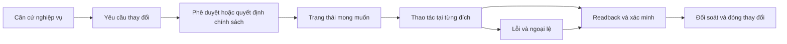

# Provisioning audit — Kiểm toán cấp phát và thu hồi quyền truy cập

## 1. Provisioning audit trả lời điều gì?

**Provisioning audit** là việc kiểm tra có hệ thống các thay đổi tài khoản và quyền truy cập, từ căn cứ nghiệp vụ, phê duyệt, thực thi đến xác minh kết quả. Phạm vi bao gồm cả cấp mới, cập nhật, đình chỉ và thu hồi; không chỉ những lần tạo tài khoản thành công.

Trong IAM, một bản ghi “đã gửi yêu cầu gỡ quyền” chưa chứng minh người dùng đã mất quyền. Một phản hồi API thành công cũng có thể chỉ có nghĩa hệ thống đích đã nhận công việc để xử lý sau. Kiểm toán cần phân biệt rõ ý định, thao tác và kết quả thực tế.

Ví dụ, một nhân viên nghỉ việc lúc 17:00. Directory đã khóa tài khoản nhưng ứng dụng quản lý khách hàng vẫn duy trì một tài khoản cục bộ và một phiên đang mở. Nếu báo cáo chỉ lấy trạng thái tại directory, nó có thể kết luận việc thu hồi đã hoàn tất trong khi một đường truy cập vẫn tồn tại.

Một lần kiểm toán tốt cần trả lời được:

- Ai hoặc hệ thống nào yêu cầu thay đổi, cho danh tính nào và trong tenant nào?
- Vì sao cần thay đổi, ai có thẩm quyền phê duyệt và chính sách nào được áp dụng?
- Tài khoản, vai trò, nhóm, quyền và phạm vi cụ thể nào được thêm hoặc gỡ?
- Thành phần nào thực hiện, vào lúc nào, trên những hệ thống đích nào?
- Kết quả đã được xác minh đến mức nào, còn lỗi hoặc ngoại lệ nào chưa xử lý?

Mục đích là kiểm tra quyền truy cập có căn cứ, phù hợp nguyên tắc ít quyền nhất và được thay đổi trong thời hạn yêu cầu, đồng thời có khả năng truy vết khi xảy ra sự cố.

## 2. Phân biệt nhật ký, đối soát và kiểm toán

| Hoạt động | Câu hỏi chính | Sản phẩm điển hình |
| --- | --- | --- |
| Ghi nhật ký kiểm toán | Chuyện gì đã được ghi nhận là xảy ra? | Sự kiện yêu cầu, phê duyệt, thực thi và xác minh |
| Đối soát provisioning | Trạng thái đích có khớp trạng thái mong muốn không? | Chênh lệch tài khoản, membership và entitlement |
| Rà soát quyền định kỳ | Người này hiện còn cần những quyền này không? | Quyết định giữ, sửa hoặc thu hồi quyền |
| Provisioning audit | Quy trình và bằng chứng có chứng minh việc cấp/thu hồi đúng không? | Phát hiện, mức ảnh hưởng, hành động khắc phục và kết quả kiểm tra lại |

Các hoạt động hỗ trợ nhau nhưng không thay thế nhau. Nhật ký đầy đủ vẫn có thể cho thấy một quyền được cấp sai phê duyệt. Đối soát thấy trạng thái hiện tại đúng chưa chứng minh trong tuần trước không từng có quyền thừa. Rà soát quyết định thu hồi quyền cũng chưa chứng minh connector đã thực sự gỡ quyền đó.

Provisioning audit cần kết hợp lịch sử thay đổi, trạng thái hiện tại và căn cứ nghiệp vụ. Với quyền nhạy cảm, cần thêm bằng chứng từ điểm thực thi quyền hoặc cơ chế kiểm tra phù hợp.

## 3. Xác định phạm vi và các mục tiêu kiểm soát

### 3.1. Phạm vi theo danh tính và hệ thống đích

Danh sách kiểm toán nên bao gồm những loại danh tính và đường cấp quyền đang thực sự được sử dụng: nhân viên, cộng tác viên, tài khoản quản trị, tài khoản dịch vụ hoặc workload nếu thuộc phạm vi quản lý. Với danh tính phi con người, cần biết chủ sở hữu, mục đích và căn cứ duy trì quyền thay vì chỉ tìm một hồ sơ nhân sự.

Phạm vi hệ thống không dừng ở IdP. Nó có thể gồm directory, ứng dụng SaaS, cơ sở dữ liệu, hệ thống quản lý đặc quyền và ứng dụng có tài khoản cục bộ. Ghi rõ đích nào được quản lý tự động, đích nào cần thao tác thủ công và đích nào chưa tích hợp.

Một báo cáo “100% thu hồi thành công” chỉ có ý nghĩa khi biết mẫu số: bao nhiêu tài khoản, quyền và hệ thống đích phải thu hồi, và danh sách đó có đầy đủ không.

### 3.2. Mục tiêu kiểm soát

| Mục tiêu | Ví dụ câu hỏi kiểm toán |
| --- | --- |
| Có thẩm quyền | Quyền quản trị có được người sở hữu phù hợp phê duyệt không? |
| Chính xác | Connector có cập nhật đúng danh tính, tenant và scope không? |
| Đầy đủ | Tất cả đích bắt buộc của một lần nghỉ việc đã được xử lý chưa? |
| Kịp thời | Quyền cũ mất hiệu lực trong thời hạn quy định chưa? |
| Ít quyền nhất | Có quyền trực tiếp hoặc quyền kế thừa vượt quá trạng thái đã duyệt không? |
| Phân tách nhiệm vụ | Người yêu cầu có tự phê duyệt một quyền xung đột không? |
| Truy vết được | Có nối được yêu cầu tới thao tác và kết quả tại từng đích không? |
| Bảo vệ bằng chứng | Người thực hiện thay đổi có thể tự xóa dấu vết không? |

Tiêu chí cụ thể phải theo chính sách đã được tổ chức phê duyệt. Không nên tự đặt một thời hạn thu hồi chung cho mọi quyền hoặc suy ra rằng một bộ log tự động đáp ứng mọi nghĩa vụ kiểm toán.

## 4. Xây dựng chuỗi bằng chứng xuyên suốt



Mỗi mắt xích cần có định danh để liên kết, không chỉ dựa vào việc các timestamp gần nhau. Một yêu cầu có thể tạo nhiều công việc tại nhiều đích, và một công việc có thể có nhiều lần thử.

### 4.1. Các định danh cần phân biệt

- **Change ID:** định danh của thay đổi nghiệp vụ, chẳng hạn một lần chuyển bộ phận.
- **Request ID:** định danh của yêu cầu cấp hoặc thu hồi quyền trong quy trình.
- **Target task ID:** định danh công việc của yêu cầu tại một hệ thống đích.
- **Attempt ID:** định danh một lần thử thực thi công việc.
- **Event ID:** định danh một sự kiện nhật ký cụ thể.

Các hệ thống có thể dùng tên khác hoặc gộp một số khái niệm, nhưng vẫn cần phân biệt yêu cầu, lần thử và sự kiện. Đếm số sự kiện thành công không tương đương đếm số yêu cầu đã hoàn tất.

### 4.2. Người khởi xướng, người được cấp quyền và người thực thi

Ba đối tượng này thường khác nhau. Một quản lý yêu cầu cấp role cho nhân viên, người sở hữu ứng dụng phê duyệt, rồi tài khoản dịch vụ của connector thực hiện. Log chỉ ghi tài khoản connector sẽ mất căn cứ “ai đã yêu cầu và phê duyệt”. Log chỉ ghi tên nhân viên lại không cho biết ai đã thay đổi tài khoản đó.

Cần giữ liên kết giữa người khởi xướng và dịch vụ thực thi, đồng thời phân biệt thao tác của con người với thao tác tự động theo chính sách. Dùng định danh ổn định và tenant để tránh nhầm khi email hoặc tên hiển thị thay đổi.

### 4.3. Dữ liệu tối thiểu của một sự kiện

| Nhóm dữ liệu | Nội dung cần cân nhắc |
| --- | --- |
| Liên kết | Event ID, change ID, request ID, task ID, attempt ID |
| Danh tính | Subject ID ổn định, tenant, tài khoản đích và ánh xạ tương ứng |
| Chủ thể thực hiện | Người khởi xướng, người phê duyệt, dịch vụ thực thi |
| Thao tác | Tạo tài khoản, thêm nhóm, gỡ role, khóa tài khoản hoặc thao tác cụ thể khác |
| Đối tượng quyền | Role, entitlement, scope và thời hạn được quản lý |
| Căn cứ | Mã yêu cầu, quyết định phê duyệt, chính sách hoặc ngoại lệ liên quan |
| Phiên bản | Phiên bản trạng thái mong muốn, chính sách và ánh xạ quyền khi cần |
| Thời gian | Thời điểm xảy ra, thời điểm thu nhận log, thời điểm phải có hiệu lực |
| Kết quả | Đã nhận, đã áp dụng, đã xác minh, lỗi hoặc chưa xác định |
| Bằng chứng | Tham chiếu readback, xác nhận từ đích và giới hạn xác minh |

Không phải sự kiện nào cũng có mọi trường. Sự kiện tự động có thể dẫn tới một quyết định chính sách thay cho phê duyệt thủ công. Điều cần kiểm tra là căn cứ đó có hợp lệ cho loại quyền đang cấp hay không.

Ví dụ một sự kiện xác minh thu hồi role, với dữ liệu hoàn toàn minh họa:

```json
{
  "eventId": "evt-9107",
  "eventType": "provisioning.verification.completed",
  "changeId": "chg-841",
  "requestId": "req-204",
  "targetTaskId": "task-crm-204",
  "attemptId": "attempt-2",
  "subjectId": "person-1842",
  "tenantId": "company-a",
  "targetSystem": "crm",
  "targetAccountId": "crm-user-778",
  "action": "REMOVE_ROLE",
  "role": "customer_exporter",
  "scope": "business-unit-south",
  "desiredVersion": 41,
  "occurredAt": "2030-04-12T10:05:00Z",
  "recordedAt": "2030-04-12T10:05:02Z",
  "outcome": "VERIFIED_STATE",
  "evidence": {
    "method": "target_membership_readback",
    "reference": "evidence-581",
    "rolePresent": false,
    "sessionAccessChecked": false
  }
}
```

Sự kiện này chứng minh kết quả đọc membership theo phương pháp được ghi. Nó không tự chứng minh phiên cũ đã mất khả năng xuất dữ liệu: trường `sessionAccessChecked` cho thấy giới hạn đó. Khi yêu cầu kiểm soát đòi hỏi chặn phiên, cần bằng chứng bổ sung tương ứng trước khi kết luận hoàn tất toàn bộ.

## 5. Phân biệt các mức bằng chứng

| Mức | Ví dụ bằng chứng | Điều có thể kết luận |
| --- | --- | --- |
| Ý định | Yêu cầu thu hồi đã được duyệt | Có căn cứ để thực hiện thu hồi |
| Lần thử | Connector đã gửi lệnh | Một thao tác đã được thử |
| Tiếp nhận | Đích trả về mã công việc | Đích đã nhận yêu cầu theo contract của nó |
| Trạng thái | Readback cho thấy role đã mất | Trạng thái quyền quan sát được tại đích đã thay đổi |
| Thực thi | Kiểm tra phù hợp cho thấy thao tác cũ bị từ chối | Đường truy cập được kiểm tra đã áp dụng việc thu hồi |

Mức bằng chứng cần đạt phụ thuộc mục tiêu kiểm soát. Không phải mọi quyền đọc thông thường đều cần kiểm tra bằng một phiên thật sau mỗi thay đổi. Tuy nhiên, không được đổi tên “đã tiếp nhận” thành “đã xác minh” để làm báo cáo trông hoàn chỉnh hơn.

Kiểm tra thực thi nên dùng cơ chế không gây tác động nghiệp vụ, chẳng hạn khả năng đánh giá quyền hoặc danh tính thử nghiệm được kiểm soát. Không tạo giao dịch thanh toán thật chỉ để chứng minh một quyền duyệt đã mất. Một kiểm tra qua đường truy cập cụ thể cũng không chứng minh mọi đường truy cập khác đều đã bị chặn.

## 6. Kiểm toán theo các sự kiện vòng đời danh tính

### 6.1. Joiner — Cấp quyền ban đầu

Kiểm tra căn cứ tạo tài khoản, ánh xạ đúng danh tính, quyền ban đầu và thời điểm bắt đầu được phép truy cập. Các quyền mặc định cần xuất phát từ chính sách hợp lệ; quyền nhạy cảm cần có phê duyệt tương ứng nếu chính sách yêu cầu.

Những dấu hiệu cần điều tra gồm tài khoản hoạt động trước ngày bắt đầu mà không có căn cứ, cấp đặc quyền ngoài gói đã duyệt, cấp vào sai tenant hoặc có tài khoản đích nhưng không tìm được người hay workload sở hữu.

### 6.2. Mover — Thay đổi công việc hoặc phạm vi

Kiểm tra cả quyền thêm, quyền gỡ và quyền được giữ lại. Người chuyển vị trí dễ tích lũy quyền cũ nếu quy trình chỉ thêm role mới. Cần xem cả scope: giữ cùng tên role nhưng chuyển đơn vị kinh doanh vẫn có thể đòi hỏi gỡ phạm vi cũ.

Khi một permission được cấp qua nhiều role, việc gỡ một role không nhất thiết làm permission đó mất. Kiểm toán phải xem các nguồn cấp quyền còn hiệu lực thay vì chỉ tìm một sự kiện “remove role”. Quyền ngoại lệ được giữ lại cần có căn cứ, chủ sở hữu và thời hạn nếu thuộc loại tạm thời.

### 6.3. Leaver — Chấm dứt truy cập

Kiểm tra danh sách đích phải xử lý, thời điểm hiệu lực và bằng chứng thu hồi tại từng đích. Một tài khoản directory bị khóa chưa tự chứng minh tài khoản cục bộ, phiên ứng dụng, khóa API hoặc các đường truy cập độc lập đã được xử lý.

Quy trình có thể khóa hoặc đình chỉ trước, còn xóa tài khoản thực hiện sau theo chính sách dữ liệu và vận hành. Vì vậy “tài khoản vẫn tồn tại” không tự động là lỗi nếu nó đã bị vô hiệu hóa đúng yêu cầu; ngược lại “đã xóa một tài khoản” cũng không chứng minh mọi credential liên quan đều mất hiệu lực.

Việc chuyển chủ sở hữu dữ liệu hoặc tác vụ cần được truy vết nếu nằm trong quy trình nghỉ việc. Giữ tài khoản đăng nhập hoạt động chỉ để bảo toàn dữ liệu thường cho thấy cần một cơ chế chuyển giao phù hợp hơn.

### 6.4. Quyền tạm thời, đặc quyền và tài khoản dịch vụ

Với quyền tạm thời, kiểm tra thời điểm hết hạn và kết quả thu hồi, không chỉ trường `expiresAt` trong yêu cầu. Với đặc quyền, xem cả phê duyệt, phạm vi và khả năng tách người yêu cầu khỏi người phê duyệt theo chính sách.

Tài khoản dịch vụ cần chủ sở hữu còn hiệu lực, mục đích sử dụng và quyền phù hợp. Khi một người sở hữu nghỉ việc, không nên máy móc vô hiệu hóa mọi workload họ từng quản lý; cần quy trình chuyển chủ sở hữu, đánh giá credential và cập nhật quyền theo thực tế vận hành.

## 7. Thực hiện một đợt kiểm toán

### 7.1. Chốt câu hỏi và tập dữ liệu cần kiểm tra

Xác định khoảng thời gian, loại thay đổi, hệ thống đích và mức bằng chứng cần đạt. Ví dụ: “Các lần thu hồi quyền xuất dữ liệu khách hàng trong tháng có đúng phê duyệt và hoàn tất trong thời hạn quy định không?”.

Xây dựng tập thay đổi dự kiến từ nguồn nghiệp vụ hoặc yêu cầu đã duyệt, rồi so với công việc provisioning và trạng thái đích. Nếu chỉ chọn các bản ghi thành công có sẵn trong log connector, sẽ bỏ sót những yêu cầu chưa từng tới connector.

### 7.2. Kiểm tra tính đầy đủ của việc thu thập log

Đối chiếu số yêu cầu và công việc tại nguồn với số đã thu nhận, theo dõi nguồn ngừng gửi, độ trễ thu nhận và các khoảng thời gian thiếu dữ liệu. Dịch vụ vẫn hoạt động không đồng nghĩa pipeline nhật ký vẫn hoạt động.

Một heartbeat hoặc số lượng sự kiện giúp phát hiện vấn đề thu thập, nhưng không chứng minh mọi thao tác đều được log đúng. Cần bổ sung đối chiếu độc lập với trạng thái đích và các đường quản trị có khả năng bỏ qua quy trình chính.

### 7.3. Nối chuỗi yêu cầu tới kết quả

Với mỗi yêu cầu, lấy danh sách đích bắt buộc đã được xác định tại thời điểm thay đổi. Theo dõi kết quả theo từng đích và phiên bản mong muốn, tránh dùng sự kiện cũ của một yêu cầu khác làm bằng chứng cho yêu cầu mới.

Một phép kiểm tra khái niệm có thể diễn đạt như sau:

```text
for mỗi yêu_cầu_thu_hồi_đã_duyệt:
    đích_bắt_buộc = phạm_vi_có_hiệu_lực_của_yêu_cầu

    for mỗi đích trong đích_bắt_buộc:
        bằng_chứng = tìm_kết_quả_đúng_yêu_cầu_danh_tính_đích_và_phiên_bản

        nếu thiếu bằng_chứng:
            ghi_nhận CHƯA_XÁC_MINH
        nếu chỉ có xác_nhận_tiếp_nhận:
            giữ trạng_thái CHỜ_XÁC_MINH
        nếu kết_quả_đáp_ứng_mục_tiêu_kiểm_soát:
            so_sánh_thời_điểm_hiệu_lực_với_hạn_hoàn_thành
```

Đây là giả mã để giải thích logic, không phải chương trình kiểm toán hoàn chỉnh. Khi trạng thái hiện tại có thể đã thay đổi thêm, cần xem lịch sử phiên bản và bối cảnh: quyền hiện có có thể được cấp lại bằng một yêu cầu mới hợp lệ, không phải lần thu hồi trước thất bại.

### 7.4. Kiểm tra chênh lệch với hệ thống đích

Đối soát trạng thái mong muốn với tài khoản, role, group và entitlement quan sát được. Ghi lại thời điểm lấy snapshot và phạm vi dữ liệu, vì hai snapshot lấy cách xa nhau có thể tạo chênh lệch tạm thời.

Ưu tiên điều tra quyền thừa, tài khoản không có chủ sở hữu, quyền đã quá hạn và thay đổi trực tiếp ngoài quy trình. Quyền thiếu cũng quan trọng vì gây gián đoạn công việc, nhưng không nên để số liệu cấp thiếu che lấp rủi ro quyền thừa.

### 7.5. Lập phát hiện và kiểm tra khắc phục

Mỗi phát hiện cần nêu điều kiện quan sát được, tiêu chí bị vi phạm, phạm vi ảnh hưởng, bằng chứng, người phụ trách và hạn xử lý. Phân biệt lỗi kiểm soát thực tế với giới hạn bằng chứng: thiếu log không tự chứng minh đã có truy cập trái phép, nhưng có thể làm mục tiêu truy vết không đạt.

Đóng phát hiện sau khi có bằng chứng khắc phục và kiểm tra lại phù hợp. Trạng thái “đã tạo ticket” chỉ là bắt đầu xử lý, không phải kết quả sửa xong.

## 8. Các tình huống dễ gây kết luận sai

### 8.1. Timeout sau khi đích đã áp dụng

Connector có thể gửi lệnh thành công nhưng mất phản hồi. Ghi nhận timeout phản ánh điều connector biết, không chứng minh đích chưa thay đổi. Audit cần liên kết các lần thử, readback và kết quả cuối, thay vì đếm mỗi lần thử là một thay đổi riêng biệt.

### 8.2. Sự kiện trùng hoặc đến sai thứ tự

Pipeline có thể nhận lại cùng một sự kiện hoặc nhận kết quả của phiên bản cũ sau phiên bản mới. Dùng định danh sự kiện để nhận diện trùng; dùng phiên bản và trạng thái công việc để dựng tiến trình nghiệp vụ.

Không nên chỉ chọn dòng có timestamp lớn nhất rồi coi đó là trạng thái đúng. Đồng hồ có thể lệch, thời điểm thu nhận khác thời điểm xảy ra, và một sự kiện đến muộn có thể mô tả thao tác cũ. Giữ cả thời điểm nguồn và thời điểm thu nhận giúp giải thích các trường hợp này.

### 8.3. Một yêu cầu thành công một phần

Nếu bốn trong năm đích đã xác minh, báo cáo phải giữ đích thứ năm chưa hoàn tất. Không dùng trung bình toàn hệ thống hoặc một cờ `success` ở cấp yêu cầu để che trạng thái của từng đích.

### 8.4. Thay đổi thủ công và truy cập khẩn cấp

Thao tác trực tiếp tại ứng dụng vẫn cần được phát hiện và gắn với căn cứ. Một quyền khẩn cấp có thể hợp lệ theo chính sách, nhưng cần biết người thực hiện, lý do, thời hạn và hoạt động hậu kiểm tương ứng. Ngoại lệ không đồng nghĩa được bỏ nhật ký hoặc giữ quyền vô hạn.

### 8.5. Readback dùng cùng một dữ liệu cũ

Nếu bước “xác minh” chỉ đọc lại cơ sở dữ liệu trung tâm vừa được cập nhật, nó không chứng minh đích đã thay đổi. Ngay cả API đọc tại đích cũng có thể phản ánh một bản sao có độ trễ; cần hiểu đặc tính nhất quán và ghi nhận giới hạn đó.

## 9. Bảo vệ và duy trì chất lượng bằng chứng

### 9.1. Tách quyền thay đổi khỏi quyền xóa dấu vết

Phân quyền cho nơi lưu bằng chứng theo nhu cầu công việc. Tài khoản connector cần quyền ghi sự kiện, nhưng không nên mặc nhiên có khả năng xóa hoặc sửa toàn bộ lịch sử. Quyền quản trị kho log, thay đổi cấu hình thu thập và xuất báo cáo cũng cần được theo dõi.

Có thể dùng kho ghi nối tiếp, chính sách lưu bất biến trong thời hạn được cấu hình và cơ chế kiểm tra tính toàn vẹn. Các biện pháp này giảm nguy cơ sửa dấu vết, nhưng không tự chứng minh sự kiện nguồn là đúng hoặc đầy đủ. Mã băm chỉ có giá trị kiểm tra tương ứng khi điểm đối chiếu được bảo vệ; kẻ có thể thay cả dữ liệu lẫn mã băm vẫn có thể tạo ra một cặp khớp nhau.

Khi phát hiện sự kiện sai, nên ghi sự kiện đính chính liên kết với bản gốc thay vì âm thầm viết lại lịch sử. Phương án cụ thể cần phù hợp chính sách quản lý dữ liệu của hệ thống.

### 9.2. Giới hạn dữ liệu nhạy cảm

Không ghi mật khẩu, access token, refresh token, khóa riêng hoặc bí mật connector vào audit log. Thông tin cá nhân và mô tả nghiệp vụ cũng chỉ nên được ghi tới mức cần thiết cho mục tiêu kiểm toán.

Tham chiếu tới bằng chứng chi tiết có thể phù hợp hơn sao chép toàn bộ payload nhạy cảm vào mọi sự kiện. Tuy nhiên, tham chiếu phải còn truy cập được trong thời hạn lưu, có kiểm soát quyền đọc và có cách kiểm tra tính toàn vẹn khi cần.

### 9.3. Lưu giữ và khả năng truy xuất

Thời hạn lưu theo chính sách, nhu cầu điều tra và các yêu cầu áp dụng cho tổ chức; không có một con số đúng cho mọi hệ thống. Phải tính cả bằng chứng gốc, chỉ mục tìm kiếm, dữ liệu ánh xạ danh tính và khả năng đọc định dạng cũ.

Kiểm tra định kỳ khả năng truy xuất hoặc khôi phục bằng chứng. Một báo cáo tồn tại nhưng không thể nối về sự kiện và căn cứ gốc sẽ hạn chế khả năng giải thích kết luận kiểm toán.

## 10. Ví dụ điều tra một lần thu hồi quyền

Minh hết nhiệm vụ xuất dữ liệu khách hàng lúc 17:00. Yêu cầu đã duyệt phải gỡ role `customer_exporter` ở ứng dụng CRM trong thời hạn nội bộ quy định, đồng thời xử lý phiên theo chính sách của quyền này.

| Mốc | Bằng chứng quan sát được | Cách diễn giải |
| --- | --- | --- |
| 17:00 | Trạng thái mong muốn bỏ role, có yêu cầu hợp lệ | Có căn cứ và thời điểm thu hồi |
| 17:01 | Connector gửi lệnh, đích trả về công việc đang chờ | Chưa chứng minh quyền đã mất |
| 17:03 | Readback tại CRM cho thấy role không còn | Đã có bằng chứng trạng thái membership |
| 17:04 | Phát hiện phiên cũ vẫn dùng bản sao role | Thu hồi chưa đạt mục tiêu thực thi đã đặt ra |
| 17:06 | Phiên được xử lý, kiểm tra phù hợp cho kết quả từ chối | Đường truy cập được kiểm tra đã áp dụng thu hồi |

Kiểm toán không nên ghi thời điểm hoàn tất là 17:01 nếu tiêu chí yêu cầu quyền mất hiệu lực trên đường truy cập đang dùng. Cần so thời điểm có bằng chứng đáp ứng tiêu chí với hạn đã quy định và ghi rõ phạm vi kiểm tra.

Nếu thiếu log xử lý phiên, kết luận phù hợp có thể là “chưa đủ bằng chứng xác nhận thời điểm thu hồi đầy đủ”, đồng thời tìm thêm nguồn chứng cứ. Không tự suy ra phiên đã an toàn chỉ vì membership đã mất, cũng không tự khẳng định có hành vi xuất dữ liệu nếu chưa có bằng chứng sử dụng quyền.

## 11. Chỉ số và câu hỏi tự kiểm tra

Các chỉ số nên giúp tìm nơi kiểm soát chưa đạt, thay vì chỉ đếm hoạt động:

- Tỷ lệ yêu cầu đã xác minh tại đủ đích bắt buộc trên tổng yêu cầu đến hạn.
- Số quyền thu hồi quá hạn, phân theo mức nhạy cảm và hệ thống đích.
- Độ trễ từ thời điểm phải có hiệu lực đến bằng chứng hoàn thành theo tiêu chí.
- Số quyền thừa, tài khoản không có chủ sở hữu và ngoại lệ đã quá hạn qua đối soát.
- Số yêu cầu thiếu căn cứ phê duyệt, thiếu ánh xạ danh tính hoặc thiếu chuỗi bằng chứng.
- Số nguồn log mất kết nối, khoảng trống thu thập và công việc chưa xác định kết quả.

Ghi rõ mẫu số, khoảng thời gian và phạm vi bao phủ. Các yêu cầu bị hủy hợp lệ hoặc chưa đến hạn cần được phân loại rõ, tránh loại bỏ tùy tiện những trường hợp khó xử lý khỏi báo cáo.

Khi đánh giá thiết kế, hãy thử tự trả lời: có phát hiện được yêu cầu chưa từng được gửi tới connector không; có nối được một quyền hiện tại về căn cứ cấp không; có chứng minh được quyền cũ đã mất trong thời hạn không; và nếu một người quản trị thay đổi quyền trực tiếp, dấu vết độc lập nào sẽ cho thấy điều đó?

Provisioning audit có giá trị khi nối được **căn cứ hợp lệ**, **thay đổi đúng phạm vi** và **kết quả đã xác minh**, đồng thời trình bày trung thực những phần còn lỗi hoặc chưa đủ bằng chứng.
