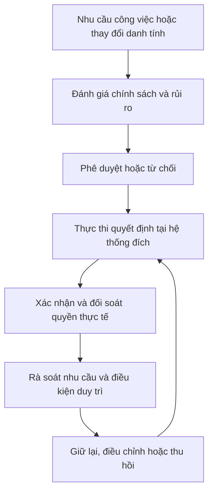

# Identity governance là gì?

## 1. Từ đăng nhập thành công đến quyền truy cập có căn cứ

Một người dùng đăng nhập bằng MFA thành công chỉ chứng minh rằng người đó đã vượt qua cơ chế xác thực được yêu cầu. Điều này chưa trả lời được vì sao họ có quyền xem dữ liệu lương, ai đã duyệt quyền đó, quyền còn cần thiết hay không và khi nào phải thu hồi.

**Identity governance**, hay quản trị danh tính và quyền truy cập, là tập hợp chính sách, trách nhiệm, quy trình và thông tin dùng để quyết định, giám sát và giải trình việc cấp, duy trì, thay đổi và thu hồi quyền của các danh tính.

Trong phạm vi IAM, quản trị danh tính tập trung vào những câu hỏi:

- Ai đang có quyền truy cập tài nguyên nào?
- Quyền đó phục vụ nhiệm vụ hoặc mục đích gì?
- Ai có thẩm quyền quyết định và chịu trách nhiệm về quyền đó?
- Quyền có phù hợp với chính sách, mức rủi ro và nguyên tắc ít quyền nhất không?
- Khi nhiệm vụ hoặc trạng thái danh tính thay đổi, quyền cần được điều chỉnh thế nào?
- Có bằng chứng nào cho thấy quyết định đã được thực thi và còn hiệu lực?

Đối tượng có thể là nhân viên, nhà thầu, đối tác, khách hàng hoặc danh tính phi con người như tài khoản dịch vụ và workload. Phạm vi cụ thể phụ thuộc mô hình của tổ chức; các loại danh tính không nhất thiết dùng chung một quy trình phê duyệt.

Identity governance không phải một giao thức đăng nhập và cũng không chỉ là một sản phẩm phần mềm. Công cụ có thể tự động hóa việc thu thập quyền, phê duyệt và đối soát, nhưng tổ chức vẫn phải xác định ai được quyết định điều gì và dựa trên tiêu chí nào.

## 2. Vấn đề mà identity governance giải quyết

### 2.1. Quyền tích lũy theo thời gian

Khi một nhân viên chuyển dự án, quyền mới có thể được cấp nhanh trong khi quyền cũ không được thu hồi. Sau nhiều lần thay đổi nhiệm vụ, người đó có một tập quyền lớn hơn nhu cầu hiện tại. Hiện tượng này thường được gọi là tích lũy quyền hoặc *privilege creep*.

Một tài khoản vẫn hoạt động bình thường và chưa từng bị xâm phạm vẫn có thể mang quá nhiều quyền. Vì vậy, an toàn danh tính không chỉ là ngăn người lạ đăng nhập mà còn là kiểm soát quyền của những danh tính hợp lệ.

### 2.2. Không rõ ai sở hữu quyết định

Nhóm vận hành có thể biết cách thêm người dùng vào một nhóm nhưng không biết người đó có được phép duyệt thanh toán hay không. Quản lý trực tiếp biết nhiệm vụ của nhân viên nhưng có thể không hiểu ý nghĩa kỹ thuật của nhóm `FIN-AP-APPROVER`.

Identity governance nối các góc nhìn này: quyền kỹ thuật cần có mô tả nghiệp vụ, người sở hữu và quy tắc phê duyệt rõ ràng. Người thực thi thao tác không mặc nhiên là người có quyền quyết định nghiệp vụ.

### 2.3. Có báo cáo nhưng thiếu căn cứ

Danh sách tài khoản cho biết ai tồn tại trong ứng dụng. Danh sách nhóm cho biết một phần quyền kỹ thuật. Nhưng nếu không có ánh xạ và lịch sử quyết định, tổ chức vẫn khó giải thích vì sao một người có quyền tại một thời điểm cụ thể.

Quản trị danh tính hướng tới việc nối được danh tính, tài khoản, quyền, lý do, người quyết định, thời hạn và kết quả thực thi thành một chuỗi có thể kiểm tra.

## 3. Vị trí trong bức tranh IAM

IAM là phạm vi rộng, bao gồm quản lý danh tính, xác thực, cấp quyền, phiên, liên kết danh tính và vòng đời truy cập. Identity governance bổ sung góc nhìn chính sách, trách nhiệm và giám sát cho các cơ chế đó.

| Thành phần hoặc hoạt động | Câu hỏi chính | Quan hệ với identity governance |
|---|---|---|
| Xác thực, MFA | Ai đang cố truy cập và có đáp ứng yêu cầu xác thực không? | Cung cấp cơ chế nhận diện; không tự chứng minh quyền có lý do nghiệp vụ |
| Phân quyền bằng RBAC, ABAC hoặc chính sách khác | Yêu cầu này có được phép thực hiện không? | Thực thi các quy tắc; governance quản lý căn cứ, trách nhiệm và việc rà soát những quy tắc, vai trò, thuộc tính đó |
| SSO, liên kết danh tính | Làm thế nào sử dụng quan hệ tin cậy để đăng nhập vào nhiều ứng dụng? | Giúp kết nối truy cập; các quyền trong ứng dụng vẫn cần được quản trị |
| Provisioning và deprovisioning | Làm thế nào tạo, cập nhật hoặc thu hồi tài khoản và quyền ở đích? | Thực thi các quyết định vòng đời và cung cấp kết quả để đối soát |
| Quản lý truy cập đặc quyền | Làm thế nào kiểm soát việc sử dụng quyền có tác động cao? | Nhận chính sách, chủ sở hữu, điều kiện phê duyệt và thời hạn; bổ sung kiểm soát cho truy cập nhạy cảm |
| Nhật ký và giám sát | Điều gì đã xảy ra, ở đâu và khi nào? | Cung cấp bằng chứng cho việc xem xét, điều tra và giải trình |

Thuật ngữ **Identity Governance and Administration**, viết tắt **IGA**, nhấn mạnh việc kết hợp quản trị với quản trị vận hành danh tính và quyền. Ranh giới tính năng của từng giải pháp có thể khác nhau; không nên dùng tên gọi sản phẩm để thay thế việc xác định năng lực và trách nhiệm thực tế.

Một hệ thống xác thực mạnh vẫn có thể có governance yếu nếu quyền được cấp tùy ý. Ngược lại, một quy trình phê duyệt chặt chẽ chưa đủ bảo vệ dữ liệu nếu ứng dụng không thực thi đúng quyền đã quyết định.

## 4. Những đối tượng cần hiểu rõ

### 4.1. Danh tính và tài khoản

**Danh tính** biểu diễn chủ thể trong một phạm vi quản lý. **Tài khoản** là biểu diễn mà chủ thể sử dụng tại một hệ thống cụ thể. Một nhân viên có thể gắn với tài khoản SSO, tài khoản quản trị riêng và tài khoản tại nhiều ứng dụng.

Không nên đồng nhất địa chỉ email với định danh ổn định trong mọi hệ thống. Email có thể đổi hoặc được cấp lại. Governance cần ánh xạ đủ tin cậy để biết tài khoản nào thuộc chủ thể nào, trong tenant nào và theo quan hệ nào.

Tài khoản không xác định được chủ sở hữu là một khoảng trống cần xử lý. Với tài khoản dịch vụ, chủ sở hữu thường là nhóm hoặc người chịu trách nhiệm cho ứng dụng, kèm mục đích sử dụng và vòng đời tương ứng.

### 4.2. Quyền kỹ thuật và quyền có ý nghĩa nghiệp vụ

Một *entitlement* là đơn vị quyền mà hệ thống có thể quản lý, chẳng hạn membership của nhóm, application role hoặc một quyền trực tiếp. Đơn vị này cần được diễn giải thành khả năng cụ thể mà người ra quyết định hiểu được.

Ví dụ minh họa:

| Đối tượng | Biểu diễn kỹ thuật | Ý nghĩa cần trình bày cho người duyệt |
|---|---|---|
| Nhân viên Minh | `subject-1042` | Nhân viên phụ trách đối soát chi phí của nhóm A |
| Tài khoản ứng dụng | `expense:user-803` | Tài khoản của Minh trong ứng dụng chi phí |
| Quyền | `expense.report.read` | Xem báo cáo chi phí trong phạm vi được cấp |
| Vai trò | `expense-reviewer` | Tập quyền phục vụ công việc rà soát chi phí theo định nghĩa vai trò |
| Ràng buộc | `department = A` | Chỉ truy cập dữ liệu thuộc phạm vi bộ phận A theo chính sách |

Một vai trò có tên dễ hiểu chưa chắc có nội dung phù hợp. Nếu vai trò bao gồm cả quyền duyệt thanh toán ngoài nhu cầu của người nhận, việc phê duyệt vai trò vẫn tạo ra quyền dư thừa.

### 4.3. Quyền hiệu lực có thể đến từ nhiều đường

Quyền của một chủ thể có thể đến từ nhóm lồng nhau, vai trò, thuộc tính, cấp trực tiếp hoặc quan hệ kế thừa trên tài nguyên. Bỏ một membership chưa chắc loại bỏ quyền nếu vẫn còn đường cấp khác.

Governance cần phân biệt:

- **Quyền được yêu cầu:** chủ thể hoặc người đại diện muốn nhận gì.
- **Quyền được phê duyệt:** quyết định cho phép cấp gì, theo điều kiện nào.
- **Quyền thực tế:** những gì được quan sát tại hệ thống đích.
- **Quyền hiệu lực:** khả năng truy cập hình thành khi áp dụng các chính sách và quan hệ liên quan tại một thời điểm, trong một ngữ cảnh.

Các tập thông tin này có liên quan nhưng không luôn giống nhau. Sai lệch có thể xuất phát từ connector lỗi, cấp quyền ngoài quy trình hoặc cách tổng hợp quyền tại đích.

## 5. Vòng đời quản trị quyền

Identity governance là hoạt động liên tục. Phê duyệt lúc đầu chỉ là một phần của vòng đời.



### 5.1. Xác định nhu cầu và chính sách

Quyền có thể được phát sinh từ yêu cầu riêng hoặc được cấp theo chính sách cho một nhóm đối tượng phù hợp. Ví dụ, nhân viên của một bộ phận được cấp quyền dùng công cụ cộng tác cơ bản khi quan hệ lao động có hiệu lực.

Tự động cấp không có nghĩa là không cần quản trị. Chính sách tự động vẫn phải có người sở hữu, dữ liệu đầu vào đáng tin cậy, phạm vi và điều kiện thu hồi.

### 5.2. Đánh giá và quyết định

Quyết định có thể xét nhiệm vụ hiện tại, độ nhạy cảm của dữ liệu, phạm vi tài nguyên, thời hạn và những quyền khác mà chủ thể đã có. Với quyền có rủi ro cao, tổ chức có thể yêu cầu các bên có thẩm quyền khác nhau cùng xem xét.

Một kiểm soát thường gặp là **separation of duties**, hay phân tách nhiệm vụ. Chẳng hạn, tổ chức có thể quy định người tạo một lệnh chi không được tự duyệt chính lệnh chi đó. Đây có thể là kiểm soát theo hành động hoặc theo tổ hợp quyền; cách áp dụng phải thể hiện đúng quy tắc nghiệp vụ.

Phê duyệt không phải một nút bấm hình thức. Người duyệt cần hiểu quyền được cấp, lý do cần quyền và điều kiện mà mình đang chấp nhận.

### 5.3. Thực thi và đối soát

Sau phê duyệt, hệ thống provisioning hoặc nhóm vận hành cấp quyền tại đích. Governance phải theo dõi kết quả thay vì coi trạng thái “đã duyệt” là bằng chứng “đã cấp đúng”.

Tương tự, một yêu cầu thu hồi chưa hoàn tất chỉ vì đã tạo ticket. Cần xác nhận trạng thái tại đích và xử lý lỗi, kể cả khi lỗi nằm ngoài công cụ governance.

### 5.4. Rà soát và thu hồi

Quyền cần được đánh giá lại khi chủ thể chuyển việc, dự án kết thúc, hợp đồng hết hạn hoặc xuất hiện sự kiện rủi ro. Rà soát định kỳ bổ sung khả năng phát hiện những quyền không còn phù hợp nhưng chưa được điều chỉnh theo sự kiện.

Một đợt rà soát quyền thường yêu cầu người có trách nhiệm quyết định giữ, đổi hoặc bỏ quyền dựa trên thông tin hiện hành. Việc hoàn thành đợt rà soát phải bao gồm theo dõi các quyết định cần thực thi, không chỉ đếm số câu trả lời đã nhận.

## 6. Ai chịu trách nhiệm?

Không có một bộ phận duy nhất tự quyết định đúng mọi loại quyền. Cần xác định trách nhiệm theo phạm vi tài nguyên và nghiệp vụ.

| Vai trò | Trách nhiệm điển hình |
|---|---|
| Chủ sở hữu ứng dụng hoặc dữ liệu | Giải thích quyền, xác định rủi ro và tiêu chí cho phép truy cập trong phạm vi sở hữu |
| Quản lý hoặc người phụ trách công việc | Xác nhận nhu cầu và quan hệ của người được cấp quyền với nhiệm vụ |
| Nhóm IAM hoặc quản trị nền tảng | Quản lý ánh xạ, tích hợp và cơ chế thực thi, theo dõi lỗi đồng bộ |
| Nhóm an toàn thông tin | Xây dựng hoặc phối hợp xây dựng chính sách kiểm soát, theo dõi rủi ro và ngoại lệ |
| Người rà soát quyền | Đánh giá quyền được giao rà soát với thông tin và thẩm quyền phù hợp |
| Bên kiểm tra độc lập | Xem xét thiết kế và bằng chứng vận hành của các kiểm soát trong phạm vi được giao |

Một người có thể đảm nhiệm nhiều vai trò trong tổ chức nhỏ, nhưng trách nhiệm vẫn cần được nêu rõ. Những tổ hợp có nguy cơ tự đề nghị, tự duyệt và tự thực thi quyền nhạy cảm cần được xem xét theo chính sách phân tách nhiệm vụ.

Nguồn dữ liệu có thẩm quyền cũng phải được xác định theo từng thuộc tính. Hệ thống nhân sự có thể quyết định trạng thái nhân viên, trong khi chủ dự án quyết định thời hạn tham gia dự án. Không nên mặc định một nguồn duy nhất đúng cho mọi danh tính và mọi loại thông tin.

## 7. Ví dụ: quyền tạm thời để rà soát chi phí

Minh làm việc ở bộ phận A và cần xem báo cáo chi phí để đối soát một dự án trong hai tuần. Yêu cầu chỉ bao gồm xem báo cáo của dự án đó, không bao gồm sửa chứng từ hoặc duyệt thanh toán.

Một luồng governance có thể diễn ra như sau:

1. Minh chọn quyền có mô tả rõ, nêu mục đích, dự án và thời hạn. Hệ thống xác định đúng danh tính cùng tài khoản đích.
2. Chính sách kiểm tra phạm vi quyền và các điều kiện bắt buộc. Người quản lý xác nhận nhu cầu; chủ sở hữu dữ liệu quyết định quyền theo thẩm quyền được tổ chức quy định.
3. Sau phê duyệt, connector cấp quyền xem đúng phạm vi. Hệ thống ghi nhận việc thực thi và đối chiếu quyền thực tế ở ứng dụng.
4. Nếu Minh chuyển khỏi dự án trước ngày hết hạn, thay đổi này kích hoạt đánh giá và thu hồi sớm theo chính sách. Nếu không có thay đổi, quyền hết hiệu lực theo thời hạn đã duyệt.
5. Kết quả thu hồi được xác minh. Bằng chứng cho biết ai đã quyết định, phạm vi nào đã cấp, khi nào quyền có hiệu lực và khi nào quyền được bỏ.

Một bản ghi minh họa có thể chứa:

```yaml
requestId: req-2048
subjectId: subject-1042
targetAccountId: expense-user-803
entitlement: expense.report.read
scope: project-example
businessReason: Đối soát chi phí dự án
approvalDecision: APPROVED
grantResult: CONFIRMED
validity: Hai tuần theo quyết định đã duyệt
revocationResult: NOT_YET_DUE
```

Đây là ví dụ dữ liệu để hiểu mô hình, không phải schema chuẩn của một giao thức. Trong triển khai thực tế, cần thời điểm có hiệu lực và hết hạn rõ ràng, định danh người quyết định, dấu thời gian cùng lịch sử thay đổi. Trạng thái phê duyệt và trạng thái thực thi phải được lưu sao cho không làm mất các diễn biến trước đó.

Nếu Minh đăng nhập bằng MFA nhưng được cấp nhầm quyền quản trị toàn ứng dụng, xác thực có thể vẫn hoạt động đúng trong khi governance và việc thực thi phạm vi quyền đã thất bại.

## 8. Bằng chứng cần đủ để tái hiện quyết định

Một ảnh chụp danh sách quyền hiện tại không luôn trả lời được câu hỏi ai có quyền tại thời điểm xảy ra một sự việc trong quá khứ. Muốn giải trình, cần nối được lịch sử danh tính, quyết định và kết quả thực thi theo thời gian.

Những thông tin hữu ích gồm:

- Định danh chủ thể, tài khoản, tenant và tài nguyên trong phạm vi liên quan.
- Quyền, phạm vi, nguồn cấp và thời hạn đã quyết định.
- Lý do nghiệp vụ, người hoặc chính sách ra quyết định và các điều kiện kèm theo.
- Thời điểm yêu cầu, phê duyệt, áp dụng và xác minh.
- Các thay đổi, lần rà soát, ngoại lệ và quyết định thu hồi sau đó.
- Sai lệch giữa trạng thái mong muốn và trạng thái đích, cùng cách xử lý.

Nhật ký không nên chứa mật khẩu, token hoặc bí mật của credential. Quyền đọc và sửa bằng chứng cũng cần được kiểm soát để người thực hiện thay đổi không thể tùy ý sửa lịch sử nhằm che giấu thao tác.

Việc có bằng chứng hỗ trợ kiểm tra và giải trình; nó không tự động chứng minh mọi chính sách đều đúng hoặc mọi yêu cầu bên ngoài đều đã được đáp ứng. Trước hết phải xác định kiểm soát nào cần chứng minh và bằng chứng nào thực sự liên quan tới kiểm soát đó.

## 9. Ngoại lệ cũng cần được quản trị

Một nhu cầu đặc biệt có thể chưa phù hợp với vai trò hoặc quy tắc thông thường. Nếu tổ chức chấp nhận ngoại lệ, cần ghi rõ người có thẩm quyền chấp nhận, lý do, phạm vi, rủi ro, biện pháp kiểm soát bổ sung và thời điểm xem xét lại hoặc hết hạn.

Ngoại lệ không nên trở thành quyền vĩnh viễn chỉ vì chưa có ai quay lại kiểm tra. Đối với truy cập khẩn cấp, quy trình có thể khác quy trình thông thường nhưng vẫn cần giới hạn, theo dõi và xem xét sau khi sử dụng theo chính sách đã định.

Tài khoản dịch vụ cũng không phải ngoại lệ mặc định. Nếu không có người đăng nhập tương tác để phê duyệt mỗi lần, vẫn cần chủ sở hữu, mục đích, phạm vi quyền và tín hiệu vòng đời để biết khi nào phải thay đổi hoặc thu hồi.

## 10. Đánh giá hiệu quả và tránh các nhầm lẫn phổ biến

Một chương trình governance có giá trị khi quyền thực tế phù hợp hơn với nhu cầu và sai lệch được phát hiện, xử lý có trách nhiệm. Số lượng yêu cầu phê duyệt tự nó không phản ánh kết quả đó.

Các chỉ số có thể theo dõi gồm tỷ lệ quyền có chủ sở hữu và mô tả rõ, số tài khoản chưa ánh xạ được, quyền quá hạn chưa thu hồi, độ trễ thực thi quyết định thu hồi, sai lệch tìm thấy khi đối soát và số quyết định rà soát còn chờ thực thi. Cần định nghĩa phạm vi và cách đo trước khi so sánh các số liệu.

| Nhầm lẫn | Cách hiểu phù hợp hơn |
|---|---|
| Có SSO và MFA là đã quản trị quyền đầy đủ | SSO và MFA giải quyết các phần của truy cập; căn cứ nghiệp vụ và vòng đời quyền vẫn cần được quản lý |
| Đã duyệt là đã cấp đúng | Cần xác nhận việc thực thi và phạm vi quyền thực tế tại đích |
| Có RBAC thì không cần rà soát | Vai trò, membership và nội dung vai trò đều có thể trở nên không còn phù hợp |
| Chỉ cần chụp danh sách quyền vào kỳ kiểm tra | Cần theo dõi thay đổi và bằng chứng theo thời gian, không chỉ trạng thái tại một thời điểm |
| Quyền do quản trị viên cấp trực tiếp nằm ngoài governance | Đó là một nguồn cấp cần được quan sát, đối soát và xử lý theo chính sách |
| Identity governance chỉ dành cho con người | Danh tính dịch vụ và workload cũng có quyền, chủ sở hữu và vòng đời cần được quản trị |

Identity governance gắn quyền kỹ thuật với mục đích, thẩm quyền quyết định và trách nhiệm theo thời gian. Một quyền được quản trị tốt phải có thể giải thích vì sao tồn tại, xác minh đang được thực thi trong phạm vi nào và điều chỉnh hoặc thu hồi khi căn cứ cấp quyền không còn đúng.
