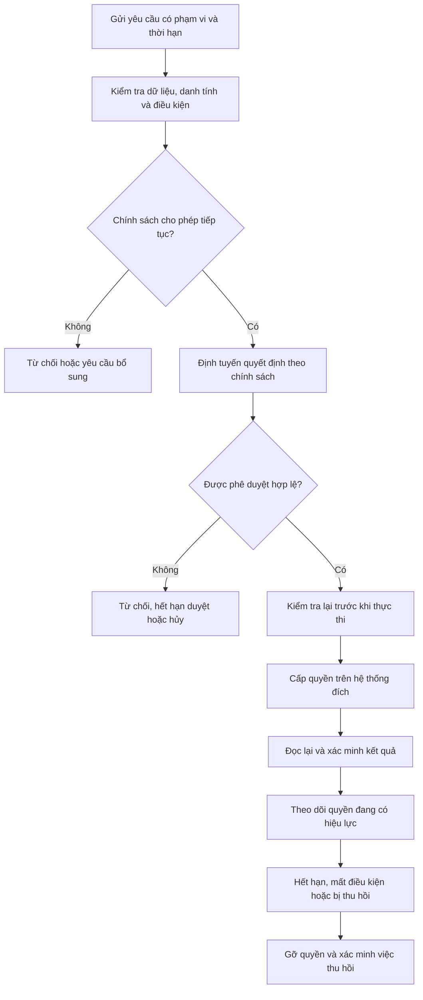

# Access request: yêu cầu cấp quyền truy cập

## 1. Access request trong quản trị danh tính

**Access request** là yêu cầu có cấu trúc để một danh tính được sử dụng một tài nguyên với những quyền, phạm vi và thời hạn xác định. Quy trình này biến nhu cầu công việc thành một quyết định có thể kiểm tra: ai cần quyền gì, vì sao cần, ai có thẩm quyền chấp thuận và việc cấp quyền đã thực sự xảy ra hay chưa.

Ví dụ, Minh thuộc nhóm phân tích cần đọc báo cáo doanh thu của dự án A trong hai tuần. Yêu cầu phù hợp không phải là “cho Minh vào hệ thống tài chính”, mà là “cấp quyền xem báo cáo doanh thu của dự án A, tại môi trường được chỉ định, từ thời điểm bắt đầu đến thời điểm kết thúc, phục vụ một nhiệm vụ cụ thể”.

Trong Identity Governance, yêu cầu truy cập gắn kết ba thành phần:

- **Nhu cầu nghiệp vụ:** lý do danh tính cần thực hiện công việc.
- **Quy tắc quản trị:** điều kiện được yêu cầu, người có quyền quyết định, giới hạn phạm vi và thời gian.
- **Việc thực thi:** tạo hoặc cập nhật tài khoản, gán quyền, xác minh kết quả và thu hồi theo quyết định.

Biểu mẫu hoặc nút phê duyệt chỉ là giao diện của quy trình. Giá trị của access request nằm ở việc quyết định được chuyển thành quyền phù hợp trên hệ thống đích, đồng thời giữ được bằng chứng trong suốt vòng đời.

## 2. Access request khác xác thực và kiểm tra quyền như thế nào?

Ba hoạt động dưới đây giải quyết các câu hỏi khác nhau:

| Hoạt động | Câu hỏi chính | Ví dụ |
| --- | --- | --- |
| Authentication — xác thực | Chủ thể đang truy cập là ai, và đã chứng minh danh tính bằng cách nào? | Người dùng đăng nhập bằng MFA |
| Access request — yêu cầu truy cập | Chủ thể có nên được cấp một quyền phục vụ công việc hay không? | Quản lý và chủ dữ liệu xét yêu cầu xem báo cáo |
| Authorization — kiểm tra quyền | Tại thời điểm thực hiện, chủ thể có được phép làm hành động này trên tài nguyên này không? | API kiểm tra quyền đọc báo cáo dự án A |

Một người đã đăng nhập thành công không tự động có quyền xin mọi quyền hoặc tự phê duyệt yêu cầu của mình. Tương tự, yêu cầu đã được duyệt không có nghĩa ứng dụng đã cấp quyền, và quyền đã được cấp không có nghĩa mọi lần truy cập trong tương lai đều được phép.

Nếu chính sách yêu cầu chỉ được đọc dữ liệu từ thiết bị được quản lý, việc phê duyệt nhóm quyền không thay thế bước kiểm tra thiết bị khi sử dụng dữ liệu. Trong mô hình ABAC, các thuộc tính liên quan vẫn phải được quản lý và đánh giá theo chính sách.

## 3. Các vai trò tham gia và trách nhiệm

Một người có thể đóng nhiều vai trò trong tổ chức, nhưng quy trình cần phân biệt rõ trách nhiệm của từng vai trò đối với từng yêu cầu.

| Vai trò | Trách nhiệm chính |
| --- | --- |
| Requester — người gửi | Khai báo nhu cầu, chọn đúng đối tượng và cung cấp lý do |
| Beneficiary — người hoặc danh tính nhận quyền | Là đối tượng sẽ có quyền nếu yêu cầu được thực thi |
| Manager hoặc sponsor | Xác nhận nhu cầu công việc và quan hệ làm việc phù hợp |
| Resource/data owner — chủ tài nguyên hoặc dữ liệu | Quyết định việc sử dụng tài nguyên thuộc trách nhiệm của mình |
| Application/role owner | Giải thích ý nghĩa quyền, duy trì mapping và điều kiện cấp quyền |
| Policy engine hoặc người kiểm soát | Đánh giá điều kiện, rủi ro và xung đột quyền theo chính sách |
| Provisioning executor | Thực hiện cấp hoặc gỡ quyền trên hệ thống đích |
| Người theo dõi/kiểm toán | Xem xét bằng chứng và việc tuân thủ quy trình đã công bố |

Người gửi có thể xin quyền cho chính mình hoặc cho người khác nếu được phép. Hai trường hợp phải được ghi nhận khác nhau; không được thay tên người nhận quyền rồi khiến dấu vết trông như người đó đã tự yêu cầu.

Quản lý thường biết nhân sự đang làm nhiệm vụ gì, còn chủ dữ liệu biết việc cho phép sử dụng dữ liệu có phù hợp hay không. Một sự phê duyệt không tự thay thế sự phê duyệt còn lại nếu chính sách yêu cầu cả hai.

Đối với danh tính workload, người yêu cầu thường là chủ ứng dụng hoặc chủ dịch vụ. Quy trình cần liên kết quyền với một danh tính workload được quản lý và người chịu trách nhiệm, thay vì cấp quyền cho tài khoản cá nhân rồi chia sẻ credential cho ứng dụng.

## 4. Mô tả chính xác quyền được yêu cầu

### 4.1. Danh mục quyền có thể yêu cầu

Access catalog là danh mục các quyền, vai trò hoặc gói truy cập mà người dùng có thể yêu cầu trong phạm vi chính sách. Một mục danh mục cần đủ thông tin để người gửi và người duyệt hiểu tác động của quyết định.

Ví dụ, tên hiển thị “Finance Access” quá rộng. “Xem báo cáo doanh thu dự án A trên hệ thống phân tích” cho biết nhiều hơn, nhưng vẫn cần xác định ID quyền, môi trường, dữ liệu và giới hạn thao tác.

Một mục có thể mô tả:

- ID ổn định và tên nghiệp vụ dễ hiểu.
- Ứng dụng, tài nguyên và môi trường đích.
- Hành động được phép và các hành động quan trọng không được bao gồm.
- Đối tượng đủ điều kiện yêu cầu.
- Chủ sở hữu và người phê duyệt.
- Điều kiện tiên quyết, chẳng hạn đào tạo hoặc quan hệ dự án còn hiệu lực.
- Thời hạn mặc định, thời hạn tối đa và cách gia hạn.
- Mức nhạy cảm, xung đột quyền và yêu cầu kiểm soát bổ sung.
- Mapping đến nhóm, role, permission hoặc thuộc tính ở hệ thống đích.

Tên nghiệp vụ cần liên kết với mapping có phiên bản. Nếu một role được mở rộng từ “chỉ xem” thành “xem và sửa”, một phê duyệt cũ cho phiên bản chỉ xem không nên tự trở thành sự đồng ý cho phạm vi mới.

### 4.2. Những trường thông tin cần có

Một yêu cầu thường cần các nhóm dữ liệu sau:

| Nhóm | Ví dụ | Mục đích |
| --- | --- | --- |
| Danh tính | Requester ID, beneficiary ID, quan hệ làm việc | Xác định ai yêu cầu và ai nhận quyền |
| Tài nguyên | Resource ID, application ID, môi trường | Tránh nhầm tài nguyên hoặc môi trường |
| Quyền và phạm vi | Entitlement ID, dự án A, hành động read | Thể hiện phạm vi tối thiểu cần cấp |
| Thời gian | Thời điểm bắt đầu, thời điểm kết thúc, múi giờ | Tránh quyền tạm thời trở thành quyền vô thời hạn |
| Nhu cầu | Lý do, mã nhiệm vụ hoặc dự án | Hỗ trợ đánh giá nhu cầu và truy vết |
| Điều kiện | Thuộc tính đủ điều kiện, phiên bản chính sách | Đánh giá yêu cầu theo đúng ngữ cảnh |
| Quyết định và thực thi | Người duyệt, thời gian, kết quả cấp quyền | Chứng minh quyết định và kết quả thực tế |

Lý do nên chỉ ra công việc cần hoàn thành, không chỉ ghi “cần gấp” hoặc “theo yêu cầu quản lý”. Không đưa mật khẩu, private key, access token hoặc dữ liệu khách hàng không cần thiết vào lý do.

Danh tính của người gửi và người nhận quyền phải được đối chiếu bằng ID được quản lý. Tên hiển thị và địa chỉ email có thể thay đổi, trùng hoặc được cấp lại.

## 5. Vòng đời của một yêu cầu truy cập

Một luồng phổ biến có thể biểu diễn như sau:



Đây là luồng khái niệm. Không phải yêu cầu nào cũng cần cùng số bước phê duyệt, nhưng các quyết định phải tuân theo chính sách được công bố và có bằng chứng.

### 5.1. Tiếp nhận và kiểm tra đầu vào

Hệ thống kiểm tra quyền tồn tại trong danh mục, người nhận còn hợp lệ, thời hạn nằm trong giới hạn và người gửi có thẩm quyền yêu cầu cho người nhận đó.

Một yêu cầu thiếu thông tin có thể được trả lại để bổ sung. Không nên biến dữ liệu chưa biết thành sự đồng ý mặc định. Nếu không tìm thấy chủ sở hữu quyền hoặc người duyệt hợp lệ, yêu cầu cần được giữ ở trạng thái phù hợp và chuyển xử lý, không tự cấp quyền.

### 5.2. Đánh giá chính sách

Các kiểm tra có thể bao gồm:

- Người nhận có còn quan hệ làm việc hoặc quan hệ dự án phù hợp không.
- Quyền đã có sẵn hay chưa và được cấp từ nguồn nào.
- Quyền xin thêm có xung đột với quyền hiện có không.
- Phạm vi, thời hạn và môi trường có phù hợp với mức nhạy cảm không.
- Có đáp ứng điều kiện tiên quyết không.
- Yêu cầu có thuộc trường hợp phải xét riêng hoặc bị cấm không.

Chính sách có thể cho phép tự động cấp một quyền rủi ro thấp khi đủ điều kiện rõ ràng. Điều này vẫn là quyết định theo chính sách, cần ghi nhận căn cứ và phiên bản; không phải bỏ qua quản trị.

### 5.3. Phê duyệt

Quy trình chuyển yêu cầu đến đúng người có thẩm quyền với thông tin về nhu cầu, quyền hiện có, tác động quyền mới, thời hạn và cảnh báo liên quan.

Người duyệt có thể đồng ý, từ chối hoặc yêu cầu thông tin bổ sung theo quy trình. Nếu muốn giảm phạm vi hay rút ngắn thời hạn, quyết định phải được ghi thành phạm vi cuối cùng rõ ràng. Không cấp một biến thể quyền khác mà hồ sơ yêu cầu và người nhận không thể nhận biết.

### 5.4. Cấp quyền và xác minh

Sau phê duyệt, hệ thống thực thi thay đổi vào hệ thống đích. Một phản hồi “đã nhận yêu cầu” từ connector chưa đủ chứng minh quyền đã tồn tại.

Cần đọc lại trạng thái cuối cùng hoặc thu thập bằng chứng tương đương theo khả năng tích hợp. Nếu quyền phải đi qua nhiều hệ thống, từng phần cần có trạng thái thực thi riêng.

### 5.5. Hết hạn, thu hồi và gia hạn

Khi đến hạn hoặc khi người nhận mất điều kiện, quyền phải được xử lý theo chính sách. Đánh dấu hết hạn trên cổng yêu cầu chưa chứng minh ứng dụng đã gỡ quyền.

Gia hạn là một quyết định mới hoặc một phần mở rộng được quản lý rõ ràng. Không kéo dài âm thầm chỉ vì người dùng vẫn sử dụng hệ thống hoặc vì connector chưa chạy.

## 6. Phê duyệt theo rủi ro và phân tách nhiệm vụ

Số lượng người duyệt không tự đo mức an toàn. Quan trọng là người duyệt có đúng thẩm quyền, đủ thông tin và độc lập theo yêu cầu của chính sách hay không.

Ví dụ về cách phân loại trong một tổ chức giả định:

| Loại yêu cầu | Cách quyết định có thể áp dụng |
| --- | --- |
| Quyền cơ bản cho thành viên dự án hợp lệ | Tự động theo chính sách đã phê duyệt hoặc duyệt bởi chủ dự án |
| Quyền đọc dữ liệu hạn chế | Xác nhận nhu cầu và quyết định của chủ dữ liệu |
| Quyền sửa dữ liệu nghiệp vụ quan trọng | Đánh giá thêm phạm vi tác động và xung đột quyền |
| Quyền quản trị production | Quy trình đặc quyền, thời hạn ngắn và kiểm soát bổ sung phù hợp |
| Quyền tạo xung đột bị chính sách cấm | Từ chối; không để một lượt duyệt thông thường vượt qua lệnh cấm |

Đây là ví dụ thiết kế, không phải quy định bắt buộc cho mọi tổ chức.

**Segregation of Duties (SoD)** là phân tách nhiệm vụ nhằm hạn chế một chủ thể nắm tổ hợp quyền có thể thực hiện và che giấu một giao dịch hoặc một hành vi không phù hợp. Ví dụ, chính sách có thể không cho một người vừa tạo nhà cung cấp vừa phê duyệt thanh toán cho nhà cung cấp đó.

Kiểm tra SoD cần xét tổ hợp quyền hiệu lực, không chỉ tên role đang được yêu cầu. Một người có thể nhận các thành phần quyền từ nhiều ứng dụng hoặc nhiều nhóm khác nhau.

Nếu hai yêu cầu được duyệt đồng thời, mỗi yêu cầu có thể không thấy quyền do yêu cầu kia sắp cấp. Để tránh kết quả cuối cùng vi phạm chính sách, hệ thống cần xét cả thay đổi đang chờ có liên quan và kiểm tra lại ngay trước khi cấp. Tùy thiết kế, có thể cần điều phối tuần tự theo danh tính hoặc nhóm quyền xung đột.

Ngoại lệ SoD, nếu được chính sách cho phép, phải có thẩm quyền quyết định riêng, lý do, phạm vi, thời hạn và biện pháp kiểm soát bù. Một người duyệt nhấn “approve” không tự tạo quyền miễn trừ mọi chính sách.

## 7. Không để đường phê duyệt trở thành đường tự cấp quyền

Một số kiểm soát cần được thể hiện rõ trong quy trình:

### 7.1. Tách người yêu cầu, người nhận và người duyệt

Nếu chính sách cấm tự phê duyệt, hệ thống phải đối chiếu cả người gửi và người nhận với người ra quyết định theo các điều kiện của chính sách. Chỉ so tên trên biểu mẫu không đủ.

Khi quản lý yêu cầu cho cấp dưới, không nên mặc định rằng hành động gửi yêu cầu đã thay cho mọi phê duyệt cần thiết. Quy trình cần quy định rõ vai trò nào được đáp ứng và vai trò nào còn phải quyết định độc lập.

### 7.2. Quản lý ủy quyền và thay người duyệt

Ủy quyền cần có phạm vi và thời hạn. Người nhận ủy quyền không được vượt quá thẩm quyền được chuyển giao; thay người duyệt cũng không được làm mất yêu cầu độc lập.

Nếu người duyệt nghỉ việc, mất vai trò hoặc không còn sở hữu tài nguyên, yêu cầu đang chờ cần được định tuyến lại theo dữ liệu hiện hành. Hết thời gian chờ có thể dẫn đến nhắc việc, chuyển cấp hoặc hết hạn, nhưng không nên tự biến thành phê duyệt chỉ vì không ai trả lời.

### 7.3. Bảo vệ tính toàn vẹn của quyết định

Phê duyệt phải gắn với một phiên bản cụ thể của yêu cầu: người nhận, tài nguyên, quyền, phạm vi và thời hạn. Thay đổi nội dung quan trọng sau khi duyệt cần được đánh giá lại.

Ví dụ, không thể duyệt quyền read ở môi trường test rồi đổi nội dung yêu cầu thành quyền admin ở production mà giữ nguyên chữ ký phê duyệt. Điều tương tự áp dụng khi ID quyền vẫn giữ nguyên nhưng mapping hoặc ý nghĩa quyền đã thay đổi đáng kể.

## 8. Approved không đồng nghĩa với provisioned

Tách trạng thái quyết định khỏi trạng thái thực thi giúp tránh báo cáo sai.

| Chiều trạng thái | Ví dụ | Ý nghĩa |
| --- | --- | --- |
| Quyết định | PENDING, APPROVED, DENIED, CANCELED | Yêu cầu đang ở đâu trong quá trình xét |
| Thực thi cấp quyền | NOT_STARTED, IN_PROGRESS, PARTIAL, VERIFIED, FAILED | Quyền đã thực sự được áp dụng đến mức nào |
| Vòng đời quyền | SCHEDULED, ACTIVE, EXPIRED, REVOKING, REVOKED | Quyền đang có hiệu lực hay đang được thu hồi |

Các tên này chỉ là ví dụ, nhưng cần tránh một trạng thái “DONE” che khuất những ý nghĩa khác nhau.

Nếu yêu cầu được duyệt nhưng tài khoản đích chưa được tạo, kết quả có thể là đang chờ provisioning. Nếu ba quyền đã cấp được hai, kết quả là một phần, không phải toàn bộ đã thành công.

Ngay trước khi thực thi, cần xác nhận quyết định vẫn hợp lệ:

- Yêu cầu chưa bị hủy hoặc thay thế.
- Thời hạn bắt đầu và kết thúc vẫn phù hợp.
- Người nhận còn đủ điều kiện.
- Phiên bản quyền và phạm vi được áp dụng đúng với quyết định.
- Không phát sinh xung đột chính sách cần chặn.
- Phê duyệt chưa hết giá trị theo quy định của tổ chức.

Khoảng thời gian giữa phê duyệt và cấp quyền có thể đủ lâu để ngữ cảnh thay đổi. Việc kiểm tra lại giúp hạn chế lỗi quyết định đúng ở thời điểm xét nhưng không còn đúng lúc áp dụng.

## 9. Ví dụ một yêu cầu có phạm vi và thời hạn

Dữ liệu dưới đây minh họa một hồ sơ logic, không phải schema hay cấu hình của một sản phẩm:

```yaml
requestId: AR-1042
revision: 1
requesterId: person-073
beneficiaryId: person-073
relationshipId: employment-073-a
access:
  catalogItemId: finance-project-report-reader
  catalogVersion: 3
  resourceId: revenue-reporting
  environment: production
  scope:
    projectIds:
      - project-a
  operations:
    - read
validity:
  startsAt: "2027-01-11T09:00:00+07:00"
  endsAt: "2027-01-25T09:00:00+07:00"
businessReason: "Đối soát số liệu doanh thu dự án A cho nhiệm vụ ANALYTICS-208"
decision:
  status: PENDING
fulfillment:
  status: NOT_STARTED
```

Mô hình này cho phép nhận ra các giới hạn quan trọng: chỉ một dự án, chỉ đọc, đúng môi trường và thời gian cụ thể.

Nếu hệ thống đích chỉ có nhóm “đọc tất cả dự án”, connector không nên âm thầm dùng nhóm đó để thực thi yêu cầu trên. Quy trình phải có một cách cấp đúng phạm vi, hoặc trả lại rằng yêu cầu chưa thể đáp ứng bằng mapping hiện có. Cấp quyền rộng hơn cần một yêu cầu và quyết định tương ứng.

Nếu Minh đã có quyền đọc dự án A từ một role công việc còn hợp lệ, hệ thống cần phân biệt “không cần thay đổi quyền hiệu lực” với “đã tạo một grant mới có thời hạn”. Nếu không quản lý nguồn cấp quyền, bước hết hạn có thể gỡ nhầm quyền vẫn được phép giữ từ nguồn khác.

## 10. Thực thi bền vững và quản lý nguồn cấp quyền

### 10.1. Idempotency và retry

Connector có thể timeout dù hệ thống đích đã cấp quyền. Khi xử lý lại, cần tránh tạo grant trùng, gửi thông báo lặp không cần thiết hoặc kéo dài thời hạn ngoài quyết định.

Có thể dùng một operation ID ổn định gắn với request ID, revision, beneficiary ID và hành động đích. Trước và sau khi gửi lệnh, hệ thống đối chiếu trạng thái thực tế để xác định còn việc gì phải làm.

Retry cần có giới hạn và cơ chế chuyển người phụ trách. Chỉ cấp lại lệnh nhiều lần không giải quyết được mapping sai, quyền đích không tồn tại hoặc tài khoản đích đang bị khóa theo quyết định nghỉ việc.

### 10.2. Quyền hiệu lực có thể có nhiều nguồn

Một entitlement có thể đến từ role công việc, quyền dự án và một yêu cầu tạm thời. Thu hồi một nguồn không tự đồng nghĩa được phép xóa mọi nguồn còn lại.

Vì vậy, hồ sơ grant nên liên kết được với nguồn quyết định, phạm vi và thời hạn. Khi một nguồn hết hạn, hệ thống tính lại quyền hiệu lực theo chính sách và các nguồn còn hợp lệ, rồi áp dụng thay đổi phù hợp.

Ngược lại, không nên giữ quyền chỉ vì còn một bản ghi cũ không rõ nguồn. Đối soát cần phát hiện nguồn đã hết giá trị nhưng quyền vẫn tồn tại.

### 10.3. Xử lý kết quả một phần

Khi cấp quyền qua nhiều hệ thống, có thể phát sinh trạng thái một phần. Quy trình cần biết các phần đó có thể tồn tại độc lập hay phải được xử lý như một gói có điều kiện.

Nếu cần hoàn tác, chỉ hoàn tác những thay đổi mà yêu cầu đó thực sự tạo ra và còn được phép gỡ. Không xóa quyền có từ trước hoặc quyền được một quyết định hợp lệ khác cấp trong lúc xử lý.

Việc bù trừ cũng có thể thất bại. Trạng thái và người phụ trách phần còn lại phải được giữ lại, thay vì ghi “rollback thành công” chỉ vì đã gửi lệnh thu hồi.

## 11. Thay đổi yêu cầu, hủy yêu cầu và cấp quyền khẩn cấp

Một yêu cầu chưa cấp quyền có thể được hủy theo chính sách. Tuy nhiên, nếu connector đã thực thi một phần, hủy hồ sơ không tự hoàn tác tác động trên hệ thống đích. Cần kiểm tra trạng thái thực tế và phát sinh hành động thu hồi tương ứng.

Khi thay đổi phạm vi, người nhận hoặc thời hạn, nên tạo revision mới và xác định lại các quyết định cần thiết. Cần ngăn tác vụ của revision cũ tiếp tục cấp quyền sau khi revision mới đã thay thế nó.

Đối với nhu cầu khẩn cấp, có thể có quy trình được phê duyệt riêng với giới hạn thời gian, ghi nhận lý do, cảnh báo và xem xét sau sử dụng. “Khẩn cấp” không nên là một tùy chọn giúp người gửi tự bỏ mọi kiểm soát.

Với quyền đặc biệt, access request thường là một phần của quy trình cấp quyền đúng lúc cần dùng. Điều kiện kích hoạt, thời gian hiệu lực, xác thực bổ sung và ghi nhận hoạt động cần phù hợp với cơ chế quản lý đặc quyền của tổ chức.

## 12. Bằng chứng và chỉ số vận hành

Một hồ sơ có thể truy vết cần nối được chuỗi:

```text
Nhu cầu công việc
    -> phiên bản yêu cầu
    -> dữ liệu và chính sách dùng để xét
    -> người hoặc cơ chế ra quyết định
    -> các thao tác cấp quyền
    -> trạng thái đã xác minh tại hệ thống đích
    -> thay đổi, hết hạn và thu hồi
```

Các dấu thời gian cần thể hiện múi giờ hoặc được chuẩn hóa nhất quán. Bản ghi nên chỉ ra ai hành động với vai trò nào, quyết định áp dụng cho nội dung nào và bằng chứng nào xác nhận việc thực thi.

Thông tin trong yêu cầu có thể chứa dữ liệu nhân sự hoặc thông tin nghiệp vụ nhạy cảm. Quyền xem hồ sơ, chỉnh sửa, phê duyệt và quản trị workflow cần được giới hạn riêng. Quản trị giao diện không mặc nhiên nên cho phép sửa lịch sử phê duyệt mà không có dấu vết.

Một số chỉ số hữu ích:

| Chỉ số | Điều có thể phát hiện |
| --- | --- |
| Thời gian chờ quyết định theo loại quyền | Nút thắt ở người duyệt hoặc thông tin đầu vào |
| Thời gian từ phê duyệt đến cấp quyền đã xác minh | Vấn đề connector hoặc quy trình thực thi |
| Số yêu cầu cấp một phần hoặc thất bại | Khoảng cách giữa quyết định và trạng thái hệ thống |
| Số quyền quá hạn chưa thu hồi | Rủi ro quyền tạm thời trở thành quyền tồn tại lâu dài |
| Tỷ lệ thay đổi phạm vi sau khi gửi | Mục danh mục hoặc hướng dẫn chưa rõ |
| Số quyết định bị trả lại do thiếu thông tin | Chất lượng biểu mẫu và dữ liệu phục vụ xét |
| Số quyền không có nguồn quyết định hợp lệ | Thiếu đối soát, cấp ngoài luồng hoặc dữ liệu nguồn lỗi |

Thời gian xử lý ngắn không tự chứng minh chất lượng. Phê duyệt hàng loạt mà không hiểu tác động quyền có thể làm chỉ số tốc độ đẹp hơn trong khi chất lượng kiểm soát giảm.

## 13. Các sai lầm thường gặp

| Sai lầm | Hệ quả | Cách xử lý phù hợp |
| --- | --- | --- |
| Xin tên nhóm kỹ thuật mà không hiểu quyền bên trong | Cấp quyền rộng hoặc sai mục đích | Dùng danh mục có mô tả nghiệp vụ và mapping được quản lý |
| Không phân biệt requester và beneficiary | Sai dấu vết trách nhiệm, dễ tự phê duyệt ngoài ý muốn | Ghi và kiểm tra riêng hai danh tính |
| Chỉ cần quản lý đồng ý cho mọi quyền | Bỏ qua thẩm quyền của chủ dữ liệu và chính sách liên quan | Định tuyến theo loại tài nguyên và rủi ro |
| Kiểm tra SoD chỉ với một yêu cầu đơn lẻ | Tổ hợp quyền cuối cùng có thể vi phạm chính sách | Xét quyền hiệu lực, thay đổi đang chờ và kiểm tra trước cấp |
| Thay nội dung sau khi duyệt nhưng giữ quyết định cũ | Quyền được cấp khác quyền đã được xem xét | Gắn quyết định với revision và phạm vi cụ thể |
| Đánh dấu hoàn tất ngay khi duyệt | Che khuất cấp quyền lỗi hoặc chưa thực thi | Tách quyết định, thực thi và vòng đời quyền |
| Đặt thời hạn trên biểu mẫu nhưng không gỡ quyền đích | Quyền tiếp tục tồn tại sau khi hết hạn | Theo dõi tác vụ thu hồi và xác minh kết quả |
| Gỡ entitlement mà không xét nguồn khác | Làm mất quyền vẫn được cấp hợp lệ | Quản lý nguồn grant và tính lại quyền hiệu lực |
| Cho phép yêu cầu lại để vượt một quyết định cấm | Hình thành đường vòng qua chính sách | Áp dụng kiểm tra nhất quán ở mọi kênh cấp quyền |

Một access request được quản lý đầy đủ không kết thúc ở sự đồng ý. Nó phải giữ được mối liên hệ giữa nhu cầu, phạm vi đã quyết định, quyền thực tế và việc chấm dứt quyền khi không còn cơ sở sử dụng.
