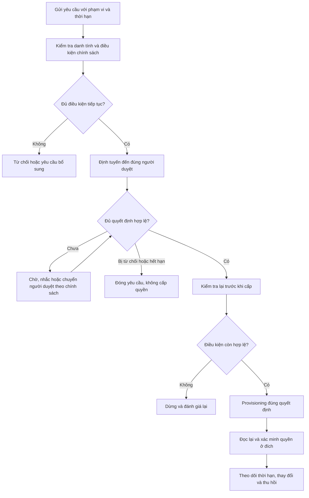

# Access approval

## 1. Phê duyệt truy cập quyết định điều gì?

**Access approval**, hay phê duyệt truy cập, là quá trình người hoặc cơ chế được trao thẩm quyền đánh giá một yêu cầu cấp quyền, sau đó chấp thuận hoặc từ chối theo chính sách. Một quyết định có ý nghĩa phải chỉ rõ **ai được truy cập tài nguyên nào, được làm gì, trong phạm vi nào, vì lý do gì và đến khi nào**.

Trong identity governance, phê duyệt truy cập gắn nhu cầu công việc với trách nhiệm của người quyết định. Quy trình này giúp tránh tình trạng quyền được cấp chỉ vì người yêu cầu quen quản trị viên, giữ chức vụ cao hoặc từng có quyền tương tự.

Ví dụ, một kỹ sư cần xem log của dịch vụ thanh toán để điều tra sự cố. Nhu cầu đó có thể phù hợp với quyền đọc log của đúng dịch vụ trong vài giờ. Nó không tự động chứng minh kỹ sư cần quyền quản trị toàn bộ môi trường production hoặc quyền tải mọi dữ liệu khách hàng.

Kết quả phê duyệt vì vậy không nên chỉ là một từ “đồng ý”. Đó là một quyết định có đối tượng, giới hạn, điều kiện, thời hạn và bằng chứng. Các giới hạn ấy phải được chuyển thành cấu hình quyền thực tế, rồi được thu hồi hoặc đánh giá lại khi điều kiện thay đổi.

## 2. Phân biệt phê duyệt với các cơ chế IAM khác

| Cơ chế | Câu hỏi chính | Ví dụ |
|---|---|---|
| Xác thực | Chủ thể đang đăng nhập là ai? | Kiểm tra mật khẩu và MFA |
| Phê duyệt truy cập | Nhu cầu cấp quyền này có được chấp thuận không? | Chủ dữ liệu đồng ý quyền đọc cho dự án cụ thể |
| Provisioning | Làm thế nào tạo hoặc cập nhật quyền ở hệ thống đích? | Thêm tài khoản vào nhóm được ánh xạ với vai trò đọc |
| Kiểm tra quyền khi sử dụng | Yêu cầu thao tác hiện tại có được phép không? | API kiểm tra người gọi có quyền xem hồ sơ đang yêu cầu |
| Access review | Quyền đang có còn cần thiết và hợp lệ không? | Chủ ứng dụng định kỳ xem lại quyền của nhóm nhà thầu |
| Reconciliation | Quyền thực tế có phù hợp với trạng thái được phép không? | Phát hiện vai trò thừa được thêm trực tiếp tại ứng dụng |

Phê duyệt không thay thế xác thực, và xác thực thành công không chứng minh người dùng được cấp mọi quyền họ yêu cầu. Tương tự, một yêu cầu đã duyệt chưa có nghĩa connector đã cấp quyền thành công.

Ứng dụng vẫn phải kiểm tra quyền khi người dùng thực hiện thao tác. OWASP nêu các nguyên tắc ít quyền nhất, từ chối theo mặc định và kiểm tra quyền cho từng yêu cầu; một bản ghi phê duyệt trong cổng IAM không thay thế các kiểm tra đó ở hệ thống thực thi. [OWASP Authorization Cheat Sheet](https://cheatsheetseries.owasp.org/cheatsheets/Authorization_Cheat_Sheet.html).

## 3. Một yêu cầu truy cập cần đủ thông tin

### 3.1. Người gửi và người được hưởng quyền

**Requester** là người gửi yêu cầu. **Beneficiary** là danh tính được cấp quyền. Hai bên có thể là cùng người, nhưng cũng có thể khác nhau khi quản lý yêu cầu cho nhân viên mới hoặc người phụ trách yêu cầu quyền cho tài khoản dịch vụ.

Hệ thống cần ghi nhận cả hai, dùng định danh ổn định và xác minh người gửi có quyền yêu cầu thay hay không. Không chỉ lưu tên hiển thị hoặc nội dung email vì chúng không đủ để ràng buộc quyết định với đúng danh tính.

Với đối tác hoặc nhà thầu, cần xác định người bảo trợ và ngày kết thúc quan hệ. Với workload, cần biết chủ sở hữu nghiệp vụ hoặc kỹ thuật, mục đích tích hợp và cách quản lý thông tin xác thực; một chương trình không thể tự cung cấp trách nhiệm quản trị như một người có thẩm quyền.

### 3.2. Tài nguyên, quyền và phạm vi

“Xin quyền vào hệ thống báo cáo” là mô tả quá rộng. Một yêu cầu có thể cần xác định:

- Ứng dụng, tài nguyên và đơn vị hoặc tenant có liên quan.
- Môi trường development, staging hay production.
- Vai trò hoặc hành động cụ thể: xem, chỉnh sửa, xuất dữ liệu, duyệt giao dịch.
- Phạm vi dữ liệu: một dự án, một khu vực, một tập khách hàng hoặc toàn hệ thống.
- Các quyền đi kèm khi gán vai trò hoặc nhóm được yêu cầu.

Tên vai trò nên có mô tả nghiệp vụ dễ hiểu. Nếu gói “Analyst” thực tế bao gồm cả tải dữ liệu ra ngoài, người duyệt phải biết điều đó. Một gói quyền quá rộng không trở thành ít rủi ro chỉ vì tên của nó nghe thông thường.

### 3.3. Lý do và thời hạn

Lý do cần gắn với nhiệm vụ cụ thể, chẳng hạn dự án, ticket sự cố hoặc trách nhiệm công việc. Các câu như “cần gấp”, “để làm việc” hoặc “đồng nghiệp đều có” chưa giải thích đủ vì sao cần đúng quyền đang xin.

Cũng cần tách ba loại thời gian:

1. **Hạn ra quyết định:** yêu cầu được chờ duyệt đến khi nào.
2. **Hiệu lực của quyết định:** quyết định còn có thể được dùng để bắt đầu cấp quyền trong điều kiện nào, đến thời điểm nào.
3. **Khoảng hiệu lực của quyền:** quyền được hoạt động từ lúc nào đến lúc nào.

Một yêu cầu chờ duyệt tối đa hai ngày không đồng nghĩa quyền được cấp tồn tại hai ngày. Ngược lại, yêu cầu quyền cho ngày mai không cho phép hệ thống cấp quyền ngay hôm nay chỉ vì đã được duyệt sớm.

## 4. Căn cứ ra quyết định

### 4.1. Nhu cầu nghiệp vụ và ít quyền nhất

Người duyệt cần xác định công việc có thật, danh tính có liên quan và quyền được xin có phù hợp với công việc đó không. Sau đó, xem xét có phạm vi hẹp hơn hoặc thời hạn ngắn hơn đáp ứng được nhu cầu hay không.

Ví dụ, nhiệm vụ điều tra một báo cáo sai có thể chỉ cần đọc dữ liệu tổng hợp. Nếu yêu cầu xin cả quyền sửa dữ liệu gốc và tải thông tin cá nhân, người duyệt cần yêu cầu làm rõ hoặc đề nghị yêu cầu mới với phạm vi phù hợp.

Nếu công cụ cho phép phê duyệt một phần, nội dung được chấp thuận phải được ghi rõ và bên cấp quyền phải dùng đúng phần đó. Nếu công cụ chỉ hỗ trợ chấp thuận hoặc từ chối toàn bộ, không duyệt một yêu cầu rộng rồi ghi trong bình luận rằng “chỉ được dùng quyền đọc”. Bình luận không tự giới hạn quyền kỹ thuật.

### 4.2. Điều kiện đủ và giới hạn bắt buộc

Trước hoặc trong quá trình duyệt, chính sách có thể kiểm tra trạng thái danh tính, loại hợp đồng, yêu cầu đào tạo, người bảo trợ, quyền hiện có và các xung đột. Điều kiện nào là bắt buộc, điều kiện nào có quy trình ngoại lệ phải được định nghĩa rõ.

Người quản lý đồng ý không mặc nhiên có quyền bỏ qua một giới hạn bắt buộc. Nếu chính sách cho phép ngoại lệ, ngoại lệ cần có thẩm quyền riêng, lý do, thời hạn và biện pháp kiểm soát; không nên ẩn trong một bình luận phê duyệt thông thường.

### 4.3. Phân tách nhiệm vụ

**Separation of duties**, hay phân tách nhiệm vụ, giúp hạn chế một người có khả năng tự thực hiện toàn bộ một chuỗi hành động có rủi ro. Ví dụ, cùng một người không nên vừa tạo nhà cung cấp vừa duyệt thanh toán cho nhà cung cấp đó nếu chính sách quy định hai nhiệm vụ phải độc lập.

Khi đánh giá yêu cầu, cần xét quyền hiện có cùng quyền mới, kể cả những quyền đi qua nhóm hoặc vai trò kế thừa trong phạm vi có thể quan sát. Từng quyền riêng lẻ có thể hợp lệ, nhưng tổ hợp của chúng có thể tạo xung đột.

Phân tách nhiệm vụ còn áp dụng cho chính quy trình phê duyệt. Không cho người dùng tự duyệt yêu cầu của mình hoặc dùng cơ chế yêu cầu thay để biến người hưởng quyền thành người duyệt độc lập. Các chính sách có thể cần cấm cả người gửi lẫn người hưởng quyền tham gia một số bước quyết định.

## 5. Chọn người duyệt theo trách nhiệm

| Vai trò | Trọng tâm đánh giá | Giới hạn cần hiểu |
|---|---|---|
| Quản lý trực tiếp | Nhiệm vụ có cần thiết, người dùng có thuộc nhóm thực hiện không? | Có thể chưa hiểu toàn bộ rủi ro dữ liệu hoặc quyền kỹ thuật |
| Chủ ứng dụng hoặc chủ dữ liệu | Quyền và phạm vi có phù hợp với tài nguyên do mình quản lý không? | Không thay thế các giới hạn an ninh bắt buộc |
| Bộ phận an ninh hoặc quản trị đặc quyền | Rủi ro cao, quyền quản trị, xung đột và ngoại lệ | Không nhất thiết cần tham gia mọi yêu cầu ít rủi ro |
| Người bảo trợ đối tác | Mục đích hợp tác và thời hạn của người ngoài tổ chức | Cần có thẩm quyền bảo trợ đúng tài nguyên và phạm vi |
| Đội IAM hoặc cơ chế tự động | Định tuyến, kiểm tra chính sách, thực thi và ghi bằng chứng | Có khả năng kỹ thuật cấp quyền không đồng nghĩa được quyết định nhu cầu nghiệp vụ |

Người duyệt phải được chỉ định theo phạm vi. Chủ ứng dụng A không tự động có thẩm quyền duyệt quyền của ứng dụng B. Tương tự, quyền thay mặt một người duyệt phải có thời hạn và phạm vi ủy quyền phù hợp.

Danh sách người duyệt cần được quản lý như dữ liệu nhạy cảm về quyền. Nếu người dùng có thể tự sửa người quản lý hoặc tự thêm mình vào nhóm chủ tài nguyên mà không có kiểm soát phù hợp, họ có thể tác động đến đường đi của chính yêu cầu truy cập.

Không nên mặc định quản trị viên IAM là người duyệt cuối cho mọi tài nguyên chỉ vì họ vận hành công cụ. Chủ sở hữu tài nguyên phải rõ ràng; tài nguyên chưa có người chịu trách nhiệm cần được xử lý về quản trị trước khi mở luồng cấp quyền thông thường.

## 6. Phê duyệt một bước, nhiều bước và biểu quyết

**Một bước** phù hợp khi một vai trò duyệt có đủ thẩm quyền và thông tin cho mức rủi ro của yêu cầu. Trong một bước có thể có nhiều người được chỉ định để giảm phụ thuộc vào một cá nhân.

**Nhiều bước** có thể tách các câu hỏi khác nhau: quản lý xác nhận nhu cầu, chủ dữ liệu xác nhận phạm vi, rồi bộ phận có thẩm quyền xử lý phần đặc quyền hoặc ngoại lệ. Các bước có thể tuần tự hoặc song song, tùy công cụ và chính sách.

Cần quy định chính xác ý nghĩa của việc có nhiều người duyệt:

- **Bất kỳ một người trong nhóm đồng ý:** một quyết định hợp lệ có thể hoàn tất bước.
- **Tất cả vai trò bắt buộc đồng ý:** mỗi vai trò phải có quyết định đáp ứng điều kiện.
- **Đủ số phiếu:** cần một số lượng quyết định từ những người khác nhau theo quy tắc đã định.

Ba cơ chế này không tương đương. Thêm năm người vào cùng một danh sách không tự tạo ra yêu cầu năm người cùng duyệt. Nếu cần hai người độc lập, phải xác minh hai quyết định đến từ hai danh tính phù hợp, không chỉ đếm hai nút đã được bấm hoặc hai tài khoản của cùng người.

Microsoft Entra minh họa sự khác biệt này: với nhiều người duyệt trong cùng một bước, chỉ cần một người ra quyết định cho bước đó; sản phẩm cũng có cấu hình phê duyệt nhiều bước và lý do yêu cầu hoặc quyết định. Đây là hành vi của sản phẩm cần hiểu khi thiết kế chính sách, không phải quy tắc chung cho mọi nền tảng. [Tài liệu phê duyệt yêu cầu](https://learn.microsoft.com/en-us/entra/id-governance/entitlement-management-request-approve), [tài liệu cấu hình phê duyệt](https://learn.microsoft.com/en-us/entra/id-governance/entitlement-management-access-package-approval-policy).

Chính sách cũng phải nêu cách xử lý quyết định mâu thuẫn, chẳng hạn một người đồng ý và người khác từ chối. Không để thứ tự đến của các thông báo vô tình quyết định ý nghĩa nghiệp vụ. Nếu công cụ chỉ hỗ trợ một kiểu xử lý, thiết kế luồng phải phản ánh đúng khả năng đó.

## 7. Luồng xử lý từ yêu cầu đến quyền thực tế



Các nhãn trong sơ đồ là mô tả nghiệp vụ, không phải tên trạng thái bắt buộc của một phần mềm. Một triển khai có thể dùng các trạng thái như `SUBMITTED`, `PENDING_APPROVAL`, `APPROVED`, `PROVISIONING`, `ACTIVE`, `DENIED`, `EXPIRED`, `CANCELLED` và `FAILED`.

Điều quan trọng là không nhập nhằng giữa **đã duyệt**, **đã gửi lệnh cấp**, **đã cấp một phần** và **đã xác minh đủ quyền được phép**. Nếu một gói gồm ba tài nguyên mà mới cấp được hai, thông báo cho người dùng và báo cáo vận hành phải thể hiện phần còn thiếu.

Không cấp từng phần chỉ vì một bước đầu đã đồng ý khi chính sách yêu cầu toàn bộ các bước hoàn thành trước khi cấp. Nếu nghiệp vụ thực sự cho phép chia thành nhiều phần được duyệt độc lập, cần mô hình hóa từng phần rõ ràng và có bằng chứng tương ứng.

## 8. Ràng buộc quyết định với đúng nội dung yêu cầu

### 8.1. Không thay nội dung sau khi đã duyệt

Giả sử người duyệt chấp thuận quyền đọc của dự án A trong một ngày. Nếu sau đó yêu cầu bị sửa thành quyền quản trị toàn bộ ứng dụng trong một tháng, quyết định cũ không còn là căn cứ cho nội dung mới.

Một thiết kế phù hợp là gắn quyết định với phiên bản nội dung yêu cầu. Các trường ảnh hưởng quyền — danh tính hưởng quyền, tài nguyên, môi trường, vai trò, phạm vi và thời hạn — phải được kiểm soát thay đổi. Khi thay đổi đáng kể, tạo phiên bản hoặc yêu cầu mới và thực hiện lại những bước duyệt bị ảnh hưởng.

Bình luận bổ sung không nhất thiết thay đổi quyền, nhưng nếu nó chứa một điều kiện nghiệp vụ mới thì điều kiện cần được thể hiện ở dữ liệu có thể thực thi. Chỉ kiểm tra một mã yêu cầu tồn tại trong cơ sở dữ liệu chưa chứng minh quyền sắp cấp là quyền đã được duyệt.

### 8.2. Kiểm tra lại trước khi cấp

Giữa thời điểm gửi, duyệt và provisioning, danh tính có thể nghỉ việc, hết hợp đồng, chuyển bộ phận hoặc được cấp thêm một quyền tạo xung đột. Chủ tài nguyên và chính sách cũng có thể thay đổi.

Trước khi cấp, cần đánh giá lại các điều kiện cần thiết theo chính sách hiện hành, xác định quyết định còn hiệu lực và không có yêu cầu hủy hoặc thu hồi mới hơn. Một quyết định hợp lệ lúc trước không phải giấy phép vượt qua mọi thay đổi sau đó.

Nếu công việc cấp quyền phải thử lại sau lỗi, lần thử lại vẫn phải kiểm tra hiệu lực. Không để một công việc cũ cấp lại quyền sau khi người dùng đã rời tổ chức hoặc yêu cầu đã bị hủy.

### 8.3. Giới hạn quyền của API phê duyệt

Ẩn nút “Approve” khỏi giao diện của người không có quyền là chưa đủ. API phải xác thực người gọi, kiểm tra thẩm quyền của họ đối với đúng yêu cầu, trạng thái hiện tại, phiên bản và các ràng buộc chống tự duyệt.

Luồng quyết định cần xử lý được thao tác trùng và cạnh tranh, chẳng hạn người dùng bấm hai lần hoặc hai người duyệt cùng gửi kết quả. Việc chuyển trạng thái phải nhất quán với quy tắc biểu quyết. Không nhận danh tính người duyệt chỉ từ một trường do trình duyệt tự gửi lên mà bỏ qua phiên đã xác thực.

## 9. Ví dụ: yêu cầu đọc báo cáo production

Mai là nhà phân tích đang điều tra chênh lệch doanh số của dự án `sales-q4`. Mai cần xem báo cáo tổng hợp trong hai ngày, không cần sửa dữ liệu hoặc xuất dữ liệu chi tiết.

Một nội dung yêu cầu minh họa có thể là:

```yaml
requestId: access-4721
revision: 1
requestedBy: person-208
beneficiary: person-208
resource: revenue-reporting
environment: production
role: report-reader
scope:
  project: sales-q4
requestedDurationHours: 48
businessJustification: Đối chiếu báo cáo doanh số theo ticket ANALYTICS-729
```

Đây là cấu trúc minh họa để giải thích nội dung, không phải schema cấu hình của một sản phẩm. Trong triển khai thật, thời điểm bắt đầu và kết thúc phải được xác định rõ, có múi giờ, và người duyệt cần thấy được khoảng thời gian họ chấp thuận.

Giả sử chính sách của tổ chức yêu cầu quản lý trực tiếp xác nhận nhiệm vụ và chủ dữ liệu xác nhận phạm vi production. Trình tự có thể là:

1. Hệ thống kiểm tra Mai còn hoạt động, đủ điều kiện yêu cầu và vai trò `report-reader` thực sự chỉ cho phép đọc trong phạm vi dự án.
2. Quản lý xác nhận ticket có thật và Mai được phân công xử lý.
3. Chủ dữ liệu xác nhận báo cáo tổng hợp đáp ứng nhu cầu, thời hạn phù hợp và không kèm quyền tải dữ liệu chi tiết.
4. Hệ thống ghi hai quyết định gắn với phiên bản 1, kiểm tra lại điều kiện trước khi cấp.
5. Connector cấp đúng vai trò và phạm vi; quy trình xác minh quyền tại ứng dụng đích.
6. Khi hết thời hạn, hệ thống thực hiện thu hồi và xác minh kết quả theo cơ chế của ứng dụng.

Nếu ứng dụng chỉ có vai trò đọc toàn bộ dự án và không thể giới hạn ở `sales-q4`, quy trình không nên báo rằng quyền thực tế đã đúng phạm vi vừa duyệt. Cần chọn cách đáp ứng hẹp hơn, thay đổi yêu cầu và duyệt lại, hoặc xử lý theo quy trình ngoại lệ có thẩm quyền.

Nếu Mai vốn đã có quyền đọc qua một vai trò khác, việc hết hạn yêu cầu này không có nghĩa chắc chắn Mai mất mọi quyền đọc. Hệ thống cần theo dõi nguồn cấp và quyền hiệu lực để thu hồi đúng quan hệ, đồng thời phát hiện quyền khác không còn hợp lệ nếu có.

## 10. Quá hạn, ủy quyền, tự động hóa và khẩn cấp

### 10.1. Không có phản hồi không phải đồng ý

Yêu cầu cần có thời hạn xử lý, nhắc việc và đường chuyển người duyệt theo chính sách. Nếu hết hạn mà chưa có đủ quyết định, yêu cầu không được tự biến thành đã duyệt chỉ để tránh chậm tiến độ.

Chuyển cho người duyệt dự phòng phải giữ nguyên phạm vi và điều kiện. Người dự phòng phải có thẩm quyền, đáp ứng yêu cầu độc lập và được ghi vào lịch sử. Nếu không tìm được người phù hợp, đó là vấn đề cần xử lý về ownership; không mặc định chuyển cho chính người xin quyền.

Ủy quyền cần nêu ai ủy quyền, cho ai, phạm vi, thời hạn và điều kiện thu hồi. Một ủy quyền chung chung hoặc hết hạn không đủ làm căn cứ cho quyết định mới.

### 10.2. Không phải quyền nào cũng cần duyệt thủ công từng lần

Tổ chức có thể cấp tự động quyền cơ bản cho những đối tượng đáp ứng chính sách đã được phê duyệt. Ví dụ, nhân viên đang hoạt động thuộc một đơn vị được cấp quyền sử dụng cổng thông tin nội bộ.

Trong trường hợp đó, quyết định nằm ở chính sách và điều kiện đủ, thay vì một người bấm đồng ý cho từng trường hợp. Cần có người chịu trách nhiệm cho chính sách, quản lý thay đổi và khả năng giải thích vì sao một lần cấp tự động được cho phép. Không ghi rằng có người duyệt thủ công khi thực tế không có.

Các quyền nhạy cảm, ngoại lệ hoặc truy cập ngoài vai trò thường cần kiểm soát phù hợp với rủi ro. Số bước duyệt nên gắn với câu hỏi cần giải quyết; thêm nhiều bước không có thông tin mới có thể làm người duyệt chỉ bấm cho xong.

### 10.3. Quyền đặc quyền và truy cập khẩn cấp

Với đặc quyền, có thể phân biệt **đủ điều kiện được kích hoạt** và **đang có quyền hoạt động**. Được duyệt đủ điều kiện không nhất thiết cho phép dùng quyền liên tục; lần kích hoạt có thể còn yêu cầu MFA, lý do, thời hạn ngắn và bước duyệt riêng theo chính sách.

Truy cập khẩn cấp cần quy trình được xác định trước: ai được kích hoạt, quyền nào, trong bao lâu, thông báo cho ai và đánh giá lại thế nào sau sự kiện. Không giả định rằng mọi tình huống khẩn cấp đều phải chờ cùng một chuỗi duyệt, nhưng cũng không dùng từ “khẩn cấp” để bỏ qua kiểm soát mà không có thẩm quyền.

Nếu quy trình cho phép truy cập trước và xem xét sau trong một điều kiện đặc biệt, bằng chứng phải phản ánh đúng điều đó. Một cuộc xem xét sau sự kiện không được ghi lại như thể đã có phê duyệt trước khi cấp quyền.

## 11. Bằng chứng, thu hồi và đo lường

Một hồ sơ phê duyệt có thể cần lưu các thông tin sau theo yêu cầu quản trị:

- Người gửi, người hưởng quyền, tài nguyên, vai trò, phạm vi và thời hạn đã yêu cầu.
- Phiên bản yêu cầu và căn cứ chính sách tại các thời điểm liên quan.
- Danh tính người duyệt, vai trò hoặc ủy quyền làm căn cứ thẩm quyền, quyết định và lý do.
- Thời điểm ra quyết định, bổ sung, từ chối, hủy và hết hạn.
- Kết quả kiểm tra trước cấp, các thao tác provisioning và bằng chứng xác minh ở đích.
- Kết quả gia hạn, thu hồi và các ngoại lệ còn hiệu lực.

Log và lịch sử quyết định cần được bảo vệ khỏi sửa trái phép, giới hạn người xem và lưu theo chính sách phù hợp. Không đưa mật khẩu, token hoặc dữ liệu nghiệp vụ nhạy cảm không cần thiết vào ô lý do. Người duyệt cần đủ thông tin đánh giá, nhưng không phải vì vậy mà mọi người trong chuỗi được xem toàn bộ dữ liệu khách hàng.

Quy trình phê duyệt phải kết nối với thu hồi khi hết hạn, chuyển vị trí, nghỉ việc hoặc khi căn cứ nghiệp vụ không còn. Gia hạn là một quyết định cần đánh giá lại theo chính sách; không đơn giản sao chép lần duyệt cũ mãi mãi.

Một số chỉ số có ích gồm thời gian chờ theo mức rủi ro, số yêu cầu quá hạn, số yêu cầu trả về vì thiếu thông tin, số trường hợp tự duyệt bị chặn, số quyền cấp không khớp quyết định và số lần thu hồi quá hạn. Tỷ lệ phê duyệt nhanh không tự chứng minh chất lượng nếu phần lớn quyết định không có căn cứ hoặc quyền được cấp quá rộng.

Cũng nên theo dõi sự phụ thuộc vào một người duyệt và những tài nguyên chưa có chủ sở hữu. Những điểm này thường giải thích vì sao người dùng tìm cách xin quyền ngoài quy trình chính thức.

## 12. Tình huống tự kiểm tra

**Quản lý nói “đồng ý”, nhưng chủ dữ liệu từ chối. Có được cấp quyền không?**

Phụ thuộc quy tắc đã xác định, nhưng nếu cả hai bước đều bắt buộc đồng ý thì chưa đủ điều kiện cấp. Người vận hành không được tự bỏ bước từ chối. Nếu cần xem xét lại, dùng luồng giải trình, yêu cầu mới hoặc quy trình ngoại lệ phù hợp.

**Thêm ba người vào một nhóm duyệt có bảo đảm ba người cùng đồng ý không?**

Không. Có công cụ chỉ cần một người trong nhóm ra quyết định. Muốn có nhiều quyết định độc lập phải cấu hình đúng các bước hoặc điều kiện biểu quyết và xác minh danh tính của từng người.

**Yêu cầu đã duyệt nhưng người hưởng quyền nghỉ việc trước khi connector xử lý. Có tiếp tục cấp không?**

Không tiếp tục dựa riêng vào quyết định cũ. Cần kiểm tra lại trạng thái có thẩm quyền, hiệu lực và chính sách tại thời điểm cấp; thay đổi vòng đời có thể làm yêu cầu không còn hợp lệ.

**Người duyệt đồng ý quyền đọc nhưng chỉ có thể cấp vai trò quản trị. Có thể cấp rồi nhắc người dùng chỉ đọc không?**

Không thể coi đó là thực thi đúng quyết định. Cần tìm giải pháp quyền phù hợp hoặc đưa phạm vi thực tế vào một yêu cầu được đánh giá lại. Cam kết trong bình luận không thay thế giới hạn quyền ở ứng dụng.

**Có vé phê duyệt là đủ chứng minh người dùng không còn truy cập sau ngày hết hạn?**

Chưa. Vé cho biết quyết định và thời hạn, còn việc thu hồi cần có bằng chứng thực thi và xác minh ở các hệ thống liên quan. Quyền có thể còn qua nhóm khác, phiên làm việc hoặc cơ chế truy cập khác tùy ứng dụng; báo cáo phải nêu rõ phạm vi đã kiểm chứng.

Một luồng phê duyệt có trách nhiệm phải nối được ba điều: quyết định có căn cứ, quyền được thực thi đúng giới hạn và quyền được kết thúc khi căn cứ đó hết hiệu lực.
