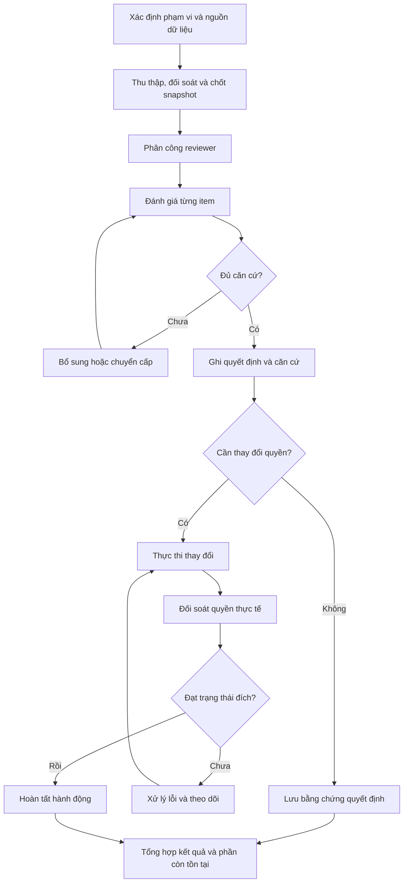

# Access review

## 1. Access review giải quyết vấn đề gì?

**Access review** là hoạt động rà soát có chủ đích để xác định quyền truy cập đang tồn tại có còn cần thiết, phù hợp và đúng chính sách hay không. Trong identity governance, kết quả rà soát phải dẫn đến quyết định có người chịu trách nhiệm và hành động xử lý có thể kiểm chứng.

Một nhân viên có thể được cấp quyền hợp lệ khi tham gia dự án, nhưng vẫn giữ quyền sau khi chuyển bộ phận. Một workload có thể tiếp tục truy cập dữ liệu dù ứng dụng sử dụng nó đã ngừng hoạt động. Xác thực thành công hoặc từng được phê duyệt không chứng minh những quyền đó vẫn phù hợp ở hiện tại.

Access review giúp phát hiện quyền tích lũy theo thời gian, quyền không có chủ sở hữu, quyền đặc quyền không còn cần thiết, tài khoản không gắn được với danh tính hợp lệ và tổ hợp quyền tạo xung đột nhiệm vụ. Đây là một cơ chế duy trì nguyên tắc ít quyền nhất trong suốt vòng đời danh tính.

Cần phân biệt các hoạt động liên quan:

| Hoạt động | Câu hỏi chính | Thời điểm thường gặp |
|---|---|---|
| Phê duyệt cấp quyền | Có nên cấp quyền được yêu cầu không? | Trước khi cấp hoặc mở rộng quyền |
| Access review | Quyền đang tồn tại có còn phù hợp không? | Định kỳ hoặc khi có sự kiện |
| Provisioning/deprovisioning | Thay đổi quyền được thực hiện ở hệ thống đích ra sao? | Khi cấp, sửa hoặc thu hồi quyền |
| Kiểm tra quyền khi truy cập | Chủ thể có được thực hiện hành động này ngay lúc này không? | Tại thời điểm sử dụng tài nguyên |
| Kiểm toán | Có bằng chứng cho thấy các kiểm soát đã được thực hiện không? | Theo kế hoạch hoặc khi điều tra |

Thuật ngữ **access certification** hoặc **recertification** thường được dùng khi người có trách nhiệm xác nhận lại quyền trong một đợt rà soát chính thức. Cách gọi có thể khác giữa các tổ chức; điều quan trọng là phạm vi, thẩm quyền quyết định và cách xử lý kết quả được định nghĩa rõ.

## 2. Rà soát quyền thực tế, không chỉ rà soát danh sách đã yêu cầu

Quyền trong hệ thống đích có thể khác dữ liệu trong cổng yêu cầu IAM. Có quyền được cấp trực tiếp bởi quản trị viên, quyền kế thừa qua nhóm, vai trò lồng nhau hoặc tài khoản cục bộ không đi qua quy trình chung. Chỉ xem những yêu cầu đã được duyệt sẽ bỏ sót các đường truy cập này.

Một đợt review cần xác định rõ đang xem xét đối tượng nào:

- **Danh tính:** nhân viên, đối tác hoặc workload cùng trạng thái và người chịu trách nhiệm.
- **Tài khoản:** tài khoản cụ thể trong directory, ứng dụng hoặc nền tảng đích.
- **Gán quyền:** quan hệ giữa tài khoản hoặc danh tính với nhóm, vai trò, entitlement hay tài nguyên.
- **Quyền có hiệu lực:** khả năng truy cập thực tế sau khi tính các đường cấp trực tiếp, kế thừa và điều kiện liên quan.
- **Định nghĩa vai trò:** tập quyền chứa trong một role; đây có thể là đối tượng rà soát riêng với việc ai đang được gán role đó.

**Entitlement** là một đơn vị quyền hoặc khả năng truy cập có thể được quản lý, chẳng hạn quyền đọc báo cáo hay thành viên của nhóm quản trị. Một role có thể bao gồm nhiều entitlement. Duyệt thành viên của role không tự chứng minh mọi entitlement trong role đều được thiết kế đúng.

Ví dụ:

```text
Danh tính employee-208
  -> tài khoản reporting/u208
      -> gán trực tiếp: report-reader
      -> nhóm finance-analysts
          -> vai trò report-reader
          -> quyền export-sensitive-report
```

Nếu chỉ xóa gán trực tiếp `report-reader`, người dùng vẫn có thể nhận cùng quyền qua nhóm. Nếu xóa toàn bộ nhóm để thu hồi quyền xuất báo cáo, có thể làm mất những quyền khác còn cần thiết. Reviewer cần hiểu nguồn cấp và tác động của hành động đề xuất.

Việc review cũng phải nhìn được tổ hợp quyền. Một quyền riêng lẻ có vẻ hợp lý nhưng kết hợp với quyền ở ứng dụng khác có thể cho phép cùng người vừa tạo vừa phê duyệt giao dịch. Đây là vấn đề phân tách nhiệm vụ, thường được gọi là **Segregation of Duties — SoD**.

## 3. Xác định phạm vi và chất lượng dữ liệu trước khi mở đợt review

Một **review campaign** là đợt rà soát có phạm vi, người phụ trách, thời điểm chốt dữ liệu và hạn xử lý. Không nên khởi tạo campaign bằng một danh sách tài khoản rồi để reviewer tự đoán những gì họ phải xác nhận.

Phạm vi cần trả lời được:

1. Những hệ thống, môi trường, tài nguyên và loại quyền nào được bao phủ?
2. Những loại danh tính nào được xét: nhân viên, đối tác, tài khoản quản trị, workload?
3. Đang rà soát thành viên nhóm, gán role, entitlement chi tiết hay quyền có hiệu lực?
4. Dữ liệu được thu thập từ đâu và cập nhật đến thời điểm nào?
5. Ai quyết định, ai xử lý thu hồi và ai xác nhận hoàn tất?
6. Những đối tượng nào chưa được bao phủ hoặc chưa đủ dữ liệu để đánh giá?

Dữ liệu cần được đối soát với nguồn thực tế phù hợp. Directory có thể cho biết thành viên nhóm, nhưng ứng dụng vẫn có các gán quyền cục bộ. Dữ liệu nhân sự giúp xác minh trạng thái nhân viên nhưng không tự mô tả hết quyền ở production.

Nếu connector mất kết nối, danh sách rỗng không có nghĩa hệ thống không có quyền nào cần review. Phải phân biệt “đã thu thập và không có đối tượng” với “không thu thập được dữ liệu”.

Những vấn đề chất lượng dữ liệu thường gặp gồm:

| Vấn đề | Rủi ro với kết quả review | Hướng xử lý |
|---|---|---|
| Tài khoản không gắn được với danh tính | Không biết ai chịu trách nhiệm và còn cần quyền hay không | Điều tra liên kết danh tính, đưa vào luồng xử lý rõ ràng |
| Entitlement có tên kỹ thuật khó hiểu | Reviewer duyệt theo tên mà không hiểu tác động | Bổ sung mô tả nghiệp vụ, phạm vi và chủ sở hữu |
| Thiếu nguồn cấp hoặc đường kế thừa | Thu hồi sai điểm hoặc không loại bỏ được quyền | Thu thập nguồn gán, nhóm lồng nhau và quan hệ liên quan |
| Dữ liệu đã cũ | Quyết định dựa trên trạng thái không còn đúng | Hiển thị độ mới, đồng bộ lại hoặc xử lý chênh lệch |
| Trùng đối tượng rà soát | Đếm sai tiến độ hoặc ra quyết định mâu thuẫn | Dùng định danh ổn định và quy tắc chuẩn hóa |
| Không xác định được owner | Không tìm được reviewer có thẩm quyền | Chuyển cấp và quản lý như một thiếu hụt governance |

Không nên bỏ các đối tượng khó xác minh ra khỏi campaign rồi báo độ bao phủ hoàn chỉnh. Cần thể hiện phần chưa được đánh giá cùng người chịu trách nhiệm xử lý.

## 4. Chọn reviewer có đủ hiểu biết và thẩm quyền

Người đánh giá cần biết cả nhu cầu sử dụng lẫn ý nghĩa của quyền. Quản lý trực tiếp thường biết nhân viên đang làm gì, trong khi chủ sở hữu ứng dụng hoặc dữ liệu hiểu entitlement có tác động ra sao.

| Reviewer | Thế mạnh | Giới hạn cần lưu ý |
|---|---|---|
| Quản lý trực tiếp | Nắm nhiệm vụ và quan hệ công việc | Có thể không hiểu chi tiết quyền kỹ thuật |
| Chủ sở hữu ứng dụng | Hiểu role, entitlement và tác động vận hành | Có thể không biết nhu cầu của từng nhân viên |
| Chủ sở hữu dữ liệu | Đánh giá mục đích, phạm vi và độ nhạy cảm của dữ liệu | Có thể cần hỗ trợ về đường cấp quyền |
| Chủ sở hữu workload | Xác nhận mục đích và vòng đời của danh tính máy | Cần chứng minh workload vẫn tồn tại và có trách nhiệm quản lý |
| Bộ phận kiểm soát độc lập | Đánh giá xung đột, ngoại lệ hoặc quyền rủi ro cao | Không thay thế được thông tin nghiệp vụ từ owner |

Tổ chức có thể chọn một hoặc nhiều lớp review theo rủi ro. Nếu cần hai người độc lập xác nhận, cùng một người mang hai vai trò không tự trở thành hai reviewer độc lập.

Tự đánh giá có thể cung cấp thông tin về nhu cầu nhưng không nên mặc định là quyết định cuối cùng cho quyền của chính reviewer. Cần áp dụng quy tắc độc lập phù hợp, đặc biệt với quyền quản trị và dữ liệu nhạy cảm.

Ủy quyền khi nghỉ phép phải có người nhận, phạm vi và thời hạn rõ ràng. Hệ thống lưu cả người được giao ban đầu lẫn người thực sự quyết định, đồng thời kiểm tra thẩm quyền tại thời điểm thao tác. Không cho requester hoặc subject tùy ý chọn người sẽ xác nhận quyền của mình.

## 5. Thông tin cần hiển thị cho mỗi review item

Một **review item** là đơn vị mà reviewer đưa ra quyết định, chẳng hạn một gán entitlement cho một tài khoản tại một phạm vi cụ thể. Đơn vị quá rộng như “toàn bộ quyền của nhân viên” có thể che mất quyền nhạy cảm; đơn vị quá nhỏ nhưng không có ngữ cảnh lại khiến reviewer mất khả năng đánh giá.

Mỗi item nên có các thông tin đủ để trả lời “ai có quyền gì, ở đâu, vì sao và còn cần không”:

- Danh tính, tài khoản liên quan, loại danh tính và trạng thái hoạt động.
- Bộ phận, nhiệm vụ hoặc chủ sở hữu workload cần thiết cho việc đánh giá.
- Hệ thống, môi trường, entitlement và phạm vi tài nguyên.
- Mô tả dễ hiểu về tác động của quyền, nhất là khả năng sửa, xuất hoặc quản trị dữ liệu.
- Nguồn cấp trực tiếp hoặc kế thừa, thời điểm cấp và ngày hết hạn nếu có.
- Lý do hoặc yêu cầu cấp ban đầu, cùng những thay đổi vai trò công việc có liên quan.
- Tín hiệu sử dụng, rủi ro, xung đột nhiệm vụ và kết quả review trước đó.
- Thời điểm thu thập và phần dữ liệu còn thiếu.

“Lần sử dụng cuối” chỉ là một tín hiệu. Không có bản ghi sử dụng có thể do log thiếu, dữ liệu chưa cập nhật hoặc hành động không được hệ thống đo lường. Ngược lại, có sử dụng gần đây không chứng minh quyền đó hợp lệ hoặc cần thiết.

Một quyền phục vụ khôi phục sự cố có thể ít được dùng nhưng vẫn có nhu cầu chính đáng. Reviewer cần cân nhắc cơ chế truy cập khẩn cấp, thời hạn và kiểm soát liên quan thay vì tự động giữ hoặc thu hồi chỉ dựa vào số ngày không hoạt động.

## 6. Các loại quyết định và trách nhiệm đi kèm

Một giao diện chỉ có nút “đồng ý” dễ làm mất những trường hợp chưa đủ thông tin hoặc cần thu hẹp phạm vi. Tập quyết định cần phản ánh cách tổ chức sẽ xử lý sau review.

| Quyết định | Ý nghĩa | Việc tiếp theo |
|---|---|---|
| Giữ nguyên | Quyền hiện tại vẫn cần và phù hợp với phạm vi được xét | Lưu người quyết định, căn cứ và thời điểm đánh giá |
| Thu hồi | Quyền không còn phù hợp hoặc không còn nhu cầu | Tạo hành động thu hồi và theo dõi đến khi xác nhận |
| Điều chỉnh | Chỉ một phần quyền hoặc thời hạn còn cần thiết | Xác định trạng thái đích; xử lý thay đổi theo chính sách |
| Cần thêm thông tin | Chưa đủ căn cứ để quyết định | Giao người bổ sung và hạn xử lý, giữ trạng thái chưa hoàn tất |
| Chuyển reviewer | Người hiện tại không đủ hiểu biết hoặc thẩm quyền | Chuyển cho đúng người, giữ lịch sử và trách nhiệm |
| Ngoại lệ có thời hạn | Có nhu cầu được chấp thuận nhưng cần xử lý một sai lệch theo quy trình ngoại lệ | Ghi owner, căn cứ, kiểm soát bù và ngày đánh giá lại |

Việc điều chỉnh sang một role khác có thể vô tình thêm quyền mới. Phải so sánh phạm vi trước và sau; phần mở rộng vượt quyền hiện có cần qua kiểm tra hoặc phê duyệt cấp quyền tương ứng. Access review không phải đường tắt để tự cấp thêm đặc quyền.

Ngoại lệ không đồng nghĩa đánh dấu mọi rủi ro đã được giải quyết. Ngoại lệ cần người có thẩm quyền chấp nhận, phạm vi rõ, thời hạn và trách nhiệm xử lý. Khi hết hạn, hệ thống phải đánh giá lại hoặc thực hiện hành động đã định.

Một phiếu review cũng không xóa lịch sử của một lần cấp quyền không đúng quy trình. Cần lưu phát hiện và xử lý nguyên nhân, dù quyết định cuối cùng là giữ quyền vì hiện tại có nhu cầu hợp lệ.

## 7. Vòng đời campaign: quyết định và xử lý là hai phần riêng

Một campaign có thể đi qua các bước sau:



Có thể dùng các trạng thái quyết định như `PENDING`, `RETAIN`, `REVOKE`, `MODIFY` và trạng thái xử lý riêng như `NOT_REQUIRED`, `QUEUED`, `APPLYING`, `FAILED`, `VERIFIED`. Đây là ví dụ khái niệm; tên trạng thái không quan trọng bằng việc không trộn lẫn ý kiến reviewer với kết quả thực thi.

Ví dụ một item đã được quyết định thu hồi nhưng chưa xử lý xong:

```yaml
campaignId: review-finance-2026-q4
itemId: item-0042
snapshot:
  capturedAt: "2026-11-20T02:00:00Z"
  subjectId: employee-208
  accountId: reporting-u208
  entitlementId: export-sensitive-report
  resourceScope: finance-project-a
  assignmentId: assignment-783
  assignmentVersion: 4
  grantSource: direct
decision:
  outcome: REVOKE
  reviewerId: data-owner-017
  reason: "Không còn tham gia dự án A"
  decidedAt: "2026-11-21T09:15:00Z"
remediation:
  state: QUEUED
  operationId: revoke-item-0042
```

Ví dụ này là dữ liệu minh họa, không phải schema của một sản phẩm cụ thể. Hệ thống phải xác thực reviewer và kiểm tra thẩm quyền ở phía máy chủ; không tin một `reviewerId` được gửi tùy ý trong request.

### Hết hạn và không phản hồi

Im lặng không được coi là một quyết định giữ quyền có chủ đích. Workflow cần có nhắc việc, chuyển cấp và cách xử lý khi quá hạn. Chính sách có thể quy định một số quyền tạm thời hết hiệu lực khi không được xác nhận, nhưng phải thể hiện đây là hành động theo chính sách, không ghi thành reviewer đã chấp thuận.

Nếu campaign cho phép đóng phần ra quyết định trước khi xong thu hồi, báo cáo phải thể hiện riêng các hành động còn mở cùng owner và hạn xử lý. Không tuyên bố toàn bộ quyền đã được làm sạch chỉ vì mọi reviewer đã bấm nút.

## 8. Snapshot, thay đổi đồng thời và quyền kế thừa

Review thường kéo dài nhiều ngày, trong khi quyền và trạng thái nhân sự tiếp tục thay đổi. **Snapshot** giúp xác định reviewer đã xem dữ liệu nào; nó không đảm bảo dữ liệu đó vẫn là hiện trạng khi xử lý quyết định.

Giả sử reviewer quyết định xóa gán quyền phiên bản 4. Trước khi connector thực thi, gán quyền đó đã bị xóa và một gán mới được tạo theo nhu cầu khác. Nếu chỉ dựa vào tên người dùng và entitlement, lệnh cũ có thể tác động sai đối tượng hoặc xóa quyền được cấp từ quy trình mới.

Cần liên kết quyết định với định danh gán quyền, phiên bản hoặc dấu hiệu nguồn cấp đủ tin cậy. Trước khi thực thi, đối chiếu trạng thái hiện tại với đối tượng đã được review. Nếu có thay đổi ảnh hưởng đến quyết định, đánh giá lại hoặc chuyển xử lý; không âm thầm coi quyết định cũ bao phủ mọi thay đổi sau đó.

Có hai cách tổ chức thường gặp:

- **Review theo snapshot:** chốt một tập đối tượng tại thời điểm xác định, theo dõi phần thay đổi phát sinh riêng và kiểm tra chênh lệch trước xử lý.
- **Review trên dữ liệu cập nhật:** cập nhật thông tin trong campaign theo quy tắc rõ ràng; thay đổi quan trọng phải khiến item được đánh giá lại, không giữ quyết định cũ một cách máy móc.

Với quyền kế thừa, phải phân biệt mục tiêu “xóa một nguồn cấp” và “loại bỏ quyền có hiệu lực”. Xóa một nguồn không đủ nếu còn đường khác. Ngược lại, để loại bỏ một quyền, việc sửa nhóm dùng chung có thể ảnh hưởng nhiều chủ thể khác và cần phân tích tác động riêng.

Nếu role đã thay đổi nội dung trong lúc review, quyết định giữ role trước đó không tự xác nhận những entitlement mới được thêm. Cần review định nghĩa role hoặc những thành viên bị ảnh hưởng theo chính sách thay đổi quyền.

## 9. Thực thi thu hồi và xác minh hiệu lực

Quyết định `REVOKE` cần trở thành một hành động có định danh, người phụ trách, thời hạn và kết quả. Đối với hệ thống được kết nối, connector có thể tự động thực thi; với ứng dụng chưa tích hợp, có thể dùng tác vụ thủ công nhưng vẫn phải có bằng chứng đối soát.

Một quy trình xử lý gồm:

1. Kiểm tra lại đối tượng, nguồn cấp và tính hợp lệ của quyết định.
2. Xác định thay đổi cần thực hiện cùng tác động liên quan.
3. Gửi thao tác tới hệ thống đích và ghi mã thao tác ổn định.
4. Xử lý timeout hoặc retry theo trạng thái thực tế, tránh thao tác lặp ngoài ý muốn.
5. Đọc hoặc đối soát lại quyền để xác nhận tiêu chí hoàn tất.
6. Ghi phần còn tồn tại, lỗi và người chịu trách nhiệm nếu chưa đạt kết quả.

Phản hồi “đã nhận yêu cầu” không chứng minh quyền đã bị thu hồi. Nhiều hệ thống đồng bộ bất đồng bộ hoặc có bộ nhớ đệm; cần xác định nguồn và thời điểm xác minh phù hợp.

Ngay cả khi gán quyền đã bị xóa, phiên đang hoạt động, token hoặc quyền cục bộ có thể còn hiệu lực theo cơ chế của ứng dụng. Với quyền rủi ro cao, kế hoạch thu hồi cần xét các đường sử dụng còn tồn tại và giới hạn kỹ thuật. Không khẳng định mọi token đều mất hiệu lực chỉ vì thay đổi thành viên nhóm.

Khi phát hiện nhân viên đã nghỉ việc hoặc tài khoản có dấu hiệu bị xâm phạm, không chờ campaign định kỳ kết thúc mới xử lý. Chuyển sang quy trình deprovisioning hoặc ứng phó sự cố có thẩm quyền, đồng thời liên kết bằng chứng vào item để tránh thao tác cũ cấp hoặc giữ lại quyền ngoài ý muốn.

Nếu một yêu cầu xử lý thất bại một phần trên nhiều hệ thống, phải báo đúng phần đã hoàn tất và phần chưa xử lý. Không khôi phục quyền đã thu hồi chỉ để đưa mọi hệ thống về cùng trạng thái nếu việc đó làm mở lại truy cập không phù hợp.

## 10. Thiết kế nhịp review theo rủi ro

Tần suất nên dựa trên tác động của quyền, độ nhạy cảm tài nguyên, khả năng thay đổi và các kiểm soát khác. Không có một chu kỳ duy nhất phù hợp với mọi entitlement.

Các tình huống có thể kích hoạt review ngoài lịch gồm chuyển bộ phận, thay đổi chủ sở hữu workload, kết thúc hợp đồng, hoàn thành dự án, phát hiện xung đột nhiệm vụ hoặc thay đổi đáng kể nội dung role.

| Cách kích hoạt | Thế mạnh | Điểm cần kiểm soát |
|---|---|---|
| Định kỳ | Có lịch bao phủ ổn định và dễ theo dõi | Có thể phát hiện muộn thay đổi xảy ra giữa hai đợt |
| Theo sự kiện | Gần thời điểm nhu cầu quyền thay đổi | Phụ thuộc chất lượng và độ đầy đủ của sự kiện |
| Theo tín hiệu rủi ro | Tập trung vào trường hợp có tác động cao | Điểm rủi ro và dữ liệu đầu vào có thể thiếu hoặc sai |
| Kết hợp | Vừa bao phủ định kỳ vừa xử lý thay đổi sớm | Cần tránh trùng item và quyết định mâu thuẫn |

Có thể dùng gợi ý tự động để ưu tiên item, chẳng hạn quyền đặc quyền của tài khoản không có owner hoặc quyền còn tồn tại sau khi đổi vai trò. Gợi ý phải có căn cứ hiển thị được. Không coi điểm rủi ro thấp là bằng chứng chắc chắn rằng quyền còn cần.

Đối với workload, reviewer cần xác minh dịch vụ còn hoạt động, phạm vi truy cập cần cho chức năng nào, chủ sở hữu còn hợp lệ và credential có được quản lý đúng hay không. Việc không có quản lý trực tiếp như nhân viên không phải lý do loại workload khỏi governance.

## 11. Ví dụ: nhân viên chuyển khỏi bộ phận tài chính

Minh từng là chuyên viên tài chính và được cấp quyền xem báo cáo cùng quyền xuất dữ liệu nhạy cảm của dự án A. Sau khi chuyển sang vận hành, Minh vẫn cần xem một số báo cáo tổng hợp nhưng không còn nhiệm vụ xuất dữ liệu chi tiết.

Trong campaign:

1. Dữ liệu nhân sự cho biết Minh đã đổi bộ phận; dữ liệu ứng dụng cho thấy tài khoản vẫn hoạt động.
2. Reviewer thấy quyền đọc được cấp qua nhóm dùng chung và quyền xuất dữ liệu được gán trực tiếp.
3. Quản lý mới xác nhận nhu cầu xem báo cáo tổng hợp. Chủ dữ liệu xác nhận quyền xuất dữ liệu không còn cần.
4. Item quyền xuất dữ liệu nhận quyết định `REVOKE`; item quyền đọc được đánh giá theo đúng phạm vi còn cần.
5. Hệ thống kiểm tra lại gán quyền trực tiếp trước khi xóa, thực thi rồi đối soát với ứng dụng.
6. Nếu quyền xuất dữ liệu vẫn tồn tại qua một role khác, hành động chưa đạt mục tiêu loại bỏ quyền có hiệu lực. Cần phân tích đường cấp còn lại và xử lý theo thẩm quyền.
7. Bằng chứng hoàn tất chỉ được ghi khi đạt tiêu chí xác minh đã định. Những giới hạn về phiên hoặc token còn hiệu lực được ghi nhận và xử lý riêng nếu cần.

Một cách xử lý kém là giữ toàn bộ quyền vì Minh vẫn đăng nhập gần đây. Cách khác là xóa mọi quyền tài chính mà không xem tác động đến công việc hiện tại. Review có giá trị khi quyết định dựa trên nhu cầu cụ thể và hiểu được đường cấp quyền.

## 12. Bằng chứng và chỉ số không được che mất việc còn tồn tại

Hồ sơ review nên lưu phạm vi campaign, nguồn dữ liệu, thời điểm snapshot, item, reviewer, căn cứ, quyết định, ủy quyền hoặc ngoại lệ và kết quả thực thi. Mỗi thay đổi cần liên kết được từ quyết định đến mã thao tác và bằng chứng đối soát.

Nhật ký cần được bảo vệ khỏi sửa đổi trái phép và giới hạn người đọc. Không đưa mật khẩu, token hoặc khóa bí mật vào ghi chú review. Thông tin nhân sự và lý do nghiệp vụ cũng cần được lưu theo mục đích, quyền truy cập và thời hạn giữ dữ liệu đã quy định.

Nên theo dõi riêng ít nhất ba khía cạnh:

| Chỉ số | Câu hỏi được trả lời | Giới hạn |
|---|---|---|
| Độ bao phủ dữ liệu | Có bao nhiêu hệ thống và loại quyền đã được thu thập đủ? | Không thể suy ra chỉ từ tỷ lệ item hoàn tất |
| Tỷ lệ có quyết định hợp lệ | Bao nhiêu item trong phạm vi đã được xử lý bởi reviewer phù hợp? | Chưa chứng minh các thay đổi đã thực thi |
| Tỷ lệ xử lý đã xác minh | Bao nhiêu hành động cần thay đổi đã đạt trạng thái đích? | Cần thể hiện lỗi, quá hạn và ngoại lệ còn mở |

Ví dụ, trong 200 item có 180 item đã có quyết định hợp lệ, tỷ lệ ra quyết định là 90%. Trong 30 item yêu cầu thu hồi, mới có 24 item được xác minh hoàn tất, tỷ lệ thu hồi đã xác minh là 80%. Hai tỷ lệ này không thể thay thế nhau; còn 20 item chưa có quyết định và 6 hành động thu hồi chưa hoàn tất.

Mẫu số phải phản ánh đúng phạm vi đã công bố. Không bỏ item không có owner, hệ thống mất kết nối hoặc quyết định khó xử lý để làm tăng tỷ lệ hoàn tất.

Những dấu hiệu cần xem lại chất lượng quy trình gồm reviewer duyệt hàng loạt quá nhanh, mọi quyền đều được giữ mà không có căn cứ, nhiều tác vụ thu hồi quá hạn và cùng lỗi nguồn dữ liệu lặp lại qua nhiều campaign. Các dấu hiệu này cần điều tra, không tự động chứng minh từng quyết định cụ thể là sai.

## 13. Tự kiểm tra

1. Vì sao danh sách yêu cầu cấp quyền đã được duyệt không đủ để làm nguồn duy nhất cho access review?
2. Khi nào quản lý trực tiếp cần phối hợp với chủ sở hữu ứng dụng hoặc dữ liệu?
3. Vì sao không có log sử dụng chưa đủ để kết luận phải thu hồi quyền?
4. Điều gì phải được kiểm tra nếu một gán quyền thay đổi sau khi reviewer đã quyết định?
5. Vì sao xóa một nguồn cấp có thể chưa loại bỏ quyền có hiệu lực?
6. Bằng chứng nào phân biệt “đã quyết định thu hồi” với “đã thu hồi và xác minh”?

Access review duy trì sự phù hợp của quyền bằng quyết định có trách nhiệm và hành động theo sau. Một campaign chỉ đem lại kết quả đáng tin cậy khi dữ liệu đủ rõ, reviewer đủ thẩm quyền, thay đổi được xử lý đến nơi và những phần chưa hoàn tất vẫn được theo dõi minh bạch.
