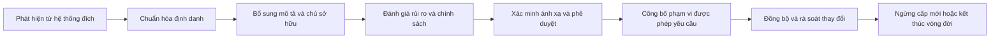

# Entitlement catalog — Danh mục quyền truy cập

## 1. Vì sao identity governance cần danh mục quyền?

Một người quản lý nhận được yêu cầu cấp nhóm `APP_CRM_EXT_L3_S`. Chỉ nhìn tên nhóm, họ khó biết người dùng sẽ làm được gì, trên dữ liệu nào, trong môi trường nào và mức rủi ro ra sao. Nếu vẫn phê duyệt, quyết định đó gần như chỉ dựa vào sự tin tưởng người yêu cầu.

**Entitlement catalog** là danh mục được quản trị của các quyền truy cập và đối tượng cấp quyền. Nó kết nối định danh kỹ thuật tại hệ thống đích với ý nghĩa nghiệp vụ, chủ sở hữu, phạm vi, mức rủi ro, điều kiện yêu cầu, cách phê duyệt và cách cấp hoặc thu hồi.

Ví dụ, bản ghi danh mục có thể giải thích nhóm trên là “Xuất dữ liệu khách hàng của khu vực miền Nam trên CRM production”, chỉ dành cho một số nhiệm vụ, cần người sở hữu dữ liệu phê duyệt và phải có thời hạn.

Trong identity governance, danh mục quyền hỗ trợ ba quyết định liên quan nhau: **quyền nào tồn tại**, **ai có căn cứ để nhận quyền đó** và **quyền đã cấp còn phù hợp hay không**. Danh mục không tự quyết định hoặc thực thi mọi yêu cầu truy cập; nó cung cấp ngữ cảnh và dữ liệu có quản trị cho các quy trình đó.

## 2. Entitlement là gì và có thể được biểu diễn như thế nào?

**Entitlement** có thể hiểu là một đơn vị quyền truy cập được cấp và quản trị trong một hệ thống. Tùy ứng dụng, nó có thể được biểu diễn bằng permission, vai trò, nhóm, quyền trên tài nguyên hoặc một loại liên kết quyền khác.

| Đối tượng | Ví dụ | Điều cần làm rõ trong danh mục |
| --- | --- | --- |
| Permission | `invoice.approve` | Cho phép hành động nào và chịu điều kiện nào? |
| Application role | `invoice_approver` | Role gồm những permission nào? |
| Group membership | Thành viên nhóm CRM | Nhóm cấp quyền trực tiếp hay thông qua role khác? |
| Resource entitlement | Đọc kho dữ liệu của đơn vị A | Tài nguyên, tenant và phạm vi cụ thể là gì? |
| Business role hoặc gói truy cập | Nhân viên hỗ trợ khách hàng | Gói bao gồm những entitlement kỹ thuật nào? |

Những đối tượng này có thể cùng xuất hiện trong một danh mục, nhưng cần phân loại và ghi rõ quan hệ. Không nên coi một permission đơn lẻ và một gói chứa nhiều role là hai quyền tương đương chỉ vì cả hai đều có nút “yêu cầu”.

Tài khoản ứng dụng, giấy phép sử dụng phần mềm và entitlement cũng không mặc nhiên là một thứ. Giấy phép có thể là điều kiện để dùng sản phẩm; quyền đọc, xuất hoặc xóa dữ liệu vẫn cần được kiểm soát riêng. Danh mục có thể tham chiếu các điều kiện đó mà không đồng nhất chúng với quyền phân quyền.

### Danh mục quyền khác danh sách ai đang có quyền

Danh mục mô tả **quyền**. Danh sách assignment mô tả **liên kết giữa danh tính và quyền**, chẳng hạn một người được cấp role trong một khoảng thời gian. Quan sát tại đích mô tả **trạng thái đang thấy**.

```text
Catalog entry:
    Quyền xuất khách hàng miền Nam là gì, ai sở hữu, cấp theo điều kiện nào?

Assignment:
    person-1842 được cấp quyền này từ lúc nào, theo yêu cầu nào?

Observed access:
    Tài khoản CRM của person-1842 hiện có membership tương ứng không?
```

Ba loại dữ liệu cần liên kết được nhưng không nên gộp thành một bản ghi khó quản lý. Một entitlement vẫn có thể tồn tại trong danh mục dù chưa ai được cấp; ngược lại, một quyền đang được dùng có thể chưa được quản trị đầy đủ trong danh mục.

## 3. Định danh quyền chính xác

### 3.1. Dùng định danh ổn định, không dựa vào tên hiển thị

Tên role hoặc group có thể được đổi để dễ hiểu hơn. Nếu danh mục lấy tên hiển thị làm định danh duy nhất, việc đổi tên có thể tạo bản ghi trùng hoặc làm mất liên kết với lịch sử phê duyệt.

Một bản ghi thường cần cả **ID của danh mục** và **định danh gốc tại hệ thống đích**. Ngữ cảnh định danh còn có thể bao gồm hệ thống, tenant, môi trường, loại đối tượng và scope.

```text
catalogId: ent-CRM-0042
application: crm-production
tenant: company-a
nativeObjectType: group
nativeObjectId: grp-314
displayName: Xuất khách hàng miền Nam
scope: region:south
```

Hai nhóm cùng tên ở hai tenant khác nhau không phải cùng một entitlement. Role quản trị ở môi trường thử nghiệm cũng không nên bị ánh xạ nhầm sang role cùng tên ở production.

Nếu đối tượng gốc bị xóa rồi tạo lại với cùng tên, phải xác minh định danh mới và ý nghĩa quyền. Không tự nối lại lịch sử chỉ vì tên giống nhau. Khả năng tái sử dụng native ID tùy hệ thống đích; bộ tích hợp cần hiểu đặc tính này và theo dõi vòng đời hoặc dấu hiệu nhận diện bổ sung khi cần.

### 3.2. Giữ nguyên ngữ nghĩa scope và điều kiện

Quyền `customer.export` trong đơn vị A khác quyền đó trên toàn bộ tổ chức. Danh mục phải phân biệt phạm vi thực tế, thay vì chỉ thêm chữ “đơn vị A” vào mô tả trong khi nhóm kỹ thuật vẫn cấp toàn cục.

Với hệ thống cho phép quyền theo tham số, có thể quản lý định nghĩa quyền cùng tập giá trị scope hợp lệ thay vì tạo một bản ghi cho từng tài nguyên nhỏ. Khi đó cần kiểm tra tham số ở phía dịch vụ cấp quyền và điểm thực thi; không tin vào scope do trình duyệt tự gửi.

Trong ABAC, một quyền có thể phụ thuộc thuộc tính hoặc chính sách động. Danh mục nên mô tả hành động, miền tài nguyên và chính sách liên quan, không cố biến mọi kết quả đánh giá theo ngữ cảnh thành một permission tĩnh.

## 4. Nội dung cần có trong một bản ghi danh mục

### 4.1. Ý nghĩa nghiệp vụ và tác động

Mô tả cần giúp người phê duyệt hiểu người nhận quyền làm được gì, trên dữ liệu nào và hậu quả quan trọng là gì. “Cấp quyền CRM” hoặc “Nhóm cấp 3” thường chưa đủ.

Một mô tả tốt có thể viết:

> Cho phép xuất danh sách khách hàng thuộc khu vực miền Nam từ CRM production để thực hiện nhiệm vụ đối soát đã được giao. Dữ liệu xuất có thể chứa thông tin liên hệ. Quyền này không bao gồm sửa hồ sơ khách hàng hoặc xuất dữ liệu của khu vực khác.

Các giới hạn trong mô tả phải đúng với cơ chế kỹ thuật thực tế. Nếu nhóm được ánh xạ còn cho phép sửa dữ liệu hoặc xuất toàn cục, cần sửa ánh xạ hoặc mô tả và đánh giá lại rủi ro; không giữ một mô tả dễ hiểu nhưng sai.

### 4.2. Chủ sở hữu và trách nhiệm

Một entitlement thường liên quan nhiều vai trò quản trị:

| Trách nhiệm | Ví dụ công việc |
| --- | --- |
| Chủ sở hữu nghiệp vụ hoặc dữ liệu | Xác định mục đích, điều kiện sử dụng và ai nên được cấp |
| Chủ sở hữu ứng dụng | Xác nhận ý nghĩa kỹ thuật và khả năng thực thi tại đích |
| Nhóm IAM | Quản lý tích hợp, workflow, đồng bộ và bằng chứng provisioning |
| Nhóm an toàn thông tin | Xác định tiêu chí rủi ro, xung đột nhiệm vụ và kiểm soát liên quan |
| Người rà soát quyền | Đánh giá các assignment còn hợp lệ trong phạm vi được giao |

Một cá nhân có thể đảm nhiệm nhiều trách nhiệm nếu chính sách cho phép, nhưng vẫn cần biết ai chịu trách nhiệm cho quyết định nào. “Nhóm IT” mà không có đầu mối và cơ chế thay thế thường khiến entitlement mất chủ sở hữu khi nhân sự thay đổi.

Chủ sở hữu danh mục không mặc nhiên có quyền tự cấp entitlement cho mình. Quyền sửa metadata, quyền phê duyệt và quyền provisioning cần được phân quyền phù hợp.

### 4.3. Rủi ro, điều kiện và chính sách yêu cầu

Mức rủi ro có thể xét dữ liệu nhạy cảm, khả năng sửa hoặc xóa, đặc quyền quản trị, phạm vi tài nguyên và ảnh hưởng nghiệp vụ. Nhãn như `HIGH` chỉ hữu ích khi có tiêu chí và ảnh hưởng tới quy trình, chẳng hạn yêu cầu thêm phê duyệt hoặc giới hạn thời hạn.

Ngoài nhãn rủi ro của entitlement, quyết định cấp quyền còn phụ thuộc ngữ cảnh: người nhận đang có quyền nào, thuộc tenant nào, phục vụ nhiệm vụ gì và có xung đột nhiệm vụ hay không. Một quyền tương đối hẹp vẫn có thể nguy hiểm khi kết hợp với quyền khác.

Các trường chính sách thường cần làm rõ:

- Quyền có được yêu cầu qua cổng tự phục vụ hay chỉ cấp qua quy trình riêng?
- Ai đủ điều kiện yêu cầu, có cần đào tạo hoặc điều kiện tiên quyết không?
- Ai phê duyệt và xử lý thế nào nếu người phê duyệt không còn hoạt động?
- Quyền có thời hạn tối đa hoặc mặc định nào, cơ chế gia hạn là gì?
- Có xung đột nhiệm vụ hoặc quyền phụ thuộc nào cần kiểm tra?
- Quyền cần được rà soát theo sự kiện hoặc chu kỳ nào theo chính sách?

Đủ điều kiện yêu cầu không đồng nghĩa đã được cấp. Có tên trong catalog cũng không làm quyền tự xuất hiện tại ứng dụng đích.

### 4.4. Ánh xạ kỹ thuật và vòng đời

Danh mục cần nối entitlement với cách cấp, thu hồi và xác minh tại đích: connector nào, loại đối tượng nào, định danh gốc nào, phạm vi nào và phương pháp kiểm tra kết quả nào.

Ghi cả nguồn phát hiện và thời điểm xác minh gần nhất giúp phân biệt “đã tìm thấy” với “đã hiểu và phê duyệt”. Trạng thái vòng đời, phiên bản metadata và lịch sử thay đổi giúp bảo toàn căn cứ khi entitlement thay đổi ý nghĩa.

## 5. Ví dụ một bản ghi entitlement

Ví dụ dưới đây minh họa thiết kế dữ liệu trong một hệ thống quản trị quyền, không phải schema bắt buộc của một sản phẩm:

```yaml
catalogId: ent-CRM-0042
version: 7
name: Xuất khách hàng miền Nam
description: >-
  Xuất danh sách khách hàng thuộc khu vực miền Nam từ CRM production
  để phục vụ nhiệm vụ đối soát đã được phê duyệt.
applicationId: crm-production
tenantId: company-a
type: GROUP_MEMBERSHIP
nativeReference:
  objectType: group
  objectId: grp-314
scope:
  type: region
  value: south
ownership:
  businessOwner: customer-data-owner
  technicalOwner: crm-platform-owner
risk:
  level: HIGH
  reasons:
    - Cho phép xuất dữ liệu khách hàng
requestPolicy:
  requestable: true
  eligiblePopulation: customer-operations-approved
  approvalPolicyId: sensitive-customer-export
  maxDurationHours: 8
  conflictPolicyId: customer-data-conflicts
fulfillment:
  connectorId: crm-connector
  grantOperation: addMembership
  revokeOperation: removeMembership
  verificationMethod: targetMembershipReadback
lifecycle:
  state: ACTIVE
  lastVerifiedAt: '2030-04-12T08:00:00Z'
```

Thời hạn tám giờ và các tên chính sách chỉ là lựa chọn minh họa. Chúng cần được tổ chức xác định theo nhu cầu và khả năng thực thi thực tế.

Bản ghi này dẫn tới một số yêu cầu thiết kế: nhóm `grp-314` phải thật sự giới hạn đúng khu vực; chính sách phê duyệt phải tồn tại và được bảo vệ; hệ thống phải có khả năng thu hồi khi hết hạn; và việc đọc lại membership chưa tự chứng minh mọi phiên đang mở đã mất quyền xuất.

Nếu ứng dụng không hỗ trợ giới hạn khu vực theo nhóm này, trường `scope` trong catalog không thể tạo ra sự giới hạn đó. Cần giải quyết khoảng cách giữa mô tả và thực thi trước khi công bố entitlement cho người dùng yêu cầu.

## 6. Xây dựng và duy trì catalog



### 6.1. Phát hiện và nhập dữ liệu

Connector có thể liệt kê role, group hoặc quyền tại ứng dụng đích. Dữ liệu nhập ban đầu thường chỉ là định danh kỹ thuật, tên và một số thuộc tính; chưa đủ để gọi là danh mục được quản trị hoàn chỉnh.

Một đối tượng mới phát hiện nên được giữ trong trạng thái cần phân loại hoặc xác minh. Không tự động công bố mọi nhóm mới thành quyền có thể yêu cầu. Nhóm vận hành, nhóm đặc quyền hoặc nhóm lồng nhau có thể mang tác động vượt xa tên gọi.

Phân biệt nguồn chân lý theo từng trường. Hệ thống đích có thể là nguồn cho native ID và tập permission kỹ thuật, trong khi chủ sở hữu nghiệp vụ chịu trách nhiệm mô tả, mục đích và điều kiện cấp. Đồng bộ không nên ghi đè mô tả đã duyệt bằng một chuỗi kỹ thuật trống từ connector.

### 6.2. Chuẩn hóa và xử lý trùng

Tìm các bản ghi cùng đối tượng gốc, tên dễ gây nhầm hoặc ánh xạ không rõ ràng. Không gộp chỉ vì tên gần giống; cần so tenant, môi trường, định danh gốc và ngữ nghĩa quyền.

Ngược lại, hai quyền kỹ thuật khác nhau có thể cùng được trình bày trong một gói nghiệp vụ. Khi đó nên biểu diễn quan hệ bao gồm rõ ràng thay vì xóa dấu vết các entitlement thành phần.

### 6.3. Xác minh trước khi công bố

Người có trách nhiệm cần xác nhận mô tả, phạm vi, chủ sở hữu, mức rủi ro và ánh xạ cấp/thu hồi. Với quyền nhạy cảm, cần kiểm tra những đường cấp gián tiếp như nhóm lồng nhau hoặc role chứa role khác.

Tách **được quản lý trong catalog**, **được hiển thị cho người dùng** và **được phép yêu cầu**. Một entitlement quản trị có thể cần được theo dõi và rà soát nhưng không xuất hiện trong cổng yêu cầu thông thường. Ẩn khỏi cổng cũng không phải là biện pháp chặn cấp quyền tại các API hoặc công cụ quản trị khác.

### 6.4. Đồng bộ và phát hiện thay đổi ý nghĩa

Catalog phải được duy trì khi tên, permission thành phần, scope, chủ sở hữu hoặc cách cấp quyền thay đổi. Đặc biệt, một nhóm có tên cũ nhưng được bổ sung quyền xuất dữ liệu toàn cục có thể làm tăng rủi ro cho mọi assignment hiện có.

Không chỉ kiểm tra “bản ghi còn tồn tại không”. Cần theo dõi những thay đổi có ý nghĩa về quyền và kích hoạt đánh giá lại khi cần. Việc tăng phạm vi hoặc thêm đặc quyền có thể đòi hỏi phê duyệt lại, rà soát assignment và cập nhật chính sách.

Nếu connector tạm thời không đọc được danh sách nhóm, không nên coi mọi quyền biến mất và tự động xóa catalog. Cần phân biệt nguồn lỗi, dữ liệu thiếu và đối tượng thật sự bị xóa bằng contract đồng bộ và bằng chứng phù hợp.

## 7. Dùng catalog trong quy trình yêu cầu và cấp quyền

Một quy trình cơ bản gồm các bước:

1. Người yêu cầu chọn entitlement và scope từ tập được phép, cung cấp lý do cùng thời hạn cần dùng.
2. Hệ thống kiểm tra danh tính, điều kiện yêu cầu, trạng thái entitlement, xung đột nhiệm vụ và giới hạn thời hạn.
3. Người hoặc chính sách có thẩm quyền quyết định dựa trên mô tả và phiên bản quyền tương ứng.
4. Hệ thống provisioning áp dụng ánh xạ đã được kiểm soát tới đúng tài khoản và hệ thống đích.
5. Hệ thống xác minh kết quả, lưu liên kết assignment với yêu cầu, phê duyệt và phiên bản catalog.
6. Đến khi hết hạn hoặc mất căn cứ, quy trình thu hồi và xác minh được kích hoạt.

Các trường như native ID, scope và connector không nên được trình duyệt tùy ý sửa để chọn một quyền rộng hơn. Dịch vụ phía máy chủ phải lấy hoặc kiểm tra ánh xạ từ dữ liệu có thẩm quyền.

### Điều gì xảy ra nếu catalog đổi sau khi đã phê duyệt?

Giả sử phiên bản 7 chỉ cho xuất khách hàng miền Nam, nhưng phiên bản 8 đổi sang nhóm xuất toàn tổ chức. Không nên lấy một phê duyệt cũ rồi cấp âm thầm quyền mới rộng hơn.

Yêu cầu cần tham chiếu phiên bản hoặc snapshot ngữ nghĩa đủ để biết đã duyệt điều gì. Trước khi provisioning, hệ thống kiểm tra entitlement còn hợp lệ và ánh xạ có thay đổi đáng kể không. Nếu có, cần xử lý theo chính sách như yêu cầu phê duyệt lại hoặc dùng ánh xạ cũ vẫn được cho phép, thay vì tự chọn phiên bản mới nhất bất kể nội dung.

Phiên bản cũng hữu ích khi thu hồi: cần biết liên kết kỹ thuật nào đã thực sự được cấp. Nếu ánh xạ hiện tại đã đổi, chỉ gọi thao tác thu hồi theo bản ghi mới có thể để lại membership cũ.

## 8. Dùng catalog để rà soát quyền và kiểm toán

Người rà soát cần thấy đủ ngữ cảnh để quyết định giữ hay thu hồi, gồm ý nghĩa entitlement, scope, mức rủi ro, nguồn cấp, người sở hữu và căn cứ assignment. Chỉ hiển thị một mã nhóm dài dễ dẫn tới phê duyệt hàng loạt mà không hiểu tác động.

Quyền hiệu lực có thể đến từ nhiều đường: cấp trực tiếp, thành viên nhóm lồng nhau, role nghiệp vụ hoặc gói truy cập. Catalog nên giúp giải thích các đường đó, trong khi hệ thống tính quyền phải áp dụng đúng ngữ nghĩa của ứng dụng. Xóa một assignment trực tiếp không đảm bảo quyền đã mất nếu nó vẫn được một role khác cấp.

Ví dụ, người rà soát quyết định thu hồi quyền xuất khách hàng. Tác vụ khắc phục phải tìm các nguồn cấp còn hiệu lực trong phạm vi cần xử lý và xác minh kết quả. Nếu chỉ gỡ một nhóm nhưng quyền vẫn còn qua một role khác, quyết định rà soát chưa đạt mục tiêu.

Đối với kiểm toán, lịch sử catalog giúp trả lời quyền có ý nghĩa gì tại thời điểm phê duyệt, ai đã sửa mô tả hoặc ánh xạ, và người phê duyệt đã dựa trên phiên bản nào. Danh mục hiện tại không đủ để tái dựng một quyết định quá khứ nếu lịch sử thay đổi đã mất.

Dữ liệu sử dụng gần đây có thể bổ sung ngữ cảnh khi rà soát, nhưng “không thấy sử dụng” không tự chứng minh quyền không cần thiết. Một số nhiệm vụ diễn ra ít thường xuyên, và telemetry có thể không bao phủ đầy đủ. Cần kết hợp căn cứ nghiệp vụ với dữ liệu quan sát.

## 9. Ngừng cấp mới và kết thúc vòng đời entitlement

Một vòng đời minh họa có thể gồm:

| Trạng thái | Ý nghĩa quản trị |
| --- | --- |
| `DISCOVERED` | Đã phát hiện, chưa xác minh đầy đủ |
| `DRAFT` | Đang bổ sung mô tả, chủ sở hữu và chính sách |
| `ACTIVE` | Đã được duyệt để quản lý theo chính sách tương ứng |
| `DEPRECATED` | Hạn chế hoặc dừng cấp mới, xử lý các assignment đang có |
| `RETIRED` | Kết thúc sử dụng theo điều kiện đã xác minh, giữ lịch sử cần thiết |

Tên trạng thái không quan trọng bằng chuyển trạng thái và tác động thực tế được định nghĩa rõ. `ACTIVE` không nhất thiết đồng nghĩa mọi người đều thấy hoặc được yêu cầu quyền đó.

Khi một entitlement được thay thế, cần xác định entitlement kế nhiệm, mức tương đương về quyền và cách xử lý assignment cũ. Không chuyển tự động nếu quyền mới rộng hơn hoặc có điều kiện khác mà chưa được phê duyệt.

Đánh dấu `DEPRECATED` hoặc `RETIRED` trong catalog không tự gỡ quyền tại ứng dụng đích. Cần công việc thu hồi hoặc chuyển đổi riêng, readback và xử lý lỗi. Ngược lại, xóa bản ghi danh mục quá sớm có thể làm mất thông tin cần để thu hồi và giải thích lịch sử cấp quyền.

## 10. Bảo vệ catalog như dữ liệu điều khiển an ninh

Catalog có thể ảnh hưởng trực tiếp tới quyết định cấp quyền. Nếu một người có thể đổi `requestable`, hạ mức rủi ro, sửa người phê duyệt hoặc trỏ native ID sang nhóm quản trị, họ có thể tác động cả quy trình mà không cần tự gán role trực tiếp.

Cần phân quyền thay đổi metadata, kiểm soát phiên bản và ghi nhật ký những thay đổi có ý nghĩa. Tùy chính sách, thay đổi nhạy cảm cần người khác xem xét; không nên cho người đang yêu cầu quyền tự sửa điều kiện để yêu cầu của mình được thông qua.

Nhật ký nên ghi ai thay đổi, trường nào đổi, phiên bản trước và sau, lý do và căn cứ phê duyệt. Bảo vệ cả connector và thông tin ánh xạ; credential của connector không thuộc nội dung công bố trong catalog.

Thông tin hiển thị cũng cần theo phạm vi người dùng. Danh mục có thể chứa tên hệ thống nhạy cảm hoặc mô tả đặc quyền không phù hợp công bố rộng. Kiểm soát quyền xem là cần thiết, nhưng không thay thế kiểm soát yêu cầu và cấp quyền ở phía máy chủ.

## 11. Các lỗi thường gặp và chỉ số chất lượng

| Lỗi | Hậu quả | Hướng xử lý |
| --- | --- | --- |
| Dùng nguyên tên kỹ thuật làm mô tả | Người phê duyệt không hiểu tác động | Bổ sung hành động, dữ liệu, phạm vi và mục đích |
| Gộp theo tên, bỏ qua tenant hoặc môi trường | Cấp nhầm đối tượng đích | Dùng định danh có ngữ cảnh và kiểm tra native ID |
| Tự công bố mọi quyền mới phát hiện | Quyền nhạy cảm trở thành có thể yêu cầu ngoài ý muốn | Có bước phân loại, xác minh và phê duyệt |
| Ghi scope hẹp nhưng ánh xạ cấp rộng | Danh mục tạo cảm giác an toàn sai | Xác minh giới hạn tại hệ thống thực thi |
| Không theo dõi quyền thành phần của role | Role giữ tên nhưng tăng đặc quyền mà không bị phát hiện | Theo dõi thay đổi ngữ nghĩa và đánh giá lại assignment |
| Dùng phê duyệt cũ với ánh xạ mới rộng hơn | Người dùng nhận quyền chưa được duyệt | Liên kết phiên bản và tái kiểm tra trước cấp |
| Xóa entitlement để ngừng sử dụng | Mất lịch sử, assignment tại đích có thể vẫn còn | Dùng trạng thái vòng đời và quy trình thu hồi |
| Chủ sở hữu không còn hoạt động | Yêu cầu và rà soát bị bỏ ngỏ | Có cơ chế chuyển trách nhiệm và cảnh báo |

Các chỉ số hữu ích gồm tỷ lệ entitlement có chủ sở hữu còn hiệu lực, mô tả nghiệp vụ đạt yêu cầu, scope đã xác minh, ánh xạ cấp/thu hồi đã kiểm tra và dữ liệu được xác minh trong khoảng thời gian chính sách quy định. Cũng nên theo dõi quyền chưa phân loại, quyền ngừng cấp mới nhưng còn assignment và thay đổi kỹ thuật chưa được đánh giá.

Mỗi chỉ số cần mẫu số và phạm vi rõ ràng. Chỉ đo các ứng dụng đã tích hợp có thể làm báo cáo bỏ sót những hệ thống chưa được quản trị; cần ghi rõ phần bao phủ và phần còn thiếu.

## 12. Tự kiểm tra bằng một tình huống thực tế

Một nhân viên cần xuất dữ liệu khách hàng miền Nam trong một ca đối soát. Catalog có nhóm tên `CRM_EXPORT`, người sở hữu chưa được xác nhận và lần đồng bộ gần nhất cho thấy nhóm có thể xuất mọi khu vực.

Không nên chỉ đổi tên hiển thị thành “Xuất khách hàng miền Nam” rồi công bố. Cần xác minh quyền thực tế, chọn hoặc xây dựng ánh xạ có scope phù hợp, xác nhận chủ sở hữu, đặt chính sách yêu cầu và phê duyệt, kiểm tra cách thu hồi khi hết hạn, rồi mới cho phép sử dụng theo quy trình.

Sau khi cấp, assignment phải nối được tới entitlement và phiên bản đã duyệt. Nếu nhóm kỹ thuật đổi ý nghĩa về sau, hệ thống cần phát hiện và xử lý thay đổi đó. Khi rà soát, người chịu trách nhiệm phải nhìn thấy quyền đang có và mọi nguồn cấp liên quan, không chỉ một nhãn dễ đọc.

Một entitlement catalog có giá trị khi biến đối tượng kỹ thuật khó hiểu thành một đơn vị quyền **có định danh chính xác, ngữ nghĩa rõ, người chịu trách nhiệm và quy trình quản lý được thực thi**. Chất lượng của nó được thể hiện ở quyết định cấp và thu hồi đúng, không chỉ ở số lượng bản ghi đã nhập.
