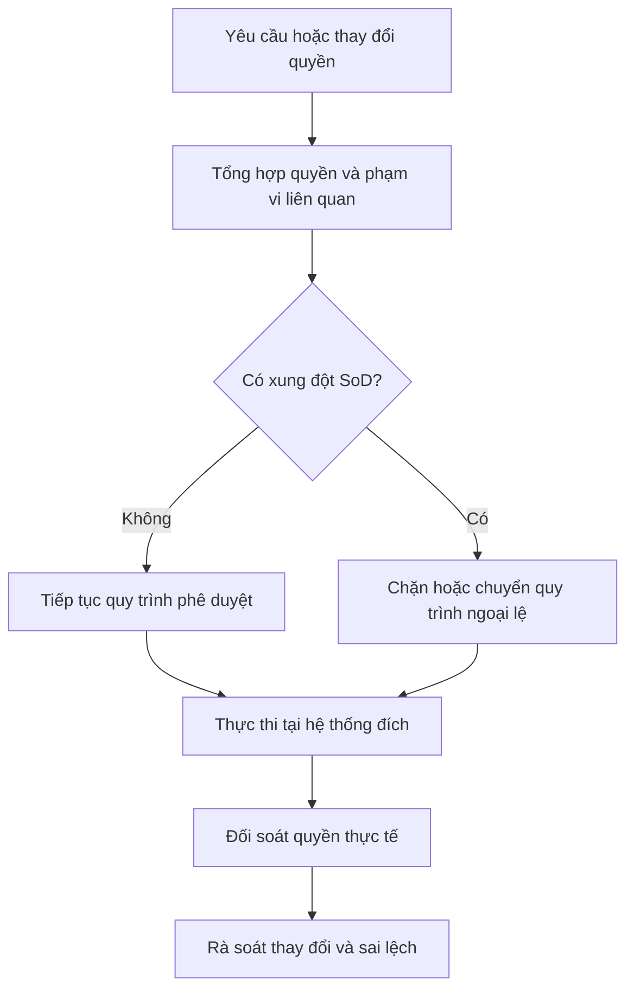

# Segregation of duties

## 1. Vì sao một người không nên kiểm soát mọi bước?

Giả sử một ứng dụng cho phép cùng một người tạo đề nghị thanh toán, duyệt đề nghị đó và sửa nhật ký để che giấu thao tác. Người này không cần chiếm quyền của ai khác để hoàn tất một chuỗi hành động có rủi ro cao. Ngay cả khi không có gian lận, một sai sót cũng có thể đi qua toàn bộ quy trình mà không được một bên độc lập kiểm tra.

**Segregation of duties**, thường viết tắt là **SoD**, là nguyên tắc phân tách những nhiệm vụ hoặc khả năng có xung đột để một chủ thể không tự kiểm soát toàn bộ một chuỗi hành động cần sự kiểm tra độc lập. Thuật ngữ **separation of duties** cũng thường được dùng với ý nghĩa này.

Trong IAM và identity governance, SoD liên quan tới cả việc quyết định ai được có quyền nào và việc kiểm soát cách các quyền được sử dụng. Có những tổ hợp quyền không nên cấp cho cùng một người; cũng có những quyền một người được phép giữ nhưng không được sử dụng cùng nhau trong một phiên hoặc trên cùng một giao dịch.

Mục tiêu của SoD là giảm cơ hội lạm dụng, giảm sai sót không được phát hiện và tạo trách nhiệm rõ ràng. SoD không bảo đảm loại bỏ mọi rủi ro: hai người vẫn có thể thông đồng, hai tài khoản có thể bị cùng một bên chiếm quyền, hoặc một quản trị viên có thể tìm cách vô hiệu hóa cơ chế kiểm soát.

## 2. Phân biệt với least privilege, MFA và phê duyệt thông thường

**Least privilege**, hay nguyên tắc ít quyền nhất, yêu cầu chỉ cấp những quyền cần thiết trong phạm vi và thời gian phù hợp. SoD xem xét thêm sự nguy hiểm khi kết hợp các khả năng.

Một nhân viên có thể thực sự cần quyền lập đề nghị và quyền duyệt đề nghị của người khác. Từng quyền riêng lẻ đều có lý do công việc, nhưng việc dùng cả hai trên chính đề nghị của mình vẫn vi phạm chính sách phân tách nhiệm vụ.

| Kiểm soát | Vấn đề chính được giải quyết | Điều chưa tự bảo đảm |
|---|---|---|
| MFA | Tăng độ tin cậy của việc xác thực | Người đã xác thực không có tổ hợp quyền xung đột |
| Least privilege | Hạn chế quyền dư thừa về phạm vi, hành động và thời gian | Các bước cần độc lập đã được tách đúng |
| RBAC hoặc ABAC | Biểu diễn và thực thi quyết định phân quyền | Mọi vai trò, thuộc tính và đường cấp quyền đều đã tuân thủ SoD |
| Một bước phê duyệt | Có người hoặc cơ chế xem xét yêu cầu | Người duyệt đủ độc lập với người tạo, người hưởng quyền hoặc người thực thi theo chính sách |
| SoD | Hạn chế tổ hợp nhiệm vụ và hành động có xung đột | Không xảy ra thông đồng hoặc mọi đường quản trị đều không thể bị lạm dụng |

Hai nút “tạo” và “duyệt” trên giao diện không tạo thành SoD nếu cùng một người vẫn có thể bấm cả hai. Tương tự, hai lần nhập mật khẩu của cùng một người không tạo ra hai người kiểm soát độc lập.

## 3. Ba vị trí đặt ràng buộc

### 3.1. Phân tách khi cấp quyền: static separation of duty

Ràng buộc tĩnh ngăn việc cấp đồng thời những vai trò hoặc quyền có xung đột cho cùng chủ thể trong phạm vi chính sách xác định.

Ví dụ: chính sách của một tổ chức không cho phép cùng một người vừa giữ quyền thay đổi thông tin tài khoản nhận tiền của nhà cung cấp vừa giữ quyền phê duyệt chi trả trong cùng đơn vị. Khi có yêu cầu cấp quyền thứ hai, hệ thống cần xét những quyền đã có trước khi quyết định.

Với hai vai trò `VendorBankEditor` và `PaymentApprover`, một quy tắc minh họa là:

```text
Trong cùng phạm vi đơn vị:
    không cấp đồng thời VendorBankEditor và PaymentApprover
    cho cùng một người.
```

Ràng buộc này kiểm soát khả năng được sở hữu, không cần đợi giao dịch cụ thể xuất hiện. Đổi lại, nó có thể hạn chế công việc nếu tổ chức cần một người thực hiện các nhiệm vụ khác nhau trong những ngữ cảnh không xung đột. Vì vậy, phạm vi của quy tắc phải rõ ràng.

### 3.2. Phân tách khi kích hoạt vai trò: dynamic separation of duty

Trong mô hình RBAC, ràng buộc động thường giới hạn những vai trò có thể được kích hoạt cùng nhau trong một phiên. Một người có thể được gán nhiều vai trò nhưng không được kích hoạt một tổ hợp có xung đột trong phiên đó.

Ví dụ minh họa: người vận hành được gán vai trò lập và kiểm tra hồ sơ để làm việc trong các ca khác nhau, nhưng không được kích hoạt đồng thời hai vai trò này trong một phiên theo quy tắc của hệ thống.

Giới hạn theo phiên không tự ngăn người đó lập hồ sơ ở phiên thứ nhất rồi duyệt lại chính hồ sơ đó ở phiên thứ hai. Nếu yêu cầu nghiệp vụ là “không tự duyệt hồ sơ mình tạo”, cần một kiểm soát dựa trên lịch sử và đối tượng giao dịch.

### 3.3. Phân tách trên giao dịch hoặc quy trình

Ứng dụng kiểm tra quan hệ giữa chủ thể hiện tại với những hành động đã diễn ra trên cùng giao dịch. Một quy tắc phổ biến là **maker-checker**: người lập và người kiểm tra hoặc phê duyệt phải độc lập theo chính sách.

```text
Người duyệt đề nghị X phải:
    có quyền duyệt X trong phạm vi hiện tại
    AND không phải người đã lập X.
```

Các quy trình nhạy cảm hơn có thể yêu cầu nhiều người duyệt độc lập, chẳng hạn hai người khác nhau cho cùng một phiên bản của đề nghị. Số người cần thiết và tiêu chí độc lập là quyết định nghiệp vụ, không có một con số bắt buộc cho mọi hệ thống.

| Loại ràng buộc | Thời điểm kiểm tra | Thông tin cần biết | Giới hạn cần nhớ |
|---|---|---|---|
| Tĩnh | Cấp hoặc thay đổi quyền | Những quyền và phạm vi mà chủ thể đã có hoặc sẽ nhận | Không thay thế kiểm soát chi tiết trên từng đối tượng |
| Động theo phiên | Kích hoạt vai trò trong phiên | Vai trò được gán và vai trò đang kích hoạt | Không tự ngăn việc dùng phiên khác để thao tác lại cùng giao dịch |
| Theo giao dịch hoặc lịch sử | Thực hiện một bước nghiệp vụ | Người đã làm các bước trước, đối tượng, phiên bản và trạng thái | Cần dữ liệu nghiệp vụ tin cậy và cơ chế thực thi tại ứng dụng |

Các loại ràng buộc có thể được kết hợp. Không nên gọi mọi quy tắc kiểm tra lúc chạy là cùng một cơ chế rồi bỏ qua sự khác nhau về phạm vi và dữ liệu cần có.

## 4. Xác định xung đột từ nghiệp vụ, không chỉ từ tên vai trò

SoD bắt đầu từ việc xác định chuỗi hành động có thể tạo rủi ro nếu một chủ thể kiểm soát toàn bộ. Sau đó mới ánh xạ các hành động đó tới quyền, vai trò, nhóm và ứng dụng.

| Chuỗi công việc minh họa | Các khả năng cần xem xét phân tách | Rủi ro khi kết hợp |
|---|---|---|
| Quản lý chi trả | Sửa thông tin nhận tiền và phê duyệt chi trả | Tự thay đổi đích nhận rồi duyệt chuyển tiền |
| Cấp quyền nhạy cảm | Đề nghị quyền cho mình và phê duyệt quyền đó | Tự quyết định phạm vi truy cập của bản thân |
| Triển khai phần mềm | Tạo thay đổi và phê duyệt phát hành vào môi trường nhạy cảm | Tự đưa thay đổi chưa được kiểm tra độc lập vào sử dụng |
| Quản trị hạ tầng | Thực hiện thay đổi và sửa bằng chứng kiểm tra thay đổi | Che giấu hoặc làm sai lệch lịch sử thao tác |
| Quản lý credential | Tạo phương tiện truy cập và tự xác nhận việc bàn giao hay kiểm tra | Tạo truy cập không được một bên độc lập xác nhận |

Những ví dụ này không phải lệnh cấm áp dụng sẵn cho mọi tổ chức. Chủ sở hữu nghiệp vụ và bên chịu trách nhiệm rủi ro phải xác định tổ hợp nào cần cấm, tổ hợp nào chỉ cần kiểm tra trên từng giao dịch và tổ hợp nào có biện pháp kiểm soát khác.

Quyền có thể nằm ở hai ứng dụng khác nhau. Một hệ thống quản lý nhà cung cấp cho phép sửa thông tin nhận tiền, trong khi hệ thống chi trả cấp quyền phê duyệt. Nếu chỉ kiểm tra xung đột bên trong từng ứng dụng, tổ hợp nguy hiểm xuyên hệ thống có thể bị bỏ sót.

## 5. Mô tả một quy tắc SoD đủ rõ

Một quy tắc hữu ích cần nêu được đối tượng kiểm soát, tổ hợp xung đột, phạm vi, thời điểm áp dụng và cách xử lý vi phạm. Chỉ viết “không có quyền xung đột” không đủ để người vận hành hoặc chương trình quyết định đúng.

Ví dụ sau là mô hình chính sách minh họa, không phải schema chuẩn hay cấu hình có thể đưa trực tiếp vào một sản phẩm:

```yaml
ruleId: sod-vendor-payment-example
description: Tách sửa thông tin nhận tiền khỏi phê duyệt chi trả
subjectBoundary: canonical-human-identity
scope:
  sameTenant: true
  sameBusinessUnit: true
conflictingCapabilities:
  - vendor.bank-account.update
  - payment.approve
checkAt:
  - access-request
  - entitlement-change
  - reconciliation
defaultOutcome: BLOCK_CONFLICTING_GRANT
exception:
  requiresIndependentApproval: true
  requiresExpiry: true
```

`subjectBoundary` cho biết quy tắc xét cùng một con người, thay vì chỉ xét hai chuỗi tên đăng nhập. Các điều kiện tenant và đơn vị giới hạn nơi tổ hợp quyền được coi là xung đột. Tuy nhiên, nếu người dùng có khả năng di chuyển dữ liệu hoặc thao tác giữa các đơn vị, mô hình phạm vi phải phản ánh đường tác động đó.

Quy tắc theo giao dịch cần bổ sung dữ liệu khác, chẳng hạn `createdBy`, người đã duyệt, phiên bản nội dung, số lượt duyệt độc lập cần có và trạng thái quy trình. Không thể suy ra toàn bộ thông tin này chỉ từ danh sách vai trò.

## 6. Cùng một người, nhiều tài khoản và nhiều đường cấp quyền

### 6.1. Hai tài khoản chưa chắc là hai chủ thể độc lập

Một người có thể có tài khoản thường, tài khoản quản trị và tài khoản tại nhiều hệ thống. Nếu SoD cần phân tách theo con người, so sánh hai `accountId` khác nhau là chưa đủ.

Ví dụ, Hương dùng tài khoản thường để tạo yêu cầu, sau đó dùng tài khoản quản trị để duyệt. Ứng dụng thấy hai tên đăng nhập khác nhau nhưng chính sách “không tự duyệt” vẫn bị vi phạm.

Cần có ánh xạ tài khoản tới định danh chủ thể ổn định, trong đúng phạm vi quản lý. Email hiển thị hoặc tên người dùng do phía khách gửi lên không phải nguồn đáng tin cậy duy nhất cho phép so sánh này. Nếu thiếu ánh xạ ở một thao tác bắt buộc có kiểm tra độc lập, hệ thống phải xử lý trạng thái chưa biết theo chính sách rõ ràng, thay vì mặc định hai tài khoản là hai người khác nhau.

### 6.2. Xét quyền hiệu lực và quyền kế thừa

Một chủ thể có thể nhận cùng khả năng qua nhóm lồng nhau, vai trò tổng hợp, cấp trực tiếp hoặc quyền quản trị cho phép tự gán vai trò. Việc kiểm tra hai vai trò bề mặt sẽ thiếu nếu một vai trò khác chứa cùng quyền xung đột.

Các yếu tố cần được mô hình hóa gồm:

- Quyền trực tiếp và quyền đến từ vai trò, nhóm hoặc quan hệ kế thừa.
- Phạm vi tài nguyên mà quyền thực sự áp dụng.
- Thời gian hiệu lực và thời gian các quyền có thể chồng lấn.
- Khả năng nâng quyền, giả danh hoặc sửa chính sách phân quyền.
- Các đường cấp quyền tại ứng dụng nằm ngoài hệ thống IAM trung tâm.

Không phải hệ thống governance nào cũng tự tính được mọi quyền hiệu lực trong mọi ngữ cảnh. Những phần chưa quan sát được cần được ghi nhận và xử lý, thay vì báo một kết quả “không xung đột” rộng hơn phạm vi đã kiểm tra.

## 7. Đưa SoD vào vòng đời quyền



Nhánh ngoại lệ chỉ được đi tới thực thi khi đã đạt đủ điều kiện của ngoại lệ được phép. Một yêu cầu bị chặn không tự trở thành được phép chỉ vì đã chuyển cho quản trị viên xử lý.

### 7.1. Kiểm tra trước khi cấp

Khi cấp một quyền mới, đánh giá tập quyền dự kiến sau thay đổi. Nếu chỉ đánh giá quyền mới một cách độc lập, hệ thống không thể nhận ra tổ hợp xung đột với quyền đã tồn tại.

Hai yêu cầu đang chờ cũng có thể tạo xung đột. Ví dụ, hai người duyệt song song hai quyền khác nhau và mỗi người chỉ nhìn thấy trạng thái cũ. Hệ thống cần cơ chế phát hiện hoặc ngăn việc áp dụng đồng thời tổ hợp không hợp lệ, chẳng hạn kiểm tra lại ở bước cấp và điều phối cập nhật nhất quán theo chủ thể, phạm vi.

### 7.2. Kiểm tra khi nội dung vai trò thay đổi

Thêm một quyền vào vai trò có thể làm nhiều người đang giữ vai trò đó phát sinh xung đột mà không có yêu cầu cấp quyền mới nào. Vì vậy, thay đổi định nghĩa vai trò, quan hệ nhóm và quy tắc kế thừa cũng thuộc phạm vi kiểm soát.

Một mô hình xử lý là đánh giá tác động trước khi phát hành thay đổi, sau đó đối soát kết quả thực tế. Các đường quản trị ngoài quy trình cần được giám sát và phát hiện sai lệch.

### 7.3. Xử lý xung đột đã tồn tại

Khi triển khai SoD vào hệ thống đang hoạt động, có thể phát hiện nhiều tổ hợp quyền cũ không phù hợp. Cần xác nhận ánh xạ và phạm vi trước khi xử lý, rồi giao người chịu trách nhiệm lựa chọn thu hồi, điều chỉnh hoặc ngoại lệ có căn cứ.

Không nên tự động xóa mọi quyền có vẻ xung đột khi chưa biết tác động vận hành. Tuy nhiên, đánh dấu một vi phạm là “đã xem” cũng không phải giải quyết xong. Phải theo dõi quyết định khắc phục đến khi được thực thi và xác minh.

## 8. Thực thi maker-checker tại ứng dụng

Với quy tắc “không duyệt đề nghị do chính mình tạo”, điểm cưỡng chế phải nằm ở nơi thực hiện phê duyệt, không chỉ ở giao diện. Một API trực tiếp cũng phải chịu cùng quy tắc.

Mã giả sau minh họa các điều kiện chính:

```text
function approveRequest(authenticatedContext, requestId, expectedVersion):
    actor = resolveTrustedCanonicalSubject(authenticatedContext)

    begin transaction
        item = loadRequestForUpdate(requestId, actor.tenantId)

        require item exists
        require item.state == PENDING_APPROVAL
        require item.version == expectedVersion
        require actor has current approval permission for item.scope
        require actor.humanId != item.createdByHumanId
        require actor.humanId has not approved this item version

        recordApproval(item.id, item.version, actor.humanId)

        if independentApprovalThresholdReached(item):
            transitionToApproved(item)

        recordAuditEvent(item, actor)
    commit transaction
```

Đây là mã giả về kiểm soát, không phải chương trình hoàn chỉnh. `actor` phải đến từ ngữ cảnh xác thực đáng tin cậy; người gọi không được tự gửi một `humanId` bất kỳ để đóng vai người khác. Người tạo và lịch sử phê duyệt cũng phải là dữ liệu do máy chủ kiểm soát.

Việc đọc trạng thái, kiểm tra điều kiện và ghi quyết định cần được thực hiện với cơ chế nhất quán phù hợp. Nếu kiểm tra và ghi tách rời, hai yêu cầu đồng thời có thể vượt qua giới hạn số lượt duyệt hoặc phê duyệt một phiên bản đã thay đổi. Khóa hay điều kiện cập nhật có kiểm tra phiên bản chỉ giải quyết những dữ liệu nằm trong phạm vi nhất quán thực sự của chúng.

Nếu quyền nằm ở dịch vụ bên ngoài, một transaction cơ sở dữ liệu cục bộ không tự khóa được trạng thái quyền tại dịch vụ đó. Thiết kế phải xác định độ mới của quyết định phân quyền, cách xử lý thay đổi đồng thời và điểm kiểm tra lại trước hành động có hiệu lực.

Ngoài ra, phê duyệt phải gắn với đúng nội dung. Nếu số tiền, người nhận hoặc phạm vi tài nguyên thay đổi sau khi được duyệt, hệ thống cần áp dụng quy tắc phê duyệt lại tương ứng. Không nên tiếp tục dùng một dấu “đã duyệt” chung cho mọi phiên bản.

## 9. Ngoại lệ, nhóm nhỏ và danh tính dịch vụ

### 9.1. Ngoại lệ cần có giới hạn

Một ngoại lệ SoD phải chỉ rõ quy tắc được ngoại lệ, chủ thể, phạm vi, lý do, người chấp nhận rủi ro, thời hạn và biện pháp kiểm soát bổ sung. Người xin quyền không nên tự phê duyệt ngoại lệ cho chính mình khi quy tắc đòi hỏi kiểm tra độc lập.

Biện pháp bổ sung có thể là giới hạn giá trị hoặc phạm vi thao tác, cấp quyền ngắn hạn, giám sát bổ sung hay yêu cầu kiểm tra độc lập sau hành động. Cần nói rõ đây là biện pháp phòng ngừa hay phát hiện: rà soát sau không thể chặn một giao dịch đã hoàn tất trước đó.

Ngoại lệ hết hạn phải dẫn tới thu hồi hoặc đánh giá lại theo quy trình. Đổi tên vi phạm thành “ngoại lệ” mà không có người chịu trách nhiệm và thời hạn chỉ làm mất khả năng theo dõi rủi ro.

### 9.2. Ít người không làm mất nhu cầu kiểm soát

Nhóm nhỏ có thể khó bố trí hai người cho mọi thao tác. Có thể thu hẹp các trường hợp bắt buộc độc lập vào những hành động có tác động cao và dùng người kiểm tra từ nhóm khác theo thẩm quyền phù hợp.

Nếu chỉ có kiểm tra sau hoặc một cơ chế bù khác, cần thừa nhận giới hạn của nó. Không nên mô tả quy trình một người tự làm và tự ký lại là phân tách độc lập.

### 9.3. Tài khoản dịch vụ cũng có thể gom các khả năng xung đột

Một bot có quyền tạo yêu cầu và tự phê duyệt mọi yêu cầu có thể vô hiệu hóa thiết kế maker-checker. Đổi bước phê duyệt thành tác vụ tự động không tự tạo ra tính độc lập.

Quy trình tự động cần chính sách quyết định rõ ràng, phạm vi quyền của workload, người sở hữu, quản lý thay đổi và bằng chứng thực thi. Nếu một người có thể tùy ý sửa cả quy tắc tự động lẫn kết quả kiểm tra, phải xem xét lại đường kiểm soát đó.

## 10. Bằng chứng và những tình huống cần kiểm chứng

Với ràng buộc cấp quyền, bằng chứng cần nối được chủ thể, tập quyền liên quan, phạm vi, phiên bản chính sách, kết quả kiểm tra và quyết định cuối cùng. Với ràng buộc giao dịch, cần thêm định danh đối tượng, phiên bản nội dung, người thực hiện từng bước và kết quả thực thi.

Nhật ký phải được bảo vệ theo mô hình đe dọa của hệ thống. Nếu cùng người thực hiện thao tác có thể sửa toàn bộ bằng chứng mà không bị phát hiện, khả năng kiểm tra độc lập bị suy giảm. Không ghi mật khẩu, token hoặc bí mật credential vào bằng chứng.

Các tình huống minh họa để kiểm chứng thiết kế:

| Tình huống | Kết quả mong muốn theo quy tắc ví dụ |
|---|---|
| Người tạo duyệt lại đề nghị của mình | Bị từ chối ở phía máy chủ |
| Cùng một người dùng hai tài khoản khác nhau | Vẫn nhận ra cùng chủ thể khi chính sách phân tách theo con người |
| Người khác có quyền đúng phạm vi duyệt | Được xử lý theo trạng thái và điều kiện hiện hành |
| Hai quyền xung đột được yêu cầu song song | Không áp dụng thành tổ hợp trái chính sách do cả hai cùng nhìn trạng thái cũ |
| Quyền xung đột đến từ nhóm lồng nhau | Được nhận diện trong phạm vi mô hình quyền đã công bố |
| Người dùng đổi phiên để tự duyệt | Vẫn bị chặn bởi kiểm tra trên giao dịch |
| Nội dung thay đổi sau khi đã duyệt | Không dùng lại phê duyệt cũ nếu thay đổi đòi hỏi phê duyệt lại |
| Lặp lại cùng lượt duyệt | Không đếm thành nhiều người duyệt độc lập |
| Ngoại lệ đã hết hạn | Không tiếp tục cho phép dựa trên ngoại lệ cũ |
| Gọi API bỏ qua giao diện | Vẫn chịu kiểm tra SoD tại điểm thực thi |

Các chỉ số vận hành có thể gồm xung đột còn mở theo mức rủi ro, thời gian khắc phục, ngoại lệ sắp hết hạn, độ bao phủ tài khoản đã ánh xạ và số lần từ chối tự phê duyệt. Cần phân biệt “không phát hiện vi phạm” với “chưa đủ dữ liệu hoặc chưa kiểm soát đường truy cập đó”.

## 11. Những điểm cần ghi nhớ

SoD phân tách khả năng hoặc hành động có xung đột để duy trì sự kiểm tra độc lập trong một quy trình. Ràng buộc khi cấp quyền, khi kích hoạt vai trò và khi thực hiện giao dịch giải quyết các vấn đề khác nhau; lựa chọn phải dựa trên điều cần ngăn và dữ liệu mà hệ thống có thể kiểm chứng.

Một kiểm soát SoD hiệu quả cần định danh đúng chủ thể, hiểu quyền thực tế và phạm vi tác động, thực thi tại đường truy cập có hiệu lực và theo dõi quyết định đến kết quả. Hai tài khoản, hai phiên hay hai bước giao diện không thay thế được sự độc lập mà chính sách nghiệp vụ yêu cầu.
