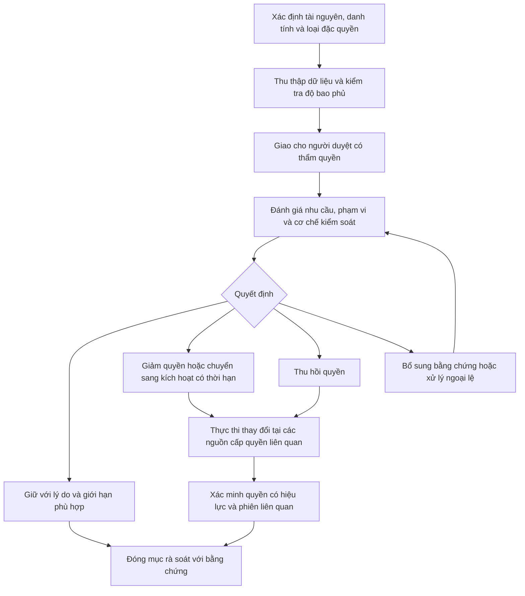

# Privileged access review: rà soát quyền truy cập đặc quyền

## 1. Rà soát quyền đặc quyền để trả lời điều gì?

**Privileged access review** là quá trình đánh giá lại việc một danh tính có nên tiếp tục giữ khả năng thực hiện những hành động có tác động lớn đến hệ thống, dữ liệu hoặc cơ chế kiểm soát truy cập hay không.

Một quyết định rà soát cần trả lời được:

- Danh tính nào đang có hoặc có thể kích hoạt quyền đặc biệt?
- Quyền đó tác động đến tài nguyên và môi trường nào?
- Nhu cầu công việc hiện tại có còn đòi hỏi phạm vi quyền đó không?
- Quyền có được cấp qua nguồn hợp lệ, với điều kiện kiểm soát phù hợp không?
- Nếu phải giảm hoặc thu hồi quyền, thay đổi nào thực sự loại bỏ khả năng truy cập cần loại bỏ?

Trong quản trị danh tính, việc phê duyệt cấp quyền là quyết định tại một thời điểm. Rà soát đặc quyền kiểm tra lại quyết định đó sau khi công việc, nhân sự, tài nguyên hoặc chính sách đã thay đổi.

Ví dụ, Linh từng cần quản trị production để xử lý một sự cố. Sự cố đã đóng nhưng nhóm quyền vẫn tồn tại. Một đợt rà soát cần xác định Linh còn nhiệm vụ vận hành thường xuyên hay chỉ cần khả năng kích hoạt quyền trong các ca được phân công. Chỉ hỏi “Linh có phải nhân viên kỹ thuật không?” chưa đủ để giữ quyền quản trị production vô thời hạn.

## 2. Nhận diện đặc quyền theo tác động thực tế

Đặc quyền không chỉ nằm trong các role có chữ “admin”. Một quyền có thể được xem là đặc biệt do khả năng thay đổi hệ thống, truy cập dữ liệu nhạy cảm, cấp quyền cho người khác hoặc làm mất hiệu lực cơ chế giám sát.

| Khả năng | Ví dụ về tác động cần rà soát |
| --- | --- |
| Quản trị danh tính | Tạo tài khoản, đặt lại yếu tố xác thực, thay đổi chính sách đăng nhập |
| Thay đổi phân quyền | Gán role, sửa policy, quản lý nhóm đang cấp quyền quản trị |
| Điều khiển hệ thống | Sửa cấu hình production, triển khai mã, chạy lệnh với quyền cao |
| Quản trị dữ liệu | Đọc dữ liệu diện rộng, sửa bản ghi quan trọng, thay đổi quyền cơ sở dữ liệu |
| Quản lý secret và danh tính workload | Đọc secret, cấp credential, thay đổi danh tính thực thi dịch vụ |
| Điều khiển cơ chế bảo vệ | Tắt ghi log, sửa cảnh báo, thay đổi chính sách kiểm soát |
| Quản trị hạ tầng IAM/PAM/IGA | Sửa luồng phê duyệt, điều kiện kích hoạt hoặc phạm vi thu hồi quyền |

Một người chỉ có quyền sửa pipeline triển khai có thể gián tiếp đưa mã chạy dưới danh tính dịch vụ có quyền cao. Một người quản lý nhóm có thể thêm mình hoặc người khác vào nhóm quản trị. Các đường này cần được nhận diện theo khả năng thực tế, dù tên role ban đầu không phải là administrator.

Cũng không nên kết luận rằng mọi quyền sửa cấu hình đều dẫn đến toàn quyền. Tác động còn phụ thuộc vào tài nguyên đích, điều kiện, chính sách giới hạn và các điểm kiểm soát khác. Khi chưa đủ bằng chứng, ghi rõ phần chưa xác định và người phụ trách phân tích thay vì gắn nhãn an toàn mặc định.

## 3. Xác định đơn vị và phạm vi rà soát

### 3.1. Một dòng “người dùng — role” thường chưa đủ

Đơn vị rà soát nên thể hiện được mối quan hệ giữa:

```text
Danh tính
    -> tài khoản thực thi
    -> nguồn cấp quyền hoặc đường kích hoạt
    -> quyền/hành động có hiệu lực
    -> tài nguyên và môi trường
    -> điều kiện, thời hạn và cơ chế kiểm soát
```

Ví dụ, cùng một role vận hành nhưng một người chỉ được kích hoạt khi có phê duyệt trong thời gian ngắn, còn người khác có quyền thường trực. Hai trường hợp không có cùng mức phơi lộ và không nên được duyệt bằng một mô tả chung.

Một hồ sơ rà soát có thể gồm:

| Thành phần | Thông tin cần biết |
| --- | --- |
| Chủ thể | ID ổn định, loại danh tính, trạng thái quan hệ làm việc |
| Tài khoản | Tài khoản thường, tài khoản quản trị riêng, danh tính workload hoặc tài khoản khẩn cấp |
| Quyền | ID quyền, phiên bản định nghĩa, hành động và tài nguyên |
| Nguồn | Cấp trực tiếp, nhóm, role, ủy quyền, liên kết danh tính hoặc cơ chế kích hoạt |
| Phạm vi | Dự án, tenant, subscription, môi trường hoặc tập dữ liệu |
| Thời gian | Ngày cấp, ngày hết hạn, thời điểm kích hoạt gần đây |
| Kiểm soát | MFA theo chính sách, phê duyệt, giới hạn phiên, giám sát |
| Căn cứ | Nhu cầu công việc, yêu cầu gốc, chủ sở hữu, ngoại lệ liên quan |
| Kết quả | Giữ, giảm phạm vi, chuyển cơ chế, thu hồi hoặc cần điều tra |

### 3.2. Bao phủ cả danh tính người và danh tính máy

Phạm vi có thể bao gồm nhân viên, nhà thầu, đối tác, tài khoản quản trị của người dùng, service account và danh tính workload.

Đối với workload, câu hỏi “quản lý của nhân viên có đồng ý không?” không phù hợp nếu không có chủ dịch vụ chịu trách nhiệm. Cần biết ứng dụng nào dùng danh tính đó, quyền nào cần cho chức năng hiện tại, ai sở hữu, credential được quản lý ra sao và có phương án thay đổi an toàn không.

Tài khoản dùng chung, nếu vẫn tồn tại trong phạm vi được cho phép, cần cơ chế truy trách nhiệm đến người sử dụng. Việc chủ tài khoản chung xác nhận “vẫn cần” không thay cho rà soát những người có thể lấy hoặc sử dụng credential.

## 4. Phân biệt quyền thường trực, quyền đủ điều kiện và phiên đang hoạt động

Các hệ thống quản lý đặc quyền có thể tách quyền đủ điều kiện kích hoạt khỏi quyền đang hoạt động.

| Hình thức | Khả năng cần xem xét | Câu hỏi rà soát |
| --- | --- | --- |
| Standing privilege — quyền thường trực | Có thể dùng quyền bất cứ khi nào các điều kiện truy cập được đáp ứng | Công việc có thực sự cần quyền liên tục không? |
| Eligible privilege — quyền đủ điều kiện | Có thể xin kích hoạt một quyền đặc biệt | Ai được kích hoạt, với điều kiện nào, và có thể sửa điều kiện đó không? |
| Active elevation — quyền đang được nâng | Đặc quyền đang có hiệu lực trong một khoảng thời gian | Việc kích hoạt có còn hợp lệ và có cần kết thúc sớm không? |
| Emergency access — truy cập khẩn cấp | Khả năng vượt hoặc thay thế một số luồng vận hành thông thường theo thiết kế | Ai có thể sử dụng, khi nào dùng và bằng chứng sau sử dụng ở đâu? |

JIT — cấp hoặc kích hoạt quyền đúng lúc cần dùng — có thể giảm thời gian quyền ở trạng thái hoạt động. Tuy nhiên, quyền đủ điều kiện vẫn là một khả năng có giá trị: nếu một người tự kích hoạt được quyền cao mà không có kiểm soát thích hợp, rủi ro chưa được xử lý đầy đủ.

Rà soát cần bao phủ cả người được quyền kích hoạt và người có thể thay đổi chính sách kích hoạt. Một quản trị viên sửa được luồng phê duyệt hoặc giới hạn thời gian có thể ảnh hưởng trực tiếp đến hiệu quả kiểm soát.

Việc gỡ eligibility và việc kết thúc một phiên đã kích hoạt có thể là hai thao tác riêng. Không mặc định rằng hoàn tất thao tác đầu đã chấm dứt mọi đặc quyền đang sử dụng.

## 5. Chuẩn bị bằng chứng để người duyệt quyết định được

Người duyệt cần thấy ý nghĩa quyền và ngữ cảnh công việc, không chỉ một chuỗi tên nhóm kỹ thuật.

### 5.1. Dữ liệu nền cần có

Một bộ bằng chứng hữu ích có thể bao gồm:

- Trạng thái danh tính và quan hệ làm việc hiện tại.
- Chức năng công việc, dịch vụ hoặc nhiệm vụ đang phụ trách.
- Tài khoản liên kết với danh tính và người chịu trách nhiệm.
- Định nghĩa quyền, phạm vi tài nguyên, môi trường và phiên bản policy.
- Đường cấp quyền trực tiếp, kế thừa và khả năng kích hoạt.
- Yêu cầu cấp quyền, quyết định trước đây, ngày hết hạn và ngoại lệ.
- Log sử dụng hoặc log kích hoạt trong khoảng quan sát đã xác định.
- Các điều kiện bảo vệ đang áp dụng và khả năng thay đổi chúng.
- Xung đột phân tách nhiệm vụ hoặc tổ hợp quyền đáng chú ý.
- Thời điểm thu thập, nguồn dữ liệu và giới hạn bao phủ.

Không sao chép mật khẩu, private key, token hoặc nội dung phiên nhạy cảm vào bảng rà soát. Thường chỉ cần tham chiếu có kiểm soát đến bằng chứng, cùng phần mô tả đã giảm thiểu dữ liệu nhạy cảm.

### 5.2. Quyền có hiệu lực khác với danh sách assignment

Một assignment chỉ là một đầu vào của quyết định phân quyền. Quyền có hiệu lực còn có thể chịu ảnh hưởng của nhóm lồng nhau, phạm vi tài nguyên, chính sách giới hạn, điều kiện và luật từ chối.

Do đó, không nên tính mọi quyền có hiệu lực bằng cách cộng đơn giản tất cả permission nhìn thấy. Phải hiểu cách hệ thống đích kết hợp các chính sách hoặc dùng công cụ phân tích phù hợp với mô hình của hệ thống đó.

Ví dụ, một tài khoản có quyền quản trị qua hai nhóm độc lập. Thu hồi một assignment nhưng để nguyên nhóm còn lại có thể không làm thay đổi khả năng quản trị. Bằng chứng cần chỉ ra đường còn tồn tại.

### 5.3. Không dùng “chưa thấy sử dụng” làm kết luận duy nhất

Không có log sử dụng có thể do quyền không còn cần, nhưng cũng có thể do:

- Khoảng quan sát quá ngắn.
- Log chưa bao phủ loại hành động liên quan.
- Quyền dành cho tình huống ít xảy ra.
- Dữ liệu log bị thiếu hoặc chưa đồng bộ.
- Người dùng thực hiện qua một tài khoản hoặc một đường khác.

Ngược lại, quyền được dùng gần đây không chứng minh việc sử dụng đó hợp lệ hoặc công việc hiện tại vẫn cần phạm vi quyền như cũ.

Dữ liệu sử dụng nên hỗ trợ quyết định cùng nhu cầu công việc và chính sách. Với quyền phục hồi khẩn cấp, cần xem khả năng sẵn sàng và cơ chế kiểm soát, không chỉ tần suất sử dụng.

## 6. Chọn người duyệt và bảo đảm tính độc lập

Rà soát đặc quyền thường cần kết hợp hiểu biết nghiệp vụ với hiểu biết kỹ thuật.

Quản lý trực tiếp có thể xác nhận người đó còn phụ trách dịch vụ nào. Chủ hệ thống có thể xác nhận role thực sự cho phép những gì. Chủ dữ liệu hoặc người kiểm soát phù hợp có thể đánh giá tác động đến dữ liệu và các tổ hợp quyền.

Quy trình cần quy định ai có quyền đưa ra quyết định cuối cùng, ai chỉ cung cấp thông tin và trường hợp nào cần thêm người đánh giá độc lập.

Các nguyên tắc quan trọng gồm:

- Không để người được rà soát tự xác nhận đặc quyền của chính mình khi chính sách yêu cầu độc lập.
- Xem xét việc người duyệt cũng là người cấp quyền, người quản trị workflow hoặc người đang nắm quyền tương tự.
- Quản lý ủy quyền duyệt theo phạm vi và thời hạn; không chuyển việc một cách làm mất yêu cầu độc lập.
- Có đường chuyển cấp khi chủ sở hữu rời tổ chức hoặc dữ liệu chủ sở hữu không còn đúng.
- Ghi nhận ai quyết định, căn cứ nào được dùng và phiên bản dữ liệu nào đã được xem.

Không phải lúc nào cũng có thể tách mọi vai trò trong một đội nhỏ. Khi có giới hạn tổ chức, cần xác định biện pháp kiểm tra phù hợp và trách nhiệm cụ thể theo chính sách, thay vì để việc tự xác nhận diễn ra mà không được nhận biết.

Người quản trị công cụ rà soát có khả năng sửa danh sách, thay người duyệt hoặc đóng chiến dịch cũng cần được kiểm soát. Một báo cáo hoàn tất sẽ thiếu giá trị nếu người bị rà soát có thể âm thầm xóa mục bất lợi khỏi phạm vi.

## 7. Từ rà soát đến quyết định có phạm vi cụ thể

Một chiến dịch có thể được tổ chức theo chu kỳ hoặc được kích hoạt bởi thay đổi có rủi ro: chuyển vai trò, kết thúc dự án, đổi chủ dịch vụ, mở rộng role, thay đổi chính sách kích hoạt hoặc phát hiện sự cố.

Tần suất nên dựa trên mức tác động, tốc độ thay đổi và chính sách của tổ chức. Không có một khoảng thời gian duy nhất phù hợp cho mọi loại quyền và mọi hệ thống.

Luồng tổng quát có thể như sau:



### 7.1. Giữ quyền

Quyết định giữ quyền cần nói rõ nhu cầu hiện tại, phạm vi giữ lại và điều kiện áp dụng. “Đã có từ trước” hoặc “người này đáng tin” không giải thích được vì sao cần quyền.

Nếu giữ một ngoại lệ, cần tham chiếu quyết định ngoại lệ còn hợp lệ, người chịu trách nhiệm và thời hạn. Một lượt rà soát không nên tự gia hạn ngoại lệ đã hết hạn.

### 7.2. Giảm phạm vi hoặc thay cơ chế

Không phải mọi quyết định đều là giữ toàn bộ hoặc xóa toàn bộ. Có thể:

- Giới hạn từ nhiều môi trường xuống một môi trường cần thiết.
- Thay role quản trị rộng bằng role đủ cho tác vụ vận hành cụ thể.
- Chuyển quyền thường trực sang quyền đủ điều kiện kích hoạt.
- Rút ngắn thời hạn hoặc bỏ khả năng ủy quyền.
- Tách tài khoản quản trị khỏi tài khoản dùng cho công việc thông thường.
- Bổ sung điều kiện kích hoạt nếu chính sách yêu cầu.

Mỗi thay đổi cần được xác định và thực thi rõ ràng. Chỉ ghi chú “chuyển sang JIT” trong báo cáo không thay đổi cơ chế truy cập ở hệ thống đích.

### 7.3. Thu hồi

Quyết định thu hồi cần chỉ rõ nguồn hoặc đường truy cập phải loại bỏ. Nếu mục tiêu là chấm dứt mọi quyền quản trị của một người trên production, kế hoạch phải xét các đường khác có thể đem lại cùng khả năng.

Nếu chỉ thu hồi một grant không còn căn cứ nhưng quyền hiệu lực vẫn được một nguồn hợp lệ khác cung cấp, báo cáo cần nói rõ kết quả. Không nên tuyên bố “đã loại bỏ đặc quyền” khi thực tế chỉ loại bỏ một nguồn trùng.

### 7.4. Cần thêm thông tin hoặc ngoại lệ

Dữ liệu không đủ là một trạng thái cần xử lý, không phải một lý do để mặc định giữ quyền. Cần có người phụ trách, thời hạn bổ sung và cách kiểm soát khoảng rủi ro đang tồn tại theo chính sách.

Nếu phát hiện dấu hiệu truy cập không hợp lệ hoặc bị xâm nhập, cần chuyển sang quy trình xử lý phù hợp ngay; không chờ chiến dịch định kỳ kết thúc mới xem xét.

## 8. Thực thi và xác minh quyết định

### 8.1. Tách hoàn tất quyết định khỏi hoàn tất xử lý

Một mục có thể đã được quyết định thu hồi nhưng connector vẫn đang lỗi. Vì vậy, trạng thái duyệt và trạng thái thay đổi kỹ thuật nên được quản lý riêng.

| Trạng thái logic | Điều đã biết | Điều chưa được phép suy ra |
| --- | --- | --- |
| Chưa quyết định | Mục đang chờ đánh giá | Không thể mặc định là đã giữ hoặc đã thu hồi |
| Đã quyết định thay đổi | Có quyết định hợp lệ và phạm vi xử lý | Quyền thực tế chưa chắc đã thay đổi |
| Đang thực thi | Hành động đã bắt đầu | Gửi lệnh thành công chưa chắc quyền đã mất |
| Đã xác minh | Có bằng chứng phù hợp về trạng thái đích | Cần nêu giới hạn của phép xác minh |
| Còn ngoại lệ hoặc thất bại | Có phần chưa xử lý được | Không được trình bày là đã hoàn tất toàn bộ |

### 8.2. Kiểm tra lại dữ liệu trước khi thay đổi

Danh sách rà soát thường là ảnh chụp tại một thời điểm. Trong lúc người duyệt xử lý, nhóm, role, tài khoản hoặc quan hệ làm việc có thể đã thay đổi.

Trước khi thực thi cần đối chiếu đúng ID, phiên bản và trạng thái hiện tại. Nếu mục đã thay đổi đáng kể, hệ thống phải đánh giá lại phạm vi hoặc định tuyến xem xét bổ sung.

Không khôi phục một membership cũ chỉ để khớp với ảnh chụp được duyệt. Cũng không dùng một quyết định thu hồi cũ để vô tình xóa grant mới được cấp hợp lệ cho mục đích khác.

Một cách quản lý là gắn hành động với ID grant hoặc đường cấp quyền, kèm phiên bản và phạm vi quyết định. Các thay đổi mới sau thời điểm chụp cần được đối soát riêng thay vì bị che khuất bởi nhãn “đã review”.

### 8.3. Kiểm tra quyền có hiệu lực sau thay đổi

Xác minh cần phù hợp với mục tiêu xử lý:

- Thu hồi nhóm: đọc lại membership, kiểm tra nhóm lồng nhau hoặc đường cấp khác có liên quan.
- Thu hồi role trực tiếp: xác nhận assignment đã mất và xem khả năng role còn được cấp qua nguồn khác.
- Bỏ eligibility: xác nhận người đó không còn được kích hoạt theo cơ chế đã quyết định.
- Kết thúc quyền đang hoạt động: kiểm tra active elevation và phiên liên quan.
- Thay đổi workload role: xác nhận cấu hình danh tính thực thi và quyền phù hợp, đồng thời theo dõi chức năng dịch vụ.
- Thu hồi khả năng dùng credential: xử lý tại nơi xác thực và xem các bản credential liên quan theo phạm vi quyết định.

Các phiên, token hoặc dữ liệu quyền đã được cache có thể tiếp tục có hiệu lực sau khi assignment thay đổi, tùy kiến trúc. Cần xác định cơ chế thu hồi, giới hạn thời gian còn lại và biện pháp xử lý phù hợp. Không kết luận một token đã mất hiệu lực chỉ vì portal không còn hiển thị role.

Phép kiểm tra nên dùng công cụ quản trị, phân tích chính sách hoặc kiểm tra được ủy quyền. Không cần lấy credential của người được rà soát để tự đăng nhập dưới danh tính của họ.

### 8.4. Giữ việc thay đổi an toàn và có thể truy vết

Trước khi gỡ quyền workload, cần hiểu phụ thuộc và chuẩn bị cách chuyển sang phạm vi quyền phù hợp. Nếu thay đổi có thể ảnh hưởng đến vận hành, việc triển khai cần được điều phối trong quy trình thay đổi tương ứng.

Điều này không biến việc “có thể ảnh hưởng dịch vụ” thành lý do giữ mọi đặc quyền vô thời hạn. Phần trì hoãn cần có trách nhiệm xử lý, thời hạn và biện pháp hạn chế rủi ro theo chính sách.

Quy trình cũng cần xử lý retry và phản hồi không rõ ràng. Một tác vụ timeout phải được đọc lại trạng thái trước khi kết luận thất bại hoặc gửi lại lệnh. Lưu ID hành động và liên kết đến quyết định giúp tránh thay đổi trùng hoặc thu hồi nhầm.

## 9. Ví dụ một đợt rà soát quyền production

Một tổ chức rà soát quyền vận hành của dịch vụ thanh toán. Dưới đây là dữ liệu và quyết định minh họa:

| Mục | Bằng chứng chính | Quyết định | Bằng chứng cần có sau xử lý |
| --- | --- | --- | --- |
| Tài khoản quản trị của Linh | Còn trực vận hành; đang có quyền rộng thường trực | Chuyển sang role hẹp hơn, kích hoạt có thời hạn theo chính sách | Quyền rộng thường trực đã mất; role thay thế và điều kiện kích hoạt đúng quyết định |
| Tài khoản của Quang | Đã chuyển khỏi nhóm vận hành nhưng còn trong nhóm quản trị | Thu hồi đường cấp không còn căn cứ; kiểm tra các đường khác | Membership và quyền hiệu lực liên quan đã thay đổi |
| Workload báo cáo | Chỉ đọc số liệu nhưng có role quản trị dữ liệu | Thiết kế quyền đọc đúng phạm vi và thay thế có kiểm soát | Workload dùng quyền mới; quyền cũ đã gỡ; chức năng cần thiết vẫn hoạt động |
| Tài khoản khẩn cấp | Ít sử dụng, vẫn phục vụ phương án phục hồi | Giữ theo cơ chế khẩn cấp đã duyệt, kiểm tra chủ sở hữu và kiểm soát | Cơ chế sử dụng, bảo vệ và bằng chứng kiểm tra phù hợp với chính sách |

Khi xử lý mục của Quang, nhóm IAM phát hiện tài khoản còn một role trực tiếp ngoài nhóm quản trị. Nếu mục tiêu là chấm dứt quyền vận hành production, gỡ nhóm là chưa đủ. Role trực tiếp phải được đánh giá và xử lý trong phạm vi phù hợp; nếu nằm ngoài quyết định ban đầu, cần bổ sung quyết định thay vì âm thầm mở rộng thay đổi.

Với Linh, việc giữ tên trong danh sách eligible không tự là sai. Cần xem nhu cầu trực, phạm vi role và điều kiện kích hoạt. Nếu Linh đồng thời có khả năng tự sửa cơ chế phê duyệt, đó là một khả năng đặc quyền riêng cần rà soát.

Với workload, việc không có quản lý trực tiếp của một nhân viên không phải lý do bỏ qua. Chủ dịch vụ phải xác nhận chức năng và quyền cần thiết; IAM hỗ trợ ánh xạ và xác minh thay đổi trên hệ thống đích.

Tài khoản khẩn cấp cần tránh bị gỡ một cách làm mất phương án phục hồi hợp lệ. Đồng thời, việc được giữ không loại trừ yêu cầu kiểm soát người có thể lấy credential, bảo vệ tài khoản, kiểm tra khả năng sử dụng theo kế hoạch và xem xét mọi lần sử dụng thực tế.

## 10. Hồ sơ quyết định minh họa

Dữ liệu sau chỉ mô tả một hồ sơ logic, không phải schema của sản phẩm hoặc cấu hình cần triển khai:

```yaml
reviewItemId: PAR-2048
reviewScope: payment-production
subject:
  identityId: person-104
  accountId: admin-account-104
entitlement:
  id: production-operator
  definitionVersion: 6
  scope: payment-service
  assignmentKind: standing
grantPath:
  sourceType: groupMembership
  sourceId: payment-production-admins
  grantId: membership-7802
evidence:
  capturedAt: "2027-02-10T09:00:00+07:00"
  employmentState: active
  currentDuty: on-call-operator
  usageWindow: "Khoảng quan sát được ghi trong hồ sơ bằng chứng"
decision:
  type: REDUCE_AND_CHANGE_ACTIVATION
  reason: "Còn nhu cầu trực; không cần quyền rộng thường trực"
  targetEntitlementId: payment-incident-operator
  targetAssignmentKind: eligible
  reviewerId: reviewer-021
remediation:
  status: PENDING
  ownerId: iam-operations
verification:
  status: NOT_STARTED
```

Hồ sơ thật cần lưu đầy đủ phạm vi thay thế, giới hạn thời gian, điều kiện kích hoạt và thẩm quyền quyết định. Các giá trị đó không được suy ra từ một câu lý do tự do.

Điểm quan trọng trong ví dụ là ba lớp được tách biệt: dữ liệu đã xem, quyết định cần làm và kết quả thực thi. Khi thay đổi hoàn tất, bằng chứng xác minh phải liên kết đến đúng mục và đúng hành động.

## 11. Theo dõi hiệu quả thay vì chỉ đếm lượt xác nhận

Một chiến dịch có thể có tỷ lệ người duyệt phản hồi rất cao nhưng vẫn để nguyên quyền không phù hợp. Cần theo dõi cả độ bao phủ và kết quả xử lý.

| Chỉ số | Cách diễn giải cần thận trọng |
| --- | --- |
| Tỷ lệ tài nguyên đặc biệt đã đưa vào phạm vi | Không chỉ đo tài nguyên đã có connector; cần biết phần chưa nhìn thấy |
| Tỷ lệ danh tính và tài khoản đã đối chiếu chủ sở hữu | Tài khoản chưa rõ chủ không nên bị loại khỏi mẫu số để làm đẹp kết quả |
| Số quyết định giảm hoặc thu hồi đang chờ | Thể hiện phần rủi ro còn tồn tại sau khi người duyệt đã hoàn thành |
| Thời gian từ quyết định đến xác minh | Phản ánh hiệu quả xử lý trên hệ thống thực tế |
| Số đường cấp quyền bổ sung được phát hiện | Cho thấy khoảng cách giữa inventory ban đầu và quyền có hiệu lực |
| Số ngoại lệ quá hạn hoặc thiếu chủ sở hữu | Phát hiện quyết định tạm thời bị kéo dài |
| Thay đổi đặc quyền sau thời điểm chụp dữ liệu | Giúp tránh kết luận độ bao phủ dựa trên một ảnh chụp đã cũ |
| Tỷ lệ quyền thường trực được thay bằng phạm vi phù hợp hơn | Cần kiểm tra quyền thay thế và điều kiện kích hoạt, không chỉ tên mô hình |

Không đặt mục tiêu phải thu hồi một tỷ lệ cố định để chứng minh chiến dịch có ích. Một quyết định giữ có thể đúng nếu có căn cứ; một quyết định thu hồi có thể sai nếu không hiểu phụ thuộc.

Không phản hồi trước hạn cũng không nên tự trở thành một lượt “đã xác nhận”. Quy trình phải quy định cách chuyển cấp, xử lý quá hạn và hành động mặc định phù hợp với từng mức rủi ro, đồng thời theo dõi việc thực thi hành động đó.

Dấu vết phục vụ kiểm tra nên giữ được nguồn dữ liệu, thời điểm chụp, người quyết định, lý do, phiên bản quyền, hành động và bằng chứng cuối cùng. Báo cáo cần nêu rõ giới hạn như ứng dụng chưa tích hợp, log không đủ hoặc quyền chưa xác minh được.

## 12. Những sai lầm thường gặp

| Sai lầm | Hệ quả | Cách tiếp cận phù hợp |
| --- | --- | --- |
| Chỉ rà soát role có tên admin | Bỏ sót đường triển khai mã, quản lý nhóm hoặc đọc secret | Phân loại theo tác động và khả năng thực tế |
| Chỉ rà soát assignment trực tiếp | Quyền vẫn tồn tại qua nhóm hoặc cơ chế khác | Phân tích các đường cấp và quyền có hiệu lực |
| Đồng nhất eligible với không có rủi ro | Bỏ sót khả năng kích hoạt hoặc sửa chính sách kích hoạt | Rà soát cả eligibility, điều kiện và quyền quản trị cơ chế |
| Cho người dùng tự xác nhận quyền của mình | Quyết định thiếu độc lập theo chính sách | Định tuyến người duyệt có thẩm quyền phù hợp |
| Giữ quyền vì thấy đã dùng gần đây | Nhầm hành vi sử dụng với nhu cầu hợp lệ | Kết hợp nhu cầu hiện tại, phạm vi và bằng chứng sử dụng |
| Thu hồi quyền khẩn cấp chỉ vì ít sử dụng | Có thể làm mất phương án phục hồi cần thiết | Đánh giá chức năng khẩn cấp và cơ chế kiểm soát riêng |
| Đóng mục ngay khi chọn revoke | Quyền thực tế có thể còn nguyên do lỗi thực thi | Chờ bằng chứng xác minh và theo dõi ngoại lệ |
| Gỡ một nguồn rồi tuyên bố hết đặc quyền | Các đường khác tiếp tục đem lại cùng khả năng | Đối soát quyền hiệu lực theo mục tiêu quyết định |
| Dùng ảnh chụp cũ để áp dụng mọi thay đổi | Thu hồi nhầm hoặc bỏ sót quyền mới | Đối chiếu phiên bản, trạng thái hiện tại và phần thay đổi mới |
| Xóa quyền workload mà không hiểu chức năng | Gây gián đoạn và khó xác định phạm vi đúng | Chủ dịch vụ xác nhận nhu cầu, triển khai thay thế và xác minh |
| Giữ ngoại lệ không thời hạn | Quyền không phù hợp trở thành trạng thái thường trực | Có chủ sở hữu, giới hạn và thời điểm xem xét lại |

Rà soát quyền đặc quyền có hiệu quả khi một người có thẩm quyền hiểu được khả năng thực tế của danh tính, quyết định dựa trên nhu cầu hiện tại và theo dõi thay đổi đến kết quả đã xác minh. Danh sách được ký xác nhận chỉ là một phần bằng chứng; trạng thái đặc quyền sau xử lý mới cho biết quyết định đã có tác dụng đến đâu.
