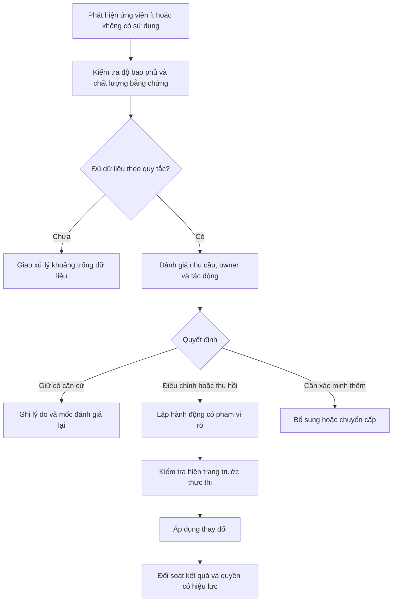

# Inactive access review

## 1. Quyền không hoạt động là một tín hiệu cần đánh giá

**Inactive access review** là hoạt động rà soát những quyền truy cập không có bằng chứng sử dụng phù hợp trong một khoảng thời gian xác định, nhằm quyết định giữ, thu hẹp, tạm ngừng hoặc thu hồi. Đây là một phần của identity governance, giúp giảm quyền tích lũy và duy trì nguyên tắc ít quyền nhất.

Một người dùng có thể đăng nhập ứng dụng hằng ngày nhưng không còn sử dụng quyền xuất dữ liệu nhạy cảm. Một workload có thể vẫn chạy nhưng không cần quyền ghi vào một kho dữ liệu cũ. Ngược lại, tài khoản khôi phục khẩn cấp có thể không được dùng thường xuyên nhưng vẫn có mục đích rõ ràng.

Vì vậy, “không thấy sử dụng” là đầu vào cho đánh giá, không tự động chứng minh “không còn cần” hay “có thể xóa ngay”. Reviewer phải xem cả chất lượng quan sát, nhu cầu nghiệp vụ, phạm vi quyền và tác động khi thay đổi.

Mục tiêu cũng không chỉ là giảm số tài khoản. Kết quả tốt có thể là giữ tài khoản, bỏ một entitlement không cần thiết, chuyển đặc quyền thường trực sang cấp theo thời hạn hoặc làm rõ một khoảng trống giám sát.

## 2. Phân biệt các loại không hoạt động

Trong IAM, trạng thái không hoạt động có thể thuộc nhiều đối tượng khác nhau:

| Đối tượng | Tín hiệu minh họa | Điều chưa thể kết luận |
|---|---|---|
| Danh tính con người | Không ghi nhận hoạt động trong một số hệ thống | Người đó đã nghỉ việc hoặc không còn nhiệm vụ |
| Tài khoản ứng dụng | Không có đăng nhập thành công được quan sát | Mọi đường truy cập qua tài khoản đều không được sử dụng |
| Entitlement | Không thấy hành động tương ứng trong phạm vi được giám sát | Entitlement chắc chắn không còn cần |
| Vai trò đặc quyền | Không ghi nhận kích hoạt hoặc sử dụng đặc quyền | Có thể bỏ mà không ảnh hưởng năng lực ứng cứu |
| Credential | Không có sự kiện sử dụng khóa hoặc token cụ thể | Toàn bộ danh tính sở hữu credential đều không hoạt động |
| Workload | Không có lời gọi API tại một dịch vụ đích | Workload đã ngừng hoặc không truy cập tài nguyên khác |

**Entitlement** là đơn vị khả năng truy cập được quản lý, chẳng hạn quyền đọc một nhóm báo cáo. Một role có thể chứa nhiều entitlement. Review cần nói rõ đang đánh giá role, một quyền bên trong role hay một gán quyền tại tài nguyên cụ thể.

Cũng cần phân biệt:

- **Dormant account:** tài khoản tồn tại nhưng không có hoạt động phù hợp trong cửa sổ quan sát.
- **Inactive access:** một quyền hoặc phạm vi truy cập không có bằng chứng sử dụng, dù tài khoản có thể vẫn hoạt động.
- **Orphan account:** tài khoản không liên kết được với danh tính hoặc chủ sở hữu chịu trách nhiệm.
- **Disabled account:** tài khoản đã bị vô hiệu hóa theo trạng thái quản trị.

Các nhóm này có thể giao nhau nhưng không đồng nghĩa. Một tài khoản không có owner vẫn có thể đang được sử dụng. Một tài khoản đã vô hiệu hóa vẫn có thể còn quyền, credential hoặc phiên ở hệ thống khác cần xử lý.

## 3. Chọn bằng chứng đúng với loại quyền

### Đăng nhập không phải bằng chứng sử dụng mọi quyền

Log IdP thường phản ánh sự kiện xác thực hoặc thiết lập phiên. Nó không nhất thiết cho biết người dùng đã đọc dữ liệu gì, dùng entitlement nào hay truy cập qua tài khoản cục bộ hay chưa.

Ngược lại, không có đăng nhập tương tác mới không chứng minh ứng dụng không được sử dụng. Phiên dài hạn, refresh token, API key, chứng chỉ và các luồng máy với máy có thể tạo hoạt động mà không có một lần đăng nhập tương tác mới.

| Nguồn bằng chứng | Có thể giúp quan sát | Giới hạn cần làm rõ |
|---|---|---|
| IdP hoặc directory | Xác thực thành công, trạng thái tài khoản | Không bao phủ toàn bộ hành động tại ứng dụng |
| Audit log ứng dụng | Hành động trên dữ liệu hoặc chức năng | Có thể thiếu hành động đọc hoặc thiếu định danh tài nguyên |
| Audit log hạ tầng | Lời gọi API, principal và tài nguyên liên quan | Không phải mọi dịch vụ hoặc loại sự kiện đều được thu thập |
| PAM | Kích hoạt hoặc sử dụng phiên đặc quyền được quản lý | Đường truy cập ngoài PAM có thể chưa được phản ánh |
| API gateway | Lời gọi qua gateway và credential được nhận diện | Không bao phủ đường gọi trực tiếp đi vòng gateway |
| Scheduler và dữ liệu workload | Lịch chạy, trạng thái job và phụ thuộc | Một job chạy không chứng minh nó cần mọi quyền được cấp |

Thất bại xác thực không chứng minh một chủ thể hợp lệ đã sử dụng quyền thành công. Heartbeat hoặc đồng bộ nền cũng không tự chứng minh nhu cầu đối với chức năng nghiệp vụ nhạy cảm. Tuy nhiên, không được tùy ý bỏ hoạt động nền nếu đó chính là công việc hợp lệ của workload đang xét.

### Sự kiện thực tế và nguồn cấp quyền là hai lớp dữ liệu

Ứng dụng có thể ghi người dùng đã xuất báo cáo nhưng không chỉ rõ họ được phép làm việc đó nhờ role nào. Nếu nhiều role cùng cho phép hành động, không thể tùy tiện gán sự kiện cho một role rồi kết luận các role còn lại không dùng.

Cần đối chiếu hành động với tài nguyên, phạm vi và các đường cấp quyền. Khi không thể xác định đường cấp, ghi rõ giới hạn của suy luận. Một sự kiện sử dụng ở dự án A không chứng minh quyền tương tự tại dự án B vẫn cần thiết.

Không cộng gộp mọi hoạt động của một danh tính để làm mới thời điểm sử dụng của mọi entitlement. Điều đó khiến quyền dư thừa tồn tại chỉ vì người dùng vẫn dùng một chức năng khác.

## 4. Chất lượng dữ liệu quyết định mức độ tin cậy

Một ngày sử dụng cuối cùng chỉ có ý nghĩa khi biết nguồn dữ liệu đã quan sát được gì. Trước khi đưa một quyền vào danh sách nghi ngờ không hoạt động, cần xác định:

1. Log có bao phủ hành động và đường truy cập liên quan không?
2. Việc liên kết sự kiện với danh tính, tài khoản, credential và tài nguyên có đáng tin cậy không?
3. Dữ liệu được lưu đủ dài cho cửa sổ đánh giá không?
4. Có gián đoạn thu thập, thay đổi cấu hình hoặc độ trễ nhập liệu không?
5. Mốc thời gian có được chuẩn hóa và phân biệt thời gian xảy ra với thời gian nhận sự kiện không?
6. Quyền đã tồn tại đủ lâu để áp dụng quy tắc quan sát chưa?

Ví dụ, chính sách minh họa yêu cầu xem xét quyền không dùng trong 60 ngày. Nếu log chỉ còn 30 ngày, không thể dựa vào đó để khẳng định quyền đã không dùng suốt 60 ngày. Kết luận phù hợp là thiếu bằng chứng cho cửa sổ yêu cầu.

Giá trị `lastUsedAt: null` cũng có thể mang nhiều nghĩa: không ghi nhận sử dụng trong khoảng được quan sát đầy đủ, không hỗ trợ đo lường, chưa nhận dữ liệu hoặc không liên kết được sự kiện. Không nên dùng một giá trị rỗng cho tất cả trường hợp mà không có trạng thái giải thích.

Một mô hình phân loại minh họa:

| Phân loại | Ý nghĩa | Hướng xử lý |
|---|---|---|
| Có hoạt động phù hợp | Có bằng chứng sử dụng thuộc đối tượng và cửa sổ đang xét | Tiếp tục đánh giá nhu cầu và rủi ro nếu cần |
| Nghi ngờ không hoạt động | Không quan sát thấy sử dụng phù hợp và đạt điều kiện dữ liệu đã định | Đưa vào review, không coi là quyết định thu hồi |
| Chưa đủ thời gian quan sát | Quyền mới được cấp hoặc mới bắt đầu đo lường | Theo dõi và đánh giá lại; không bỏ qua các kiểm soát rủi ro khác |
| Không đủ dữ liệu | Thiếu độ bao phủ, log hoặc liên kết danh tính | Xử lý chất lượng dữ liệu, chuyển đánh giá có trách nhiệm |
| Ngoại lệ cần theo dõi | Có lý do hợp lệ cho mức sử dụng thấp | Quản lý owner, thời hạn và kiểm soát liên quan |

“Không đủ dữ liệu” không được tự chuyển thành “giữ quyền vô thời hạn”. Nó tạo ra trách nhiệm xác minh, bổ sung quan sát hoặc đưa ra quyết định theo chính sách rủi ro. Nhưng cũng không được lặng lẽ đổi thành “đã xác nhận không dùng”.

## 5. Cửa sổ quan sát và quy tắc phát hiện

Ngưỡng thời gian cần dựa trên loại quyền, chu kỳ nghiệp vụ và mức rủi ro. Một quyền phục vụ công việc hằng ngày khác quyền phục vụ chốt sổ cuối năm. Không có một số ngày cố định phù hợp cho mọi tổ chức và mọi entitlement.

Một quy tắc phát hiện cần định nghĩa ít nhất:

- Đối tượng và phạm vi được đánh giá.
- Những sự kiện nào được coi là sử dụng phù hợp.
- Cửa sổ quan sát và yêu cầu về độ bao phủ.
- Cách xử lý quyền mới, nghỉ phép, công việc theo mùa và workload.
- Nguồn xác minh owner và nhu cầu.
- Tuyến review, thời hạn xử lý và điều kiện cho hành động tự động nếu có.

Ví dụ quy tắc khái niệm sau chỉ tạo ứng viên để review:

```text
function classifyForReview(assignment, observation, policy):
    if not observation.coversRelevantAccessPaths:
        return INSUFFICIENT_DATA

    if not observation.identityMappingReliable:
        return INSUFFICIENT_DATA

    if assignment.age < policy.requiredObservationWindow:
        return OBSERVATION_NOT_MATURE

    if not observation.coversRequiredWindowWithoutKnownGaps:
        return INSUFFICIENT_DATA

    if observation.hasRelevantSuccessfulUseInWindow:
        return OBSERVED_IN_USE

    return CANDIDATE_INACTIVE
```

Pseudocode không phải triển khai đầy đủ và không tự thực hiện thu hồi. Các điều kiện độ bao phủ phải được xác định từ khả năng thực tế của từng nguồn. Những hành động cần xử lý sớm vì nghỉ việc, sự cố hoặc vi phạm chính sách không phải chờ đủ cửa sổ này.

Nếu có thời điểm sử dụng phù hợp gần nhất, có thể tính khoảng cách đến thời điểm đánh giá. Nếu chưa từng quan sát thấy sử dụng, chỉ dùng tuổi gán quyền hoặc thời gian quan sát làm căn cứ khi các điều kiện dữ liệu cho phép; không biến ngày tạo tài khoản thành ngày sử dụng cuối cùng.

Khi đổi credential, chuyển tài khoản hoặc thay công cụ thu log, cần xem tính liên tục của dữ liệu. Không giả định credential mới chưa dùng đồng nghĩa workload lâu nay không hoạt động, cũng không gán lịch sử của credential cũ cho một chủ thể mới không liên quan.

## 6. Từ ứng viên đến quyết định governance

Danh sách phát hiện cần được làm giàu bằng ngữ cảnh: chủ thể, owner, quyền, tài nguyên, nguồn cấp, thời hạn hiện có, nhiệm vụ hiện tại, lịch sử review và tác động nếu thu hồi.

Một luồng xử lý phù hợp:



Quản lý trực tiếp có thể xác nhận nhu cầu công việc của nhân viên, nhưng chủ ứng dụng hoặc chủ dữ liệu thường cần giải thích entitlement. Với workload, cần owner có trách nhiệm với dịch vụ và hiểu các phụ thuộc của nó.

Reviewer nên có các lựa chọn như thu hồi, thu hẹp, giữ có lý do, ngoại lệ có thời hạn hoặc cần thêm thông tin. Lý do “có thể cần sau này” không đủ rõ nếu không có mục đích, phạm vi và cơ chế đánh giá lại.

Nếu không có người phản hồi, workflow nhắc việc và chuyển cấp theo quy định. Không ghi nhận im lặng là đã xác nhận nhu cầu. Nếu tổ chức có chính sách tự hết hạn khi không được xác nhận, lưu đó là hành động theo chính sách và bảo đảm nó áp dụng đúng đối tượng.

Đối với quyền đặc quyền, có thể xem xét bỏ quyền thường trực và chuyển sang cấp theo nhu cầu, có thời hạn, xác thực tăng cường và phê duyệt phù hợp. Đây là thay đổi mô hình truy cập cần được thiết kế, không phải chỉ đổi nhãn của quyền cũ.

## 7. Chọn hành động đúng phạm vi và xử lý ngoại lệ

### Thu hồi quyền khác với xóa tài khoản

Nếu chỉ một entitlement không còn cần thiết, không nên mặc định vô hiệu hóa toàn bộ tài khoản. Nếu tài khoản không còn mục đích sử dụng, có thể cần vô hiệu hóa hoặc deprovisioning theo chính sách; xóa tài khoản và dữ liệu là một quyết định khác với việc chặn truy cập.

Quyền kế thừa cần xử lý tại nguồn phù hợp. Xóa một gán trực tiếp có thể chưa loại bỏ được quyền nếu còn role hoặc nhóm khác. Sửa một role dùng chung để giải quyết một trường hợp cá nhân có thể ảnh hưởng nhiều người không thuộc phạm vi quyết định.

Với quyền sinh từ thuộc tính hoặc chính sách động, chỉ xóa quyền ở đích có thể khiến quy trình cấp phát tạo lại. Cần xử lý nguồn dữ liệu hoặc quy tắc cấp quyền theo thẩm quyền, và đối soát sau các vòng đồng bộ tiếp theo.

### Những trường hợp dùng ít nhưng vẫn có mục đích

| Trường hợp | Điều cần xác minh | Cách quản lý có thể áp dụng |
|---|---|---|
| Nhân viên nghỉ phép hoặc tạm nghỉ | Trạng thái từ nguồn có thẩm quyền, ngày dự kiến trở lại và loại quyền | Xử lý theo chính sách; đánh giá riêng quyền nhạy cảm |
| Công việc theo quý hoặc năm | Lịch nghiệp vụ, owner và phạm vi cần trong từng kỳ | Cấp theo thời hạn hoặc review đúng chu kỳ |
| Khôi phục khẩn cấp | Trách nhiệm, điều kiện kích hoạt và năng lực sử dụng an toàn | Quy trình break-glass, kiểm thử có kiểm soát và giám sát |
| Workload dự phòng | Kiến trúc dự phòng, phụ thuộc và yêu cầu vận hành | Quyền tối thiểu, owner rõ và kiểm tra định kỳ |
| Credential không thấy dùng | Phạm vi quan sát, định danh credential và khả năng còn phụ thuộc | Xác minh, thu hẹp hoặc thu hồi từng credential có kiểm chứng |

Ngoại lệ cần có chủ sở hữu, lý do, phạm vi, thời hạn và người chấp thuận phù hợp. Không tạo một danh sách loại trừ vĩnh viễn cho mọi tài khoản có tên “service”, “backup” hoặc “emergency”.

Tạm ngừng trước khi xóa có thể giảm khó khăn phục hồi trong một số tình huống, nhưng không mặc định là không gây gián đoạn. Vô hiệu hóa một workload đang có phụ thuộc chưa được ghi nhận vẫn có thể làm hỏng chuỗi xử lý.

Nếu có quy trình khôi phục quyền sau thu hồi nhầm, phải xác minh lại nhu cầu và thẩm quyền. Không mở lại quyền cho bất kỳ ai chỉ vì họ báo không đăng nhập được; cũng không tự khôi phục quyền của danh tính đã bị thu hồi do sự cố hoặc nghỉ việc.

## 8. Thực thi phải xét thay đổi đồng thời và các đường truy cập còn lại

Quyết định review thường dựa trên snapshot, trong khi hệ thống tiếp tục thay đổi. Một gán quyền nghi ngờ không dùng có thể đã bị xóa, được cấp lại với mục đích khác hoặc bắt đầu được sử dụng trong thời gian chờ xử lý.

Mỗi hành động cần gắn với định danh đối tượng, tài nguyên, nguồn cấp và phiên bản hoặc bằng chứng trạng thái phù hợp. Trước thực thi, kiểm tra lại trạng thái hiện tại và điều kiện của quyết định.

Hoạt động mới có thể làm thay đổi phân loại “không sử dụng”, nhưng không tự chứng minh quyền hợp lệ: đó có thể là nhu cầu mới, một tác vụ thử hoặc hoạt động đáng ngờ. Nếu thay đổi có ảnh hưởng, chuyển đánh giá lại theo chính sách thay vì tự hủy hoặc tự tiếp tục lệnh cũ.

Khi gọi connector:

1. Dùng định danh thao tác ổn định cho cùng một ý định xử lý.
2. Kiểm tra hiện trạng khi timeout vì đích có thể đã áp dụng thay đổi.
3. Theo dõi lỗi và kết quả một phần nếu tác động nhiều hệ thống.
4. Đối soát nguồn cấp và quyền có hiệu lực theo mục tiêu đã định.
5. Xác nhận các vòng đồng bộ không tạo lại quyền ngoài ý muốn.

Phản hồi “đã nhận lệnh” không tương đương “đã thu hồi”. Thay đổi thành viên nhóm cũng không chắc làm mất ngay hiệu lực của phiên, token hoặc credential ở mọi ứng dụng. Với quyền rủi ro cao, cần xử lý những đường truy cập này theo cơ chế mà hệ thống đích hỗ trợ và ghi rõ giới hạn.

Tách trạng thái quyết định như `REVOKE` khỏi trạng thái thực thi như `QUEUED`, `FAILED` hoặc `VERIFIED`. Item chưa đạt kết quả không được báo hoàn tất chỉ vì reviewer đã chọn thu hồi.

## 9. Ví dụ: quyền xuất báo cáo không có sử dụng được quan sát

Một tổ chức có quy tắc minh họa đưa quyền xuất báo cáo vào review khi không thấy sử dụng phù hợp trong 60 ngày và dữ liệu đáp ứng điều kiện quan sát. Đây là ví dụ học tập, không phải ngưỡng chung cho mọi tổ chức.

Tài khoản của Hạnh vẫn đọc báo cáo mỗi ngày. Hạnh từng được cấp quyền xuất dữ liệu chi tiết của dự án B, nhưng đã rời dự án. Log đăng nhập có hoạt động gần đây; log chức năng xuất báo cáo trong phạm vi dự án B không có sự kiện sử dụng trong cửa sổ đã xác định.

Một bản ghi phát hiện có thể biểu diễn như sau:

```yaml
reviewItemId: inactive-item-019
subjectId: employee-319
accountId: reporting-u319
assignmentId: assignment-610
entitlementId: export-detailed-report
resourceScope: project-b
observation:
  windowStart: "2026-09-27T00:00:00Z"
  windowEnd: "2026-11-26T00:00:00Z"
  coverageStatus: SUFFICIENT_FOR_DEFINED_RULE
  relevantSuccessfulUseObserved: false
  lastRelevantUseAt: null
classification: CANDIDATE_INACTIVE
decision:
  state: PENDING
remediation:
  state: NOT_STARTED
```

Dữ liệu trên chỉ là schema minh họa. `coverageStatus` là kết quả đánh giá của hệ thống dựa trên nguồn quan sát, không phải cờ để requester tùy ý khai báo. Giá trị `lastRelevantUseAt: null` được hiểu trong phạm vi và tình trạng dữ liệu đã mô tả, không có nghĩa “chưa từng sử dụng trong toàn bộ lịch sử”.

Quy trình xử lý:

1. Xác minh log đã bao phủ đầy đủ khoảng thời gian theo quy tắc, tính đến độ trễ nhập liệu và những đường xuất dữ liệu cần quan sát.
2. Kiểm tra liên kết tài khoản với Hạnh và nguồn cấp entitlement.
3. Quản lý cùng chủ dữ liệu xác nhận Hạnh không còn nhiệm vụ ở dự án B.
4. Reviewer quyết định thu hồi entitlement tại dự án B, giữ các quyền đọc báo cáo vẫn cần thiết.
5. Connector kiểm tra lại gán quyền trước khi xóa, sau đó đối soát quyền có hiệu lực và đường cấp khác.
6. Nếu có đường kế thừa còn giữ quyền xuất dữ liệu, tiếp tục xử lý; không đánh dấu hoàn tất mục tiêu thu hồi.

Nếu log chỉ bao phủ 20 ngày, bước đầu tiên phải ghi nhận thiếu dữ liệu. Owner vẫn có thể xác nhận Hạnh không còn nhu cầu và quyết định thu hồi trên căn cứ nghiệp vụ đó. Hồ sơ phải thể hiện đúng căn cứ, thay vì khẳng định đã chứng minh không dùng 60 ngày.

Nếu đối tượng là workload xuất báo cáo cuối năm, cùng tín hiệu thiếu hoạt động có thể dẫn đến quyết định khác: xác minh lịch chạy, giữ phạm vi cần thiết đến thời hạn xác định hoặc chuyển sang cơ chế cấp quyền trong kỳ sử dụng.

## 10. Bằng chứng, chỉ số và những sai sót thường gặp

Hồ sơ review cần giữ được chuỗi liên kết từ phát hiện đến kết quả: đối tượng, entitlement, tài nguyên, nguồn cấp, cửa sổ quan sát, giới hạn dữ liệu, quy tắc phát hiện, reviewer, căn cứ, ngoại lệ và hành động thực thi.

Nhật ký cần được bảo vệ khỏi sửa trái phép và giới hạn người truy cập. Không đưa token, khóa API hoặc mật khẩu vào hồ sơ. Dữ liệu hoạt động và thông tin nhân sự cần được sử dụng đúng mục đích, với thời hạn lưu giữ phù hợp của tổ chức.

Các chỉ số nên tách riêng:

| Nhóm chỉ số | Ví dụ | Điều không được suy diễn |
|---|---|---|
| Chất lượng quan sát | Tỷ lệ hệ thống và quyền có dữ liệu đủ cho cửa sổ đánh giá | Không có ứng viên không có nghĩa không có quyền dư |
| Xử lý review | Số ứng viên đã có quyết định hợp lệ, số chưa có owner | Có quyết định không có nghĩa đã đổi quyền |
| Kết quả thực thi | Số hành động thu hồi đã được xác minh, số lỗi hoặc quá hạn | Lệnh gửi thành công không chứng minh quyền đã hết hiệu lực |
| Ngoại lệ | Ngoại lệ còn hạn, hết hạn và chưa được đánh giá lại | Ngoại lệ có ghi chú không có nghĩa rủi ro đã được xử lý |
| Ảnh hưởng vận hành | Thu hồi nhầm, yêu cầu phục hồi và nguyên nhân | Tỷ lệ quyền bị xóa cao không tự chứng minh chất lượng tốt |

Ví dụ, 100 ứng viên có 30 trường hợp thiếu dữ liệu. Trong 70 trường hợp đủ dữ liệu, reviewer quyết định thu hồi 50 và giữ 20 có căn cứ. Nếu mới xác minh thu hồi được 45 trường hợp, tỷ lệ hoàn tất thu hồi là 45/50 = 90%; còn 5 hành động chưa xong và 30 trường hợp dữ liệu chưa đủ. Không thể báo toàn bộ 100 ứng viên đã được xử lý.

Các lỗi cần nhận biết:

- Dùng đăng nhập gần nhất để xác nhận mọi entitlement của tài khoản vẫn cần.
- Coi dữ liệu rỗng hoặc connector lỗi là bằng chứng không hoạt động.
- Dùng một ngưỡng cho cả nhân viên, workload theo lịch và tài khoản khẩn cấp.
- Thu hồi cả tài khoản khi chỉ cần bỏ một quyền không còn nhu cầu.
- Tạo ngoại lệ vĩnh viễn mà không có owner và thời hạn.
- Đóng item trước khi xác minh kết quả tại đích hoặc trước khi kiểm tra quyền được cấp lại.
- Tối ưu số quyền bị xóa mà bỏ qua chất lượng dữ liệu và gián đoạn nghiệp vụ.

## 11. Tự kiểm tra

1. Một người dùng đăng nhập mỗi ngày có thể vẫn có quyền không hoạt động như thế nào?
2. Vì sao không có sự kiện trong log 30 ngày chưa chứng minh không dùng quyền trong 60 ngày?
3. Cần biết thêm gì trước khi diễn giải `lastUsedAt: null`?
4. Khi nào một workload ít hoạt động vẫn có lý do giữ quyền, và ngoại lệ phải được quản lý ra sao?
5. Vì sao việc xóa một gán quyền có thể chưa loại bỏ quyền có hiệu lực?
6. Cần lưu những bằng chứng nào để chứng minh quyết định thu hồi đã được thực hiện đúng phạm vi?

Inactive access review có giá trị khi biến tín hiệu ít sử dụng thành quyết định có căn cứ và thay đổi được xác minh. Chất lượng của quy trình phụ thuộc đồng thời vào khả năng quan sát, hiểu biết về nhu cầu và việc theo dõi kết quả trong toàn bộ vòng đời quyền.
