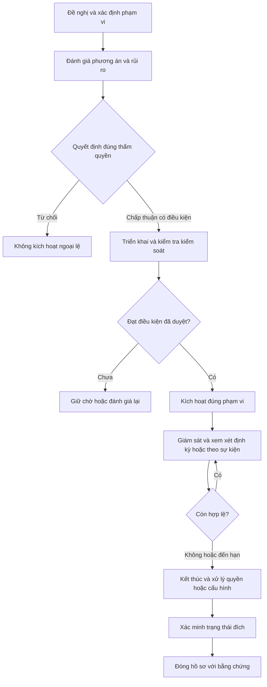

# Exception management

## 1. Ngoại lệ IAM là gì?

**Exception management**, hay quản lý ngoại lệ, là quá trình xác định, đánh giá, phê duyệt, thực thi, giám sát và kết thúc những trường hợp được phép khác với một yêu cầu hoặc chính sách IAM thông thường trong phạm vi đã xác định.

Ví dụ, chính sách yêu cầu ứng dụng doanh nghiệp tích hợp đăng nhập một lần qua nhà cung cấp danh tính của tổ chức. Một ứng dụng cũ chưa hỗ trợ tích hợp nhưng vẫn cần vận hành trong thời gian chuyển đổi. Tổ chức có thể xem xét ngoại lệ cho đúng ứng dụng và nhóm người dùng cần thiết, kèm kiểm soát bổ sung, người chịu trách nhiệm, mốc xem xét và kế hoạch chấm dứt ngoại lệ.

Ngoại lệ không phải một quyền miễn trừ chung. Nó chỉ có ý nghĩa đối với yêu cầu chính sách, danh tính, tài nguyên, hành động, khoảng thời gian và điều kiện được duyệt. Cho phép sử dụng đăng nhập cục bộ trong một ứng dụng không đồng nghĩa cho phép bỏ qua kiểm soát truy cập dữ liệu của ứng dụng đó.

Trong bài này, “exception” là ngoại lệ về quản trị và chính sách, không phải cơ chế bắt và xử lý lỗi của một ngôn ngữ lập trình.

NIST CSF 2.0 đặt việc quản lý, đánh giá tác động rủi ro, ghi nhận và theo dõi thay đổi cùng ngoại lệ trong kết quả ID.RA-07. Các ví dụ triển khai cũng đề cập xem xét, phê duyệt và đánh giá lại rủi ro đã chấp nhận. Đây là định hướng quản trị; quy trình cụ thể vẫn cần được tổ chức xác định. [NIST Cybersecurity Framework — ID.RA-07](https://csrc.nist.gov/Projects/Cybersecurity-Framework/Filters).

## 2. Phân biệt ngoại lệ với các tình huống gần giống

| Tình huống | Đặc điểm | Cách xử lý |
|---|---|---|
| Cấp quyền thông thường | Yêu cầu nằm trong chính sách hiện hành | Dùng quy trình yêu cầu và phê duyệt truy cập thông thường |
| Ngoại lệ được quản lý | Có đề xuất khác chính sách, được đánh giá và có quyết định đúng thẩm quyền | Theo dõi phạm vi, điều kiện, rủi ro và vòng đời ngoại lệ |
| Sai lệch chưa được cho phép | Cấu hình hoặc quyền thực tế khác chính sách nhưng chưa có quyết định hợp lệ | Xử lý sai lệch; không tự coi là ngoại lệ |
| Sự cố vận hành | Connector lỗi hoặc ứng dụng không đáp ứng | Khắc phục sự cố và đánh giá có cần cơ chế khẩn cấp hay không |
| Truy cập khẩn cấp | Sử dụng cơ chế đặc biệt để xử lý tình huống đã xác định | Áp dụng quy trình khẩn cấp cùng bằng chứng và xem xét sau sử dụng |
| Thay đổi chính sách | Nhiều trường hợp cho thấy yêu cầu chung cần được điều chỉnh | Thực hiện quản lý thay đổi chính sách, không gia hạn hàng loạt để che vấn đề |

Một quyền tồn tại lâu không tự trở thành quyền hợp lệ. Tương tự, việc một nhóm thường xuyên xin ngoại lệ không đủ để chứng minh yêu cầu chính sách nên bị bỏ. Cần xem nguyên nhân, khả năng đáp ứng và rủi ro thực tế.

Nếu phát hiện tài khoản không tuân thủ trước khi có phê duyệt, phải ghi lại đúng diễn biến. Một quyết định sau đó có thể cho phép vận hành từ một thời điểm mới, nhưng không nên được ghi lùi ngày để biến thời gian chưa được cho phép thành đã được duyệt.

## 3. Những trường hợp ngoại lệ thường gặp trong IAM

Ngoại lệ có thể xuất hiện ở nhiều phần của vòng đời danh tính:

- Ứng dụng cũ chưa hỗ trợ SSO hoặc phương thức xác thực theo yêu cầu chung.
- Workload còn phụ thuộc thông tin xác thực dài hạn trong thời gian chuyển sang cơ chế phù hợp hơn.
- Một người cần tạm thời thực hiện hai nhiệm vụ vốn được yêu cầu phân tách.
- Tài khoản nhà thầu cần tồn tại lâu hơn mốc kết thúc ban đầu để bàn giao công việc.
- Tác vụ xử lý sự cố cần quyền cao hơn vai trò thông thường trong một khoảng thời gian ngắn.
- Một hệ thống chưa hỗ trợ tự động thu hồi hoặc chưa cung cấp đủ dữ liệu cho đối soát.

Những ví dụ này là tình huống cần đánh giá, không phải danh sách mặc nhiên được chấp thuận. Trước khi mở ngoại lệ, cần kiểm tra xem có cách đáp ứng đúng chính sách bằng phạm vi hẹp hơn, vai trò khác, tài khoản phù hợp hoặc thay đổi quy trình hay không.

Quyền tạm thời cũng không luôn là ngoại lệ. Nếu chính sách đã cho phép quyền quản trị theo yêu cầu, có phê duyệt và thời hạn ngắn, việc cấp đúng cơ chế đó là vận hành bình thường. Chỉ khi phải khác một yêu cầu cụ thể mới cần xác định phần ngoại lệ.

## 4. Hồ sơ ngoại lệ cần trả lời những câu hỏi nào?

### 4.1. Chính sách nào đang được đề nghị khác đi?

Hồ sơ cần nêu mã hoặc định danh yêu cầu, phiên bản và nội dung kiểm soát liên quan. “Xin ngoại lệ bảo mật” là quá rộng. Một mô tả tốt hơn là: ứng dụng A chưa tích hợp với nhà cung cấp danh tính theo yêu cầu SSO của chính sách phiên bản hiện hành.

Phải tách phần đề nghị được khác với phần vẫn phải tuân thủ. Ngoại lệ với yêu cầu SSO không mặc nhiên thay đổi thời hạn tài khoản, quy tắc ít quyền nhất, quyền xem dữ liệu hoặc trách nhiệm kiểm toán.

### 4.2. Ai và tài nguyên nào nằm trong phạm vi?

Cần xác định danh tính hoặc nhóm được quản lý, tài khoản đích, ứng dụng, môi trường, vai trò và hành động. Phạm vi “toàn bộ bộ phận” có thể rộng hơn nhu cầu của vài người thực hiện bàn giao.

Nếu dùng nhóm để áp dụng ngoại lệ, phải kiểm soát thành viên nhóm. Phê duyệt cho năm người không đủ làm căn cứ cho việc người thứ sáu được thêm sau đó. Tùy chính sách, việc thêm thành viên có thể cần đánh giá lại hoặc một quyết định mới.

### 4.3. Vì sao không thể đáp ứng cách thông thường?

Lý do cần có bằng chứng và các phương án đã xem xét: giới hạn kỹ thuật, phụ thuộc nhà cung cấp, thời gian chuyển đổi hoặc tác động vận hành. “Tiện hơn”, “người dùng không thích” hoặc “quản lý yêu cầu gấp” chưa giải thích vì sao cần khác chính sách.

Cần đánh giá cả rủi ro khi cho phép và ảnh hưởng khi không cho phép. So sánh này giúp chọn giải pháp thực tế, nhưng không làm mất yêu cầu về thẩm quyền chấp thuận.

### 4.4. Ai chịu trách nhiệm và khi nào kết thúc?

Hồ sơ cần có người sở hữu ngoại lệ, chủ tài nguyên, người đánh giá, người được trao thẩm quyền chấp nhận rủi ro, người triển khai và người giám sát. Vai trò có thể do một nhóm đảm nhiệm nhưng trách nhiệm phải đủ rõ để có thể liên hệ và xử lý.

Ngoại lệ tạm thời cần thời điểm bắt đầu, kết thúc, mốc xem xét và tiêu chí kết thúc. Ngoài ngày hết hạn, nên có kế hoạch khắc phục với người thực hiện và các mốc có thể kiểm chứng. Nếu chỉ ghi “đến khi nâng cấp xong”, ngoại lệ có thể tồn tại vô thời hạn mà không ai chịu trách nhiệm về tiến độ.

## 5. Đánh giá rủi ro và kiểm soát bù trừ

### 5.1. Mô tả rủi ro bằng tình huống cụ thể

Không chỉ điền một nhãn “trung bình” vào biểu mẫu. Cần giải thích chủ thể nào có thể khai thác điểm yếu gì và hậu quả là gì. Ví dụ, đăng nhập cục bộ không đi qua hệ thống danh tính trung tâm có thể làm việc thu hồi khi nhân viên nghỉ việc không được đồng bộ tự động.

Các yếu tố cần xem xét gồm độ nhạy của dữ liệu, mức đặc quyền, khả năng tiếp cận hệ thống, số danh tính bị ảnh hưởng, thời gian tồn tại và khả năng phát hiện hoặc thu hồi. Rủi ro còn phụ thuộc các quyền khác của cùng danh tính, không chỉ quyền trong một yêu cầu riêng lẻ.

Mô hình chấm điểm có thể hỗ trợ so sánh theo phương pháp nội bộ, nhưng con số không thay thế lập luận. Không có một công thức chung chứng minh rằng cộng thêm một biện pháp giám sát sẽ làm mọi loại rủi ro giảm đúng một mức.

### 5.2. Kiểm soát bù trừ phải tác động vào rủi ro

**Compensating control**, hay kiểm soát bù trừ, là biện pháp được dùng để giảm rủi ro trong bối cảnh chưa thể đáp ứng đầy đủ kiểm soát thông thường. Nó cần có mục tiêu, chủ sở hữu, cách kiểm chứng và phản ứng khi không còn hoạt động.

| Điểm thiếu hoặc rủi ro | Biện pháp có thể xem xét | Giới hạn cần đánh giá |
|---|---|---|
| Tài khoản cục bộ chưa được thu hồi tự động | Danh sách tài khoản có chủ sở hữu, đối soát và quy trình thu hồi theo sự kiện nghỉ việc | Vẫn có độ trễ và phụ thuộc người thực hiện |
| Ứng dụng chỉ tiếp cận qua một cổng kiểm soát | Xác thực mạnh ở cổng, giới hạn đường kết nối, chặn truy cập trực tiếp vào đích | Chỉ có ý nghĩa nếu không tồn tại đường bỏ qua cổng |
| Workload còn dùng bí mật dài hạn | Lưu trong hệ thống quản lý bí mật, giới hạn quyền, kiểm soát người đọc và luân chuyển phù hợp | Không loại bỏ hoàn toàn rủi ro sao chép hoặc lộ bí mật |
| Hai nhiệm vụ nhạy cảm tạm do cùng người thực hiện | Thu hẹp thời gian, thêm bước kiểm tra độc lập đối với kết quả nghiệp vụ | Kiểm tra sau không luôn thay thế được ngăn chặn trước |
| Quyền cao cần cho một tác vụ | Cấp đúng tác vụ và thời hạn, theo dõi sử dụng, có khả năng chấm dứt | Quyền vẫn gây tác động trong thời gian hoạt động |

Các biện pháp trong bảng là lựa chọn cần đánh giá, không phải bằng chứng mặc định về mức bảo vệ tương đương. Ví dụ, giới hạn IP không thay thế xác thực danh tính; giám sát log có thể giúp phát hiện nhưng không tự ngăn một thao tác sai.

Khi phê duyệt có điều kiện, cần xác nhận các kiểm soát bắt buộc đã được triển khai và kiểm tra trước khi kích hoạt ngoại lệ. Một kế hoạch “sẽ bật cảnh báo” chưa tương đương cảnh báo đang hoạt động và có người xử lý.

### 5.3. Rủi ro còn lại phải được chấp nhận đúng thẩm quyền

**Residual risk** là rủi ro còn lại sau khi tính đến các biện pháp kiểm soát. Chấp nhận rủi ro không làm rủi ro biến mất; nó ghi nhận người có thẩm quyền đồng ý với việc vận hành trong điều kiện đã xác định.

Đội an ninh có thể đánh giá và đưa khuyến nghị, còn người được ủy quyền chấp nhận rủi ro phải được chính sách xác định. Quản trị viên có quyền sửa cấu hình không tự có thẩm quyền quyết định mọi ngoại lệ.

Nếu một yêu cầu nằm ngoài quyền được phép miễn trừ của người duyệt, cần chuyển đúng cấp hoặc chọn phương án đáp ứng yêu cầu. Không dùng một chữ ký phê duyệt thông thường để thay thế thẩm quyền mà người ký không có.

## 6. Vòng đời của một ngoại lệ



Các trạng thái nội bộ minh họa có thể là `REQUESTED`, `UNDER_REVIEW`, `APPROVED`, `ACTIVE`, `ENDING` và `CLOSED`. Cần phân biệt một ngoại lệ đã được duyệt với một ngoại lệ đã triển khai đủ điều kiện; không báo đang hoạt động hợp lệ khi các kiểm soát bắt buộc vẫn chưa có.

Tương tự, hết hiệu lực quản trị không chứng minh cấu hình đã được gỡ khỏi ứng dụng. Có thể cần theo dõi riêng **hiệu lực quyết định** và **tiến độ thực thi** để thấy rõ những trường hợp hết hạn nhưng chưa kết thúc được về kỹ thuật.

Mọi thay đổi đáng kể về phạm vi, quyền, chủ thể, thời hạn hoặc điều kiện cần được đánh giá tác động. Không sửa trực tiếp nội dung hồ sơ cũ rồi tiếp tục dùng chữ ký đã duyệt cho một nội dung khác. Lưu phiên bản và lịch sử giúp xác định quyết định nào áp dụng cho cấu hình nào.

## 7. Ví dụ: ứng dụng cũ chưa tích hợp SSO

Giả sử một ứng dụng lập lịch sản xuất chưa hỗ trợ SSO và sẽ được thay thế. Chính sách tổ chức yêu cầu SSO đối với ứng dụng thuộc phạm vi này. Bộ phận vận hành đề nghị tiếp tục dùng tài khoản cục bộ trong giai đoạn chuyển đổi.

Một đề xuất ngoại lệ có thể được thu hẹp như sau:

- Chỉ áp dụng cho ứng dụng và môi trường đã chỉ định, với danh sách danh tính cần vận hành.
- Dùng tài khoản cá nhân có liên kết với danh tính trung tâm, không dùng chung một tài khoản cho cả ca.
- Chỉ có các vai trò cần thiết cho vận hành; tài khoản quản trị được đánh giá riêng.
- Giới hạn đường truy cập qua một cổng được kiểm soát nếu kiến trúc cho phép, đồng thời xác minh không có đường truy cập trực tiếp ngoài phạm vi.
- Có nguồn sự kiện nghỉ việc, người thực hiện thu hồi, đối soát tài khoản và cơ chế cảnh báo.
- Có kế hoạch chuyển đổi, mốc kiểm tra tiến độ và thời điểm hết hạn cụ thể.

Hồ sơ vẫn phải mô tả rủi ro còn lại: tài khoản cục bộ có thể không đồng bộ trạng thái ngay với hệ thống danh tính, ứng dụng có thể có hạn chế về log hoặc phiên đăng nhập. Các kiểm soát bổ sung cần được đánh giá dựa trên các hạn chế đó.

Một bản ghi minh họa có thể có cấu trúc sau:

```yaml
exceptionId: iam-exception-028
revision: 1
policyRequirement: central-sso-for-workforce-applications
resource: production-scheduling-legacy
environment: production
scopeReference: approved-identities-revision-1
owner: production-application-owner
riskAcceptanceReference: risk-decision-142
startsAt: '2026-12-01T09:00:00+07:00'
endsAt: '2026-12-15T09:00:00+07:00'
nextReviewAt: '2026-12-08T09:00:00+07:00'
compensatingControls:
  - named-local-accounts
  - controlled-access-path
  - offboarding-and-account-reconciliation
exitPlanReference: migration-plan-073
activationStatus: pending-verification
```

Các giá trị và tên trường ở đây chỉ phục vụ minh họa, không phải schema của một sản phẩm. Những tham chiếu phải trỏ tới bằng chứng có thể kiểm tra; bản thân tên `controlled-access-path` không chứng minh đường truy cập đã được giới hạn.

Khi đến ngày kết thúc, kết quả không chỉ là đổi trạng thái hồ sơ. Đội vận hành phải triển khai phương án đã duyệt: chuyển người dùng sang ứng dụng mới, dừng đường truy cập cũ hoặc đưa hệ thống trở về trạng thái phù hợp với chính sách. Sau đó xác minh tài khoản, cấu hình và đường truy cập liên quan trước khi đóng.

## 8. Thực thi ngoại lệ đúng phạm vi

### 8.1. Tránh loại trừ rộng hơn quyết định

Một cấu hình loại trừ ở cấp chính sách có thể tác động đến nhiều ứng dụng hoặc nhiều kiểm soát hơn dự kiến. Trước khi áp dụng, cần kiểm tra những gì thực sự bị bỏ qua, các chính sách còn tác dụng và khả năng truy cập theo những đường khác.

Không nên giải quyết ngoại lệ cho vài tài khoản bằng cách tắt một chính sách cho cả tổ chức. Nếu nền tảng không hỗ trợ phạm vi đủ hẹp, đó là thông tin cần đưa lại vào đánh giá rủi ro và lựa chọn phương án; không được tuyên bố đã thực thi đúng phạm vi khi công cụ chỉ làm được rộng hơn.

### 8.2. Kiểm soát nhóm và cấu hình ngoại lệ

Nhóm loại trừ, danh sách cho phép hoặc bản ghi cấu hình ngoại lệ thực chất có thể làm thay đổi quyền truy cập. Chúng cần được giới hạn người sửa, ghi lịch sử và đối soát với danh sách đã được duyệt.

Khi có thể, liên kết mỗi cấu hình với mã ngoại lệ và phiên bản quyết định để truy vết. Việc thử lại triển khai phải kiểm tra quyết định còn hiệu lực; công việc cũ không được thêm lại một thành viên sau khi ngoại lệ đã kết thúc.

### 8.3. Không bỏ kiểm tra quyền khi sử dụng

Một ngoại lệ về phương thức xác thực không mặc nhiên cấp thêm quyền dữ liệu. Ứng dụng vẫn phải kiểm tra chủ thể, tài nguyên và hành động theo các quy tắc còn áp dụng. Các điều kiện của ngoại lệ cần được chuyển thành cấu hình hoặc kiểm soát có thể thực hiện, không chỉ nằm trong bình luận.

Với workload, phạm vi phải gắn với đúng danh tính dịch vụ và tài nguyên cần truy cập. Không sao chép bí mật hoặc dùng một tài khoản quản trị chung chỉ vì quá trình chuyển đổi chưa hoàn tất.

## 9. Xem xét lại, gia hạn và thu hồi

### 9.1. Xem xét theo thời gian và theo sự kiện

Mốc xem xét phụ thuộc mức rủi ro và thời gian tồn tại. Ngoài lịch định kỳ, cần đánh giá lại khi có thay đổi như người hưởng quyền chuyển vị trí, hợp đồng kết thúc, chủ ứng dụng thay đổi, phát hiện sự cố hoặc kiểm soát bù trừ ngừng hoạt động.

Câu hỏi cần trả lời là: nhu cầu còn tồn tại không, phạm vi có bị mở rộng không, rủi ro có thay đổi không, các kiểm soát có bằng chứng hoạt động không và kế hoạch chấm dứt có tiến triển không?

Nếu không đọc được dữ liệu giám sát, không được mặc định rằng không có sự kiện bất thường. Cần ghi nhận khoảng trống quan sát và xử lý theo điều kiện đã duyệt; với một số ngoại lệ, mất kiểm soát bắt buộc có thể là lý do tạm dừng hoặc thu hồi.

### 9.2. Gia hạn là một quyết định mới

Gia hạn phải dựa trên trạng thái hiện tại, lịch sử sử dụng, hiệu quả kiểm soát và tiến độ khắc phục. Cần nêu vì sao chưa hoàn thành, kế hoạch mới và người chấp thuận thời gian tiếp theo. Không tự kéo dài ngày hết hạn chỉ vì không ai phản hồi.

Nếu dự kiến kết thúc không khả thi, vấn đề phải được đưa lên trước khi đến hạn để có quyết định đúng thẩm quyền. Trong lúc chờ, không coi ngoại lệ đã hết hạn là vẫn hợp lệ. Nếu cần duy trì tạm thời, phải có một căn cứ mới hợp lệ và thời hạn rõ ràng.

Việc gia hạn nhiều lần là tín hiệu cần xem lại đầu tư, kiến trúc hoặc chính sách. Nó không tự chứng minh ngoại lệ phải bị từ chối, nhưng cần được nhìn thấy và giải thích thay vì biến thành thao tác hành chính lặp lại.

### 9.3. Kết thúc phải có bằng chứng thực tế

Kế hoạch kết thúc cần xác định hành động, người thực hiện, thời điểm và cách xác minh. Tùy trường hợp, có thể cần gỡ thành viên nhóm loại trừ, thu hồi vai trò, vô hiệu hóa thông tin xác thực, đóng đường truy cập cũ hoặc xác nhận kiểm soát chuẩn đã hoạt động.

Một ngoại lệ hết hạn không luôn đòi hỏi xóa tài khoản. Nếu tài khoản vẫn có vai trò hợp lệ khác, chỉ kết thúc phần khác chính sách hoặc quan hệ quyền thuộc ngoại lệ theo phương án đã duyệt. Ngược lại, nếu cần chấm dứt toàn bộ truy cập, phải xét các nguồn quyền, phiên và thông tin xác thực liên quan theo khả năng của hệ thống.

Nếu bước thu hồi thất bại, hồ sơ phải thể hiện phần tồn đọng, rủi ro và người xử lý. Không đánh dấu đóng hoàn tất chỉ vì đã gửi lệnh hoặc đã qua ngày kết thúc.

## 10. Tài khoản khẩn cấp và trường hợp không chỉ là ngoại lệ ngắn hạn

**Break-glass** là cơ chế truy cập khẩn cấp được chuẩn bị trước để xử lý những tình huống mà đường quản trị thông thường không dùng được. Tài khoản khẩn cấp có thể tồn tại lâu dài theo thiết kế, trong khi từng lần sử dụng vẫn phải được kiểm soát và xem xét.

Vì vậy, không nên áp dụng máy móc một ngày hết hạn ngắn rồi xóa mọi tài khoản khẩn cấp mà bỏ qua mục tiêu khôi phục truy cập. Nếu có khác biệt với chính sách thông thường, cần tài liệu hóa phạm vi, cơ sở thiết kế, chủ sở hữu, phương thức bảo vệ, giám sát và lịch kiểm tra lại.

Microsoft Entra có hướng dẫn riêng cho tài khoản khẩn cấp, gồm cách bảo vệ phương thức xác thực, tránh các phụ thuộc có thể chặn truy cập trong sự cố và theo dõi việc sử dụng. Đây là ví dụ về thiết kế chuyên biệt; không nên suy diễn thành cho phép mọi tài khoản đặc quyền tự loại khỏi chính sách. [Hướng dẫn tài khoản truy cập khẩn cấp của Microsoft Entra](https://learn.microsoft.com/en-us/entra/identity/role-based-access-control/security-emergency-access).

Với ngoại lệ vận hành dài hạn khác, cũng cần quyết định rõ đó là một trường hợp kiến trúc được quản lý hay một khoảng chuyển đổi chưa hoàn tất. Dù không dùng cùng kiểu hết hạn ngắn, chúng vẫn cần cơ sở chấp thuận hiện hành và đánh giá lại; nhãn “vĩnh viễn” không thay thế việc quản trị rủi ro.

## 11. Bằng chứng và chỉ số quản trị

Một danh mục ngoại lệ có ích phải cho biết ngoại lệ nào đang hoạt động, ở đâu, ai chịu trách nhiệm và rủi ro nào còn được chấp nhận. Các thông tin nên liên kết được với quyết định, cấu hình và kết quả xác minh, thay vì chỉ là danh sách ticket đã đóng.

Những chỉ số có thể theo dõi gồm:

- Số ngoại lệ đang hoạt động theo loại chính sách, hệ thống và mức rủi ro.
- Số ngoại lệ quá hạn hoặc đã hết hiệu lực nhưng chưa kết thúc về kỹ thuật.
- Số ngoại lệ thiếu chủ sở hữu, thiếu bằng chứng kiểm soát hoặc quá mốc xem xét.
- Tuổi ngoại lệ, số lần gia hạn và tiến độ các mốc khắc phục.
- Số danh tính và tài nguyên thực tế được loại trừ so với phạm vi đã duyệt.
- Thời gian từ quyết định thu hồi đến khi xác minh hoàn tất ở đích.

Các chỉ số cần có ngữ cảnh. Số ngoại lệ giảm do xóa hồ sơ nhưng giữ cấu hình loại trừ không phản ánh cải thiện. Ngược lại, số ngoại lệ tăng có thể do tổ chức vừa phát hiện và ghi nhận những trường hợp trước đó chưa được quản lý.

Hồ sơ phải được bảo vệ phù hợp vì nó có thể tiết lộ điểm yếu, tài khoản đặc quyền và đường truy cập đặc biệt. Chỉ lưu dữ liệu cần thiết; không đưa mật khẩu hoặc token vào biểu mẫu ngoại lệ. Các thay đổi hồ sơ, quyết định và cấu hình cần có lịch sử để phục vụ điều tra và kiểm toán.

## 12. Tình huống tự kiểm tra

**Có ticket ghi “đã chấp nhận rủi ro” là đủ để thêm cả phòng ban vào nhóm loại trừ không?**

Chưa. Phải xác minh người chấp thuận có thẩm quyền, quyết định còn hiệu lực, nhóm danh tính nằm trong phạm vi và các điều kiện kích hoạt đã được đáp ứng. Cấu hình không được rộng hơn nội dung đã duyệt.

**Kiểm soát bù trừ là giám sát log, nhưng nguồn log bị ngắt. Ngoại lệ có tiếp tục như cũ không?**

Cần đánh giá ngay theo điều kiện đã chấp thuận và quy trình phản ứng. Không có log không chứng minh không có vấn đề. Nếu giám sát là điều kiện bắt buộc, việc mất điều kiện có thể yêu cầu tạm dừng, thu hồi hoặc một quyết định mới đúng thẩm quyền.

**Ngoại lệ đã hết hạn, nhưng dừng quyền có thể làm gián đoạn công việc. Có tự gia hạn được không?**

Không tự gia hạn vì im lặng hoặc vì lo gián đoạn. Kế hoạch kết thúc cần được chuẩn bị trước, và mọi nhu cầu duy trì phải được đánh giá, chấp thuận lại theo thẩm quyền. Nếu việc kết thúc đang thất bại, phải ghi nhận rủi ro tồn đọng và chuyển xử lý thay vì báo đã hoàn tất.

**Đã gỡ người dùng khỏi một nhóm loại trừ. Có thể chắc chắn mọi ngoại lệ của người đó đã kết thúc không?**

Chưa. Cần xác minh các cấu hình và đường truy cập nằm trong phạm vi, kể cả nhóm khác, phép gán trực tiếp hoặc tài khoản đích có liên quan. Bằng chứng đóng phải phản ánh những gì thực sự đã được kiểm tra.

**Một ngoại lệ được gia hạn nhiều lần thì nên làm gì?**

Đánh giá nguyên nhân chưa khắc phục, rủi ro hiện tại, chất lượng kiểm soát và tính khả thi của kế hoạch. Có thể cần quyết định đầu tư, thay kiến trúc hoặc xem xét chính sách qua quy trình riêng. Không chỉ thay ngày hết hạn rồi giữ nguyên mọi giả định cũ.

Quản lý ngoại lệ có hiệu quả khi tổ chức giải thích được phần nào đang khác chính sách, vì sao được cho phép, ai chịu trách nhiệm, điều kiện nào giữ quyết định còn hiệu lực và bằng chứng nào xác nhận ngoại lệ đã kết thúc.
