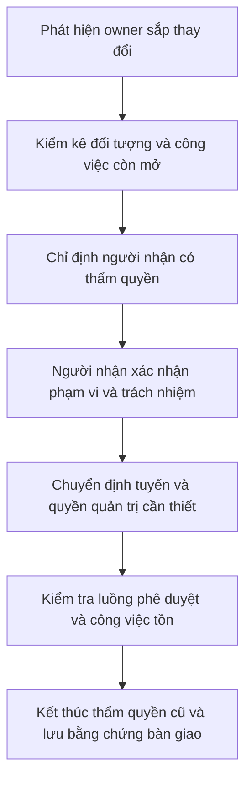

# Owner accountability — Trách nhiệm giải trình của chủ sở hữu trong IAM

## 1. Có tên chủ sở hữu chưa có nghĩa đã có trách nhiệm thực chất

Một ứng dụng có trường `owner = IT Team`, nhưng khi cần quyết định ai được xuất dữ liệu khách hàng, nhóm vận hành nói họ chỉ quản lý máy chủ. Quản lý nhân sự biết người dùng thuộc phòng ban nào nhưng không hiểu quyền xuất dữ liệu. Nhóm IAM có thể gỡ role nhưng không biết role đó còn cần thiết hay không. Yêu cầu vì thế bị chuyển vòng quanh, còn quyền cũ vẫn tồn tại.

**Owner accountability** trong quản trị danh tính là việc xác định rõ ai chịu trách nhiệm giải trình cho một tài nguyên, danh tính hoặc nhóm quyết định truy cập; người đó phải có thẩm quyền phù hợp, đưa ra quyết định có căn cứ, theo dõi việc thực hiện và xử lý những vấn đề thuộc phạm vi của mình.

Trách nhiệm giải trình cần thể hiện qua hành động và bằng chứng: quyền được mô tả đúng, yêu cầu được quyết định đúng người, rà soát được thực hiện, phát hiện được khắc phục và việc bàn giao không để lại khoảng trống quản trị. Một trường owner chỉ có giá trị nếu nó dẫn tới những việc đó.

Trong bài này, “chủ sở hữu” là vai trò quản trị do tổ chức chỉ định, không mặc nhiên nói về quyền sở hữu pháp lý. Người chịu trách nhiệm cho một ứng dụng cũng không tự động được phép đọc mọi dữ liệu trong ứng dụng đó.

## 2. Phân biệt các trách nhiệm thường bị gộp chung

### 2.1. Accountable và responsible

**Accountable** là chịu trách nhiệm về một kết quả hoặc quyết định trong phạm vi đã định. **Responsible** là trực tiếp thực hiện công việc để tạo ra kết quả đó. Hai vai trò có thể do cùng người đảm nhiệm nếu chính sách cho phép, nhưng cần được phân biệt để không đẩy trách nhiệm nghiệp vụ cho người vận hành kỹ thuật.

Ví dụ, chủ sở hữu dữ liệu chịu trách nhiệm quyết định quyền xuất dữ liệu có còn cần thiết không. Nhóm IAM thực hiện gỡ entitlement qua connector. Người vận hành connector không nên tự quyết định căn cứ nghiệp vụ; ngược lại, người quyết định thu hồi không nên coi việc gửi ticket là bằng chứng quyền đã mất.

### 2.2. Phê duyệt, quản lý nhân sự và quản trị kỹ thuật

Một quản lý trực tiếp có thể xác nhận nhân viên đang làm nhiệm vụ đối soát, nhưng chưa chắc có thẩm quyền chấp thuận xuất toàn bộ dữ liệu khách hàng. Chủ sở hữu dữ liệu hiểu tác động của việc xuất dữ liệu, còn chủ sở hữu ứng dụng hiểu role nào thực sự cho phép hành động đó.

Vì vậy, một workflow có thể cần nhiều loại xác nhận với mục đích khác nhau. Không nên thêm nhiều chữ ký chỉ để tăng số bước; cần biết mỗi bước xác minh điều gì và ai có khả năng làm việc đó.

### 2.3. Sở hữu một đối tượng và được cấp quyền sử dụng đối tượng đó

Người được ghi là owner của tài khoản dịch vụ chịu trách nhiệm về mục đích và vòng đời của tài khoản. Điều này không tự cấp quyền đọc secret, đăng nhập bằng tài khoản hoặc sử dụng mọi quyền của workload.

Tương tự, người có thể sửa metadata của entitlement không nên mặc nhiên được tự phê duyệt entitlement cho mình. Quyền quản trị quy trình, quyền quyết định và quyền sử dụng cần được thiết kế riêng, theo nguyên tắc ít quyền nhất và phân tách nhiệm vụ.

## 3. Những đối tượng nào cần có owner?

| Đối tượng quản trị | Trách nhiệm tiêu biểu của owner |
| --- | --- |
| Ứng dụng | Xác nhận mô hình quyền, đầu mối xử lý và khả năng thực thi cấp/thu hồi |
| Dữ liệu hoặc miền dữ liệu | Xác định điều kiện truy cập, phạm vi và tác động nghiệp vụ |
| Entitlement, role hoặc group cấp quyền | Giữ mô tả đúng, xác định điều kiện cấp và rà soát các assignment |
| Business role hoặc gói truy cập | Bảo đảm các quyền thành phần phù hợp công việc và không mở rộng âm thầm |
| Tài khoản dịch vụ hoặc workload identity | Xác nhận mục đích, người phụ trách, phạm vi quyền và vòng đời |
| Quy trình yêu cầu và rà soát | Duy trì người quyết định hợp lệ, thời hạn, cơ chế chuyển cấp và bằng chứng |
| Ngoại lệ quyền truy cập | Theo dõi lý do, hạn dùng, biện pháp kiểm soát và việc kết thúc ngoại lệ |

Không cần tạo một cá nhân owner riêng cho từng bản ghi nếu tổ chức có thể quản lý theo nhóm đối tượng hoặc vai trò nghiệp vụ. Tuy nhiên, phạm vi phải rõ. Một owner cho “toàn bộ CRM” có thể quá rộng nếu các miền dữ liệu thuộc nhiều đơn vị và có thẩm quyền khác nhau.

Quản trị cũng cần bao phủ tenant và môi trường. Có quyền chịu trách nhiệm cho ứng dụng thử nghiệm không mặc nhiên có thẩm quyền quyết định quyền quản trị production. Cùng một tên role ở hai tenant có thể thuộc hai owner khác nhau.

## 4. Một hợp đồng trách nhiệm cần những gì?

### 4.1. Phạm vi cụ thể

Phải xác định owner chịu trách nhiệm cho đối tượng nào, loại quyết định nào và trong khoảng thời gian nào. “Chịu trách nhiệm IAM” quá chung để giải quyết một yêu cầu gỡ quyền cụ thể.

Ví dụ về phạm vi rõ hơn:

```text
Đối tượng: entitlement xuất khách hàng khu vực miền Nam
Ứng dụng: CRM production
Tenant: company-a
Trách nhiệm: quyết định nhu cầu nghiệp vụ, điều kiện cấp và rà soát assignment
Thẩm quyền không bao gồm: tự thay đổi ánh xạ sang quyền xuất toàn tổ chức
Đầu mối thực thi: nhóm vận hành IAM
Đầu mối xác nhận kỹ thuật: chủ sở hữu ứng dụng CRM
```

Một người có thể sở hữu nhiều đối tượng, nhưng cần đủ hiểu biết và năng lực xử lý khối lượng công việc. Phân bổ hàng nghìn entitlement cho một người mà không có nhóm hỗ trợ hoặc công cụ phù hợp dễ tạo ra phê duyệt hình thức.

### 4.2. Thẩm quyền và thông tin cần thiết

Owner cần có thẩm quyền yêu cầu sửa hoặc thu hồi quyền thuộc phạm vi được giao, đồng thời được cung cấp thông tin để quyết định: ý nghĩa entitlement, scope, nguồn cấp, căn cứ nghiệp vụ, rủi ro và các ngoại lệ.

Nếu chỉ yêu cầu owner “chịu trách nhiệm” nhưng không cho biết quyền làm được gì hoặc không có đường yêu cầu khắc phục, cơ chế đó khó hoạt động. Thẩm quyền vẫn có giới hạn: owner không được tự miễn mọi kiểm soát an ninh hoặc chấp nhận rủi ro vượt quá mức tổ chức cho phép.

### 4.3. Công việc và thời hạn

Quy định rõ các sự kiện cần hành động: yêu cầu mới, thay đổi ý nghĩa role, chuyển vị trí, nghỉ việc, chiến dịch rà soát, phát hiện quyền thừa hoặc hết hạn ngoại lệ.

Thời hạn xử lý phụ thuộc mức rủi ro và chính sách. Quyền quản trị nhạy cảm có thể cần cách xử lý khác quyền đọc thông thường. Bài học không đặt một con số chung; điều quan trọng là có thời hạn được duyệt, được theo dõi và có người nhận chuyển cấp khi quá hạn.

### 4.4. Bằng chứng và điều kiện hoàn tất

Owner cần biết khi nào nhiệm vụ được coi là hoàn tất. Với một quyết định thu hồi, các mốc có thể gồm:

```text
Quyết định thu hồi có căn cứ
        ↓
Công việc thực thi được giao đúng đích
        ↓
Hệ thống đích áp dụng thay đổi
        ↓
Kết quả được xác minh theo mức yêu cầu
        ↓
Đóng công việc hoặc giữ ngoại lệ được phê duyệt
```

Owner không cần tự vận hành mọi connector, nhưng cần có khả năng theo dõi lỗi, yêu cầu xử lý và xác nhận điều kiện đóng công việc. “Tôi đã bấm thu hồi” chỉ chứng minh một quyết định đã được gửi.

## 5. Phân công theo quyết định, tránh nhiều owner nhưng không ai quyết

Một cách thể hiện trách nhiệm là ma trận RACI: `A` chịu trách nhiệm về quyết định hoặc kết quả, `R` thực hiện, `C` được tham vấn và `I` được thông báo. Đây là công cụ phân công; không thay thế chính sách thẩm quyền hoặc điều kiện phê duyệt.

Ví dụ dưới đây chỉ minh họa một cách phân chia:

| Công việc hoặc quyết định | Owner nghiệp vụ/dữ liệu | Owner ứng dụng | Nhóm IAM | An toàn thông tin |
| --- | --- | --- | --- | --- |
| Xác định nhu cầu nghiệp vụ của entitlement | A/R | C | C | C |
| Xác nhận role kỹ thuật thực sự cấp quyền gì | C | A/R | C | C |
| Thực hiện cập nhật qua connector IAM | I | C | A/R | I |
| Rà soát nhu cầu giữ assignment | A/R | C | R về điều phối | C |
| Đánh giá ảnh hưởng của thay đổi permission thành phần | A về chấp thuận nghiệp vụ | R về phân tích kỹ thuật | C | C |

Nên xác định đầu mối `A` rõ cho từng quyết định hoặc kết quả. Khi một hoạt động có nhiều phần độc lập, tách chúng thành các quyết định cụ thể thay vì gán nhiều người “cùng chịu trách nhiệm” cho một mục không rõ ranh giới.

Quyết định chấp nhận rủi ro ngoại lệ cần được giao cho người có thẩm quyền theo chính sách riêng của tổ chức. Không mặc định nhóm an toàn thông tin, người quản lý nhân sự hoặc owner ứng dụng luôn có quyền chấp nhận mọi rủi ro.

## 6. Ghi nhận ownership có thể vận hành được

Một bản ghi ownership nên dùng định danh ổn định, liên kết đúng đối tượng và giữ lịch sử thay đổi. Chỉ lưu email liên hệ có thể gây nhầm khi địa chỉ đổi hoặc được tái sử dụng.

Ví dụ cấu trúc dữ liệu minh họa:

```yaml
ownershipId: own-204
object:
  type: ENTITLEMENT
  id: ent-CRM-0042
  tenantId: company-a
  environment: production
accountableRole: customer-data-owner-south
currentAssigneeId: person-275
responsibilityScope:
  - business-need-approval
  - assignment-review
  - exception-follow-up
status: ACCEPTED
effectiveFrom: '2030-04-01T00:00:00Z'
acceptedBy: person-275
acceptanceEvidence: handover-811
delegatePolicyId: sensitive-access-owner-delegation
escalationRole: customer-data-governance-lead
version: 4
```

Đây không phải schema bắt buộc. Điểm chính là phân biệt vai trò chịu trách nhiệm với người đang đảm nhiệm, xác nhận đã nhận việc và đầu mối chuyển cấp.

Một danh sách email hoặc nhóm cộng tác có thể là kênh nhận thông báo hữu ích, nhưng cần biết ai đang có thẩm quyền trong nhóm, ai xử lý công việc và cách kiểm soát thay đổi thành viên. Gửi thông báo thành công tới một hộp thư không chứng minh đã có người nhận trách nhiệm.

Trạng thái tài khoản owner còn hoạt động cũng chưa đủ. Người đó có thể đã chuyển bộ phận, không còn thẩm quyền hoặc không còn hiểu tài nguyên. Kiểm tra ownership phải xét cả tính hợp lệ của vai trò được giao.

## 7. Ủy quyền mà vẫn giữ rõ trách nhiệm

Owner có thể cần người thay thế khi nghỉ phép hoặc phân công một số công việc cho chuyên viên hiểu hệ thống hơn. Ủy quyền cần xác định rõ đối tượng, hành động được làm, thời gian hiệu lực và cách ghi nhận người thực sự quyết định.

Phân biệt hai tình huống:

- **Ủy quyền thực hiện:** người khác chuẩn bị dữ liệu, rà soát hoặc xử lý công việc trong phạm vi được phép; đầu mối chịu trách nhiệm chính vẫn được xác định.
- **Chuyển giao ownership:** vai trò hoặc người chịu trách nhiệm chính thay đổi thông qua quy trình có thẩm quyền và có hiệu lực rõ ràng.

Ủy quyền không nên trở thành đường vòng để tự phê duyệt. Ví dụ, người yêu cầu quyền không được chọn mình làm người được ủy quyền chỉ để vượt kiểm soát phân tách nhiệm vụ. Khi có xung đột lợi ích, cần người quyết định thay thế hợp lệ theo chính sách.

Hệ thống nên ghi cả owner gốc, người được ủy quyền, căn cứ ủy quyền và người đưa ra quyết định. Không dùng chung tài khoản hoặc giả danh owner để thao tác, vì sẽ mất khả năng truy vết.

Khi thời hạn ủy quyền kết thúc, quyền xử lý tương ứng phải được cập nhật. Công việc đang chờ cần được định tuyến lại theo quy định; một liên kết phê duyệt cũ không nên tiếp tục dùng chỉ vì nó vẫn mở được trên trình duyệt.

## 8. Bàn giao khi owner đổi vị trí hoặc nghỉ việc

### 8.1. Bàn giao là một quy trình, không chỉ sửa trường tên



Danh sách bàn giao cần gồm tài nguyên, entitlement, tài khoản dịch vụ, ngoại lệ, chiến dịch rà soát và công việc khắc phục chưa đóng. Người nhận cần biết vấn đề đang tồn tại, không chỉ nhận danh sách đối tượng có vẻ đã ổn định.

Chuyển ownership không đồng nghĩa sao chép secret cho người mới. Nếu cần quyền quản trị hoặc truy cập kho secret để thực hiện nhiệm vụ, phải cấp theo quy trình tương ứng và đánh giá việc cập nhật credential khi có căn cứ.

### 8.2. Xử lý công việc đang chờ

Một yêu cầu có thể được tạo trước khi bàn giao nhưng xử lý sau khi owner cũ mất thẩm quyền. Workflow cần kiểm tra người quyết định còn được phép hành động tại thời điểm thao tác và xử lý công việc đang chờ theo quy tắc bàn giao.

Không phải mọi phê duyệt hợp lệ trong quá khứ đều tự mất hiệu lực khi owner đổi. Cần phân biệt quyết định đã hoàn tất theo thẩm quyền lúc đó với yêu cầu còn chờ hoặc nội dung đã thay đổi đáng kể. Nếu đối tượng quyền, scope hoặc rủi ro thay đổi, việc phê duyệt lại có thể cần thiết theo chính sách.

### 8.3. Thu hồi thẩm quyền cũ nhưng giữ lịch sử

Sau bàn giao, cập nhật quyền phê duyệt và quản trị tương ứng của người cũ, định tuyến thông báo và cơ chế chuyển cấp. Đồng thời giữ lịch sử ai chịu trách nhiệm và ai đã quyết định trong từng khoảng thời gian để phục vụ điều tra và kiểm toán.

Không nên sửa toàn bộ các bản ghi quá khứ thành tên owner mới, vì sẽ làm sai lịch sử. Bản ghi hiện hành và bằng chứng quyết định quá khứ có mục đích khác nhau.

## 9. Khi không tìm được owner hợp lệ

Đối tượng không có chủ sở hữu hợp lệ thường được gọi là **orphaned** trong bối cảnh quản trị. Có thể là một role không rõ ai phê duyệt, một tài khoản dịch vụ do người đã nghỉ việc tạo hoặc một ứng dụng đã chuyển nhóm nhưng chưa cập nhật trách nhiệm.

Quy trình xử lý nên phân loại rủi ro, xác định thẩm quyền tạm thời và giao việc tìm owner chính thức. Tránh hai cực: tiếp tục cho phép mọi yêu cầu vì “chưa biết hỏi ai”, hoặc vô hiệu hóa hàng loạt workload production chỉ vì metadata thiếu owner.

| Tình huống | Cách xử lý cần cân nhắc theo chính sách |
| --- | --- |
| Yêu cầu cấp quyền mới chưa có người quyết định hợp lệ | Giữ chờ hoặc từ chối theo quy định, chuyển cấp để chỉ định đầu mối |
| Quyền nhạy cảm hiện có nhưng chưa xác nhận nhu cầu | Đánh giá rủi ro, rà soát khẩn và áp dụng hạn chế phù hợp |
| Workload quan trọng không có owner | Giao đầu mối tạm thời có thẩm quyền, kiểm kê phụ thuộc và lập kế hoạch xử lý |
| Owner quá hạn phản hồi | Nhắc việc, chuyển cấp và áp dụng kết quả mặc định đã được chính sách quy định |

Không phản hồi không nên được âm thầm hiểu là chấp thuận. Nếu tổ chức có quy tắc tự động thu hồi sau quá hạn cho một loại quyền, quy tắc cần được phê duyệt, được biết trước và có cách xử lý tác động vận hành tương ứng.

Quyền tạm thời hoặc ngoại lệ trong lúc tìm owner cần có người chấp nhận theo đúng thẩm quyền, phạm vi giới hạn, thời hạn và kế hoạch kết thúc. Ghi nhãn “tạm thời” mà không có ngày hoặc điều kiện kết thúc chỉ tạo thêm một trạng thái không được quản lý.

Trong tình huống khẩn cấp, đầu mối được chỉ định trước có thể kích hoạt quy trình khẩn cấp theo thẩm quyền. Cần lưu lý do, người thực hiện, thời hạn và hậu kiểm; không tự sáng tạo một owner mới chỉ để yêu cầu được đi qua workflow.

## 10. Trách nhiệm theo vòng đời quyền truy cập

### Cấp mới

Owner xác nhận nhu cầu, scope, thời hạn và điều kiện nghiệp vụ trong phạm vi của mình. Hệ thống vẫn cần kiểm tra danh tính người nhận, quyền phê duyệt và những chính sách bắt buộc; chữ ký owner không thay thế mọi kiểm soát kỹ thuật.

### Thay đổi vai trò hoặc entitlement

Owner đánh giá cả quyền được thêm và quyền cần gỡ. Khi role giữ tên nhưng tăng permission thành phần, cần xem tác động lên các assignment hiện có; không chỉ xem các yêu cầu cấp mới.

### Rà soát định kỳ hoặc theo sự kiện

Owner cần đủ thông tin để xác nhận căn cứ còn tồn tại, quyết định giữ hoặc thu hồi, nêu lý do khi cần và theo dõi việc khắc phục. Dữ liệu không sử dụng gần đây có thể hỗ trợ, nhưng không tự chứng minh quyền không còn cần thiết.

### Thu hồi và kết thúc sử dụng

Owner bảo đảm quyết định được chuyển thành công việc có người xử lý và có kết quả. Tùy loại quyền, xác minh có thể cần xem trạng thái đích, nguồn cấp gián tiếp, phiên hoặc credential liên quan. Một quyết định thu hồi trên hệ thống governance chưa tự làm quyền mất hiệu lực tại ứng dụng.

### Chấm dứt ứng dụng hoặc workload

Owner phối hợp xác định các danh tính, role, credential và quy trình phụ thuộc cần kết thúc hoặc chuyển đổi. Việc xóa ứng dụng khỏi catalog không tự thu hồi tài khoản hay quyền còn tồn tại ở các hệ thống khác.

## 11. Bằng chứng để chứng minh trách nhiệm đã được thực hiện

Một chuỗi bằng chứng nên nối được:

```text
Đối tượng + phạm vi + phiên bản
        → owner có thẩm quyền tại thời điểm quyết định
        → quyết định và căn cứ
        → công việc thực thi
        → kết quả xác minh hoặc ngoại lệ còn mở
```

Thông tin hữu ích gồm định danh người quyết định, vai trò được giao, ủy quyền nếu có, thời điểm, lý do, dữ liệu quyền đã được xem, mã yêu cầu và kết quả xử lý. Đối với thu hồi thất bại, cần biết ai nhận cảnh báo và công việc đang ở đâu.

Không cần ghi mật khẩu hoặc token để chứng minh ownership. Dữ liệu bằng chứng và quyền xem chúng cần được giới hạn theo nhu cầu. Đồng thời bảo vệ log khỏi việc người đang bị kiểm tra tự sửa hoặc xóa dấu vết.

Metadata owner cũng là dữ liệu điều khiển an ninh: người sửa owner có thể thay người nhận yêu cầu phê duyệt. Thay đổi này cần thẩm quyền, lịch sử và kiểm soát phù hợp, đặc biệt với quyền nhạy cảm. Không chỉ kiểm toán quyết định cấp quyền mà bỏ qua thay đổi người có quyền quyết định.

## 12. Ví dụ xử lý một quyền bị mở rộng ngoài dự kiến

Một entitlement CRM được mô tả là “Xuất khách hàng miền Nam”. Nhóm ứng dụng cập nhật role kỹ thuật và vô tình mở phạm vi xuất ra toàn tổ chức. Owner dữ liệu miền Nam sắp nghỉ việc, còn người kế nhiệm chưa nhận bàn giao.

Quy trình có trách nhiệm cần xử lý những việc sau:

1. Phát hiện thay đổi ngữ nghĩa quyền và ghi nhận entitlement cùng các assignment có thể bị ảnh hưởng.
2. Định tuyến tới owner ứng dụng để xác nhận phạm vi kỹ thuật thực tế, đồng thời chuyển cấp tới đầu mối quản trị có thẩm quyền khi owner nghiệp vụ đang trong giai đoạn bàn giao.
3. Hạn chế cấp mới entitlement đang có ngữ nghĩa chưa được xác nhận theo chính sách; đánh giá các quyền hiện có và biện pháp giảm tác động phù hợp.
4. Quyết định sửa ánh xạ, tách entitlement hoặc xin phê duyệt cho nhu cầu rộng hơn. Người có thẩm quyền phải chịu trách nhiệm cho căn cứ nghiệp vụ, thay vì để nhóm IAM tự chọn.
5. Giao thực thi, theo dõi lỗi và xác minh phạm vi quyền sau thay đổi. Nếu còn quyền xuất toàn cục qua một role khác, tiếp tục xử lý thay vì đóng việc chỉ vì một nhóm đã được sửa.
6. Hoàn tất bàn giao ownership, chuyển các công việc còn mở và kết thúc thẩm quyền cũ theo điều kiện có hiệu lực.

Bằng chứng cần cho thấy ai có thẩm quyền tại từng quyết định và kết quả đã đạt tới đâu. Chỉ sửa tên owner hoặc chỉ gửi thông báo cho người kế nhiệm không giải quyết quyền đang quá rộng.

## 13. Chỉ số chất lượng và những lỗi thường gặp

Các chỉ số nên đánh giá khả năng thực hiện trách nhiệm, không chỉ tỷ lệ có trường owner khác rỗng:

- Tỷ lệ tài nguyên hoặc entitlement có owner hợp lệ, đã nhận trách nhiệm và đúng phạm vi.
- Số đối tượng nhạy cảm không có owner, hoặc owner không còn thẩm quyền.
- Số quyết định và công việc khắc phục quá hạn, phân theo mức rủi ro.
- Tỷ lệ quyết định thu hồi có kết quả xác minh, tách khỏi tỷ lệ đã bấm quyết định.
- Số ủy quyền hết hạn chưa được cập nhật và bàn giao chưa hoàn tất.
- Số thay đổi ownership hoặc ánh xạ quyền chưa có căn cứ phù hợp.

Mỗi chỉ số cần phạm vi và mẫu số rõ ràng, kể cả những hệ thống chưa tích hợp đầy đủ. Thời gian phản hồi nhanh không chứng minh quyết định tốt; tỷ lệ phê duyệt cao cũng không phải mục tiêu an toàn tự thân.

| Lỗi thường gặp | Hệ quả |
| --- | --- |
| Gán mặc định mọi thứ cho nhóm IAM | Thiếu người chịu trách nhiệm về nhu cầu nghiệp vụ |
| Chỉ ghi tên nhóm nhưng không biết ai có thẩm quyền | Công việc không được nhận hoặc quyết định sai người |
| Cho owner tự cấp đặc quyền cho mình | Tạo xung đột lợi ích và đường vượt kiểm soát |
| Coi không phản hồi là đồng ý | Quyền tồn tại mà không có quyết định hợp lệ |
| Đóng rà soát khi đã gửi yêu cầu gỡ quyền | Quyền thực tế có thể vẫn còn |
| Đổi owner mà không bàn giao việc tồn | Ngoại lệ, lỗi và tài khoản dịch vụ bị bỏ quên |
| Sửa lịch sử thành tên owner mới | Không còn giải thích được ai đã quyết định trong quá khứ |

Khi đánh giá một cơ chế ownership, hãy kiểm tra bằng một yêu cầu cụ thể: có biết đúng người phải quyết định không, người đó có đủ thông tin và thẩm quyền không, nếu họ vắng mặt thì chuyện gì xảy ra, và bằng chứng nào chứng minh quyết định đã được thực hiện? Trả lời được những câu hỏi đó mới cho thấy owner accountability đang vận hành, thay vì chỉ tồn tại dưới dạng metadata.
