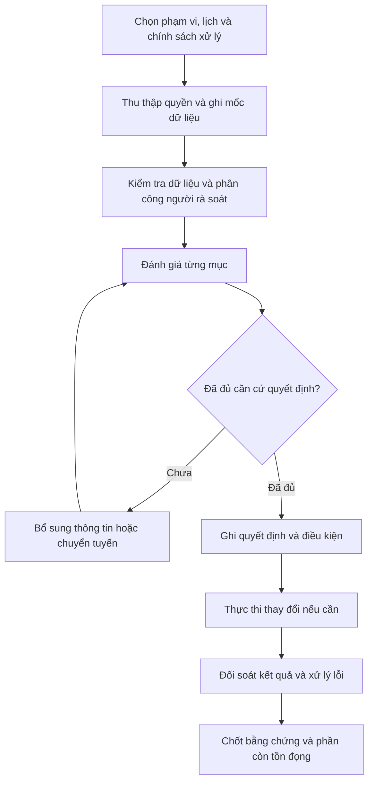

# Periodic recertification

## 1. Quyền đã được duyệt có thể không còn phù hợp

Một nhân viên được cấp quyền quản trị dự án khi dự án bắt đầu. Sáu tháng sau, dự án đã chuyển sang nhóm khác nhưng quyền vẫn còn. Việc phê duyệt ban đầu có thể hoàn toàn đúng; vấn đề là căn cứ để giữ quyền đã thay đổi mà hệ thống chưa xử lý.

**Periodic recertification** trong identity governance là quá trình tái xác nhận theo chu kỳ rằng những tài khoản, quyền hoặc quan hệ cấp quyền đang tồn tại vẫn có lý do hợp lệ và phù hợp với chính sách hiện hành. Quá trình này thường được tổ chức thành các đợt rà soát quyền, còn gọi là chiến dịch rà soát hoặc *access review campaign*.

Tái xác nhận quyền không phải xác minh lại giấy tờ nhận dạng, gia hạn chứng thư số hay làm mới token. Câu hỏi chính là: **chủ thể này có còn cần quyền này, với phạm vi và điều kiện hiện tại hay không?**

Kết quả có thể là giữ quyền, thu hồi quyền, điều chỉnh phạm vi hoặc chuyển sang một ngoại lệ được quản lý. Một đợt tái xác nhận có ý nghĩa phải theo dõi các quyết định đến việc thực thi; chỉ thu đủ chữ ký hoặc câu trả lời chưa chứng minh quyền đã được xử lý đúng.

## 2. Vai trò trong vòng đời IAM

Provisioning cấp tài khoản và quyền theo quyết định được cho phép. Deprovisioning thực hiện việc thu hồi khi điều kiện truy cập chấm dứt. Periodic recertification bổ sung một cơ chế phát hiện những quyền không còn phù hợp nhưng chưa được các luồng vòng đời khác xử lý.

Ví dụ, đợt rà soát có thể phát hiện quyền được cấp trực tiếp ngoài IAM, tài khoản dịch vụ không còn chủ sở hữu, membership của dự án đã kết thúc hoặc quyền đặc biệt được quên gắn ngày hết hạn.

| Hoạt động | Điều gì kích hoạt? | Câu hỏi hoặc kết quả chính |
|---|---|---|
| Phê duyệt cấp quyền ban đầu | Một nhu cầu truy cập mới | Có nên cấp quyền theo nhu cầu và chính sách hiện tại không? |
| Điều chỉnh theo sự kiện vòng đời | Chuyển nhóm, nghỉ việc, hết hợp đồng hoặc thay đổi tương tự | Quyền nào cần thay đổi ngay theo sự kiện? |
| Tái xác nhận định kỳ | Chu kỳ và phạm vi đã được tổ chức xác định | Những quyền còn tồn tại có tiếp tục được giữ không? |
| Đối soát kỹ thuật | So sánh trạng thái mong muốn với trạng thái đích | Quyết định đã được thực thi đúng chưa; có quyền nào nằm ngoài quy trình không? |
| Kiểm tra hành vi truy cập | Yêu cầu tới tài nguyên | Chủ thể có được phép thực hiện hành động này vào lúc này không? |

Các hoạt động này bổ trợ nhau. Không nên chờ tới kỳ rà soát tiếp theo mới xử lý một nhân viên đã nghỉ việc hoặc một quyền đã hết hạn. Ngược lại, luồng thu hồi theo sự kiện tốt cũng không loại bỏ nhu cầu tìm quyền cũ, tài khoản bị bỏ sót và những sai lệch chưa có sự kiện tương ứng.

## 3. Xác định đối tượng và phạm vi rà soát

### 3.1. Không chỉ rà soát danh sách tài khoản

Một tài khoản còn cần thiết không có nghĩa mọi quyền của tài khoản đều cần thiết. Một người dùng có thể phải tiếp tục sử dụng ứng dụng nhưng không còn cần quyền xuất toàn bộ dữ liệu.

Đối tượng rà soát có thể là:

- Tài khoản tại một ứng dụng hoặc một tenant.
- Membership của nhóm hoặc vai trò.
- Một entitlement, tức đơn vị quyền được quản lý tại đích.
- Quyền trên tài nguyên cụ thể, như quyền quản trị một dự án.
- Quyền đủ điều kiện để được kích hoạt khi cần, dù hiện không hoạt động.
- Danh tính dịch vụ hoặc workload, cùng chủ sở hữu và các quyền liên quan.

Phạm vi phải cho biết đang xem xét quyền được cấp, quyền có thể kích hoạt hay khả năng truy cập hiệu lực. Nếu công cụ chỉ thu thập được membership cấp trực tiếp, không nên báo rằng đã rà soát mọi quyền hiệu lực của người dùng.

### 3.2. Mô tả một mục rà soát đủ chính xác

Một mục rà soát nên xác định được ít nhất chủ thể, tài khoản đích, quyền, tài nguyên hoặc phạm vi và nguồn cấp quyền liên quan. Tenant phải được thể hiện khi có khả năng trùng định danh giữa các tenant.

Ví dụ:

```text
Chủ thể: nhân viên subject-1042
Tài khoản: tenant-A / reporting-app / account-803
Quyền: report.export
Phạm vi: project-example
Nguồn cấp: membership của nhóm reporting-project-example
Thời điểm quan sát: T0
```

Tên người dùng hoặc email hiển thị không nên là khóa duy nhất để thực hiện quyết định. Các giá trị này có thể đổi hoặc được cấp lại cho một người khác. Cần ánh xạ ổn định tới chủ thể và tài khoản đúng phạm vi.

### 3.3. Quyền kế thừa cần được giải thích

Một quyền có thể đến từ nhiều nhóm, vai trò hoặc cấp trực tiếp. Nếu người rà soát chọn bỏ một membership nhưng quyền vẫn tồn tại qua đường khác, mục tiêu thu hồi quyền hiệu lực có thể chưa đạt.

Do đó, giao diện và tác vụ khắc phục phải nói rõ quyết định áp dụng cho đường cấp nào. Nếu muốn bỏ khả năng truy cập hoàn toàn, cần đánh giá các đường cấp liên quan. Nếu chỉ muốn bỏ một nguồn cấp, không được tự ý xóa những quyền khác ngoài quyết định.

## 4. Chọn chu kỳ dựa trên rủi ro và khả năng vận hành

Không có một chu kỳ phù hợp cho mọi quyền. Tổ chức cần xác định tần suất theo mức nhạy cảm của tài nguyên, tác động của quyền, tốc độ thay đổi nhiệm vụ, khả năng thu hồi theo sự kiện và các yêu cầu đã được xác định cho phạm vi đó.

Một nhóm quyền quản trị môi trường quan trọng có thể được rà soát thường xuyên hơn quyền đọc tài liệu nội bộ thông thường. Các khoảng thời gian như hàng tháng, hàng quý hoặc hàng năm chỉ là lựa chọn minh họa; không nên coi một khoảng thời gian cụ thể là quy định chung cho mọi tổ chức.

Cần thiết kế cả ba mốc:

1. Chu kỳ bắt đầu đợt rà soát tiếp theo.
2. Hạn để người được giao đưa ra quyết định.
3. Hạn để thực thi và xác minh quyết định cần thay đổi quyền.

Một chương trình bắt đầu đúng lịch nhưng để tác vụ thu hồi tồn tại nhiều tuần vẫn có khoảng trống kiểm soát. Tương tự, mở chiến dịch quá thường xuyên nhưng mỗi người phải duyệt hàng nghìn mục thiếu ngữ cảnh có thể làm tăng việc giữ quyền một cách máy móc.

Chu kỳ định kỳ cũng không thay thế ngày hết hạn của quyền tạm thời. Quyền đã được duyệt tới một thời điểm xác định cần được xử lý khi hết hạn; không tự gia hạn chỉ vì kỳ rà soát chưa tới.

## 5. Cung cấp dữ liệu đủ để ra quyết định

Người rà soát cần hiểu ý nghĩa của quyền và hoàn cảnh hiện tại của chủ thể. Một tên nhóm kỹ thuật như `APP-RPT-EXT-02` không đủ để quyết định quyền đó có nên được giữ hay không.

| Nhóm thông tin | Ví dụ | Giá trị đối với quyết định |
|---|---|---|
| Danh tính và vòng đời | Trạng thái hoạt động, nhóm công việc, quản lý hiện tại | Xác định chủ thể và quan hệ công việc còn hợp lệ |
| Ý nghĩa của quyền | Hành động được phép, loại dữ liệu, phạm vi tài nguyên | Hiểu khả năng và tác động thực tế |
| Căn cứ cấp | Lý do nghiệp vụ, yêu cầu ban đầu, người duyệt, thời hạn | Đối chiếu căn cứ cũ với nhu cầu hiện tại |
| Nguồn cấp và quan hệ | Nhóm, vai trò, cấp trực tiếp, kế thừa | Biết tác động của việc giữ hoặc thu hồi |
| Tín hiệu sử dụng | Lần sử dụng quan sát được, nguồn nhật ký, khoảng thời gian bao phủ | Bổ sung bằng chứng về nhu cầu và hoạt động |
| Rủi ro và ngoại lệ | Quyền đặc quyền, xung đột nhiệm vụ, ngoại lệ sắp hết hạn | Nhận biết trường hợp cần xem xét kỹ hơn |
| Chất lượng dữ liệu | Thời điểm đồng bộ, thiếu nhật ký, ánh xạ chưa chắc chắn | Tránh quyết định dựa trên dữ liệu bị hiểu nhầm |

Không thấy sử dụng không đồng nghĩa chắc chắn không cần quyền. Quyền có thể phục vụ công việc theo mùa, quy trình cuối kỳ hoặc tình huống khẩn cấp. Ngược lại, có sử dụng cũng không chứng minh việc sử dụng là phù hợp.

Nếu không có dữ liệu sử dụng, phải thể hiện là chưa có bằng chứng quan sát thay vì gán thành “không dùng”. Khuyến nghị tự động hoặc điểm rủi ro có thể giúp ưu tiên, nhưng cần biết chúng dựa trên dữ liệu nào và có giới hạn gì.

## 6. Chọn đúng người rà soát

Quản lý trực tiếp thường hiểu nhiệm vụ của nhân viên. Chủ sở hữu ứng dụng hoặc dữ liệu hiểu ý nghĩa và độ nhạy cảm của quyền. Chủ sở hữu dịch vụ hiểu vì sao một workload cần quyền. Không phải một vai trò luôn đủ thông tin để quyết định mọi mục.

Có thể phân công một người hoặc nhiều cấp rà soát theo mức rủi ro và trách nhiệm đã quy định. Nếu có nhiều cấp, cần định nghĩa cách kết hợp kết quả và xử lý bất đồng; không mặc định một lượt giữ quyền luôn thắng một lượt thu hồi.

Những yêu cầu quan trọng gồm:

- Người rà soát có thẩm quyền với đúng tài nguyên và phạm vi.
- Việc tự xác nhận quyền của bản thân được kiểm soát theo chính sách phân tách nhiệm vụ.
- Người nghỉ việc, chuyển vai trò hoặc không còn thẩm quyền được thay thế đúng cách.
- Ủy quyền có phạm vi, thời hạn và lịch sử; không biến thành chuyển việc cho một tài khoản bất kỳ.
- Mục không có người chịu trách nhiệm được chuyển tuyến xử lý, không mặc định giữ quyền.

Chủ tài khoản có thể cung cấp lý do hoặc xác nhận thông tin. Tuy nhiên, lời tự xác nhận của người hưởng quyền không thay thế quyết định độc lập nếu chính sách yêu cầu một bên khác phê duyệt.

## 7. Quy trình từ khởi tạo tới đóng chiến dịch



### 7.1. Chuẩn bị và chốt mốc dữ liệu

Xác định hệ thống đích, loại quyền, đối tượng được bao phủ, các trường hợp loại trừ và thời điểm thu thập dữ liệu. Một snapshot tại mốc `T0` giúp biết chính xác người rà soát đã nhìn thấy gì.

Snapshot không làm quyền ngừng thay đổi trong hệ thống thật. Trong lúc chiến dịch diễn ra, người dùng có thể chuyển nhóm hoặc quyền có thể được thu hồi, cấp lại theo một yêu cầu mới. Vì vậy, cần lưu định danh và phiên bản hoặc dấu vết thay đổi đủ để phân biệt mục cũ với trạng thái hiện tại.

Thiếu connector, thiếu quyền đọc dữ liệu hoặc ánh xạ lỗi là vấn đề về độ bao phủ. Phải xử lý hoặc công bố phần chưa được rà soát, thay vì lặng lẽ bỏ các mục đó khỏi báo cáo rồi coi toàn bộ phạm vi đã hoàn tất.

### 7.2. Ghi quyết định có lý do

Các nhãn dưới đây minh họa một mô hình quyết định, không phải bộ trạng thái bắt buộc của mọi sản phẩm:

| Quyết định | Ý nghĩa | Hành động tiếp theo |
|---|---|---|
| Giữ quyền | Nhu cầu và điều kiện hiện tại vẫn phù hợp | Lưu căn cứ, điều kiện và mốc xem xét lại theo chính sách |
| Thu hồi | Không còn căn cứ để tiếp tục quyền được xem xét | Tạo tác vụ thu hồi đúng phạm vi và xác minh kết quả |
| Điều chỉnh | Chỉ một phần phạm vi hoặc thời hạn còn cần thiết | Xác định thay đổi cụ thể rồi thực thi theo quy trình được cho phép |
| Cần thêm thông tin | Chưa đủ căn cứ quyết định | Chuyển người xử lý hoặc yêu cầu bổ sung; chưa coi là tái xác nhận xong |
| Đề nghị ngoại lệ | Nhu cầu không phù hợp quy tắc thông thường nhưng cần xem xét riêng | Chuyển quy trình ngoại lệ; chưa tự trở thành quyền được chấp nhận |

Giữ quyền trong chiến dịch không tự tạo ra một quyền mới hoặc cho phép kéo dài quyền đã hết hạn. Nếu muốn mở rộng quyền hoặc gia hạn ngoài chính sách hiện tại, phải đi qua quy trình có thẩm quyền tương ứng.

### 7.3. Xử lý không phản hồi

Chính sách chiến dịch phải xác định nhắc việc, chuyển tuyến, thời hạn và cách xử lý khi vẫn không có quyết định. Im lặng không phải bằng chứng rằng quyền còn cần thiết.

Tùy loại quyền và mức rủi ro, chính sách có thể yêu cầu thu hồi, tạm đình chỉ hoặc chuyển tới một bên có thẩm quyền để xử lý. Nếu cho phép tiếp tục trong một thời hạn giới hạn, đó phải là quyết định rõ ràng có người chịu trách nhiệm và điều kiện kèm theo. Không nên tự áp dụng một quy tắc thu hồi hàng loạt ngoài phạm vi chính sách, đặc biệt với các danh tính phục vụ vận hành quan trọng.

Đối tượng đang chờ xử lý quá hạn phải tiếp tục được theo dõi. Không chuyển mục đó thành “đã duyệt” chỉ để đạt tỷ lệ hoàn thành.

## 8. Quyết định và thực thi là hai trạng thái khác nhau

Một người rà soát có thể quyết định thu hồi hôm nay, nhưng connector chỉ thực thi thành công vào ngày sau. Trong khoảng thời gian đó, quyền có thể vẫn còn hiệu lực.

Nên tách tối thiểu trạng thái quyết định khỏi trạng thái khắc phục. Ví dụ minh họa:

```yaml
campaignId: review-example
itemId: review-item-42
subjectId: subject-1042
targetAccountId: reporting-account-803
entitlement: report.export
scope: project-example
grantReference: grant-219
decision:
  outcome: REVOKE
  reason: Nhiệm vụ xuất báo cáo đã kết thúc
  reviewerId: reviewer-17
remediation:
  state: PENDING
  targetConfirmed: false
```

Bản ghi này chưa thể hiện thu hồi đã hoàn tất. Trong triển khai thực tế, cần bổ sung các mốc thời gian, định danh tenant, phiên bản liên quan và bằng chứng kết quả phù hợp. Đây là ví dụ diễn giải, không phải schema chuẩn của giao thức.

Trước khi áp dụng một quyết định trên snapshot cũ, cần đối chiếu trạng thái hiện tại. Nếu quyền cũ đã bị bỏ rồi một quyền mới được cấp theo căn cứ khác, không được mù quáng dùng quyết định cũ để thu hồi quyền mới. Cũng không được tự giữ quyền mới chỉ vì quyền cũ từng được tái xác nhận.

Khi thực thi lỗi, cần phân biệt lỗi tạm thời, ánh xạ sai, thiếu quyền của connector và thay đổi tại đích. Tác vụ cần retry hoặc chuyển xử lý có chủ sở hữu, thời hạn và bằng chứng. Việc tạo ticket hoặc nhận mã phản hồi thành công ban đầu chưa luôn chứng minh thay đổi đã có hiệu lực.

Đối soát phải kiểm tra đúng mục tiêu: bỏ một nguồn cấp hay chấm dứt hoàn toàn khả năng truy cập. Nếu mục tiêu là chặn khả năng truy cập, cần xem xét các đường cấp khác và ảnh hưởng của phiên, token hoặc bộ nhớ đệm theo thiết kế của hệ thống. Không đồng nhất việc xóa membership với việc mọi yêu cầu cũ lập tức bị từ chối.

## 9. Ví dụ một đợt tái xác nhận quyền

Một ứng dụng báo cáo chốt 120 mục quyền trong phạm vi chiến dịch. Người rà soát có mô tả quyền, lý do cấp, nguồn cấp và nhiệm vụ hiện tại của từng chủ thể.

Sau vòng đánh giá đầu tiên:

- 100 mục được quyết định giữ lại với căn cứ phù hợp.
- 12 mục được quyết định thu hồi.
- 8 mục thiếu thông tin và cần chủ sở hữu ứng dụng làm rõ.

Ở thời điểm này, không thể báo rằng cả 120 mục đã được tái xác nhận. Có 8 mục chưa có quyết định cuối cùng. Đồng thời, 12 mục đã quyết định thu hồi cần được theo dõi riêng tới kết quả thực thi.

Giả sử hệ thống xác minh được 10 lượt thu hồi thành công, còn 2 lượt lỗi connector. Báo cáo cần thể hiện 2 mục khắc phục đang mở, dù người rà soát đã hoàn tất quyết định đối với chúng.

Một trong 8 mục thiếu thông tin thuộc tài khoản dịch vụ không còn người sở hữu rõ ràng. Nhóm vận hành cần xác định ứng dụng phụ thuộc, người chịu trách nhiệm và nhu cầu trước khi đưa ra quyết định theo chính sách. Không thể coi tài khoản này là hợp lệ chỉ vì “có vẻ vẫn chạy”, cũng không nên tùy ý xóa khi chưa xác định tác động và thẩm quyền xử lý.

Nếu một nhân viên trong nhóm 100 mục đã được giữ quyền nghỉ việc giữa chiến dịch, sự kiện nghỉ việc phải được xử lý theo vòng đời truy cập. Quyết định giữ quyền trước đó không phải lý do trì hoãn thu hồi tới kỳ tiếp theo.

Chiến dịch chỉ được đóng theo điều kiện đã quy định. Nếu quy trình cho phép chuyển một phần khắc phục sang hồ sơ theo dõi riêng, phải ghi rõ các mục, người sở hữu và rủi ro còn lại; không gắn nhãn đã khắc phục cho những việc chưa hoàn tất.

## 10. Chống việc duyệt giữ quyền một cách máy móc

Khi người rà soát nhận quá nhiều mục không có mô tả, họ dễ chọn giữ tất cả chỉ để kết thúc công việc. Đây là vấn đề về thiết kế kiểm soát, không chỉ là thái độ của người duyệt.

Có thể cải thiện bằng cách chia phạm vi theo ứng dụng hoặc trách nhiệm, trình bày quyền bằng ngôn ngữ nghiệp vụ, ưu tiên quyền có tác động cao và hiển thị rõ thay đổi so với kỳ trước. Các thao tác hàng loạt cần giữ được khả năng hiểu phạm vi và truy vết quyết định cho từng mục.

Tự động đề xuất giữ quyền cần căn cứ và giới hạn. Nếu dùng tự động ra quyết định cho một số quyền theo chính sách, phải ghi nhận đó là quyết định của cơ chế nào, phiên bản chính sách và dữ liệu nào, thay vì thể hiện như một người đã trực tiếp rà soát.

Một dấu hiệu cần xem xét là tỷ lệ giữ quyền gần như tuyệt đối đi kèm thời gian đánh giá rất ngắn và dữ liệu thiếu ngữ cảnh. Tuy nhiên, chỉ số này không tự chứng minh có sai phạm; cần kiểm tra thực tế phạm vi và chất lượng quyết định.

## 11. Bằng chứng và đo lường hiệu quả

Bằng chứng của một chiến dịch nên cho phép tái hiện phạm vi đã chọn, dữ liệu mà người rà soát nhìn thấy, người có thẩm quyền quyết định, lý do, thay đổi sau quyết định và kết quả thực thi.

Cần bảo vệ lịch sử quyết định và bằng chứng khỏi sửa đổi không được phép, kiểm soát quyền truy cập dữ liệu nhạy cảm và lưu giữ theo chính sách đã xác định. Không cần sao chép mật khẩu, token hoặc bí mật credential vào hồ sơ rà soát.

Những chỉ số hữu ích gồm:

| Chỉ số | Điều cần định nghĩa rõ |
|---|---|
| Độ bao phủ | Tổng thể nào cần rà soát; hệ thống, tài khoản hoặc loại quyền nào chưa thu thập được |
| Tỷ lệ quyết định hoàn tất | Những mục nào có quyết định cuối cùng; không gộp mục cần thêm thông tin thành đã duyệt |
| Tỷ lệ thay đổi đã xác minh | Những quyết định nào cần thay đổi và bao nhiêu đã có bằng chứng thực thi |
| Độ trễ thu hồi | Tính từ mốc quyết định hoặc hiệu lực nào tới mốc xác nhận nào |
| Mục quá hạn và ngoại lệ | Tuổi tồn đọng, mức rủi ro, người sở hữu và hạn xử lý |
| Chất lượng ánh xạ và người sở hữu | Bao nhiêu tài khoản hoặc quyền chưa có định danh, mô tả hay bên chịu trách nhiệm phù hợp |

Không nên đặt mục tiêu buộc phải thu hồi một tỷ lệ cố định trong mỗi kỳ. Mục tiêu là quyền phù hợp với nhu cầu, không phải tạo số lượt thu hồi cho đẹp báo cáo. Một tỷ lệ hoàn thành cao cũng không có nhiều ý nghĩa nếu phần quyền khó quan sát đã bị bỏ khỏi mẫu số mà không công bố.

## 12. Những điều cần ghi nhớ

Periodic recertification kiểm tra lại căn cứ để duy trì quyền theo chu kỳ. Một lần phê duyệt trong quá khứ không bảo đảm quyền tiếp tục phù hợp khi nhiệm vụ, chủ sở hữu, tài nguyên hoặc chính sách thay đổi.

Quá trình có hiệu quả cần phạm vi rõ ràng, dữ liệu đủ mới, người rà soát có thẩm quyền và khả năng theo dõi quyết định tới thực thi. Giữ quyền, quyết định thu hồi và xác nhận đã thu hồi là những kết quả khác nhau. Tái xác nhận định kỳ phải phối hợp với thu hồi theo sự kiện và đối soát kỹ thuật để kiểm soát cả quyền cũ lẫn những thay đổi diễn ra giữa hai kỳ.
