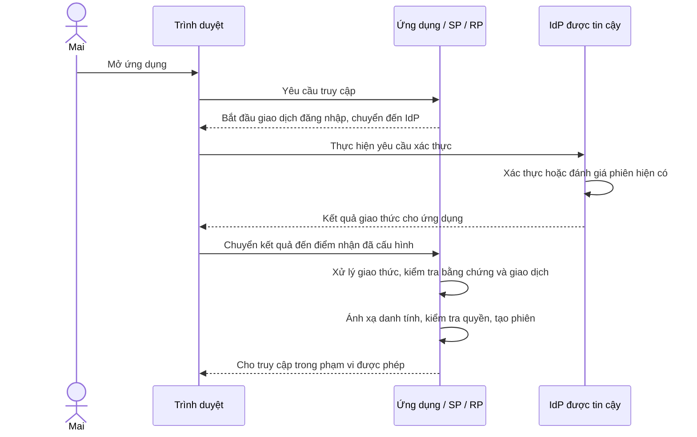

# Identity federation là gì?

## 1. Khái niệm và vấn đề cần giải quyết

**Identity federation — liên kết danh tính** là mô hình trong đó một hệ thống chấp nhận thông tin danh tính hoặc kết quả xác thực do một bên khác phát hành, dựa trên một quan hệ tin cậy được thiết lập và những quy tắc kiểm tra cụ thể.

Thay vì mỗi ứng dụng tự thu thập và kiểm tra mật khẩu của người dùng, ứng dụng có thể chuyển phần xác thực sang một nhà cung cấp danh tính được tin cậy. Sau đó, ứng dụng kiểm tra bằng chứng nhận được, nhận diện người dùng và áp dụng chính sách truy cập của mình.

Ví dụ, công ty An Phú dùng một nhà cung cấp danh tính doanh nghiệp để nhân viên đăng nhập. Công ty thuê thêm một dịch vụ quản lý công việc. Dịch vụ này được cấu hình để chấp nhận người dùng từ nhà cung cấp danh tính của An Phú.

Khi Mai mở dịch vụ quản lý công việc:

- Dịch vụ không cần yêu cầu Mai cung cấp mật khẩu doanh nghiệp cho chính nó.
- Mai thực hiện xác thực tại nhà cung cấp danh tính, hoặc sử dụng phiên đã có tại đó nếu chính sách cho phép.
- Dịch vụ nhận kết quả theo giao thức đã tích hợp và kiểm tra kết quả đó.
- Dịch vụ ánh xạ Mai vào tài khoản phù hợp và quyết định Mai được làm gì.

Điểm cốt lõi không phải là “đăng nhập bằng một nút duy nhất”, mà là **một bên dựa vào phát biểu có thể kiểm chứng của bên khác về danh tính trong một phạm vi tin cậy đã xác định**.

Federation có thể diễn ra giữa hai tổ chức, chẳng hạn đối tác truy cập cổng cộng tác, hoặc giữa các hệ thống có ranh giới quản trị riêng trong cùng một tổ chức. Không bắt buộc phải có hai công ty khác nhau mới có federation.

## 2. Các thành phần trong mô hình

| Thành phần | Vai trò |
| --- | --- |
| Subject — chủ thể | Người dùng hoặc danh tính đang được nhận diện |
| Identity Provider — IdP | Quản lý việc xác thực và phát hành thông tin danh tính theo giao thức |
| Service Provider — SP hoặc Relying Party — RP | Ứng dụng dựa vào thông tin do bên phát hành cung cấp |
| User agent | Thường là trình duyệt hỗ trợ các bước chuyển hướng trong luồng đăng nhập người dùng |
| Assertion/token hoặc kết quả giao thức | Thông điệp dùng để truyền bằng chứng và thông tin theo quy tắc của giao thức |
| Trust configuration — cấu hình tin cậy | Xác định bên nào được chấp nhận, khóa nào dùng để kiểm tra, đích nhận và các điều kiện liên quan |
| Chính sách ứng dụng | Quy tắc ánh xạ danh tính, tạo phiên và cho phép truy cập tài nguyên |

Tên gọi SP thường gặp trong SAML; RP thường gặp trong OpenID Connect. Đây là các vai trò tương ứng trong những ngữ cảnh khác nhau, không có nghĩa cấu trúc thông điệp hay cách kiểm tra của hai giao thức giống nhau.

Một sản phẩm có thể đóng nhiều vai trò. Chẳng hạn, một identity broker có thể nhận danh tính từ IdP phía trước rồi phát hành kết quả cho ứng dụng phía sau. Khi đó cần hiểu từng quan hệ tin cậy riêng, không chỉ nhìn tên sản phẩm.

### 2.1. IdP xác thực không có nghĩa IdP quyết định mọi quyền

IdP có thể thông báo rằng một chủ thể đã được xác thực và cung cấp các thuộc tính đã thống nhất. Ứng dụng vẫn phải đánh giá:

- Có chấp nhận bên phát hành này cho ứng dụng hoặc tenant này không?
- Chủ thể có được liên kết với một tài khoản hợp lệ không?
- Tài khoản đó có được dùng ứng dụng không?
- Chủ thể được thao tác trên tài nguyên nào với quyền gì?

Một kết quả xác thực hợp lệ không tự tạo quyền quản trị hoặc quyền đọc mọi dữ liệu.

### 2.2. Xác thực khác xác minh danh tính ngoài đời thực

Nếu IdP xác thực một tài khoản thành công, điều đó chứng minh kết quả trong phạm vi cơ chế xác thực và chính sách của IdP. Nó không tự chứng minh mọi thông tin hồ sơ là sự thật đã được kiểm tra ngoài đời thực.

Ứng dụng cần hiểu nguồn gốc và mức bảo đảm của các thuộc tính. Một tên hiển thị do người dùng tự sửa không có cùng ý nghĩa với một thuộc tính do tổ chức kiểm soát.

## 3. Quan hệ tin cậy được thiết lập như thế nào?

Federation cần một thỏa thuận kỹ thuật và quản trị: bên nhận chấp nhận phát biểu nào từ bên phát hành nào, trong điều kiện nào.

Có thể hình dung quan hệ đó gồm bốn lớp:

| Lớp | Câu hỏi cần trả lời |
| --- | --- |
| Định danh bên phát hành | Ai được phép phát hành thông tin mà ứng dụng này chấp nhận? |
| Xác thực thông điệp | Dùng khóa, thuật toán và cơ chế giao thức nào để kiểm tra? |
| Phạm vi sử dụng | Thông điệp dành cho ứng dụng nào, còn hiệu lực khi nào, gắn với giao dịch nào? |
| Ý nghĩa và chính sách | Thuộc tính được hiểu ra sao, ánh xạ tài khoản nào và cho phép quyền gì? |

Khóa công khai giúp ứng dụng kiểm tra chữ ký của bên phát hành tương ứng. Nhưng một thông điệp có chữ ký hợp lệ từ một bên bất kỳ không tự trở thành thông điệp đáng tin cho ứng dụng.

Ứng dụng cần bắt đầu từ cấu hình tin cậy đã được phê duyệt. Không nên lấy một địa chỉ issuer hoặc địa chỉ khóa do thông điệp chưa được kiểm tra cung cấp rồi tự coi bên đó là đáng tin.

Các dữ liệu cấu hình thường liên quan đến:

- ID của bên phát hành và ID của ứng dụng.
- Endpoint giao thức và địa chỉ nhận phản hồi đã đăng ký.
- Khóa kiểm tra chữ ký hoặc metadata chứa thông tin khóa theo cơ chế được quản lý.
- Các bên nhận hợp lệ và điều kiện thời gian.
- Quy tắc định danh chủ thể và các claim được phép sử dụng.
- Điều kiện về ngữ cảnh xác thực khi ứng dụng có yêu cầu cụ thể.

Định dạng và trường cụ thể phụ thuộc giao thức. Một bài giới thiệu federation không thay thế quy tắc triển khai và kiểm tra đầy đủ của SAML hoặc OIDC.

### 3.1. Tin cậy có phạm vi và không tự bắc cầu

Nếu ứng dụng A tin IdP của công ty B, điều đó không có nghĩa A phải tin mọi IdP mà B từng tích hợp, hoặc mọi thuộc tính do người dùng của B tự khai báo.

Tương tự, một kết quả được phát hành cho ứng dụng A không nên được ứng dụng C chấp nhận chỉ vì cùng biết khóa của IdP. Đúng bên phát hành là một điều kiện; đúng bên nhận và mục đích sử dụng là các điều kiện khác.

Trong hệ thống nhiều tenant, việc chấp nhận đúng IdP còn phải gắn với đúng tenant. Một tài khoản từ một tổ chức được tích hợp không tự có quyền đi vào dữ liệu của tổ chức khác trên cùng nền tảng.

## 4. Một luồng đăng nhập liên kết danh tính

Sơ đồ dưới đây mô tả luồng ở mức khái niệm. “Kết quả giao thức” có thể là assertion hoặc một phản hồi cần được xử lý tiếp; không phải giao thức nào cũng gửi trực tiếp cùng một loại token qua trình duyệt.



Có thể tách quá trình thành các bước:

1. **Ứng dụng nhận yêu cầu truy cập.** Nếu chưa có phiên ứng dụng phù hợp, ứng dụng bắt đầu một giao dịch đăng nhập.
2. **Ứng dụng chọn IdP được phép.** Lựa chọn có thể dựa trên tenant, cấu hình doanh nghiệp hoặc bước chọn tổ chức. Địa chỉ email người dùng nhập có thể hỗ trợ tìm IdP nhưng không tự tạo quan hệ tin cậy.
3. **IdP đánh giá yêu cầu xác thực.** IdP có thể yêu cầu mật khẩu, MFA hoặc cơ chế khác; cũng có thể sử dụng phiên hiện có nếu điều kiện của giao thức và chính sách được đáp ứng.
4. **IdP phát hành kết quả cho ứng dụng.** Kết quả phải được xử lý đúng giao thức và đúng ngữ cảnh giao dịch.
5. **Ứng dụng kiểm tra kết quả.** Trong một số luồng, ứng dụng còn phải trao đổi mã qua kênh máy chủ trước khi có thông tin danh tính để kiểm tra.
6. **Ứng dụng tìm hoặc tạo liên kết tài khoản.** Việc này phải tuân theo quy tắc định danh và chính sách tạo tài khoản.
7. **Ứng dụng áp dụng phân quyền.** Xác thực thành công có thể vẫn dẫn đến từ chối truy cập nếu người dùng chưa được cấp quyền.
8. **Ứng dụng quản lý phiên riêng.** Thời hạn và cách kết thúc phiên cần được xác định, không mặc định giống phiên IdP.

Người dùng không nhất thiết nhập lại mật khẩu ở bước 3 mỗi lần. Tuy nhiên, việc tránh nhập lại mật khẩu phải do phiên và chính sách hợp lệ, không phải do ứng dụng bỏ qua kiểm tra bằng chứng.

## 5. Assertion, token và claim có ý nghĩa gì?

**Claim** là một phát biểu về chủ thể hoặc ngữ cảnh liên quan. Chẳng hạn, bên phát hành có thể cung cấp định danh chủ thể, thời điểm xác thực hoặc thuộc tính tổ chức theo thỏa thuận.

**Assertion** và **token** là những cách đóng gói thông tin trong các giao thức cụ thể. Không nên dùng hai từ này để suy ra rằng mọi thông điệp có cùng cấu trúc, cùng mục đích hoặc có thể thay thế cho nhau.

Những khái niệm thường cần hiểu gồm:

| Khái niệm | Ý nghĩa ở mức tổng quát |
| --- | --- |
| Issuer | Bên phát hành thông tin |
| Subject | Chủ thể mà thông tin nói đến |
| Audience | Bên nhận hoặc đối tượng sử dụng dự kiến |
| Thời gian hiệu lực | Khoảng thời gian hoặc điều kiện thời gian được phép chấp nhận |
| Ngữ cảnh xác thực | Thông tin về sự kiện hoặc cách xác thực, khi giao thức cung cấp |
| Liên kết giao dịch | Dữ liệu hỗ trợ gắn kết quả với giao dịch đăng nhập tương ứng |
| Chữ ký | Hỗ trợ kiểm tra nguồn phát hành và tính toàn vẹn theo cơ chế sử dụng |

Tên field và cách diễn giải phải theo giao thức. Ví dụ, không được lấy tên field của OIDC rồi mặc định nó tồn tại và có cùng quy tắc trong một SAML assertion.

### 5.1. Ký không đồng nghĩa với mã hóa

Thông điệp có chữ ký thường vẫn có thể được đọc bởi bên nhìn thấy nội dung. Chữ ký không tự che giấu dữ liệu.

Mã hóa nhằm bảo vệ tính bí mật trong phạm vi cơ chế mã hóa được dùng. TLS bảo vệ dữ liệu trên kết nối nhưng không làm mọi token được lưu ở trình duyệt hoặc log tự trở thành bí mật an toàn.

Do đó, cần giảm thiểu thuộc tính được phát hành và tránh ghi nguyên assertion, token hoặc mã dùng trong giao dịch vào nhật ký thông thường. Một token còn hiệu lực có thể mang giá trị truy cập; log không nên trở thành nơi phát tán nó.

### 5.2. Giải mã nội dung không đồng nghĩa đã xác minh

Đọc được các field của token hoặc parse được XML không chứng minh nội dung có thể tin cậy. Kiểm tra cần diễn ra trước khi dùng nội dung để nhận diện hoặc cấp quyền.

Ở mức khái niệm, ứng dụng cần kiểm tra đúng bên phát hành, đúng cơ chế bảo vệ, đúng bên nhận, điều kiện thời gian và các ràng buộc giao dịch theo luồng sử dụng. Các bước chống phát lại hoặc nhầm giao dịch cũng phải theo đúng giao thức, thay vì chỉ kiểm tra chữ ký.

## 6. Nhận diện cùng một người qua ranh giới hệ thống

Một IdP nói về chủ thể trong không gian định danh của mình; ứng dụng cần ánh xạ chủ thể đó vào tài khoản nội bộ.

Đối với OIDC, cặp `issuer + subject` là cơ sở quan trọng để nhận diện chủ thể trong ngữ cảnh bên phát hành. Không nên dùng riêng một giá trị subject rồi bỏ qua issuer.

Trong SAML, ý nghĩa định danh phụ thuộc vào loại định danh và thỏa thuận giữa các bên. Một định danh tạm thời không nên bị sử dụng như một khóa tài khoản bền vững mà không có thiết kế phù hợp.

Ví dụ minh họa:

```text
Bên phát hành: IdP của An Phú
Định danh chủ thể tại IdP: user-7391
                    |
                    v
Liên kết tài khoản được quản lý
                    |
                    v
ID người dùng tại ứng dụng: app-user-208
```

Ứng dụng không cần dùng cùng một ID nội bộ với IdP. Điều cần giữ là liên kết đúng và ổn định theo thiết kế, kể cả khi tên hiển thị hoặc email thay đổi.

### 6.1. Vì sao không tự liên kết chỉ bằng email?

Email có thể được đổi, cấp lại hoặc xuất hiện trong nhiều nguồn danh tính. Mức kiểm soát email và ý nghĩa của thuộc tính “đã xác minh” cũng phụ thuộc bên phát hành và chính sách.

Giả sử Mai đã có tài khoản đặc quyền trong ứng dụng bằng email doanh nghiệp. Một nguồn danh tính khác gửi cùng chuỗi email không có nghĩa người đăng nhập từ nguồn đó được phép nhận tài khoản đặc quyền của Mai.

Liên kết tài khoản cần một quy trình bảo đảm cả danh tính được liên kết và thẩm quyền của bên thực hiện. Không biến sự trùng khớp một thuộc tính thành chứng minh quyền sở hữu tài khoản.

### 6.2. Thuộc tính dùng cho phân quyền phải có nguồn được quản lý

Ứng dụng có thể ánh xạ một claim nhóm hoặc phòng ban vào quyền nội bộ, nhưng cần xác định:

- Bên nào có quyền phát biểu thuộc tính đó.
- Thuộc tính được quản lý hay người dùng tự sửa.
- Giá trị nào được chấp nhận cho tenant và ứng dụng.
- Quyền nội bộ nào tương ứng, với phạm vi nào.
- Khi thuộc tính thay đổi thì quyền và phiên đang có được cập nhật ra sao.

Tin một IdP để xác thực người dùng không tự đồng nghĩa cho phép IdP đó cấp mọi role nội bộ. Một claim có nội dung “admin” chỉ có giá trị phân quyền nếu có quy tắc tin cậy và ánh xạ tương ứng.

## 7. Federation, SSO và đồng bộ tài khoản khác nhau thế nào?

Những khái niệm này thường cùng xuất hiện nhưng giải quyết các vấn đề khác nhau.

| Khái niệm | Mục tiêu chính | Điều không tự bảo đảm |
| --- | --- | --- |
| Federation | Cho một hệ thống dựa vào thông tin danh tính từ bên được tin cậy | Không tự cấp tài khoản, phân quyền hoặc thu hồi mọi phiên |
| Single Sign-On — SSO | Giảm việc người dùng phải xác thực lặp lại khi dùng nhiều ứng dụng | Không nhất thiết có nhiều tổ chức hay một mô hình federation cụ thể |
| Provisioning | Tạo, cập nhật tài khoản và quyền theo nguồn quản lý | Không phải bằng chứng người dùng vừa được xác thực |
| Password synchronization | Đồng bộ hoặc duy trì mật khẩu giữa các hệ thống | Không biến đăng nhập cục bộ thành liên kết danh tính |
| Authorization | Quyết định hành động nào được phép trên tài nguyên nào | Không thay thế việc kiểm tra danh tính |

Federation thường là nền tảng để triển khai SSO: sau khi có phiên IdP, người dùng có thể đăng nhập vào ứng dụng thứ hai mà không phải lặp lại toàn bộ thao tác xác thực. Tuy nhiên, ứng dụng thứ hai vẫn phải thực hiện giao thức và kiểm tra kết quả dành cho mình.

Cũng có những giải pháp SSO trong một miền quản trị không cần cùng mô hình federation như một SaaS bên ngoài. Vì vậy, “có SSO” và “có federation” không phải hai câu đồng nghĩa trong mọi kiến trúc.

Việc dùng cùng một mật khẩu trên nhiều ứng dụng không đủ chứng minh có federation. Nếu từng ứng dụng vẫn trực tiếp nhận và kiểm tra mật khẩu, ranh giới xử lý credential khác với việc dựa vào IdP.

### 7.1. Federation không yêu cầu loại bỏ mọi tài khoản ứng dụng

Ứng dụng thường vẫn cần một tài khoản nội bộ để gắn dữ liệu, quyền, tùy chọn và nhật ký hoạt động. Federation thay đổi cách chứng minh danh tính khi đăng nhập; nó không khiến đối tượng người dùng trong ứng dụng biến mất.

Ứng dụng cũng có thể còn cơ chế đăng nhập cục bộ phục vụ một số trường hợp. Những đường đó cần được quản lý riêng để không tạo ra cách đi vòng qua kiểm soát doanh nghiệp.

## 8. Vị trí của SAML, OIDC, OAuth và SCIM

Một bức tranh nền tảng có thể mô tả như sau:

| Công nghệ/giao thức | Liên hệ với bài toán |
| --- | --- |
| SAML | Có thể dùng assertion để truyền thông tin xác thực và thuộc tính giữa IdP và SP trong các luồng liên kết danh tính |
| OpenID Connect — OIDC | Cung cấp lớp danh tính trên OAuth 2.0, giúp RP nhận thông tin về việc xác thực người dùng |
| OAuth 2.0 | Khung ủy quyền cho việc truy cập tài nguyên; không tự là một giao thức xác thực người dùng hoàn chỉnh |
| SCIM | Hỗ trợ quản lý tài nguyên danh tính như tài khoản và nhóm; thuộc bài toán provisioning |

Trong một luồng OIDC dùng authorization code, phản hồi về ứng dụng có thể chứa code. Ứng dụng xử lý code theo giao thức qua endpoint phù hợp để nhận kết quả cần thiết. Code không phải là một ID Token có thể đọc trực tiếp để nhận diện người dùng.

**ID Token** phục vụ RP trong ngữ cảnh xác thực OIDC. **Access token** phục vụ việc truy cập resource server theo phạm vi và cơ chế của nó. Không nên gửi ID Token như một access token đến một API chỉ vì cả hai đều có thể xuất hiện trong cùng một giao dịch.

Ngược lại, một access token tồn tại không tự cho ứng dụng biết mọi thông tin cần để kết luận ai vừa đăng nhập, bằng cách nào và trong giao dịch nào. Các vai trò và loại token phải được dùng đúng mục đích.

Một triển khai có thể đồng thời dùng OIDC hoặc SAML cho đăng nhập, SCIM cho cấp phát tài khoản và cơ chế phân quyền riêng trong ứng dụng. Không cần ép một giao thức giải quyết toàn bộ vòng đời IAM.

## 9. Provisioning và vòng đời quyền trong môi trường federation

### 9.1. Tài khoản tạo trước và tài khoản tạo khi đăng nhập

Có hai mô hình thường gặp:

- **Tạo trước:** tài khoản và các thuộc tính cần thiết được provision vào ứng dụng trước khi người dùng đăng nhập.
- **Just-in-time account creation:** ứng dụng tạo tài khoản tại lần đăng nhập liên kết đầu tiên nếu chính sách cho phép.

Tạo tài khoản khi đăng nhập không đồng nghĩa được phép nhận mọi người từ mọi IdP. Ứng dụng vẫn cần điều kiện về tenant, nhóm đối tượng, thuộc tính được tin cậy và quyền mặc định phù hợp.

Nếu ứng dụng tạo sẵn tài khoản quản trị rộng cho bất kỳ người đăng nhập thành công nào, federation vẫn có thể hoạt động đúng về xác thực nhưng chính sách cấp quyền lại sai.

Từ “JIT” ở đây chỉ việc tạo tài khoản vào thời điểm đăng nhập. Nó không tự có nghĩa quyền đặc biệt được kích hoạt ngắn hạn theo mô hình quản lý đặc quyền.

### 9.2. Khi người dùng đổi vai trò hoặc nghỉ việc

Nếu Mai chuyển bộ phận, ứng dụng có thể vẫn giữ role cũ nếu chỉ nhận cập nhật thuộc tính trong lần đăng nhập tiếp theo. Khi đó cần xem cơ chế đồng bộ, nguồn quyền và thời điểm ứng dụng đánh giá lại phân quyền.

Nếu Mai nghỉ việc và tài khoản IdP bị disable:

- Khả năng xác thực mới qua IdP có thể bị chặn theo cơ chế và chính sách của IdP.
- Tài khoản ứng dụng có thể vẫn tồn tại.
- Phiên ứng dụng đã mở có thể vẫn được chấp nhận.
- Token hoặc credential phát hành trước đó có thể có vòng đời riêng.
- Đường đăng nhập cục bộ, nếu còn, cần được xử lý độc lập.

Vì vậy, federation cần đi cùng deprovisioning, quản lý phiên và thu hồi quyền. Khóa tại một nơi không tự chứng minh rằng mọi hình thức truy cập ở các hệ thống đích đều đã kết thúc.

### 9.3. Phiên IdP và phiên ứng dụng là các trạng thái khác nhau

Một người có thể đăng xuất khỏi ứng dụng A nhưng vẫn còn phiên IdP. Khi mở lại A, IdP có thể xác thực dựa trên phiên còn hợp lệ, khiến người dùng thấy đăng nhập lại mà không nhập mật khẩu.

Tương tự, đăng xuất khỏi IdP không mặc nhiên chấm dứt cookie phiên của mọi ứng dụng. Khả năng đăng xuất phối hợp phụ thuộc vào giao thức, sản phẩm và cấu hình thực tế.

Phải xác định mục tiêu cụ thể: kết thúc phiên hiện tại của một ứng dụng, kết thúc phiên IdP, ngăn đăng nhập mới hay thu hồi mọi quyền liên quan. Những mục tiêu này có thể cần các hành động khác nhau.

## 10. Ví dụ phân chia trách nhiệm trong một tích hợp doanh nghiệp

An Phú tích hợp nền tảng quản lý công việc bên ngoài. Hai bên thống nhất:

| Hạng mục | Quyết định minh họa |
| --- | --- |
| Bên phát hành được phép | IdP doanh nghiệp đã được đăng ký cho tenant An Phú |
| Nhận diện người dùng | Dùng định danh chủ thể theo giao thức và mapping nội bộ được quản lý |
| Thuộc tính nhận | Chỉ các thuộc tính cần cho đăng nhập và vận hành đã được xác định |
| Điều kiện vào ứng dụng | Người dùng thuộc nhóm đối tượng được phép và có tài khoản hợp lệ |
| Phân quyền | Ánh xạ có giới hạn vào role ứng dụng; không mặc định nhận quyền quản trị từ mọi claim |
| Quản lý tài khoản | Provision trước hoặc tạo khi đăng nhập theo chính sách đã lựa chọn |
| Nghỉ việc | Khóa nguồn xác thực, xử lý tài khoản đích, quyền và phiên theo quy trình |
| Vận hành | Theo dõi lỗi, quản lý khóa, thay đổi cấu hình và đầu mối xử lý sự cố |

Khi Mai đăng nhập, ứng dụng trước hết xử lý và kiểm tra kết quả giao thức theo cấu hình tin cậy. Sau đó, mapping tìm được tài khoản `app-user-208`.

Nếu tài khoản chưa được cấp quyền vào không gian dự án X, ứng dụng từ chối truy cập X dù xác thực đã thành công. Đây là kết quả phân quyền bình thường, không phải bằng chứng federation đã hỏng.

Nếu cùng lúc có một người từ tenant đối tác đăng nhập hợp lệ bằng IdP khác, ứng dụng phải giữ đúng ranh giới tenant. Sự tồn tại của hai liên kết hợp lệ không cho phép trộn tài khoản hoặc dữ liệu giữa hai tổ chức.

### 10.1. Ví dụ dữ liệu khái niệm

```text
Kết quả xác thực đã được kiểm tra:
    issuer          = IdP An Phú được cấu hình
    subject         = user-7391
    bên nhận        = ứng dụng quản lý công việc
    giao dịch       = giao dịch đăng nhập đang chờ hợp lệ

Mapping nội bộ:
    IdP An Phú + user-7391 -> app-user-208

Quyền ứng dụng:
    app-user-208 -> thành viên dự án A, quyền xem và cập nhật nhiệm vụ
    app-user-208 -> không có quyền quản trị tenant
```

Đây là cách biểu diễn để hiểu mô hình, không phải một token hợp lệ, không phải schema giao thức và không thay thế thư viện xác minh.

## 11. Lợi ích, giới hạn và trách nhiệm vận hành

### 11.1. Lợi ích

Federation có thể giảm số nơi trực tiếp xử lý credential của người dùng. Chính sách xác thực doanh nghiệp có thể được áp dụng tại IdP, trong khi ứng dụng bên ngoài sử dụng kết quả phù hợp thay vì thu thập mật khẩu doanh nghiệp.

Việc tích hợp cũng có thể hỗ trợ trải nghiệm SSO và cộng tác với đối tác mà không buộc mỗi ứng dụng duy trì một bộ mật khẩu riêng cho cùng người dùng.

Tuy nhiên, lợi ích về MFA hoặc mức bảo đảm chỉ có ý nghĩa khi chính sách và ngữ cảnh xác thực thực sự đáp ứng yêu cầu của ứng dụng. Không thể suy ra “có MFA” chỉ từ việc đang dùng federation.

### 11.2. Phụ thuộc và phạm vi ảnh hưởng

IdP có thể trở thành thành phần quan trọng đối với nhiều ứng dụng. Nếu IdP bị gián đoạn, các đăng nhập mới có thể thất bại; phiên ứng dụng đang tồn tại có tiếp tục hoạt động hay không tùy thiết kế.

Nếu bên phát hành bị xâm nhập hoặc cấu hình tin cậy bị thay đổi trái phép, nhiều ứng dụng có thể chịu tác động. Cần quản lý quyền quản trị IdP, quyền sửa tích hợp, khóa phát hành và mapping phân quyền như các khả năng nhạy cảm.

Không nên khắc phục lỗi tích hợp bằng cách bỏ kiểm tra chữ ký, bên nhận hoặc issuer. Mất kết nối hoặc lỗi khóa phải được chẩn đoán như vấn đề vận hành, không biến thành một chế độ chấp nhận mọi kết quả.

### 11.3. Khóa ký và thay đổi cấu hình

Bên phát hành có thể thay khóa ký. Bên nhận cần một cơ chế cập nhật tin cậy, với quy trình chuyển đổi và thời gian chấp nhận khóa phù hợp.

Khóa ký dùng cho thông điệp federation và chứng thư bảo vệ kết nối TLS có vai trò khác nhau. Việc một website có chứng thư TLS hợp lệ không chứng minh mọi token từ đó được ứng dụng cho phép chấp nhận.

Khi xử lý sự cố khóa, cần đánh giá phạm vi bị ảnh hưởng và cách loại bỏ tin cậy theo quy trình. Chỉ tải một khóa mới từ địa chỉ xuất hiện trong thông điệp chưa tin cậy có thể đưa kẻ phát hành giả vào mô hình tin cậy.

### 11.4. Theo dõi và bảo vệ dữ liệu

Nhật ký nên giúp phân biệt:

- Thất bại xác thực tại IdP.
- Phản hồi không hợp lệ hoặc không gắn đúng giao dịch.
- Không ánh xạ được tài khoản.
- Tài khoản không đủ điều kiện dùng ứng dụng.
- Xác thực thành công nhưng không có quyền với tài nguyên.
- Lỗi vận hành như endpoint không hoạt động hoặc cấu hình khóa chưa đồng bộ.

Chỉ ghi dữ liệu cần thiết để truy vết, tránh lưu toàn bộ token, assertion, code hoặc thuộc tính nhạy cảm. Cũng cần xác định ai được xem log và thông tin danh tính nào được chia sẻ giữa các bên.

Federation không bắt buộc gửi toàn bộ hồ sơ người dùng cho mọi ứng dụng. Chia sẻ đúng phần cần thiết giúp giới hạn việc lộ dữ liệu và giảm phụ thuộc không cần thiết giữa các hệ thống.

## 12. Các tình huống giúp kiểm tra cách hiểu

| Tình huống | Kết luận đúng ở mức mô hình |
| --- | --- |
| Thông điệp được ký đúng nhưng từ IdP chưa được ứng dụng tin cậy | Chữ ký hợp lệ chưa đủ điều kiện chấp nhận danh tính |
| Token có đúng issuer nhưng được phát hành cho ứng dụng khác | Cần từ chối theo quy tắc bên nhận của giao thức, không dùng chéo tùy ý |
| Người dùng xác thực thành công nhưng chưa có assignment vào ứng dụng | Có thể không được vào ứng dụng; xác thực và cấp quyền là hai quyết định |
| Hai IdP gửi cùng địa chỉ email | Không tự kết luận hai phiên đăng nhập thuộc cùng một tài khoản |
| IdP gửi nhóm quản trị nhưng mapping không cho phép nhóm đó cấp role nội bộ | Claim không tự tạo quyền quản trị |
| Tài khoản IdP đã khóa nhưng cookie ứng dụng vẫn còn hợp lệ | Cần xử lý vòng đời phiên và deprovisioning; không chỉ nhìn trạng thái IdP |
| Có SCIM để tạo tài khoản | Chưa đủ để kết luận đã có đăng nhập federation |
| Có đăng nhập federation | Chưa đủ để kết luận đã có đồng bộ tài khoản, thu hồi quyền và đăng xuất toàn hệ thống |

Identity federation cho phép các hệ thống phối hợp về danh tính mà vẫn có ranh giới trách nhiệm. Bên phát hành chịu trách nhiệm cho kết quả và thông tin mình cung cấp; bên nhận chịu trách nhiệm kiểm tra đúng phạm vi tin cậy, ánh xạ đúng tài khoản và quyết định quyền truy cập phù hợp. Các cơ chế provisioning, quản lý phiên và quản trị quyền tiếp tục hoàn thiện vòng đời xung quanh lần đăng nhập đó.
